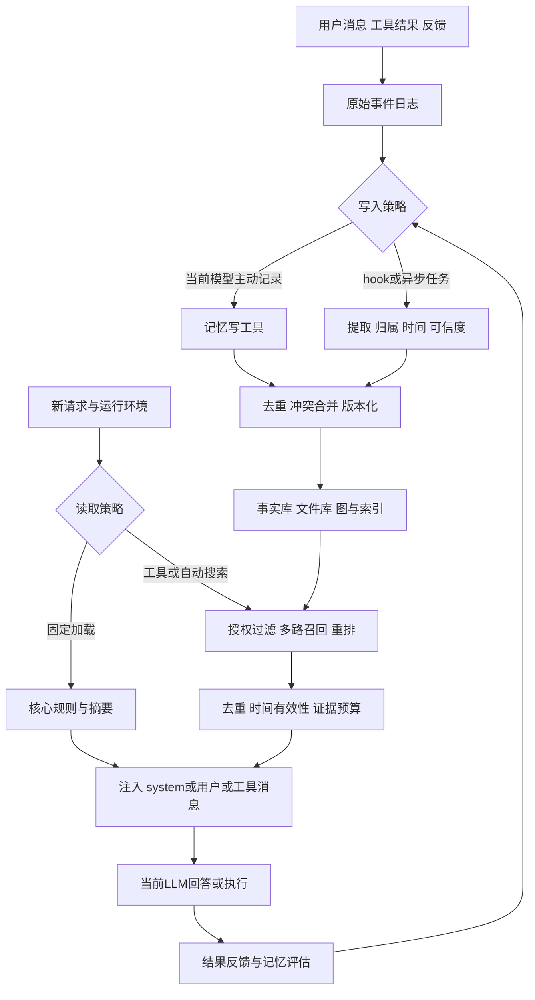
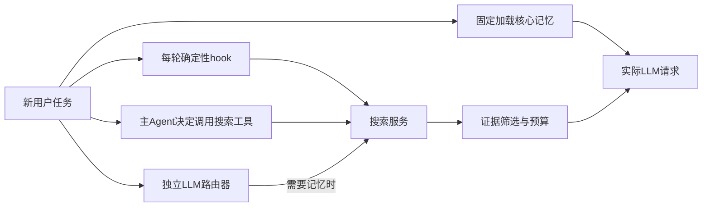

# Agent Memory 通用架构与检索决策

> 记忆不是一个向量数据库，而是一条有写入、冲突消解、读取、上下文注入、失效和权限控制的状态管线。本章给出通用设计；标为“建议”的结构不是任何项目的默认 schema。研究日期：2026-11-18。

## 先把三个正交维度分开

“哪种记忆”“存在哪里”“谁决定检索”是三个不同问题。语义记忆可以存在 Markdown，也可以存在 PostgreSQL；一个向量库既可以由 Agent 主动查，也可以由请求前 hook 自动查。BM25、Embedding、混合检索属于召回算法，不能回答触发者是谁。

| 维度 | 可选项 | 解释 |
|---|---|---|
| 内容与用途 | 工作状态、事件经历、语义事实、用户画像、程序性经验 | 分别回答当前做到哪、曾发生什么、什么为真、此人偏好什么、以后如何做 |
| 载体与表示 | 对话 JSONL、Markdown、关系表、向量索引、时序知识图谱 | JSONL 是容器，Embedding 是表示，ANN 是检索；不能混用术语 |
| 控制与时机 | 固定加载、Agent 工具、每轮 hook、后台提取/整理模型、用户显式确认 | 一个系统通常同时有几条管线，并非只能选一个 |

认知分类只是功能类比。工作记忆是当前请求里的任务和证据；跨会话持久化是存储性质；长期记忆是否能起作用还依赖读取路径。上下文压缩形成的摘要通常属于会话延续状态，不自动等于跨项目用户画像。[LangMem 对 semantic/episodic/procedural 与线程状态的区分](https://www.langchain.com/blog/langmem-sdk-launch)。

## 一条记忆从出生到进入模型



**图的含义：**写入与读取分别决策。后台 LLM 可以负责提取，却完全不参与每轮“要不要检索”；每轮检索也可以是确定性 hook，不需要额外 LLM。反过来，Agent 的 `memory_search` 工具可能调用完整的混合搜索服务。必须沿箭头查实现，不能从“支持 MCP”推断搜索算法。

## 建议的数据模型：原始事件与衍生记忆分开

一个用户先说“项目用 pip”，一周后说“从今天起改用 uv”。若只向向量库追加两句，搜索很可能同时召回两个版本。可靠设计要表达主体、范围、时效、来源和被取代关系。

```json
{
  "id": "mem-uv-002",
  "tenant_id": "team-a",
  "subject_id": "project:billing-service",
  "kind": "procedure",
  "claim": "本项目使用 uv 管理 Python 依赖",
  "source_event_ids": ["evt-20261118-17"],
  "observed_at": "2026-11-18T08:00:00Z",
  "valid_from": "2026-11-18T08:00:00Z",
  "valid_to": null,
  "supersedes": ["mem-pip-001"],
  "status": "active",
  "confidence": 1.0,
  "authority": "explicit-user-instruction",
  "visibility": "project",
  "content_hash": "sha256:example",
  "extractor_version": "rules-v1",
  "embedding_version": "not-yet-indexed"
}
```

这是建议结构。`confidence` 在这里是记录字段，不是 LLM 可校准的概率。`observed_at` 是系统获知时间，`valid_from/valid_to` 是事实生效时间；补录旧事实时两者不同。`tenant_id` 与 `subject_id` 不能只存在自然语言内容里，必须成为查询和授权条件。

建议至少分四层：

| 层 | 数据 | 是否可丢弃 | 读取方式 |
|---|---|---|---|
| 原始事件 | user/assistant/tool、来源、会话、时间、执行结果 | 按隐私策略保留，不能无限制存秘密 | 审计、重新提取、精确回看 |
| 原子事实/经验 | 有来源、范围和状态的可检索单元 | 可修订/撤销，不覆写审计来源 | 过滤+召回 |
| 汇总视图 | 用户画像、项目指南、主题摘要 | 可重建，但生成过程有成本且可能有损 | 固定注入或按主题加载 |
| 索引 | FTS、Embedding、ANN、图边索引 | 原则上可由源数据重建 | 加速搜索，不作为唯一事实源 |

SQLite 可以同时保存事件和 FTS；PostgreSQL 可以同时保存 JSONB、全文索引和 pgvector；图数据库可能另存关系，Embedding 仍在别处。所谓“混合记忆”应列出实际查询参与的索引与融合方式，而非仅罗列依赖。

## 写入策略：记什么，何时记，谁来判断

| 策略 | 实现 | 优点 | 风险与适用范围 |
|---|---|---|---|
| 用户显式记忆 | `/remember` 或确认后的工具写入 | 权威来源清楚 | 用户不会为每条有用经验手工标注 |
| 当前 Agent 主动记 | 记忆工具进入工具集，由主模型调用 | 与任务语义紧密，能写经验 | 模型可能忘记写，或把推断当事实 |
| 同步 hook 提取 | 每轮结束收集消息，再调用提取器 | 写入时点稳定 | 增加关键路径延迟与模型成本 |
| 异步后台整理 | 事件队列、会话结束/压缩后触发、批量提取 | 与交互解耦，可深度反思 | 索引滞后、并发冲突、重复任务、失败重试 |
| 确定性采集 | 直接存命令结果、显式偏好字段、成功案例 | 可复现、便宜 | 事实不一定有可泛化价值，原始日志很嘈杂 |

这些是通用方案，不是任何单个项目必然全部支持。所谓“另一个局外 LLM”通常是提取/整合 worker 或读取路由器，二者必须分开核实。它可能使用同一个模型配置，却运行在不同对话上下文中。

建议写入流程如下：事件落账 → 权限/敏感信息过滤 → 提取候选 → 验证来源 → 查同主体旧事实 → 判定追加/更新/失效/拒绝 → 事务写事实与 outbox → 异步建索引。不能先更新向量库再假定事实表必然成功。使用 event id 与 idempotency key 防重放重复；采用版本号或 compare-and-swap 处理两个后台任务同时改画像。

“更常被召回”不等于“更真实”。不能因为模型重复提到一条错误，就不断加大其重要性。显式用户纠正与工具验证应有可追踪的优先级；来源不明的推测与确认事实分开存。

## 检索不是只有向量相似度

### 词法召回与 BM25

BM25 针对分词后的词项匹配，兼顾词频饱和、文档长度和逆文档频率。适合函数名、错误码、路径、工单号等精确标识。中文效果取决于 tokenizer，默认英文/Unicode 分词并不自动等于优质中文检索。

$$
\operatorname{BM25}(q,d)=\sum_{t\in q}\operatorname{IDF}(t)\frac{f(t,d)(k_1+1)}{f(t,d)+k_1(1-b+b|d|/\operatorname{avgdl})}
$$

这里 $f(t,d)$ 是文档中的词频，$|d|$ 是文档长度，$k_1$ 控制饱和，$b$ 控制长度归一。实现的 IDF 及分数符号会不同；例如 SQLite FTS5 的 `bm25()` 为方便升序排序对相关分取负，不能拿它与另一系统分数直接相加。[SQLite FTS5 官方 BM25 说明](https://sqlite.org/fts5.html#the_bm25_function)。

### Dense Embedding 与 ANN

查询和记忆经同版本 embedding 模型映射成向量，再用 cosine、内积或 L2 搜索。它解决“uv 管依赖”和“这个仓库怎么装包”等措辞不同的问题，却可能混淆否定、时间、数字或相似名字。ANN 指近似最近邻索引，不是模型；向量维数相同也不代表两种模型的向量能混用。

$$
\operatorname{cos}(q,d)=\frac{\boldsymbol{e}_q^\top\boldsymbol{e}_d}{\|\boldsymbol{e}_q\|\,\|\boldsymbol{e}_d\|}
$$

### 多路融合与重排

建议先在有权访问且时间有效的候选范围检索，分别取 BM25 和 dense 的 top-$k$，按 id 去重。若没有经过标定的分数，RRF 的按名次融合比直接相加两个尺度不同的分数更易解释：

$$
\operatorname{RRF}(d)=\sum_{r\in\mathcal{R}}\frac{w_r}{c+\operatorname{rank}_r(d)}
$$

$\mathcal{R}$ 是检索列表集合，未出现在某列表的文档对此列表贡献零，名次从 1 开始，$c>0$ 是平滑参数。它只是融合规则，不理解事实真伪；可在候选上使用 cross-encoder 或 LLM reranker，再施加时效、可信度和去重约束。**本文将 RRF 用作通用方案，不声称所有被调研项目都采用它。**[原始 RRF 论文](https://plg.uwaterloo.ca/~gvcormac/cormacksigir09-rrf.pdf)。

图检索适合“谁在何时属于哪个团队”等多跳与时序关系；图数据库不是自动消解矛盾的答案。关系抽取错误、同名实体合并错误、过期边仍会污染结果。图/词法/dense 三路也可以组合，具体项目是否这么做见对应章节。

## 读取触发者：五种架构不要混为一谈



**图的含义：**只有第三条要求主 Agent 先意识到记忆有用并发出调用；第四条需要另付路由推理成本。固定加载没有“搜索查询”；确定性 hook 可直接用本轮输入当查询；主 Agent 工具可以重写查询和多步翻页。后台写入模型不在这张读取图中，因为它不必参与当前轮读取。

| 读取模式 | 决策者 | 检索算法 | 典型失败 |
|---|---|---|---|
| 核心文件直接加载 | 启动/资源加载代码 | 无；可能截断/选目录 | 文件过长、无关规则常驻 |
| 文件目录渐进阅读 | 主 Agent | read/grep/路径/关键词，未必 BM25 | 未读到索引链接、忘记继续查 |
| 显式 search 工具 | 主 Agent | 服务内可以是任意混合算法 | 不调用、查询写偏、预算耗尽 |
| hook 自动召回 | 应用确定性代码 | lexical/dense/hybrid 可配置 | 每轮误召回、时延、提示注入 |
| LLM 路由后召回 | 独立模型 | 路由后仍要实际 retriever | 路由漏判、额外模型调用 |

## 从检索结果到消息：要展示真正使用的内容

下面是**建议的宿主注入格式**，不是 Pi/Mem0 等统一 wire 协议：

```json
{
  "role": "toolResult",
  "toolCallId": "search-17",
  "toolName": "memory_search",
  "content": [{"type":"text","text":"[mem-uv-002] 本项目使用uv；2026-11-18起生效。来源 evt-17。旧pip规则已失效。"}],
  "isError": false
}
```

这要求前面真有 id=`search-17` 的工具调用。自动 hook 不能凭空伪造一个没有对应调用的 toolResult；应使用宿主支持的 system/context/custom message 路径。否则 provider 可能拒绝孤立结果。记忆是数据和证据，不应允许检索内容覆盖更高优先级的权限政策。

预算必须作用于最终 token，而非只限制条数。可以以每条记忆的估计效用 $u_i$、token 成本 $c_i$，在预算 $B$ 下选择集合：

$$
\max_{x_i\in\{0,1\}}\sum_i u_i x_i\quad\text{s.t.}\quad\sum_i c_i x_i\le B
$$

这是设计抽象，不是已验证的最优模型。工程上通常用相关性、来源、去重、时间和长度的启发式近似，同时为无相关证据提供空结果而非强塞 top-5。

## 遗忘、纠正和删除也是主路径

“用 uv”后来被纠正为“只有 CI 用 uv，本地仍用 pip”，应拆成带作用域的两条规则，而不是把后一句覆盖全部。删除需要覆盖原始事件、事实、画像、向量、图边、缓存、派生摘要和备份保留策略；仅删向量不是删记忆，重建任务还可能从旧日志把它重新写回来。

建议给每条记录保存来源、状态和 tombstone，索引更新使用版本。摘要与已注入上下文要分别处理：数据库删除不会使正在运行的 LLM 请求“忘掉”先前已读内容；下一请求必须重建。对用户记忆至少能导出、纠错、按项目隔离、按来源追踪。

## Python 实现的渐进路线

先从 SQLite 事件表、事实表和 FTS5 做起，保留一个显式 `memory_search` 工具与小核心文件。先测试偏好更新、范围冲突、无答案、删除和跨用户隔离。确实出现词法漏召回，再加 embedding；确实出现多跳/时序瓶颈，再加图。没有基线数据就直接上“后台多Agent+混合图向量”会同时引入太多不可归因变量。

本专题的 [离线评测样例](examples/README.md) 用标准库 SQLite/FTS5 演示词法召回与时间更新。它不代表生产系统，也不把缺少 embedding 的例子包装成混合检索；价值在于可以核对记忆行、结果、来源与错误。
