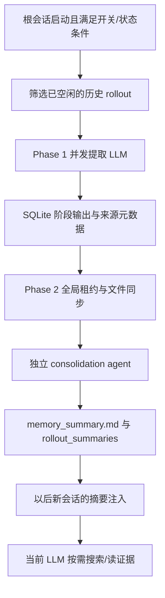
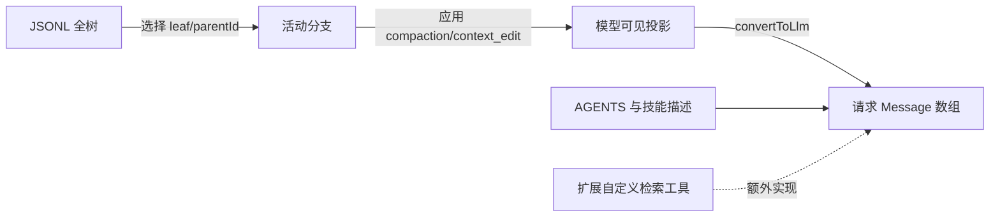
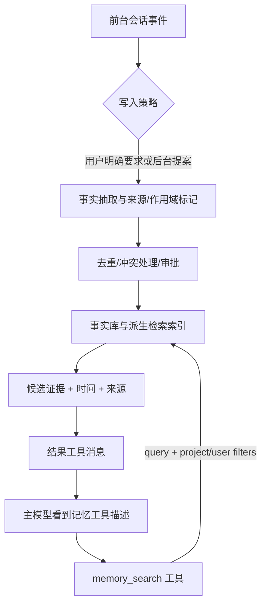

# 原生 Agent 的记忆：Claude Code、Codex、Hermes 与 Pi

> 核查日期：2026-11-18。先区分**正在运行的上下文、会话档案、每次加载的常驻知识、按需召回的历史，以及写记忆的后台任务**。它们可能都被产品叫作 memory，却不使用同一载体或检索算法。
>
> 本章所有 JSON、Markdown 内容样例均为**按已核实字段/组织方式构造的教学例子**，不来自用户的真实聊天或私人记忆目录。源码快照不等于已发布版本：Pi 为 `5f89cc0a7df669813650bfdac498f8ff865e8233`；Hermes 为 `aaec1339aa325888919c522911c54a7e684c7f23`；Codex 开源 main 为 `04cfdee311a062e052f13594661376db1196e661`。Claude Code 以公开官方文档为依据，未把未公开实现推测为事实。

## 先回答“到底是谁决定要不要查记忆”

以下四种策略可以同时存在，不能用 BM25/Embedding 这一列概括整个系统：

| 策略 | 决策者 | 真正发生的操作 | 本章实例 |
|---|---|---|---|
| 启动时确定性加载 | harness | 根据路径、作用域和预算读文件，直接构造模型上下文 | Pi 项目约定、Hermes 两个小记忆文件、Claude 的 MEMORY.md 索引 |
| 对话模型自主召回 | 正在回答任务的 LLM | 判断有必要后调用 read/search/历史工具；工具返回证据，下一轮再回答 | Claude 读取 topic 文件、Hermes session_search、Codex 本地记忆搜索工具 |
| 后台模型整理 | 独立于前台回答的模型运行 | 从聊天抽取、审核、合并知识；一般是**写入链**，不是每个问题的检索路由器 | Codex 两阶段提取/整合、Hermes background review |
| 外部 memory provider | 插件/服务及其策略 | 宿主送事件或查询，外部系统可能做语义索引、混合召回或画像推断 | Hermes 可选外部 provider；不是 Pi 核心默认能力 |

**后台有一个 LLM 负责整理，不等于每次检索前都有一个“局外 LLM”负责判断。** 同理，磁盘里有 SQLite，也不意味着查询使用向量相似度；SQLite 可以只是会话行、任务租约、FTS 索引或使用计数的存储。

## 一张跨项目存取表

| Agent / 载体 | 原生保存形式 | 主要写入者与时机 | 主要读取路径 | 已核实的检索性质 |
|---|---|---|---|---|
| Claude 指令 | CLAUDE.md、规则 Markdown；新版本也可加载 AGENTS.md | 用户/代码库维护，或显式要求模型编辑 | 启动与按目录/路径加载 | 文件解析与加载，无需 Embedding |
| Claude auto memory | 项目 memory/MEMORY.md + 带 frontmatter 的 topic Markdown | 模型在工作中保存有未来价值的纠正/事实 | 索引启动加载，详情按需文件工具读 | 索引引导 + agent 自主读取；公开文档没有把它定义成原生 BM25/向量库 |
| Codex local memories | memories 或 memories_v2 下的摘要、rollout_summaries、扩展 notes；SQLite 元数据/作业状态 | 后台提取与整合，受开关、空闲和额度门槛约束 | 摘要注入 + 按需搜索/读取文件 | 本地 search 实现为子串匹配；不能据有 DB 就写成 BM25/Embedding |
| Hermes curated memory | memories/MEMORY.md、USER.md，条目以 § 分隔 | 前台 memory 工具与后台 review；成功写入立即落盘 | 新会话冻结进 system；当前工具返回 live 状态 | 小量全读，无 BM25/Embedding |
| Hermes 会话历史 | state.db 的会话/消息与 FTS5 表 | 会话运行自动记录 | 模型调用 session_search | FTS5 默认 rank/BM25 类文本排序、trigram 路由；不是向量相似度 |
| Pi 会话档案 | sessions 下追加式 JSONL 树 | 已完成消息与状态事件 | 当前分支投影、继续/切换会话 | 按 ID/parentId 重放，不是 BM25/Embedding |
| Pi 项目知识 | AGENTS.override.md / AGENTS.md / CLAUDE.md 等 | 用户、工具或扩展实际写文件 | 资源加载/重载后进入 system 分区 | 文件发现和直接加载 |
| Pi 扩展状态 | JSONL custom / custom_message；外部插件可另建数据库 | 扩展显式写入 | 扩展读取当前分支后决定注入 | 核心没有替所有扩展实现统一检索 |

下面逐个解释这张表的证据、精确边界与故障窗口。

## Claude Code：常驻索引 + 逐条 Markdown 记忆

### 记忆不是一个隐形向量数据库

官方当前区分人写的指令文件与模型维护的 auto memory。指令表达“怎样工作”，auto memory 保留不易从代码推导的用户、反馈、项目与外部资料入口。索引和 topic 文件都是可读文本；不要把 Claude 网页聊天的用户记忆服务与 Claude Code 本地目录混为一谈。[官方记忆文档](https://code.claude.com/docs/en/memory)

典型目录结构：

```text
~/.claude/CLAUDE.md                         # 用户范围指令
project/CLAUDE.md 或 project/.claude/CLAUDE.md
project/.claude/rules/*.md                  # 可按路径约束的规则
~/.claude/projects/<project>/memory/
  MEMORY.md                                # 简短索引
  user_role.md
  feedback_testing.md
  reference_issue_tracker.md
```

`<project>` 由仓库定位规则派生，当前文档说明同仓库 worktree 与子目录共享 auto memory。可用 autoMemoryDirectory 改位置；自定义配置目录也会影响项目命名，不能把路径字符串当永久 API。默认是机器本地文件，不是自动跨设备同步库。[存储与作用域](https://code.claude.com/docs/en/memory#storage-location)

### 内容究竟长什么样

```markdown
# MEMORY.md（教学索引）
- [测试反馈](feedback_testing.md)：改测试前先说明影响范围；适用于本项目。
- [用户背景](user_role.md)：Python 开发者，需要解释 TypeScript 对照。
- [工单入口](reference_issue_tracker.md)：线上故障对应的看板位置。
```

```markdown
---
name: 测试执行约定
description: 用户纠正过的本项目测试方式
type: feedback
---
单元测试使用 pytest。只改文档时不宣称跑过测试。
原因：用户明确纠正过“静态检查通过=全部测试通过”的表述。
适用范围：本仓库；不是所有项目的通用偏好。
```

这是符合文档概念的样例，不承诺模型每次写相同的字段顺序。官方列出 `user / feedback / project / reference` 四类 type；写入带 YAML frontmatter 的记忆文件时，还会记录 ISO 时间格式的 `modified`。实际 schema 与界面可能随版本变化。[auto memory 的分类与行为](https://code.claude.com/docs/en/memory#auto-memory)

### 什么时候存，什么时候用

1. 当前对话的 Claude 决定某条纠正/偏好值得未来保留，调用文件工具创建或修改 topic 文件，并维护索引；不是每一轮都保存。
2. 新会话启动时加载 MEMORY.md 前 **200 行或 25KB，先达到者**。详情文件不随索引全量加载。
3. 模型看到索引后，如果当前问题需要细节，使用标准文件工具读取对应 topic。它也可以根据当前上下文决定不查。
4. 索引接近限制时程序提示整理；超限写入仍可发生，但会返回要求缩短的错误，因为尾部下次不加载。
5. 记忆文件不跟会话 transcript 的清理周期一起删除；用户或模型编辑/删除它们才改变其长期内容。

这条路径的关键算法是**分层加载与模型工具选择**，不是“所有主题先做向量召回”。官方没有在该本地机制说明中承诺 BM25、Embedding 或混合检索；不能从“Recalled memories”的 UI 文案反推 ANN 数据库。[按需读取与容量边界](https://code.claude.com/docs/en/memory#how-it-works)

### 写入模型是不是另一个后台 LLM

公开说明是 Claude 在会话中读写本地记忆。不能据此断言其内部绝无优化或预取，但也没有足够公开证据把该机制画成“每次用户输入→独立判断 LLM→向量检索”。官方明确部分 background/嵌套会话不能开启普通 auto memory，subagent 自己的 memory 目录又是另一项配置；主会话的 auto memory 不是默认自动灌给所有 subagent。[启用条件](https://code.claude.com/docs/en/memory#enable-or-disable-auto-memory)、[subagents](https://code.claude.com/docs/en/sub-agents)

### 与指令和压缩怎样相处

CLAUDE.md 不是操作系统策略。当前文档明确其内容作为 system 后的 user 消息交给模型；要强制执行特定事件规则应使用 hook，而不是把自然语言称为 guardrail。路径规则与子目录指令可按需加载，不能把所有文件都误画成开场全量拼接。[指令加载与故障排查](https://code.claude.com/docs/en/memory#troubleshoot-memory-issues)

压缩减少本会话上下文，auto memory 是跨会话持久知识，两者不等价。即使一次会话已经压缩，记忆目录仍在；即使记忆目录有文件，topic 没被当前模型读取时，内容也可能不在本轮请求中。最直接的诊断是 `/context all` 检查已加载内容，用 `/memory` 检查载体，而不是相信一句“我记住了”。

## Codex：后台抽取与整合，加前台摘要注入和按需工具

### 先区分四个容易混淆的 surface

- **本地 CLI / IDE / 桌面所连接的 host**：使用该机器 Codex home 的本地 store。
- **ChatGPT 网页记忆**：是另一套账号/产品能力，不等于本地 Codex 文件目录。
- **Computer History**：桌面采集允许应用/网站活动形成的额外输入，不能视为 CLI 必需组件。
- **开源 main 的 v2 代码**：提供可核验实现，但不保证某台客户端已经发布、开启或采用该版本。

官方当前称 local memories 默认关闭；`features.memories=true` 与使用/生成开关共同决定运行。新 CLI profile 倾向 memories_v2；已有 memories 可继续沿用；迁移期桌面可以读 v1 并双写。不要只检查一个目录就断言没记忆。[官方本地记忆与迁移规则](https://learn.chatgpt.com/docs/customization/memories)

### 保存载体分成“内容”和“调度状态”

```text
$CODEX_HOME/                               # 默认 ~/.codex
  memories/ 或 memories_v2/
    memory_summary.md                      # 给新任务的压缩索引/概况
    rollout_summaries/<安全slug或ID>.md      # 单次任务/会话的证据摘要
    raw_memories.md                         # v1 管线的原始抽取合并材料等
    MEMORY.md、skills/                      # v1整合产物可见，非v2必需格式
    extensions/ad_hoc/notes/*.md            # 显式增补/纠正/遗忘请求
    phase2_workspace_diff.md                # 整合时的临时差异材料
```

SQLite 不只是全文。官方开源 [SQLite runtime](https://github.com/openai/codex/blob/04cfdee311a062e052f13594661376db1196e661/codex-rs/state/src/sqlite.rs) 区分 state、memories、memories-v2 等 DB；其中 v2 文件名为 `memories_v2_1.sqlite`。DB 承担提取作业、租约、阶段输出、使用计数等；Markdown 承担可阅读、可被模型取用的内容。文件名含版本是状态实现细节，不是向量索引的证明。

### 写入是异步两阶段，而不是每个用户 turn 结束就立刻保存



Phase 1 只挑符合来源、年龄、空闲时间等条件的 rollout，先在 DB claim，防止并发重复处理。失败带 backoff，合法但没有值得记的材料也可无输出结束。模型生成后清理秘密字段，持久化来源、cwd、分支、生成时刻等。不是“程序把每句话机械切块嵌入”。[phase1.rs](https://github.com/openai/codex/blob/04cfdee311a062e052f13594661376db1196e661/codex-rs/memories/write/src/phase1.rs)、[状态模型](https://github.com/openai/codex/blob/04cfdee311a062e052f13594661376db1196e661/codex-rs/state/src/model/memories.rs)

**v1/v2 有具体差别。** README 仍有旧组织描述，不能只读概述下结论。v1 的抽取包括 raw_memory、rollout_summary、rollout_slug；当前 v2 的 [stage_one_system_v2](https://github.com/openai/codex/blob/04cfdee311a062e052f13594661376db1196e661/codex-rs/memories/write/templates/memories/stage_one_system_v2.md) 明确要求输出恰好 `rollout_summary` 与 `rollout_slug` 两个字符串，保存任务经过和用户实际要求，不在此阶段直接推断泛化用户画像。

```json
{
  "rollout_summary": "## 任务：修复测试\n用户要求先复现，之后才允许改代码。已定位...尚未确认部署。",
  "rollout_slug": "pytest-fixture-fix"
}
```

这是 **v2 模型返回的形状**。DB 记录还会带 thread_id、rollout_path、source_updated_at、cwd、git_branch、generated_at 等来源字段；不要把模型返回 JSON 与数据库完整行混为一谈。

Phase 2 获得全局 lease 后选择输入、同步摘要文件和差异，再启动专用 consolidation agent。它依据差异和来源修订总摘要，不是任意前台模型都并发写同一个总文件。整合成功会更新基线/阶段消费状态；输入删去后，旧来源不应在后续整合中被旧摘要复活。[phase2.rs](https://github.com/openai/codex/blob/04cfdee311a062e052f13594661376db1196e661/codex-rs/memories/write/src/phase2.rs)、[存储同步](https://github.com/openai/codex/blob/04cfdee311a062e052f13594661376db1196e661/codex-rs/memories/write/src/storage.rs)

当前 v2 总摘要模板要求以 `v1` 文本标识开头，并包含 User Profile、User preferences、General Tips、What's in Memory，整体留在 10,000 UTF-8 字节以内。这是**摘要文本内部的格式标识**，不能把开头 `v1` 当成整个 Codex store 还是 v1 的证据。[consolidation_v2.md](https://github.com/openai/codex/blob/04cfdee311a062e052f13594661376db1196e661/codex-rs/memories/write/templates/memories/consolidation_v2.md)

```markdown
v1
## User Profile
主要用 Python 开发，需要说明陌生语言的控制流。
## User preferences
用户明确要求报告中的事实有来源。
## General Tips
验证项目当前状态，不能把历史“已完成”当作现在仍成立。
## What's in Memory
### ai-learn
#### 2026-11-18
- rollout_summaries/memory-report.md — 记忆专题的研究范围与遗留事项；thread_id=<真实来源ID>
```

示例里的偏好必须由证据支持；一次“本次先给我计划”不能自动改写成“用户永远要求先给计划”。这正是 v2 抽取和整合提示强调的范围控制。

### 检索：摘要直接注入；其余前台模型按需查询

[read_path_v2](https://github.com/openai/codex/blob/04cfdee311a062e052f13594661376db1196e661/codex-rs/ext/memories/templates/memories/read_path_v2.md) 把 MEMORY_SUMMARY 包入 developer instructions，并要求只在额外证据、时序或不确定性会改变当前回答时读取匹配的 rollout。不会把每个历史 transcript 都加载。

本地 [search.rs](https://github.com/openai/codex/blob/04cfdee311a062e052f13594661376db1196e661/codex-rs/ext/memories/src/local/search.rs) 的实现非常明确：枚举允许的记忆文本文件，匹配查询子串，可选择任一词、同一行全部词、限定行窗口内全部词；支持大小写和分隔符归一化。结果按**相对文件路径、命中行号**排序，带上下文行和分页。它不是 FTS5 BM25，也没有在这条 local backend 中执行 Embedding ANN。

```json
{
  "queries": ["pytest", "fixture"],
  "match_mode": "示意：要求同一行或限定行窗口共同出现",
  "context_lines": 3,
  "max_results": 10
}
```

上面只展示参数职责，match_mode 用中文解释而非伪造可直接调用的枚举值；实际 schema 见 [工具定义](https://github.com/openai/codex/blob/04cfdee311a062e052f13594661376db1196e661/codex-rs/ext/memories/src/tools/search.rs)。主模型根据注入摘要决定是否搜索/读取；后台 extraction/consolidation 模型负责写入整理，并不是每一次查询的隐形 reranker。

### 更新、遗忘与可用性边界

v2 阅读提示要求显式记住/纠正/遗忘时，通过 `extensions/ad_hoc/notes/` 增加小型 Markdown 请求，由后续整合应用，不鼓励前台直接覆盖 generated summary。全局和 chat 级的“使用记忆/贡献记忆”是两条独立控制；关闭使用不等于删除文件，关闭生成不等于从旧索引中删除历史。官方还提供删除选定机器记忆的控制。[v2 阅读与显式更新约定](https://github.com/openai/codex/blob/04cfdee311a062e052f13594661376db1196e661/codex-rs/ext/memories/templates/memories/read_path_v2.md)、[用户控制](https://learn.chatgpt.com/docs/customization/memories)

## Hermes Agent：小型常驻文件 + 原始会话全文召回 + 后台反思

### 三条链同时存在

本章使用本地源码 commit `aaec1339…`，其设计已不止“两个 Markdown”。核心有 curated memory 与 session recall，另有后台学习 review；外部 provider 是附加能力，不是默认把所有内容换成向量库。[源码开发约定](https://github.com/NousResearch/hermes-agent/blob/aaec1339aa325888919c522911c54a7e684c7f23/AGENTS.md)、[用户记忆说明](https://github.com/NousResearch/hermes-agent/blob/aaec1339aa325888919c522911c54a7e684c7f23/website/docs/user-guide/features/memory.md)

| 载体 | 内容/格式 | 写入 | 读取/查询 |
|---|---|---|---|
| `$HERMES_HOME/memories/MEMORY.md` | 环境事实、持久经验，默认 2200 字符 | memory 工具 add/patch/remove，成功立即原子写入 | 新会话全读为冻结 system 快照 |
| `memories/USER.md` | 用户背景、工作偏好，默认 1375 字符 | 同工具，target=user | 同样冻结加载 |
| `state.db` | sessions、messages 及关联元数据，FTS5 索引 | 会话自动记录 | session_search 按需 discover/read/scroll/browse |
| profile 的 skills 文件 | 程序化步骤、复用工作流 | 前台或后台 skill 管理 | 技能发现后按需加载；不等于所有技能正文常驻 |
| 待审批记忆操作 | 被暂存的 add/patch/remove 及目标绑定 | write_approval 或后台破坏性修改 | 用户批准后才改变最终 Markdown |
| 外部 memory provider | 由 RetainDB/ByteRover/目录插件决定 | 各 provider hooks/工具策略 | 各 provider 自己的API，不能套用原生 FTS5 结论 |

默认 HERMES_HOME 是 `~/.hermes`；profile 会改变根目录，不同 profile 是隔离岛。以上不是项目内一个全局用户共享数据库。

### 小型文件的真实格式与容量处理

```text
# MEMORY.md 的文件正文示意；实际不是带这些注释的结构化数据库
项目 test runner 是 pytest；CI 使用 Python 3.12。
§
首次修改依赖前检查 lockfile 与构建方式。
```

条目分隔符为 `\n§\n`，每个 entry 可跨行。实现把条目列表拼接计算字符预算，写入使用临时文件后原子替换。它不是“Markdown 每个标题一个向量点”；没有 embedding ID、相似度分数或内部 top-k。[MemoryStore](https://github.com/NousResearch/hermes-agent/blob/aaec1339aa325888919c522911c54a7e684c7f23/tools/memory_tool_store.py)

```json
{
  "target": "user",
  "operations": [{"action": "add", "content": "用户明确偏好中文解释，并给 Python 对照。"}]
}
```

当前 schema 要顶层 target；patch 的 old_text 必须在目标条目中形成唯一匹配。容量超限返回错误，模型必须自行缩短、合并或删除，不会静默把老条目挤出。存在单轮失败次数限制，避免反复整理记忆耗尽本轮预算。[工具语义](https://github.com/NousResearch/hermes-agent/blob/aaec1339aa325888919c522911c54a7e684c7f23/tools/memory_tool.py)

### 写了以后，当前模型为什么不一定从 system 看见更新

启动时 `load_from_disk()` 生成 `_system_prompt_snapshot`；之后 add/patch 成功会更新 live entries 和文件，却不重建本会话 system 前缀。原因是保持 prompt cache 稳定。工具响应可以展示 live 状态，下一新会话才重新加载最新文件。

因此“写入立即持久化”和“system 立即刷新”是两回事。另一个进程早已运行的会话也不会自动热更新。长期开着 gateway 不做会话边界，会让新知识迟迟不能作为新开场快照受益；重启进程不一定等于创建新会话。[冻结快照实现](https://github.com/NousResearch/hermes-agent/blob/aaec1339aa325888919c522911c54a7e684c7f23/tools/memory_tool_store.py#L223)

### 历史检索明确是 FTS5，而非自动语义搜索

`state.db` 中 sessions 和 messages 是事实档案。下例只展示概念字段，不是完整 SQL 建表原文：

```sql
sessions(id, started_at, source, model, parent_session_id, end_reason, ...)
messages(id, session_id, role, content, timestamp, tool_name, tool_calls, ...)
-- 另有 messages_fts 与 trigram 相关 FTS5 表/维护机制
```

`session_search(query=...)` 返回命中历史；`session_id` 与 `around_message_id` 用来展开附近窗口；只给 session_id 可读该会话；不带参数可浏览。工具执行不请求 LLM 摘要，返回的是 DB 实际消息；但返回量有预算，不能照文档某段“no truncation”宣传把它当无上限：当前源码 `_READ_MAX_CONTENT=2000`，scroll/discovery 也有各自裁剪。[session_search_tool.py](https://github.com/NousResearch/hermes-agent/blob/aaec1339aa325888919c522911c54a7e684c7f23/tools/session_search_tool.py)

默认走 SQLite FTS5 的 rank 文本检索，包含 trigram/CJK 路由及 LIKE 降级。FTS5 默认 rank 是 BM25 系列排序，但工具的最终发现结果还做 lineage 去重、按 session source 的降权（例如 cron）与分层展开；不能说最终结果“只按 BM25 分数”。这里没有额外向量库，也没有独立 LLM 在每次命中后重排。[FTS定义](https://github.com/NousResearch/hermes-agent/blob/aaec1339aa325888919c522911c54a7e684c7f23/hermes_state_fts.py)、[检索路由](https://github.com/NousResearch/hermes-agent/blob/aaec1339aa325888919c522911c54a7e684c7f23/hermes_state_search.py)

触发检索的是正在处理任务的 agent：常驻记忆足够时不必查；遇到“上周那个部署参数”再调 session_search。查询没有付费 LLM 调用，不代表回填结果对后续 prompt 没有 token 成本。

### 确实有另一个模型运行，但它主要负责学习写入

当前源码 `agent/background_review.py` 与配置 `auxiliary.background_review` 支持会话工作之后的独立 review fork。默认使用主聊天模型；同模型保留原前缀以利用缓存，换模型时可用 digest。默认工具白名单仅允许记忆/技能管理及只读工具，不是给后台任意 shell 权限。它依据 memory/skill nudge、运行条件和开关决定是否安排，不能把“after turn可运行”写成“每轮必定写记忆”。[后台review实现](https://github.com/NousResearch/hermes-agent/blob/aaec1339aa325888919c522911c54a7e684c7f23/agent/background_review.py)、[初始化频率配置](https://github.com/NousResearch/hermes-agent/blob/aaec1339aa325888919c522911c54a7e684c7f23/agent/agent_init.py)

写入审批开启时，提案先暂存；批准前不进入 MEMORY.md/USER.md。patch/remove 会绑定审阅时的目标条目，若目标已改变就拒绝应用，防止批准操作误删后来改写的内容。普通文件工具仍可能改这些文件，因此 write_approval 不是文件系统锁；后台白名单减少了绕过通道，前台是否允许其他写工具又是另一层策略。

RetainDB 与 ByteRover 是仓库随附的外部 provider，其他包括 Honcho、Hindsight、Mem0、OpenViking 等可从目录装插件。当前文档表示一次只激活一个外部 provider，原生两个文件仍并存。外部是否使用 embedding/hybrid 必须逐插件研究，不能从 Hermes 支持它推断原生 session_search 也变为向量搜索。[provider文档](https://github.com/NousResearch/hermes-agent/blob/aaec1339aa325888919c522911c54a7e684c7f23/website/docs/user-guide/features/memory-providers.md)

## Pi：默认有持久会话与文件化知识，没有统一的自动长期召回服务

### 六种状态逐个说清楚

“Pi 有记忆”必须拆成下面六件事。这里讲的是 coding-agent CLI，不能把 `packages/durable` 的任务持久化、第三方扩展的向量库或其他 Agent 的记忆插件当成 CLI 默认机制。[Pi 当前定位](https://github.com/earendil-works/pi/blob/5f89cc0a7df669813650bfdac498f8ff865e8233/README.md)

| 种类 | 物理载体与格式 | 大致存什么 | 写入时机 | 如何读、由谁触发 |
|---|---|---|---|---|
| 工作上下文 | 进程内 AgentMessage[] / queues | 当前提示、当前对话、未完成流、steering/follow-up | prompt、流事件、工具执行、投影刷新 | 循环每次请求准备；不是数据库检索 |
| 会话事实档案 | 默认 `~/.pi/agent/sessions/` 下 JSONL，按 cwd 分组 | message、模型变更、分支、compaction、context_edit、扩展条目等 | 完成消息/状态追加；首次会话输入时创建文件 | continue/resume/tree/fork 选路径，按 ID 重放 |
| 会话工作摘要 | 同一 JSONL 的 compaction / branch_summary | 任务进度、约束、关键证据和保留边界 | 手动/自动压缩、跨分支摘要 | SessionManager 生成投影；摘要变成模型可见消息 |
| 项目/用户规则 | agentDir 与项目祖先的 AGENTS.override.md / AGENTS.md / CLAUDE.md 等 | 项目测试命令、约束、团队约定 | 用户/工具/扩展真的编辑这些文件 | 资源加载/重载，进入 system 的 project_context 分区 |
| 按需过程知识 | skills 目录的 SKILL.md、references、scripts | 怎样完成特定任务的程序性知识 | 安装或编辑技能文件 | 描述先进入提示；相关时模型 read 全文或显式 skill 命令 |
| 扩展记忆状态 | 同 JSONL 的 custom / custom_message；扩展可另建文件/DB | 由扩展自定的偏好、任务状态、证据指针等 | appendEntry/sendMessage 或自定义存储 | 扩展读取分支、注入上下文或提供检索工具；核心不替它检索 |

**Pi 默认不存在第七个自动流程：“把所有对话 embedding 后存入统一记忆库，下一轮根据相似度自动召回”。** 本次核查的核心路径没有统一 memory tool 或后台长期记忆提取模型。它有用于会话压缩的摘要模型调用，但这是窗口管理，不是自动跨会话知识库。扩展可以实现后者，存在扩展能力不等于默认安装。[SDK 与资源组合](https://github.com/earendil-works/pi/blob/5f89cc0a7df669813650bfdac498f8ff865e8233/packages/coding-agent/docs/sdk.md)、[扩展接口](https://github.com/earendil-works/pi/blob/5f89cc0a7df669813650bfdac498f8ff865e8233/packages/coding-agent/docs/extensions.md)

### 会话 JSONL 的真实形状：每行是 entry，不只是聊天字符串

```json
{"type":"message","id":"u1","parentId":"s1","timestamp":"2026-11-18T00:00:00.000Z","message":{"role":"user","content":"本项目测试使用 pytest；修复 add。","timestamp":1}}
{"type":"message","id":"a1","parentId":"u1","timestamp":"2026-11-18T00:00:01.000Z","message":{"role":"assistant","content":[{"type":"toolCall","id":"call_r1","name":"read","arguments":{"path":"calc.py"}}]}}
{"type":"message","id":"t1","parentId":"a1","timestamp":"2026-11-18T00:00:02.000Z","message":{"role":"toolResult","toolCallId":"call_r1","toolName":"read","content":[{"type":"text","text":"def add(a,b): return a-b"}],"isError":false,"timestamp":3}}
```

这个结构示例省略实际 assistant 必需的 api/provider/model/usage/stopReason 等普通元数据，并省略前面的 session header 与 system entry；它不是可直接导入的完整会话。`id/parentId` 属于历史树，`toolCallId` 属于调用与结果配对，不要互换。

SessionManager 在仅有 setup entries 时可先留内存；首次出现 user 或 assistant 后，创建文件并刷入 setup，后续逐条 append。AgentSession 处理 `message_end` 记录定稿消息，partial text_delta 不会每个变成一份完整 assistant 记录。追加失败会撤销内存中的对应 entry/byId/leaf 更新，免得后继指向未写记录。[持久化实现](https://github.com/earendil-works/pi/blob/5f89cc0a7df669813650bfdac498f8ff865e8233/packages/coding-agent/src/core/session-manager.ts#L1168)、[定稿记录入口](https://github.com/earendil-works/pi/blob/5f89cc0a7df669813650bfdac498f8ff865e8233/packages/coding-agent/src/core/agent-session.ts)

### “检索历史”在核心里首先是重放，不是搜索



`pi --continue`、`--resume` 或会话树操作选择要继续的会话/位置；`buildSessionProjection()` 计算本次应该看见哪些消息。该操作不先用 BM25 寻找相似会话，也不根据 embedding 相似度选 top-k。它的主键是会话身份、活动叶与历史边界。[会话行为](https://github.com/earendil-works/pi/blob/5f89cc0a7df669813650bfdac498f8ff865e8233/packages/coding-agent/docs/sessions.md)、[投影实现](https://github.com/earendil-works/pi/blob/5f89cc0a7df669813650bfdac498f8ff865e8233/packages/coding-agent/src/core/session-manager.ts#L543)

所以“昨天某次会话有部署参数”不能推导为“今天 Pi 会自动搜到”。你可以显式续接正确会话，把必要知识写入会重复加载的项目文件，或安装/编写历史检索扩展。若任意 bash/read 能读到会话文件，模型也可以在被提示后用文件搜索；那是通用工具操作，不是内核原生的语义记忆服务。

### 压缩保存什么，怎样重新读取

```json
{
  "type": "compaction",
  "id": "c1",
  "parentId": "latest-entry",
  "timestamp": "2026-11-18T00:10:00.000Z",
  "summary": "## Goal\n修复 add。\n## Progress\n已读取但尚未修改。\n...",
  "firstKeptEntryId": "u2",
  "tokensBefore": 150000,
  "details": {"readFiles": ["calc.py"], "modifiedFiles": []},
  "systemMessage": {"role":"system","content":"...当前系统提示快照...","timestamp":0}
}
```

这是字段形状示例，tokens 为人为给定值。实际 systemMessage 还可含 sections/toolsAdded；摘要调用的 usage 等字段可另保存。原始记录仍留在文件。下次加载，投影用最新 compaction 的完整系统状态、摘要与 firstKept 边界保留尾部，后续 context_edit 可以改变某个 entry 对上下文的贡献。

送给 LLM 的 compactionSummary 会转换成 **user 消息中的 `<summary>` 文本**，不是把它变成更高优先级的 system 指令。被替代的旧 user/assistant/toolResult 不再逐条重送；只是磁盘仍保留。新的压缩会利用旧摘要与新的可见前缀，而非重新读全文件。[摘要消息转换](https://github.com/earendil-works/pi/blob/5f89cc0a7df669813650bfdac498f8ff865e8233/packages/coding-agent/src/core/messages.ts#L176)、[压缩准备](https://github.com/earendil-works/pi/blob/5f89cc0a7df669813650bfdac498f8ff865e8233/packages/coding-agent/src/core/compaction/compaction.ts#L859)

后台有没有 LLM？**压缩时有独立摘要请求**，但其输入是当前投影中选出的旧对话，目标是续接当前会话，并不会自动写一份跨会话用户画像。摘要前序列化还会把单条工具结果文字限制为开头 2000 字符，省去 thinking，图片不按原图提交；不能说摘要模型完整重读了全部原始证据。[摘要材料序列化](https://github.com/earendil-works/pi/blob/5f89cc0a7df669813650bfdac498f8ff865e8233/packages/coding-agent/src/core/compaction/utils.ts#L97)

### 项目知识怎样进入请求：文件路径发现，不是语义召回

Pi 在每个适用目录按优先顺序选择第一个存在的上下文文件：AGENTS.override.md → AGENTS.md → AGENTS.MD → CLAUDE.md → CLAUDE.MD；用户 agentDir 与项目祖先作用域参与合并。它不是把同目录所有这些文件重复拼接。[resource-loader.ts](https://github.com/earendil-works/pi/blob/5f89cc0a7df669813650bfdac498f8ff865e8233/packages/coding-agent/src/core/resource-loader.ts#L214)

例如文件内容：

```markdown
# 本项目约定
- 测试命令：pytest -q。
- 数据库迁移要先给出回滚路径。
- 这条约定只适用于本仓库，不推断为用户在所有项目的偏好。
```

资源加载后，程序把原文变为 system 的项目分区，形状大致如下：

```xml
Project-specific instructions and guidelines:
<project_instructions path="/demo/AGENTS.md">
...文件原文...
</project_instructions>
```

写入发生在用户/模型工具/扩展实际修改文件时；加载器本身不会每轮从聊天抽取新事实再改 AGENTS。读取发生在资源加载、重载或新会话相应入口；不能假设改完文件后所有正在运行的会话都立即改 system。项目规则是提示，不是安全边界。[system-prompt.ts](https://github.com/earendil-works/pi/blob/5f89cc0a7df669813650bfdac498f8ff865e8233/packages/coding-agent/src/core/system-prompt.ts#L79)

### 扩展 custom 状态：存了仍不等于模型会用

```typescript
// 这里只保存扩展状态，并不自动把它放进模型上下文
pi.appendEntry("my-memory", {
  testRunner: "pytest",
  source: "user-explicit",
  scope: "/demo"
});
```

存到会话里会是类似下面的自定义条目：

```json
{
  "type":"custom", "id":"m1", "parentId":"t1",
  "timestamp":"2026-11-18T00:00:03.000Z",
  "customType":"my-memory",
  "data":{"testRunner":"pytest","source":"user-explicit","scope":"/demo"}
}
```

纯 custom entry 不参与 LLM 上下文。扩展在 session_start、tree 切换等事件从 `getBranch()` 读取适用条目，重建自身状态，之后还必须选择：注入 system/context、发送模型可见 custom_message，或提供 retrieval tool。扫整个历史文件会把废弃分支状态混进来。与 custom 不同，custom_message 的 content 可送模；display=false 只是隐藏 UI，不等于不送模，details 也不能当成自动可见正文。[扩展状态约定](https://github.com/earendil-works/pi/blob/5f89cc0a7df669813650bfdac498f8ff865e8233/packages/coding-agent/docs/extensions.md#L2149)、[entry 类型与投影](https://github.com/earendil-works/pi/blob/5f89cc0a7df669813650bfdac498f8ff865e8233/packages/coding-agent/src/core/session-manager.ts#L118)

### 如果要给 Pi 增加真正的检索记忆，哪些是你必须设计的

以下是**建议架构，不是 Pi 已经内置**：



- 小量规则：直接加载 Markdown，成本透明，避免检索漏掉必需规则。
- 错误码、函数名、路径：FTS5/BM25 往往是必要的稀疏召回通道。
- 自然语言经验/跨表达偏好：可加 Embedding，再融合去重；不能只靠近义距离处理最新事实。
- 主模型自主工具调用：提供清楚的使用条件、返回预算和证据格式；主模型可能不调用，需要评测 recall failure。
- 独立后台 LLM：适合抽取、整合、冲突提案；若要用它每次决定检索，则额外支付路由成本，且要评测“误判无需召回”的失败率。
- 任何方案都要定义 user/project scope、来源、有效时间、删除语义、写入确认、重建索引与注入位置。把 `.add()` 和 `.search()` 连上不等于完成 memory 设计。

## 把四个原生设计放回同一问题里

用户说：“昨天我纠正过，接口测试依赖 Redis。现在帮我改测试。”

| 系统 | 能否直接看到这条知识 | 没直接看到时怎样补 | 最容易误判的地方 |
|---|---|---|---|
| Claude Code | 若索引有条目，开场可见；topic 详情未必已读 | 主模型按索引读反馈文件；必要时搜索文件 | 把索引存在等同详情已进入本轮 |
| Codex | 若已有后台整合摘要相关项，可见指针/概况 | 主模型搜索/读取 rollout_summaries | 聊天刚结束后台尚未处理，或读错v1/v2 store |
| Hermes | 若 MEMORY.md/USER.md 已保存并新开会话，直接可见 | 主模型调用 session_search 查实际历史 | 同一长会话 frozen snapshot 仍旧；或模型只说保存却没调用工具 |
| Pi | 若 AGENTS 已写入并被加载，或续接对应会话，可见 | 显式选会话、使用文件工具，或自定义记忆检索扩展 | 以为磁盘有旧会话就默认跨会话语义召回 |

**没有检索并不一定是缺陷。** 一条必须每次适用的规则更适合确定性加载；稀少但关键的过去证据适合按需查询；大规模经验需要索引与更新策略。真正应该比较的是知识能否在正确作用域、正确时间、以可验证来源进入当前任务，而不是“用了哪个向量库”。

## 证据范围与未覆盖的实现

- Claude Code：官方公开行为，未声称审查闭源内部检索器；本地 auto memory 与网页账户 memory 分开。
- Codex：官方当前用户文档 + 固定开源 main；v1/v2 正在迁移，后台选择阈值依设置，不能替所有客户端宣称同样默认。
- Hermes / Pi：固定本地源码及其随仓库文档；遇到文档“无截断”与当前源码预算冲突时，以源码控制流为准，并已在正文说明。
- 未访问用户实际记忆文件、未运行真实提取模型、未构造其私人数据库。所有示例是教学数据；不把“源码支持某机制”当作独立性能评测通过。
