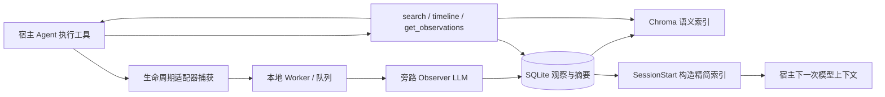
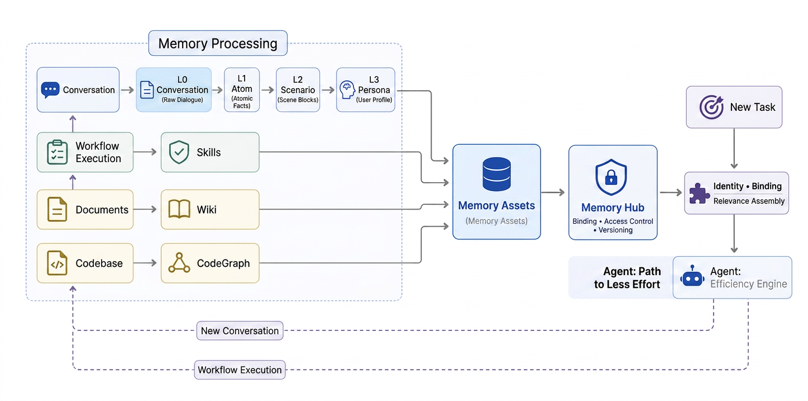
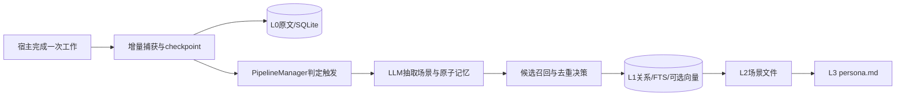
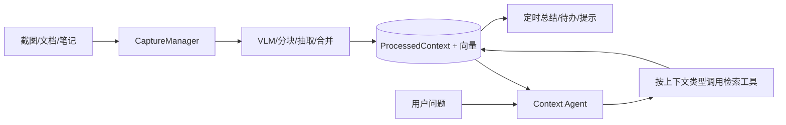

# 记忆插件与中国开源系统：claude-mem、OpenViking、TencentDB、Hy-Memory 与 MineContext

> 本章把“记忆如何变成下一次请求中的证据”作为主线：逐项说明载体、写入者、检索器、调用者与注入位置。核查日期：2026-11-18。所有代码观察固定到下表提交；示例是按源码字段构造的教学摘选，不是真实用户数据，也不是可直接提交的完整 API 请求。

## 为什么不能把这些项目都叫“向量记忆库”

claude-mem 是把已有 coding agent 的活动交给旁路 observer，再通过启动注入与工具召回复用的插件系统；OpenViking 是提供文件式上下文空间、会话和检索接口的数据库；TencentDB Agent Memory 是带层级抽取、召回与接入适配器的记忆服务；Hy-Memory 同时提供写入模型、场景化 SDK 与 MemHub 应用；MineContext 则从桌面活动主动捕获上下文。它们选择的原始证据和自动化边界不同，不能只比较“是否使用 embedding”。

### 证据快照与版本边界

| 项目 | 固定提交 | 最近提交时间（UTC） | GitHub star 快照 |
|---|---|---|---|
| thedotmack/claude-mem | `4316546ed8a0d8d163b8cbf8ff5ce2619f9bc0aa` | 2026-11-17T18:50:43Z | 117,942 |
| volcengine/OpenViking | `85b3666a8b904fd6e3469efe14192abba18db9f2` | 2026-11-17T16:48:20Z | 42,375 |
| Tencent/TencentDB-Agent-Memory | `42d4cde50c5a83182fced8c584f9ddb32a620615` | 2026-11-10T13:27:08Z | 30,969 |
| Tencent-Hunyuan/Hy-Memory | `23cb604ec4e27b69905a361cb38553e1c350480d` | 2026-11-15T08:49:03Z | 2,075 |
| volcengine/MineContext | `171c7a9ea8091e326ddcf0f10718aa1b58c83c65` | 2026-05-07T13:23:05Z | 5,551 |

star 仅表示本次通过 GitHub API 观察到的热度，不是质量、准确率或安全性指标。Tencent 的旧 `Tencent/TencentDB-Agent-Memory` 地址和腾讯云组织入口可能重定向；本章链接使用本次成功解析到的仓库与固定提交。**TencentDB 与 Tencent-Hunyuan/Hy-Memory 是不同项目**，不要将它们的术语、层号与评测结果合并。

## claude-mem：旁路观察者写记忆，宿主 Agent 仍负责工作

### 从事件到持久观察，而不是直接把聊天全文追加到 prompt

当前源码已经包含多种宿主接入和远端服务分支，不能用早期“只有 Claude Code 的几个 hook”描述全部产品。本节先讲本地 worker 主线。Claude Code 的 Setup、SessionStart、UserPromptSubmit、PreToolUse、PostToolUse、PostToolUseFailure、Stop、SubagentStop、SessionEnd 等事件经适配器送入 worker；不同宿主支持的事件不相同，有些接入只提供搜索，不采集会话。

worker 是本地 Bun/HTTP 服务；observer 是另一个模型驱动的处理角色。它观察宿主的工具活动，将值得保留的行为整理为 observations，并在会话阶段形成 summary。observer 不替主 Agent 修改项目，也不意味着每个工具事件都必然产生一条记忆：无意义、重复或无标题的候选会被跳过/去重，写入可以异步完成。由此存在“刚执行完一个操作，另一个会话立刻检索不到”的索引/处理延迟。



图中有两个 LLM 职责：工作模型决定怎么完成代码任务；observer 决定从已发生的活动中写下什么。检索常规路径则主要由确定性搜索与宿主工具调用完成，并不是每次都再找一个外部 LLM 判断“是否需要记忆”。
来源：[当前接入、worker、observer 与三阶段读取](https://github.com/thedotmack/claude-mem/blob/4316546ed8a0d8d163b8cbf8ff5ce2619f9bc0aa/README.md)；[Claude Code 实际 hook 配置](https://github.com/thedotmack/claude-mem/blob/4316546ed8a0d8d163b8cbf8ff5ce2619f9bc0aa/plugin/hooks/hooks.json)；[观察有效性与内容指纹](https://github.com/thedotmack/claude-mem/blob/4316546ed8a0d8d163b8cbf8ff5ce2619f9bc0aa/src/services/sqlite/observations/store.ts)。

### 它存什么，文件和表长什么样

本地默认数据根是 `~/.claude-mem/`；设置文件为 `settings.json`，主 SQLite 为 `claude-mem.db`。主线表包括 `sdk_sessions`、`observations`、`session_summaries`、`user_prompts`；FTS5 外部内容索引由关系表与触发器保持同步。Chroma 是另一份派生语义索引，不应把它当成唯一事实源。源码还包含 PostgreSQL/服务端存储，**不等于安装本地插件后默认把本地库改为 PostgreSQL**。

下例是一个 observation 的字段级投影；数组在一些 SQLite 字段中以 JSON 字符串保存，应用返回时再转换。

```json
{
  "id": 123,
  "memory_session_id": "session-example",
  "project": "billing-service",
  "type": "bugfix",
  "title": "重试支付请求必须复用幂等键",
  "subtitle": "重复创建订单的根因",
  "narrative": "失败后换一个幂等键会使支付网关把重试视为新订单。",
  "facts": ["同一订单的网络重试复用同一幂等键"],
  "concepts": ["idempotency", "payment"],
  "files_read": ["src/payment.ts"],
  "files_modified": ["src/payment.ts"],
  "created_at_epoch": 1794960000000
}
```

这是一条“解释过的经验”，不是源文件快照。若 observer 把一次猜测误写成事实，向量检索仍可能高分召回；ID、session、文件与时间字段的意义在于让人能回到来源核查。内容指纹也有边界：相同标题不一定同一事实，结构细节与来源字段需要区别对待。当前代码专门处理 title/narrative 指纹与 facts/concepts 等不同结构内容，不能把去重说成“向量距离小就删除”。
来源：[会话、观察、迁移与文件索引](https://github.com/thedotmack/claude-mem/blob/4316546ed8a0d8d163b8cbf8ff5ce2619f9bc0aa/src/services/sqlite/SessionStore.ts)；[内容指纹与结构字段身份](https://github.com/thedotmack/claude-mem/blob/4316546ed8a0d8d163b8cbf8ff5ce2619f9bc0aa/src/services/sqlite/observations/store.ts)；[FTS5 建表、触发器、检索](https://github.com/thedotmack/claude-mem/blob/4316546ed8a0d8d163b8cbf8ff5ce2619f9bc0aa/src/services/sqlite/SessionSearch.ts)。

### 搜索到底是 BM25、Embedding，还是混合

三个层次要分开。

| 路径 | 当前实现 | 是否需要额外 LLM |
|---|---|---|
| 仅日期、项目、文件等过滤 | SQLite 关系查询 | 不需要 |
| 文本搜索且 Chroma 已配置 | 先走 Chroma 语义候选；缺失类别可从 SQLite 补充 | embedding 不等于生成式 LLM；这里不默认每次做 agentic 推理 |
| Chroma 未配置 | SQLite/FTS5 文本搜索；有不支持 FTS 的兼容路径 | 不需要 |
| 按文件检索的 HybridSearchStrategy | SQLite 先筛出匹配文件的 ID，再用 Chroma 的排名交集排序，补回未排名候选 | 不需要生成式判断 |
| deeper raw-tool search | 独立的深搜索能力与原始工具证据链 | 与常规搜索分开，不可用它推导所有搜索都由模型执行 |

因此，“支持混合搜索”是对，但“每次搜索必定 BM25 与向量各取 top-k 再 RRF”不对。当前 `SearchOrchestrator` 对带 query 的常规路径优先走 Chroma，再按类别补充；按文件路径的 HybridSearchStrategy 又是“结构化筛选后语义排序”。FTS 的 rank 是 SQLite FTS5 的相关性路径，源码明确涉及 BM25，但并非所有 SQLite 查询都按 BM25：按日期排序的请求会保留日期顺序。Chroma 查询失败可成为明确错误，而不是一律静默降级成“没有结果”。

中文也是实际工程问题：FTS tokenizer 对 CJK 的切分、OR 查询的文档工作量上限、项目与平台过滤、语义召回的隐式时间窗，都可能改变 recall。评测只说“用了 hybrid”并不能复现这些差异。
来源：[策略路由、空类别补充与异常](https://github.com/thedotmack/claude-mem/blob/4316546ed8a0d8d163b8cbf8ff5ce2619f9bc0aa/src/services/worker/search/SearchOrchestrator.ts)；[文件筛选与语义排序](https://github.com/thedotmack/claude-mem/blob/4316546ed8a0d8d163b8cbf8ff5ce2619f9bc0aa/src/services/worker/search/strategies/HybridSearchStrategy.ts)；[SQLite 过滤路径](https://github.com/thedotmack/claude-mem/blob/4316546ed8a0d8d163b8cbf8ff5ce2619f9bc0aa/src/services/worker/search/strategies/SQLiteSearchStrategy.ts)；[FTS rank 与中文检索处理](https://github.com/thedotmack/claude-mem/blob/4316546ed8a0d8d163b8cbf8ff5ce2619f9bc0aa/src/services/sqlite/SessionSearch.ts)。

### 哪些记忆自动注入，哪些由 Agent 主动打开

SessionStart 会构造项目相关、数量/预算受限的精简观察索引；当前 README 指出项目的后续会话才自然积累出可注入的前序记忆。启动索引不是把所有完整 observation 塞进系统提示。更细的信息由主 Agent 通过三步展开：

```text
search(query="支付重试", project="billing-service")
  → 返回观察 ID、标题、简短线索

timeline(anchor=123)
  → 看这次工作前后的时间脉络

get_observations(ids=[123, 127])
  → 获取选中观察的完整内容
```

这正是“直接注入 + 工具按需检索”的组合。`save_memory` 又允许主动存一条记忆，不能把所有写入都归给 observer。项目/平台来源过滤决定索引的作用域；当前配置可选择是否跨 harness 汇入启动上下文，不能把跨平台可读默认解释成跨用户隔离已经成立。

本地 worker、可选云同步、托管 observer/服务端模式会改变数据出机边界。即使 SQLite 本地，选择远端模型做 observer 仍可能把工具内容发往模型服务。删除记录还需要处理 SQLite、向量索引、同步 outbox 和备份，而非只删一个 prompt 片段。敏感内容过滤/`<private>` 机制也不能替代对插件、模型供应商和同步设置的审核。
来源：[启动上下文构造](https://github.com/thedotmack/claude-mem/blob/4316546ed8a0d8d163b8cbf8ff5ce2619f9bc0aa/src/services/context/ContextBuilder.ts)；[渐进式读取](https://github.com/thedotmack/claude-mem/blob/4316546ed8a0d8d163b8cbf8ff5ce2619f9bc0aa/src/services/worker/ProgressiveMemorySearch.ts)；[语义索引同步](https://github.com/thedotmack/claude-mem/blob/4316546ed8a0d8d163b8cbf8ff5ce2619f9bc0aa/src/services/sync/ChromaSync.ts)；[save_memory、跨宿主与云同步入口](https://github.com/thedotmack/claude-mem/blob/4316546ed8a0d8d163b8cbf8ff5ce2619f9bc0aa/README.md)。

## OpenViking：可读的文件上下文空间，以及与之分离的检索索引

### 先认清两套“层号”不是一回事

OpenViking 的 L0/L1/L2 是**同一内容的摘要粒度**：L0 abstract、L1 overview、L2 详细内容。它们不是 TencentDB 的“原始对话→原子事实→场景→画像”层级，也不是 Hy-Memory 的认知层。目录式组织的价值是内容可检查和逐级展开，不意味着检索必然按目录一层层递归。

```text
viking://resources/docs/auth/
  .abstract.md        # L0
  .overview.md        # L1
  oauth-design.md     # L2

viking://~/memories/   # 当前用户作用域下的记忆
viking://~/skills/     # 技能
```

上述是官方存储文档给出的 URI/侧文件形状；具体 memory 类型目录由配置与注册类型决定，不应硬编码成一个跨版本不变的目录枚举。VikingFS 将 URI 映射到按 account/user 等划分的物理空间。AGFS/RAGFS 内容后端与向量索引是两套存储：文件后端可用 localfs、S3 或内存；向量后端可用 local、HTTP 或 Volcengine VikingDB。它不是“所有东西只存向量数据库”。

向量记录的字段摘选如下；`abstract` 对 memory 记录可直接容纳正文文本，当前文档说明有 50,000 字节的正文上限，因此向量库不仅有一个 ID，也不能简单认为“全文绝不会出现在索引里”。

```json
{
  "id": "context-record-id",
  "uri": "viking://resources/docs/auth/oauth-design.md",
  "parent_uri": "viking://resources/docs/auth",
  "context_type": "resource",
  "is_leaf": true,
  "vector": [0.01, 0.02],
  "abstract": "OAuth 登录流程与刷新令牌策略……",
  "created_at": "2026-11-18T00:00:00Z",
  "active_count": 3
}
```

此例的向量维度已缩短，仅用于展示字段关系。备份、迁移、删除与权限检查都要覆盖内容与索引两边。文件操作会协调索引删除/URI 更新，但异步摘要刷新、失败恢复仍可能有中间状态，不能许诺跨所有后端的原子事务。
来源：[内容/索引双存储、URI 与 schema](https://github.com/volcengine/OpenViking/blob/85b3666a8b904fd6e3469efe14192abba18db9f2/docs/en/concepts/05-storage.md)；[文件式上下文与会话入口](https://github.com/volcengine/OpenViking/blob/85b3666a8b904fd6e3469efe14192abba18db9f2/README.md)。

### 何时写：显式接入会话，commit 才是有意义的生命周期边界

普通资源入库由调用者 `add-resource` 等操作触发语义处理；Agent 的用户偏好与经验来自已接入的 session 消息。调用者需要提交对话，再在适当边界 commit；当前 README 与 session 实现描述了归档对话、生成工作记忆/摘要和提取长期记忆的流程。commit 是程序接口，不会因为用户电脑上任何聊天工具产生一条消息就自动捕获。

SDK/服务端核心与 Claude Code、Codex、OpenClaw 等适配器不能混同：插件可以在 host lifecycle 事件上代调用 session API，因此最终“每轮还是会话结束写入”取决于你选的适配器和策略。记忆类型、self/peer 提取、是否产生工作记忆等由 MemoryPolicy 与注册类型约束；并非所有 session 都必然提取全部类型。大模型用于语义抽取和更新，文件/向量索引则负责保存和查询。应保留原始 messages/归档，才能追查抽取出来的结论。
来源：[commit、会话归档、MemoryPolicy 与工作记忆](https://github.com/volcengine/OpenViking/blob/85b3666a8b904fd6e3469efe14192abba18db9f2/openviking/session/session.py)；[资源与会话概念](https://github.com/volcengine/OpenViking/blob/85b3666a8b904fd6e3469efe14192abba18db9f2/docs/en/getting-started/01-introduction.md)。

### 当前检索机制已经变化：不能继续照搬“层级递归召回”旧图

本次固定提交的官方检索文档明确描述：**每个 query 执行一次全局向量搜索，范围由 URI、类型、权限、metadata 与 level 约束**；默认文本查询可直接匹配 L0/L1/L2。历史版本的目录优先队列、父到子分数传播、收敛轮次已移除。类名仍可能叫 `HierarchicalRetriever`，不能从名字推回旧算法。

| API/阶段 | 实际机制 | 决策者 |
|---|---|---|
| `find(query, uri)` | 单 query、无会话意图分析，QUICK 召回 | 调用者直接给 query |
| `search(query, session_id)` | session 有摘要/消息且意图分析开启时，先做 intent analysis | 单独可配置的 query_planner LLM；未配时回退 VLM |
| IntentAnalyzer 输入 | 会话压缩摘要、最近 5 条消息、当前 query | 生成 0 或多个 TypedQuery |
| TypedQuery | query、context_type、intent、priority | 可分别搜索 MEMORY / RESOURCE / SKILL |
| 全局召回 | 向量索引 + scope/filter；每个规划 query 独立召回 | 确定性检索程序 |
| THINKING + 可用 reranker | 召回 `2×limit`，对已有候选重排，返回最多 limit | 配置的 reranker，不再发起搜索 |

0 个 TypedQuery 可以表示当前只是闲聊、无需检索；多个 query 可以将“写 RFC”拆成技能、模板和记忆三路。这才是本章明确存在“局外 LLM 决定检索计划”的例子。它与主 Agent 自己调用工具是可组合的：主 Agent 调用 `search`，数据库内部再做一次规划；也可以直接调用 `find` 绕过这一步。

当前排序使用 rerank 分数，失败时保留 vector 分数；文档明确说明访问频率、更新时间、父目录得分不进入该排名。索引支持 sparse/vector 等字段、系统另有 grep/关键词能力，但本次核对的 `find/search` 文本主流程不能笼统等同“BM25+embedding+RRF”。多个规划 query 的 limit 各自生效，合并后可超出单个 limit，且当前不保证跨 query 去重。
来源：[当前检索算法与已删除机制](https://github.com/volcengine/OpenViking/blob/85b3666a8b904fd6e3469efe14192abba18db9f2/docs/en/concepts/07-retrieval.md)；[召回实现](https://github.com/volcengine/OpenViking/blob/85b3666a8b904fd6e3469efe14192abba18db9f2/openviking/retrieve/hierarchical_retriever.py)；[LLM 规划实现](https://github.com/volcengine/OpenViking/blob/85b3666a8b904fd6e3469efe14192abba18db9f2/openviking/retrieve/intent_analyzer.py)；[HTTP 与 SDK 查询接口](https://github.com/volcengine/OpenViking/blob/85b3666a8b904fd6e3469efe14192abba18db9f2/docs/en/api/06-retrieval.md)。

## TencentDB Agent Memory：L0–L3、自动召回和主动工具相结合

### 产品拆分与 v2/v3 命名必须先厘清

当前 monorepo 的 MemoryCore 提供记忆与元数据核心，MemoryKnowledge 处理知识内容解析/索引/检索，MemoryProxy 负责代理接入等能力。Core 并不托管或调度你的 Agent。不能拿一个知识库解析模块的全文 RAG，充当 L1 用户记忆系统的实现细节。

本次迁移文档中的关系是：**MemoryCore 软件 v1.x/v0.x 对应旧数据格式 v2，升级软件 v2.0.0+ 使用数据格式 v3**。这是数据库字段与文件布局的迁移，不应和用户提到的 Mem0 v2/v3混为一个版本体系。



图源：腾讯仓库 `assets/images/flowchart5.png`，固定提交见下方来源。图说明 L0–L3 与资产/Hub 的关系；它表达的是整体产品方案，具体默认 SQLite/BM25、LLM pipeline、可选云后端仍以下面的代码路径为准。
来源：[项目分层与官方技术图](https://github.com/Tencent/TencentDB-Agent-Memory/blob/42d4cde50c5a83182fced8c584f9ddb32a620615/README.md)；[Core 边界和 standalone 默认](https://github.com/Tencent/TencentDB-Agent-Memory/blob/42d4cde50c5a83182fced8c584f9ddb32a620615/MemoryCore/README.md)；[软件版本与数据格式迁移](https://github.com/Tencent/TencentDB-Agent-Memory/blob/42d4cde50c5a83182fced8c584f9ddb32a620615/MemoryCore/scripts/migrate-v2-to-v3/README.md)。

### 本地文件、SQLite、画像究竟怎么放

默认数据根为 `~/.memory-tencentdb/memory-tdai/`。当前本地 SQLite 文件 `vectors.db` 这个名字容易误导：它不仅有 vector，还保存 L0/L1 的普通关系字段与 FTS5。启用向量并配置维度后，SQLite vector 虚表使用 cosine distance。可选后端另有腾讯向量库等，不能把默认 standalone 的数据去向说成必须上云。

| 载体/层 | 格式与主要内容 | 后续如何使用 |
|---|---|---|
| L0 Conversation | 本地原始对话记录/JSONL；SQLite `l0_conversations` 存 message_text、role、session_key、recorded_at、tenant 字段；向量是可选索引 | 定位原话、事件时间和来源；conversation_search 可深查 |
| L1 Atom | `l1_records` 关系行 + FTS5；可选向量 | 每轮按用户 query 找事实/偏好/约束/事件 |
| L2 Scenario | scoped `profiles/.../scene_blocks/` 文件及相关 metadata | 先注入场景导航，再按路径读取具体场景 |
| L3 Persona | scoped `profiles/.../persona.md` | 作为较稳定系统上下文恢复画像 |

L1 的真实字段摘选：

```json
{
  "record_id": "mem-example-1",
  "content": "billing-service 的同一订单网络重试复用幂等键",
  "type": "rule",
  "priority": 80,
  "scene_name": "billing-service",
  "session_key": "session-example",
  "session_id": "session-1",
  "team_id": "team-a",
  "user_id": "user-a",
  "agent_id": "coding-agent",
  "task_id": "task-1",
  "version": 1,
  "timestamp_start": "2026-11-18T00:00:00Z",
  "metadata_json": "{}"
}
```

这里的 type/值是教学构造，字段来自 schema；不是说每个实际记录都具有同一分类。L0 对应关系行中则是 `role`、`message_text`、`timestamp` 等，不是先把每句原话转成画像。v3 给 L0/L1 增加 team/task/user/agent/version 等隔离信息；旧 `scene_blocks/`、`persona.md` 迁入 `profiles/team%3Adefault%7Cagent%3Adefault/...`。隔离不只是 query 多加 user_id：画像文件的 scope 也必须一致，不能检索不到 scoped 文件时退回全局文件而串租户。
来源：[L0/L1 schema、向量与 FTS](https://github.com/Tencent/TencentDB-Agent-Memory/blob/42d4cde50c5a83182fced8c584f9ddb32a620615/MemoryCore/src/core/store/sqlite/memory-store.ts)；[vectors.db 与 scoped 画像目录](https://github.com/Tencent/TencentDB-Agent-Memory/blob/42d4cde50c5a83182fced8c584f9ddb32a620615/MemoryCore/scripts/migrate-v2-to-v3/README.md)。

### 什么时候存，后台 LLM 在哪一步出现

`auto-capture` 在宿主接入的 capture 边界记录新增 L0，带 checkpoint 避免每次把全历史重新灌入。它也会恢复原始用户文本，避免把上轮注入的记忆当作用户新事实再记录。源码明确把 L0 捕获与 L1 提取分开：capture 通知 scheduler，由 pipeline manager 判断何时抽取，capture 函数本身不直接决定立即发抽取请求。

本次默认配置包括 `everyNConversations=5`、L1 idle timeout=600 秒；L2 在 L1 后可延迟 10 秒，最小间隔 900 秒、最大间隔 3600 秒。它们是这个提交的默认配置，不是所有安装不可更改的保证；L3 画像也由对应 pipeline/触发策略生成。L1 extractor 将一批对话交给 LLM，先做场景分段与原子事实抽取；随后候选记忆去重/冲突处理，可能得到 store/update/merge/skip 等决定，再保存。不是只有一次 embedding 写入。



此图是职责关系，不是承诺每次 L1 生成都同步连跑至 L3。后台写入失败、索引写入延迟和任务关闭时尚未完成的 embedding，都应观测；源码有注册后台任务、关闭前等待等处理，说明“API返回”与“所有派生数据都一致”不是同一瞬间。
来源：[增量 L0 与调度通知](https://github.com/Tencent/TencentDB-Agent-Memory/blob/42d4cde50c5a83182fced8c584f9ddb32a620615/MemoryCore/src/core/hooks/auto-capture.ts)；[pipeline 默认值](https://github.com/Tencent/TencentDB-Agent-Memory/blob/42d4cde50c5a83182fced8c584f9ddb32a620615/MemoryCore/src/config.ts)；[抽取、batchDedup 与写入](https://github.com/Tencent/TencentDB-Agent-Memory/blob/42d4cde50c5a83182fced8c584f9ddb32a620615/MemoryCore/src/core/record/l1-extractor.ts)。

### 它会自己检索，还是让 Agent 调工具

两条路径都有，而且分工明确。

**自动召回：** Agent 处理当前问题之前，auto-recall 用 `userText` 做 L1 keyword/embedding/hybrid 检索；L1 命中被组为动态 `prependContext`，较稳定的 L3 persona、L2 场景导航和工具指南放入 `appendSystemContext`。这里检索的主开关是 hook/调用方，不必每轮另找 LLM 判断“用不用记忆”。

**主动深查：** 已注入的片段不足时，主 Agent 可调用 `tdai_memory_search` 找 L1、`tdai_conversation_search` 找 L0、按 Scene Navigation 路径读完整场景。源码指南要求两种搜索合计每轮最多三次，但指南文字本身不能当成所有 host 上都不可绕过的权限/次数硬限制。

| 检索策略 | 实现 | 注意 |
|---|---|---|
| keyword | SQLite FTS5 BM25 | 必须验证 FTS5 可用；不能将依赖缺失当正常无匹配 |
| embedding | 向量 cosine 相似度 | 需实际配置 embedding 和可用向量索引 |
| hybrid | keyword 与 embedding 以 RRF 融合 | 配置写着 hybrid 不代表禁用embedding时仍有双路信号 |
| L2/L3 读取 | scoped 文件读取、导航/画像注入 | 不是把所有画像再跑 BM25 |

standalone README 默认关闭远端 embedding，因此正常默认能力以 BM25 为基础；代码 recall.strategy 默认虽写 hybrid，实际有效路由取决于 embedding 可用性。召回超时默认 5000ms，返回结构化错误/partial 状态，不能把“超时没记忆”静默等同“确实没有相关事实”。
来源：[自动召回、注入字段、工具指南与超时](https://github.com/Tencent/TencentDB-Agent-Memory/blob/42d4cde50c5a83182fced8c584f9ddb32a620615/MemoryCore/src/core/hooks/auto-recall.ts)；[配置默认与有效前提](https://github.com/Tencent/TencentDB-Agent-Memory/blob/42d4cde50c5a83182fced8c584f9ddb32a620615/MemoryCore/src/config.ts)；[默认无远端embedding与FTS5依赖](https://github.com/Tencent/TencentDB-Agent-Memory/blob/42d4cde50c5a83182fced8c584f9ddb32a620615/MemoryCore/README.md)。

## Hy-Memory：写入、认知加工、召回和桌面接入的分层

### 三种模式、三种场景不是同一个开关

Hy-Memory 是腾讯混元项目，与腾讯云数据库团队的 TencentDB Agent Memory 分开。SDK 的 mode 决定记忆加工深度，scene 决定 Chat/Working/Coding 链路，MemHub 则负责宿主历史接入与应用调度。`Hy-Memory-30B-A3B` 是专门优化长期记忆写入的模型；**模型权重不是数据库，下载它不会自动让 Agent 拥有持久存储或召回**。

| mode | 写入规则 | 是否调用生成式 LLM | 图/演化 |
|---|---|---|---|
| lite | 原始记忆 embedding 写入/检索；忽略 scene/layers | 该记忆路径不做 LLM 抽取 | 无 System 2 |
| pro | 事实抽取 + reconcile 冲突处理 | 有 | 图为可选配置，不能默认为总开启 |
| ultra | pro 加 System 2 图式归纳、跨域整理 | 有 | 自动开启所需图能力；SDK 可显式 evolve |

SDK 中 `evolve()` 是可调用的认知加工入口；MemHub 的 ultra 夜间自动整理是应用调度，两者不能混为“SDK默认每晚有个后台线程”。同样，不传 scene 时，普通无工具对话写入可零 LLM 分类直接走 Chat；含工具轨迹的写入可用 LLM 分到 chat/working/coding。检索 `search_mode="default"` 固定 Chat，`agentic` 才增加场景判定、query 改写和时间范围解析。
来源：[mode、scene、MemHub 与 API 语义](https://github.com/Tencent-Hunyuan/Hy-Memory/blob/23cb604ec4e27b69905a361cb38553e1c350480d/README.zh.md)；[客户端写入与查询路由](https://github.com/Tencent-Hunyuan/Hy-Memory/blob/23cb604ec4e27b69905a361cb38553e1c350480d/hy_memory/client.py)。

### 持久载体与字段：不只是一个向量

Chat 的 L0_BASIC_INFO、L1_RAW、L2_FACT、L3_SUMMARY、L4_IDENTITY、L5_KNOWLEDGE、L6_SCHEMA、L7_INTENTION 是源码类型标识；旧枚举还保留编号兼容别名，不能把注释中的“七层”当成只有七个成员，也不能由一个枚举推断每层全部实现、所有模式都写。L0–L4 主要进入向量侧；ultra 的图式/意图等使用图后端，具体能力仍受模式和实现影响。

Working/Coding 更强调可复用经验、当前任务事实和代码版本变化。默认业务存储为 SQLite，向量库独立可选 Chroma/Qdrant/FAISS；图后端和业务关系库又是另外的配置维度。当前业务文档已支持 PostgreSQL，但只覆盖 Working/Coding 业务仓储与轨迹/版本链，**不意味着整套SDK或MemHub不再使用SQLite**。默认路径由 data/history 配置派生，Working 常见 `coding_memory.db`，Coding variant 为 `coding_memory_cv.db`，轨迹再有自己的文件/后端。

```json
{
  "node_id": "fact-example",
  "user_id": "user-a",
  "agent_id": "coding-agent",
  "session_id": "session-1",
  "layer": "l2_fact",
  "content": "当前项目测试命令为 uv run pytest",
  "valid_from": 1794960000,
  "valid_until": null,
  "supersedes": ["old-fact-id"],
  "superseded_by": [],
  "is_latest": true,
  "source_session_id": "session-1",
  "source_turn_index": 4,
  "confidence": 0.95,
  "evidence_count": 1
}
```

这是 `MemoryNode.to_dict()` 的存储字段摘选，不保证全部属于公开返回字段（例如 superseded_by 是系统维护关系）：valid time、版本演化关系、原始来源和置信度都有明确位置。不同层/variant使用的字段与表可以不同；不能因为示例中有 confidence，就假定模型给的0.95已经经过统计校准。原始证据、抽取断言、后续纠错与失效时间，应分别保留，而不是把新偏好覆盖旧文本后再也无法回答“上月用的是什么”。
来源：[层标识、scope与序列化字段](https://github.com/Tencent-Hunyuan/Hy-Memory/blob/23cb604ec4e27b69905a361cb38553e1c350480d/hy_memory/models/memory.py)；[variant 存储路径与仓储](https://github.com/Tencent-Hunyuan/Hy-Memory/blob/23cb604ec4e27b69905a361cb38553e1c350480d/hy_memory/coding/store.py)；[SQLite/PostgreSQL 与向量存储边界](https://github.com/Tencent-Hunyuan/Hy-Memory/blob/23cb604ec4e27b69905a361cb38553e1c350480d/docs/business_storage.md)。

### 检索有混合实现，但本次默认 reader 仍需明确

源码的 `_retrieval` 包包含 BM25、dense 候选、实体/时间/意图、去重、多样性、RRF 与 rerank 等组件；然而 `resolve_reader_name()` 的缺省是 **legacy**，明确 override 或环境变量才选择 hybrid。不能看到目录里有 `rrf.py` 就宣称所有 `client.search()` 默认经过完整多路融合。

在 hybrid 路径中，RRF 用各路的相对名次而非直接相加不可比的向量/BM25原分数；配置默认平滑常数为60。之后仍有候选 guard、scope、时间与可用性等处理。Graph、proactive intent 和版本链的作用也不是“再加一种embedding”：它们保留关联与演化，可帮助从当前事实追溯旧断言/来源。agentic检索的额外LLM规划、可选本地cross-encoder重排及legacy/hybrid reader分别是不同开关。

谁负责检索取决于集成层：裸 SDK 由调用者调用 search；MemHub/宿主插件可以在模型请求前主动召回；你也可以把 search 封装成Agent工具。不能把MemHub跨应用采集、SDK事实提取和主Agent工具调用统称为一个“记忆模型自动决定”。

备份需要同时包含关系数据、向量库、图与源轨迹。业务库切换PostgreSQL不会自动迁移旧SQLite，也不会把本地Chroma变共享服务；关系数据与向量写入不是跨库原子事务。只备份本地目录不能包含远端PostgreSQL数据。
来源：[legacy/hybrid默认和RRF常量](https://github.com/Tencent-Hunyuan/Hy-Memory/blob/23cb604ec4e27b69905a361cb38553e1c350480d/hy_memory/pipelines/_retrieval/config.py)；[rank fusion实现](https://github.com/Tencent-Hunyuan/Hy-Memory/blob/23cb604ec4e27b69905a361cb38553e1c350480d/hy_memory/pipelines/_retrieval/rrf.py)；[检索入口](https://github.com/Tencent-Hunyuan/Hy-Memory/blob/23cb604ec4e27b69905a361cb38553e1c350480d/hy_memory/retrieval.py)；[迁移、隔离、跨库一致性与备份边界](https://github.com/Tencent-Hunyuan/Hy-Memory/blob/23cb604ec4e27b69905a361cb38553e1c350480d/docs/business_storage.md)。

## MineContext：从桌面活动到主动上下文，不等于 Coding Agent 会话插件

### 证据源与触发方式完全不同

MineContext 归属火山引擎开源组织。它是桌面上下文应用，典型输入是屏幕截图、文档变化和应用中的笔记；不是仅从 Claude/Codex 的 tool-call transcript 捕获。用户必须启用录屏/选择范围并开始记录。默认配置中的 screenshot capture interval 为5秒，文档/文件监控另有周期，这些都可配置。

VLM读取截图，提取标题、摘要、实体、关键词、上下文类别、置信与重要性；处理层再做合并/去重，embedding形成可检索context。后台消费任务可生成日常总结、待办、提示等；用户也可在Chat with AI提问。这里确实存在主动后台模型工作，但它的触发是捕获和消费调度，而不是主Agent每次手工调用“存一条记忆”。



这是“个人活动上下文”系统，不是所有数据都具备跨用户团队服务的租户治理。源码README中“local-first”也不能推导成“不出机”：如果配置远端VLM/embedding，截图内容/文本仍可能交给模型服务；只有本地模型部署并核对调用链后才能作更强的数据边界承诺。
来源：[产品范围、捕获与组件分层](https://github.com/volcengine/MineContext/blob/171c7a9ea8091e326ddcf0f10718aa1b58c83c65/README.md)；[捕获周期、后端和消费调度](https://github.com/volcengine/MineContext/blob/171c7a9ea8091e326ddcf0f10718aa1b58c83c65/config/config.yaml)。

### 存储与检索的实际形状

默认配置中截图路径为 `${CONTEXT_PATH}/screenshots`；结构化业务SQLite为 `${CONTEXT_PATH}/persist/sqlite/app.db`；向量默认Chroma，目录 `${CONTEXT_PATH}/persist/chromadb`，另有Qdrant配置。Electron前端还可以有自己的应用数据库，不能拿前端一个schema代表整个后端context存储。

```json
{
  "id": "context-example",
  "extracted_data": {
    "title": "调试支付网关重试",
    "summary": "正在查看幂等键重复创建订单的日志",
    "keywords": ["支付", "重试"],
    "entities": ["billing-service"],
    "context_type": "activity_context",
    "confidence": 8,
    "importance": 7
  },
  "properties": {
    "create_time": "2026-11-18T09:00:00+08:00",
    "event_time": "2026-11-18T09:00:00+08:00",
    "raw_properties": [{"content_path": "/data/screenshots/example.png"}],
    "merge_count": 0
  }
}
```

这是按 `ProcessedContext` 相关模型截取的字段示意，省略必填source/format等字段，不能直接作为合法插入请求；分类值与置信度也是构造值。Chroma写入时会把嵌套结构转换为可用metadata（复杂列表/字典序列化），并保留对应文档与embedding，不是原样把一个任意Python对象交给向量引擎。

`BaseContextRetrievalTool` 会构造时间范围、实体条件，实体工具可先把别名归一化；提供query时做语义搜索，不提供query则走filter-only。根据activity/intent等context类型有不同检索工具；Context Agent据当前问题选择调用，底层从Chroma/Qdrant检索。已核查的这条路径以向量与结构过滤为主，**没有足够证据把默认主路径写成BM25+向量RRF**。后端的某些SQLite业务文本查询也不能据此升级为全系统混合召回。

删除/保留策略应分别处理截图、ProcessedContext、向量索引和生成报告。删掉一个待办不等于删除产生它的截图和摘要；临时停止采集也不等于旧内容已清除。
来源：[Raw/Extracted/ProcessedContext模型](https://github.com/volcengine/MineContext/blob/171c7a9ea8091e326ddcf0f10718aa1b58c83c65/opencontext/models/context.py)；[Chroma格式与向量查询](https://github.com/volcengine/MineContext/blob/171c7a9ea8091e326ddcf0f10718aa1b58c83c65/opencontext/storage/backends/chromadb_backend.py)；[结构化存储](https://github.com/volcengine/MineContext/blob/171c7a9ea8091e326ddcf0f10718aa1b58c83c65/opencontext/storage/backends/sqlite_backend.py)；[实体/时间过滤及语义查询](https://github.com/volcengine/MineContext/blob/171c7a9ea8091e326ddcf0f10718aa1b58c83c65/opencontext/tools/retrieval_tools/base_context_retrieval_tool.py)。

## 用同一个问题比较“谁决定用记忆”

假设用户问：“上次我们为什么要求支付重试复用幂等键？”

| 系统 | 前台 Agent 之前发生什么 | Agent还可以做什么 | 哪个额外LLM可能参与 |
|---|---|---|---|
| claude-mem | SessionStart注入项目精简索引；不同host hook能力不同 | search→timeline→get_observations打开细节 | 写阶段observer；可选独立深搜索，非普通检索必经 |
| OpenViking | 裸SDK本身不会读取所有host聊天；调用方须接入session与search | read/grep/find/search及URI展开 | search有会话且intent启用时的query_planner；find不需要 |
| TencentDB | auto-recall按当前userText召回L1，并注入persona/scene导航 | memory_search / conversation_search / 读场景文件 | 写阶段抽取、去重、画像；自动召回主路径不默认每轮LLM判定 |
| Hy-Memory | 裸SDK由host调用search；MemHub可管理捕获与注入 | 自行封装SDK为tool或用宿主集成 | pro/ultra写入；agentic查询可规划；legacy/hybrid与mode分开 |
| MineContext | 之前由桌面捕获/定时任务积累上下文 | Context Agent按类型调用retrieval tool | 截图VLM、后台消费、对话Agent；底层向量检索不是额外推理 |

这个对照回答了“是工具检索，还是局外LLM判断”的二选一为什么常常问错：**同一系统可以在写入端使用旁路LLM，在启动端确定性注入小索引，再让主Agent通过工具展开；也可以在数据库内部再加query planner。**评测应分别计写入成本、检索规划成本、检索延迟、注入token、最终答题效果与污染风险。

## 对开发者最有用的可复现实验

用同一条带来源的经验输入，分别做四组干预，不需要先比较广告中的排行榜：

- **禁用向量**：查精确错误码/文件名与自然语言释义各自的召回变化；记录它是明确降级、错误还是静默零结果。
- **只存不注入**：确认写库后主Agent是否真的看得见。禁用启动hook再发问，可以区分“数据库有数据”和“上下文有证据”。
- **制造冲突和跨项目同名事实**：先记“测试用pytest”，再更正“本项目改用uv run pytest”；另一个项目仍使用pytest。检查版本、来源、作用域和旧事实的有效期，而非只测top-1相似度。
- **删除并重启**：同时查关系行、向量、文件、同步副本和备份恢复。删除后的默认召回、主动工具和重索引不应把旧事实重新“复活”。

本章给的是代码与文档研究，不声称已经运行所有系统或复现其论文结果；未完成的端到端、删除传播、认证边界验证应在实际选型时列为验收项。
