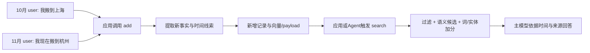
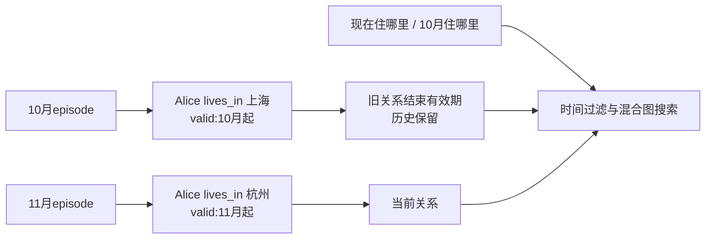
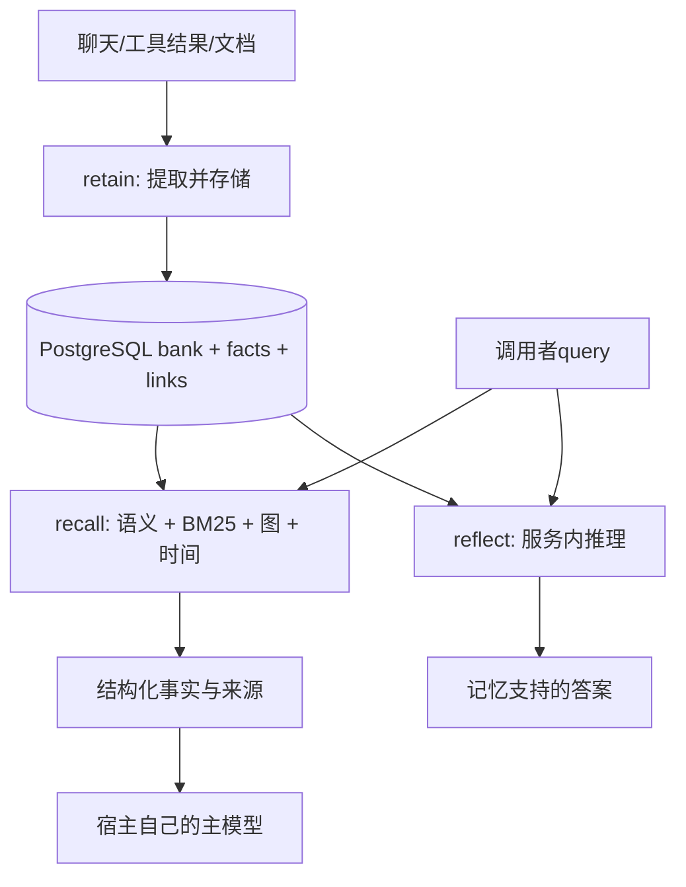
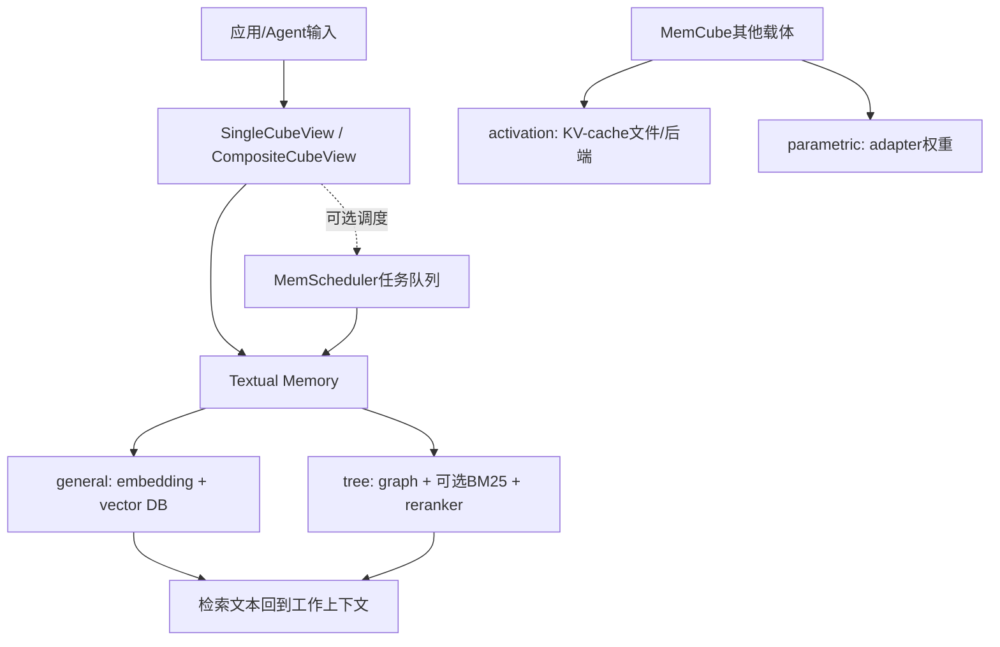

# 独立记忆系统：写入、存储、检索与调用权分别在哪里

> 核查日期：2026-11-18。本文关注可验证的工程机制，不按榜单分数排名。以下 GitHub 源码链接固定到本次读取的 commit；官方在线文档是核查当日的页面，后续可能变化。示例 JSON 是按真实字段压缩的教学样例，UUID、人物与事实是构造数据，不是用户数据。没有部署这些服务或调用付费模型，因此“源码可见能力”不等于本报告完成了生产验收。

这里要拆开三个经常混用的问题：

1. **谁决定发起检索？** 可能是每轮请求前的确定性 middleware、主 Agent 自己调用 search 工具、或后台/旁路 LLM 先做路由。
2. **检索内部怎么找？** 可能是向量、BM25、实体、图遍历、时间范围以及其组合。
3. **谁根据结果回答？** 可以是原来的主模型，也可以让记忆服务的独立推理操作直接生成回答。

一套系统完全可以“Agent 主动调用工具”且“工具内部执行向量+BM25”，二者不矛盾。看到项目使用 LLM，也不能直接推断每次检索都需要一个旁路 LLM。

## 本章项目与快照

| 项目 | 固定 commit | GitHub stars 快照 |
|---|---|---:|
| [mem0ai/mem0](https://github.com/mem0ai/mem0) | `f1791daa86d469249c9b002f62644d58a1eb96a0` | 69,122 |
| [letta-ai/letta](https://github.com/letta-ai/letta) | `8816d3a8516893bfdc0fa14bfb1235226012e295` | 25,472 |
| [letta-ai/letta-code](https://github.com/letta-ai/letta-code) | `69a7a1518420eaff46a7a3f39f1c6cb6890f52fd` | 3,863 |
| [getzep/graphiti](https://github.com/getzep/graphiti) | `4ef979c74e1e68d08217cf0af4022ddbc89c257f` | 32,890 |
| [vectorize-io/hindsight](https://github.com/vectorize-io/hindsight) | `b5f5968ebf2a7dbe6363809fac0b31e428008171` | 61,585 |
| [MemTensor/MemOS](https://github.com/MemTensor/MemOS) | `3a16e5fe3048a209f722806f4123fa2e533588fd` | 12,435 |
| [langchain-ai/langmem](https://github.com/langchain-ai/langmem) | `4beb9c36a40953f09357e5b2dd62ecc726f22d13` | 1,773 |

星数只用来说明项目关注度，不是准确率、安全性或工程成熟度指标。报告覆盖 Mem0、Letta、Graphiti、Hindsight、MemOS 与 LangMem 六种不同组合方式；它们并不都是与 Pi 同层次的完整 coding agent。

| 项目/具体路径 | 主载体 | 写入决策 | 读取/检索 | 主模型必须主动用工具吗 |
|---|---|---|---|---|
| Mem0 当前 OSS | 可选向量后端的向量+payload；本地 SQLite 历史/短消息 | 应用调用 add；默认提取 LLM，当前为 additive pipeline | 当前实现：向量候选、BM25、实体信号；后端依赖要满足 | 不必须；可在应用前置 search，也可包装工具 |
| 当前 Letta Code MemFS | Git 管理的 Markdown 记忆仓库 | Agent 修改；显式 remember；可选 dreaming 后台 subagent | 核心记忆投影到提示，其余按目录/工具读取；消息搜索是另一能力 | 已加载核心不必检索；深入文件由 Agent 按需访问 |
| Graphiti | 图数据库 episode/entity/fact edge，附向量和全文索引 | 应用 add_episode；LLM 抽取/消歧/关系处理 | 向量+全文，按 recipe 可加图遍历、RRF/MMR/cross-encoder | 不必须；Python API、MCP 或宿主前置查询均可 |
| Hindsight | PostgreSQL memory_units、documents、entities、关系等 | retain 提取；可后台 consolidation | recall 多路检索；reflect 另外运行推理 | recall 不替你选择宿主时机；reflect 明确是服务内推理 |
| MemOS | 配置化 MemCube；文本后端可为向量库/图库，另有激活与参数载体 | Reader/Extractor、View/API、可选 Scheduler | 随具体 text backend；general 不等于 tree 的混合方案 | 不必须；scheduler 与宿主也可驱动 |
| LangMem | LangGraph BaseStore 的 namespace/key/value；后端自选 | 主 Agent memory tool，或后台 memory manager | Store search；是否向量取决于索引配置 | 有工具模式，也有宿主/后台路径 |

## Mem0：必须把旧算法、新 OSS 与 Platform V3 拆开

### “v3”指什么，本次确实核实到了什么

本次仓库里同时存在 `docs/migration/oss-v2-to-v3.mdx` 和 `platform-v2-to-v3.mdx`。前者讲新的开源记忆算法与 SDK 行为，后者讲托管服务 V3 endpoint 与算法迁移。**不能将服务 endpoint 的 v3、Python 包的 semver、论文算法版本，当作同一个编号。** 本章只把源码中明确命名的 V3 phased pipeline 与对应迁移材料联系起来，不推断任何已安装实例自动升级。[OSS算法迁移](https://github.com/mem0ai/mem0/blob/f1791daa86d469249c9b002f62644d58a1eb96a0/docs/migration/oss-v2-to-v3.mdx)

旧资料常画两次模型调用：先提取候选事实，再取旧记忆让模型选择 ADD/UPDATE/DELETE/NONE。当前 `Memory._add_to_vector_store()` 已标为分阶段的 V3 管线；提取路径采用 ADD-only，不再把“相似旧事实”交给第二个 LLM 原位更新/删除。显式管理接口仍然可以更新或删除；**“提取阶段 ADD-only”不是“用户永远不能删除记忆”**。[Mem0写入与检索实现](https://github.com/mem0ai/mem0/blob/f1791daa86d469249c9b002f62644d58a1eb96a0/mem0/memory/main.py)

### 写入时，数据经过什么步骤

调用者仍须明确把消息送入 `add()`；不是安装库后自动监听所有聊天。默认 `infer=True` 才执行事实提取。当前源码先读取同 session scope 的最近 10 条短消息，结合本次消息与检索出的相关旧事实构造提取上下文，然后一次 LLM 提取；批量 embedding 后做文本哈希去重，构建 payload，再批量插入后端。批插失败可回退逐条插入，只有确认存入的记录才进入 ADD 历史与返回值。提取 LLM 对失败插入没有“魔法事务”修复能力。[Mem0写入与检索实现](https://github.com/mem0ai/mem0/blob/f1791daa86d469249c9b002f62644d58a1eb96a0/mem0/memory/main.py)

`infer=False` 是另一条路径：按输入消息直接保存非 system 内容，跳过事实推断；这不等于不需要 embedding，也不自动把内容验证为真实事实。源码还记录 role 与可选 actor attribution。使用者必须决定 assistant 说的“已完成付款”能否在没有工具回执时成为可信记忆。

payload 与 SQLite 是两种不同的存储职责，不能说“Mem0 只存一个 JSON 文件”：

```json
{
  "id": "mem_001",
  "vector": [0.12, -0.03, "..."],
  "payload": {
    "data": "Alice 于 2026 年 10 月搬到上海",
    "text_lemmatized": "alice move shanghai ...",
    "hash": "文本的MD5去重标识",
    "user_id": "alice",
    "agent_id": "support-agent",
    "created_at": "2026-10-05T09:00:00Z",
    "updated_at": "2026-10-05T09:00:00Z"
  }
}
```

这是向量记录的压缩示意，实际向量维度由 embedding 配置决定。后端可以换，不必固定 Qdrant。`mem0/memory/storage.py` 的 SQLite 则有 `history`（memory_id、旧/新文本、event、时间、删除状态等）与 `messages`（session_scope、role、content、name、created_at 等）表；短 messages 缓冲按 scope 保留近期 10 条，**不是完整聊天归档库**。SQLite history 与向量库是不同故障域，不能假设跨库原子提交。[SQLite历史与短消息存储](https://github.com/mem0ai/mem0/blob/f1791daa86d469249c9b002f62644d58a1eb96a0/mem0/memory/storage.py)

### 检索是否真的“向量+BM25+实体”

当前 Python `_search_vector_store()` 先为 query 做词形处理、实体提取和 embedding；向量 over-fetch 使用 `max(limit*4,60)` 形成候选池，再查询后端关键词能力并计算实体加分。`score_and_rank()` 把归一化后的多信号相加后按有效信号上界归一化。

关键限制是：**本次读到的 Python 实现最终候选来自 semantic_results，并不是将纯 BM25 命中无条件并入一个全新的并集。** semantic score 先过 threshold，再得到 BM25/entity 加分。因此一条词完全匹配、但未进入语义候选池的记忆，不能只因为文档写“hybrid”就保证被召回。阈值还不是最终融合分数阈值。[候选与融合分数实现](https://github.com/mem0ai/mem0/blob/f1791daa86d469249c9b002f62644d58a1eb96a0/mem0/utils/scoring.py)

用教学数值算一次：语义分 0.6、归一化 BM25 分 0.8、实体加分 0.3，三种信号均存在时，上界是 $1+1+0.5=2.5$，融合分为 $(0.6+0.8+0.3)/2.5=0.68$。若语义分只有 0.05 而 threshold=0.1，则在融合前已被丢弃，关键词再强也不能救回。这也说明不同检索器的分数不应直接与旧版 cosine threshold 混用。该公式对应本次源码，不是对托管 Platform 内部评分的逆向断言。

同样，配置不足可能降级：Qdrant 的稀疏 BM25 路径需要对应依赖，NLP/实体能力也有额外安装与模型要求；其他后端用各自的关键词实现。当前默认 search 参数在 OSS 迁移文档中是 top_k=20、threshold=0.1、rerank=False；这是该快照的默认，不是所有历史版本或 Platform 的统一常数。可选 reranker 又是最后一层，既可能是 cross-encoder/服务，也可选 LLM reranker；不能一律称“后台 LLM 决定是否检索”。[OSS算法迁移](https://github.com/mem0ai/mem0/blob/f1791daa86d469249c9b002f62644d58a1eb96a0/docs/migration/oss-v2-to-v3.mdx) [可选重排](https://github.com/mem0ai/mem0/blob/f1791daa86d469249c9b002f62644d58a1eb96a0/docs/open-source/features/reranker-search.mdx)

### 同一用户搬家：当前算法把冲突处理责任移到了哪里



ADD-only 会保留历史事实，而非把上海文本自动改成杭州。好处是历史信息不被提取模型误删；代价是存量增加，当前/历史冲突更多依赖时间表达、检索排序和下游推理。若应用需要一个强约束的 `current_city`，建议另有可审计的事实状态表，不要把 top-1 相似文本当作权威业务字段。后一句是本报告的设计建议，不是 Mem0 自动提供的保障。

Platform V3 的公开材料还描述内置 graph memory 与多信号/时间排序，并提供 `/v3/memories/add/`、`/v3/memories/search/`。这不能证明托管后端内部所有物理表与开源实现相同；当前 OSS 迁移说明反而明确将原外部图存储集成移出 OSS。托管图结构属于公开 API 能力，不能伪装成已审计的开源数据库 schema。[Platform V3迁移](https://github.com/mem0ai/mem0/blob/f1791daa86d469249c9b002f62644d58a1eb96a0/docs/migration/platform-v2-to-v3.mdx)

## Letta/MemGPT：当前主线已经不能只用“core blocks + archival vector DB”描述

### 先认清项目迁移

当前 `letta-ai/letta` 的 main 是迁移入口，README 将旧 V1 API server 指向 archive 分支，当前源码指向 `letta-ai/letta-code`。因此老 MemGPT 论文的虚拟上下文管理、旧 Letta 的 core-memory blocks/archival passages，与当前 Letta Code 的 Git-backed MemFS 必须分年代讨论。把旧 passage 数据库 schema 当作当前所有 Letta Agent 的落盘结构，会误导选型。[当前项目迁移声明](https://github.com/letta-ai/letta/blob/8816d3a8516893bfdc0fa14bfb1235226012e295/README.md)

旧概念仍有学习价值：core memory 是持续放进上下文的小容量工作知识；recall 是历史消息查找；archival 是容量更大的外部记忆，由工具按需搬回上下文。但这些是**架构角色**，不是承诺今天每个部署都恰好有名为 core.json、recall.db、archival.db 的三个文件。

### 当前载体和加载规则

当前 Letta Code 源码定义 `memfs-v1` 与 `memfs-v2`；本地根目录有 `MEMORY.md` 时识别为 v2。v1 的核心路径是 `system/` 下 Markdown；v2 的核心路径是根层 Markdown。v2 中更深目录的投影还要求祖先目录具备 `MEMORY.md`；skills 路径另行处理，不作为一般记忆投影。**不是把 Git 仓库里所有文件每轮全量塞进 prompt**。[MemFS格式与核心路径规则](https://github.com/letta-ai/letta-code/blob/69a7a1518420eaff46a7a3f39f1c6cb6890f52fd/src/agent/memory-format.ts)

```text
$MEMORY_DIR/                  # 实际路径由 agent 的作用域/运行时决定
  .git/                       # 版本与同步历史，不是embedding索引
  MEMORY.md                   # v2 入口/层级说明
  user.md                     # 根层核心Markdown示意
  projects/
    MEMORY.md                 # 该层组织入口示意
    shop/
      MEMORY.md
      testing.md              # 更具体的项目知识
  skills/                     # Agent自维护技能；与一般记忆投影区分
```

以上是按当前规则构造的目录例子，不是每个新 Agent 都必定生成这些同名文件。文件正文可用自然语言保存事实、约束、项目经验与引用。例如 `testing.md` 应写“2026-11-02 用户确认 shop 项目用 pytest；来源 session...”，而非只有“pytest”。Git 提供差异与版本历史；它不会自动判断新知识的真伪。

### 什么时候写，是谁判断，如何检索

当前官方 memory 文档区分主动学习、`/remember`、`/init` 与可配置 dreaming。前两者由运行中的 Agent 选择知识位置并更新记忆仓库；dreaming 可按完成步数或压缩事件触发后台 subagent，审阅近期对话后提出/应用记忆整合。这正是用户问的“是不是另有局外 LLM”：**在启用 dreaming 的场景中，确实可以有独立后台模型工作；它不是所有检索请求的必经门控器。** [当前 Memory & dreaming 文档](https://docs.letta.com/configuration/memory)。

核心记忆经文件投影进入上下文；较深的内容可由 Agent 按目录、read/search 等工具访问。不能把“有消息搜索”推导为“所有 MemFS 检索一定使用 BM25+embedding”：本次核实的文件格式、投影和 Git 源码不支持这项统一断言。消息搜索、文件查找、提示投影是三条不同路径。官方宣称的跨机器 Cloud 同步也不等于本地裸 Git 仓库与云服务具有同样的数据存储实现。[文件系统组织](https://github.com/letta-ai/letta-code/blob/69a7a1518420eaff46a7a3f39f1c6cb6890f52fd/src/agent/memory-filesystem.ts) [Git记忆操作](https://github.com/letta-ai/letta-code/blob/69a7a1518420eaff46a7a3f39f1c6cb6890f52fd/src/agent/memory-git.ts)

适合的任务是积累一个可检查、可重写的 Agent 身份与项目经验。代价包括提示预算、层级放置错误、反复改写导致的信息漂移、Git 冲突及同步失败。版本化便于追查“谁何时改了什么”，仍要测试后台整合会不会把假设提升成用户事实。Git 不是访问控制层：共享记忆仓库的权限与秘密暴露要由真实认证和作用域配置保证。

## Graphiti/Zep：把事实变化编码进时间图，而非把所有文本平铺成向量

### 存储对象及双时间语义

Graphiti 是开源 temporal graph 库；Zep 是围绕相关技术构建的托管产品，不应把 Zep 专有后端当作 Graphiti 开源默认实现。可插拔驱动包括 Neo4j、FalkorDB、Neptune 等，具体可用搜索/索引能力跟驱动有关。

Graphiti 的 episode 记录一次输入及来源/参考时间；entity node 表示归一化实体；entity edge 保存事实关系、来源 episode 与时间。下例压缩了 `EntityEdge` 的真实字段：

```json
{
  "uuid":"edge_1", "group_id":"tenant_alice",
  "source_node_uuid":"alice", "target_node_uuid":"hangzhou",
  "name":"LIVES_IN", "fact":"Alice 从 11 月开始居住在杭州",
  "episodes":["episode_2026_11"],
  "created_at":"2026-11-10T09:00:00Z",
  "valid_at":"2026-11-01T00:00:00Z",
  "invalid_at":null, "expired_at":null,
  "fact_embedding":[0.02,-0.08,"..."]
}
```

`valid_at/invalid_at` 描述事实在世界中何时成立；created/expired 则参与记录被建立、被认定失效的时间管理。回填的历史事件与今天得知的事实不一定发生在同一天。`episodes` 使事实能回溯证据，不要把自然语言 fact 当作无来源的唯一真相。[时间事实边字段](https://github.com/getzep/graphiti/blob/4ef979c74e1e68d08217cf0af4022ddbc89c257f/graphiti_core/edges.py) [episode与entity节点](https://github.com/getzep/graphiti/blob/4ef979c74e1e68d08217cf0af4022ddbc89c257f/graphiti_core/nodes.py)



### 写入与冲突

应用调用 `add_episode()` 才提交新材料；可输入文本、消息或结构化 JSON。写入路径利用 LLM 抽取实体与关系、解析上下文和时间，检索既有节点做实体消歧，再处理重复或矛盾的 edge。新事实可能让旧 edge 失效，而不是把旧事件从历史中删除。这解释了为什么 Graphiti 不等于“给 Neo4j 插一个三元组函数”。[episode写入流程](https://github.com/getzep/graphiti/blob/4ef979c74e1e68d08217cf0af4022ddbc89c257f/graphiti_core/graphiti.py)

提取仍可能出错：同名人物错误合并、时间锚点误读、“我考虑搬家”被抽成已搬家，都不能由图数据库自动修正。旧边失效是否正确，要有可检查的来源和测试集；删除用户数据也要覆盖 episode、实体、边与派生信息，不能只删一条可见 fact。

### 检索配方，不是一条固定万能算法

源码提供的 recipe 可组合 entity-edge/node/community 的 BM25、cosine similarity、BFS，以及 RRF、MMR、node-distance 或 cross-encoder rerank。常见简单 `search()` 是混合事实查找；需要图扩展与其他 rerank 时使用对应配置。不要把“支持 BFS”说成每次默认都执行全图遍历，也不要把 RRF 与 LLM rerank 当同一个概念。[检索配方](https://github.com/getzep/graphiti/blob/4ef979c74e1e68d08217cf0af4022ddbc89c257f/graphiti_core/search/search_config_recipes.py) [多类对象检索](https://github.com/getzep/graphiti/blob/4ef979c74e1e68d08217cf0af4022ddbc89c257f/graphiti_core/search/search.py)

宿主可每轮前置调用查询，也可让模型通过 MCP/search tool 自主取回。Graphiti 的主要价值是动态事实和关系检索；返回结果怎样成为主模型上下文，仍由调用者决定。`group_id` 是重要分区字段，但过滤字段不自动等于完整鉴权；网络服务必须将已认证身份映射到允许的 group，并覆盖写、读、删除接口。

## Hindsight：retain、recall、reflect 刻意分离

### PostgreSQL 中保存什么

Hindsight 把 bank 作为记忆作用域。源码初始迁移可见 `banks`、`documents`、`entities`、`memory_units`、异步操作与关系等表；不是每个 bank 一个 Markdown 文件。`memory_units` 有 text、embedding、document_id、context、event_date、occurred_start/end、mentioned_at、fact_type、confidence_score、access_count、metadata、created_at/updated_at 等。后续迁移会继续改变 schema；不要把初始迁移中的 vector(384) 写成所有当前部署的固定维度。[PostgreSQL初始表结构](https://github.com/vectorize-io/hindsight/blob/b5f5968ebf2a7dbe6363809fac0b31e428008171/hindsight-api-slim/hindsight_api/alembic/versions/5a366d414dce_initial_schema.py)

```json
{
  "id":"fact_1", "bank_id":"alice", "document_id":"chat_42",
  "text":"Alice 计划 11 月 20 日参加检索评测会议",
  "fact_type":"world", "context":"项目排期对话",
  "occurred_start":"2026-11-20T09:00:00Z",
  "mentioned_at":"2026-11-18T08:00:00Z",
  "metadata":{"source":"user_message_17"},
  "embedding":[0.04,0.07,"..."]
}
```

这是按字段构造的单元示例，不含所有默认值。原始 document 与提取后的事实分开；实体/链接再提供关系视角。初始迁移中的历史分类不能直接当作当前 API 枚举。当前公开 recall API 的 types 为 `world / experience / observation`，分别涉及外部事实、主体经历与派生观察；数据库历史字段与服务接口需按版本对应。[当前 recall types](https://hindsight.vectorize.io/developer/api/recall#types)。

### 写入和后台整理

`retain()` 接收文本、上下文、时间、metadata、document id 等，由提取 LLM 形成事实、实体及关系，再持久化和索引。可异步处理，因此“请求接受了”不必然表示马上能在 recall 中查到全部新事实。document_id 还涉及同源内容更新的 upsert 语义，集成时要按版本测试替换范围。后台 consolidation 可以把多条经历归纳为 observation，不能把归纳判断当作一条新的原始用户陈述。[Retain文档](https://github.com/vectorize-io/hindsight/blob/b5f5968ebf2a7dbe6363809fac0b31e428008171/skills/hindsight-docs/references/developer/retain.md)

### recall 和 reflect 为什么不是同一个接口

`recall()` 在当前源码文档中运行 semantic、BM25 keyword、graph、temporal 多路召回，融合后重排，按 token budget 选择结构化事实；当前公开参考中的默认 max_tokens=4096 只计事实 text，元数据等不会全部纳入这个字数预算。而且它不是事实文本的绝对硬上限：通常跳过超过剩余预算的事实，继续选择后面能装下的短事实；若有命中却会返回空结果，则可保底整条返回排名第一的事实而超预算；`max_tokens=0` 才刻意不返回 facts。启用 chunks 等可选附加结果时还有独立预算。因此不能据此认为事实 text、整个 HTTP 返回或最终注入 prompt 必然小于4096 tokens，宿主仍须检查实际大小。相对时间可由 query_timestamp 锚定，避免离线复现时把“上个月”解释成评测当天的上个月。[Recall与配置分支](https://github.com/vectorize-io/hindsight/blob/b5f5968ebf2a7dbe6363809fac0b31e428008171/skills/hindsight-docs/references/developer/api/recall.md)

当前默认重排文档描述 cross-encoder，但还有 decision-model 与 TypeSafe 等配置分支；不能一律断言召回路径“完全不用 LLM”，也不能说“必有旁路 LLM先判断是否需要记忆”。应读取实际启用的 reranker/decision 配置。

`reflect()` 则是服务内利用记忆进行推理并生成答案的另一操作。选择 recall 是“把证据拿回给我自己的模型”；选择 reflect 是“请记忆服务的推理层来综合”。两者的延迟、token成本、回答可控性不同。[三种操作定位](https://github.com/vectorize-io/hindsight/blob/b5f5968ebf2a7dbe6363809fac0b31e428008171/README.md)



bank 与 tags 可以帮助按用户/团队分区或过滤，但服务认证和租户隔离仍要配置。把所有用户塞一个 bank，然后指望每个模型都自觉带对 tags，是应用约定，不能当强安全边界。更新、invalidated状态、consolidation派生结果与原document删除的连锁效果应列为集成测试，而非只看单次问答命中。

## MemOS：容器、调度和多种后端，必须指定你分析的是哪条路径

### 三类载体不是三个同样的文本向量集合

MemCube 抽象可容纳 textual memory、activation memory 与 parametric memory。仓库示例目录实际出现 `config.json`、`textual_memory.json`、`activation_memory.pickle`、`parametric_memory.adapter`；这是特定示例的导出/加载格式，不表示所有服务运行时都只读写这些文件。激活/KV-cache 需要匹配模型与推理实现；参数适配器依赖模型兼容性，它们不是通用文本 search 结果。[MemCube与View](https://github.com/MemTensor/MemOS/blob/3a16e5fe3048a209f722806f4123fa2e533588fd/docs/en/open_source/modules/mem_cube.md) [三类后端导出示例](https://github.com/MemTensor/MemOS/blob/3a16e5fe3048a209f722806f4123fa2e533588fd/examples/data/mem_cube_2/config.json)

样例文本项把 id、vector 和 payload 放在 JSON 里，payload 的 metadata 包含 user/session、来源、时间、状态与标签等。生产运行可能将同样的内容交给向量库或图库，而不是持续重写一份大 JSON。

```json
{
  "id":"m1",
  "memory":"用户在 shop 项目要求测试使用 pytest",
  "metadata":{
    "user_id":"alice", "session_id":"s42",
    "source":"conversation", "status":"activated",
    "tags":["testing","shop"], "updated_at":"2026-11-18T08:00:00Z"
  }
}
```

这是文本记忆对象的精简语义示意；不要把它当成任何 API endpoint 都接受的完整请求。MemOS 2.0 文档引入 SingleCubeView/CompositeCubeView，运行时 add/search 应从 View 协调，跨 cube 结果带回 cube_id，让调用者知道记忆来自哪里。[MemCube与View](https://github.com/MemTensor/MemOS/blob/3a16e5fe3048a209f722806f4123fa2e533588fd/docs/en/open_source/modules/mem_cube.md)



图中两种文本后端是可选分支，不是每次查询都先后经过两种检索。KV-cache 与 adapter 也不是普通文本结果；图不表示它们能跨模型无条件复用。

### “MemOS 使用什么检索”不能只答一个词

当前 `GeneralTextMemory.search()` 是 query embedding → vector DB search；配置示例使用 Qdrant。它不能因为同仓库另有图记忆就自动变成 hybrid。`TreeTextMemory` 则初始化 graph store、embedder、可选 EnhancedBM25、dispatcher LLM 与 reranker，并依配置走更复杂的组织和检索。**general 与 tree、不同 search_strategy 是不同实现分支**。[GeneralTextMemory实现](https://github.com/MemTensor/MemOS/blob/3a16e5fe3048a209f722806f4123fa2e533588fd/src/memos/memories/textual/general.py) [TreeTextMemory配置与实现](https://github.com/MemTensor/MemOS/blob/3a16e5fe3048a209f722806f4123fa2e533588fd/src/memos/memories/textual/tree.py)

因此选型时要保存具体配置：reader、extractor、text backend、graph/vector backend、embedding、BM25开关、reranker、scheduler。只写“我们使用 MemOS”不具备实验可复现性。

### 谁决定写和读：Scheduler 是可选控制面

MemScheduler 文档定义 query、answer、mem_update、mem_read、mem_organize、pref_add、mem_feedback、api_mix_search 等任务，由带 user_id、mem_cube_id、label 的消息路由到处理器。它能把查询意图识别、记忆检索、工作记忆替换、导入与重组拆成任务，而非要求主 Agent 每次自己发一个 search tool。[Scheduler消息与处理器](https://github.com/MemTensor/MemOS/blob/3a16e5fe3048a209f722806f4123fa2e533588fd/docs/en/open_source/modules/mem_scheduler.md)

这回答了“局外 LLM 是否存在”：某些配置会有 extractor/dispatcher 等专门模型，它们与主回答模型职责不同；调度队列及事件触发仍是程序机制，不能全部解释成“另一个 LLM随时盯着”。配置多带来灵活性，也增加异步一致性、积压、重复任务和来源追踪的复杂度。

适用于希望同时研究记忆组织、检索和工作记忆更新的团队；不宜把论文里的三类记忆目标直接当作每条后端路径均已拥有的生产保证。MemOS 项目主体是 MemTensor；这里不将它错误归入字节或腾讯。其他厂商项目在本专题相应章节单独核对。

## LangMem：将“由 Agent 自己操作记忆”暴露为明确工具

LangMem 的价值在于把记忆提取/管理能力与 LangGraph Store 抽象组合，而不是自带唯一物理数据库。`BaseStore` 以 namespace、key 与 JSON value 表达记录；示例用 InMemoryStore 便于运行，但重启会丢失。持久化可由 PostgreSQL Store 等后端承担。是否启用 embedding 索引、索引字段和维度由 Store 配置决定，不能把 LangMem 名字当作 BM25 或 hybrid 的证明。[Store与memory tools示例](https://github.com/langchain-ai/langmem/blob/4beb9c36a40953f09357e5b2dd62ecc726f22d13/docs/docs/guides/memory_tools.md)

```python
# 按当前工具概念缩写，非完整应用
namespace = ("memories", "alice", "shop")
key = "test-runner"
value = {
    "runner": "pytest",
    "source": "user_message_17",
    "confirmed_at": "2026-11-18T08:00:00Z"
}
# store.put(namespace, key, value)
# store.search(namespace_prefix, query="shop如何运行测试")
```

`create_manage_memory_tool()` 可将 create/update/delete 动作暴露给主 Agent，`actions_permitted` 限制允许动作；`create_search_memory_tool()` 把读取连接到对应 Store。namespace 可从运行时 user_id 等配置展开。主模型能自行选择何时写入/搜索，这是控制面选择，不是检索算法本身。[管理和搜索工具实现](https://github.com/langchain-ai/langmem/blob/4beb9c36a40953f09357e5b2dd62ecc726f22d13/src/langmem/knowledge/tools.py)

另一方面，`create_memory_manager` 一类 extraction/manager 能把聊天记录交给专门模型抽取/合并结构化记忆，宿主可在响应后后台执行，再将记录写进同一 Store。也可以在每轮入口确定性搜索，不依赖主模型主动调用。**同一库允许主动工具和后台整合两个模式，不能说它“必然由另一个模型判断要不要查”。** [专门记忆提取器](https://github.com/langchain-ai/langmem/blob/4beb9c36a40953f09357e5b2dd62ecc726f22d13/src/langmem/knowledge/extraction.py)

namespace 对隔离有帮助，但只有服务器把已认证身份绑定到不可被提示篡改的 namespace，才形成可靠租户边界。不要让用户对话随意提供另一个 user_id 直接决定检索空间。另一个需要明确的失败窗口是回答已成功而后台写记忆失败；应有重试/幂等事件或可审计队列，否则下一会话会表现为“忘了”，而当前回答本身看起来正常。

## 跨项目选择：先定义希望保留的真相，再选存储

| 问题 | 更应优先核查的机制 | 不足以说明问题的宣传词 |
|---|---|---|
| 用户偏好常变化，还要回答历史状态 | 时间字段、来源、失效与状态解析；Graphiti/新增事实路线需对比 | 长期记忆 |
| 只要少量可解释项目知识 | 文件层级、提示投影、编辑与版本；Letta式文件化路线可研究 | 必须向量数据库 |
| Python应用需自控写读时机 | 可调用API、返回原始事实、namespace；Mem0/Hindsight recall/LangMem均可组合 | 自动记忆 |
| 要服务内综合多次经历 | 明确reflect/consolidation及证据返回 | 混合检索 |
| 要研究多载体与调度 | MemCube实际backend、scheduler任务和工作记忆替换 | Memory OS |
| 要可信业务当前值 | 证据、权限、显式状态机与业务数据库一致性 | top-1相似记忆 |

每个系统都应跑同一组反例：把主模型的建议误当执行事实、用户改口、同名实体、跨租户同句、删除后仍从派生摘要召回、事件晚到、异步写失败、关键词命中但向量漏召回、历史时间问题和没有相关记忆时的拒答。**这些失败模式通常比“用了哪家向量库”更能解释线上质量。**
