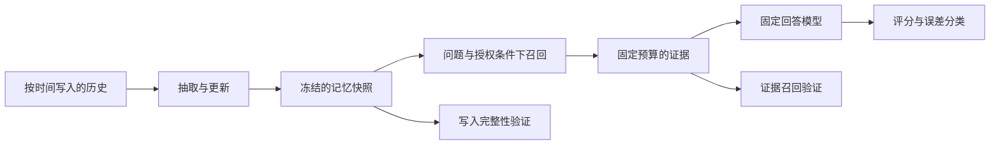

# Agent Memory Benchmark 构建与测试方案

> 先问评测测的是“是否存下来”“是否找回来”“是否用对”，再比较准确率。以下区分公开 benchmark 的原始任务与本专题建议的复现实验。日期：2026-11-18；不冒充已经跑过付费模型的排行榜。

## 公开数据集分别测什么

| 数据集 | 构建与输入 | 测什么 | 使用边界 |
|---|---|---|---|
| LoCoMo | 10 组长期多会话对话，带 QA、事件摘要等标注 | 跨会话事实、多跳、时间、拒答等对话记忆 | 样本会话数小；常见论文仅选部分QA类别，不能把不同子集的分数直接横比 |
| LongMemEval | 500 道问题，各带多会话历史与答案证据 | 信息抽取、多会话推理、时间推理、知识更新、拒答五种能力 | 常见 small/medium 历史规模不同；历史清洗版本也影响结果 |
| LongMemEval-V2 | 作者已发布的 agentic 版本，451 人工题、web/enterprise轨迹；最大历史可达115M token | 环境状态、动态变化、流程知识、环境陷阱、前提意识，兼顾查询时延 | 不是把V1聊天题简单扩到更多token；轨迹知识与个人偏好是不同任务 |
| MemoryAgentBench | 将长材料按增量交互喂给Agent，独立记忆后回答/完成任务 | 准确检索、测试时学习、长期理解、选择性遗忘等能力 | 在线写入协议和处理顺序是任务的一部分；离线看完全部再索引可能改变设定 |
| LoCoMo-Plus | 从长期对话进一步考察认知层面的记忆应用 | 间接线索与潜在约束在新任务中的运用 | 需要确认具体发布数据和官方评分脚本，不能只测关键词回忆 |

来源：[LoCoMo 原始仓库](https://github.com/snap-research/locomo)、[论文](https://aclanthology.org/2024.acl-long.747/)；[LongMemEval 官方仓库](https://github.com/xiaowu0162/LongMemEval)、[论文](https://arxiv.org/abs/2410.10813)；[V2 官方仓库](https://github.com/xiaowu0162/LongMemEval-V2)；[MemoryAgentBench 官方仓库](https://github.com/HUST-AI-HYZ/MemoryAgentBench)、[论文](https://arxiv.org/abs/2507.05257)；[LoCoMo-Plus](https://arxiv.org/abs/2602.10715)。这里不把项目自营排行榜当独立验证。

除这些外，BEAM、PersonaMem 系列、MemoryBench 与厂商评测 harness 也值得跟踪。先确认它是数据集、评测执行器还是排行榜；同名“MemoryBench”和“Agent Memory Benchmark”不能只看标题当成统一标准。以 [AMB 的任务与运行说明](https://agentmemorybenchmark.ai/)为例，它允许通过 provider 接口比较系统，但运营方也开发 Hindsight；比较时仍需核对原始run配置和竞争产品适配器，而非直接采信排名。

## 一张图拆出失败归因



**图的含义：**答案错误可能来自写入丢失、索引不可见、检索未命中、预算裁掉、回答模型误读或评分器误判。只看最后准确率不能告诉你要改哪个模块。

## 三层评估与成本账

| 层 | 指标 | 需要什么标注 |
|---|---|---|
| 写入/维护 | 事实precision/recall、纠正成功率、重复率、时间归属、删除残留、索引就绪延迟 | 源事件到事实的对齐、失效关系 |
| 检索 | Recall@k、Precision@k、MRR、nDCG、证据覆盖率、空结果正确率 | gold evidence ids；多跳题的全部必要证据 |
| 使用 | 正确率、时间/身份一致、约束满足、可证据支持、拒答能力、实际任务成功 | 答案rubric、应否使用记忆、可验证任务结果 |
| 系统 | 写入与查询p50/p95、tokens、模型调用次数、建库/维护/回答费用、存储 | 同一硬件/并发/缓存状态下的测量日志 |

$$
\operatorname{Recall@k}(q)=\frac{|R_k(q)\cap G(q)|}{|G(q)|},\qquad
\operatorname{Precision@k}(q)=\frac{|R_k(q)\cap G(q)|}{|R_k(q)|}
$$

$G(q)$ 为该问题的相关证据集合，$R_k(q)$ 为最多 $k$ 条返回结果。若无答案问题的 $G(q)$ 为空，不强行计算这个分式，另报拒答/误召回。以证据单元还是会话为id必须统一；LongMemEval的会话级gold与逐片段检索不能直接当成同一级别。

$$
\operatorname{MRR}=\frac{1}{|Q|}\sum_{q\in Q}\frac{1}{\operatorname{rank}_{q}^{\mathrm{first\ relevant}}}
$$

未命中时该项为0。多跳问题仅首条相关排得靠前仍不够，要额外报告全证据覆盖。最终总成本应包括建库、后台整理、嵌入重建、路由、检索重排、回答和judge，而非只算在线回答token。

## 一个可复现的公平实验协议

1. 固定 dataset 文件哈希、split、代码commit；区分官方清洗前后版本和排除类别。发布查询清单，不仅发布平均分。
2. 为每个隔离用户/会话组建立独立命名空间；严格按时间顺序 ingest。问题和 gold answer 不能提前进入提取器或后台整理上下文。
3. 记录写入模式（同步/异步）、提取模型、预算、是否等待索引ready。未等待ready造成的失败与稳定态检索分别报告。
4. 各系统使用一致的问题、回答模型、prompt、温度和证据token预算；另外单独跑“产品最佳默认配置”，不能把它与受控组件实验混在同一排行。
5. 保存检索原结果、过滤后的结果、最终送模文本及source ids。工具式多轮检索要统一最大轮数和总预算，不能对一个系统只准一次搜索。
6. 保存回答，按官方脚本或明示rubric评分。Judge模型、版本和prompt固定，盲化系统名；抽样人工复核，报告分歧。
7. 以用户/会话为组做bootstrap置信区间，而非把同一会话派生的题当完全独立样本；报告种子和多次运行方差。
8. 冷/热缓存、延迟、构建成本和增量更新成本分开报。不要让一个系统带热索引、另一个现场建库后就比较“延迟”。

这是一套建议协议。不能把示例数字当真实测量。尤其不要把某厂商 LoCoMo 的子集、某博客 LongMemEval 的 top-200 和另一系统同名数据集全量成绩拼成“同台比较”。

## 建立自己的编码Agent记忆集

聊天问答并不覆盖“记住仓库陷阱后下一次少犯错”。建议以仓库快照和任务序列构建一个小型私有集：

```json
{
  "case_id": "repo-uv-correction",
  "scope": {"tenant":"t1","project":"repo-a"},
  "events": [
    {"id":"e1","at":"2026-11-01","text":"本项目用pip"},
    {"id":"e2","at":"2026-11-18","text":"从今天起改为uv，CI和本地都一致"}
  ],
  "query": {"at":"2026-11-19","text":"安装依赖应该用哪个工具？"},
  "gold": {"answer":"uv","evidence_ids":["e2"],"obsolete_ids":["e1"]},
  "checks": ["不得引用repo-b规则", "不得执行生产写操作"]
}
```

再增加：同名用户/项目、只有CI改动、未来生效、显式纠正、删除后再次查询、时间范围问题、无证据问题、记忆里的恶意指令、错误工具输出被当经验、分支撤回、索引滞后、并发更新、回到旧会话等。至少一组必须让旧记忆比新记忆词法更相似，验证系统不会只按相关分盲选。

对“下次运行pytest而非unittest”的程序性记忆，应检查实际命令和任务结果，而不仅问模型“你记住了吗”。对不该个性化的任务也要设负例：用户曾经偏好某框架，不意味着所有新项目都要被改成那个框架。

## 建议的基线与消融

- 无记忆，仅当前任务；确定记忆是否真有增益。
- 全历史在同一上下文窗口内；窗口装不下的情况另报，不偷偷裁掉证据。
- 原始片段 BM25、dense 和 hybrid；区分提取价值与单纯检索价值。
- 摘要/事实提取后使用相同retriever，观察抽取造成的收益与信息损失。
- Oracle evidence + 同一回答模型，估计“有正确证据也答错”的下游上限。
- 去掉时间过滤、冲突消解、画像、图边、后台整理、rerank分别重跑；一次只改一个变量。

如果完整系统打败基础RAG，也不能立刻归功于图或“自进化”：它可能只是用了更强提取模型、更大证据预算或更多轮工具。反过来，一个低成本BM25基线赢某子集，也不能证明Embedding永远无用。

## 安全与维护评测应独立设门槛

记忆系统会持续影响以后决策。建议将跨租户泄漏、删除失效、持久提示注入和越权访问设为独立门槛，不用总体QA准确率抵消。删除测试至少验证原记录、检索索引、画像、缓存和重新提取任务；回滚测试验证当前状态不会因旧分支读取而污染。离线样例只检验部分正确性，不代表完成红队或生产合规验证。

## 本次报告做了哪些测试

本次执行的是资料与渲染检查、以及配套标准库样例的确定性测试：验证词法召回、时间更新、作用域隔离和逻辑撤销后的查询。**没有为报告调用付费模型跑完整LoCoMo/LongMemEval，也没有自行复现各厂商的成绩。**项目引用的性能数字若保留，必须按原作者报告理解，并以其模型/预算/数据版本为条件。
