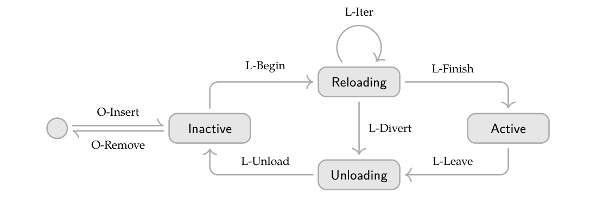

# Cordis：运行时组件的时间与空间可组合性

> 💡 Cordis让运行时持有每次受管副作用的撤销操作，并根据依赖变化自动启停组件，再用统一context和生命周期演算说明这些局部机制如何组合成系统保证。
>
> [论文](https://arxiv.org/abs/2608.25512v1) · [Cordis实现](https://github.com/cordiverse/cordis) · [补充解读](Cordis解读.md)。这是一篇程序设计与形式语义论文，结果主要是性质证明和系统案例，不是模型基准。

插件和Agent运行环境不断加载、替换组件时，困难不只是代码能否import：组件离开后监听器、资源与注册项能否完整清理，服务撤回后依赖者是否还会继续运行，同一配置在不同启停历史下能否回到一致状态？Cordis将这些问题分成时间与空间两个维度，把effect和coeffect从静态分析概念提升为运行时机制。论文先定义可撤销effect与响应式coeffect，再以受管context限定观察与操作，建立动态组件演算和元理论，最后给出TypeScript核心、声明式loader、HMR与Koishi案例。其保证依赖明确的可逆性、独立性和生命周期条件，不能理解成任意代码都可自动回滚。

## 两个维度与现有机制的不足

时间可组合性要求移除一个组件时，撤销它对共享环境的受管影响；空间可组合性要求声明、发现依赖，并在依赖出现、撤回或身份改变时协调生命周期。

静态程序中，RAII/词法作用域和模块导入分别处理部分问题；长期运行系统中，副作用寿命不由函数栈决定，依赖也不固定。重启进程、容器编排提供粗粒度替代，却会丢缓存、连接和在途任务。

论文以VSCode说明实践缺口：抽样前100扩展中87个含可执行代码，卸载通常需要重启extension host，只有7个声明非内置扩展依赖。这是特定日期样本对API生态的观察，不是对全部插件系统的普遍定理。

## 可撤销effect：变化和逆操作一起返回

受管effect的类型为：

$$
e:\Gamma\to\Gamma\times(\Gamma\to\Gamma).
$$

执行得到新context与本次逆操作。逆操作可捕获旧状态，只需在相应执行所到达的状态满足恢复条件，不要求在任意状态都构成全局双射。

effect context为$\partial\Gamma=\Gamma\times(\Gamma\to\Gamma)$，保存当前状态$\gamma$与累计撤销函数$\phi$。跟踪变换定义为：

$$
\operatorname{track}(f,g)(\gamma,\phi)=(f(\gamma),\phi\circ g).
$$

后发生的逆先执行，形成栈式恢复。跟踪不改变前向行为，并与组合相容；但提供一个名叫dispose的函数本身不证明它正确，理论需要witness保证它撤销对应变化。

effect function进一步把操作和产生的逆纳入结构，effect iterator把阶段性执行、暂停、继续和撤销纳入同一抽象，适应异步初始化和长期运行组件。嵌套effect把子级清理再登记到父级，使父卸载能够收回子资源。

## 响应式coeffect：依赖是可观察的运行条件

coeffect context是有限的类型化部分映射$\sigma:(k:K)\rightharpoonup\mathcal V_k$。每个key有其值类型；重复提供已有key、撤销不存在key违反操作前提，不产生正常转移。

组件依赖规范$d\subseteq K$，满足条件为：

$$
\sigma\models d\iff\forall k\in d,\ k\in\operatorname{dom}(\sigma).
$$

每次context变化都比较前后满足性，分activating、deactivating、neutral。激活启动并跟踪effect，失效触发累计逆；这将“依赖缺失时何时启停”从每个插件的手写逻辑交给运行时。

后续模型还关心提供者身份：同名key从旧实例换到新实例，不能只看“key仍存在”就让依赖者继续持有旧对象。

## 隔离、拦截与统一context

isolation给同名key映射不同realm，使两组组件有独立服务；interception调整读取服务时的metadata或权限。前者改变“解析到谁”，后者改变“如何使用它”，不能混成同一种覆盖。

effect与coeffect统一到递归context，概念上为$\Gamma_\infty=\mu\Gamma.\,\Gamma\times(\Gamma\to\Gamma)\times\Sigma$。所有共享位置需要通过key下的操作暴露，每个阶段只能通过该context作用于环境。

这条纪律是理论前提：如果组件可任意改另一个全局对象，运行时即使完整记录ctx上的操作，也不能恢复被绕过的影响。

## 可观察等价与独立性

释放内存不会恢复堆布局，重新生成标识也不必等于旧标识，所以恢复不是逐字节相等。论文以key公开的操作定义可观察等价$\simeq$：在允许的观察序列下无法区分，才算等价。

跨组件交错比单组件逆序恢复更难。要撤销A而不抹掉之后B的变化，需要两者effect满足独立性：相关前向/逆变换可交换，且其他effect不能改变本次逆函数应捕获的信息。并不是所有两个有dispose的函数都天然独立。

在这些条件下，一组独立effect的逆可以按不同顺序撤销仍恢复初态。对于共享对象，独立性通常需要选择合适表示，例如用独立注册项标识管理集合，而不是用“把整个列表恢复旧快照”覆盖其他组件新增项。

coeffect commutativity把依赖解析与effect交换联系起来，作为从局部恢复走向组件组合的关键条件。边界外的位置和不满足这些条件的操作不受该定理保证。

## 组件、fiber与动态演算

组件由依赖规范、提供项和带witness的effect构成；fiber是运行实例，保存生命周期、父关系、局部绑定、累计逆和已提交依赖视图。注册表记录整个组件系统。

编排规则负责插入、请求退役与移除；生命周期规则负责Begin、Iter、Finish、Leave、Divert、Unload等执行。Inactive、Reloading、Active、Unloading分开，退役标记不等于马上删除对象。

只有Active提供者对新激活宣称可用。它进入Unloading时，依赖者先看见依赖失效并开始退出，但实际绑定暂留，供已有依赖者完成撤销；全部依赖者退出后才撤回提供项。因此“先通知不能再用”与“立即销毁对象”是不同阶段。

若异步加载期间依赖变化，目标视图与committed view的比较决定继续、转向或重载，避免把半初始化实例误当作已稳定服务。

## 元理论分别保证什么

| 性质 | 论文要证明的行为 | 关键范围 |
| --- | --- | --- |
| Preservation | 每条规则保持注册表结构、提供项与依赖视图等不变量 | 从well-formed状态出发 |
| 时间可组合性 | 单fiber撤销在其他fiber交错后仍有效 | effect独立性与正确逆 |
| 空间可组合性 | 激活只访问已承诺且有效的依赖，撤回按序传播 | context介入、提供者/视图纪律 |
| Progress/静止 | 满足条件的内部生命周期能继续并达到稳定状态 | 无环先后关系、有限执行等条件 |
| Confluence | 同一编排输入的不同内部执行顺序到达等价稳定态 | 相应无环/独立性前提 |

合流不是“输入任何不同配置都会同结果”。编排是外部输入，比较固定插入/退役请求后，内部调度和退出分支是否改变可观察结果。正常形对应最终活跃组件按依赖顺序从头加载的状态，是动态更新与from-scratch一致性的类比。

循环依赖可能让组件永久Inactive；这可由声明预测，不是并发调度随机出现的死锁。把互相交互的模块拆成核心服务与桥接组件，可能消除看似不可避免的环，但不是形式模型自动替作者拆分。

## TypeScript核心：实现与证明前提的落差

`ctx.effect`接收动作/迭代器，返回dispose，设置armed状态确保最多执行一次，并把自身逆加入父context。运行时负责跟踪和调用，**不验证作者写的逆确实正确，也不自动证明所提供共享操作可交换**。

服务解析经`key→realm→value`两层映射；变更通知筛出同realm的依赖者并refresh。Proxy属性访问沿fiber父链查committed view，声明了但未提交时报INACTIVE_ACCESS，没有声明时报UNDECLARED_ACCESS。

这比普通`ctx.get`反射API多了生命周期和声明检查，但语言级代理不是恶意代码沙箱：能直接访问宿主全局的代码仍可绕过它。

## 声明式loader与配置协调

entry包含id、url、config、disabled、isolate、intercept。稳定id允许对配置树做keyed diff，保留无关实例：id/url改变重建；disabled启停；isolate重分realm；intercept可原地改；config交给组件决定是否重载。模块可并发加载，依赖约束作用在激活阶段，而不要求import阶段串行排序。

HMR不只是删模块缓存：收集变更与依赖图，区分接受/拒绝边界，定位stale entries，备份并失效相关模块，依次撤销、重新导入、重新激活。导入失败则恢复缓存并重建旧组件。代码缓存恢复不等于撤回已经对外发送的消息。

## 案例、外部I/O与扩展讨论

Koishi提供约四年、超过4000社区插件的案例：不同作者只约定依赖接口，也能动态换数据库、适配器或功能插件，而无关连接继续运行。证据是单一语言与生态的观察，没有受控性能比较，因此不能写出虚构的吞吐或可用性提升比例。

外部边界按“位置是否被系统独占管理”而非按内存/磁盘介质划分。私有临时文件可受管，共享文件未必；打开句柄并登记资源可撤销，已经发送到网络的字节不可自动消失。需要output commit或应用补偿时，是额外协议和更粗等价，不是本框架天然逆操作。

服务broker可把多provider、滚动更新和RPC接入同一依赖接口，但跨进程调用仍有延迟与失败，需异步契约。权限可通过声明与intercept衰减，隔离不可信代码仍需进程、VM等外部边界。

类型化key在独立编译生态仍可能接口漂移或撞名。命名空间、版本/结构检查等解决不同部分，把它们统一且保持组合保证仍是开放问题。其他语言需闭包、动态装卸能力以及属性/依赖访问介入；Python descriptor等可实现部分机制，不能据此认为已有同等成熟的Python实现。

## 结论

Cordis将“能撤销”与“依赖会响应变化”放进同一种运行纪律，并通过演算说明在明确条件下如何从局部机制得到系统性质。它的价值不是让任意有副作用代码自动变安全，而是把清理责任、依赖视图和更新次序组织成可推理的结构；正确逆、受管边界、共享操作表示和可靠实现仍是系统成立的基础。
