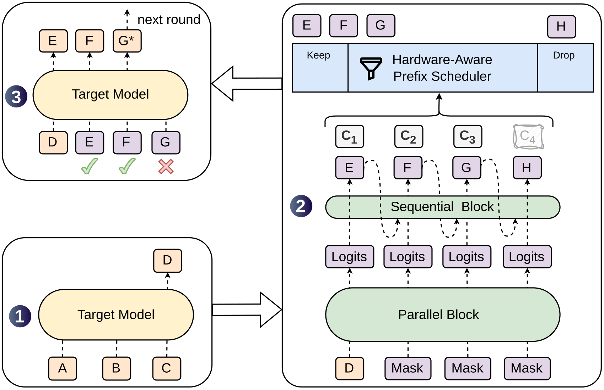
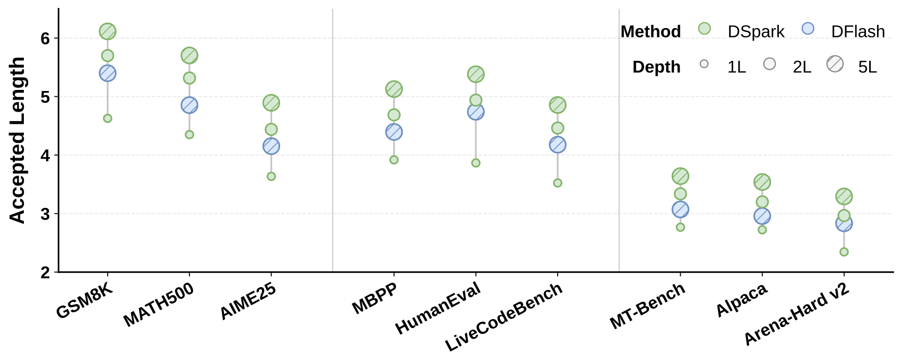
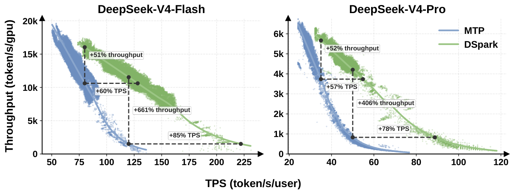

# DSpark：半自回归草稿与按置信度调度的投机解码

> 💡 DSpark 先并行算草稿、再用很轻的顺序模块修正相邻依赖，并按前缀接受概率和硬件负载决定验多少token，以同时改善接受长度与服务效率。
>
> [论文](https://arxiv.org/abs/2607.05147) · [训练框架](https://github.com/deepseek-ai/DeepSpec) · [补充解读](DSpark解读.md)

投机解码用便宜草稿模型提出多个token，再由目标模型并行验证，但草稿快并不代表整体快：纯自回归草稿要逐步计算，纯并行草稿又容易把不同可能续写拼成不一致序列；固定长验证还会在高并发时浪费主模型容量。DSpark分别处理这两个问题，用轻量顺序偏置改善并行草稿，再用校准的接受概率和引擎容量曲线分配验证预算。论文同时给出离线接受长度、组件实验和V4预览服务实测，并专门分析自适应截断如何破坏或保持目标分布。

## 延迟目标与半自回归分布

平均每输出token延迟近似$L=(T_{draft}+T_{verify})/\tau$，$\tau$为每轮接受长度。因此只增大草稿长度可能同时增大分母与验证成本，未必有利。

并行backbone一次给出$\gamma$个位置的基础logits $U_k$，顺序模块根据此前已采样token加入偏置：

$$
p_k(v\mid x_{<k})=\operatorname{softmax}_v(U_k(v)+B_k(x_{<k},v)),\quad P(X)=\prod_kp_k(x_k\mid x_{<k}).
$$

默认Markov head仅依赖前一token，$B(x_{k-1},\cdot)=W_1[x_{k-1}]W_2$，低秩$r=256$。它用便宜查表加投影避免“of course”和“no problem”被独立位置混成“of problem”。RNN版本以门控状态累积更长前缀，收益需与顺序时延比较。

## 接受概率、校准与训练

confidence head预测条件接受概率$c_k$，真值来自draft和target分布的总变差：

$$
c_k^*=1-\tfrac12\|p_k^d-p_k^t\|_1,\qquad a_k=P(\text{前}k\text{个全接受})=\prod_{i\le k}c_i.
$$

confidence是“前面已接受条件下当前能否接受”，不是整段共同概率。Sequential Temperature Scaling在验证集逐位置校准累积前缀概率；因为调度需要绝对期望，只有排序准确还不够。

冻结target及共享embedding/head，只训draft backbone、顺序head和confidence。loss为$0.1L_{CE}+0.9L_{TV}+L_{conf}$，各位置权重$e^{-(k-1)/\gamma}$，偏重能影响整个接受前缀的早期位置。TV匹配直接关联接受率，confidence用软标签BCE。

## 硬件感知的全批前缀调度

对请求$r$验$\ell_r$个草稿，目标模型批token量$B=\sum_r(1+\ell_r)$，期望接受$\tau=\sum_r(1+\sum_{j\le\ell_r}a_{r,j})$。预先profile每个$B$的steps/s，最大化$\Theta=\tau\operatorname{SPS}(B)$。

固定$B$时按$a_{r,j}$全局排序即可，因其随位置不增，选后项自然包含前项。但回头看完整草稿再决定前面token是否获准，会让未来候选泄漏到准入事件，破坏无损投机的non-anticipating条件。

理论算法首次吞吐下降即停止，决定只依赖当前可见前缀。它仅在目标曲线单峰等条件下给全局最优，**不能把任意动态top-k都称为严格无偏**。

生产为兼容CUDA graph与ZOS，用前两步的历史置信估计决定当前容量，当前token按当前分数排序；历史容量把回顾搜索与当前候选隔开，避免后者反向影响准入。论文给出相应因果条件，不是仅凭“异步”二字就保证无损。

## 离线接受质量与消融

统一框架重训Eagle3、DFlash、DSpark，target为Qwen3-4/8/14B及Gemma4-12B，block7；Eagle3一层、两种并行方法五层。1.3M Open-PerfectBlend只取prompt，target重新生成回复，训练10epochs，使用non-thinking。

| Target | Drafter | Math | Math | Math | Code | Code | Code | Chat | Chat | Chat |
| --- | --- | --- | --- | --- | --- | --- | --- | --- | --- | --- |
| Target | Drafter | GSM8K | MATH | AIME25 | MBPP | HumanEval | LCB | MT-Bench | Alpaca | Arena-Hard |
| Qwen3-4B | Eagle3 | 5.14 | 4.62 | 3.92 | 3.69 | 4.16 | 3.77 | 2.39 | 2.26 | 2.55 |
| Qwen3-4B | DFlash | 5.40 | 4.85 | 4.15 | 4.40 | 4.74 | 4.18 | 3.07 | 2.96 | 2.83 |
| Qwen3-4B | DSpark | 6.11 | 5.70 | 4.89 | 5.13 | 5.38 | 4.86 | 3.64 | 3.54 | 3.29 |
| Qwen3-8B | Eagle3 | 5.30 | 4.77 | 3.91 | 3.96 | 4.33 | 4.17 | 2.66 | 2.54 | 2.54 |
| Qwen3-8B | DFlash | 5.33 | 4.91 | 4.07 | 4.36 | 4.64 | 4.39 | 3.11 | 2.98 | 2.81 |
| Qwen3-8B | DSpark | 6.17 | 5.78 | 5.01 | 5.16 | 5.52 | 5.17 | 3.72 | 3.58 | 3.21 |
| Qwen3-14B | Eagle3 | 5.24 | 4.60 | 3.71 | 3.81 | 4.14 | 4.01 | 2.62 | 2.47 | 2.48 |
| Qwen3-14B | DFlash | 5.41 | 4.84 | 3.98 | 4.44 | 4.59 | 4.33 | 3.10 | 2.94 | 2.72 |
| Qwen3-14B | DSpark | 6.21 | 5.74 | 4.94 | 5.26 | 5.43 | 5.02 | 3.70 | 3.58 | 3.13 |
| Gemma4-12B | Eagle3 | 5.87 | 5.46 | 4.83 | 4.72 | 5.37 | 4.16 | 3.19 | 3.06 | 2.72 |
| Gemma4-12B | DFlash | 5.45 | 5.04 | 4.22 | 4.39 | 4.95 | 3.70 | 2.98 | 2.84 | 2.59 |
| Gemma4-12B | DSpark | 6.05 | 5.78 | 5.12 | 5.11 | 5.64 | 4.51 | 3.49 | 3.35 | 2.92 |

该表**关闭confidence scheduler**，只比较固定块接受质量。Qwen三规模相对Eagle3平均接受长度提高30.9/26.7/30.0%，相对DFlash提高16.3/18.4/18.3%。这是接受长度提升，不是同倍服务吞吐。

数学/代码比开放聊天更可预测；例如4B上数学约5.57、代码5.12、聊天3.49。深度、block长度与顺序head实验解释接受质量与draft时延之间的取舍。校准后confidence才适合求期望收益，静态阈值不能适应不同并发工作点。

## V4服务部署与结果

生产DSpark为三层MoE+mHC、窗口128、block5、Markov head。只传target末层hidden，在draft worker本地重建所需logits，减少大词表通信；按固定anchor packing，避免草稿训练成本随目标长上下文增长。

Flash在80tok/s/user约束下，整体吞吐相对MTP-1提高51%；Pro在35tok/s/user下提高52%。同吞吐时用户速度分别约提高60%–85%和57%–78%。

更严SLA下出现661%/406%的名义相对优势，作者明确是MTP-1接近低并发能力边界，不应当作代表性的通用倍数。高并发时调度缩短验证预算，低并发则利用空余计算验更多候选。

## 局限

低接受率请求仍要付出整块并行draft的前置成本，验证调度无法追回；复杂硬件容量曲线和异步实现需要满足因果约束。论文把架构接受收益、调度收益和生产前沿分开验证，核心结论是少量顺序计算与负载感知验证可以互补，而不是草稿越长越好。
