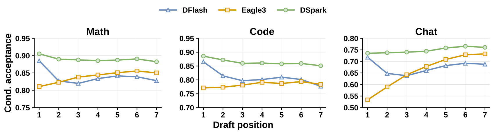
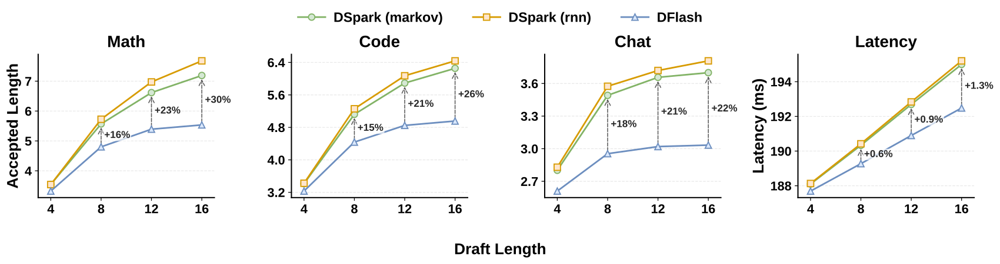
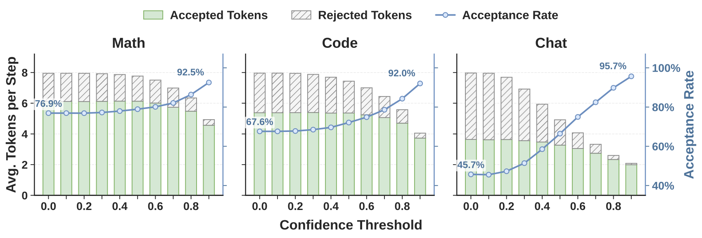
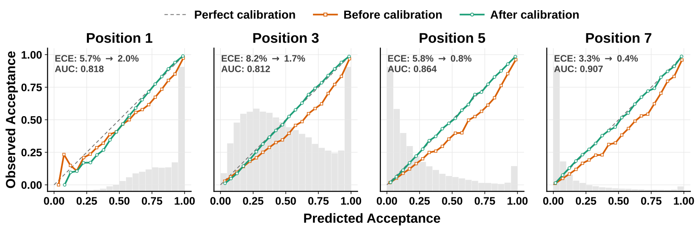
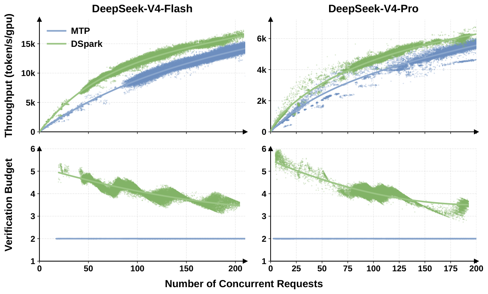

# DSpark: Confidence-Scheduled Speculative Decoding with Semi-Autoregressive Generation / 全文中英对照

> 来源：[arXiv:2607.05147v1](https://arxiv.org/abs/2607.05147v1)。英文段落后紧接中文，覆盖所取 HTML 版本的主文、附录、图表、脚注与参考文献；公式、数字表和书目信息共用。中文以机器初译为底稿，进行了术语整理与结构核对，尚未逐句人工审定；遇到歧义请以紧邻英文和原论文为准。 原作版权归所列作者，许可见 [原作许可](http://creativecommons.org/licenses/by/4.0/)；中文译文与版式改写在该许可条件下提供（涉及 SA 时沿用相同许可，涉及 NC 时仅限非商业使用）。

## Authors and affiliations / 作者与机构

Xin Cheng 1,2,∗ , Xingkai Yu 2,∗ , Chenze Shao 2,∗ , Jiashi Li 2,∗ , Yunfan Xiong 2,∗ Yi Qian 2 , Jiaqi Zhu 2 , Shirong Ma 2 , Xiaokang Zhang 2 , Jiasheng Ye 2 , Qinyu Chen 2 , Chengqi Deng 2 , Jiping Yu 2 , Damai Dai 2 , Zhengyan Zhang 2 , Yixuan Wei 2 , Yixuan Tan 2 , Wenkai Yang 2 , Runxin Xu 2 , Yu Wu 2 , Zhean Xu 2 , Xuanyu Wang 2 , Muyang Chen 2 , Rui Tian 2 , Xiao Bi 2 , Zhewen Hao 2 , Shaoyuan Chen 2 , Huanqi Cao 2 , Wentao Zhang 2 , Anyi Xu 2 , Huishuai Zhang 1 , Dongyan Zhao 1 , Wenfeng Liang 2 1 Peking University 2 DeepSeek-AI {chengxin, xingkai, shaochenze, js.li, yunfanxiong}@deepseek.com

**EN.** \reportnumber

**中.** \报告编号

**EN.** 001

**中.** 001

## Abstract / 摘要

**EN.** Speculative decoding accelerates Large Language Model (LLM) inference by decoupling draft generation from target verification. While recent parallel drafters efficiently propose long token sequences in a single forward pass, they suffer from rapid acceptance decay due to a lack of inter-token dependencies. Furthermore, indiscriminately verifying these extended blocks wastes critical batch capacity on tokens with high rejection risks, severely degrading throughput in high-concurrency serving systems. We introduce DSpark, a speculative decoding framework that unifies high-throughput parallel generation with adaptive, load-aware verification. To maintain draft quality, DSpark utilizes a semi-autoregressive architecture—coupling a parallel backbone with a lightweight sequential module—to introduce intra-block dependency modeling and mitigate suffix decay. To optimize system efficiency, DSpark employs confidence-scheduled verification, dynamically tailoring the verification length for each request based on estimated prefix survival probabilities and engine-specific throughput profiles. On offline benchmarks across diverse domains, DSpark substantially improves the accepted length over state-of-the-art autoregressive and parallel drafters. When deployed within the DeepSeek-V4 serving system under live user traffic, DSpark successfully mitigates verification waste. Compared to the established production baseline (MTP-1), DSpark accelerates per-user generation speeds by 60%–85% at matched throughput levels. More importantly, by preventing severe throughput degradation under strict interactivity constraints, it enables performance tiers that were previously unattainable, shifting the Pareto frontier of our serving system. To facilitate community progress, we open-source the [DSpark checkpoints](https://huggingface.co/deepseek-ai/DeepSeek-V4-Pro-DSpark/tree/main) alongside [DeepSpec](https://github.com/deepseek-ai/DeepSpec) , an algorithm-driven training repository for speculative decoding.

**中.** 推测性解码通过将草稿生成与目标验证解耦来加速大型语言模型 (LLM) 推理。虽然最近的并行起草者在一次前向传递中有效地提出了长令牌序列，但由于缺乏令牌间依赖性，它们的接受度迅速下降。此外，不加区别地验证这些扩展块会浪费具有高拒绝风险的令牌的关键批量容量，严重降低高并发服务系统的吞吐量。我们介绍 DSpark，这是一种推测性解码框架，它将高吞吐量并行生成与自适应负载感知验证相结合。为了保持草稿质量，DSpark 采用半自回归架构（将并行主干与轻量级顺序模块耦合）来引入块内依赖建模并减轻后缀衰减。为了优化系统效率，DSpark 采用置信度计划验证，根据估计的前缀生存概率和特定于引擎的吞吐量配置文件动态调整每个请求的验证长度。在跨不同领域的离线基准测试中，DSpark 与最先进的自回归和并行绘图仪相比，大大提高了可接受的长度。当在实时用户流量下部署在 DeepSeek-V4 服务系统中时，DSpark 成功减少了验证浪费。与既定的生产基线 (MTP-1) 相比，DSpark 在匹配的吞吐量水平下将每个用户的生成速度加快了 60%–85%。更重要的是，通过防止严格的交互性限制下严重的吞吐量下降，它实现了以前无法实现的性能层，从而改变了我们服务系统的帕累托边界。为了促进社区进步，我们开源了 [DSpark 检查点](https://huggingface.co/deepseek-ai/DeepSeek-V4-Pro-DSpark/tree/main) 以及 [DeepSpec](https://github.com/deepseek-ai/DeepSpec)，这是一个用于推测解码的算法驱动训练存储库。

## Introduction / 简介

**EN.** Large Language Models (LLMs) generate text autoregressively: each new token requires a full forward pass conditioned on all preceding tokens, making inference latency proportional to the output length. The resulting low GPU utilization and high user-perceived waiting time constitute a primary bottleneck in production LLM serving, particularly for latency-sensitive scenarios such as real-time conversational assistants and multi-turn agentic workflows. Speculative decoding ( Leviathan et al., 2023 ; Chen et al., 2023 ) offers a principled solution: a lightweight draft model proposes a block of candidate tokens, and the full-size target model verifies the entire block in a single forward pass via rejection sampling, accepting the longest prefix consistent with the target distribution and appending one bonus token. Because verification is parallel and the acceptance rule preserves the target distribution exactly, speculative decoding accelerates generation without any quality loss.

**中.** 大型语言模型 (LLM) 自回归生成文本：每个新标记都需要以所有先前标记为条件的完整前向传递，从而使推理延迟与输出长度成正比。由此产生的低 GPU 利用率和高用户感知等待时间构成了生产 LLM 服务的主要瓶颈，特别是对于延迟敏感的场景，例如实时会话助理和多轮代理工作流程。推测性解码（Leviathan et al., 2023；Chen et al., 2023）提供了一种原则性的解决方案：轻量级草案模型提出候选令牌块，全尺寸目标模型通过拒绝采样在单次前向传递中验证整个块，接受与目标分布一致的最长前缀并附加一个奖励令牌。由于验证是并行的，并且接受规则准确地保留了目标分布，因此推测解码可以加速生成，而不会造成任何质量损失。

**EN.** The design of the draft model governs the trade-off between drafting latency and acceptance rate. Early drafters are autoregressive ( Li et al., 2024b ; Cheng et al., 2024 ) , conditioning each position on previously sampled tokens. However, their drafting latency grows linearly with the block size, forcing these methods to use short blocks and shallow architectures. To break this sequential bottleneck, parallel drafters ( Cai et al., 2024 ; Liu et al., 2026a ; Chen et al., 2026 ) have emerged as a compelling alternative: all draft positions are produced in a single forward pass, making drafting latency nearly independent of block size. This structural advantage theoretically allows parallel drafters to efficiently generate substantially longer draft blocks.

**中.** 草稿模型的设计决定了草稿延迟和接受率之间的权衡。早期的起草者是自回归的（Li et al., 2024b；Cheng et al., 2024），根据之前采样的标记来调节每个位置。然而，它们的起草延迟随着块大小线性增长，迫使这些方法使用短块和浅架构。为了打破这个顺序瓶颈，并行起草者（Cai et al., 2024；Liu et al., 2026a；Chen et al., 2026）已经成为一种引人注目的替代方案：所有起草位置都在一次前向传递中产生，使得起草延迟几乎与块大小无关。从理论上讲，这种结构优势允许平行牵伸机有效地生成更长的牵伸块。

**EN.** However, fully unlocking the potential of large parallel draft blocks introduces two critical bottlenecks—one in generation quality, and the other in system efficiency. First, because parallel drafters predict each position independently, they cannot model inter-token dependencies within a block. This independence leads to multi-modal collisions and rapid acceptance decay at later positions ( Gu et al., 2018 ; Huang et al., 2022b ) . Second, determining the optimal verification length remains a challenge. While parallel generation easily produces long draft blocks, indiscriminately verifying all proposed tokens degrades system throughput, particularly under high-concurrency workloads ( Liu et al., 2024c ; Hu et al., 2026b ) . The ideal verification length varies along two axes. On the data side, structured requests like code naturally sustain higher acceptance rates than open-ended chat ( Xia et al., 2024 ; Abramovich et al., 2026 ) . On the system side, verifying extra tokens is nearly free under light loads. Under heavy loads, however, verifying tokens with a high rejection risk occupies critical batch capacity that could otherwise serve other active requests ( Liu et al., 2024b ; Wu et al., 2025 ) .

**中.** 然而，充分释放大型并行草案区块的潜力会带来两个关键瓶颈——一个是发电质量，另一个是系统效率。首先，由于并行绘图者独立预测每个位置，因此他们无法对块内的令牌间依赖关系进行建模。这种独立性导致了多模态碰撞和后期位置的快速接受度衰减（Gu et al., 2018; Huang et al., 2022b）。其次，确定最佳验证长度仍然是一个挑战。虽然并行生成很容易产生长草稿块，但不加区别地验证所有提议的代币会降低系统吞吐量，特别是在高并发工作负载下（Liu et al., 2024c; Hu et al., 2026b）。理想的验证长度沿两个轴变化。在数据方面，像代码这样的结构化请求自然比开放式聊天具有更高的接受率（Xia 等人，2024；Abramovich 等人，2026）。在系统方面，在轻负载下验证额外的令牌几乎是免费的。然而，在重负载下，验证具有高拒绝风险的令牌会占用关键的批量容量，否则这些容量可以服务于其他主动请求（Liu et al., 2024b; Wu et al., 2025）。

**EN.** To address these bottlenecks, we introduce DSpark , a speculative decoding framework that unifies high-throughput parallel generation with adaptive, load-aware verification. At its core, DSpark is designed to resolve the inherent trade-offs in draft generation and verification through two complementary mechanisms.

**中.** 为了解决这些瓶颈，我们引入了 DSpark，这是一种推测性解码框架，它将高吞吐量并行生成与自适应负载感知验证相结合。 DSpark 的核心旨在通过两种互补机制解决草稿生成和验证中固有的权衡问题。

**EN.** First, to overcome the lack of inter-token dependencies, DSpark adopts a semi-autoregressive architecture. It keeps the computationally expensive draft backbone fully parallel, appending only a lightweight serial output head to inject local transition information. This design preserves the drafting speed of parallel models while significantly mitigating suffix decay.

**中.** 首先，为了克服代币间依赖关系的缺乏，DSpark 采用了半自回归架构。它使计算成本高昂的草案主干完全并行，仅附加一个轻量级串行输出头来注入本地转换信息。这种设计保留了并行模型的绘图速度，同时显着减轻了后缀衰减。

**EN.** Second, to resolve the system-level bottleneck, DSpark employs confidence-scheduled verification. By coupling a confidence head—which estimates per-position prefix survival probabilities—with a hardware-aware scheduler, DSpark dynamically tailors the verification length for each request. This scheduler leverages real-time engine throughput profiles to route target verification budget only toward tokens with the highest expected return.

**中.** 其次，为了解决系统级瓶颈，DSpark采用了置信度计划验证。通过将置信头（估计每个位置前缀生存概率）与硬件感知调度程序相结合，DSpark 可以动态定制每个请求的验证长度。该调度程序利用实时引擎吞吐量配置文件将目标验证预算仅分配给具有最高预期回报的代币。

**EN.** We extensively evaluate DSpark across both controlled offline benchmarks and production-scale online deployments. On controlled offline benchmarks—spanning mathematical reasoning, code generation, and daily chat—DSpark consistently outperforms strong baselines. Specifically, across the Qwen3-4B, 8B, and 14B target models ( Yang et al., 2025 ) , it improves the macro-average accepted length over the autoregressive Eagle3 ( Li et al., 2026b ) by 30.9%, 26.7%, and 30.0%, and over the parallel DFlash ( Chen et al., 2026 ) by 16.3%, 18.4%, and 18.3%, respectively. Beyond top-line metrics, our fine-grained position-wise analysis reveals the distinct generation characteristics of different drafters, empirically demonstrating how DSpark successfully combines the high initial-token capacity of parallel models with the suffix coherence of autoregressive models.

**中.** 我们通过受控离线基准测试和生产规模在线部署对 DSpark 进行了广泛评估。在受控离线基准测试中（涵盖数学推理、代码生成和日常聊天），DSpark 始终优于强大的基准。具体来说，在 Qwen3-4B、8B 和 14B 目标模型（Yang et al., 2025）中，它比自回归 Eagle3（Li et al., 2026b）将宏观平均接受长度提高了 30.9%、26.7% 和 30.0%，比并行 DFlash（Chen et al., 2026）提高了 30.9%、26.7% 和 30.0%。分别为 16.3%、18.4% 和 18.3%。除了顶线指标之外，我们的细粒度位置分析还揭示了不同起草者的独特生成特征，以实证方式证明了 DSpark 如何成功地将并行模型的高初始令牌容量与自回归模型的后缀一致性相结合。

**EN.** Beyond offline evaluation, we deployed DSpark within the DeepSeek-V4 ( DeepSeek-AI, 2026 ) serving system to assess its performance under live user traffic. Compared to the prior MTP-1 production baseline ( DeepSeek-AI, 2024 ) , DSpark significantly broadens the system’s operational envelope. Specifically, it consistently accelerates per-user generation speeds by 60%–85% (V4-Flash) and 57%–78% (V4-Pro) at matched aggregate throughput capacities. Furthermore, under strict Service Level Agreements (SLAs) where the baseline’s capacity deteriorates severely—such as 120 TPS for Flash and 50 TPS for Pro—DSpark mitigates verification overhead to maintain robust throughput. By overcoming this performance cliff, DSpark unlocks strict interactivity tiers that were previously unattainable, effectively shifting the Pareto frontier of LLM serving.

**中.** 除了离线评估之外，我们还在 DeepSeek-V4（DeepSeek-AI，2026）服务系统中部署了 DSpark，以评估其在实时用户流量下的性能。与之前的 MTP-1 生产基线（DeepSeek-AI，2024）相比，DSpark 显着拓宽了系统的操作范围。具体来说，它在匹配的聚合吞吐量能力下持续将每用户生成速度提高了 60%–85% (V4-Flash) 和 57%–78% (V4-Pro)。此外，在严格的服务级别协议 (SLA) 下，基线容量严重恶化（例如闪存为 120 TPS，Pro 为 50 TPS），DSpark 可以减轻验证开销以保持稳健的吞吐量。通过克服这一性能悬崖，DSpark 解锁了以前无法实现的严格交互层，有效地改变了 LLM 服务的帕累托前沿。

**EN.** To foster collective advancement within the open-source community, we are making our artifacts publicly available. Specifically, we release the trained [DSpark checkpoints](https://huggingface.co/deepseek-ai/DeepSeek-V4-Pro-DSpark/tree/main) for both the DeepSeek-V4-Flash (preview) and DeepSeek-V4-Pro (preview) models. Furthermore, we open-source [DeepSpec](https://github.com/deepseek-ai/DeepSpec) , an algorithm-driven training repository, including Eagle3, DFlash and DSpark. These artifacts are intended to support further research on efficient LLM serving.

**中.** 为了促进开源社区内的集体进步，我们正在公开提供我们的工件。具体来说，我们发布了适用于 DeepSeek-V4-Flash（预览版）和 DeepSeek-V4-Pro（预览版）模型的经过训练的 [DSpark 检查点](https://huggingface.co/deepseek-ai/DeepSeek-V4-Pro-DSpark/tree/main)。此外，我们还开源了算法驱动的训练库[DeepSpec](https://github.com/deepseek-ai/DeepSpec)，包括Eagle3、DFlash和DSpark。这些工件旨在支持高效LLM服务的进一步研究。

## Background / 背景

### Speculative Decoding / 推测性解码

**EN.** Autoregressive language models generate one token per forward pass, making inference latency proportional to output length. Speculative decoding ( Ge et al., 2022 ; Leviathan et al., 2023 ; Chen et al., 2023 ) accelerates the inference of a target model $M_{t}$ using a lightweight draft model $M_{d}$ . At each decoding cycle, the draft model proposes $\gamma$ candidate tokens $x_{1},\ldots,x_{\gamma}$ . The target model verifies all candidates in a single forward pass, accepting the longest prefix consistent with its own distribution.

**中.** 自回归语言模型每次前向传递生成一个标记，使推理延迟与输出长度成正比。推测解码（Ge et al., 2022；Leviathan et al., 2023；Chen et al., 2023）使用轻量级草案模型 $M_{d}$ 加速目标模型 $M_{t}$ 的推理。在每个解码周期，草稿模型提出 $\gamma$ 候选标记 $x_{1},\ldots,x_{\gamma}$ 。目标模型在一次前向传递中验证所有候选者，接受与其自身分布一致的最长前缀。

**EN.** Concretely, at each draft position $k$ , the target model computes its own distribution $p_{k}^{t}$ and compares it against the draft distribution $p_{k}^{d}$ . The token $x_{k}$ is accepted with probability $\min(1,\,p_{k}^{t}(x_{k})/p_{k}^{d}(x_{k}))$ . Verification proceeds left to right: the first rejection at position $k$ discards all subsequent tokens $x_{k+1},\ldots,x_{\gamma}$ , regardless of their quality.

**中.** 具体来说，在每个拔模位置 $k$ ，目标模型计算其自己的分布 $p_{k}^{t}$ 并将其与拔模分布 $p_{k}^{d}$ 进行比较。代币 $x_{k}$ 被接受的概率为 $\min(1,\,p_{k}^{t}(x_{k})/p_{k}^{d}(x_{k}))$ 。验证从左到右进行：位置 $k$ 处的第一次拒绝将丢弃所有后续令牌 $x_{k+1},\ldots,x_{\gamma}$ ，无论其质量如何。

**EN.** Let $\tau$ denote the number of accepted tokens per cycle, and let $T_{\text{draft}}$ and $T_{\text{verify}}$ be the wall-clock times of the drafting and verification passes, respectively. The average latency per generated token is:

**中.** 令 $\tau$ 表示每个周期接受的令牌数量，并令 $T_{\text{draft}}$ 和 $T_{\text{verify}}$ 分别为起草和验证通过的挂钟时间。每个生成令牌的平均延迟为：

$$
L=\frac{T_{\text{draft}}+T_{\text{verify}}}{\tau}.\tag{1}
$$

**EN.** Improving speedup therefore reduces to three levers: lowering $T_{\text{draft}}$ (draft faster), raising $\tau$ (draft better), or reducing the effective $T_{\text{verify}}$ (verify smarter).

**中.** 因此，提高加速比可以减少到三个杠杆：降低 $T_{\text{draft}}$（草稿速度更快）、提高 $\tau$（草稿效果更好）或降低有效 $T_{\text{verify}}$（验证更智能）。

### Drafter Architectures / 绘图员架构

**EN.** The design of the draft model determines how $T_{\text{draft}}$ and $\tau$ trade off. Existing approaches fall into two categories.

**中.** 草稿模型的设计决定了$T_{\text{draft}}$和$\tau$如何权衡。现有的方法分为两类。

#### Autoregressive drafters. / 自回归起草者。

**EN.** Autoregressive drafters generate draft tokens sequentially, conditioning each position on previously sampled tokens ( DeepSeek-AI, 2024 ; Li et al., 2024c ; Li et al., 2024b ; Li et al., 2026b ; Zhang et al., 2025 ) . This explicit dependency gives strong modeling capacity, but the drafting cost grows linearly with block size: $T_{\text{draft}}\propto\gamma$ , which forces autoregressive drafters to use small $\gamma$ and shallow architectures to keep $T_{\text{draft}}$ low. To compensate for the short block, tree-based verification ( Miao et al., 2024 ) expands candidates into a tree and verifies multiple paths via tree attention, but the large number of verification tokens reduces overall serving throughput.

**中.** 自回归起草者按顺序生成草案令牌，根据先前采样的令牌调整每个位置（DeepSeek-AI，2024；Li et al.，2024c；Li et al.，2024b；Li et al.，2026b；Zhang et al.，2025）。这种显式依赖性提供了强大的建模能力，但绘图成本随块大小线性增长： $T_{\text{draft}}\propto\gamma$ ，这迫使自回归绘图人员使用小型 $\gamma$ 和浅架构来保持 $T_{\text{draft}}$ 较低。为了弥补短块的问题，基于树的验证（Miao et al., 2024）将候选扩展为树，并通过树注意力验证多个路径，但大量的验证令牌降低了整体服务吞吐量。

#### Parallel drafters. / 平行绘图员。

**EN.** Parallel drafters produce all $\gamma$ draft tokens in a single forward pass, making $T_{\text{draft}}$ nearly independent of the block size ( Cai et al., 2024 ; Chen et al., 2026 ; Liu et al., 2026a ; Li et al., 2025a ; Sandler et al., 2026 ) . This allows substantially larger blocks (e.g., $\gamma{=}16$ ) without proportionally increasing latency.

**中.** 并行起草者在一次前向传递中生成所有 $\gamma$ 草案代币，使得 $T_{\text{draft}}$ 几乎独立于区块大小（Cai 等人，2024；Chen 等人，2026；Liu 等人，2026a；Li 等人，2025a；Sandler 等人，2026）。这允许更大的块（例如，$\gamma{=}16$），而不会成比例地增加延迟。

**EN.** Among them, DFlash ( Chen et al., 2026 ) is a state-of-the-art parallel drafter, which conditions its draft model on rich context features extracted from the target model (KV injection). During prefill, hidden states from a set of target layers $\{l_{1},\ldots,l_{m}\}$ are concatenated and projected into the draft hidden space:

**中.** 其中，DFlash（Chen et al., 2026）是一种最先进的并行起草器，它根据从目标模型提取的丰富上下文特征（KV注入）来调整其草稿模型。在预填充期间，来自一组目标层 $\{l_{1},\ldots,l_{m}\}$ 的隐藏状态被连接并投影到草稿隐藏空间中：

$$
H_{\text{ctx}}=\mathrm{RMSNorm}\bigl(W_{c}\,[H^{(l_{1})};\,\ldots;\,H^{(l_{m})}]\bigr),\tag{2}
$$

**EN.** where $W_{c}\in\mathbb{R}^{d\times md}$ is a shared projection. These context features are injected into every draft layer by concatenating them with the draft block representations along the sequence dimension of keys and values:

**中.** 其中 $W_{c}\in\mathbb{R}^{d\times md}$ 是共享投影。这些上下文特征通过沿着键和值的序列维度将它们与草稿块表示连接起来而注入到每个草稿层中：

$$
K_{i}=[W_{i}^{K}H_{\text{ctx}};\;W_{i}^{K}H_{d}],\quad V_{i}=[W_{i}^{V}H_{\text{ctx}};\;W_{i}^{V}H_{d}].\tag{3}
$$

**EN.** All positions within a block attend bidirectionally to each other and to the injected target context.

**中.** 块内的所有位置都双向参与彼此以及注入的目标上下文。

**EN.** The draft model shares the target model’s embedding layer and language modeling head (both frozen). It takes as input the embedding of an anchor token [^footnote1] followed by $\gamma$ mask token embeddings, and produces logits for all mask positions in a single forward pass. Since drafting requires only a single forward pass regardless of block size, DFlash can afford deeper architectures and larger blocks than autoregressive drafters under the same latency budget.

**中.** 草稿模型共享目标模型的嵌入层和语言建模头（均已冻结）。它将锚标记 [^footnote1] 的嵌入后跟 $\gamma$ 掩码标记嵌入作为输入，并在单个前向传递中生成所有掩码位置的 logits。由于无论块大小如何，绘图都只需要一次前向传递，因此在相同的延迟预算下，DFlash 可以比自回归绘图器提供更深的架构和更大的块。

## Architecture / 建筑

**EN.** The overview of DSpark is shown in Figure 1 . Recall from Equation 1 that the per-token latency of speculative decoding is $L=(T_{\text{draft}}+T_{\text{verify}})/\tau$ . Autoregressive drafters achieve high $\tau$ but pay $T_{\text{draft}}\propto\gamma$ ; parallel drafters collapse $T_{\text{draft}}$ to a single pass but sacrifice $\tau$ because each position is predicted independently. Meanwhile, fixed-length verification wastes $T_{\text{verify}}$ on low-confidence suffix tokens that are almost certain to be rejected. DSpark addresses these limitations with two complementary components:

**中.** DSpark的概述如图1所示。回想一下公式 1，推测解码的每个令牌延迟为 $L=(T_{\text{draft}}+T_{\text{verify}})/\tau$ 。自回归绘图员获得高 $\tau$ 但支付 $T_{\text{draft}}\propto\gamma$ ；并行绘图仪将 $T_{\text{draft}}$ 折叠为单次传递，但牺牲了 $\tau$，因为每个位置都是独立预测的。同时，固定长度验证在几乎肯定会被拒绝的低置信度后缀令牌上浪费了 $T_{\text{verify}}$。 DSpark 通过两个互补组件解决了这些限制：

**EN.** Semi-autoregressive generation ( Section 3.1 ). A parallel backbone handles the bulk of draft computation, which keeps $T_{\text{draft}}$ nearly independent of $\gamma$ . A lightweight sequential block then injects dependency among draft tokens, improving $\tau$ at minimal additional latency.

**中.** 半自回归生成（第 3.1 节）。并行主干处理大量草稿计算，这使 $T_{\text{draft}}$ 几乎独立于 $\gamma$ 。然后，轻量级顺序块在草稿令牌之间注入依赖性，以最小的额外延迟改进 $\tau$。

**EN.** Confidence-scheduled verification ( Section 3.2 ). A confidence head estimates per-position acceptance probabilities, and a hardware-aware scheduler uses these estimates to prune low-confidence suffix tokens, cutting unnecessary verification compute.

**中.** 置信度计划验证（第 3.2 节）。置信头估计每个位置的接受概率，硬件感知调度程序使用这些估计来修剪低置信度后缀标记，从而减少不必要的验证计算。

**EN.** Figure 1 : The DSpark architecture and decoding cycle. Given prompt tokens ABC , the target model executes one step to generate the next token D , which serves as the anchor for the drafting phase. Using D as the input, DSpark employs a heavy parallel backbone and a lightweight sequential head to generate draft tokens EFGH along with their corresponding confidence scores $c_{1}$ – $c_{4}$ . The Hardware-Aware Prefix Scheduler then evaluates these scores to retain the prefix EFG and drop the low-confidence token H . Finally, the target model verifies the scheduled prefix in parallel. As illustrated, E and F are accepted while G is rejected, prompting the model to generate a corrected token G ∗ to complete the current round.

**中.** 图 1：DSpark 架构和解码周期。给定提示标记 ABC ，目标模型执行一个步骤来生成下一个标记 D ，该标记用作起草阶段的锚点。使用 D 作为输入，DSpark 采用重型并行主干和轻量级顺序头来生成草案令牌 EFGH 及其相应的置信度分数 $c_{1}$ – $c_{4}$ 。然后，硬件感知前缀调度程序评估这些分数以保留前缀 EFG 并删除低置信度标记 H 。最后，目标模型并行验证预定的前缀。如图所示，E 和 F 被接受，而 G 被拒绝，促使模型生成修正后的标记 G ＊ 来完成本轮。

### Semi-Autoregressive Generation / 半自回归生成

**EN.** A parallel drafter produces all $\gamma$ draft logits in one forward pass, so each prediction cannot condition on tokens sampled elsewhere in the block. When the context admits multiple plausible continuations, e.g., “of course” and “no problem”, a parallel drafter may produce incoherent combinations such as “of problem” or “no course”, because each position marginalizes over all possible predecessors rather than conditioning on the one actually sampled ( Gu et al., 2018 ; Huang et al., 2022a ) . Acceptance rate thus decays rapidly along the block, wasting both draft and verification compute. We therefore adopt a semi-autoregressive structure that splits draft generation into two stages:

**中.** 并行起草器在一次前向传递中生成所有 $\gamma$ 草案逻辑，因此每个预测不能以块中其他地方采样的令牌为条件。当上下文承认多个看似合理的延续时，例如“当然”和“没问题”，平行起草者可能会产生不连贯的组合，例如“有问题”或“没有问题”，因为每个位置都会边缘化所有可能的前任，而不是以实际采样的条件为条件（Gu et al., 2018; Huang et al., 2022a）。因此，接受率沿着区块迅速衰减，浪费了草稿和验证计算。因此，我们采用半自回归结构，将草案生成分为两个阶段：

#### Parallel stage. / 平行阶段。

**EN.** A parallel backbone (in our instantiation, DFlash ( Chen et al., 2026 ) ) runs a single forward pass over the entire block, producing hidden states $h_{1},\ldots,h_{\gamma}$ and base logits $U_{1},\ldots,U_{\gamma}$ . We make only a minor modification to the original DFlash backbone: instead of feeding an anchor token plus $\gamma$ mask tokens and predicting only the mask positions, we treat the anchor itself as the first prediction position, so $\gamma$ input tokens (anchor $+$ $\gamma{-}1$ masks) yield $\gamma$ draft logits. This reduces draft computation while maintaining similar draft quality.

**中.** 并行骨干网（在我们的实例中为 DFlash (Chen et al., 2026)）在整个块上运行一次前向传递，产生隐藏状态 $h_{1},\ldots,h_{\gamma}$ 和基本逻辑 $U_{1},\ldots,U_{\gamma}$ 。我们只对原始 DFlash 主干进行了微小的修改：我们不是输入锚标记加上 $\gamma$ 掩码标记并仅预测掩码位置，而是将锚本身视为第一个预测位置，因此 $\gamma$ 输入标记（锚 $+$ $\gamma{-}1$ 掩码）产生 $\gamma$ 草稿逻辑。这减少了拔模计算，同时保持相似的拔模质量。

#### Sequential stage. / 顺序阶段。

**EN.** The sequential stage supplements the base logits with a prefix-dependent transition bias $B_{k}(x_{0},x_{<k},x_{k})$ , allowing each draft position to condition on previously sampled tokens within the block. Rather than defining a globally normalized energy model, the sequential stage induces a causal block distribution through an autoregressive factorization:

**中.** 顺序阶段通过依赖于前缀的转换偏差 $B_{k}(x_{0},x_{<k},x_{k})$ 补充基本逻辑，允许每个草案位置以块内先前采样的令牌为条件。顺序阶段不是定义全局标准化能量模型，而是通过自回归分解引入因果块分布：

$$
P(X\mid x_{0})=\prod_{k=1}^{\gamma}p_{k}(x_{k}\mid x_{0},x_{<k}),\qquad p_{k}(v\mid x_{0},x_{<k})=\frac{\exp\!\left(U_{k}(v)+B_{k}(x_{0},x_{<k},v)\right)}{\sum_{u\in\mathcal{V}}\exp\!\left(U_{k}(u)+B_{k}(x_{0},x_{<k},u)\right)}.\tag{4}
$$

**EN.** Here, $x_{0}$ denotes the anchor token from the previous verification cycle, $U_{k}$ is the base logit vector produced by the parallel backbone at position $k$ , and $\mathcal{V}$ is the vocabulary. At inference time, the sequential block samples left to right according to $p_{k}(\cdot\mid x_{0},x_{<k})$ . Because this sampling process is inherently sequential, the block must be computationally lightweight ( $T_{\text{sequential}}\ll T_{\text{parallel}}$ ) so that the overall draft latency remains dominated by the parallel stage. We describe two instantiations of the sequential block below.

**中.** 这里， $x_{0}$ 表示来自上一个验证周期的锚标记， $U_{k}$ 是并行骨干网在位置 $k$ 处生成的基本 Logit 向量，而 $\mathcal{V}$ 是词汇表。在推理时，顺序块根据 $p_{k}(\cdot\mid x_{0},x_{<k})$ 从左到右进行采样。由于此采样过程本质上是顺序的，因此该块在计算上必须是轻量级的 ($T_{\text{sequential}}\ll T_{\text{parallel}}$)，以便总体草案延迟仍然由并行阶段主导。我们在下面描述顺序块的两个实例。

**EN.** Markov head. The simplest instantiation restricts $B_{k}$ to depend only on the immediately preceding token, reducing it to a first-order transition $B(x_{k-1},x_{k})$ . In principle this is a full $V\times V$ matrix $B$ ; we approximate it with a low-rank factorization $B=W_{1}W_{2}$ , where $W_{1}\in\mathbb{R}^{V\times r}$ and $W_{2}\in\mathbb{R}^{r\times V}$ . Given the preceding token $x_{k-1}$ , the transition bias for position $k$ is:

**中.** 马尔可夫头。最简单的实例化限制 $B_{k}$ 仅依赖于前一个标记，将其简化为一阶转换 $B(x_{k-1},x_{k})$ 。原则上，这是一个完整的 $V\times V$ 矩阵 $B$ ；我们用低阶分解 $B=W_{1}W_{2}$ 来近似它，其中 $W_{1}\in\mathbb{R}^{V\times r}$ 和 $W_{2}\in\mathbb{R}^{r\times V}$ 。给定前面的代币 $x_{k-1}$ ，位置 $k$ 的转换偏差为：

$$
B(x_{k-1},\,\cdot\,)=W_{1}[x_{k-1}]\,W_{2}\;\in\;\mathbb{R}^{V},\tag{5}
$$

**EN.** where $W_{1}$ serves as an embedding lookup table and $W_{2}$ as a logit projection. The low-rank factorization ( $r{=}256$ by default) keeps both storage and per-step compute small, making the sequential loop efficient even for large vocabularies. Returning to the earlier example: once position 1 samples “of”, the Markov head boosts “course” and suppresses “problem” at position 2, which mitigates the cross-mode collision.

**中.** 其中 $W_{1}$ 用作嵌入查找表，$W_{2}$ 用作 logit 投影。低阶分解（默认情况下为 $r{=}256$）使存储和每步计算都保持较小，即使对于大型词汇表也使顺序循环高效。回到前面的例子：一旦位置 1 采样“of”，马尔可夫头就会增强“course”并抑制位置 2 处的“problem”，从而减轻跨模式碰撞。

**EN.** RNN head. The Markov head is memoryless beyond one step—position $k$ cannot access tokens before $x_{k-1}$ . The RNN head relaxes this by maintaining a recurrent state $s_{k}$ that accumulates the full prefix history within a block. At each step, the module concatenates the current state $s_{k-1}\in\mathbb{R}^{r}$ , the previous token embedding $W_{1}[x_{k-1}]\in\mathbb{R}^{r}$ , and the backbone hidden $h_{k}\in\mathbb{R}^{d}$ into an input vector $z_{k}=[s_{k-1};\,W_{1}[x_{k-1}];\,h_{k}]\in\mathbb{R}^{2r+d}$ , then applies a single gated update:

**中.** RNN 头。马尔可夫头在一步之后是无记忆的——位置 $k$ 无法访问 $x_{k-1}$ 之前的令牌。 RNN 头通过维护循环状态 $s_{k}$ 来放松这一点，该状态累积块内的完整前缀历史记录。在每个步骤中，该模块将当前状态 $s_{k-1}\in\mathbb{R}^{r}$ 、先前的令牌嵌入 $W_{1}[x_{k-1}]\in\mathbb{R}^{r}$ 和主干隐藏 $h_{k}\in\mathbb{R}^{d}$ 连接到输入向量 $z_{k}=[s_{k-1};\,W_{1}[x_{k-1}];\,h_{k}]\in\mathbb{R}^{2r+d}$ 中，然后应用单个门控更新：

$$
\displaystyle s_{k}=\sigma(W_{g}\,z_{k}) \displaystyle\odot s_{k-1}\;+\;\bigl(1-\sigma(W_{g}\,z_{k})\bigr)\odot\tanh(W_{c}\,z_{k}),
$$

$$
\displaystyle B_{k}(x_{<k},\,\cdot\,)=W_{2}^{\top}\,\tanh(W_{o}\,z_{k}),
$$

**EN.** where $W_{g},W_{c},W_{o}\in\mathbb{R}^{r\times(2r+d)}$ are jointly parameterized by a single linear projection that is split into gate, candidate, and output components. The state $s_{0}$ is initialized to zero.

**中.** 其中 $W_{g},W_{c},W_{o}\in\mathbb{R}^{r\times(2r+d)}$ 由单个线性投影联合参数化，该线性投影分为门、候选和输出组件。状态 $s_{0}$ 初始化为零。

### Confidence-Scheduled Verification / 置信度计划验证

**EN.** The semi-autoregressive architecture enables DSpark to generate large draft blocks efficiently. However, producing more draft tokens does not automatically translate to higher end-to-end speedups. Indiscriminately verifying the full draft block can actually degrade overall system throughput, especially in high-concurrency scenarios ( Liu et al., 2024c ; Hu et al., 2026b ) .

**中.** 半自回归架构使 DSpark 能够高效地生成大型拔模块。然而，产生更多的草稿代币并不会自动转化为更高的端到端加速。不加区别地验证完整草稿块实际上会降低整体系统吞吐量，尤其是在高并发场景下（Liu et al., 2024c; Hu et al., 2026b）。

**EN.** This performance bottleneck stems from two interacting factors. First, on the data side, draft acceptance rates inherently vary across domains: structured text like code naturally yields high acceptance, whereas open-ended chat has significantly lower acceptance ( Xia et al., 2024 ; Abramovich et al., 2026 ) . Second, on the system side, the actual cost of verifying an extra token depends strictly on the engine load. Under light system load, an extra verification incurs minimal penalty even if rejected. However, under high-concurrency deployments, every unnecessary verification occupies target model batch capacity that could otherwise serve other active requests ( Liu et al., 2024b ; Wu et al., 2025 ) .

**中.** 这种性能瓶颈源于两个相互作用的因素。首先，在数据方面，不同领域的草稿接受率本质上有所不同：像代码这样的结构化文本自然会产生很高的接受度，而开放式聊天的接受度则明显较低（Xia 等人，2024 年；Abramovich 等人，2026 年）。其次，在系统方面，验证额外令牌的实际成本严格取决于引擎负载。在轻系统负载下，即使拒绝额外验证，也会产生最小的惩罚。然而，在高并发部署下，每个不必要的验证都会占用目标模型批量容量，否则可以服务其他主动请求（Liu et al., 2024b; Wu et al., 2025）。

**EN.** Therefore, fully unlocking the potential of large draft blocks requires a unified mechanism that routes target model compute only toward tokens with a positive expected return. DSpark achieves this by coupling a confidence head ( Section 3.2.1 ) that predicts prefix survival probabilities, with a hardware-aware prefix scheduler ( Section 3.2.2 ) that dynamically determines the optimal verification lengths based on current system load.

**中.** 因此，充分释放大型草案区块的潜力需要一种统一的机制，将目标模型计算仅路由到具有正预期回报的代币。 DSpark 通过将预测前缀生存概率的置信头（第 3.2.1 节）与基于当前系统负载动态确定最佳验证长度的硬件感知前缀调度程序（第 3.2.2 节）相结合来实现这一点。

#### Confidence Head / 信心头

**EN.** Drawing inspiration from Huang et al. (2024) ; Wang et al. (2026b) , the confidence head outputs a scalar $c_{k}\in(0,1)$ for each draft position $k$ . Crucially, $c_{k}$ models the conditional probability that the draft token at position $k$ will survive target verification, given that all preceding tokens in the block have been accepted. The architecture features a lightweight linear projection followed by a sigmoid function:

**中.** 从 Huang 等人那里汲取灵感。 (2024);王等人。 (2026b) ，置信头为每个草稿位置 $k$ 输出标量 $c_{k}\in(0,1)$ 。至关重要的是，$c_{k}$ 对 $k$ 位置处的草稿代币能够通过目标验证的条件概率进行建模，前提是块中所有先前的代币都已被接受。该架构采用轻量级线性投影，后跟 sigmoid 函数：

$$
c_{k}=\sigma\bigl(w^{\top}[h_{k};\,W_{1}[x_{k-1}]]\bigr),\tag{7}
$$

**EN.** where $h_{k}$ is the hidden state of the backbone and $W_{1}[x_{k-1}]$ is the Markov Embedding from the previous draft token. We supervise $c_{k}$ using the analytical acceptance rate per-step $c_{k}^{*}$ . This rate is determined by the total variation distance between the draft distribution $p_{k}^{d}$ and the target distribution $p_{k}^{t}$ :

**中.** 其中 $h_{k}$ 是主干的隐藏状态，$W_{1}[x_{k-1}]$ 是来自先前草案代币的马尔可夫嵌入。我们使用每步的分析接受率 $c_{k}^{*}$ 来监督 $c_{k}$ 。该比率由拔模分布 $p_{k}^{d}$ 和目标分布 $p_{k}^{t}$ 之间的总变化距离确定：

$$
c_{k}^{*}=1-\tfrac{1}{2}\|p_{k}^{d}-p_{k}^{t}\|_{1}.\tag{8}
$$

#### Post-hoc Calibration. / 事后校准。

**EN.** Unlike threshold-based verification heuristics ( Huang et al., 2024 ; Li et al., 2024b ; Zhang et al., 2026b ) , which only require confidence scores to correctly rank draft token qualities, our hardware-aware scheduling approach (detailed in Section 3.2.2 ) precisely requires the absolute magnitudes of the cumulative acceptance probabilities to compute the expected acceptance length $\tau$ . Because neural confidence estimates are often overconfident ( Guo et al., 2017 ; Ovadia et al., 2019 ) , using the raw confidence scores directly would distort the throughput estimation, leading to suboptimal scheduling.

**中.** 与基于阈值的验证启发法（Huang et al., 2024；Li et al., 2024b；Zhang et al., 2026b）仅需要置信度分数来正确排列草稿令牌质量不同，我们的硬件感知调度方法（详见第 3.2.2 节）精确地需要累积接受概率的绝对大小来计算预期接受长度 $\tau$ 。由于神经置信度估计通常过于自信（Guo et al., 2017；Ovadia et al., 2019），直接使用原始置信度分数会扭曲吞吐量估计，导致次优调度。

**EN.** To address this, we introduce Sequential Temperature Scaling (STS) . Because each $c_{i}$ models a conditional probability, the chain rule dictates that the joint probability of a draft prefix being accepted factorizes into the cumulative product $\prod_{i\leqslant k}c_{i}$ . Using a held-out validation set, STS calibrates this joint probability consecutively from left to right. Specifically, at each position $k\in\{1,\dots,\gamma\}$ , we perform a simple 1D grid search to find the optimal temperature scalar that minimizes the Expected Calibration Error (ECE) ( Naeini et al., 2015 ) of the cumulative product, keeping the already-calibrated scores of all preceding positions fixed. Crucially, temperature scaling is an order-preserving transformation: it rectifies the predicted probabilities to match empirical acceptance rates without disrupting the relative draft token rankings learned by the confidence head.

**中.** 为了解决这个问题，我们引入了顺序温度调节（STS）。由于每个 $c_{i}$ 都对条件概率进行建模，因此链式规则规定草案前缀被接受的联合概率分解为累积乘积 $\prod_{i\leqslant k}c_{i}$ 。使用保留的验证集，STS 从左到右连续校准该联合概率。具体来说，在每个位置 $k\in\{1,\dots,\gamma\}$ 处，我们执行简单的一维网格搜索来找到最佳温度标量，以最小化累积乘积的预期校准误差 (ECE)（Naeini 等人，2015），同时保持所有先前位置的已校准分数固定。至关重要的是，温度缩放是一种保序变换：它纠正预测概率以匹配经验接受率，而不破坏置信头学习到的相对草稿令牌排名。

#### Hardware-Aware Prefix Scheduler / 硬件感知前缀调度程序

**EN.** 0: Active requests $r\in\{1,\dots,R\}$ ; confidence sequence $c_{r,1},\dots,c_{r,\gamma}$ per request; profiled step curve $\text{SPS}(B)$

**中.** 0：主动请求 $r\in\{1,\dots,R\}$ ；每个请求的置信序列 $c_{r,1},\dots,c_{r,\gamma}$；异形阶梯曲线 $\text{SPS}(B)$

**EN.** 0: Selected per-request prefix lengths $\ell^{*}_{1},\dots,\ell^{*}_{R}$

**中.** 0：选择的每个请求前缀长度 $\ell^{*}_{1},\dots,\ell^{*}_{R}$

**EN.** 1: for $r=1$ to $R$ do

**中.** 1：对于$r=1$到$R$做

**EN.** 2: Compute prefix survival probabilities: $a_{r,j}\leftarrow\prod_{i\leqslant j}c_{r,i}$ for $j=1,\dots,\gamma$

**中.** 2：计算前缀生存概率：$a_{r,j}\leftarrow\prod_{i\leqslant j}c_{r,i}$ for $j=1,\dots,\gamma$

**EN.** 3: end for

**中.** 3：结束

**EN.** 4: Construct candidate space $\mathcal{E}\leftarrow\{(r,j)\mid a_{r,j}>0\}$ and sort descending by $a_{r,j}$

**中.** 4：构造候选空间$\mathcal{E}\leftarrow\{(r,j)\mid a_{r,j}>0\}$并按$a_{r,j}$降序排序

**EN.** 5: Initialize states: $\ell_{r}\leftarrow 0$ for all $r$ ; Batch size $B\leftarrow R$ ; Expected accepts $\tau^{*}\leftarrow R$

**中.** 5：初始化状态：$\ell_{r}\leftarrow 0$ 对于所有 $r$ ；批量大小 $B\leftarrow R$ ；预期接受 $\tau^{*}\leftarrow R$

**EN.** 6: Initialize tracking: $\Theta_{\text{best}}\leftarrow R\cdot\text{SPS}(R)$ ; Selected lengths $\ell^{*}_{r}\leftarrow 0$ for all $r$

**中.** 6：初始化跟踪：$\Theta_{\text{best}}\leftarrow R\cdot\text{SPS}(R)$；所有 $r$ 的选定长度 $\ell^{*}_{r}\leftarrow 0$

**EN.** 7: for each $(r,j)\in\mathcal{E}$ in sorted order do

**中.** 7：对于按排序顺序的每个 $(r,j)\in\mathcal{E}$ 执行

**EN.** 8: $\ell_{r}\leftarrow j$ ; $B\leftarrow B+1$ ; $\tau^{*}\leftarrow\tau^{*}+a_{r,j}$

**中.** 8: $\ell_{r}\leftarrow j$ ; $B\leftarrow B+1$ ; $\tau^{*}\leftarrow\tau^{*}+a_{r,j}$

**EN.** 9: Current throughput $\Theta\leftarrow\tau^{*}\cdot\text{SPS}(B)$

**中.** 9：当前吞吐量 $\Theta\leftarrow\tau^{*}\cdot\text{SPS}(B)$

**EN.** 10: if $\Theta>\Theta_{\text{best}}$ then

**中.** 10：如果 $\Theta>\Theta_{\text{best}}$ 那么

**EN.** 11: $\Theta_{\text{best}}\leftarrow\Theta$ ; Update selected lengths $\ell^{*}_{r}\leftarrow\ell_{r}$

**中.** 11：$\Theta_{\text{best}}\leftarrow\Theta$；更新选定的长度 $\ell^{*}_{r}\leftarrow\ell_{r}$

**EN.** 12: else

**中.** 12：其他

**EN.** 13: break

**中.** 13：打破

**EN.** 14: end if

**中.** 14：结束如果

**EN.** 15: end for

**中.** 15：结束

**EN.** 16: return $(\ell^{*}_{1},\dots,\ell^{*}_{R})$ achieving $\Theta_{\text{best}}$

**中.** 16：返回$(\ell^{*}_{1},\dots,\ell^{*}_{R})$ 实现$\Theta_{\text{best}}$

**EN.** Algorithm 1 Hardware-Aware Prefix Scheduler

**中.** 算法 1 硬件感知前缀调度器

**EN.** Prior methods ( Huang et al., 2024 ; Li et al., 2024b ) typically apply a static threshold to confidence scores to determine verification length. While effective under isolated, single-request assumptions, static thresholds can be suboptimal in high-concurrency production systems, where the utility of verifying a draft token depends heavily on the current system load.

**中.** 先前的方法（Huang 等人，2024；Li 等人，2024b）通常对置信度分数应用静态阈值来确定验证长度。虽然静态阈值在孤立的单请求假设下有效，但在高并发生产系统中可能不是最佳的，其中验证草稿令牌的效用在很大程度上取决于当前的系统负载。

**EN.** To address this, we formulate verification length selection as a global throughput maximization problem ( Algorithm 1 ). Consider a batch of $R$ active requests. For request $r$ , let $c_{r,1},\dots,c_{r,\gamma}$ be the per-position confidence estimates, and let $\ell_{r}\in\{0,\dots,\gamma\}$ denote the scheduled verification length. Because speculative decoding dynamically accepts draft tokens only as a continuous prefix, the survival probability of a token at position $j$ is the cumulative product $a_{r,j}=\prod_{i\leqslant j}c_{r,i}$ .

**中.** 为了解决这个问题，我们将验证长度选择制定为全局吞吐量最大化问题（算法 1）。考虑一批 $R$ 活动请求。对于请求 $r$ ，令 $c_{r,1},\dots,c_{r,\gamma}$ 为每个位置的置信度估计，并令 $\ell_{r}\in\{0,\dots,\gamma\}$ 表示计划的验证长度。由于推测解码动态地仅接受草稿令牌作为连续前缀，因此位置 $j$ 的令牌的生存概率是累积乘积 $a_{r,j}=\prod_{i\leqslant j}c_{r,i}$ 。

**EN.** In a single verification step, the total batch size (measured in tokens) sent to the target model is $B=\sum_{r=1}^{R}(1+\ell_{r})$ , and the expected number of successfully accepted tokens is $\tau=\sum_{r=1}^{R}\bigl(1+\sum_{j=1}^{\ell_{r}}a_{r,j}\bigr)$ . Under a simplifying assumption [^footnote2] , let $\text{SPS}(B)$ denote the engine throughput, measured in steps per second, for a given forward-pass batch size $B$ . Crucially, this capacity curve is profiled once during engine initialization and stored as a lightweight cost table. Our scheduler then aims to maximize the expected system-wide token throughput $\Theta=\tau\cdot\text{SPS}(B)$ by dynamically selecting verification lengths $\ell_{1},\dots,\ell_{R}$ .

**中.** 在单个验证步骤中，发送到目标模型的总批量大小（以令牌为单位）为 $B=\sum_{r=1}^{R}(1+\ell_{r})$ ，成功接受令牌的预期数量为 $\tau=\sum_{r=1}^{R}\bigl(1+\sum_{j=1}^{\ell_{r}}a_{r,j}\bigr)$ 。在简化假设 [^footnote2] 下，让 $\text{SPS}(B)$ 表示对于给定的前向传递批量大小 $B$ 的引擎吞吐量（以每秒步数测量）。至关重要的是，该容量曲线在引擎初始化期间进行一次分析，并存储为轻量级成本表。然后，我们的调度程序旨在通过动态选择验证长度 $\ell_{1},\dots,\ell_{R}$ 来最大化预期的系统范围令牌吞吐量 $\Theta=\tau\cdot\text{SPS}(B)$ 。

**EN.** Although finding the global maximum of $\Theta$ appears to be a combinatorial search, the objective structure allows for an efficient greedy solution. Because $a_{r,j}$ is monotonically non-increasing with respect to $j$ (i.e., $a_{r,j}\leq a_{r,j-1}$ ), the marginal gain in expected accepted tokens for extending request $r$ ’s verification length from $j-1$ to $j$ is exactly $a_{r,j}$ . This monotonicity ensures that sorting candidate tokens globally by $a_{r,j}$ naturally respects intra-block prefix dependencies. Consequently, if the total verification batch size $B$ were fixed, the optimal allocation $\{\ell_{r}\}$ would be determined by greedily selecting the draft tokens with the highest survival probabilities from the global pool of all $\{a_{r,j}\}$ .

**中.** 尽管寻找 $\Theta$ 的全局最大值似乎是组合搜索，但目标结构允许有效的贪婪解决方案。由于 $a_{r,j}$ 相对于 $j$ （即 $a_{r,j}\leq a_{r,j-1}$ ）是单调非递增的，因此将请求 $r$ 的验证长度从 $j-1$ 扩展到 $j$ 的预期接受令牌的边际增益恰好是 $a_{r,j}$ 。这种单调性确保通过 $a_{r,j}$ 对候选令牌进行全局排序自然地尊重块内前缀依赖性。因此，如果总验证批量大小 $B$ 是固定的，则最优分配 $\{\ell_{r}\}$ 将通过从所有 $\{a_{r,j}\}$ 的全局池中贪婪地选择具有最高生存概率的草案令牌来确定。

**EN.** Building on this insight, the optimization can be evaluated along this greedy admission path. We first globally sort all valid prefix extensions in descending order of survival probability. To dynamically determine the optimal target batch size $B$ , we incrementally admit tokens from this sorted pool, updating the expected throughput $\Theta$ via an lookup from the cost table.

**中.** 基于这种洞察力，可以沿着贪婪的准入路径评估优化。我们首先按生存概率的降序对所有有效的前缀扩展进行全局排序。为了动态确定最佳目标批量大小 $B$ ，我们逐步接纳来自此排序池的令牌，通过从成本表中查找来更新预期吞吐量 $\Theta$ 。

**EN.** Lossless speculative decoding strictly requires the non-anticipating property : admission decisions must not depend on future candidate tokens ( Leviathan et al., 2023 ; Chen et al., 2023 ) . Because our confidence head relies on the Markov feature of the previously sampled token, computing the next survival probability $a_{r,k+1}$ explicitly requires the instantiated candidate $x_{r,k}$ . A retrospective global search would thus inadvertently leak $x_{r,k}$ into the admission decision for step $k$ , introducing selection bias (we provide a concrete counterexample demonstrating this theoretical violation in Appendix A ).

**中.** 无损推测解码严格要求非预期属性：准入决策不得依赖于未来的候选令牌（Leviathan 等人，2023；Chen 等人，2023）。因为我们的置信头依赖于先前采样的标记的马尔可夫特征，所以计算下一个生存概率 $a_{r,k+1}$ 明确需要实例化的候选 $x_{r,k}$ 。因此，回顾性全局搜索会无意中将 $x_{r,k}$ 泄漏到步骤 $k$ 的准入决策中，从而引入选择偏差（我们在附录 A 中提供了一个具体的反例来证明这种理论违规）。

**EN.** To enforce strict causality, the scheduler ( Algorithm 1 ) employs an early-stopping mechanism. By breaking the greedy search immediately when the throughput drops ( $\Theta\leq\Theta_{\text{best}}$ ), the truncation decision relies solely on the prefix processed up to that exact step. This isolates the admission event from future tokens, ensuring exact target-distribution recovery. Note that this stepwise early-stopping yields the global maximum throughput if and only if the objective $\Theta$ is unimodal, which implicitly assumes a smoothly decaying hardware capacity curve. We address the engineering adaptations required for real-world, non-smooth SPS characteristics and asynchronous system pipelines in Section 5.2 .

**中.** 为了强制执行严格的因果关系，调度程序（算法 1）采用了提前停止机制。通过在吞吐量下降 ( $\Theta\leq\Theta_{\text{best}}$ ) 时立即中断贪婪搜索，截断决策仅依赖于到该确切步骤处理的前缀。这将准入事件与未来的代币隔离开来，确保精确的目标分布恢复。请注意，当且仅当目标 $\Theta$ 是单峰时，这种逐步提前停止才会产生全局最大吞吐量，这隐含地假设了平滑衰减的硬件容量曲线。我们在第 5.2 节中讨论了现实世界中非平滑 SPS 特性和异步系统管道所需的工程调整。

### Training / 培训

**EN.** During training, we randomly sample multiple anchor positions from each target sequence to form $\gamma$ -token blocks as training data. The target model is frozen throughout training; the draft model shares its embedding layer and language modeling head and keeps them frozen, updating only the backbone drafter, sequential block, and confidence head.

**中.** 在训练过程中，我们从每个目标序列中随机采样多个锚点位置，以形成 $\gamma$ 令牌块作为训练数据。目标模型在整个训练过程中被冻结；草稿模型共享其嵌入层和语言建模头，并保持它们冻结，仅更新骨干起草器、顺序块和置信头。

**EN.** The training objective consists of three terms: a cross-entropy loss $\mathcal{L}_{\text{ce}}$ , a distribution-matching loss $\mathcal{L}_{\text{tv}}$ , and a confidence loss $\mathcal{L}_{\text{conf}}$ . All three are position-weighted by $w_{k}=\exp(-(k{-}1)/\gamma)$ ( Chen et al., 2026 ) , which emphasizes earlier block positions that contribute more to the expected acceptance length under prefix-based verification. The cross-entropy loss $\mathcal{L}_{\text{ce}}$ trains the drafter to predict the correct next token:

**中.** 训练目标由三项组成：交叉熵损失 $\mathcal{L}_{\text{ce}}$ 、分布匹配损失 $\mathcal{L}_{\text{tv}}$ 和置信度损失 $\mathcal{L}_{\text{conf}}$ 。这三个都由 $w_{k}=\exp(-(k{-}1)/\gamma)$ (Chen et al., 2026) 进行位置加权，它强调较早的区块位置，这些位置对基于前缀的验证下的预期接受长度贡献更大。交叉熵损失 $\mathcal{L}_{\text{ce}}$ 训练起草者预测正确的下一个标记：

$$
\mathcal{L}_{\text{ce}}=-\sum_{k=1}^{\gamma}w_{k}\log p^{d}_{k}(x_{k}^{*}),\tag{9}
$$

**EN.** where $x_{k}^{*}$ is the ground-truth token and $p^{d}_{k}$ is the draft distribution. The distribution-matching loss $\mathcal{L}_{\text{tv}}$ penalizes the total variation distance between the draft and target distributions:

**中.** 其中 $x_{k}^{*}$ 是真实令牌，$p^{d}_{k}$ 是草稿分布。分布匹配损失 $\mathcal{L}_{\text{tv}}$ 惩罚草稿分布和目标分布之间的总变化距离：

$$
\mathcal{L}_{\text{tv}}=\sum_{k=1}^{\gamma}w_{k}\|p_{k}^{d}-p_{k}^{t}\|_{1}.\tag{10}
$$

**EN.** Since the total variation distance is a direct proxy for the acceptance rate: the per-step acceptance probability equals $1-\frac{1}{2}\|p^{d}-p^{t}\|_{1}$ ( Leviathan et al., 2023 ) , minimizing $\mathcal{L}_{\text{tv}}$ directly maximizes the expected acceptance rate.

**中.** 由于总变化距离是接受率的直接代理：每步接受概率等于 $1-\frac{1}{2}\|p^{d}-p^{t}\|_{1}$ （Leviathan 等人，2023），因此最小化 $\mathcal{L}_{\text{tv}}$ 直接最大化预期接受率。

**EN.** The confidence loss $\mathcal{L}_{\text{conf}}$ is a binary cross-entropy that trains the confidence head to predict the soft acceptance label $c_{k}^{*}$ from Equation 8 :

**中.** 置信度损失 $\mathcal{L}_{\text{conf}}$ 是一个二元交叉熵，用于训练置信头根据公式 8 预测软接受标签 $c_{k}^{*}$ ：

$$
\mathcal{L}_{\text{conf}}=-\sum_{k=1}^{\gamma}w_{k}\bigl[c_{k}^{*}\log c_{k}+(1-c_{k}^{*})\log(1-c_{k})\bigr].\tag{11}
$$

**EN.** The overall objective is a weighted combination of the three terms (with default weights $\alpha_{\text{ce}}=0.1$ , $\alpha_{\text{tv}}=0.9$ , $\alpha_{\text{conf}}=1.0$ ):

**中.** 总体目标是三项的加权组合（默认权重 $\alpha_{\text{ce}}=0.1$ 、 $\alpha_{\text{tv}}=0.9$ 、 $\alpha_{\text{conf}}=1.0$ ）：

$$
\mathcal{L}=\alpha_{\text{ce}}\,\mathcal{L}_{\text{ce}}+\alpha_{\text{tv}}\,\mathcal{L}_{\text{tv}}+\alpha_{\text{conf}}\,\mathcal{L}_{\text{conf}}\tag{12}
$$

## Experiments / 实验

**EN.** In this section, we validate the draft quality of DSpark using offline benchmarks and report the effectiveness of confidence scheduler under online production traffic in Section 5 . The experimental setup is described in Section 4.1 , main results in Section 4.2 , and additional analyses are included in Section 4.3 .

**中.** 在本节中，我们使用离线基准验证 DSpark 的草稿质量，并在第 5 节中报告在线生产流量下置信调度器的有效性。实验设置在 4.1 节中描述，主要结果在 4.2 节中，附加分析在 4.3 节中。

### Experimental Setup / 实验装置

#### Target and draft models. / 目标模型和草稿模型。

**EN.** We evaluate DSpark on four target models spanning different scales and model families: Qwen3-{4B, 8B, 14B} ( Yang et al., 2025 ) , and Gemma4-12B ( Google DeepMind, 2026 ) . For draft models, we compare DSpark with two representative drafters: DFlash ( Chen et al., 2026 ) , a state-of-the-art parallel drafter, and Eagle3 ( Li et al., 2026b ) , an autoregressive drafter based on Training-Time Test (TTT). For strict and fair comparison, we retrain all drafters in the same [training framework](https://github.com/deepseek-ai/DeepSpec) and on the same data [^footnote3] . We align Eagle3’s TTT horizon (7) with the block size (7) used by DFlash and DSpark, and we use the same target-model feature layers for all drafters. For the number of draft model layers, we set 1 for Eagle3 and 5 for DSpark and DFlash ( Chen et al., 2026 ) . Unless otherwise stated, DSpark denotes the Markov-head variant; we study the RNN-head variant in Section 4.3.2 .

**中.** 我们在跨越不同尺度和模型系列的四个目标模型上评估 DSpark：Qwen3-{4B, 8B, 14B} (Yang et al., 2025) 和 Gemma4-12B (Google DeepMind, 2026)。对于草图模型，我们将 DSpark 与两个代表性绘图器进行比较：DFlash（Chen 等人，2026）（一种最先进的并行绘图器）和 Eagle3（Li 等人，2026b）（一种基于训练时间测试（TTT）的自回归绘图器）。为了严格和公平的比较，我们在相同的[训练框架](https://github.com/deepseek-ai/DeepSpec)和相同的数据 [^footnote3] 中重新训练所有起草者。我们将 Eagle3 的 TTT 水平 (7) 与 DFlash 和 DSpark 使用的块大小 (7) 对齐，并且我们为所有绘图者使用相同的目标模型特征层。对于草稿模型层数，我们将 Eagle3 设置为 1，将 DSpark 和 DFlash 设置为 5（Chen et al., 2026）。除非另有说明，DSpark 表示马尔可夫头变体；我们在 4.3.2 节中研究了 RNN-head 变体。

#### Training data. / 训练数据。

**EN.** We use [Open-PerfectBlend](https://huggingface.co/datasets/mlabonne/open-perfectblend) , an open-sourced version of PerfectBlend ( Xu et al., 2024 ) consisting of 1.3 million samples. It is a general-purpose instruction dataset containing chat (17.6%), math (39.4%), code (38.9%), and instruction-following data (4.1%). We only use the prompts from Open-PerfectBlend; responses are regenerated by each target model with recommended sampling parameters. Each drafter is trained for 10 epochs to ensure full convergence. For data generation and evaluation, we adopt the non-thinking mode.

**中.** 我们使用 [Open-PerfectBlend](https://huggingface.co/datasets/mlabonne/open-perfectblend)，这是 PerfectBlend 的开源版本（Xu 等人，2024），由 130 万个样本组成。它是一个通用指令数据集，包含聊天（17.6%）、数学（39.4%）、代码（38.9%）和指令跟踪数据（4.1%）。我们仅使用 Open-PerfectBlend 中的提示；每个目标模型使用推荐的采样参数重新生成响应。每个起草者都经过 10 个 epoch 的训练，以确保完全收敛。对于数据生成和评估，我们采用非思维模式。

#### Evaluation protocol. / 评估协议。

**EN.** We evaluate the performance of different algorithms on three domains:

**中.** 我们评估不同算法在三个领域的性能：

**EN.** 1.

**中.** 1.

**EN.** Mathematical Reasoning , including GSM8K ( Cobbe et al., 2021 ) , MATH500 ( Lightman et al., 2024 ) and AIME25 ( Zhang and Math-AI, 2025 ) .

**中.** 数学推理，包括 GSM8K（Cobbe 等人，2021）、MATH500（Lightman 等人，2024）和 AIME25（Zhang 和 Math-AI，2025）。

**EN.** 2.

**中.** 2.

**EN.** Code Generation , including MBPP ( Austin et al., 2021b ) , HumanEval ( Chen et al., 2021 ) and Live-CodeBench ( Jain et al., 2025 ) .

**中.** 代码生成，包括 MBPP (Austin et al., 2021b)、HumanEval (Chen et al., 2021) 和 Live-CodeBench (Jain et al., 2025)。

**EN.** 3.

**中.** 3.

**EN.** Daily Chat , including MT-Bench ( Zheng et al., 2023 ) , Alpaca ( Taori et al., 2023 ) and Arena-Hard ( Li et al., 2024a ; Li et al., 2025b ) .

**中.** Daily Chat，包括 MT-Bench (Zheng et al., 2023)、Alpaca (Taori et al., 2023) 和 Arena-Hard (Li et al., 2024a; Li et al., 2025b)。

**EN.** For all benchmarks, we use standard speculative decoding ( Leviathan et al., 2023 ; Chen et al., 2023 ) with the sampling temperature set to $1.0$ . We report the accepted length ( $\tau$ ) per decoding round [^footnote4] . For all drafters, we use chain-based drafting.

**中.** 对于所有基准测试，我们使用标准推测解码（Leviathan et al., 2023；Chen et al., 2023），采样温度设置为 $1.0$ 。我们报告每轮解码可接受的长度（$\tau$）[^footnote4]。对于所有起草者，我们使用基于链的起草。

| Target 目标 | Drafter 绘图员 | Math 数学 | Math 数学 | Math 数学 | Code 代码 | Code 代码 | Code 代码 | Chat 聊天 | Chat 聊天 | Chat 聊天 |
| --- | --- | --- | --- | --- | --- | --- | --- | --- | --- | --- |
| Target 目标 | Drafter 绘图员 | GSM8K | MATH 数学 | AIME25 | MBPP | HumanEval 人类评估 | LCB | MT-Bench MT 工作台 | Alpaca 羊驼毛 | Arena-Hard 竞技场-困难 |
| Qwen3-4B | Eagle3 鹰3 | 5.14 | 4.62 | 3.92 | 3.69 | 4.16 | 3.77 | 2.39 | 2.26 | 2.55 |
| Qwen3-4B | DFlash 闪存 | 5.40 | 4.85 | 4.15 | 4.40 | 4.74 | 4.18 | 3.07 | 2.96 | 2.83 |
| Qwen3-4B | DSpark 迪斯帕克 | 6.11 | 5.70 | 4.89 | 5.13 | 5.38 | 4.86 | 3.64 | 3.54 | 3.29 |
| Qwen3-8B | Eagle3 鹰3 | 5.30 | 4.77 | 3.91 | 3.96 | 4.33 | 4.17 | 2.66 | 2.54 | 2.54 |
| Qwen3-8B | DFlash 闪存 | 5.33 | 4.91 | 4.07 | 4.36 | 4.64 | 4.39 | 3.11 | 2.98 | 2.81 |
| Qwen3-8B | DSpark 迪斯帕克 | 6.17 | 5.78 | 5.01 | 5.16 | 5.52 | 5.17 | 3.72 | 3.58 | 3.21 |
| Qwen3-14B | Eagle3 鹰3 | 5.24 | 4.60 | 3.71 | 3.81 | 4.14 | 4.01 | 2.62 | 2.47 | 2.48 |
| Qwen3-14B | DFlash 闪存 | 5.41 | 4.84 | 3.98 | 4.44 | 4.59 | 4.33 | 3.10 | 2.94 | 2.72 |
| Qwen3-14B | DSpark 迪斯帕克 | 6.21 | 5.74 | 4.94 | 5.26 | 5.43 | 5.02 | 3.70 | 3.58 | 3.13 |
| Gemma4-12B 杰玛4-12B | Eagle3 鹰3 | 5.87 | 5.46 | 4.83 | 4.72 | 5.37 | 4.16 | 3.19 | 3.06 | 2.72 |
| Gemma4-12B 杰玛4-12B | DFlash 闪存 | 5.45 | 5.04 | 4.22 | 4.39 | 4.95 | 3.70 | 2.98 | 2.84 | 2.59 |
| Gemma4-12B 杰玛4-12B | DSpark 迪斯帕克 | 6.05 | 5.78 | 5.12 | 5.11 | 5.64 | 4.51 | 3.49 | 3.35 | 2.92 |

**EN.** Table 1 : Main speculative decoding results. We report accepted length ( $\tau$ ) per decoding round (higher is better) for different target models and domains. Bold marks the best results.

**中.** 表 1：主要推测解码结果。我们报告不同目标模型和域的每轮解码可接受的长度（$\tau$）（越高越好）。粗体标记为最佳结果。

### Experimental Results / 实验结果

**EN.** To isolate the raw draft quality from system-level scheduling policies, our offline evaluation disables the confidence scheduler, forcing all drafters to propose a fixed block of tokens. The main results, measured by the average accepted length ( $\tau$ ) per round, are reported in Table 1 .

**中.** 为了将原始草稿质量与系统级调度策略隔离开来，我们的离线评估禁用了置信度调度程序，迫使所有起草者提出固定的令牌块。主要结果以每轮的平均接受长度（$\tau$）衡量，如表 1 所示。

**EN.** DSpark consistently outperforms both the autoregressive baseline (Eagle3) and the parallel baseline (DFlash) across all evaluated target models and benchmark domains. Specifically, across the Qwen3-4B, 8B, and 14B models, DSpark improves the macro-average accepted length over Eagle3 by 30.9%, 26.7%, and 30.0%, respectively. Similarly, compared to DFlash, DSpark yields relative improvements of 16.3%, 18.4%, and 18.3% across the three scales. Crucially, this advantage generalizes across model families, as demonstrated by the consistent performance gains on the Gemma4-12B target.

**中.** 在所有评估的目标模型和基准领域中，DSpark 始终优于自回归基线 (Eagle3) 和并行基线 (DFlash)。具体来说，在 Qwen3-4B、8B 和 14B 模型中，DSpark 的宏观平均接受长度比 Eagle3 分别提高了 30.9%、26.7% 和 30.0%。同样，与 DFlash 相比，DSpark 在三个尺度上的相对改进分别为 16.3%、18.4% 和 18.3%。至关重要的是，这一优势在整个模型系列中都具有普遍性，Gemma4-12B 目标的持续性能提升就证明了这一点。

**EN.** Beyond the average improvements, Table 1 reveals a strong domain effect: the accepted length is naturally higher on structured tasks (e.g., 5.57 on math and 5.12 on code for Qwen3-4B) than on open-ended chat (3.49). This inherent variance in data predictability means a static verification length often wastes compute on trailing tokens that are highly likely to be rejected. This directly motivates our confidence-scheduled verification, which dynamically prunes the draft block based on expected acceptance.

**中.** 除了平均改进之外，表 1 还揭示了强大的领域效应：结构化任务的可接受长度自然高于开放式聊天 (3.49)（例如，数学为 5.57，Qwen3-4B 代码为 5.12）。数据可预测性的这种固有差异意味着静态验证长度通常会浪费对极有可能被拒绝的尾随令牌的计算。这直接激发了我们的置信计划验证，该验证根据预期接受情况动态修剪草稿块。

### Experimental Analysis / 实验分析

#### Why Can Parallel Generation Outperform Autoregression? / 为什么并行生成能够优于自回归？

**EN.** Figure 2 : Position-wise conditional acceptance. We report the empirical conditional acceptance rate for each draft position, averaged across benchmarks within each domain using the Qwen3-4B target model. Unlike standard prefix survival, this metric isolates the baseline predictive quality at position $k$ by removing the penalty of previous rejections. Notice that the autoregressive drafter (Eagle3) remains stable or trends upward, while the parallel drafter (DFlash) suffers suffix decay.

**中.** 图 2：按位置有条件接受。我们报告了每个草案位置的经验条件接受率，使用 Qwen3-4B 目标模型在每个领域内的基准上进行平均。与标准前缀生存不同，该指标通过消除先前拒绝的惩罚来隔离位置 $k$ 的基线预测质量。请注意，自回归起草器 (Eagle3) 保持稳定或呈上升趋势，而并行起草器 (DFlash) 则遭受后缀衰减。

**EN.** Table 1 presents a counter-intuitive observation: the parallel drafter (DFlash) and the semi-autoregressive drafter (DSpark) often yield longer accepted lengths than the fully autoregressive drafter (Eagle3). This finding contrasts with the standard expectation that step-by-step autoregression produces higher-quality sequences than parallel models ( Ren et al., 2020 ; Israel et al., 2026 ; Zheng et al., 2025 ) .

**中.** 表 1 呈现了一个反直觉的观察结果：平行绘图仪 (DFlash) 和半自回归绘图仪 (DSpark) 通常比完全自回归绘图仪 (Eagle3) 产生更长的可接受长度。这一发现与标准预期形成鲜明对比，即逐步自回归比并行模型产生更高质量的序列（Ren 等人，2020；Israel 等人，2026；Zheng 等人，2025）。

**EN.** To analyze this behavior, we examine performance beyond the macro-level accepted length. Using the Qwen3-4B target model and the benchmark sets described in Section 4.1 , we introduce position-wise conditional acceptance tracked during actual speculative decoding rollouts. Specifically, for a given draft position $k$ , the evaluation denominator counts only the instances where the target model successfully verifies and accepts all preceding draft tokens from $1$ to $k-1$ . The metric then calculates the proportion of these valid instances where the token at position $k$ is also accepted. This approach ensures that the evaluation of position $k$ is not penalized by earlier prefix errors, revealing the underlying predictive quality at each specific step. Figure 2 details these measurements, demonstrating clear behavioral differences across the architectures.

**中.** 为了分析这种行为，我们检查了超出宏观层面可接受长度的性能。使用 Qwen3-4B 目标模型和第 4.1 节中描述的基准集，我们引入了在实际推测解码推出期间跟踪的位置条件接受。具体来说，对于给定的草案位置 $k$ ，评估分母仅计算目标模型成功验证并接受从 $1$ 到 $k-1$ 的所有先前草案令牌的实例。然后，该指标计算这些有效实例中 $k$ 位置的令牌也被接受的比例。这种方法确保了位置 $k$ 的评估不会受到早期前缀错误的影响，从而揭示了每个特定步骤的潜在预测质量。图 2 详细介绍了这些测量结果，展示了不同架构之间明显的行为差异。

#### The Capacity Advantage at Position 1. / 产能优势位居第一。

**EN.** At the first draft position, both architectures predict the next token based solely on the target context. The performance divergence here stems strictly from architectural capacity: autoregressive models like Eagle3 are constrained to shallow networks due to their $O(\gamma)$ latency, whereas $O(1)$ parallel drafters can afford much deeper networks. This structural gap yields a substantial accuracy margin at position 1, with DFlash starting noticeably higher than Eagle3 (e.g., 0.88 vs. 0.81 on Math, and 0.72 vs. 0.53 on Chat). Because speculative decoding operates as a strict prefix-matching survival process, the first token carries the highest leverage—a rejection here immediately invalidates the entire block. Consequently, this initial capacity advantage disproportionately boosts the final accepted length, explaining why parallel drafters ultimately outperform autoregressive ones globally despite rapid acceptance decay at later positions.

**中.** 在第一稿位置，两种架构都仅根据目标上下文来预测下一个标记。这里的性能差异严格源于架构能力：像 Eagle3 这样的自回归模型由于其 $O(\gamma)$ 延迟而仅限于浅层网络，而 $O(1)$ 并行绘图器可以负担更深的网络。这种结构性差距在位置 1 处产生了相当大的准确度裕度，DFlash 开始时明显高于 Eagle3（例如，数学上的 0.88 比 0.81，聊天上的 0.72 比 0.53）。由于推测性解码作为严格的前缀匹配生存过程进行操作，因此第一个令牌具有最高的杠杆作用 - 这里的拒绝会立即使整个块无效。因此，这种初始容量优势不成比例地提高了最终接受的长度，这解释了为什么平行绘图员最终在全球范围内优于自回归绘图员，尽管后来的位置接受度迅速下降。

#### The Limitation of Independence at Later Positions. / 后期职位独立性的限制。

**EN.** Examining the tail of the curves (positions 2 through 7) exposes the inherent limitation of independent parallel generation. As earlier tokens lock in a specific semantic path, subsequent tokens naturally become more predictable. Autoregressive models like Eagle3 effectively leverage this conditional certainty, maintaining or even increasing conditional acceptance deeper into the block (e.g., from 0.53 to 0.74 on Chat). In contrast, DFlash suffers from rapid acceptance decay, dropping from 0.87 to 0.78 on Code and 0.72 to 0.63 on Chat. Because each parallel position marginalizes over all possible prior tokens rather than conditioning on an exact sampled prefix, the model frequently proposes inconsistent suffix combinations—a mode known as multi-modal collision ( Gu et al., 2018 ; Stern et al., 2018 ) .

**中.** 检查曲线尾部（位置 2 到 7）揭示了独立并行生成的固有局限性。随着早期的标记锁定特定的语义路径，后续的标记自然变得更加可预测。像 Eagle3 这样的自回归模型有效地利用了这种条件确定性，维持甚至增加了区块更深处的条件接受度（例如，Chat 上的从 0.53 到 0.74）。相比之下，DFlash 的接受度迅速下降，Code 上的接受度从 0.87 下降到 0.78，Chat 上的接受度从 0.72 下降到 0.63。由于每个并行位置都会边缘化所有可能的先验标记，而不是以精确采样的前缀为条件，因此该模型经常提出不一致的后缀组合，这种模式称为多模态碰撞（Gu et al., 2018；Stern et al., 2018）。

#### Mitigating Suffix Decay with Semi-Autoregression. / 通过半自回归减轻后缀衰减。

**EN.** The preceding analysis highlights a clear architectural objective: combining the high capacity of a parallel backbone for the initial token with the dependency modeling of an autoregressive model for subsequent tokens. This directly motivates DSpark’s semi-autoregressive design. As shown in Figure 2 , DSpark inherits the high initial acceptance of the deep parallel drafter (e.g., starting at 0.93 on Math). Simultaneously, its lightweight sequential head mitigates the rapid acceptance decay typical of parallel generation. By resolving this trade-off, DSpark maintains a high and stable conditional acceptance rate throughout the entire draft block.

**中.** 前面的分析强调了一个明确的架构目标：将初始令牌的并行主干的高容量与后续令牌的自回归模型的依赖关系建模相结合。这直接激发了 DSpark 的半自回归设计。如图 2 所示，DSpark 继承了深度并行绘图器的高初始接受度（例如，数学从 0.93 开始）。同时，其轻量级顺序头减轻了并行生成典型的快速接受度衰减。通过解决这种权衡，DSpark 在整个选秀区块中保持了较高且稳定的有条件接受率。

#### Little Autoregression Goes a Long Way / 一点点自回归会有很大帮助

**EN.** Building on the insights from Section 4.3.1 , we explore the architectural design space of DSpark along two dimensions: drafter depth (number of transformer layers) and proposal length (block size $\gamma$ ). Unless otherwise stated, all experiments in this section use Qwen3-4B as the target model and follow the evaluation protocol detailed in Section 4.1 .

**中.** 基于第 4.3.1 节的见解，我们沿着两个维度探索 DSpark 的架构设计空间：绘图深度（Transformer层数）和提案长度（块大小 $\gamma$ ）。除非另有说明，本节中的所有实验均使用 Qwen3-4B 作为目标模型，并遵循第 4.1 节中详述的评估协议。

**EN.** Figure 3 : Effect of drafter depth. With proposal length fixed, DSpark’s performance improves as drafter layers are added. Notably, a shallow 2-layer DSpark outperforms a deeper 5-layer DFlash baseline, highlighting the parameter efficiency of sequential modeling.

**中.** 图 3：牵伸深度的影响。在提案长度固定的情况下，DSpark 的性能随着起草器层的添加而提高。值得注意的是，浅层 2 层 DSpark 的性能优于更深的 5 层 DFlash 基线，凸显了顺序建模的参数效率。

**EN.** Figure 4 : Effect of proposal length and latency overhead. DSpark consistently outperforms DFlash across various block sizes (left three panels). The rightmost panel demonstrates that the sequential head introduces minimal latency overhead during serving.

**中.** 图 4：提案长度和延迟开销的影响。 DSpark 在各种块大小上始终优于 DFlash（左三图）。最右边的面板展示了顺序头在服务期间引入的延迟开销最小。

#### Drafter Depth. / 绘图仪深度。

**EN.** Increasing the number of transformer layers naturally expands a draft model’s predictive capacity. To isolate this effect, we fix the block size to 7 and vary the number of DSpark layers from 1 to 5, comparing it against a 5-layer DFlash baseline. Figure 3 aggregates the accepted lengths across the math, code, and chat domains. As expected, DSpark’s performance improves monotonically with depth, with the steepest marginal gain occurring from one to two layers. Notably, a 2-layer DSpark outperforms the 5-layer DFlash baseline across all domains. This demonstrates that injecting local auto-regression via a lightweight sequential head offers a highly favorable accuracy-parameter trade-off, achieving better sequence coherence than simply stacking deeper parallel layers.

**中.** 增加Transformer层数自然会扩展草图模型的预测能力。为了隔离这种影响，我们将块大小固定为 7，并将 DSpark 层数从 1 更改为 5，并将其与 5 层 DFlash 基线进行比较。图 3 汇总了数学、代码和聊天领域可接受的长度。正如预期的那样，DSpark 的性能随深度单调提高，一到两层的边际增益最陡。值得注意的是，2 层 DSpark 在所有域中的性能均优于 5 层 DFlash 基准。这表明，通过轻量级顺序头注入局部自回归提供了非常有利的精度参数权衡，与简单地堆叠更深的并行层相比，实现了更好的序列一致性。

#### Proposal Length. / 提案长度。

**EN.** Next, we fix the drafter depth to 5 layers and scale the draft length (proposal length $\gamma$ plus one anchor token) across $\{4,8,12,16\}$ to evaluate performance on longer draft blocks. For DSpark, we evaluate both the default Markov head and the RNN head. The first three panels of Figure 4 show that DSpark consistently outperforms DFlash at every proposal length. More importantly, the performance gap steadily widens as $\gamma$ increases. Because pure parallel generation (DFlash) suffers from rapid acceptance decay ( Figure 2 ), its marginal utility diminishes for long blocks. DSpark mitigates this decay, causing its relative gain over DFlash to grow. For instance, at $\gamma=7$ , DSpark improves the accepted length by 16% on math, 15% on code, and 18% on chat; at $\gamma=15$ , these gains expand to 30%, 26%, and 22%, respectively. Also, RNN head provides only marginal additional gains over the Markov head, mainly at longer proposal lengths. Given its higher implementation complexity and less favorable deployment properties, we use the Markov head as the default.

**中.** 接下来，我们将绘图器深度固定为 5 层，并在 $\{4,8,12,16\}$ 上缩放草稿长度（提案长度 $\gamma$ 加一个锚标记），以评估较长草稿块的性能。对于 DSpark，我们评估默认的马尔可夫头和 RNN 头。图 4 的前三个面板显示 DSpark 在每个提案长度上始终优于 DFlash。更重要的是，随着$\gamma$的增加，性能差距稳步扩大。由于纯并行生成 (DFlash) 的接受度会快速衰减（图 2），因此其边际效用会因长区块而减少。 DSpark 缓解了这种衰减，使其相对于 DFlash 的增益有所增长。例如，在 $\gamma=7$ 中，DSpark 将数学可接受的长度提高了 16%，代码可接受的长度提高了 15%，聊天可接受的长度提高了 18%；在 $\gamma=15$ 上，这些收益分别扩大到 30%、26% 和 22%。此外，与马尔可夫头相比，RNN 头仅提供边际额外收益，主要是在较长的提案长度上。鉴于其较高的实现复杂性和不太有利的部署属性，我们使用马尔可夫头作为默认值。

#### Latency Overhead. / 延迟开销。

**EN.** We quantify the overhead of the sequential generation loop in DSpark. The rightmost panel of Figure 4 reports the per-round engine latency—comprising one target verification pass, the parallel draft block forward, and the serial sampling loop—measured at a batch size of 128. To prevent sequence-length bias, the reported latency represents the arithmetic mean across varying context lengths ( $\{512,1024,2048,4096\}\penalty\ \text{tokens}$ ). Since the target model dominates the verification compute time at this batch size, the sequential block’s latency overhead is negligible. Consequently, scaling the draft length from 4 to 16 adds a marginal 0.2% to 1.3% to the full-round latency over the DFlash baseline, despite delivering up to a 30% improvement in accepted length.

**中.** 我们量化了 DSpark 中顺序生成循环的开销。图 4 最右边的面板报告了每轮引擎延迟（包括一次目标验证通过、并行草稿块转发和串行采样循环），以批量大小 128 进行测量。为了防止序列长度偏差，报告的延迟表示不同上下文长度 ( $\{512,1024,2048,4096\}\penalty\ \text{tokens}$ ) 的算术平均值。由于目标模型在该批量大小下主导验证计算时间，因此顺序块的延迟开销可以忽略不计。因此，将草稿长度从 4 缩放到 16 会使 DFlash 基线的整轮延迟增加 0.2% 到 1.3%，尽管可接受的长度提高了 30%。

#### Verify Smarter, Not Longer: The Role of Confidence Head / 验证更智能，而不是更长：信心头的作用

**EN.** While DSpark sustains high acceptance over long draft blocks, verifying the entire proposal remains inefficient ( Huang et al., 2024 ; Hu et al., 2026b ) . Due to the inherent domain variance noted in Section 4.2 , trailing tokens in open-ended chat still face high rejection risks, making blind verification a waste of target compute. To evaluate whether the confidence head can effectively prune these unpromising suffixes, we conduct an offline threshold sweep using Qwen3-4B. We validate the estimator in isolation here, reserving the hardware-aware prefix scheduler ( Section 3.2.2 ) for live production evaluation in Section 5 .

**中.** 虽然 DSpark 在长草案区块上保持了较高的接受度，但验证整个提案的效率仍然很低（Huang 等人，2024；Hu 等人，2026b）。由于第 4.2 节中提到的固有域差异，开放式聊天中的尾随令牌仍然面临很高的拒绝风险，使得盲目验证浪费了目标计算。为了评估置信头是否可以有效地修剪这些没有希望的后缀，我们使用 Qwen3-4B 进行离线阈值扫描。我们在这里单独验证估计器，保留硬件感知前缀调度程序（第 3.2.2 节）用于第 5 节中的实时生产评估。

**EN.** Figure 5 : Confidence threshold sweep. A threshold of 0 corresponds to standard fixed-length verification. As the threshold increases, the overall acceptance rate steadily rises because the confidence head effectively prunes tokens that would ultimately be rejected (hashed bars).

**中.** 图 5：置信阈值扫描。阈值 0 对应于标准固定长度验证。随着阈值的增加，整体接受率稳步上升，因为置信头有效地修剪了最终将被拒绝的令牌（散列条）。

**EN.** Figure 6 : The Reliability Diagram on Alpaca Dataset. While the raw confidence estimator achieves strong discrimination, its predictions are inherently overconfident. Applying post-hoc calibration helps to align the prefix survival probabilities with empirical acceptance rates. The shaded background histogram represents the frequency distribution of sample counts across different confidence bins.

**中.** 图 6：Alpaca 数据集的可靠性图。虽然原始置信估计器实现了很强的辨别力，但其预测本质上是过度自信的。应用事后校准有助于使前缀生存概率与经验接受率保持一致。阴影背景直方图表示不同置信箱中样本计数的频率分布。

#### Diagnostic: Static Threshold Sweep. / 诊断：静态阈值扫描。

**EN.** Figure 5 plots the average tokens per step (bars) and the overall acceptance rate (line) across confidence thresholds. As the threshold increases, the acceptance rate steadily rises because the estimator filters out tokens that would ultimately be rejected (hashed bars). This suggests that the confidence head can identify lower-value suffix tokens and this pruning is most pronounced on chat workloads, where higher-entropy token distributions limit the efficiency of fixed-length verification. In the Chat subplot, raising the threshold significantly reduces rejected tokens, increasing the acceptance rate from 45.7% to 95.7%. In contrast, structured tasks (Math and Code) experience milder pruning and retain more draft tokens, with acceptance rates rising from 76.9% to 92.5% and 67.6% to 92.0%, respectively.

**中.** 图 5 绘制了每个步骤的平均标记（条形）和跨置信度阈值的总体接受率（线）。随着阈值的增加，接受率稳步上升，因为估计器会过滤掉最终会被拒绝的令牌（散列条）。这表明置信头可以识别较低值的后缀标记，并且这种修剪在聊天工作负载上最为明显，其中较高熵的标记分布限制了固定长度验证的效率。在聊天子图中，提高阈值显着减少了拒绝的令牌，将接受率从 45.7% 提高到 95.7%。相比之下，结构化任务（数学和代码）经历了更温和的修剪并保留了更多的草稿代币，接受率分别从 76.9% 上升到 92.5% 和 67.6% 上升到 92.0%。

#### From Static Thresholds to Calibrated Scheduling. / 从静态阈值到校准调度。

**EN.** While useful for diagnostics, a static threshold is sub-optimal in dynamic serving environments because it ignores system load: verifying low-confidence tokens incurs minimal opportunity cost under low concurrency, but wastes critical batch capacity under high concurrency. This load dependency motivates the hardware-aware prefix scheduler. As formulated in Section 3.2 , maximizing system-level throughput requires the confidence model to exhibit both strong predictive discrimination and precise calibration to accurately estimate cumulative survival probabilities. The reliability diagram ( Figure 6 ) demonstrates that while the raw model achieves strong discrimination (ROC-AUC ( Hanley and McNeil, 1982 ) ranging from 0.81 to 0.90), it is overly confident (ECE 3%–8%). Applying post-hoc STS ( Section 3.2.1 ) mitigates this overconfidence, reducing the average ECE to $\sim$ 1% and yielding reliable survival estimates.

**中.** 虽然静态阈值对于诊断很有用，但在动态服务环境中并不是最佳选择，因为它忽略了系统负载：验证低置信度令牌在低并发下会产生最小的机会成本，但在高并发下会浪费关键的批处理能力。这种负载依赖性激发了硬件感知前缀调度程序。正如第 3.2 节中所阐述的，最大化系统级吞吐量需要置信模型表现出强大的预测辨别力和精确的校准，以准确估计累积生存概率。可靠性图（图 6）表明，虽然原始模型实现了很强的辨别力（ROC-AUC（Hanley 和 McNeil，1982）范围从 0.81 到 0.90），但它过于自信（ECE 3%–8%）。应用事后 STS（第 3.2.1 节）可以缓解这种过度自信，将平均 ECE 降低至 $\sim$ 1%，并产生可靠的生存估计。

## Real-World Deployment of DSpark / DSpark 的实际部署

**EN.** While Section 4 establishes the algorithmic gains of DSpark on offline benchmarks, deploying it alongside large-scale models like DeepSeek-V4 ( DeepSeek-AI, 2026 ) introduces additional system-level challenges across both training and inference. In this section, we present the end-to-end production pipeline of DSpark. We detail our scalable training mechanisms, the system-level optimizations necessary to deploy the hardware-aware prefix scheduler ( Section 3.2.2 ), and the framework’s end-to-end performance under live user traffic.

**中.** 虽然第 4 节确立了 DSpark 在离线基准上的算法增益，但将其与 DeepSeek-V4（DeepSeek-AI，2026）等大型模型一起部署会在训练和推理方面带来额外的系统级挑战。在本节中，我们将介绍 DSpark 的端到端生产流程。我们详细介绍了可扩展的训练机制、部署硬件感知前缀调度程序所需的系统级优化（第 3.2.2 节）以及框架在实时用户流量下的端到端性能。

### Scalable and Flexible Training / 可扩展且灵活的培训

**EN.** The DSpark draft models are co-deployed with the preview versions of DeepSeek-V4-Flash and DeepSeek-V4-Pro ( DeepSeek-AI, 2026 ) . The parallel backbone comprises three MoE layers ( Dai et al., 2024 ) with mHC ( Xie et al., 2026 ) and a sliding window attention of 128. We configure the maximum block size to $\gamma=5$ and utilize the Markov head for sequential modeling. Furthermore, the confidence head is trained end-to-end alongside the draft model and subsequently calibrated via STS to provide reliable scheduling signals.

**中.** DSpark 草案模型与 DeepSeek-V4-Flash 和 DeepSeek-V4-Pro 的预览版（DeepSeek-AI，2026）共同部署。并行骨干网络包括三个 MoE 层（Dai 等人，2024）和 mHC（Xie 等人，2026）和 128 的滑动窗口注意力。我们将最大块大小配置为 $\gamma=5$ 并利用马尔可夫头进行顺序建模。此外，置信头与草稿模型一起进行端到端训练，随后通过 STS 进行校准，以提供可靠的调度信号。

**EN.** Training the draft model requires the target model’s output distributions for supervision. Evaluating both models over the full document context incurs substantial memory footprints and inter-worker communication overhead. To address these bottlenecks, we implement two system-level optimizations within our internal training framework (HAI-LLM) [^footnote5] :

**中.** 训练草稿模型需要目标模型的输出分布进行监督。在完整的文档上下文中评估这两个模型会产生大量的内存占用和工作人员间的通信开销。为了解决这些瓶颈，我们在内部训练框架 (HAI-LLM) [^footnote5] 中实施了两个系统级优化：

**EN.** Hidden state communication. Transferring the target model’s full-vocabulary logits ( $V\approx 10^{5}$ ) across parallel workers creates a significant bandwidth bottleneck. Instead, we temporarily cache the target model’s forward-pass activations and communicate only the hidden states immediately preceding the language modeling (LM) head. The LM head projection is then executed locally on the draft model’s workers only for the sampled target positions. This reduces the per-token communication complexity to $O(d)$ , where $d$ is the hidden dimension.

**中.** 隐藏状态通信。在并行工作进程之间传输目标模型的完整词汇表 logits ($V\approx 10^{5}$) 会造成严重的带宽瓶颈。相反，我们暂时缓存目标模型的前向传递激活，并仅传达紧邻语言建模 (LM) 头之前的隐藏状态。然后，仅针对采样的目标位置在草稿模型的工作线程上本地执行 LM 头部投影。这将每个令牌的通信复杂性降低到 $O(d)$ ，其中 $d$ 是隐藏维度。

**EN.** Anchor-bounded sequence packing. To decouple the draft model’s computational cost from the target model’s context length, we sample a fixed number of draft anchors from the training sequence and pack these isolated prediction blocks into dense training batches. We manage this packing via token-level attention indices rather than standard 2D masks. This maintains exact causal masking across multiple independent sequences and anchors, avoiding the computational and memory overhead associated with standard padding.

**中.** 锚定边界序列包装。为了将草稿模型的计算成本与目标模型的上下文长度解耦，我们从训练序列中采样固定数量的草稿锚点，并将这些孤立的预测块打包到密集的训练批次中。我们通过令牌级注意力指数而不是标准的 2D 掩码来管理这种打包。这可以在多个独立序列和锚点之间保持精确的因果屏蔽，避免与标准填充相关的计算和内存开销。

### Hardware-Aware Prefix Scheduler in Practice / 实践中的硬件感知前缀调度程序

**EN.** In Section 3.2.2 , Algorithm 1 provides a theoretically sound and lossless scheduling mechanism. However, directly deploying this algorithm into a production environment exposes two fundamental conflicts with real-world infrastructure. First, the algorithm assumes a smooth, unimodal capacity curve, whereas the true hardware capacity $\text{SPS}(B)$ is inherently discrete, exhibiting a jagged, step-wise degradation ( Yan et al., 2020 ) . Second, the algorithm requires scheduling of dynamic draft tokens per step, which clashes with continuous CUDA graph replay ( Fireworks AI, 2023 ) and Zero-Overhead Scheduling (ZOS) ( Zhu et al., 2025 ; Zheng et al., 2024 ) .

**中.** 在3.2.2节中，算法1提供了理论上合理的无损调度机制。然而，直接将该算法部署到生产环境中会暴露出与现实世界基础设施的两个根本冲突。首先，该算法假设一条平滑的单峰容量曲线，而真实的硬件容量 $\text{SPS}(B)$ 本质上是离散的，表现出锯齿状、逐步退化（Yan et al., 2020）。其次，该算法需要每步调度动态草案令牌，这与连续 CUDA 图重播（Fireworks AI，2023）和零开销调度（ZOS）（Zhu 等人，2025；Zheng 等人，2024）发生冲突。

**EN.** To navigate the trade-offs among system compatibility, throughput, and algorithmic correctness, we adapt the scheduler to operate asynchronously. Because ZOS requires the batch size for the next step to be known before the current step completes, synchronous scheduling would inevitably stall the GPU pipeline. Instead, we approximate the upcoming verification capacity using the confidence head outputs from two steps prior. Mechanically, the candidate tokens in the current step are still strictly sorted by their actual, up-to-date cumulative confidence scores; the historical prediction from two steps prior is used solely to determine the dynamic truncation length (i.e., the batch capacity limit $K$ ). This effectively casts the admission process as a dynamic top- $K$ selection. While approximating the capacity $K$ introduces a slight temporal offset, the selection mechanism is fundamentally rank-preserving: the most confident draft tokens are always prioritized for verification. This adaptation fully hides scheduling latency and ensures seamless ZOS integration.

**中.** 为了在系统兼容性、吞吐量和算法正确性之间进行权衡，我们调整调度程序以异步运行。由于 ZOS 要求在当前步骤完成之前知道下一步的批量大小，因此同步调度将不可避免地使 GPU 管道停顿。相反，我们使用前两个步骤的置信头输出来近似即将到来的验证能力。从机械上来说，当前步骤中的候选标记仍然按照其实际的、最新的累积置信度分数严格排序；之前两个步骤的历史预测仅用于确定动态截断长度（即批量容量限制 $K$ ）。这有效地将准入过程视为动态的顶级 $K$ 选择。虽然近似容量 $K$ 引入了轻微的时间偏移，但选择机制从根本上保持排名：最有信心的草稿令牌始终优先进行验证。这种调整完全隐藏了调度延迟并确保无缝 ZOS 集成。

**EN.** Building on this asynchronous pipeline, we resolve the hardware utilization bottleneck. To prevent the scheduler from being trapped in local minima by jagged SPS cliffs, we remove the early-stopping break , enabling an unconstrained global search. Ordinarily, this retrospective search would leak future token information and violate the lossless guarantee ( Appendix A ). However, our ZOS-driven adaptation naturally prevents this. Because the unconstrained search evaluates only historical predictions from two steps prior, the admission decision is isolated from the realization of the current token $x_{r,k}$ . The truncation length inherently depends only on information available from two steps prior. Thus, asynchronous design forms a causal barrier, maximizing physical throughput across hardware cliffs while preserving the exact target distribution.

**中.** 在此异步管道的基础上，我们解决了硬件利用率瓶颈。为了防止调度程序因锯齿状的 SPS 悬崖而陷入局部最小值，我们删除了提前停止的中断，从而实现不受约束的全局搜索。通常，这种回顾性搜索会泄露未来的代币信息并违反无损保证（附录A）。然而，我们的 ZOS 驱动的适应自然地阻止了这种情况。由于无约束搜索仅评估之前两个步骤的历史预测，因此准入决策与当前代币 $x_{r,k}$ 的实现是隔离的。截断长度本质上仅取决于前两个步骤中可用的信息。因此，异步设计形成了因果障碍，最大限度地提高了跨硬件悬崖的物理吞吐量，同时保留了精确的目标分布。

### High-Throughput and Low-Latency Inference / 高吞吐量和低延迟推理

**EN.** During decoding, production serving systems must simultaneously optimize two competing objectives: per-request latency and aggregate throughput ( Kwon et al., 2023 ; Zhong et al., 2024 ; Zhao et al., 2025a ) . The former governs the quality of service for individual users—a factor increasingly critical in agent-based workloads ( Tiwari et al., 2026 ) —while the latter determines the total number of concurrently served users. Because speculative decoding inevitably incurs wasted verification compute, it inherently navigates this trade-off, trading extra system compute for faster per-request generation.

**中.** 在解码过程中，生产服务系统必须同时优化两个相互竞争的目标：每个请求的延迟和聚合吞吐量（Kwon 等人，2023；Zhong 等人，2024；Zhao 等人，2025a）。前者控制着单个用户的服务质量——这一因素在基于代理的工作负载中变得越来越重要（Tiwari et al., 2026）——而后者决定了同时服务的用户总数。由于推测性解码不可避免地会导致验证计算的浪费，因此它本质上会进行这种权衡，用额外的系统计算来换取更快的每个请求生成速度。

**EN.** In our deployment setting, however, the number of requests processed per step is frequently constrained by resource limits (e.g., fixed KV-cache capacity per request) and the pool of available user traffic (e.g., RL long-tail loads). Consequently, the effective batch size persistently remains well below the GPU’s compute-saturating threshold. Under this regime, the traditional trade-off simplifies: given a fixed concurrency limit, maximizing per-GPU total token throughput and maximizing the generation speed per user ( tok/s/user ) become highly correlated objectives rather than competing ones.

**中.** 然而，在我们的部署设置中，每个步骤处理的请求数量经常受到资源限制（例如，每个请求的固定 KV 缓存容量）和可用用户流量池（例如，RL 长尾负载）的限制。因此，有效批量大小始终远低于 GPU 的计算饱和阈值。在这种机制下，传统的权衡变得简单：给定固定的并发限制，最大化每个 GPU 的总令牌吞吐量和最大化每个用户的生成速度 ( tok/s/user ) 成为高度相关的目标，而不是相互竞争的目标。

**EN.** To achieve this maximum throughput, the asynchronous scheduler ( Section 5.2 ) actively routes idle compute toward the most promising draft tokens. However, executing this dynamic routing introduces a severe challenge at the physical execution layer: the inference framework must efficiently support variable-length queries within a single batch. Standard decode kernels are heavily optimized for fixed query lengths; naively processing variable-length verified prefixes leads to severe GPU under-utilization due to padding and uneven workload distribution. We resolve this by decoupling physical execution from logical sequence tracking. In our compute kernels, all tokens across different requests are flattened and processed identically as independent elements. The complex intra-sequence dependencies are then strictly conveyed via a marker tensor integrated into our sparse attention implementation. Specifically on the DeepSeek-V4 architecture, only the index-attention and compress kernels require modification to support this variable-length routing, allowing the dynamic scheduler to operate seamlessly without introducing low-level execution overhead.

**中.** 为了实现最大吞吐量，异步调度程序（第 5.2 节）主动将空闲计算路由到最有前途的草案令牌。然而，执行这种动态路由在物理执行层引入了严峻的挑战：推理框架必须有效地支持单批内的可变长度查询。标准解码内核针对固定查询长度进行了大量优化；由于填充和工作负载分布不均匀，天真地处理可变长度验证的前缀会导致 GPU 严重利用率不足。我们通过将物理执行与逻辑序列跟踪解耦来解决这个问题。在我们的计算内核中，不同请求中的所有令牌都被展平并作为独立元素进行相同的处理。然后，复杂的序列内依赖性通过集成到我们的稀疏注意力实现中的标记张量严格地传达。特别是在 DeepSeek-V4 架构上，只有索引注意力和压缩内核需要修改来支持这种可变长度路由，从而允许动态调度器无缝运行，而不会引入低级执行开销。

### Performance under Live User Traffic / 实时用户流量下的性能

**EN.** Figure 7 : Throughput vs. TPS. Aggregate output token throughput against per-request generation speed (tok/s/user) under live traffic. In our production deployment, DSpark improves the observed throughput–interactivity frontier relative to the MTP-1 baseline under the measured traffic and engine configurations.

**中.** 图 7：吞吐量与 TPS。实时流量下针对每个请求生成速度 (tok/s/user) 的聚合输出令牌吞吐量。在我们的生产部署中，DSpark 在测量流量和引擎配置下相对于 MTP-1 基线改进了观察到的吞吐量交互边界。

**EN.** We evaluate DSpark-5 (configured with a maximum draft length of $\gamma=5$ ) against the MTP-1 ( DeepSeek-AI, 2024 ) baseline within the production serving engines of DeepSeek-V4-Flash (preview) and DeepSeek-V4-Pro (preview). MTP-1 represents the former production setup, having been superseded by DSpark two weeks following the DeepSeek-V4-preview release. This single-token setup was historically maintained in production because deploying a static multi-token drafter (e.g., MTP-3/5) strictly degrades aggregate throughput under high concurrency due to excessive verification overhead. Therefore, comparing DSpark against this established baseline directly demonstrates its ability to safely unlock the performance potential of larger draft blocks in dynamic serving environments. In all figures, the scatter points represent raw telemetry data sampled directly from live user traffic, capturing complex, real-world request distributions, while the solid lines represent the fitted performance frontiers.

**中.** 我们根据 DeepSeek-V4-Flash（预览版）和 DeepSeek-V4-Pro（预览版）的生产服务引擎中的 MTP-1（DeepSeek-AI，2024）基线评估 DSpark-5（配置最大草稿长度为 $\gamma=5$）。 MTP-1 代表以前的生产设置，在 DeepSeek-V4 预览版发布两周后已被 DSpark 取代。这种单令牌设置历史上一直在生产中维护，因为部署静态多令牌起草器（例如 MTP-3/5）会由于过多的验证开销而严格降低高并发下的聚合吞吐量。因此，将 DSpark 与此既定基线进行比较，可以直接证明其能够在动态服务环境中安全地释放较大草稿块的性能潜力。在所有图中，散点代表直接从实时用户流量采样的原始遥测数据，捕获复杂的真实请求分布，而实线代表拟合的性能边界。

#### The Serving Pareto Frontier. / 服务帕累托前沿。

**EN.** Figure 7 illustrates the trade-off between aggregate system throughput and per-user generation speed (interactivity). To quantify DSpark’s behavior under practical deployment constraints, we evaluate the system at several interactivity SLA anchors. Here, an SLA (Service Level Agreement) specifies the minimum per-user generation speed (in tokens per second) that the system must guarantee.

**中.** 图 7 说明了系统总吞吐量和每用户生成速度（交互性）之间的权衡。为了量化 DSpark 在实际部署约束下的行为，我们在多个交互 SLA 锚点上评估系统。这里，SLA（服务级别协议）指定系统必须保证的最低每用户生成速度（以每秒令牌为单位）。

**EN.** For the V4-Flash engine, we evaluate the system at SLA anchors of 80 and 120 tok/s/user. At the moderate 80 tok/s/user SLA, DSpark improves aggregate throughput by 51% over the MTP-1 baseline. The stricter 120 tok/s/user SLA represents a qualitatively different regime: under this constraint, the single-token MTP-1 baseline approaches its operational boundary and can sustain only a very small concurrent batch. Consequently, the relative throughput ratio at this point is numerically large, with DSpark achieving a nominal 661% higher aggregate throughput. We therefore interpret this high-SLA point primarily as evidence that DSpark extends the feasible interactivity frontier, rather than as a representative multiplicative speedup over a well-utilized baseline. At matched practical throughput levels, which provide a more stable comparison, DSpark accelerates per-user generation speeds by 60% to 85%.

**中.** 对于 V4-Flash 引擎，我们在 SLA 锚点 80 和 120 tok/s/用户下评估系统。在中等 80 tok/s/用户 SLA 下，DSpark 将总吞吐量比 MTP-1 基线提高了 51%。更严格的 120 tok/s/用户 SLA 代表了一种性质不同的制度：在此约束下，单令牌 MTP-1 基线接近其操作边界，并且只能维持非常小的并发批次。因此，此时的相对吞吐量比在数值上很大，DSpark 的总吞吐量名义上提高了 661%。因此，我们将这个高 SLA 点主要解释为 DSpark 扩展了可行的交互边界的证据，而不是作为在充分利用的基线上的代表性乘法加速。在匹配的实际吞吐量水平（提供更稳定的比较）下，DSpark 将每个用户的生成速度加快了 60% 至 85%。

**EN.** The V4-Pro deployment shows the same pattern. At the moderate 35 tok/s/user SLA, DSpark improves aggregate throughput by 52%. At the stricter 50 tok/s/user SLA, MTP-1 again enters a low-concurrency regime, yielding a nominal 406% relative throughput advantage for DSpark. As with V4-Flash, we treat this point as an indication that DSpark sustains useful throughput under an interactivity target that the baseline cannot efficiently support. At matched system capacities, DSpark delivers 57% to 78% faster per-user generation. Overall, these results show that DSpark shifts the observed throughput–interactivity frontier outward: it improves throughput in moderate-SLA regimes and, more importantly, preserves non-degenerate serving capacity under strict interactivity constraints.

**中.** V4-Pro 部署显示了相同的模式。在中等 35 tok/s/用户 SLA 下，DSpark 将总吞吐量提高了 52%。在更严格的 50 tok/s/用户 SLA 下，MTP-1 再次进入低并发状态，为 DSpark 带来名义上 406% 的相对吞吐量优势。与 V4-Flash 一样，我们将此点视为 DSpark 在基线无法有效支持的交互目标下维持有用吞吐量的指示。在匹配的系统容量下，DSpark 的每用户生成速度提高了 57% 至 78%。总体而言，这些结果表明 DSpark 将观察到的吞吐量-交互边界向外移动：它提高了中等 SLA 体系中的吞吐量，更重要的是，在严格的交互约束下保留了非退化服务能力。

#### Throughput Dynamics under Load. / 负载下的吞吐量动态。

**EN.** Figure 8 : Load-adaptive throughput and verification budgets. Top row (a, b): Aggregate output throughput across varying levels of system concurrency. Bottom row (c, d): The average target verification budget allocated per request. As concurrent load increases, the dynamic scheduler automatically restricts the per-request verification length to prevent resource contention.

**中.** 图 8：负载自适应吞吐量和验证预算。顶行 (a, b)：不同系统并发级别的输出吞吐量合计。底行 (c, d)：每个请求分配的平均目标验证预算。随着并发负载的增加，动态调度程序会自动限制每个请求的验证长度以防止资源争用。

**EN.** Figure 8 analyzes the underlying mechanism driving these gains by plotting aggregate throughput (top row) and the dynamic verification budget (bottom row) against system concurrency.

**中.** 图 8 通过绘制总吞吐量（顶行）和动态验证预算（底行）与系统并发性的关系，分析了推动这些收益的底层机制。

**EN.** Under the moderate concurrency regimes typical of our production deployment (fewer than 200 concurrent requests for V4-Flash and 150 for V4-Pro), the hardware-aware scheduler leverages available target compute capacity by allocating longer verification budgets, expanding from MTP-1’s static 2 tokens to roughly 4–6 tokens per request. This extended verification yields more accepted tokens per forward pass, directly contributing to the throughput gains observed on the Pareto frontier.

**中.** 在我们的生产部署典型的适度并发机制下（V4-Flash 的并发请求少于 200 个，V4-Pro 的并发请求少于 150 个），硬件感知调度程序通过分配更长的验证预算来利用可用的目标计算能力，从 MTP-1 的静态 2 个令牌扩展到每个请求大约 4-6 个令牌。这种扩展的验证在每次前向传递中产生更多被接受的令牌，直接有助于在帕累托边界上观察到的吞吐量增益。

**EN.** As system concurrency scales and target capacity saturates, the scheduler dynamically restricts this budget. The average verification length decreases smoothly with load, ensuring that low-confidence draft tokens are pruned before they consume critical batch capacity. This load-aware behavior stabilizes production deployment: DSpark maximizes the utility of idle compute under light traffic, while effectively preserving critical batch capacity under heavy traffic.

**中.** 随着系统并发扩展和目标容量饱和，调度程序会动态限制此预算。平均验证长度随着负载的增加而平滑减小，确保低置信度草稿令牌在消耗关键批次容量之前被修剪。这种负载感知行为可以稳定生产部署：DSpark 在流量较小的情况下最大限度地利用空闲计算，同时在流量较大的情况下有效保留关键批量容量。

#### Limitations. / 局限性。

**EN.** Although the prefix scheduler minimizes wasted target-model verification, DSpark still incurs a fixed draft-side cost to generate the initial $\gamma$ -token block via the parallel backbone. For complex queries with inherently low acceptance rates, this upfront drafting compute is unrecoverable. Future optimizations could introduce difficulty-aware early exiting within the draft model, enabling such requests to bypass full-block generation.

**中.** 尽管前缀调度程序最大限度地减少了目标模型验证的浪费，但 DSpark 仍然会产生固定的草案侧成本，以通过并行主干生成初始 $\gamma$ 令牌块。对于接受率本来就较低的复杂查询，这种前期绘图计算是不可恢复的。未来的优化可能会在草案模型中引入困难感知的早期退出，从而使此类请求能够绕过全块生成。

## Related Work / 相关工作

#### Speculative Decoding Algorithms. / 推测性解码算法。

**EN.** Speculative decoding accelerates autoregressive generation by decoupling token proposal from verification. Building on early blockwise methods ( Stern et al., 2018 ; Sun et al., 2021 ; Ge et al., 2022 ; Xia et al., 2023 ) , modern approaches employ rejection sampling to exactly preserve the target model’s distribution ( Chen et al., 2023 ; Leviathan et al., 2023 ) . Because inference speedup directly depends on the drafter’s efficiency and accuracy, extensive research has focused on optimizing its architecture. Beyond using standalone small language models ( Chen et al., 2023 ; Leviathan et al., 2023 ) , subsequent work integrates multi-token heads or feature extrapolators directly into the target model ( Cai et al., 2024 ; Ankner et al., 2024 ; Li et al., 2024c ; Li et al., 2024b ; Li et al., 2026b ; Zhang et al., 2025 ; Gloeckle et al., 2024 ; DeepSeek-AI, 2024 ; Cai et al., 2025 ; Eldenk et al., 2026 ) . Other strategies include self-speculation via early exits ( Zhang et al., 2024 ; Elhoushi et al., 2024 ; Liu et al., 2024a ; Xia et al., 2025 ) , dynamic vocabulary compression ( Zhao et al., 2025b ; Williams et al., 2026 ) , prompt lookup ( Saxena, 2023 ; Somasundaram et al., 2025 ) , suffix automata ( Hu et al., 2025 ) , and retrieval ( He et al., 2023 ; Shen et al., 2026 ) . To remove the sequential bottleneck of the drafting itself, a line of research proposes parallel or blockwise generation, including Medusa ( Cai et al., 2024 ) , P-EAGLE ( Hui et al., 2026 ) , PARD ( An et al., 2026a ; An et al., 2026b ) , DART ( Liu et al., 2026a ) and DFlash ( Chen et al., 2026 ) . DDTree, TAPS and JetSpec then extend the draft chain to verifiable trees ( Ringel and Romano, 2026 ; Wang et al., 2026a ; Hu et al., 2026a ) . Concurrent efforts include: Domino ( Huang et al., 2026a ) introduces a CausalEncoder conceptually similar to our RNN Head; DFlare ( Zhang et al., 2026a ) addresses conditioning bottlenecks via layer-wise fusion.

**中.** 推测性解码通过将令牌提议与验证分离来加速自回归生成。基于早期的分块方法（Stern et al., 2018；Sun et al., 2021；Ge et al., 2022；Xia et al., 2023），现代方法采用拒绝采样来精确保留目标模型的分布（Chen et al., 2023；Leviathan et al., 2023）。由于推理加速直接取决于绘图者的效率和准确性，因此广泛的研究集中在优化其架构上。除了使用独立的小语言模型（Chen et al., 2023；Leviathan et al., 2023）之外，后续工作将多标记头或特征外推器直接集成到目标模型中（Cai et al., 2024；Ankner et al., 2024；Li et al., 2024c；Li et al., 2024b；Li et al., 2026b；Zhang 等人，2025；Gloeckle 等人，2024；Cai 等人，2026；其他策略包括通过提前退出进行自我推测（Zhang et al., 2024；Elhoushi et al., 2024；Liu et al., 2024a；Xia et al., 2025）、动态词汇压缩（Zhao et al., 2025b；Williams et al., 2026）、提示查找（Saxena, 2023；Somasundaram） et al., 2025)、后缀自动机(Hu et al., 2025) 和检索(He et al., 2023; Shen et al., 2026)。为了消除绘图本身的顺序瓶颈，一系列研究提出了并行或块式生成，包括 Medusa (Cai et al., 2024)、P-EAGLE (Hui et al., 2026)、PARD (An et al., 2026a; An et al., 2026b)、DART (Liu et al., 2026a) 和 DFlash (Chen et al., 2026)。 2026）。然后，DDTree、TAPS 和 JetSpec 将草稿链扩展到可验证的树（Ringel 和 Romano，2026；Wang 等人，2026a；Hu 等人，2026a）。同时进行的工作包括：Domino（Huang et al., 2026a）引入了概念上与我们的 RNN Head 类似的 CausalEncoder； DFlare（Zhang et al., 2026a）通过逐层融合解决调节瓶颈。

#### System-Aware Scheduling for Speculative Decoding. / 用于推测性解码的系统感知调度。

**EN.** Beyond drafter architecture, another line of work focuses on determining the optimal number of speculative tokens to generate or verify in each round. To this end, various approaches adapt draft lengths on the fly using confidence heuristics ( Mamou et al., 2024 ; Li et al., 2024b ; Du et al., 2024 ; Liu et al., 2026c ; Wen and Feng, 2026 ) , learned acceptance predictors ( Huang et al., 2024 ; Zacks917, 2026 ) , or bandit-style policies ( Liu et al., 2026b ) . Furthermore, recognizing speculative decoding as inherently a system-level scheduling problem, recent works optimize overall goodput and latency by adjusting speculation budgets according to real-time system load and request priority ( AngelSlim Team, 2026 ; Liu et al., 2024c ; Huang et al., 2026b ; Li et al., 2026a ; Wu et al., 2025 ; Hu et al., 2026b ; Miao et al., 2024 ; Sadhukhan et al., 2025 ) .

**中.** 除了起草者架构之外，另一项工作重点是确定每轮中生成或验证的投机代币的最佳数量。为此，各种方法使用置信启发法动态调整草稿长度（Mamou等人，2024；Li等人，2024b；Du等人，2024；Liu等人，2026c；Wen和Feng，2026），学习接受预测器（Huang等人，2024；Zacks917，2026） ，或强盗式政策（Liu et al., 2026b）。此外，认识到推测解码本质上是一个系统级调度问题，最近的工作通过根据实时系统负载和请求优先级调整推测预算来优化总体吞吐量和延迟（AngelSlim Team，2026；Liu et al.，2024c；Huang et al.，2026b；Li et al.，2026a；Wu et al.，2025；Hu et al.，2026b； Miao 等人，2024；Sadhukhan 等人，2025）。

#### Parallel Generation. / 并行生成。

**EN.** Models that generate tokens in parallel offer a decoding latency nearly independent of output length, making them an attractive alternative to autoregressive decoding. Non-Autoregressive Transformers ( Gu et al., 2018 , NATs,) pioneered this direction by predicting all positions independently in a single pass. However, this forces the model to average over all plausible modes, often producing outputs that mix fragments from different valid sequences. Two broad lines of work have emerged to address this limitation. One direction retains the single-pass architecture but changes what the model sees or how it is trained: introducing latent variables as conditioning input to steer all positions toward a consistent output ( Gu et al., 2018 ; Kaiser et al., 2018 ; Ma et al., 2019 ) , or relaxing the training objective so that the model focuses on producing a single coherent output rather than modeling the full distribution over all valid alternatives ( Shao et al., 2021 ; Du et al., 2021 ; Qian et al., 2021 ; Shao et al., 2023 ) . The other direction reintroduces limited sequential dependency through iterative re-prediction ( Ghazvininejad et al., 2019 ; Austin et al., 2021a ; Li et al., 2022 ) , block-level autoregression ( Wang et al., 2018 ; Arriola et al., 2025 ) , or structured output layers such as CRF ( Sun et al., 2019 ) , CTC ( Libovický and Helcl, 2018 ; Saharia et al., 2020 ) , HMM ( Huang et al., 2022b ) , and PCFG ( Gui et al., 2023 ) .

**中.** 并行生成令牌的模型提供的解码延迟几乎与输出长度无关，这使它们成为自回归解码的有吸引力的替代方案。非自回归Transformer（Gu et al., 2018，NATs）通过在一次传递中独立预测所有位置，开创了这个方向。然而，这迫使模型对所有可能的模式进行平均，通常会产生混合来自不同有效序列的片段的输出。为了解决这一限制，出现了两大类工作。一个方向保留了单通道架构，但改变了模型所看到的内容或训练方式：引入潜在变量作为条件输入，以引导所有位置朝向一致的输出（Gu et al., 2018；Kaiser et al., 2018；Ma et al., 2019），或者放宽训练目标，使模型专注于产生单个一致的输出，而不是对所有有效替代方案的完整分布进行建模（Shao et al., 2021；杜等人，2021；钱等人，2021；邵等人，2023）。另一个方向通过迭代重新预测（Ghazvininejad et al., 2019；Austin et al., 2021a；Li et al., 2022）、块级自回归（Wang et al., 2018；Arriola et al., 2025）或结构化输出层（例如 CRF）（Sun et al., 2019）、CTC（Libovický 和 Helcl，2018；Saharia 等人，2020）、HMM（Huang 等人，2022b）和 PCFG（Gui 等人，2023）。

**EN.** Speculative decoding places a further demand that the drafter must provide exact per-token probabilities for the rejection sampling rule. Most techniques above cannot readily provide such probabilities due to iterative refinement, latent marginalization, or global normalization. For instance, in a design closely related to ours, CRF-NAT ( Sun et al., 2019 ) also places a sequential module over parallel hidden states, but its globally normalized partition function prevents exact per-token probability computation. Similarly, when adapting the CTC output layer to parallel speculative decoding, CTC-drafter ( Wen et al., 2024 ) is restricted to greedy verification due to the latent marginalization of alignment paths. DSpark circumvents these limitations by keeping the sequential correction local, so per-token probabilities remain exact softmax evaluations.

**中.** 推测性解码进一步要求起草者必须为拒绝采样规则提供准确的每个令牌概率。由于迭代细化、潜在边缘化或全局标准化，上述大多数技术无法轻易提供此类概率。例如，在与我们密切相关的设计中，CRF-NAT（Sun et al., 2019）也在并行隐藏状态上放置了一个顺序模块，但其全局归一化分区函数阻止了精确的每个令牌概率计算。类似地，当使 CTC 输出层适应并行推测解码时，由于对齐路径的潜在边缘化，CTC-drafter (Wen et al., 2024) 仅限于贪婪验证。 DSpark 通过保持局部顺序校正来规避这些限制，因此每个标记的概率仍然是精确的 softmax 评估。

## Conclusion / 结论

**EN.** In this paper, we present DSpark, a speculative decoding framework designed to overcome the structural and system-level bottlenecks of large language model inference in high-concurrency production environments. Algorithmically, DSpark introduces a semi-autoregressive generation paradigm—coupling a computationally heavy parallel backbone with a lightweight sequential head—to mitigate the rapid suffix decay of independent parallel drafters. At the system level, we formulate verification length selection as a global throughput maximization problem, employing a hardware-aware prefix scheduler that dynamically tailors the target model’s verification budget based on calibrated survival probabilities and real-time engine load. Extensive offline evaluations demonstrate that DSpark substantially outperforms state-of-the-art autoregressive and parallel baselines across diverse domains. Furthermore, its real-world deployment within the DeepSeek-V4 validates its practical value in production serving: by intelligently managing verification overhead, DSpark sustains robust concurrency under heavy load, consistently accelerates per-user generation speeds, and shifts the Pareto frontier of LLM serving outward.

**中.** 在本文中，我们提出了 DSpark，这是一种推测性解码框架，旨在克服高并发生产环境中大型语言模型推理的结构和系统级瓶颈。在算法上，DSpark 引入了半自回归生成范式——将计算量大的并行主干与轻量级顺序头耦合——以减轻独立并行绘图器的快速后缀衰减。在系统层面，我们将验证长度选择制定为全局吞吐量最大化问题，采用硬件感知前缀调度程序，根据校准的生存概率和实时引擎负载动态调整目标模型的验证预算。广泛的离线评估表明，DSpark 在不同领域的性能远远优于最先进的自回归和并行基线。此外，它在 DeepSeek-V4 中的实际部署验证了其在生产服务中的实用价值：通过智能管理验证开销，DSpark 在重负载下维持强大的并发性，持续加速每个用户的生成速度，并将 LLM 服务的帕累托前沿向外移动。

## References / 参考文献

- Abramovich et al. (2026) T. Abramovich, M. Ashkenazi, I. Putterman, B. Chislett, T. Mitra, B. D. Rouhani, R. Zilberstein, and Y. Geifman. Speed-bench: A unified and diverse benchmark for speculative decoding. arXiv preprint arXiv:2604.09557 , 2026.

- An et al. (2026a) Z. An, H. Bai, Z. Liu, D. Li, and E. Barsoum. PARD: Accelerating LLM inference with low-cost PARallel draft model adaptation. In The Fourteenth International Conference on Learning Representations , 2026a. URL [https://openreview.net/forum?id=XbOyv7iVGL](https://openreview.net/forum?id=XbOyv7iVGL) .

- An et al. (2026b) Z. An, T. Liu, Z. Liu, D. Li, R. Liu, and E. Barsoum. Pard-2: Target-aligned parallel draft model for dual-mode speculative decoding. arXiv preprint arXiv:2605.08632 , 2026b.

- AngelSlim Team (2026) AngelSlim Team. D-Cut: Adaptive verification depth pruning for speculative decoding, 2026. URL [https://angelslim.readthedocs.io/zh-cn/latest/dcut.html](https://angelslim.readthedocs.io/zh-cn/latest/dcut.html) .

- Ankner et al. (2024) Z. Ankner, R. Parthasarathy, A. Nrusimha, C. Rinard, J. Ragan-Kelley, and W. Brandon. Hydra: Sequentially-dependent draft heads for medusa decoding. In First Conference on Language Modeling , 2024. URL [https://openreview.net/forum?id=FbhjirzvJG](https://openreview.net/forum?id=FbhjirzvJG) .

- Arriola et al. (2025) M. Arriola, S. S. Sahoo, A. Gokaslan, Z. Yang, Z. Qi, J. Han, J. T. Chiu, and V. Kuleshov. Block diffusion: Interpolating between autoregressive and diffusion language models. In The Thirteenth International Conference on Learning Representations , 2025. URL [https://openreview.net/forum?id=tyEyYT267x](https://openreview.net/forum?id=tyEyYT267x) .

- Austin et al. (2021a) J. Austin, D. D. Johnson, J. Ho, D. Tarlow, and R. van den Berg. Structured denoising diffusion models in discrete state-spaces. In A. Beygelzimer, Y. Dauphin, P. Liang, and J. W. Vaughan, editors, Advances in Neural Information Processing Systems , 2021a. URL [https://openreview.net/forum?id=h7-XixPCAL](https://openreview.net/forum?id=h7-XixPCAL) .

- Austin et al. (2021b) J. Austin, A. Odena, M. Nye, M. Bosma, H. Michalewski, D. Dohan, E. Jiang, C. Cai, M. Terry, Q. Le, et al. Program synthesis with large language models. arXiv preprint arXiv:2108.07732 , 2021b.

- Cai et al. (2024) T. Cai, Y. Li, Z. Geng, H. Peng, J. D. Lee, D. Chen, and T. Dao. Medusa: Simple LLM inference acceleration framework with multiple decoding heads. In R. Salakhutdinov, Z. Kolter, K. Heller, A. Weller, N. Oliver, J. Scarlett, and F. Berkenkamp, editors, Proceedings of the 41st International Conference on Machine Learning , volume 235 of Proceedings of Machine Learning Research , pages 5209–5235. PMLR, 21–27 Jul 2024. URL [https://proceedings.mlr.press/v235/cai24b.html](https://proceedings.mlr.press/v235/cai24b.html) .

- Cai et al. (2025) Y. Cai, X. Liang, X. Wang, J. Ma, H. Liang, J. Luo, X. Zuo, L. Duan, Y. Yin, and X. Chen. Fastmtp: Accelerating llm inference with enhanced multi-token prediction, 2025. URL [https://arxiv.org/abs/2509.18362](https://arxiv.org/abs/2509.18362) .

- Chen et al. (2023) C. Chen, S. Borgeaud, G. Irving, J.-B. Lespiau, L. Sifre, and J. Jumper. Accelerating large language model decoding with speculative sampling. arXiv preprint arXiv:2302.01318 , 2023.

- Chen et al. (2026) J. Chen, Y. Liang, and Z. Liu. Dflash: Block diffusion for flash speculative decoding. arXiv preprint arXiv:2602.06036 , 2026.

- Chen et al. (2021) M. Chen, J. Tworek, H. Jun, Q. Yuan, H. P. de Oliveira Pinto, J. Kaplan, H. Edwards, Y. Burda, N. Joseph, G. Brockman, A. Ray, R. Puri, G. Krueger, M. Petrov, H. Khlaaf, G. Sastry, P. Mishkin, B. Chan, S. Gray, N. Ryder, M. Pavlov, A. Power, L. Kaiser, M. Bavarian, C. Winter, P. Tillet, F. P. Such, D. Cummings, M. Plappert, F. Chantzis, E. Barnes, A. Herbert-Voss, W. H. Guss, A. Nichol, A. Paino, N. Tezak, J. Tang, I. Babuschkin, S. Balaji, S. Jain, W. Saunders, C. Hesse, A. N. Carr, J. Leike, J. Achiam, V. Misra, E. Morikawa, A. Radford, M. Knight, M. Brundage, M. Murati, K. Mayer, P. Welinder, B. McGrew, D. Amodei, S. McCandlish, I. Sutskever, and W. Zaremba. Evaluating large language models trained on code, 2021.

- Cheng et al. (2024) Y. Cheng, A. Zhang, X. Zhang, C. Wang, and Y. Wang. Recurrent drafter for fast speculative decoding in large language models, 2024. URL [https://arxiv.org/abs/2403.09919](https://arxiv.org/abs/2403.09919) .

- Cobbe et al. (2021) K. Cobbe, V. Kosaraju, M. Bavarian, M. Chen, H. Jun, L. Kaiser, M. Plappert, J. Tworek, J. Hilton, R. Nakano, C. Hesse, and J. Schulman. Training verifiers to solve math word problems. arXiv preprint arXiv:2110.14168 , 2021.

- Dai et al. (2024) D. Dai, C. Deng, C. Zhao, R. Xu, H. Gao, D. Chen, J. Li, W. Zeng, X. Yu, Y. Wu, et al. Deepseekmoe: Towards ultimate expert specialization in mixture-of-experts language models. In Proceedings of the 62nd Annual Meeting of the Association for Computational Linguistics (Volume 1: Long Papers) , pages 1280–1297, 2024.

- DeepSeek-AI (2024) DeepSeek-AI. Deepseek-v3 technical report. arXiv preprint arXiv:2412.19437 , 2024.

- DeepSeek-AI (2026) DeepSeek-AI. Deepseek-v4: Towards highly efficient million-token context intelligence, 2026. URL [https://arxiv.org/abs/2606.19348](https://arxiv.org/abs/2606.19348) .

- Du et al. (2021) C. Du, Z. Tu, and J. Jiang. Order-agnostic cross entropy for non-autoregressive machine translation. In M. Meila and T. Zhang, editors, Proceedings of the 38th International Conference on Machine Learning , volume 139 of Proceedings of Machine Learning Research , pages 2849–2859. PMLR, 18–24 Jul 2021. URL [https://proceedings.mlr.press/v139/du21c.html](https://proceedings.mlr.press/v139/du21c.html) .

- Du et al. (2024) C. Du, J. Jiang, X. Yuanchen, J. Wu, S. Yu, Y. Li, S. Li, K. Xu, L. Nie, Z. Tu, and Y. You. GliDe with a CaPE: A low-hassle method to accelerate speculative decoding. In R. Salakhutdinov, Z. Kolter, K. Heller, A. Weller, N. Oliver, J. Scarlett, and F. Berkenkamp, editors, Proceedings of the 41st International Conference on Machine Learning , volume 235 of Proceedings of Machine Learning Research , pages 11704–11720. PMLR, 21–27 Jul 2024. URL [https://proceedings.mlr.press/v235/du24c.html](https://proceedings.mlr.press/v235/du24c.html) .

- Eldenk et al. (2026) D. Eldenk, P. Mohapatra, Y. Comlek, K. Oktay, H. Zhang, and S. Xia. Attention drift: What autoregressive speculative decoding models learn, 2026. URL [https://arxiv.org/abs/2605.09992](https://arxiv.org/abs/2605.09992) .

- Elhoushi et al. (2024) M. Elhoushi, A. Shrivastava, D. Liskovich, B. Hosmer, B. Wasti, L. Lai, A. Mahmoud, B. Acun, S. Agarwal, A. Roman, A. Aly, B. Chen, and C.-J. Wu. Layerskip: Enabling early exit inference and self-speculative decoding. In Proceedings of the 62nd Annual Meeting of the Association for Computational Linguistics (Volume 1: Long Papers) , page 12622–12642. Association for Computational Linguistics, 2024. [10.18653/v1/2024.acl-long.681](https://doi.org/10.18653/v1/2024.acl-long.681) . URL [http://dx.doi.org/10.18653/v1/2024.acl-long.681](http://dx.doi.org/10.18653/v1/2024.acl-long.681) .

- Fireworks AI (2023) Fireworks AI. Speed, Python: Pick Two. How CUDA Graphs Enable Fast Python Code for Deep Learning. [https://fireworks.ai/blog/speed-python-pick-two-how-cuda-graphs-enable-fast-python-code-for-deep-learning](https://fireworks.ai/blog/speed-python-pick-two-how-cuda-graphs-enable-fast-python-code-for-deep-learning) , Aug. 2023. Accessed: 2026-06-22.

- Ge et al. (2022) T. Ge, H. Xia, X. Sun, S.-Q. Chen, and F. Wei. Lossless acceleration for seq2seq generation with aggressive decoding. arXiv preprint arXiv:2205.10350 , 2022.

- Ghazvininejad et al. (2019) M. Ghazvininejad, O. Levy, Y. Liu, and L. Zettlemoyer. Mask-predict: Parallel decoding of conditional masked language models. In K. Inui, J. Jiang, V. Ng, and X. Wan, editors, Proceedings of the 2019 Conference on Empirical Methods in Natural Language Processing and the 9th International Joint Conference on Natural Language Processing (EMNLP-IJCNLP) , pages 6112–6121, Hong Kong, China, Nov. 2019. Association for Computational Linguistics. [10.18653/v1/D19-1633](https://doi.org/10.18653/v1/D19-1633) . URL [https://aclanthology.org/D19-1633/](https://aclanthology.org/D19-1633/) .

- Gloeckle et al. (2024) F. Gloeckle, B. Youbi Idrissi, B. Roziere, D. Lopez-Paz, and G. Synnaeve. Better & faster large language models via multi-token prediction. In R. Salakhutdinov, Z. Kolter, K. Heller, A. Weller, N. Oliver, J. Scarlett, and F. Berkenkamp, editors, Proceedings of the 41st International Conference on Machine Learning , volume 235 of Proceedings of Machine Learning Research , pages 15706–15734. PMLR, 21–27 Jul 2024. URL [https://proceedings.mlr.press/v235/gloeckle24a.html](https://proceedings.mlr.press/v235/gloeckle24a.html) .

- Google DeepMind (2026) Google DeepMind. Gemma 4 model card. [https://ai.google.dev/gemma/docs/core/model_card_4](https://ai.google.dev/gemma/docs/core/model_card_4) , 2026. Accessed: 2026-06-11.

- Gu et al. (2018) J. Gu, J. Bradbury, C. Xiong, V. O. Li, and R. Socher. Non-autoregressive neural machine translation. In International Conference on Learning Representations , 2018. URL [https://openreview.net/forum?id=B1l8BtlCb](https://openreview.net/forum?id=B1l8BtlCb) .

- Gui et al. (2023) S. Gui, C. Shao, Z. Ma, X. Zhang, Y. Chen, and Y. Feng. Non-autoregressive machine translation with probabilistic context-free grammar. In Thirty-seventh Conference on Neural Information Processing Systems , 2023. URL [https://openreview.net/forum?id=LloZFVwWvj](https://openreview.net/forum?id=LloZFVwWvj) .

- Guo et al. (2017) C. Guo, G. Pleiss, Y. Sun, and K. Q. Weinberger. On calibration of modern neural networks. In International conference on machine learning , pages 1321–1330. PMLR, 2017.

- Hanley and McNeil (1982) J. A. Hanley and B. J. McNeil. The meaning and use of the area under a receiver operating characteristic (roc) curve. Radiology , 143(1):29–36, 1982. [10.1148/radiology.143.1.7063747](https://doi.org/10.1148/radiology.143.1.7063747) .

- He et al. (2023) Z. He, Z. Zhong, T. Cai, J. D. Lee, and D. He. Rest: Retrieval-based speculative decoding, 2023.

- Hu et al. (2026a) L. Hu, Z. Feng, Y. Wu, H. Yuan, Y. Zhao, Y.-Y. Qian, B. Wang, P. Zhao, D. Jiang, Y. Zhu, T. Rosing, and H. Zhang. Jetspec: Breaking the scaling ceiling of speculative decoding with parallel tree drafting, 2026a. URL [https://arxiv.org/abs/2606.18394](https://arxiv.org/abs/2606.18394) .

- Hu et al. (2026b) X. Hu, Y. Shen, B. Zhang, H. Zhang, J. Dai, S. Ge, L. Chen, Y. Li, and M. Wan. Echo: Elastic speculative decoding with sparse gating for high-concurrency scenarios. arXiv preprint arXiv:2604.09603 , 2026b.

- Hu et al. (2025) Y. Hu, K. Wang, X. Zhang, F. Zhang, C. Li, H. Chen, and J. Zhang. SAM decoding: Speculative decoding via suffix automaton. In W. Che, J. Nabende, E. Shutova, and M. T. Pilehvar, editors, Proceedings of the 63rd Annual Meeting of the Association for Computational Linguistics (Volume 1: Long Papers) , pages 12187–12204, Vienna, Austria, July 2025. Association for Computational Linguistics. ISBN 979-8-89176-251-0. [10.18653/v1/2025.acl-long.595](https://doi.org/10.18653/v1/2025.acl-long.595) . URL [https://aclanthology.org/2025.acl-long.595/](https://aclanthology.org/2025.acl-long.595/) .

- Huang et al. (2022a) F. Huang, T. Tao, H. Zhou, L. Li, and M. Huang. On the learning of non-autoregressive transformers. In K. Chaudhuri, S. Jegelka, L. Song, C. Szepesvari, G. Niu, and S. Sabato, editors, Proceedings of the 39th International Conference on Machine Learning , volume 162 of Proceedings of Machine Learning Research , pages 9356–9376. PMLR, 17–23 Jul 2022a. URL [https://proceedings.mlr.press/v162/huang22k.html](https://proceedings.mlr.press/v162/huang22k.html) .

- Huang et al. (2022b) F. Huang, H. Zhou, Y. Liu, H. Li, and M. Huang. Directed acyclic transformer for non-autoregressive machine translation. In K. Chaudhuri, S. Jegelka, L. Song, C. Szepesvari, G. Niu, and S. Sabato, editors, Proceedings of the 39th International Conference on Machine Learning , volume 162 of Proceedings of Machine Learning Research , pages 9410–9428. PMLR, 17–23 Jul 2022b. URL [https://proceedings.mlr.press/v162/huang22m.html](https://proceedings.mlr.press/v162/huang22m.html) .

- Huang et al. (2026a) J. Huang, Y. Zhang, Q. Zhang, H. Lin, H. Xu, and L. Zhang. Domino: Decoupling causal modeling from autoregressive drafting in speculative decoding, 2026a. URL [https://arxiv.org/abs/2605.29707](https://arxiv.org/abs/2605.29707) .

- Huang et al. (2024) K. Huang, X. Guo, and M. Wang. Specdec++: Boosting speculative decoding via adaptive candidate lengths. arXiv preprint arXiv:2405.19715 , 2024.

- Huang et al. (2026b) K. Huang, H. Wu, Z. Shi, H. Zou, M. Yu, and Q. Shi. Adaspec: Adaptive speculative decoding for fast, slo-aware large language model serving. In Proceedings of the 2025 ACM Symposium on Cloud Computing , SoCC ’25, page 361–374, New York, NY, USA, 2026b. Association for Computing Machinery. ISBN 9798400722769. [10.1145/3772052.3772239](https://doi.org/10.1145/3772052.3772239) . URL [https://doi.org/10.1145/3772052.3772239](https://doi.org/10.1145/3772052.3772239) .

- Hui et al. (2026) M. Hui, X. Huang, J. C. Salas, Y. Sun, N. Pemberton, X. Song, A. Khetan, and G. Karypis. P-eagle: Parallel-drafting eagle with scalable training, 2026. URL [https://arxiv.org/abs/2602.01469](https://arxiv.org/abs/2602.01469) .

- Israel et al. (2026) D. Israel, G. Van den Broeck, and A. Grover. Accelerating diffusion llms via adaptive parallel decoding. Advances in neural information processing systems , 38:52870–52888, 2026.

- Jain et al. (2025) N. Jain, A. Gu, W.-D. Li, F. Yan, T. Zhang, S. Wang, A. Solar-Lezama, K. Sen, and I. Stoica. Livecodebench: Holistic and contamination free evaluation of large language models for code. In International Conference on Learning Representations , volume 2025, pages 58791–58831, 2025.

- Kaiser et al. (2018) L. Kaiser, S. Bengio, A. Roy, A. Vaswani, N. Parmar, J. Uszkoreit, and N. Shazeer. Fast decoding in sequence models using discrete latent variables. In J. Dy and A. Krause, editors, Proceedings of the 35th International Conference on Machine Learning , volume 80 of Proceedings of Machine Learning Research , pages 2390–2399. PMLR, 10–15 Jul 2018. URL [https://proceedings.mlr.press/v80/kaiser18a.html](https://proceedings.mlr.press/v80/kaiser18a.html) .

- Kwon et al. (2023) W. Kwon, Z. Li, S. Zhuang, Y. Sheng, L. Zheng, C. H. Yu, J. Gonzalez, H. Zhang, and I. Stoica. Efficient memory management for large language model serving with pagedattention. In Proceedings of the 29th symposium on operating systems principles , pages 611–626, 2023.

- Leviathan et al. (2023) Y. Leviathan, M. Kalman, and Y. Matias. Fast inference from transformers via speculative decoding. In A. Krause, E. Brunskill, K. Cho, B. Engelhardt, S. Sabato, and J. Scarlett, editors, Proceedings of the 40th International Conference on Machine Learning , volume 202 of Proceedings of Machine Learning Research , pages 19274–19286. PMLR, 23–29 Jul 2023. URL [https://proceedings.mlr.press/v202/leviathan23a.html](https://proceedings.mlr.press/v202/leviathan23a.html) .

- Li et al. (2025a) G. Li, Z. Fu, M. Fang, Q. Zhao, M. Tang, C. Yuan, and J. Wang. Diffuspec: Unlocking diffusion language models for speculative decoding, 2025a. URL [https://arxiv.org/abs/2510.02358](https://arxiv.org/abs/2510.02358) .

- Li et al. (2026a) R. Li, Z. Zhang, L. Zhang, H. Wang, X. Fu, and Z. Lai. Nightjar: Dynamic adaptive speculative decoding for large language models serving, 2026a. URL [https://arxiv.org/abs/2512.22420](https://arxiv.org/abs/2512.22420) .

- Li et al. (2024a) T. Li, W.-L. Chiang, E. Frick, L. Dunlap, B. Zhu, J. E. Gonzalez, and I. Stoica. From live data to high-quality benchmarks: The arena-hard pipeline, April 2024a. URL [https://lmsys.org/blog/2024-04-19-arena-hard/](https://lmsys.org/blog/2024-04-19-arena-hard/) .

- Li et al. (2025b) T. Li, W.-L. Chiang, E. Frick, L. Dunlap, T. Wu, B. Zhu, J. E. Gonzalez, and I. Stoica. From crowdsourced data to high-quality benchmarks: Arena-hard and benchbuilder pipeline. In A. Singh, M. Fazel, D. Hsu, S. Lacoste-Julien, F. Berkenkamp, T. Maharaj, K. Wagstaff, and J. Zhu, editors, Proceedings of the 42nd International Conference on Machine Learning , volume 267 of Proceedings of Machine Learning Research , pages 34209–34231. PMLR, 13–19 Jul 2025b. URL [https://proceedings.mlr.press/v267/li25h.html](https://proceedings.mlr.press/v267/li25h.html) .

- Li et al. (2022) X. L. Li, J. Thickstun, I. Gulrajani, P. Liang, and T. Hashimoto. Diffusion-LM improves controllable text generation. In A. H. Oh, A. Agarwal, D. Belgrave, and K. Cho, editors, Advances in Neural Information Processing Systems , 2022. URL [https://openreview.net/forum?id=3s9IrEsjLyk](https://openreview.net/forum?id=3s9IrEsjLyk) .

- Li et al. (2024b) Y. Li, F. Wei, C. Zhang, and H. Zhang. EAGLE-2: Faster inference of language models with dynamic draft trees. In Y. Al-Onaizan, M. Bansal, and Y.-N. Chen, editors, Proceedings of the 2024 Conference on Empirical Methods in Natural Language Processing , pages 7421–7432, Miami, Florida, USA, Nov. 2024b. Association for Computational Linguistics. [10.18653/v1/2024.emnlp-main.422](https://doi.org/10.18653/v1/2024.emnlp-main.422) . URL [https://aclanthology.org/2024.emnlp-main.422/](https://aclanthology.org/2024.emnlp-main.422/) .

- Li et al. (2024c) Y. Li, F. Wei, C. Zhang, and H. Zhang. EAGLE: Speculative sampling requires rethinking feature uncertainty. In R. Salakhutdinov, Z. Kolter, K. Heller, A. Weller, N. Oliver, J. Scarlett, and F. Berkenkamp, editors, Proceedings of the 41st International Conference on Machine Learning , volume 235 of Proceedings of Machine Learning Research , pages 28935–28948. PMLR, 21–27 Jul 2024c. URL [https://proceedings.mlr.press/v235/li24bt.html](https://proceedings.mlr.press/v235/li24bt.html) .

- Li et al. (2026b) Y. Li, F. Wei, C. Zhang, and H. Zhang. EAGLE-3: Scaling up inference acceleration of large language models via training-time test. In The Thirty-ninth Annual Conference on Neural Information Processing Systems , 2026b. URL [https://openreview.net/forum?id=4exx1hUffq](https://openreview.net/forum?id=4exx1hUffq) .

- Libovický and Helcl (2018) J. Libovický and J. Helcl. End-to-end non-autoregressive neural machine translation with connectionist temporal classification. In E. Riloff, D. Chiang, J. Hockenmaier, and J. Tsujii, editors, Proceedings of the 2018 Conference on Empirical Methods in Natural Language Processing , pages 3016–3021, Brussels, Belgium, Oct.-Nov. 2018. Association for Computational Linguistics. [10.18653/v1/D18-1336](https://doi.org/10.18653/v1/D18-1336) . URL [https://aclanthology.org/D18-1336/](https://aclanthology.org/D18-1336/) .

- Lightman et al. (2024) H. Lightman, V. Kosaraju, Y. Burda, H. Edwards, B. Baker, T. Lee, J. Leike, J. Schulman, I. Sutskever, and K. Cobbe. Let’s verify step by step. In The Twelfth International Conference on Learning Representations , 2024. URL [https://openreview.net/forum?id=v8L0pN6EOi](https://openreview.net/forum?id=v8L0pN6EOi) .

- Liu et al. (2024a) F. Liu, Y. Tang, Z. Liu, Y. Ni, D. Tang, K. Han, and Y. Wang. Kangaroo: Lossless self-speculative decoding for accelerating llms via double early exiting. In A. Globerson, L. Mackey, D. Belgrave, A. Fan, U. Paquet, J. Tomczak, and C. Zhang, editors, Advances in Neural Information Processing Systems , volume 37, pages 11946–11965. Curran Associates, Inc., 2024a. [10.52202/079017-0381](https://doi.org/10.52202/079017-0381) . URL [https://proceedings.neurips.cc/paper_files/paper/2024/file/16336d94a5ffca8de019087ab7fe403f-Paper-Conference.pdf](https://proceedings.neurips.cc/paper_files/paper/2024/file/16336d94a5ffca8de019087ab7fe403f-Paper-Conference.pdf) .

- Liu et al. (2026a) F. Liu, X. Li, K. Zhao, Y. Gao, Z. Zhou, Z. Zhang, Z. Wang, W. Dou, S. Zhong, and C. Tian. Dart: Diffusion-inspired speculative decoding for fast llm inference, 2026a. URL [https://arxiv.org/abs/2601.19278](https://arxiv.org/abs/2601.19278) .

- Liu et al. (2026b) H. Liu, J. Huang, Z. Jia, Y. Park, and Y.-X. Wang. Not-a-bandit: Provably no-regret drafter selection in speculative decoding for llms, 2026b. URL [https://arxiv.org/abs/2510.20064](https://arxiv.org/abs/2510.20064) .

- Liu et al. (2026c) T. Liu, Q. Lv, Y. Shen, X. Sun, and X. Sun. Talon: Confidence-aware speculative decoding with adaptive token trees. arXiv preprint arXiv:2601.07353 , 2026c.

- Liu et al. (2024b) X. Liu, C. Daniel, L. Hu, W. Kwon, Z. Li, X. Mo, A. Cheung, Z. Deng, I. Stoica, and H. Zhang. Optimizing speculative decoding for serving large language models using goodput. arXiv e-prints , pages arXiv–2406, 2024b.

- Liu et al. (2024c) X. Liu, J. Park, L. Hu, W. Kwon, Z. Li, C. Zhang, K. Du, X. Mo, K. You, A. Cheung, et al. Turbospec: Closed-loop speculation control system for optimizing llm serving goodput. arXiv preprint arXiv:2406.14066 , 2024c.

- Ma et al. (2019) X. Ma, C. Zhou, X. Li, G. Neubig, and E. Hovy. FlowSeq: Non-autoregressive conditional sequence generation with generative flow. In K. Inui, J. Jiang, V. Ng, and X. Wan, editors, Proceedings of the 2019 Conference on Empirical Methods in Natural Language Processing and the 9th International Joint Conference on Natural Language Processing (EMNLP-IJCNLP) , pages 4282–4292, Hong Kong, China, Nov. 2019. Association for Computational Linguistics. [10.18653/v1/D19-1437](https://doi.org/10.18653/v1/D19-1437) . URL [https://aclanthology.org/D19-1437/](https://aclanthology.org/D19-1437/) .

- Mamou et al. (2024) J. Mamou, O. Pereg, D. Korat, M. Berchansky, N. Timor, M. Wasserblat, and R. Schwartz. Dynamic speculation lookahead accelerates speculative decoding of large language models. In M. Rezagholizadeh, P. Passban, S. Samiee, V. Partovi Nia, Y. Cheng, Y. Deng, Q. Liu, and B. Chen, editors, Proceedings of The 4th NeurIPS Efficient Natural Language and Speech Processing Workshop , volume 262 of Proceedings of Machine Learning Research , pages 456–467. PMLR, 14 Dec 2024. URL [https://proceedings.mlr.press/v262/mamou24a.html](https://proceedings.mlr.press/v262/mamou24a.html) .

- Miao et al. (2024) X. Miao, G. Oliaro, Z. Zhang, X. Cheng, Z. Wang, Z. Zhang, R. Y. Y. Wong, A. Zhu, L. Yang, X. Shi, et al. Specinfer: Accelerating large language model serving with tree-based speculative inference and verification. In Proceedings of the 29th ACM International Conference on Architectural Support for Programming Languages and Operating Systems, Volume 3 , pages 932–949, 2024.

- Naeini et al. (2015) M. P. Naeini, G. Cooper, and M. Hauskrecht. Obtaining well calibrated probabilities using bayesian binning. In Proceedings of the AAAI conference on artificial intelligence , volume 29, 2015.

- Ovadia et al. (2019) Y. Ovadia, E. Fertig, J. Ren, Z. Nado, D. Sculley, S. Nowozin, J. Dillon, B. Lakshminarayanan, and J. Snoek. Can you trust your model’s uncertainty? evaluating predictive uncertainty under dataset shift. Advances in neural information processing systems , 32, 2019.

- Qian et al. (2021) L. Qian, H. Zhou, Y. Bao, M. Wang, L. Qiu, W. Zhang, Y. Yu, and L. Li. Glancing transformer for non-autoregressive neural machine translation. In C. Zong, F. Xia, W. Li, and R. Navigli, editors, Proceedings of the 59th Annual Meeting of the Association for Computational Linguistics and the 11th International Joint Conference on Natural Language Processing (Volume 1: Long Papers) , pages 1993–2003, Online, Aug. 2021. Association for Computational Linguistics. [10.18653/v1/2021.acl-long.155](https://doi.org/10.18653/v1/2021.acl-long.155) . URL [https://aclanthology.org/2021.acl-long.155/](https://aclanthology.org/2021.acl-long.155/) .

- Ren et al. (2020) Y. Ren, J. Liu, X. Tan, Z. Zhao, S. Zhao, and T.-Y. Liu. A study of non-autoregressive model for sequence generation. In Proceedings of the 58th Annual Meeting of the Association for Computational Linguistics , pages 149–159, 2020.

- Ringel and Romano (2026) L. Ringel and Y. Romano. Accelerating speculative decoding with block diffusion draft trees. arXiv preprint arXiv:2604.12989 , 2026.

- Sadhukhan et al. (2025) R. Sadhukhan, J. Chen, Z. Chen, V. Tiwari, R. Lai, J. Shi, I. E.-H. Yen, A. May, T. Chen, and B. Chen. Magicdec: Breaking the latency-throughput tradeoff for long context generation with speculative decoding. In The Thirteenth International Conference on Learning Representations , 2025. URL [https://openreview.net/forum?id=CS2JWaziYr](https://openreview.net/forum?id=CS2JWaziYr) .

- Saharia et al. (2020) C. Saharia, W. Chan, S. Saxena, and M. Norouzi. Non-autoregressive machine translation with latent alignments. In B. Webber, T. Cohn, Y. He, and Y. Liu, editors, Proceedings of the 2020 Conference on Empirical Methods in Natural Language Processing (EMNLP) , pages 1098–1108, Online, Nov. 2020. Association for Computational Linguistics. [10.18653/v1/2020.emnlp-main.83](https://doi.org/10.18653/v1/2020.emnlp-main.83) . URL [https://aclanthology.org/2020.emnlp-main.83/](https://aclanthology.org/2020.emnlp-main.83/) .

- Sandler et al. (2026) J. Sandler, J. Christopher, T. Hartvigsen, and F. Fioretto. Specdiff-2: Scaling diffusion drafter alignment for faster speculative decoding. In Ninth Conference on Machine Learning and Systems , 2026. URL [https://openreview.net/forum?id=o42VU86ZsV](https://openreview.net/forum?id=o42VU86ZsV) .

- Saxena (2023) A. Saxena. Prompt lookup decoding, November 2023. URL [https://github.com/apoorvumang/prompt-lookup-decoding/](https://github.com/apoorvumang/prompt-lookup-decoding/) .

- Shao et al. (2021) C. Shao, Y. Feng, J. Zhang, F. Meng, and J. Zhou. Sequence-level training for non-autoregressive neural machine translation. Computational Linguistics , 47(4):891–925, Dec. 2021. [10.1162/coli_a_00421](https://doi.org/10.1162/coli_a_00421) . URL [https://aclanthology.org/2021.cl-4.29/](https://aclanthology.org/2021.cl-4.29/) .

- Shao et al. (2023) C. Shao, Z. Ma, M. Zhang, and Y. Feng. Beyond MLE: Convex learning for text generation. In Thirty-seventh Conference on Neural Information Processing Systems , 2023. URL [https://openreview.net/forum?id=sla7V80uWA](https://openreview.net/forum?id=sla7V80uWA) .

- Shen et al. (2026) Y. Shen, T. Liu, X. Hu, Q. Kong, B. Zhang, J. Dai, J. Zhang, S. Ge, L. Chen, Y. Li, M. Wan, and C. Wang. Draft less, retrieve more: Hybrid tree construction for speculative decoding, 2026. URL [https://arxiv.org/abs/2605.20104](https://arxiv.org/abs/2605.20104) .

- Somasundaram et al. (2025) S. Somasundaram, A. Phukan, and A. Saxena. PLD+: Accelerating LLM inference by leveraging language model artifacts. In L. Chiruzzo, A. Ritter, and L. Wang, editors, Findings of the Association for Computational Linguistics: NAACL 2025 , pages 6090–6104, Albuquerque, New Mexico, Apr. 2025. Association for Computational Linguistics. ISBN 979-8-89176-195-7. [10.18653/v1/2025.findings-naacl.338](https://doi.org/10.18653/v1/2025.findings-naacl.338) . URL [https://aclanthology.org/2025.findings-naacl.338/](https://aclanthology.org/2025.findings-naacl.338/) .

- Stern et al. (2018) M. Stern, N. Shazeer, and J. Uszkoreit. Blockwise parallel decoding for deep autoregressive models. In S. Bengio, H. Wallach, H. Larochelle, K. Grauman, N. Cesa-Bianchi, and R. Garnett, editors, Advances in Neural Information Processing Systems , volume 31. Curran Associates, Inc., 2018. URL [https://proceedings.neurips.cc/paper_files/paper/2018/file/c4127b9194fe8562c64dc0f5bf2c93bc-Paper.pdf](https://proceedings.neurips.cc/paper_files/paper/2018/file/c4127b9194fe8562c64dc0f5bf2c93bc-Paper.pdf) .

- Sun et al. (2021) X. Sun, T. Ge, F. Wei, and H. Wang. Instantaneous grammatical error correction with shallow aggressive decoding. In C. Zong, F. Xia, W. Li, and R. Navigli, editors, Proceedings of the 59th Annual Meeting of the Association for Computational Linguistics and the 11th International Joint Conference on Natural Language Processing (Volume 1: Long Papers) , pages 5937–5947, Online, Aug. 2021. Association for Computational Linguistics. [10.18653/v1/2021.acl-long.462](https://doi.org/10.18653/v1/2021.acl-long.462) . URL [https://aclanthology.org/2021.acl-long.462/](https://aclanthology.org/2021.acl-long.462/) .

- Sun et al. (2019) Z. Sun, Z. Li, H. Wang, D. He, Z. Lin, and Z. Deng. Fast structured decoding for sequence models. In H. Wallach, H. Larochelle, A. Beygelzimer, F. d'Alché-Buc, E. Fox, and R. Garnett, editors, Advances in Neural Information Processing Systems , volume 32. Curran Associates, Inc., 2019. URL [https://proceedings.neurips.cc/paper_files/paper/2019/file/74563ba21a90da13dacf2a73e3ddefa7-Paper.pdf](https://proceedings.neurips.cc/paper_files/paper/2019/file/74563ba21a90da13dacf2a73e3ddefa7-Paper.pdf) .

- Taori et al. (2023) R. Taori, I. Gulrajani, T. Zhang, Y. Dubois, X. Li, C. Guestrin, P. Liang, and T. B. Hashimoto. Stanford alpaca: An instruction-following llama model. [https://github.com/tatsu-lab/stanford_alpaca](https://github.com/tatsu-lab/stanford_alpaca) , 2023.

- Tiwari et al. (2026) S. Tiwari, T. Chugh, N. Rickert, S. Peter, R. Mahajan, and H. Shen. Cachewise: Understanding workloads and optimizing kvcache management for efficiently serving llm coding agents. arXiv preprint arXiv:2606.16824 , 2026.

- Wang et al. (2018) C. Wang, J. Zhang, and H. Chen. Semi-autoregressive neural machine translation. In E. Riloff, D. Chiang, J. Hockenmaier, and J. Tsujii, editors, Proceedings of the 2018 Conference on Empirical Methods in Natural Language Processing , pages 479–488, Brussels, Belgium, Oct.-Nov. 2018. Association for Computational Linguistics. [10.18653/v1/D18-1044](https://doi.org/10.18653/v1/D18-1044) . URL [https://aclanthology.org/D18-1044/](https://aclanthology.org/D18-1044/) .

- Wang et al. (2026a) Z. Wang, J. Huang, and X. Chen. Taps: Target-aware prefix tree selection for diffusion-drafted speculative decoding, 2026a. URL [https://arxiv.org/abs/2606.00487](https://arxiv.org/abs/2606.00487) .

- Wang et al. (2026b) Z. Wang, D. Ma, X. Huang, D. Cai, T. Lan, J. Xu, H. Mi, X. Tang, and Y. Wang. THE END OF MANUAL DECODING: TOWARDS TRULY END-TO-END LANGUAGE MODELS. In The Fourteenth International Conference on Learning Representations , 2026b. URL [https://openreview.net/forum?id=cPTgQDMD5p](https://openreview.net/forum?id=cPTgQDMD5p) .

- Wen and Feng (2026) Z. Wen and Y. Feng. Specbound: Adaptive bounded self-speculation with layer-wise confidence calibration, 2026. URL [https://arxiv.org/abs/2604.12247](https://arxiv.org/abs/2604.12247) .

- Wen et al. (2024) Z. Wen, S. Gui, and Y. Feng. Speculative decoding with ctc-based draft model for llm inference acceleration. In A. Globerson, L. Mackey, D. Belgrave, A. Fan, U. Paquet, J. Tomczak, and C. Zhang, editors, Advances in Neural Information Processing Systems , volume 37, pages 92082–92100. Curran Associates, Inc., 2024. [10.52202/079017-2923](https://doi.org/10.52202/079017-2923) . URL [https://proceedings.neurips.cc/paper_files/paper/2024/file/a79054a9da91d73ed3cb1a9e87d7cd2d-Paper-Conference.pdf](https://proceedings.neurips.cc/paper_files/paper/2024/file/a79054a9da91d73ed3cb1a9e87d7cd2d-Paper-Conference.pdf) .

- Williams et al. (2026) M. Williams, Y. D. Kwon, R. Li, A. Kouris, and S. I. Venieris. Speculative decoding with a speculative vocabulary. arXiv preprint arXiv:2602.13836 , 2026.

- Wu et al. (2025) Z. Wu, Z. Zhou, A. Verma, A. Prakash, D. Rus, and B. K. H. Low. TETRIS: Optimal draft token selection for batch speculative decoding. In W. Che, J. Nabende, E. Shutova, and M. T. Pilehvar, editors, Proceedings of the 63rd Annual Meeting of the Association for Computational Linguistics (Volume 1: Long Papers) , pages 33329–33345, Vienna, Austria, July 2025. Association for Computational Linguistics. ISBN 979-8-89176-251-0. [10.18653/v1/2025.acl-long.1598](https://doi.org/10.18653/v1/2025.acl-long.1598) . URL [https://aclanthology.org/2025.acl-long.1598/](https://aclanthology.org/2025.acl-long.1598/) .

- Xia et al. (2023) H. Xia, T. Ge, P. Wang, S.-Q. Chen, F. Wei, and Z. Sui. Speculative decoding: Exploiting speculative execution for accelerating seq2seq generation. In H. Bouamor, J. Pino, and K. Bali, editors, Findings of the Association for Computational Linguistics: EMNLP 2023 , pages 3909–3925, Singapore, Dec. 2023. Association for Computational Linguistics. [10.18653/v1/2023.findings-emnlp.257](https://doi.org/10.18653/v1/2023.findings-emnlp.257) . URL [https://aclanthology.org/2023.findings-emnlp.257/](https://aclanthology.org/2023.findings-emnlp.257/) .

- Xia et al. (2024) H. Xia, Z. Yang, Q. Dong, P. Wang, Y. Li, T. Ge, T. Liu, W. Li, and Z. Sui. Unlocking efficiency in large language model inference: A comprehensive survey of speculative decoding. In L.-W. Ku, A. Martins, and V. Srikumar, editors, Findings of the Association for Computational Linguistics ACL 2024 , pages 7655–7671, Bangkok, Thailand and virtual meeting, Aug. 2024. Association for Computational Linguistics. [10.18653/v1/2024.findings-acl.456](https://doi.org/10.18653/v1/2024.findings-acl.456) . URL [https://aclanthology.org/2024.findings-acl.456](https://aclanthology.org/2024.findings-acl.456) .

- Xia et al. (2025) H. Xia, Y. Li, J. Zhang, C. Du, and W. Li. SWIFT: On-the-fly self-speculative decoding for LLM inference acceleration. In The Thirteenth International Conference on Learning Representations , 2025. URL [https://openreview.net/forum?id=EKJhH5D5wA](https://openreview.net/forum?id=EKJhH5D5wA) .

- Xie et al. (2026) Z. Xie, Y. Wei, H. Cao, C. Zhao, C. Deng, J. Li, D. Dai, H. Gao, M. Xu, K. Yu, L. Zhao, S. Zhou, Z. Xu, Z. Zhang, W. Zeng, S. Hu, Y. Wang, J. Yuan, L. Wang, and W. Liang. mHC: Manifold-constrained hyper-connections. In Forty-third International Conference on Machine Learning , 2026. URL [https://openreview.net/forum?id=mDhyxu8WRb](https://openreview.net/forum?id=mDhyxu8WRb) .

- Xu et al. (2024) T. Xu, E. Helenowski, K. A. Sankararaman, D. Jin, K. Peng, E. Han, S. Nie, C. Zhu, H. Zhang, W. Zhou, et al. The perfect blend: Redefining rlhf with mixture of judges. arXiv preprint arXiv:2409.20370 , 2024.

- Yan et al. (2020) D. Yan, W. Wang, and X. Chu. Demystifying tensor cores to optimize half-precision matrix multiply. 2020 IEEE International Parallel and Distributed Processing Symposium (IPDPS) , pages 634–643, 2020. URL [https://api.semanticscholar.org/CorpusID:220604999](https://api.semanticscholar.org/CorpusID:220604999) .

- Yang et al. (2025) A. Yang, A. Li, B. Yang, B. Zhang, B. Hui, B. Zheng, B. Yu, C. Gao, C. Huang, C. Lv, et al. Qwen3 technical report. arXiv preprint arXiv:2505.09388 , 2025.

- Zacks917 (2026) Zacks917. AutoMTP_vLLM: Adapt vllm to automtp (early stop for multi-token prediction). [https://github.com/Zacks917/AutoMTP_vLLM](https://github.com/Zacks917/AutoMTP_vLLM) , 2026. Accessed: 2026-06-21.

- Zhang et al. (2024) J. Zhang, J. Wang, H. Li, L. Shou, K. Chen, G. Chen, and S. Mehrotra. Draft& verify: Lossless large language model acceleration via self-speculative decoding. In Proceedings of the 62nd Annual Meeting of the Association for Computational Linguistics (Volume 1: Long Papers) , page 11263–11282. Association for Computational Linguistics, 2024. [10.18653/v1/2024.acl-long.607](https://doi.org/10.18653/v1/2024.acl-long.607) . URL [http://dx.doi.org/10.18653/v1/2024.acl-long.607](http://dx.doi.org/10.18653/v1/2024.acl-long.607) .

- Zhang et al. (2026a) J. Zhang, Z. Yu, S. Liu, E. J. Yu, Z. Li, D. Zhu, J. Duo, W. Xiong, Y. Song, G. Yu, J. Zhu, and S. Li. Dflare: Scaling up draft capacity for block diffusion speculative decoding, 2026a. URL [https://arxiv.org/abs/2606.02091](https://arxiv.org/abs/2606.02091) .

- Zhang et al. (2025) L. Zhang, X. Wang, Y. Huang, and R. Xu. Learning harmonized representations for speculative sampling, 2025. URL [https://arxiv.org/abs/2408.15766](https://arxiv.org/abs/2408.15766) .

- Zhang et al. (2026b) S. Zhang, Y. Zhang, Z. Zhu, H. Wang, D. Ma, D. Zhang, L. Chen, and K. Yu. Pacer: Blockwise pre-verification for speculative decoding with adaptive length. arXiv preprint arXiv:2602.01274 , 2026b.

- Zhang and Math-AI (2025) Y. Zhang and T. Math-AI. American invitational mathematics examination (aime) 2025, 2025.

- Zhao et al. (2025a) C. Zhao, C. Deng, C. Ruan, D. Dai, H. Gao, J. Li, L. Zhang, P. Huang, S. Zhou, S. Ma, et al. Insights into deepseek-v3: Scaling challenges and reflections on hardware for ai architectures. In Proceedings of the 52nd Annual International Symposium on Computer Architecture , pages 1731–1745, 2025a.

- Zhao et al. (2025b) W. Zhao, T. Pan, X. Han, Y. Zhang, S. Ao, Y. Huang, K. Zhang, W. Zhao, Y. Li, J. Zhou, et al. Fr-spec: Accelerating large-vocabulary language models via frequency-ranked speculative sampling. In Proceedings of the 63rd Annual Meeting of the Association for Computational Linguistics (Volume 1: Long Papers) , pages 3909–3921, 2025b.

- Zheng et al. (2025) K. Zheng, Y. Chen, H. Mao, M.-Y. Liu, J. Zhu, and Q. Zhang. Masked diffusion models are secretly time-agnostic masked models and exploit inaccurate categorical sampling. In The Thirteenth International Conference on Learning Representations , 2025. URL [https://openreview.net/forum?id=CTC7CmirNr](https://openreview.net/forum?id=CTC7CmirNr) .

- Zheng et al. (2023) L. Zheng, W.-L. Chiang, Y. Sheng, S. Zhuang, Z. Wu, Y. Zhuang, Z. Lin, Z. Li, D. Li, E. Xing, et al. Judging llm-as-a-judge with mt-bench and chatbot arena. Advances in neural information processing systems , 36:46595–46623, 2023.

- Zheng et al. (2024) L. Zheng, L. Yin, Z. Xie, C. Sun, J. Huang, C. H. Yu, S. Cao, C. Kozyrakis, I. Stoica, J. E. Gonzalez, C. Barrett, and Y. Sheng. Sglang: Efficient execution of structured language model programs. In A. Globerson, L. Mackey, D. Belgrave, A. Fan, U. Paquet, J. Tomczak, and C. Zhang, editors, Advances in Neural Information Processing Systems , volume 37, pages 62557–62583. Curran Associates, Inc., 2024. [10.52202/079017-2000](https://doi.org/10.52202/079017-2000) . URL [https://proceedings.neurips.cc/paper_files/paper/2024/file/724be4472168f31ba1c9ac630f15dec8-Paper-Conference.pdf](https://proceedings.neurips.cc/paper_files/paper/2024/file/724be4472168f31ba1c9ac630f15dec8-Paper-Conference.pdf) .

- Zhong et al. (2024) Y. Zhong, S. Liu, J. Chen, J. Hu, Y. Zhu, X. Liu, X. Jin, and H. Zhang. $\{$ DistServe $\}$ : Disaggregating prefill and decoding for goodput-optimized large language model serving. In 18th USENIX Symposium on Operating Systems Design and Implementation (OSDI 24) , pages 193–210, 2024.

- Zhu et al. (2025) K. Zhu, Y. Gao, Y. Zhao, L. Zhao, G. Zuo, Y. Gu, D. Xie, T. Tang, Q. Xu, Z. Ye, K. Kamahori, C.-Y. Lin, Z. Wang, S. Wang, A. Krishnamurthy, and B. Kasikci. Nanoflow: towards optimal large language model serving throughput. In Proceedings of the 19th USENIX Conference on Operating Systems Design and Implementation , OSDI ’25, USA, 2025. USENIX Association. ISBN 978-1-939133-47-2.

## Appendices / 附录

## Counterexample: Selection Bias Without Early-Stopping / 反例：没有提前停止的选择偏差

**EN.** We provide a simple counterexample to illustrate how an offline global search, i.e., operating without the break condition in Algorithm 1 , violates the non-anticipating property required by lossless speculative decoding. Formally, the admission event for the $k$ -th draft token, $\ell_{r}\geq k$ , must be determined by scheduler-visible information available before the token $x_{r,k}$ is sampled. It must not depend on the realization of $x_{r,k}$ itself. Consider a scenario with a single request ( $R=1$ ) and maximum draft length ( $\gamma=2$ ). Suppose the pre-token confidence for the first position is $a_{1}=0.8$ , and the profiled capacity curve is

**中.** 我们提供一个简单的反例来说明离线全局搜索（即，在算法 1 中没有中断条件的情况下进行操作）如何违反无损推测解码所需的非预期属性。正式而言，第 $k$ 草稿令牌 $\ell_{r}\geq k$ 的准入事件必须由对令牌 $x_{r,k}$ 进行采样之前可用的调度程序可见信息来确定。一定不能依赖于$x_{r,k}$本身的实现。考虑具有单个请求 ( $R=1$ ) 和最大草稿长度 ( $\gamma=2$ ) 的场景。假设第一个位置的预令牌置信度为 $a_{1}=0.8$ ，分析容量曲线为

$$
\mathrm{SPS}(1)=1.0,\qquad\mathrm{SPS}(2)=0.5,\qquad\mathrm{SPS}(3)=0.45.
$$

**EN.** The expected throughputs for verifying $0$ and $1$ draft tokens are

**中.** 验证 $0$ 和 $1$ 草稿令牌的预期吞吐量为

$$
\displaystyle\Theta_{0} \displaystyle=1\cdot\mathrm{SPS}(1)=1.0,
$$

$$
\displaystyle\Theta_{1} \displaystyle=(1+0.8)\cdot\mathrm{SPS}(2)=0.9.
$$

**EN.** Without early-stopping, the scheduler proceeds to evaluate $\Theta_{2}$ before committing any admission decisions. Because the Markov confidence head uses the previously sampled token, the next confidence score $c_{2}$ explicitly depends on the realization of $x_{1}$ . Consequently, the second-prefix survival probability

**中.** 如果没有提前停止，调度程序会在做出任何准入决定之前继续评估 $\Theta_{2}$。由于马尔可夫置信头使用先前采样的标记，因此下一个置信度分数 $c_{2}$ 明确取决于 $x_{1}$ 的实现。因此，第二前缀生存概率

$$
a_{2}=a_{1}c_{2}
$$

**EN.** also depends on $x_{1}$ . Consider two possible realizations of $x_{1}$ :

**中.** 还取决于 $x_{1}$ 。考虑 $x_{1}$ 的两种可能的实现：

**EN.** Case 1 ( $x_{1}$ yields a high $c_{2}$ ): Suppose $x_{1}$ results in $c_{2}=0.9$ . Then

**中.** 情况 1（ $x_{1}$ 产生高 $c_{2}$ ）：假设 $x_{1}$ 结果为 $c_{2}=0.9$ 。然后

$$
a_{2}=0.8\times 0.9=0.72.
$$

**EN.** The expected throughput for length $2$ is

**中.** 长度 $2$ 的预期吞吐量为

$$
\Theta_{2}=(1+0.8+0.72)\times 0.45=1.134.
$$

**EN.** Since $\Theta_{2}$ is the global maximum among $\{1.0,0.9,1.134\}$ , the scheduler returns $\ell=2$ . The first token $x_{1}$ is admitted into the verification prefix.

**中.** 由于 $\Theta_{2}$ 是 $\{1.0,0.9,1.134\}$ 中的全局最大值，因此调度程序返回 $\ell=2$ 。第一个令牌 $x_{1}$ 被允许进入验证前缀。

**EN.** Case 2 ( $x_{1}$ yields a low $c_{2}$ ): Suppose $x_{1}$ results in $c_{2}=0$ . Then

**中.** 情况 2（ $x_{1}$ 产生低 $c_{2}$ ）：假设 $x_{1}$ 结果为 $c_{2}=0$ 。然后

$$
a_{2}=0.
$$

**EN.** The expected throughput for length $2$ is

**中.** 长度 $2$ 的预期吞吐量为

$$
\Theta_{2}=(1+0.8+0)\times 0.45=0.81.
$$

**EN.** Here, the global maximum remains $\Theta_{0}=1.0$ , so the scheduler returns $\ell=0$ . The first token $x_{1}$ is not admitted into the verification prefix.

**中.** 在这里，全局最大值仍然是 $\Theta_{0}=1.0$ ，因此调度程序返回 $\ell=0$ 。第一个令牌 $x_{1}$ 不被允许进入验证前缀。

**EN.** Thus, the admission of the first draft token dynamically depends on the value of the first draft token itself. This retrospective dependence introduces selection bias: the scheduler favors tokens that lead to highly confident continuations, even though the admission decision for $x_{1}$ should have been made before observing $x_{1}$ . We now make the distributional bias explicit. Let the vocabulary be $\{A,B\}$ , and consider the target and draft distributions at the first position:

**中.** 因此，第一草案令牌的准入动态地取决于第一草案令牌本身的价值。这种回顾性依赖引入了选择偏差：调度程序偏向于导致高度自信的延续的令牌，即使 $x_{1}$ 的准入决策应该在观察 $x_{1}$ 之前做出。我们现在明确了分布偏差。令词汇表为 $\{A,B\}$ ，并考虑第一个位置的目标和草稿分布：

$$
p_{\mathrm{t}}(A)=0.7,\qquad p_{\mathrm{t}}(B)=0.3,
$$

$$
p_{\mathrm{d}}(A)=0.5,\qquad p_{\mathrm{d}}(B)=0.5.
$$

**EN.** The standard speculative acceptance probability at the first position is

**中.** 第一个位置的标准推测接受概率是

$$
\sum_{x\in\{A,B\}}\min\bigl(p_{\mathrm{t}}(x),p_{\mathrm{d}}(x)\bigr)=\min(0.7,0.5)+\min(0.3,0.5)=0.8,
$$

**EN.** matching the assumed value ( $a_{1}=0.8$ ). Suppose the retrospective scheduler behaves as above: $x_{1}=A$ yields a high continuation confidence and hence $\ell=2$ , while $x_{1}=B$ yields a low continuation confidence and hence $\ell=0$ . Then the first output token is distributed as follows. If $x_{1}=A$ , the draft token is admitted and accepted with probability

**中.** 匹配假设值（$a_{1}=0.8$）。假设回顾性调度程序的行为如上： $x_{1}=A$ 产生高连续置信度，因此 $\ell=2$ ，而 $x_{1}=B$ 产生低连续置信度，因此 $\ell=0$ 。然后第一个输出令牌的分配如下。如果 $x_{1}=A$ ，则草稿令牌有概率被承认和接受

$$
\min\left(1,\frac{p_{\mathrm{t}}(A)}{p_{\mathrm{d}}(A)}\right)=\min\left(1,\frac{0.7}{0.5}\right)=1,
$$

**EN.** so the output token is $A$ . If $x_{1}=B$ , the draft token is not admitted; the target model instead generates a fresh token from $p_{\mathrm{t}}$ . Therefore,

**中.** 所以输出令牌是 $A$ 。如果为 $x_{1}=B$ ，则草稿令牌不被接纳；相反，目标模型从 $p_{\mathrm{t}}$ 生成新的令牌。因此，

$$
\Pr(Y=A)=\Pr(x_{1}=A)\cdot 1+\Pr(x_{1}=B)\cdot p_{\mathrm{t}}(A)=0.5+0.5\times 0.7=0.85,
$$

**EN.** and hence

**中.** 因此

$$
\Pr(Y=B)=0.15.
$$

**EN.** This output distribution ( $(0.85,0.15)$ ) differs from the target distribution ( $(0.7,0.3)$ ), proving that the retrospective scheduler is not lossless. The early-stopping mechanism prevents this issue in the causal greedy scheduler. Since $\Theta_{1}<\Theta_{0}$ , the scheduler halts immediately and returns $\ell=0$ before evaluating any continuation-dependent quantity such as $c_{2}$ . The admission decision for the first position therefore depends only on pre-token information and cannot be biased by the realization of $x_{1}$ . This restores the non-anticipating property required by the standard losslessness argument.

**中.** 此输出分布（ $(0.85,0.15)$ ）与目标分布（ $(0.7,0.3)$ ）不同，证明追溯调度器不是无损的。提前停止机制可以防止因果贪婪调度程序中出现此问题。自 $\Theta_{1}<\Theta_{0}$ 起，调度程序立即停止并返回 $\ell=0$ ，然后再评估任何与连续相关的数量（例如 $c_{2}$ ）。因此，第一个位置的准入决策仅取决于预令牌信息，并且不会因 $x_{1}$ 的实现而产生偏差。这恢复了标准无损论证所需的非预期属性。

## Footnotes / 脚注

[^footnotex1]: **EN.** Equal contribution. **中.** 同等贡献。

[^footnote1]: **EN.** We use the terms anchor token and bonus token interchangeably in this paper to denote the final token generated by the target model in the previous decoding round. **中.** 在本文中，我们交替使用锚定令牌和奖励令牌这两个术语来表示目标模型在上一轮解码中生成的最终令牌。

[^footnote2]: **EN.** In practical serving scenarios, average context lengths remain well below extremes (e.g., 1M tokens), making their impact on decode latency marginal for highly optimized architectures like DeepSeek-V4. Moreover, in prefill-decode disaggregated deployments, decode load balancers keep both request counts and total context lengths roughly balanced across data-parallel (DP) ranks. This effectively amortizes sequence-length variance, allowing us to safely assume that engine throughput depends predominantly on the verification batch size $B$ . **中.** 在实际服务场景中，平均上下文长度仍然远低于极端值（例如 1M 令牌），这使得它们对 DeepSeek-V4 等高度优化架构的解码延迟影响微乎其微。此外，在预填充解码分解部署中，解码负载均衡器使请求计数和总上下文长度在数据并行 (DP) 等级之间保持大致平衡。这有效地摊销了序列长度方差，使我们能够安全地假设引擎吞吐量主要取决于验证批量大小 $B$ 。

[^footnote3]: **EN.** To facilitate future research, we release all [checkpoints](https://huggingface.co/collections/deepseek-ai/deepspec) we trained, including Eagle3, DFlash and DSpark. **中.** 为了方便未来的研究，我们发布了我们训练的所有[检查点](https://huggingface.co/collections/deepseek-ai/deepspec)，包括Eagle3、DFlash和DSpark。

[^footnote4]: **EN.** For clarity, unless otherwise stated, all reported metrics for accepted length and acceptance rate include the target-generated bonus token. **中.** 为了清楚起见，除非另有说明，所有报告的接受长度和接受率指标都包括目标生成的奖励令牌。

[^footnote5]: **EN.** [https://www.high-flyer.cn/en/blog/hai-llm/](https://www.high-flyer.cn/en/blog/hai-llm/) **中.** [https://www.high-flyer.cn/en/blog/hai-llm/](https://www.high-flyer.cn/en/blog/hai-llm/)
