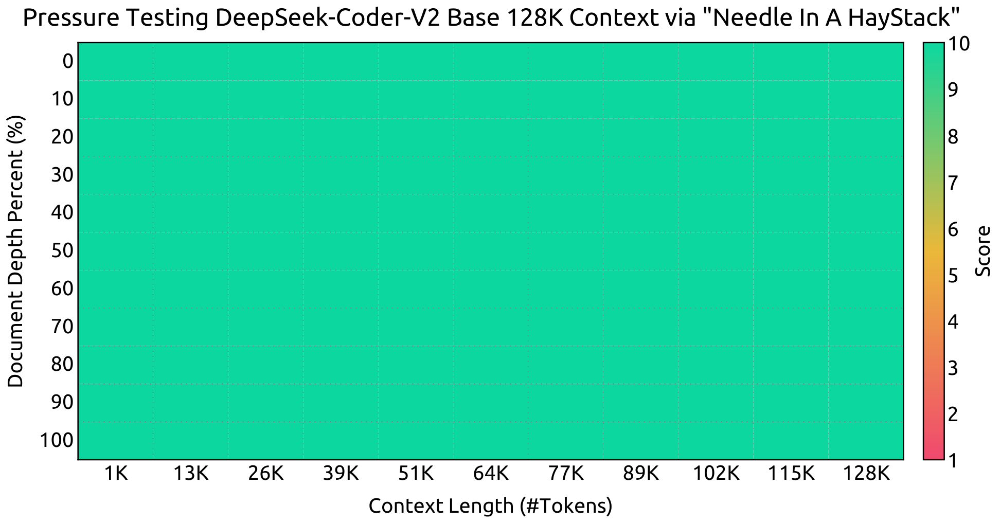

# DeepSeek-Coder-V2：补充解读

> 代码模型的高分为什么不一定变成修复成功？以下为直觉解释与应用延伸，论文内容见 [精炼主笔记](DeepSeek-Coder-V2详解.md)。

## 更长上下文首先改变工作单位

16K 到 128K 让更多文件、调用关系和项目约定进入模型，但“放得下”不等于“所有位置都能正确利用”。仓库级代码任务应单测跨文件引用、依赖推理和修改后的测试，而不只看单函数 HumanEval。

## MoE 的成本要拆开算

较低激活参数有助减少每 token 算量，大量总参数仍影响权重显存与专家通信；长上下文则增加 prefill 与 KV 成本。部署时同时报告总参数、激活参数、上下文、并发和硬件，才能判断实际性价比。

## 代码奖励的强弱取决于测试

通过公开测试可能只覆盖常见情况。RL 优化“测试通过率”时，要区分语法、单元测试、隐藏测试、复杂度限制和安全执行环境。增加样本数能搜索到更多通过解，但无法自动补全缺失的规格。

## 数学与代码的协同

两类任务都包含结构化推理与可执行检查，联合训练可能互相帮助；但评测提升不能证明模型内部学到了某个确定的通用算法。复用到 Python 工程时，以实际库版本、依赖和数据形状构造验证任务更有价值。

YaRN 扩展分 32K 和 128K 两阶段，每阶段 1000 步，并提高长文本比例。图展示 NIAH 在不同长度与目标位置上的表现；能够检索长上下文中的一条事实，并不等于完整理解一个 128K 仓库的全部依赖。

## 用一个具体场景串起来

一个算法题往往给出清晰接口和输入输出，仓库修复还要找到文件、理解依赖、遵循patch格式并避免回归。HumanEval提升不能替代这些步骤，Aider的whole与diff格式也会改变额外难度。

同样，测试通过只表示覆盖的用例未发现错误。Coder-V2用执行结果训练RM，希望泛化到有限测试没覆盖的情况；它可能更鲁棒，也可能学习评判偏差。应把验证器覆盖和奖励泛化分别看。
