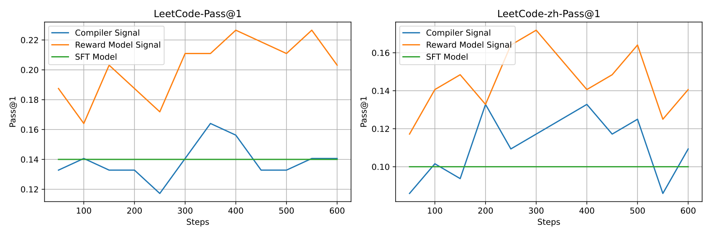

# DeepSeek-Coder-V2：从通用 MoE 继续预训练代码与数学能力

> 💡 Coder-V2 从 DeepSeek-V2 中间检查点继续训练 6T 代码、数学与语言 token，再结合代码指令及 GRPO 对齐，把低激活量 MoE 推向高水平代码生成与修复。
>
> [论文](https://arxiv.org/abs/2406.11931) · [官方仓库](https://github.com/deepseek-ai/DeepSeek-Coder-V2) · [补充解读](DeepSeek-Coder-V2解读.md)

开源代码模型在标准补全任务上不断进步，但复杂代码生成、竞赛题和真实软件修复仍落后于同期闭源系统。Coder-V2 选择在强通用 MoE 的基础上继续专业化，而不是完全从头训练代码模型。报告覆盖新语料的采集验证、16B/236B 两档模型、FIM 训练差异、128K 上下文扩展及代码奖励模型。模型在 HumanEval、数学与部分工程编辑测试上有显著进展，但完整软件修复和指令遵循仍有缺口；因此不能把单函数生成的高分直接解释成可靠的自主软件工程能力。

## 模型起点与训练语料

| 配置 | Coder-V2-Lite | Coder-V2 |
| --- | ---: | ---: |
| 总参数 | 16B | 236B |
| 激活参数 | 2.4B | 21B |
| 起始检查点训练量 | 4.2T | 4.2T |
| 本次继续预训练 | 6T | 6T |
| FIM | 开启，概率 0.5 | 未开启 |
| 扩展上下文 | 128K | 128K |

两者分别继承 V2-Lite/V2 的 MoE 与 MLA。总参数影响权重存储和部署，激活参数近似反映每 token 的计算规模，不能只按 2.4B 或 21B 配显存。报告还提到归一化设置曾导致梯度尖峰，后恢复传统归一化以稳定训练。

继续预训练的采样配比为 **60% 代码、10% 数学、30% 自然语言**，总暴露量为 4.2T+6T=10.2T。语料库的独立 token 数与训练采样次数并不相同，不能用 1,170B 代码库去否定 6T 的训练量。

### 代码语料构建

GitHub 部分保留 2023 年 11 月前创建的公开仓库，先按平均/最大行长、字母比例、XML/HTML 和结构化数据大小等规则去掉低质量、生成式或数据密集文件，再近似去重。得到约 821B 源代码和 185B 相关文本，编程语言由上一代 86 种扩大到 338 种。

Common Crawl 部分复用 DeepSeekMath 的领域挖掘：以 StackOverflow、库文档、数学网站等为种子，训练 fastText，按站点命中率补充领域 URL，迭代三轮。中文不适合按空格切词，使用 V2 BPE 分词改善召回。最终新增网页代码相关文本约 70B、数学文本 221B；GitHub 的进一步领域召回另收集约 94B 高质量代码。

### 数据质量对照

| Model | Tokens | Python | C++ | Java | PHP | TS | C# | Bash | JS | Avg | MBPP |
| --- | --- | --- | --- | --- | --- | --- | --- | --- | --- | --- | --- |
| DeepSeek-Coder-1B | 1T | 30.5% | 28.0% | 31.7% | 23.0% | 30.8% | 31.7% | 9.5% | 28.6% | 26.7% | 44.6% |
| DeepSeek-Coder-V2-1B | 1T | 36.0% | 34.8% | 31.7% | 27.3% | 37.7% | 34.2% | 6.3% | 38.5% | 31.2% | 49.0% |
| DeepSeek-Coder-V2-1B | 2T | 37.2% | 39.1% | 32.3% | 31.7% | 34.6% | 36.7% | 12.0% | 32.9% | 32.0% | 54.0% |

在同为 1T token 的 1B 试验中，新语料将 HumanEval Python 从 30.5 提高到 36.0、MBPP 从 44.6 提高到 49.0，说明不是只有更多训练量在起作用。进一步训练到 2T 后为 37.2/54.0，这部分额外收益同时包含训练量变化。

## 预训练、FIM 与长上下文

Lite 在文档 packing 前以 0.5 概率采用 PSM：输入前缀、后缀，再预测被挖去的中间片段；另一半保持普通 next-token prediction。236B 只用后者，因此不能笼统说两款都支持同样训练过的 FIM。

使用 AdamW，$\beta_1=0.9,\beta_2=0.95$、weight decay 0.1，预热 2,000 步，余弦下降至初始学习率的 10%。

上下文扩展使用 YaRN，$s=40,\alpha=1,\beta=32$。先以 32K 长度、batch 1152 训练 1,000 步，再以 128K、batch 288 训练 1,000 步，并上采样长文本。两个阶段每 batch 的 token 规模相近。NIAH 检索测试验证长距离信息提取，但不能单凭该测试推断复杂 128K 仓库级推理已经可靠。

## 指令与强化学习对齐

SFT 数据混合约 20k 代码、30k 数学指令及 V2 通用指令，总约 300M token；训练累计 1B token，token batch 约 1M，学习率 $5\times10^{-6}$，预热 100 步、余弦调度。Lite 在对齐时也保留 FIM 目标，避免只会聊天而损失补全能力。

RL 提示约 40k，代码题附带测试。论文**没有直接把编译器通过/失败作为最终全部 RL 信号**：有限测试覆盖可能漏掉错误解，于是使用执行结果形成偏好数据，训练奖励模型，再以 GRPO 更新策略。

图在内部 LeetCode 中英文测试上比较两条奖励路线，学习型 RM 的结果更好。该结论对应本文测试覆盖与模型设置；不能推广为规则奖励一定不如 RM，后续 R1 的选择也不同。GRPO 以同题多条候选的相对奖励估计优势，省去单独 critic。

## 生成、竞赛代码与补全

| 代表指标 | Coder-V2-Instruct | GPT-4o-0513 | GPT-4-Turbo-0409 |
| --- | ---: | ---: | ---: |
| LiveCodeBench overall % | 43.4 | 43.4 | 45.7 |
| LiveCodeBench hard % | 5.3 | 4.9 | 6.1 |
| USACO % | 12.1 | 18.8 | 12.3 |
| Defects4J % | 21.0 | 26.1 | 24.3 |
| SWE-bench % | 12.7 | 26.7 | 18.3 |
| Aider % | 73.7 | 72.9 | 63.9 |

HumanEval 90.2%、MBPP 76.2% 来自报告的 EvalPlus 评测管线；竞赛和工程测试提供更难的补充。LiveCodeBench 使用 2023-12 至 2024-06 的 226 道题，USACO 为 307 道竞赛题。困难题仍仅约 5%，总体高分没有消除最难算法推理瓶颈。

RepoBench 只保留 2023 年 12 月样本，避免与预训练时间重合。评价 2K–16K 上下文的下一行精确匹配，greedy、最多生成 64 token，取首个非空非注释行。Lite 的 Python 平均 38.9%、Java 43.3%，与上一代更大模型接近，但仍落后 Codestral 的 46.1/45.7。低激活量并未在每一项补全任务上换来最佳准确率。

Lite 的单行 FIM 在 Python/Java/JavaScript 分别为 80.0/89.1/87.2，说明双侧上下文训练有效；不引用原表中与分项算术不一致的 Mean 列，避免把排版或汇总口径问题继续传播。

## 工程代码、执行推理与数学

Defects4J 使用需要修改单个方法的 238 个缺陷，SWE-bench 是仓库级 issue 修复，Aider 是 133 个 Python 编辑任务且本文使用 whole 格式。Aider 73.7% 并不与后续使用 diff 格式的报告直接等价。SWE 的 12.7% 与闭源模型仍有明显差距，论文将复杂指令遵循列为重要原因。

CruxEval 检查输入/输出推断，Coder-V2 的 I-CoT/O-CoT 为 70.0/75.1，GPT-4o 为 77.4/88.7。**I 指根据给定输出反推输入，O 指给定输入预测输出**；不能沿用原文个别叙述中颠倒的说明。

| 数学指标 | Coder-V2-Lite | Coder-V2 | GPT-4o |
| --- | ---: | ---: | ---: |
| GSM8K % | 86.4 | 94.9 | 95.8 |
| MATH % | 61.8 | 75.7 | 76.6 |
| AIME 2024，解题数/30 | 0 | 4 | 2 |
| Math Odyssey % | 44.4 | 53.7 | 53.2 |

数学默认 greedy、无工具与投票。AIME 仅 30 道题，4 对 2 是小样本计数，不能描述成稳定的两倍数学能力。代码—数学混合继续预训练强化了推理，但各任务仍受提示和评价方式影响。

## 通用能力的收益与代价

同为 236B 级，MMLU 从 V2 的 78.1 提升至 79.2，BBH 从 79.7 到 83.9，Arena-Hard 从 41.6 到 65.0；TriviaQA 则由 86.7 降至 82.3，NaturalQuestions 由 53.4 降至 47.5。更少的通用网页训练与不同对齐目标，使推理收益和知识问答代价同时存在。

论文的结论不是用代码训练替代所有通用训练，而是证明强通用起点、大规模专业语料与有针对性的对齐能够把 MoE 推向代码前沿。余下问题包括长上下文的实际利用、复杂工程指令遵循和测试覆盖不完整；这些都要求超出 HumanEval 的评测。
