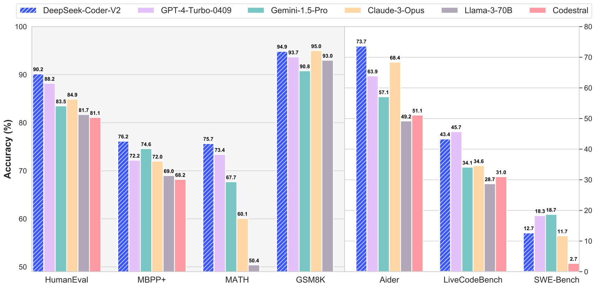

# DeepSeek-Coder-V2: Breaking the Barrier of Closed-Source Models in Code Intelligence / 全文中英对照

> 来源：[arXiv:2406.11931v1](https://arxiv.org/abs/2406.11931v1)。英文段落后紧接中文，覆盖所取 HTML 版本的主文、附录、图表、脚注与参考文献；公式、数字表和书目信息共用。中文以机器初译为底稿，进行了术语整理与结构核对，尚未逐句人工审定；遇到歧义请以紧邻英文和原论文为准。 原作版权归所列作者，许可见 [原作许可](http://creativecommons.org/licenses/by/4.0/)；中文译文与版式改写在该许可条件下提供（涉及 SA 时沿用相同许可，涉及 NC 时仅限非商业使用）。

## Authors and affiliations / 作者与机构

Qihao Zhu*, Daya Guo*, Zhihong Shao*, Dejian Yang*, Peiyi Wang, Runxin Xu, Y. Wu Yukun Li, Huazuo Gao, Shirong Ma, Wangding Zeng, Xiao Bi, Zihui Gu, Hanwei Xu, Damai Dai Kai Dong, Liyue Zhang, Yishi Piao, Zhibin Gou, Zhenda Xie, Zhewen Hao, Bingxuan Wang Junxiao Song, Deli Chen, Xin Xie, Kang Guan, Yuxiang You, Aixin Liu, Qiushi Du, Wenjun Gao Xuan Lu, Qinyu Chen, Yaohui Wang, Chengqi Deng, Jiashi Li, Chenggang Zhao Chong Ruan, Fuli Luo, Wenfeng Liang DeepSeek-AI [https://github.com/deepseek-ai/DeepSeek-Coder-V2](https://github.com/deepseek-ai/DeepSeek-Coder-V2) Corresponding author: Core contributors

**EN.** \reportnumber

**中.** \报告编号

**EN.** 001

**中.** 001

## Abstract / 摘要

**EN.** We present DeepSeek-Coder-V2, an open-source Mixture-of-Experts (MoE) code language model that achieves performance comparable to GPT4-Turbo in code-specific tasks. Specifically, DeepSeek-Coder-V2 is further pre-trained from an intermediate checkpoint of DeepSeek-V2 with additional 6 trillion tokens. Through this continued pre-training, DeepSeek-Coder-V2 substantially enhances the coding and mathematical reasoning capabilities of DeepSeek-V2, while maintaining comparable performance in general language tasks. Compared to DeepSeek-Coder-33B, DeepSeek-Coder-V2 demonstrates significant advancements in various aspects of code-related tasks, as well as reasoning and general capabilities. Additionally, DeepSeek-Coder-V2 expands its support for programming languages from 86 to 338, while extending the context length from 16K to 128K. In standard benchmark evaluations, DeepSeek-Coder-V2 achieves superior performance compared to closed-source models such as GPT4-Turbo, Claude 3 Opus, and Gemini 1.5 Pro in coding and math benchmarks.

**中.** 我们推出 DeepSeek-Coder-V2，这是一种开源 Mixture-of-Experts (MoE) 代码语言模型，它在特定于代码的任务中实现了与 GPT4-Turbo 相当的性能。具体来说，DeepSeek-Coder-V2 是从 DeepSeek-V2 的中间检查点使用额外的 6 万亿个代币进行进一步预训练的。通过这种持续的预训练，DeepSeek-Coder-V2 大幅增强了 DeepSeek-V2 的编码和数学推理能力，同时在一般语言任务中保持了可比的性能。与 DeepSeek-Coder-33B 相比，DeepSeek-Coder-V2 在代码相关任务的各个方面以及推理和通用能力方面都表现出了显着的进步。此外，DeepSeek-Coder-V2将对编程语言的支持从86种扩展到338种，同时将上下文长度从16K扩展到128K。在标准基准评估中，与 GPT4-Turbo、Claude 3 Opus 和 Gemini 1.5 Pro 等闭源模型相比，DeepSeek-Coder-V2 在编码和数学基准测试中取得了优异的性能。



**EN.** Figure 1: The Performance of DeepSeek-Coder-V2 on math and code benchmarks.

**中.** 图 1：DeepSeek-Coder-V2 在数学和代码基准测试中的性能。

## Introduction / 简介

**EN.** The open-source community has made significant strides in advancing code intelligence through the development of open-source code models such as StarCoder ( Li et al., 2023b ; Lozhkov et al., 2024 ) , CodeLlama ( Roziere et al., 2023 ) , DeepSeek-Coder ( Guo et al., 2024 ) , and Codestral ( MistralAI, 2024 ) . These models have steadily approached the performance levels of closed-source counterparts, contributing to the progress of code intelligence. However, there remains a discernible gap when comparing them to state-of-the-art closed-source models like GPT4-Turbo ( OpenAI, 2023 ) , Claude 3 Opus ( Anthropic, 2024 ) , and Gemini 1.5 Pro ( Reid et al., 2024 ) . To bridge this gap and further propel the development of open-source code models, we introduce the DeepSeek-Coder-V2 series. These models are built upon the foundation of DeepSeek-V2 ( DeepSeek-AI, 2024 ) and are further pre-trained with an additional corpus with 6 trillion tokens.

**中.** 开源社区通过开发 StarCoder（Li 等人，2023b；Lozhkov 等人，2024）、CodeLlama（Roziere 等人，2023）、DeepSeek-Coder（Guo 等人，2024）和 Codestral（MistralAI，2024）等开源代码模型，在推进代码智能方面取得了重大进展。 ）。这些模型已稳步接近闭源模型的性能水平，为代码智能的进步做出了贡献。然而，将它们与 GPT4-Turbo (OpenAI, 2023)、Claude 3 Opus (Anthropic, 2024) 和 Gemini 1.5 Pro (Reid et al., 2024) 等最先进的闭源模型进行比较时，仍然存在明显的差距。为了弥补这一差距并进一步推动开源代码模型的发展，我们推出了 DeepSeek-Coder-V2 系列。这些模型建立在 DeepSeek-V2（DeepSeek-AI，2024）的基础上，并使用包含 6 万亿个代币的额外语料库进行进一步预训练。

**EN.** In the pre-training phase, the dataset of DeepSeek-Coder-V2 is created with a composition of 60% source code, 10% math corpus, and 30% natural language corpus. The source code consists of 1,170B code-related tokens sourced from GitHub and CommonCrawl, using the same pipeline as DeepSeekMath ( Shao et al., 2024 ) . This corpus expands from 86 to 338 programming languages compared to the code corpus used to train DeepSeek-Coder. To demonstrate the effectiveness of the new code corpus, we conduct ablation studies with the 1B parameter model and observe improvements of 6.7% and 9.4% in accuracy across both HumanEval (from 30.5% to 37.2%) and MBPP (from 44.6% to 54.0%) benchmarks ( Chen et al., 2021 ; Austin et al., 2021a ) , respectively. For the math corpus, we collect 221B math-related tokens sourced from CommonCrawl using the same pipeline, which approximately doubles the size of the 120B DeepSeekMath corpus ( Shao et al., 2024 ) , while for the natural language corpus, we directly sample from the training corpus in DeepSeek-V2. In total, DeepSeek-Coder-V2 has been exposed to 10.2T training tokens, where 4.2 trillion tokens originate from the DeepSeek V2 dataset, while the remaining 6 trillion tokens come from the DeepSeek-Coder-V2 dataset.

**中.** 在预训练阶段，DeepSeek-Coder-V2的数据集由60%源代码、10%数学语料库和30%自然语言语料库组成。源代码由来自 GitHub 和 CommonCrawl 的 1,170B 代码相关令牌组成，使用与 DeepSeekMath 相同的管道（Shao et al., 2024）。与用于训练 DeepSeek-Coder 的代码语料库相比，该语料库从 86 种编程语言扩展到 338 种编程语言。为了证明新代码语料库的有效性，我们使用 1B 参数模型进行消融研究，观察到 HumanEval（从 30.5% 到 37.2%）和 MBPP（从 44.6% 到 54.0%）基准的准确度分别提高了 6.7% 和 9.4%（Chen 等人，2021；Austin 等人，2021a）。对于数学语料库，我们使用相同的管道收集来自 CommonCrawl 的 221B 个数学相关标记，这大约是 120B DeepSeekMath 语料库大小的两倍（Shao et al., 2024），而对于自然语言语料库，我们直接从 DeepSeek-V2 中的训练语料库中采样。 DeepSeek-Coder-V2 总共暴露了 10.2T 训练 token，其中 4.2 万亿个 token 来自 DeepSeek V2 数据集，其余 6 万亿个 token 来自 DeepSeek-Coder-V2 数据集。

**EN.** To accommodate longer code inputs and enhance applicability across various programming scenarios, we extend the context length from 16K to 128K tokens, allowing our models to handle more complex and extensive coding tasks. After continuous pre-training DeepSeek-V2 on this multi-source corpora, we find that DeepSeek-Coder-V2 significantly enhances the model’s capabilities in coding and mathematical reasoning while maintaining comparable general language performance.

**中.** 为了适应更长的代码输入并增强跨各种编程场景的适用性，我们将上下文长度从 16K 扩展到 128K 标记，使我们的模型能够处理更复杂和广泛的编码任务。在这个多源语料库上对 DeepSeek-V2 进行持续预训练后，我们发现 DeepSeek-Coder-V2 显着增强了模型的编码和数学推理能力，同时保持了可比的一般语言性能。

**EN.** In the alignment phase, we first construct an instruction training dataset that includes code and math data from DeepSeek-Coder ( Guo et al., 2024 ) and DeepSeek-Math ( Shao et al., 2024 ) , as well as general instruction data from DeepSeek-V2 ( DeepSeek-AI, 2024 ) . This dataset is used to fine-tune the base model. Then, in the reinforcement learning phase, we employ Group Relative Policy Optimization (GRPO) algorithm to align its behavior with human preferences. Preference data is collected in the coding domain using compiler feedback and test cases, and a reward model is developed to guide the training of the policy model. This approach ensures that the model’s responses are optimized for correctness and human preference in coding tasks. To enable the model to support code completion after alignment, we also utilize Fill-In-Middle approach ( Guo et al., 2024 ) during the fine-tuning of the base model with 16B parameters.

**中.** 在对齐阶段，我们首先构建一个指令训练数据集，其中包括来自 DeepSeek-Coder (Guo et al., 2024) 和 DeepSeek-Math (Shao et al., 2024) 的代码和数学数据，以及来自 DeepSeek-V2 (DeepSeek-AI, 2024) 的通用指令数据。该数据集用于微调基础模型。然后，在强化学习阶段，我们采用组相对策略优化（GRPO）算法来使其行为与人类偏好保持一致。使用编译器反馈和测试用例在编码领域收集偏好数据，并开发奖励模型来指导策略模型的训练。这种方法确保模型的响应针对编码任务的正确性和人类偏好进行优化。为了使模型能够支持对齐后的代码补全，我们还在使用 16B 参数对基础模型进行微调时采用了 Fill-In-Middle 方法（Guo et al., 2024）。

### Contributions / 贡献

**EN.** In summary, our main contributions are:

**中.** 总之，我们的主要贡献是：

**EN.** We introduce DeepSeek-Coder-V2 with 16B and 236B parameters based on the DeepSeekMoE framework, which has activation parameters of only 2.4B and 21B, efficiently supporting diverse computational and application needs. Additionally, DeepSeek-Coder-V2 supports 338 programming languages and a maximum context length of 128K tokens.

**中.** 我们基于 DeepSeekMoE 框架推出了具有 16B 和 236B 参数的 DeepSeek-Coder-V2，其激活参数仅为 2.4B 和 21B，有效支持多样化的计算和应用需求。此外，DeepSeek-Coder-V2 支持 338 种编程语言和最大上下文长度 128K 令牌。

**EN.** We make the first attempt to develop an open-source hundred-billion-parameter code model to advance the field of code intelligence. Experimental results indicate that DeepSeek-Coder-V2 236B outperforms state-of-the-art closed-source models, such as GPT4-Turbo, Claude 3 Opus, and Gemini 1.5 Pro, in both coding and mathematics tasks.

**中.** 我们首次尝试开发开源千亿参数代码模型，以推进代码智能领域。实验结果表明，DeepSeek-Coder-V2 236B 在编码和数学任务中均优于最先进的闭源模型，例如 GPT4-Turbo、Claude 3 Opus 和 Gemini 1.5 Pro。

**EN.** DeepSeek-Coder-V2 models are released publicly under a permissive license, allowing for both research and unrestricted commercial use.

**中.** DeepSeek-Coder-V2 模型在宽松的许可下公开发布，允许研究和不受限制的商业用途。

### Summary of Evaluations and Metrics / 评估和指标摘要

**EN.** Code : Regarding code generation benchmark evaluation, DeepSeek-Coder-V2 demonstrates remarkable superiority over all open source models while exhibiting performance on par with the leading closed-source models, such as GPT4-Turbo, Claude 3 Opus, and Gemini 1.5 Pro. Notably, we achieve a 90.2 % score on HumanEval ( Chen et al., 2021 ) , a 76.2 % score on MBPP ( Austin et al., 2021a ) (establishing a new state-of-the-art result with EvalPlus evaluation pipeline), and a 43.4 % score on LiveCodeBench ( Jain et al., 2024 ) (questions from Dec. 2023 to June. 2024). Additionally, DeepSeek-Coder-V2 is the first open-source model that surpasses a score of 10% on SWEBench ( Jimenez et al., 2023 ) .

**中.** 代码：在代码生成基准评估方面，DeepSeek-Coder-V2 表现出优于所有开源模型的显着优势，同时表现出与 GPT4-Turbo、Claude 3 Opus 和 Gemini 1.5 Pro 等领先闭源模型相当的性能。值得注意的是，我们在 HumanEval 上获得了 90.2% 的分数（Chen 等人，2021），在 MBPP 上获得了 76.2% 的分数（Austin 等人，2021a）（通过 EvalPlus 评估管道建立了新的最先进的结果），在 LiveCodeBench 上获得了 43.4% 的分数（Jain 等人，2024）（来自 12 月 12 日的问题）。 2023 年至 2024 年 6 月）。此外，DeepSeek-Coder-V2 是第一个在 SWEBench 上得分超过 10% 的开源模型（Jimenez 等人，2023）。

**EN.** Math : DeepSeek-Coder-V2 exhibits strong mathematical reasoning abilities, rivaling top closed-source models such as GPT-4o, Gemini 1.5 Pro, and Claude 3 Opus on both elementary benchmarks like GSM8K ( Cobbe et al., 2021 ) and advanced competition-level benchmarks including MATH ( Hendrycks et al., 2021 ) , AIME ( MAA, 2024 ) , and Math Odyssey ( Netmind.AI, 2024 ) . Notably, DeepSeek-Coder-V2 attains an accuracy of 75.7 % on the MATH benchmark, nearly matching the state-of-the-art accuracy of 76.6 % achieved by GPT-4o. Furthermore, it surpasses the performance of these closed-source models in the AIME 2024 competition.

**中.** 数学：DeepSeek-Coder-V2 表现出强大的数学推理能力，在 GSM8K（Cobbe 等人，2021）等基本基准和 MATH（Hendrycks 等人，2021）、AIME（MAA，2024）等高级竞赛级基准上，可与 GPT-4o、Gemini 1.5 Pro 和 Claude 3 Opus 等顶级闭源模型相媲美）和数学奥德赛（Netmind.AI，2024）。值得注意的是，DeepSeek-Coder-V2 在 MATH 基准上达到了 75.7% 的准确率，几乎与 GPT-4o 达到的最先进准确率 76.6% 相当。此外，它在 AIME 2024 竞赛中超越了这些闭源模型的性能。

**EN.** Natural Language : DeepSeek-Coder-V2 maintains comparable general language performance to DeepSeek-V2. For example, DeepSeek-Coder-V2 achieves 79.2% on MMLU with OpenAI simple-eval pipeline. Regarding subjective evaluation with GPT-4 as a judger, DeepSeek-Coder-V2 achieves 65.0 on arena-hard ( Li et al., 2024 ) , 8.77 on MT-bench ( Zheng et al., 2023 ) and 7.84 on alignbench ( Liu et al., 2023c ) . These scores are significantly better than other code-specific models, even comparable with general open source models.

**中.** 自然语言：DeepSeek-Coder-V2 保持与 DeepSeek-V2 相当的一般语言性能。例如，DeepSeek-Coder-V2 使用 OpenAI simple-eval pipeline 在 MMLU 上实现了 79.2%。以 GPT-4 作为评判者的主观评价，DeepSeek-Coder-V2 在 arena-hard 上获得 65.0（Li et al., 2024），在 MT-bench 上获得 8.77（Zheng et al., 2023），在alignbench 上获得 7.84（Liu et al., 2023c）。这些分数明显优于其他特定于代码的模型，甚至可以与一般开源模型相媲美。

## Data Collection / 数据收集

**EN.** The pre-training data for DeepSeek-Coder-V2 primarily consists of 60% source code, 10% math corpus, and 30% natural language corpus. Since the natural language corpus is directly sampled from the training dataset of DeepSeek-V2, this section focuses on the collection, cleaning, and filtering processes of the code and math data. Meanwhile, we further validate the quality of this data through comparative analysis experiments.

**中.** DeepSeek-Coder-V2的预训练数据主要由60%源代码、10%数学语料库和30%自然语言语料库组成。由于自然语言语料库是直接从DeepSeek-V2的训练数据集中采样的，因此本节重点介绍代码和数学数据的收集、清洗和过滤过程。同时，我们通过对比分析实验进一步验证了该数据的质量。

**EN.** We collect public repositories created before November 2023 on GitHub. We first apply the same filtering rules and near-deduplication as those used in the DeepSeek-Coder ( Guo et al., 2024 ) to filter out lower-quality and duplicated source code. To make the paper self-contained, we briefly describe the filtering rules. Firstly, we filter out files with an average line length exceeding 100 characters or a maximum line length surpassing 1000 characters. Additionally, we remove files with fewer than 25% alphabetic characters. Except for the XSLT programming language, we further filter out files where the string "<?xml version=" appears in the first 100 characters. For HTML files, we consider the ratio of visible text to HTML code. We retain files where the visible text constitutes at least 20% of the code and is no less than 100 characters. For JSON and YAML files, which typically contain more data, we only keep files that have a character count ranging from 50 to 5000 characters. This effectively removes most data-heavy files. By applying these filtering rules and near-deduplication, we obtain 821B code encompassing 338 programming languages and 185B code-related text, such as markdown and issues. The list of supported programming languages can be found in the Appendix A . We use the same tokenizer as DeepSeekV2, detailed in ( DeepSeek-AI, 2024 ) .

**中.** 我们收集 GitHub 上 2023 年 11 月之前创建的公共存储库。我们首先应用与 DeepSeek-Coder（Guo et al., 2024）中使用的相同的过滤规则和近重复数据删除来过滤掉质量较低和重复的源代码。为了使本文自成一体，我们简要描述过滤规则。首先，我们过滤掉平均行长度超过100个字符或最大行长度超过1000个字符的文件。此外，我们还会删除字母字符少于 25% 的文件。除XSLT编程语言外，我们进一步过滤掉前100个字符中出现字符串“<?xml version=”的文件。对于 HTML 文件，我们考虑可见文本与 HTML 代码的比率。我们保留可见文本至少占代码 20% 且不少于 100 个字符的文件。对于通常包含更多数据的 JSON 和 YAML 文件，我们仅保留字符数在 50 到 5000 个字符之间的文件。这可以有效地删除大多数数据密集型文件。通过应用这些过滤规则和近乎重复数据删除，我们获得了包含 338 种编程语言的 821B 代码和 185B 代码相关文本，例如 Markdown 和问题。支持的编程语言列表可以在附录 A 中找到。我们使用与 DeepSeekV2 相同的分词器，详细信息请参见 (DeepSeek-AI, 2024)。

**EN.** To collect code-related and math-related web texts from Common Crawl, we follow the same pipeline as DeepSeekMath ( Shao et al., 2024 ) . Specifically, we select coding forums such as StackOverflow [^footnote1] , library sites such as PyTorch documentation [^footnote2] , and mathematics website such as StackExchange [^footnote3] as our initial seed corpus. Using this seed corpus, we train a fastText model ( Joulin et al., 2016 ) to recall more coding-related and math-related web pages. Since tokenization for languages like Chinese cannot be done through spaces, we use the Byte Pair Encoding (BPE) tokenizer from DeepSeek-V2, which significantly improves the recall accuracy of fastText. For each domain, we calculate the percentage of web pages collected in the first iteration. Domains with over 10% of web pages collected are classified as code-related or math-related. We then annotate the URLs associated with code-related or math-related content within these identified domains. Uncollected web pages linked to these URLs are added to the seed corpus. After three iterations of data collection, we gather 70 billion code-related tokens and 221B math-related tokens from web pages. To further collect high-quality source code from GitHub, we also apply the same pipeline on GitHub with two iterations of data collection and collect 94B source code. The initial seed corpus is constructed by manually collecting high-quality source code, such as those containing detailed descriptions. Finally, the new code corpus consists of 1,170B code-related tokens sourced from GitHub and CommonCrawl.

**中.** 为了从 Common Crawl 中收集与代码相关和数学相关的网络文本，我们遵循与 DeepSeekMath 相同的流程（Shao 等人，2024）。具体来说，我们选择诸如 StackOverflow [^footnote1] 之类的编码论坛、诸如 PyTorch 文档 [^footnote2] 之类的图书馆网站以及诸如 StackExchange [^footnote3] 之类的数学网站作为我们的初始种子语料库。使用这个种子语料库，我们训练一个 fastText 模型（Joulin et al., 2016）来回忆更多与编码相关和数学相关的网页。由于中文等语言的分词不能通过空格完成，因此我们使用 DeepSeek-V2 的字节对编码（BPE）分词器，这显着提高了 fastText 的召回率。对于每个域，我们计算第一次迭代中收集的网页的百分比。收集的网页超过 10% 的域被分类为与代码相关或与数学相关。然后，我们注释与这些已识别域内的代码相关或数学相关内容相关的 URL。链接到这些 URL 的未收集网页将添加到种子语料库中。经过 3 次数据收集迭代，我们从网页中收集了 700 亿个与代码相关的 token 和 221B 个与数学相关的 token。为了进一步从 GitHub 收集高质量的源代码，我们还在 GitHub 上应用相同的管道，进行两次数据收集迭代，收集了 94B 源代码。初始种子语料库是通过手动收集高质量源代码（例如包含详细描述的源代码）构建的。最后，新的代码语料库由来自 GitHub 和 CommonCrawl 的 1,170B 个代码相关令牌组成。

**EN.** To demonstrate the effectiveness of the new code corpus, we conducted ablation studies (see Table 1 ) using a 1B parameter model, comparing it with the corpus used to train DeepSeek-Coder. Pre-training the 1B model on the new code corpus using 1T tokens resulted in improvements of 5.5% and 4.4% in accuracy on the HumanEval (from 30.5% to 36.0%) and MBPP (from 44.6% to 49.0%) benchmarks, respectively. Further training the 1B model with 2T tokens led to additional improvements, with HumanEval and MBPP scores rising to 37.2% and 54.0%, respectively. Therefore, the new code corpus is superior to the code corpus used to train DeepSeek-Coder.

**中.** 为了证明新代码语料库的有效性，我们使用 1B 参数模型进行了消融研究（参见表 1），并将其与用于训练 DeepSeek-Coder 的语料库进行了比较。使用 1T 令牌在新代码语料库上预训练 1B 模型，使 HumanEval（从 30.5% 到 36.0%）和 MBPP（从 44.6% 到 49.0%）基准的准确度分别提高了 5.5% 和 4.4%。使用 2T 代币进一步训练 1B 模型带来了额外的改进，HumanEval 和 MBPP 分数分别上升至 37.2% 和 54.0%。因此，新的代码语料库优于用于训练DeepSeek-Coder的代码语料库。

| Model<br>型号 | Tokens<br>代币 | Python<br>蟒蛇 | C++ | Java<br>爪哇 | PHP | TS | C# | Bash<br>重击 | JS | Avg<br>平均 | MBPP |
| --- | --- | --- | --- | --- | --- | --- | --- | --- | --- | --- | --- |
| DeepSeek-Coder-1B | 1T | 30.5% | 28.0% | 31.7% | 23.0% | 30.8% | 31.7% | 9.5% | 28.6% | 26.7% | 44.6% |
| DeepSeek-Coder-V2-1B | 1T | 36.0% | 34.8% | 31.7% | 27.3% | 37.7% | 34.2% | 6.3% | 38.5% | 31.2% | 49.0% |
| DeepSeek-Coder-V2-1B | 2T | 37.2% | 39.1% | 32.3% | 31.7% | 34.6% | 36.7% | 12.0% | 32.9% | 32.0% | 54.0% |

**EN.** Table 1: Performance of 1B base model between DeepSeek-Coder and DeepSeek-Coder-V2.

**中.** 表 1：DeepSeek-Coder 和 DeepSeek-Coder-V2 之间 1B 基本模型的性能。

## Training Policy / 培训政策

### Training Strategy / 培训策略

**EN.** We use two training objectives for DeepSeek-Coder-v2 16B: Next-Token-Prediction and Fill-In-Middle (FIM) ( Li et al., 2023b ; Bavarian et al., 2022 ; Guo et al., 2024 ) . For DeepSeek-Coder-v2 236B, we only utilize the Next-Token-Prediction objective. Here we give a brief introduction of the FIM training policy. We adopt the FIM training approach for the development of DeepSeek-Coder-v2-16B, leveraging the PSM (Prefix, Suffix, Middle) mode. This method structures the content reconstruction in the sequence: Prefix, Suffix, and Middle, as illustrated below:

**中.** 我们对 DeepSeek-Coder-v2 16B 使用两个训练目标：Next-Token-Prediction 和 Fill-In-Middle (FIM)（Li et al., 2023b；Bavarian et al., 2022；Guo et al., 2024）。对于 DeepSeek-Coder-v2 236B，我们仅利用 Next-Token-Prediction 目标。这里简单介绍一下FIM的培训政策。我们采用 FIM 训练方法来开发 DeepSeek-Coder-v2-16B，利用 PSM（前缀、后缀、中间）模式。该方法按照前缀、后缀、中间的顺序构建内容重构，如下图所示：

$$
\displaystyle\texttt{<｜fim\_begin｜>}f_{pre}\texttt{<｜fim\_hole｜>}f_{suf}\texttt{<｜fim\_end｜>}f_{middle}\texttt{<|eos\_token|>}
$$

**EN.** This structure is applied at the document level as part of the pre-packing process. The FIM is utilized at a rate of 0.5, consistent with the PSM framework, to enhance the training efficacy and model performance.

**中.** 该结构作为预打包过程的一部分应用于文档级别。 FIM的使用率为0.5，与PSM框架一致，以提高训练效率和模型性能。

### Model Architecture / 模型架构

**EN.** Our architecture aligns with that of DeepSeekV2 ( DeepSeek-AI, 2024 ) . The hyperparameters settings, 16B and 236B, correspond to those used in DeepSeek-V2-Lite and DeepSeek-V2, respectively. Notably, we encountered instability during training and spikes in gradient values, which we attributed to the exponential normalization technique. To address this, we reverted to the conventional normalization method.

**中.** 我们的架构与 DeepSeekV2（DeepSeek-AI，2024）的架构一致。超参数设置 16B 和 236B 分别对应于 DeepSeek-V2-Lite 和 DeepSeek-V2 中使用的设置。值得注意的是，我们在训练过程中遇到了不稳定和梯度值尖峰，我们将其归因于指数归一化技术。为了解决这个问题，我们恢复了传统的标准化方法。

### Training Hyper-Parameters / 训练超参数

**EN.** Consistent with the DeepSeek V2 methodology ( DeepSeek-AI, 2024 ) , we utilize the AdamW optimizer ( Loshchilov and Hutter, 2019 ) , configured with $\beta_{1}=0.9$ , $\beta_{2}=0.95$ , and a weight decay of 0.1. Batch sizes and learning rates are adjusted according to DeepSeek-V2 specifications. For learning rate scheduling, we employ a cosine decay strategy, starting with 2000 warm-up steps and gradually reducing the learning rate to 10% of its initial value.

**中.** 与 DeepSeek V2 方法（DeepSeek-AI，2024）一致，我们利用 AdamW 优化器（Leshchilov 和 Hutter，2019），配置了 $\beta_{1}=0.9$、$\beta_{2}=0.95$ 和 0.1 的权重衰减。批量大小和学习率根据 DeepSeek-V2 规范进行调整。对于学习率调度，我们采用余弦衰减策略，从 2000 个预热步骤开始，逐渐将学习率降低至初始值的 10%。

**EN.** Both DeepSeek-Coder-V2 and DeepSeek-Coder-V2-Lite are trained using the same methodology. To maintain robust natural language understanding capabilities in DeepSeek-Coder-V2, we continue the pre-training process from an intermediate checkpoint of DeepSeek-V2. The intermediate checkpoint was initially trained on 4.2T tokens. Consequently, DeepSeek-Coder-V2 has been exposed to a total of 10.2T high-quality tokens during the pre-training phase.

**中.** DeepSeek-Coder-V2 和 DeepSeek-Coder-V2-Lite 均使用相同的方法进行训练。为了保持 DeepSeek-Coder-V2 中强大的自然语言理解能力，我们从 DeepSeek-V2 的中间检查点继续进行预训练过程。中间检查点最初是在 4.2T 令牌上进行训练的。因此，DeepSeek-Coder-V2 在预训练阶段总共接触到了 10.2T 的高质量代币。

| Model<br>型号 | DeepSeek-Coder-V2-Lite | DeepSeek-Coder-V2 |
| --- | --- | --- |
| # Total Parameters (#TP)<br># 总参数 (#TP) | 16B | 236B |
| # Active Parameters (#AP)<br># 活动参数 (#AP) | 2.4B | 21B |
| Pre-training Tokens<br>预训练代币 | 4.2T+6T | 4.2T+6T |
| LR Scheduler<br>LR调度器 | Cosine<br>余弦 | Cosine<br>余弦 |
| FIM | Enable<br>启用 | Disable<br>禁用 |

**EN.** Table 2: Training Setting of DeepSeek-Coder-V2.

**中.** 表 2：DeepSeek-Coder-V2 的训练设置。

### Long Context Extension / 长上下文扩展

**EN.** Following DeepSeek-V2, we extend the context length of DeepSeek-Coder-V2 to 128K using Yarn ( Peng et al., 2023 ) . The hyper-parameters of YARN are the same as DeepSeek-V2: the scale $s$ to 40, $\alpha$ to 1, $\beta$ to 32. We further continue training the model using two stages to enhance its capability for handling long contexts. In the first stage, we utilize a sequence length of 32K and a batch size of 1152 for 1000 steps. In the second stage, we train the model for an additional 1000 steps, employing a sequence length of 128K and a batch size of 288 sequences. It should be noted here we upsample long context data ratio during long context extension. As shown in Figure 2 , the results on the “Needle In A Haystack” (NIAH) tests indicate that DeepSeek-Coder-V2 performs well across all context window lengths up to 128K.

**中.** 继 DeepSeek-V2 之后，我们使用 Yarn 将 DeepSeek-Coder-V2 的上下文长度扩展到 128K (Peng et al., 2023)。 YARN 的超参数与 DeepSeek-V2 相同：尺度 $s$ 为 40，$\alpha$ 为 1，$\beta$ 为 32。我们进一步使用两个阶段继续训练模型，以增强其处理长上下文的能力。在第一阶段，我们使用 32K 的序列长度和 1152 的批量大小来执行 1000 个步骤。在第二阶段，我们使用 128K 的序列长度和 288 个序列的批量大小额外训练模型 1000 个步骤。这里应该注意的是，我们在长上下文扩展期间对长上下文数据比率进行上采样。如图 2 所示，“大海捞针”(NIAH) 测试的结果表明 DeepSeek-Coder-V2 在高达 128K 的所有上下文窗口长度上都表现良好。


**EN.** Figure 2: Evaluation results on the “Needle In A Haystack” (NIAH) tests. DeepSeek-Coder-V2 performs well across all context window lengths up to 128K.

**中.** 图 2：“大海捞针”(NIAH) 测试的评估结果。 DeepSeek-Coder-V2 在高达 128K 的所有上下文窗口长度上都表现良好。

### Alignment / 对准

#### Supervised Fine-Tuning / 监督微调

**EN.** To build DeepSeek-Coder-V2 Chat, we construct the instruction training dataset mixed with code and math data. We first collect 20k code-related instruction data and 30k math related data from DeepSeek-Coder and DeepSeek-Math. To maintain the general ability, we also sample several data from the instruction data of DeepSeek-V2. Finally, we use a instruction dataset of 300M tokens. For training, we use a cosine schedule with 100 warm-up steps and an initial learning rate $5e^{-6}$ . We also use a batch size of 1M tokens and 1B tokens in total.

**中.** 为了构建 DeepSeek-Coder-V2 Chat，我们构建了与代码和数学数据混合的指令训练数据集。我们首先从 DeepSeek-Coder 和 DeepSeek-Math 收集 20k 代码相关指令数据和 30k 数学相关数据。为了保持通用能力，我们还从 DeepSeek-V2 的指令数据中采样了一些数据。最后，我们使用 300M 令牌的指令数据集。对于训练，我们使用具有 100 个预热步骤和初始学习率 $5e^{-6}$ 的余弦计划。我们还使用总共 1M 个代币和 1B 个代币的批量大小。

#### Reinforcement Learning / 强化学习

**EN.** We further employ Reinforcement Learning (RL) techniques to fully simulate the capabilities of DeepSeek-Coder-V2, which is proven to be quite effective.

**中.** 我们进一步采用强化学习（RL）技术来充分模拟DeepSeek-Coder-V2的能力，事实证明这是非常有效的。

#### Prompts / 提示

**EN.** Considerable effort was spent collecting prompts related to code and math from various sources, and each code prompt comes with corresponding test cases. After filtering the prompts, there are approximately 40k data in total.

**中.** 我们花费了大量的精力从各种来源收集与代码和数学相关的提示，并且每个代码提示都附带相应的测试用例。过滤提示后，总共有大约40k条数据。

#### Reward Modeling / 奖励模型

**EN.** Reward models play crucial roles in the RL training. In terms of mathematical preference data, we obtain them using the ground-truth labels. In terms of code preference data, although the code compiler itself can already provide 0-1 feedback (whether the code pass all test cases or not), some code prompts may have a limited number of test cases, and do not provide full coverage, and hence directly using 0-1 feedback from the compiler may be noisy and sub-optimal. Therefore, we still decide to train a reward model on the data provided by the compiler, and use the reward model to provide signal during RL training, which is more robust and has better generalization ability, in comparison with raw compiler signal. As illustrated in Figure 3 , in our in-house test sets (Leetcode and Leetcode-zh), using a reward model to provide RL training signal clearly outperforms using raw compiler signal. Hence, we use reward model signal rather than compiler signal in all subsequent experiments.

**中.** 奖励模型在强化学习训练中发挥着至关重要的作用。就数学偏好数据而言，我们使用真实标签获得它们。就代码偏好数据而言，虽然代码编译器本身已经可以提供0-1反馈（无论代码是否通过所有测试用例），但某些代码提示可能具有有限数量的测试用例，并且不提供完全覆盖，因此直接使用编译器的0-1反馈可能会产生噪音且次优。因此，我们仍然决定在编译器提供的数据上训练奖励模型，并在强化学习训练期间使用奖励模型提供信号，与原始编译器信号相比，该信号更鲁棒且具有更好的泛化能力。如图 3 所示，在我们的内部测试集（Leetcode 和 Leetcode-zh）中，使用奖励模型提供 RL 训练信号明显优于使用原始编译器信号。因此，我们在所有后续实验中使用奖励模型信号而不是编译器信号。

#### Reinforcement Learning Algorithm / 强化学习算法

**EN.** We employ Group Relative Policy Optimization (GRPO) Shao et al. (2024) as our RL algorithm, which is the same as what DeepSeek-V2 uses. Notably, GRPO is proven to be quite effective and has less cost compared with PPO, since there is no need to maintain an additional critic model.

**中.** 我们采用组相对策略优化 (GRPO) Shao 等人。 （2024）作为我们的 RL 算法，与 DeepSeek-V2 使用的相同。值得注意的是，GRPO 被证明非常有效，并且与 PPO 相比成本更低，因为不需要维护额外的批评模型。


**EN.** Figure 3: Performances of Different Methods

**中.** 图 3：不同方法的性能

## Experimental Results / 实验结果

**EN.** In this section, we evaluate DeepSeek-Coder-V2 on three types of tasks, including coding, mathematics, and general natural language. We compare DeepSeek-Coder-V2 with the previous state-of-the-art large language models.

**中.** 在本节中，我们将在三种类型的任务上评估 DeepSeek-Coder-V2，包括编码、数学和一般自然语言。我们将 DeepSeek-Coder-V2 与之前最先进的大型语言模型进行比较。

**EN.** CodeLlama ( Roziere et al., 2023 ) consists of a series of code language models based on Llama2 ( Touvron et al., 2023 ) , and continue pre-training on datasets ranging from 500 to 1000 billion code tokens. These models are available in four sizes: 7B, 13B, 34B, and 70B.

**中.** CodeLlama (Roziere et al., 2023) 由一系列基于 Llama2 (Touvron et al., 2023) 的代码语言模型组成，并在 500 到 10000 亿个代码标记的数据集上继续进行预训练。这些型号有四种尺寸：7B、13B、34B 和 70B。

**EN.** StarCoder ( Lozhkov et al., 2024 ) is a publicly accessible model with 15 billion parameters. It is specifically trained on a meticulously curated subset of the Stack dataset ( Kocetkov et al., 2022 ) , covering 86 programming languages.

**中.** StarCoder（Lozhkov 等人，2024）是一个可公开访问的模型，拥有 150 亿个参数。它专门针对 Stack 数据集精心策划的子集进行了训练（Kocetkov 等人，2022），涵盖 86 种编程语言。

**EN.** StarCoder2 ( Lozhkov et al., 2024 ) consists of 3B, 7B, and 15B parameters models trained on 3.3 to 4.3 trillion tokens of the Stack2 dataset ( Lozhkov et al., 2024 ) , spanning 619 programming languages.

**中.** StarCoder2（Lozhkov 等人，2024）由 3B、7B 和 15B 参数模型组成，这些模型在 Stack2 数据集（Lozhkov 等人，2024）的 3.3 到 4.3 万亿个标记上进行训练，涵盖 619 种编程语言。

**EN.** DeepSeek-Coder ( Guo et al., 2024 ) comprises a series of code language models, ranging from 1 billion to 33 billion parameters. Each model is trained from scratch on 2 trillion tokens, with a composition of 87% code and 13% natural language in both English and Chinese. These models are pre-trained on a project-level code corpus using a window size of 16K and an additional fill-in-the-blank task, enabling support for project-level code completion and infilling.

**中.** DeepSeek-Coder（Guo et al., 2024）包含一系列代码语言模型，参数范围从 10 亿到 330 亿不等。每个模型都从头开始训练 2 万亿个 token，其中 87% 是代码，13% 是英文和中文的自然语言。这些模型使用 16K 窗口大小和额外的填空任务在项目级代码语料库上进行预训练，从而支持项目级代码补全和填充。

**EN.** Codestral ( MistralAI, 2024 ) is a 22B parameter model developed by Mistral. It is trained on a diverse dataset of over 80 programming languages, including popular ones such as Python, Java, and JavaScript, as well as more specialized languages like Swift and Fortran.

**中.** Codestral（MistralAI，2024）是Mistral开发的22B参数模型。它接受了超过 80 种编程语言的多样化数据集的训练，包括 Python、Java 和 JavaScript 等流行语言，以及 Swift 和 Fortran 等更专业的语言。

**EN.** General language models that we compare include Llama3 70B ( Meta, 2024 ) , GPT-4 ( OpenAI, 2023 ) , Claude 3 Opus ( Anthropic, 2024 ) , and Gemini 1.5 Pro ( Reid et al., 2024 ) . While they are not specifically trained on large code corpora, they achieve state-of-the-art performance in coding.

**中.** 我们比较的通用语言模型包括 Llama3 70B (Meta, 2024)、GPT-4 (OpenAI, 2023)、Claude 3 Opus (Anthropic, 2024) 和 Gemini 1.5 Pro (Reid et al., 2024)。虽然他们没有接受过大型代码语料库的专门培训，但他们在编码方面实现了最先进的性能。

### Code Generation / 代码生成

#### HumanEval and MBPP Benchmarks. / HumanEval 和 MBPP 基准。

**EN.** The HumanEval ( Chen et al., 2021 ) [^footnote4] and MBPP ( Austin et al., 2021b ) benchmarks are commonly utilized for assessing the performance of code-generating Large Language Models (LLMs). HumanEval comprises 164 Python tasks that are verified through test cases to evaluate the performance of Code LLMs in a zero-shot scenario. For MBPP, we use the MBPP-Plus version ( Liu et al., 2023a ) to evaluate the models. To test the multilingual abilities of models, we extended the HumanEval benchmark problems into seven additional languages: C++, Java, PHP, TypeScript, C#, Bash, JavaScript, Swift, R, Julia, D, Rust and Racket. For both benchmarks, we employed a greedy search strategy and recreated the baseline results using identical scripts and environments to ensure a fair comparison.

**中.** HumanEval（Chen 等人，2021）[^footnote4] 和 MBPP（Austin 等人，2021b）基准通常用于评估代码生成大型语言模型（LLM）的性能。 HumanEval 包含 164 个 Python 任务，这些任务通过测试用例进行验证，以评估 Code LLM 在零样本场景中的性能。对于 MBPP，我们使用 MBPP-Plus 版本（Liu et al., 2023a）来评估模型。为了测试模型的多语言能力，我们将 HumanEval 基准问题扩展到另外七种语言：C++、Java、PHP、TypeScript、C#、Bash、JavaScript、Swift、R、Julia、D、Rust 和 Racket。对于这两个基准测试，我们采用了贪婪搜索策略，并使用相同的脚本和环境重新创建了基线结果，以确保公平的比较。

|  | #TP | #AP<br>#美联社 | Python<br>蟒蛇 | Java<br>爪哇 | C++ | C# | TS | JS | PHP | Bash<br>重击 |
| --- | --- | --- | --- | --- | --- | --- | --- | --- | --- | --- |
| Closed-Source Models<br>闭源模型 | Closed-Source Models<br>闭源模型 | Closed-Source Models<br>闭源模型 | Closed-Source Models<br>闭源模型 | Closed-Source Models<br>闭源模型 | Closed-Source Models<br>闭源模型 | Closed-Source Models<br>闭源模型 | Closed-Source Models<br>闭源模型 | Closed-Source Models<br>闭源模型 | Closed-Source Models<br>闭源模型 | Closed-Source Models<br>闭源模型 |
| Gemini-1.5-Pro<br>双子座-1.5-Pro | - | - | 83.5% | 81.0% | 78.3% | 75.3% | 77.4% | 80.8% | 74.5% | 39.9% |
| Claude-3-Opus<br>克劳德三号作品 | - | - | 84.2% | 78.5% | 81.4% | 74.7% | 76.1% | 75.8% | 78.3% | 48.7% |
| GPT-4-1106 | - | - | 87.8% | 82.3% | 78.9% | 80.4% | 81.8% | 80.1% | 77.6% | 55.7% |
| GPT-4-Turbo-0409 | - | - | 88.2% | 81.7% | 78.3% | 79.1% | 79.3% | 80.8% | 78.9% | 55.1% |
| GPT-4o-0513 | - | - | 91.0% | 80.4% | 87.0% | 82.9% | 86.2% | 87.6% | 79.5% | 53.8% |
| Open-Source Models<br>开源模型 | Open-Source Models<br>开源模型 | Open-Source Models<br>开源模型 | Open-Source Models<br>开源模型 | Open-Source Models<br>开源模型 | Open-Source Models<br>开源模型 | Open-Source Models<br>开源模型 | Open-Source Models<br>开源模型 | Open-Source Models<br>开源模型 | Open-Source Models<br>开源模型 | Open-Source Models<br>开源模型 |
| Codestral<br>共谱 | 22B | 22B | 78.1% | 71.5% | 71.4% | 77.2% | 72.3% | 73.9% | 69.6% | 47.5% |
| DS-Coder-instruct<br>DS编码器指令 | 33B | 33B | 79.3% | 73.4% | 68.9% | 74.1% | 67.9% | 73.9% | 72.7% | 43.0% |
| Llama3-Instruct<br>Llama3-指导 | 70B | 70B | 81.1% | 67.7% | 64.0% | 69.6% | 69.8% | 70.2% | 65.8% | 36.1% |
| DS-Coder-V2-Lite-Instruct<br>DS-Coder-V2-Lite-指令 | 16B | 2.4B | 81.1% | 76.6% | 75.8% | 76.6% | 80.5% | 77.6% | 74.5% | 43.0% |
| DS-Coder-V2-Instruct<br>DS-Coder-V2-指令 | 236B | 21B | 90.2% | 82.3% | 84.8% | 82.3% | 83.0% | 84.5% | 79.5% | 52.5% |
|  | #TP | #AP<br>#美联社 | Swift<br>斯威夫特 | R | Julia<br>朱莉娅 | D | Rust<br>铁锈 | Racket<br>球拍 | $\text{MBPP}^{+}$ | Average<br>平均 |
| Closed-Source Models<br>闭源模型 | Closed-Source Models<br>闭源模型 | Closed-Source Models<br>闭源模型 | Closed-Source Models<br>闭源模型 | Closed-Source Models<br>闭源模型 | Closed-Source Models<br>闭源模型 | Closed-Source Models<br>闭源模型 | Closed-Source Models<br>闭源模型 | Closed-Source Models<br>闭源模型 | Closed-Source Models<br>闭源模型 | Closed-Source Models<br>闭源模型 |
| Gemini-1.5-Pro<br>双子座-1.5-Pro | - | - | 66.5% | 53.4% | 71.7% | 55.8% | 73.1% | 48.4% | 74.6% | 68.9% |
| Claude-3-Opus<br>克劳德三号作品 | - | - | 63.9% | 55.9% | 76.1% | 60.3% | 71.2% | 64.6% | 72.0% | 70.8% |
| GPT-4-1106 | - | - | 62.7% | 57.8% | 69.2% | 60.9% | 78.8% | 64.0% | 69.3% | 72.5% |
| GPT-4-Turbo-0409 | - | - | 63.9% | 56.5% | 69.8% | 61.5% | 78.8% | 63.4% | 72.2% | 72.3% |
| GPT-4o-0513 | - | - | 75.9% | 65.2% | 78.0% | 60.9% | 80.1% | 64.6% | 73.5% | 76.4% |
| Open-Source Models<br>开源模型 | Open-Source Models<br>开源模型 | Open-Source Models<br>开源模型 | Open-Source Models<br>开源模型 | Open-Source Models<br>开源模型 | Open-Source Models<br>开源模型 | Open-Source Models<br>开源模型 | Open-Source Models<br>开源模型 | Open-Source Models<br>开源模型 | Open-Source Models<br>开源模型 | Open-Source Models<br>开源模型 |
| Codestral<br>共谱 | 22B | 22B | 63.3% | 49.7% | 67.9% | 32.1% | 67.3% | 37.3% | 68.2% | 63.2% |
| DS-Coder-instruct<br>DS编码器指令 | 33B | 33B | 61.4% | 44.7% | 53.5% | 31.4% | 68.6% | 46.0% | 70.1% | 61.9% |
| Llama3-Instruct<br>Llama3-指导 | 70B | 70B | 55.1% | 46.0% | 62.9% | 48.1% | 58.3% | 46.0% | 68.8% | 60.6% |
| DS-Coder-V2-Lite-Instruct<br>DS-Coder-V2-Lite-指令 | 16B | 2.4B | 64.6% | 47.8% | 67.3% | 45.5% | 62.2% | 41.6% | 68.8% | 65.6% |
| DS-Coder-V2-Instruct<br>DS-Coder-V2-指令 | 236B | 21B | 72.2% | 64.0% | 72.3% | 64.1% | 78.2% | 63.4% | 76.2% | 75.3% |

**EN.** Table 3: Performance Metrics for Various Models on HumanEval and MBPP Benchmarks

**中.** 表 3：HumanEval 和 MBPP 基准上各种模型的性能指标

**EN.** Table 3 provides an extensive overview of the performance metrics for various models across multiple programming languages on the HumanEval and $\text{MBPP}^{+}$ Benchmarks. The DeepSeek-Coder-V2-Instruct demonstrates exceptional performance, securing the second-highest average score of 75.3%. This performance is notable as it breaks the dominance typically seen from closed-source models, standing out as a leading open-source contender. It is surpassed only by GPT-4o, which leads with an average score of 76.4%. DeepSeek-Coder-V2-Instruct shows top-tier results across a variety of languages, including the highest scores in Java and PHP, and strong performances in Python, C++, C#, TypeScript, and JavaScript, underscoring its robustness and versatility in handling diverse coding challenges.

**中.** 表 3 全面概述了 HumanEval 和 $\text{MBPP}^{+}$ 基准上跨多种编程语言的各种模型的性能指标。 DeepSeek-Coder-V2-Instruct 展现了卓越的性能，获得了 75.3% 的第二高平均得分。这种性能值得注意，因为它打破了闭源模型通常的主导地位，成为领先的开源竞争者。仅次于 GPT-4o，后者以 76.4% 的平均分数领先。 DeepSeek-Coder-V2-Instruct 在多种语言上都显示了顶级结果，包括 Java 和 PHP 的最高得分，以及 Python、C++、C#、TypeScript 和 JavaScript 的强劲表现，凸显了其在处理各种编码挑战方面的稳健性和多功能性。

**EN.** Furthermore, the DeepSeek-Coder-V2-Lite-Instruct also performs impressively, surpassing the larger 33B model. With a considerable margin in average performance (65.6% vs. 61.9%), it highlights the effectiveness of the 16B model in delivering competitive results despite its smaller size. This underscores the model’s efficiency and the advancements in model architecture and training methodologies that allow it to outperform larger counterparts.

**中.** 此外，DeepSeek-Coder-V2-Lite-Instruct 的性能也令人印象深刻，超越了更大的 33B 模型。平均性能有相当大的差距（65.6% vs. 61.9%），凸显了 16B 模型尽管尺寸较小，但在提供有竞争力的结果方面的有效性。这强调了模型的效率以及模型架构和训练方法的进步，使其能够超越更大的同行。

#### Competitive Programming. / 竞争性编程。

**EN.** To further validate the model’s capability in real-world competitive programming problems, we utilize the LiveCodeBench ( Jain et al., 2024 ) and USACO benchmark ( Shi et al., 2024 ) to estimate the effectiveness of DeepSeek-Coder-V2. LiveCodeBench is a meticulous and contamination-free assessment of Large Language Models (LLMs) for code generation, systematically gathering novel challenges over time from three prominent competitive programming platforms: LeetCode, AtCoder, and CodeForces. Since the cut-off of the training data is before November 2023, we use the subset (1201-0601) of Livecodebench. USACO benchmark contains 307 problems from the USA Computing Olympiad, along with high-quality unit tests, reference code, and official analyses for each problem.

**中.** 为了进一步验证模型在现实世界竞争性编程问题中的能力，我们利用 LiveCodeBench (Jain et al., 2024) 和 USACO benchmark (Shi et al., 2024) 来估计 DeepSeek-Coder-V2 的有效性。 LiveCodeBench 是对用于代码生成的大型语言模型 (LLM) 进行的细致且无污染的评估，随着时间的推移系统地从三个著名的竞争性编程平台（LeetCode、AtCoder 和 CodeForces）收集新的挑战。由于训练数据的截止时间是在2023年11月之前，因此我们使用Livecodebench的子集（1201-0601）。 USACO 基准测试包含来自美国计算机奥林匹克竞赛的 307 个问题，以及每个问题的高质量单元测试、参考代码和官方分析。

| Model<br>型号 | #TP | #AP<br>#美联社 | LiveCodeBench<br>实时代码平台 | LiveCodeBench<br>实时代码平台 | LiveCodeBench<br>实时代码平台 | LiveCodeBench<br>实时代码平台 | USACO<br>美国CO |
| --- | --- | --- | --- | --- | --- | --- | --- |
| Model<br>型号 | #TP | #AP<br>#美联社 | Easy (82)<br>简单 (82) | Medium (87)<br>中型 (87) | Hard (57)<br>硬 (57) | Overall (226)<br>总体 (226) | USACO<br>美国CO |
| Closed-Source Models<br>闭源模型 | Closed-Source Models<br>闭源模型 | Closed-Source Models<br>闭源模型 | Closed-Source Models<br>闭源模型 | Closed-Source Models<br>闭源模型 | Closed-Source Models<br>闭源模型 | Closed-Source Models<br>闭源模型 | Closed-Source Models<br>闭源模型 |
| Gemini-1.5-Pro<br>双子座-1.5-Pro | - | - | 74.9% | 16.8% | 1.8% | 34.1% | 4.9% |
| Claude-3-Opus<br>克劳德三号作品 | - | - | 77.2% | 16.7% | 0.7% | 34.6% | 7.8% |
| GPT-4-1106 | - | - | 78.4% | 20.2% | 3.5% | 37.1% | 11.1% |
| GPT-4-Turbo-0409 | - | - | 84.1% | 35.4% | 6.1% | 45.7% | 12.3% |
| GPT-4o-0513 | - | - | 87.4 % | 27.5% | 4.9% | 43.4% | 18.8% |
| Open-Source Models<br>开源模型 | Open-Source Models<br>开源模型 | Open-Source Models<br>开源模型 | Open-Source Models<br>开源模型 | Open-Source Models<br>开源模型 | Open-Source Models<br>开源模型 | Open-Source Models<br>开源模型 | Open-Source Models<br>开源模型 |
| Codestral<br>共谱 | 22B | 22B | 66.5% | 17.7% | 0.2% | 31.0% | 4.6% |
| DS-Coder-instruct<br>DS编码器指令 | 33B | 33B | 51.6% | 9.7% | 0.4% | 22.5% | 4.2% |
| Llama3-Instruct<br>Llama3-指导 | 70B | 70B | 62.4% | 14.4% | 2.1% | 28.7% | 3.3% |
| DS-Coder-V2-Lite-Instruct<br>DS-Coder-V2-Lite-指令 | 16B | 2.4B | 58.5% | 8.0% | 0.0% | 24.3% | 6.5% |
| DS-Coder-V2-Instruct<br>DS-Coder-V2-指令 | 236B | 21B | 84.1% | 29.9% | 5.3% | 43.4% | 12.1% |

**EN.** Table 4: Performance on the LiveCodeBench (LCB) and USACO benchmarks.

**中.** 表 4：LiveCodeBench (LCB) 和 USACO 基准测试的性能。

**EN.** Table 4 showcases the performance of various language models on the two benchmarks. Notably, DeepSeek-Coder-V2-Instruct delivers a standout performance, tying for the highest score among large models at 43.4%, on par with GPT-4o. This exceptional result places it second overall, just behind GPT-4-Turbo-0409, which leads with an overall performance of 45.7%. DeepSeek-Coder-V2-Instruct’s impressive ability to handle complex coding challenges firmly establishes it as a top contender, closely trailing the leading GPT-4-Turbo variant.

**中.** 表 4 显示了各种语言模型在两个基准测试中的性能。值得注意的是，DeepSeek-Coder-V2-Instruct 具有出色的性能，以 43.4% 的成绩并列大型模型中的最高分，与 GPT-4o 相当。这一出色的结果使其整体排名第二，仅次于 GPT-4-Turbo-0409，后者以 45.7% 的整体性能领先。 DeepSeek-Coder-V2-Instruct 处理复杂编码挑战的令人印象深刻的能力使其成为顶级竞争者，紧随领先的 GPT-4-Turbo 变体。

### Code Completion / 代码完成

#### Repository-Level Code Completion Evaluation / 存储库级代码完成评估

**EN.** We use RepoBench ( Liu et al., 2023b ) to evaluate the capabilities of currently available open-source code models with sizes below 35B in repository-level code completion tasks. This dataset is constructed from a diverse set of real-world, open-sourced, permissively licensed repositories in two popular programming languages: Python and Java. Notably, the latest version (v1.1) of RepoBench sources its data from GitHub repositories created between October 6th and December 31st, 2023, while our pre-training data includes code created before November 2023. To ensure this dataset was not present in our pre-training data and avoid data leakage, we only use data from December 2023.

**中.** 我们使用 RepoBench（Liu et al., 2023b）来评估当前可用的大小低于 35B 的开源代码模型在存储库级代码补全任务中的能力。该数据集由一组不同的现实世界、开源、许可的存储库构建而成，采用两种流行的编程语言：Python 和 Java。值得注意的是，最新版本（v1.1）的 RepoBench 的数据来自 2023 年 10 月 6 日至 12 月 31 日之间创建的 GitHub 存储库，而我们的预训练数据包括 2023 年 11 月之前创建的代码。为了确保该数据集不存在于我们的预训练数据中并避免数据泄漏，我们仅使用 2023 年 12 月的数据。

**EN.** Our evaluation includes five context length levels—2k, 4k, 8k, 12k, and 16k tokens—across three settings: cross-file-first, cross-file-random, and in-file. We use greedy search for all models under evaluation. The models were constrained to generate a maximum of 64 new tokens per prompt, and the first non-empty and non-comment line of the output was selected as the prediction. The maximum token length for prompts was set to 15,800 by truncating excess cross-file context. We report the average exact match for the different context length levels.

**中.** 我们的评估包括五个上下文长度级别（2k、4k、8k、12k 和 16k 标记），跨三种设置：跨文件优先、跨文件随机和文件内。我们对所有正在评估的模型使用贪婪搜索。模型被限制为每个提示最多生成 64 个新标记，并且选择输出的第一个非空且非注释行作为预测。通过截断多余的跨文件上下文，将提示的最大标记长度设置为 15,800。我们报告不同上下文长度级别的平均精确匹配。

| Model<br>型号 | #TP | #AP<br>#美联社 | Python<br>蟒蛇 | Python<br>蟒蛇 | Python<br>蟒蛇 | Python<br>蟒蛇 | Python<br>蟒蛇 | Python<br>蟒蛇 | Java<br>爪哇 | Java<br>爪哇 | Java<br>爪哇 | Java<br>爪哇 | Java<br>爪哇 | Java<br>爪哇 |
| --- | --- | --- | --- | --- | --- | --- | --- | --- | --- | --- | --- | --- | --- | --- |
| Model<br>型号 | #TP | #AP<br>#美联社 | 2k | 4k | 8k | 12k | 16k | Avg<br>平均 | 2k | 4k | 8k | 12k | 16k | Avg<br>平均 |
| StarCoder2-Base | 15B | 15B | 35.7% | 36.7% | 34.6% | 27.4% | 25.1% | 32.1% | 46.2% | 45.0% | 39.8% | 30.5% | 30.7% | 38.7% |
| CodeLlama-Base<br>代码骆驼基地 | 7B | 7B | 32.0% | 34.4% | 35.3% | 33.3% | 32.2% | 33.5% | 43.1% | 42.1% | 40.4% | 37.0% | 40.3% | 40.6% |
| CodeLlama-Base<br>代码骆驼基地 | 13B | 13B | 33.0% | 36.5% | 37.0% | 34.6% | 35.0% | 35.2% | 43.5% | 44.8% | 40.7% | 38.6% | 41.1% | 41.8% |
| CodeLlama-Base<br>代码骆驼基地 | 34B | 34B | 35.3% | 37.5% | 39.5% | 34.9% | 35.6% | 36.6% | 45.9% | 45.4% | 42.5% | 41.0% | 41.2% | 43.3% |
| DS-Coder-Base<br>DS 编码器库 | 6.7B | 6.7B | 36.1% | 37.5% | 38.2% | 34.0% | 35.0% | 36.2% | 46.8% | 46.4% | 42.9% | 38.8% | 40.8% | 43.3% |
| DS-Coder-Base<br>DS 编码器库 | 33B | 33B | 39.7% | 40.1% | 40.0% | 36.9% | 38.5% | 39.1% | 47.9% | 47.7% | 43.3% | 40.9% | 43.6% | 44.8% |
| Codestral<br>共谱 | 22B | 22B | 42.1% | 44.3% | 46.6% | 46.6% | 51.5% | 46.1% | 48.3% | 47.8% | 46.0% | 42.2% | 43.9% | 45.7% |
| DS-Coder-V2-Lite-Base | 16B | 2.4B | 38.3% | 38.6% | 40.6% | 38.3% | 38.7% | 38.9% | 48.8% | 45.7% | 42.4% | 38.1% | 41.1% | 43.3% |

**EN.** Table 5: Performance of different models on December subset of RepoBench v1.1.

**中.** 表 5：不同模型在 RepoBench v1.1 12 月子集上的性能。

**EN.** As shown in Table 5 , the results indicate that the DeepSeek-Coder-V2-Lite-Base model, despite having only 2.4 billion active parameters, achieves code completion capabilities in Python comparable to the DeepSeek-Coder-Base 33B model and in Java comparable to the DeepSeek-Coder-Base 7B model. Compared to CodeStral, the DeepSeek-Coder-V2-Lite-Base model has only one-tenth of the active parameters of CodeStral, resulting in lower performance in code completion tasks. However, we believe that the smaller number of active parameters in DeepSeek-Coder-V2 makes it faster for code completion scenarios.

**中.** 如表 5 所示，结果表明 DeepSeek-Coder-V2-Lite-Base 模型尽管只有 24 亿个活跃参数，但在 Python 中实现了与 DeepSeek-Coder-Base 33B 模型相当的代码补全能力，在 Java 中实现了与 DeepSeek-Coder-Base 7B 模型相当的代码补全能力。与CodeStral相比，DeepSeek-Coder-V2-Lite-Base模型的活跃参数只有CodeStral的十分之一，导致代码补全任务的性能较低。然而，我们认为 DeepSeek-Coder-V2 中的活动参数数量较少，因此代码完成场景的速度更快。

#### Fill-in-the-Middle Code Completion / 中间填写代码完成

**EN.** DeepSeek-Coder-V2-Lite is trained with a unique approach that includes a 0.5 Fill-In-the-Middle (FIM) rate during their pre-training phase. This method allows the model to adeptly complete code by filling in blanks using the surrounding context, which includes both the preceding and following code segments. This ability is particularly advantageous for code completion tools. Several open-source models, such as SantaCoder ( Allal et al., 2023 ) , StarCoder ( Li et al., 2023b ) , and CodeLlama ( Roziere et al., 2023 ) , also leverage similar capabilities and have established high standards in the domain of code generation and completion.

**中.** DeepSeek-Coder-V2-Lite 采用独特的方法进行训练，其中在预训练阶段采用 0.5 的中间填充 (FIM) 率。该方法允许模型通过使用周围的上下文（包括前面和后面的代码段）填充空白来熟练地完成代码。这种能力对于代码完成工具特别有利。 SantaCoder (Allal et al., 2023)、StarCoder (Li et al., 2023b) 和 CodeLlama (Roziere et al., 2023) 等多个开源模型也利用类似的功能，并在代码生成和完成领域建立了高标准。

**EN.** To evaluate the performance of DeepSeek-Coder-V2 models, we conducted a comparative analysis against leading models. The assessment was based on the Single-Line Infilling benchmarks, covering three different programming languages as described by Allal et al. (2023) . The main metric for this evaluation was the line exact match accuracy [^footnote5] .

**中.** 为了评估 DeepSeek-Coder-V2 模型的性能，我们与领先模型进行了比较分析。该评估基于 Single-Line Infilling 基准，涵盖 Allal 等人描述的三种不同的编程语言。 （2023）。本次评估的主要指标是线路精确匹配精度 [^footnote5] 。

| Model<br>型号 | #TP | #AP<br>#美联社 | python<br>蟒蛇 | java<br>爪哇 | javascript | Mean<br>平均值 |
| --- | --- | --- | --- | --- | --- | --- |
| StarCoder [^footnote6] | 16B | 16B | 71.5% | 82.3% | 83.0% | 80.2% |
| CodeLlama-Base<br>代码骆驼基地 | 7B | 7B | 58.6% | 70.6% | 70.7% | 68.0% |
| CodeLlama-Base<br>代码骆驼基地 | 13B | 13B | 60.7% | 74.3% | 78.5% | 73.1% |
| DS-Coder-Base<br>DS 编码器库 | 1B | 1B | 74.1% | 85.1% | 82.9% | 81.8% |
| DS-Coder-Base<br>DS 编码器库 | 7B | 7B | 79.8% | 89.6 % | 86.3% | 86.1% |
| DS-Coder-Base<br>DS 编码器库 | 33B | 33B | 80.5% | 88.4% | 86.6% | 86.4 % |
| Codestral<br>共谱 | 22B | 22B | 77.2% | 83.2% | 85.9% | 83.0% |
| DS-Coder-V2-Lite-Base | 16B | 2.4B | 80.0% | 89.1% | 87.2% | 86.4% |

**EN.** Table 6: Performance of different approaches on the FIM-Tasks.

**中.** 表 6：不同方法在 FIM 任务上的性能。

**EN.** The table presents the performance of various coding models on FIM (Fill-in-the-Middle) tasks across three programming languages: Python, Java, and JavaScript, with a Mean score indicating overall effectiveness. Among the compared models, DeepSeek-Coder-V2-Lite-Base, with a configuration of 2.4B active parameters, achieves outstanding results. It scores 80.0% in Python, 89.1% in Java, and 87.2% in JavaScript, leading to a top Mean score of 86.4%. This demonstrates the superior effectiveness of DeepSeek-Coder-V2-Lite-Base, particularly in handling FIM tasks across different programming languages, achieving comparable performance with other bigger models in the evaluation.

**中.** 该表显示了各种编码模型在 Python、Java 和 JavaScript 三种编程语言的 FIM（中间填充）任务上的性能，并用平均分表示总体有效性。在对比模型中，配置2.4B主动参数的DeepSeek-Coder-V2-Lite-Base取得了优异的成绩。它在 Python 中得分为 80.0%，在 Java 中得分为 89.1%，在 JavaScript 中得分为 87.2%，平均得分最高为 86.4%。这证明了 DeepSeek-Coder-V2-Lite-Base 的卓越有效性，特别是在跨不同编程语言处理 FIM 任务方面，在评估中实现了与其他更大模型相当的性能。

### Code Fixing / 代码修复

**EN.** To evaluate the bug-fixing capabilities of the model, we used the Defects4J [^footnote7] , SWE-bench ( Jimenez et al., 2023 ) , and Aider [^footnote8] datasets for testing. Defects4J is a widely used dataset in the field of software engineering, specifically designed for the purpose of evaluating and testing program repair techniques. It consists of a collection of real-world software bugs from various open-source projects, including but not limited to Apache Commons, JFreeChart, and Closure Compiler. Each bug in the dataset is accompanied by test suites that can be used to validate the effectiveness of program repair tools. Since the original bugs in Defec4J may need modify several files in the repository resulting in a long context, we collect 238 bugs that only need to modify one method from this benchmark.

**中.** 为了评估模型的错误修复能力，我们使用 Defects4J [^footnote7]、SWE-bench (Jimenez et al., 2023) 和 Aider [^footnote8] 数据集进行测试。 Defects4J 是软件工程领域广泛使用的数据集，专门用于评估和测试程序修复技术。它由来自各种开源项目的真实软件错误集合组成，包括但不限于 Apache Commons、JFreeChart 和 Closure Compiler。数据集中的每个错误都附有测试套件，可用于验证程序修复工具的有效性。由于 Defec4J 中的原始错误可能需要修改存储库中的多个文件，从而导致上下文较长，因此我们在此基准测试中收集了 238 个仅需要修改一种方法的错误。

**EN.** SWE-bench is a comprehensive benchmark designed to evaluate the performance of large language models in addressing real-world software issues sourced from GitHub. The benchmark presents a codebase alongside a specific issue, challenging the language model to generate a patch that effectively resolves the described problem. This rigorous evaluation framework ensures that the language model’s ability to understand and fix real-world software issues is thoroughly tested, providing a clear measure of its practical utility and effectiveness in software development tasks.

**中.** SWE-bench 是一个综合基准测试，旨在评估大型语言模型在解决来自 GitHub 的实际软件问题时的性能。该基准测试提供了一个代码库以及一个特定问题，挑战语言模型以生成有效解决所描述问题的补丁。这种严格的评估框架确保语言模型理解和解决现实世界软件问题的能力得到彻底测试，从而清楚地衡量其在软件开发任务中的实用性和有效性。

**EN.** Aider’s code editing benchmark evaluates the LLM’s ability to modify Python source files, completing 133 distinct coding tasks. This benchmark not only tests the LLM’s coding skills but also checks its consistency in producing code edits according to the specifications in the prompt. For DeepSeek-Coder-V2 models, we use whole format to evaluate.

**中.** Aider 的代码编辑基准评估了LLM修改 Python 源文件、完成 133 项不同编码任务的能力。该基准测试不仅测试LLM的编码技能，还检查其根据提示中的规范生成代码编辑的一致性。对于 DeepSeek-Coder-V2 模型，我们使用完整格式来评估。

| Model<br>型号 | #TP | #AP<br>#美联社 | Defects4J<br>缺陷4J | SWE-Bench<br>SWE-长凳 | Aider<br>艾德尔 |
| --- | --- | --- | --- | --- | --- |
| Closed-Source Models<br>闭源模型 | Closed-Source Models<br>闭源模型 | Closed-Source Models<br>闭源模型 | Closed-Source Models<br>闭源模型 | Closed-Source Models<br>闭源模型 | Closed-Source Models<br>闭源模型 |
| Gemini-1.5-Pro<br>双子座-1.5-Pro | - | - | 18.6% | 19.3% | 57.1% |
| Claude-3-Opus<br>克劳德三号作品 | - | - | 25.5% | 11.7% | 68.4% |
| GPT-4-1106 | - | - | 22.8% | 22.7% | 65.4% |
| GPT-4-Turbo-0409 | - | - | 24.3% | 18.3% | 63.9% |
| GPT-4o-0513 | - | - | 26.1 % | 26.7 % | 72.9% |
| Open-Source Models<br>开源模型 | Open-Source Models<br>开源模型 | Open-Source Models<br>开源模型 | Open-Source Models<br>开源模型 | Open-Source Models<br>开源模型 | Open-Source Models<br>开源模型 |
| Codestral<br>共谱 | 22B | 22B | 17.8% | 2.7% | 51.1% |
| DS-Coder-Instruct<br>DS 编码器指令 | 33B | 33B | 11.3% | 0.0% | 54.5% |
| Llama3-Instruct<br>Llama3-指导 | 70B | 70B | 16.2% | - | 49.2% |
| DS-Coder-V2-Lite-Instruct<br>DS-Coder-V2-Lite-指令 | 16B | 2.4B | 9.2% | 0.0% | 44.4% |
| DS-Coder-V2-Instruct<br>DS-Coder-V2-指令 | 236B | 21B | 21.0% | 12.7 % | 73.7% |

**EN.** Table 7: Performances of different models on repair benchmarks. We do not evaluate Llama3-Instruct on SWE-Bench as it just supports 8K context length.

**中.** 表 7：不同模型在修复基准上的表现。我们不在 SWE-Bench 上评估 Llama3-Instruct，因为它仅支持 8K 上下文长度。

**EN.** Table 7 outlines the performances of different language models on software repair benchmarks, including Defects4J, SWE-Bench, and Aider. Among open-source models, DeepSeek-Coder-Instruct emerges as a standout, achieving the best performance within the open source models. It scores 21% in Defects4J and 12.7% in SWE-Bench, closely approaching the results of leading closed-source models and demonstrating significant capability in handling longer code sequences. Notably, DeepSeek-Coder-V2-Instruct achieves the highest score of 73.7% in Aider, surpassing all other models listed, including closed-source counterparts. This superior performance highlights its efficiency and robustness in automated code repair tasks, positioning DeepSeek-Coder-V2-Instruct as the top open-source model and a formidable competitor to closed-source alternatives in the field.

**中.** 表 7 列出了不同语言模型在软件修复基准测试中的表现，包括 Defects4J、SWE-Bench 和 Aider。在开源模型中，DeepSeek-Coder-Instruct 脱颖而出，在开源模型中实现了最佳性能。它在 Defects4J 中得分为 21%，在 SWE-Bench 中得分为 12.7%，非常接近领先的闭源模型的结果，并展示了处理较长代码序列的强大能力。值得注意的是，DeepSeek-Coder-V2-Instruct 在 Aider 中获得了 73.7% 的最高分，超过了列出的所有其他模型，包括闭源模型。这种卓越的性能凸显了其在自动代码修复任务中的效率和稳健性，将 DeepSeek-Coder-V2-Instruct 定位为顶级开源模型，也是该领域闭源替代方案的强大竞争对手。

### Code Understanding and Reasoning / 代码理解与推理

**EN.** To assess the code reasoning capabilities of our models, we utilize the CRUXEval benchmark. This benchmark comprises 800 Python functions paired with corresponding input-output examples. It is divided into two distinct tasks: CRUXEval-I, which requires the large language model (LLM) to predict the output based on the given input, and CRUXEval-O, where the model must predict the input from the known output. This structure challenges the model’s ability to understand and reason through Python code in both forward and reverse directions.

**中.** 为了评估我们模型的代码推理能力，我们利用 CRUXEval 基准。该基准测试包含 800 个 Python 函数以及相应的输入输出示例。它分为两个不同的任务：CRUXEval-I，它需要大语言模型（LLM）根据给定的输入预测输出；CRUXEval-O，其中模型必须根据已知的输出预测输入。这种结构挑战了模型通过 Python 代码进行正向和反向理解和推理的能力。

| Model<br>型号 | #TP | #AP<br>#美联社 | CruxEval-I-COT | CruxEval-O-COT |
| --- | --- | --- | --- | --- |
| Closed-Source Models<br>闭源模型 | Closed-Source Models<br>闭源模型 | Closed-Source Models<br>闭源模型 | Closed-Source Models<br>闭源模型 | Closed-Source Models<br>闭源模型 |
| Gemini-1.5-Pro<br>双子座-1.5-Pro | - | - | 67.0% | 77.5% |
| Claude-3-Opus<br>克劳德三号作品 | - | - | 73.4% | 82.0% |
| GPT-4-1106 | - | - | 75.5% | 77.1% |
| GPT-4-Turbo-0409 | - | - | 75.7% | 82.0% |
| GPT-4o-0513 | - | - | 77.4% | 88.7% |
| Open-Source Models<br>开源模型 | Open-Source Models<br>开源模型 | Open-Source Models<br>开源模型 | Open-Source Models<br>开源模型 | Open-Source Models<br>开源模型 |
| Codestral<br>共谱 | 22B | 22B | 48.0% | 60.6% |
| DS-Coder-Instruct<br>DS 编码器指令 | 33B | 33B | 47.3% | 50.6% |
| Llama3-Instruct<br>Llama3-指导 | 70B | 70B | 61.1% | 64.3% |
| DS-Coder-V2-Lite-Instruct<br>DS-Coder-V2-Lite-指令 | 16B | 2.4B | 53.0% | 52.9% |
| DS-Coder-V2-Instruct<br>DS-Coder-V2-指令 | 236B | 21B | 70.0% | 75.1% |

**EN.** Table 8: Performance of different models on the CruxEval benchmark.

**中.** 表 8：不同模型在 CruxEval 基准上的性能。

**EN.** Table 8 presents the performance of various language models on the CruxEval benchmark, which assesses models on two metrics: CruxEval-I-COT and CruxEval-O-COT. Among the open-source models, DeepSeek-Coder-V2-Instruct stands out significantly. It scores 70.0% on CruxEval-I-COT and 75.1% on CruxEval-O-COT, showcasing its superior capability within the open-source domain. However, when compared to larger closed-source models, there is a performance gap. This performance gap may largely be attributed to the fact that DeepSeek-Coder-V2-Instruct operates with only 21 billion activation parameters, which is considerably fewer than those in larger, more advanced closed-source models like GPT-4o. This limitation in model complexity could restrict its learning and problem-solving capacities.

**中.** 表 8 显示了 CruxEval 基准上各种语言模型的性能，该基准根据两个指标评估模型：CruxEval-I-COT 和 CruxEval-O-COT。在开源模型中，DeepSeek-Coder-V2-Instruct 脱颖而出。它在 CruxEval-I-COT 上得分为 70.0%，在 CruxEval-O-COT 上得分为 75.1%，展示了其在开源领域的卓越能力。然而，与较大的闭源模型相比，存在性能差距。这种性能差距可能很大程度上归因于 DeepSeek-Coder-V2-Instruct 仅使用 210 亿个激活参数运行，这比 GPT-4o 等更大、更先进的闭源模型中的激活参数要少得多。模型复杂性的这种限制可能会限制其学习和解决问题的能力。

### Mathematical Reasoning / 数学推理

**EN.** To assess the mathematical reasoning capabilities of DeepSeekCoder-V2, we utilized the popular grade-school benchmark GSM8K ( Cobbe et al., 2021 ) , along with advanced competition-level benchmarks including MATH ( Hendrycks et al., 2021 ) , the American Invitational Mathematics Examination (AIME) 2024 ( MAA, 2024 ) , and Math Odyssey ( Netmind.AI, 2024 ) [^footnote9] .

**中.** 为了评估 DeepSeekCoder-V2 的数学推理能力，我们利用了流行的小学基准 GSM8K（Cobbe 等人，2021）以及高级竞赛级别基准，包括 MATH（Hendrycks 等，2021）、2024 年美国数学邀请赛（AIME）（MAA，2024）和 Math Odyssey（ Netmind.AI，2024）[^footnote9]。

| Model<br>型号 | #TP | #AP<br>#美联社 | GSM8K | MATH<br>数学 | AIME 2024<br>2024年国际医疗器械展览会 | Math Odyssey<br>数学奥德赛 |
| --- | --- | --- | --- | --- | --- | --- |
| Closed-Source Models<br>闭源模型 | Closed-Source Models<br>闭源模型 | Closed-Source Models<br>闭源模型 | Closed-Source Models<br>闭源模型 | Closed-Source Models<br>闭源模型 | Closed-Source Models<br>闭源模型 | Closed-Source Models<br>闭源模型 |
| Gemini 1.5 Pro<br>双子座1.5专业版 | - | - | 90.8% | 67.7% | 2/30 | 45.0% |
| Claude-3-Opus<br>克劳德三号作品 | - | - | 95.0% | 60.1% | 2/30 | 40.6% |
| GPT-4-1106 | - | - | 91.4% | 64.3% | 1/30 | 49.1% |
| GPT-4-Turbo-0409 | - | - | 93.7% | 73.4% | 3 / 30 | 46.8% |
| GPT-4o-0513 | - | - | 95.8% | 76.6% | 2/30 | 53.2% |
| Open-Source Models<br>开源模型 | Open-Source Models<br>开源模型 | Open-Source Models<br>开源模型 | Open-Source Models<br>开源模型 | Open-Source Models<br>开源模型 | Open-Source Models<br>开源模型 | Open-Source Models<br>开源模型 |
| Llama3-Instruct<br>Llama3-指导 | 70B | 70B | 93.0% | 50.4% | 1/30 | 27.9% |
| DS-Coder-V2-Lite-Instruct<br>DS-Coder-V2-Lite-指令 | 16B | 2.4B | 86.4% | 61.8% | 0/30 | 44.4% |
| DS-Coder-V2-Instruct<br>DS-Coder-V2-指令 | 236B | 21B | 94.9% | 75.7% | 4 / 30 | 53.7% |

**EN.** Table 9: Performance of different models on the mathematical reasoning. DeepSeek-Coder-V2-Instruct can achieve 5/30 on AIME 2024 with maj@64.

**中.** 表 9：不同模型在数学推理上的表现。 DeepSeek-Coder-V2-Instruct 在 maj@64 上可以在 AIME 2024 上达到 5/30。

**EN.** The results, presented in Table 9 , were obtained using greedy decoding without the aid of tools or voting techniques, unless otherwise specified. DeepSeek-Coder-V2 achieved an accuracy of 75.7% on the MATH benchmark and 53.7% on Math Odyssey, comparable to the state-of-the-art GPT-4o. Additionally, DeepSeek-Coder-V2 solves more problems from AIME 2024 than the other models, demonstrating its strong mathematical reasoning capabilities.

**中.** 除非另有说明，表9中呈现的结果是在没有工具或投票技术的帮助下使用贪婪解码获得的。 DeepSeek-Coder-V2 在 MATH 基准测试中的准确率达到 75.7%，在 Math Odyssey 上的准确率达到 53.7%，与最先进的 GPT-4o 相当。此外，DeepSeek-Coder-V2 比其他模型解决了更多的 AIME 2024 问题，展示了其强大的数学推理能力。

### General Natural Language / 通用自然语言

**EN.** As DeepSeek-Coder-V2 is built upon DeepSeek-V2, it inherits the strong natural language capability, even surpassing DeepSeek-V2 on reasoning-related benchmarks. We compare DeepSeek-Coder-V2 Instruct with DeepSeek-V2 Chat on standard benchmarks, which covers both English and Chinese benchmarks, including BigBench Hard (BBH) ( Suzgun et al., 2022 ) , MMLU ( Hendrycks et al., 2020 ) , ARC ( Clark et al., 2018 ) , TriviaQA ( Joshi et al., 2017 ) , NaturalQuestions ( Kwiatkowski et al., 2019 ) , AGIEval ( Zhong et al., 2023 ) ， CLUEWSC ( Xu et al., 2020 ) , C-Eval ( Huang et al., 2023 ) , and CMMLU ( Li et al., 2023a ) . Besides, we also evaluate the open-ended generation ability of models, including Arena-Hard ( Li et al., 2024 ) , AlpacaEval2.0 ( Dubois et al., 2024 ) , MT-Bench ( Zheng et al., 2023 ) , and Alignbench ( Liu et al., 2023c ) . The evaluation pipeline and metrics are the same as in DeepSeek-V2, where the MMLU are evaluated using OpenAI simple-eval package [https://github.com/openai/simple-evals](https://github.com/openai/simple-evals) .

**中.** 由于DeepSeek-Coder-V2是在DeepSeek-V2的基础上构建的，它继承了强大的自然语言能力，甚至在推理相关的基准测试上超越了DeepSeek-V2。我们在标准基准上将 DeepSeek-Coder-V2 Instruct 与 DeepSeek-V2 Chat 进行比较，其中涵盖英文和中文基准，包括 BigBench Hard (BBH) (Suzgun et al., 2022)、MMLU (Hendrycks et al., 2020)、ARC (Clark et al., 2018)、TriviaQA (Joshi et al., 2017) 、NaturalQuestions (Kwiatkowski et al., 2019)、AGIEval (Zhong et al., 2023)、CLUEWSC (Xu et al., 2020)、C-Eval (Huang et al., 2023) 和 CMMLU (Li et al., 2023a)。此外，我们还评估了模型的开放式生成能力，包括 Arena-Hard (Li et al., 2024)、AlpacaEval2.0 (Dubois et al., 2024)、MT-Bench (Zheng et al., 2023) 和 Alignbench (Liu et al., 2023c)。评估流程和指标与 DeepSeek-V2 中的相同，其中使用 OpenAI simple-eval 包 [https://github.com/openai/simple-evals](https://github.com/openai/simple-evals) 评估 MMLU。

|  | Benchmark (Metric)<br>基准（公制） | # Shots<br># 镜头 | DeepSeek-V2-Lite | DeepSeek-Coder-V2-Lite | DeepSeek-V2 | DeepSeek-Coder-V2 |
| --- | --- | --- | --- | --- | --- | --- |
|  | Benchmark (Metric)<br>基准（公制） | # Shots<br># 镜头 | Chat<br>聊天 | Instruct<br>指导 | Chat<br>聊天 | Instruct<br>指导 |
|  | # Active Params<br># 活动参数 | - | 2.4B | 2.4B | 21B | 21B |
|  | # Total Params<br># 总参数 | - | 16B | 16B | 236B | 236B |
|  | # Training Tokens<br># 训练代币 | - | 5.7T | 10.2T | 8.1T | 10.2T |
| English<br>英语 | BBH (EM) | 3-shot<br>3发 | 48.1 | 61.2 | 79.7 | 83.9 |
| English<br>英语 | MMLU (Acc.)<br>MMLU（加速） | 5-shot<br>5发 | 55.7 | 60.1 | 78.1 | 79.2 |
| English<br>英语 | ARC-Easy (Acc.)<br>ARC-Easy（附件） | 25-shot<br>25发 | 86.1 | 88.9 | 98.1 | 97.4 |
| English<br>英语 | ARC-Challenge (Acc.)<br>ARC-挑战（附件） | 25-shot<br>25发 | 73.4 | 77.4 | 92.3 | 92.8 |
| English<br>英语 | TriviaQA (EM)<br>问答问答 (EM) | 5-shot<br>5发 | 65.2 | 59.5 | 86.7 | 82.3 |
| English<br>英语 | NaturalQuestions (EM)<br>自然问题 (EM) | 5-shot<br>5发 | 35.5 | 30.8 | 53.4 | 47.5 |
| English<br>英语 | AGIEval (Acc.)<br>AGIEval（加速） | 0-shot<br>0次射击 | 42.8 | 28.7 | 61.4 | 60.0 |
| Chinese<br>中文 | CLUEWSC (EM) | 5-shot<br>5发 | 80.0 | 76.5 | 89.9 | 85.9 |
| Chinese<br>中文 | C-Eval (Acc.)<br>C-评估（加速） | 5-shot<br>5发 | 60.1 | 61.6 | 78.0 | 79.4 |
| Chinese<br>中文 | CMMLU (Acc.)<br>CMMLU（加速） | 5-shot<br>5发 | 62.5 | 62.7 | 81.6 | 80.9 |
| Open-ended<br>开放式 | Arena-Hard<br>竞技场-困难 | - | 11.40 | 38.10 | 41.60 | 65.00 |
| Open-ended<br>开放式 | AlpacaEval 2.0<br>羊驼评估2.0 | - | 16.85 | 17.74 | 38.90 | 36.92 |
| Open-ended<br>开放式 | MT-Bench<br>MT 工作台 | - | 7.37 | 7.81 | 8.97 | 8.77 |
| Open-ended<br>开放式 | Alignbench<br>对齐工作台 | - | 6.02 | 6.83 | 7.91 | 7.84 |

**EN.** Table 10: A Comparison of DeepSeek-Coder-V2 Instruct with DeepSeek-V2 Chat.

**中.** 表 10：DeepSeek-Coder-V2 Instruct 与 DeepSeek-V2 Chat 的比较。

**EN.** When comparing the performance of 16B models, it is evident that DeepSeek-Coder-V2-Lite-Instruct outperforms DeepSeek-V2-Lite-Chat in benchmarks like BBH and Arena-Hard. These benchmarks place a high demand on the model’s reasoning ability, which DeepSeek-Coder-V2-Lite-Instruct excels at. However, DeepSeek-Coder-V2-Lite Instruct falls behind in knowledge-intensive benchmarks like TriviaQA, primarily due to the relatively smaller amount of web data used during pre-training.

**中.** 在比较 16B 模型的性能时，很明显 DeepSeek-Coder-V2-Lite-Instruct 在 BBH 和 Arena-Hard 等基准测试中优于 DeepSeek-V2-Lite-Chat。这些基准测试对模型的推理能力提出了很高的要求，而 DeepSeek-Coder-V2-Lite-Instruct 擅长这一点。然而，DeepSeek-Coder-V2-Lite Instruct 在像 TriviaQA 这样的知识密集型基准测试中落后，主要是由于预训练期间使用的网络数据量相对较少。

**EN.** Moving on to 236B models, DeepSeek-Coder-V2 Instruct exhibits greater strength in reasoning benchmarks, particularly in Arena-Hard, which comprises a substantial proportion of code, math, and reasoning questions. On the other hand, DeepSeek-V2 Chat demonstrates slightly better results in benchmarks such as MT-bench ( Zheng et al., 2023 ) , AlpacaEval 2.0 ( Dubois et al., 2024 ) , and AlignBench ( Liu et al., 2023c ) . This advantage can be attributed to the general-purpose alignment stage of DeepSeek-V2 Chat.

**中.** 转向 236B 模型，DeepSeek-Coder-V2 Instruct 在推理基准测试中表现出更强的实力，特别是在 Arena-Hard 中，其中包含相当大比例的代码、数学和推理问题。另一方面，DeepSeek-V2 Chat 在 MT-bench (Zheng et al., 2023)、AlpacaEval 2.0 (Dubois et al., 2024) 和 AlignBench (Liu et al., 2023c) 等基准测试中表现出稍微更好的结果。这一优势可归因于 DeepSeek-V2 Chat 的通用对齐阶段。

## Conclusion / 结论

**EN.** In this paper, we introduce DeepSeek-Coder-V2 to further advance the field of code intelligence, which is continually pre-trained from DeepSeek-V2 with 6 trillion tokens sourced from a high-quality and multi-source corpus. Through this continued pre-training, we find that DeepSeek-Coder-V2 significantly enhances the model’s capabilities in coding and mathematical reasoning while maintaining comparable general language performance to DeepSeek-V2. Compared to DeepSeek-Coder, DeepSeek-Coder-V2 supports a significantly larger number of programming languages, increasing from 86 to 338, and extends the maximum context length from 16K to 128K tokens. Experimental results demonstrate that DeepSeek-Coder-V2 achieves performance comparable to state-of-the-art closed-source models such as GPT-4 Turbo, Claude 3 Opus, and Gemini 1.5 Pro in code and math-specific tasks.

**中.** 在本文中，我们引入 DeepSeek-Coder-V2 来进一步推进代码智能领域，该领域是通过 DeepSeek-V2 使用来自高质量和多源语料库的 6 万亿个令牌不断进行预训练的。通过持续的预训练，我们发现 DeepSeek-Coder-V2 显着增强了模型的编码和数学推理能力，同时保持了与 DeepSeek-V2 相当的通用语言性能。与 DeepSeek-Coder 相比，DeepSeek-Coder-V2 支持的编程语言数量明显增多，从 86 种增加到 338 种，并将最大上下文长度从 16K 令牌扩展至 128K 令牌。实验结果表明，DeepSeek-Coder-V2 在代码和数学特定任务中的性能可与 GPT-4 Turbo、Claude 3 Opus 和 Gemini 1.5 Pro 等最先进的闭源模型相媲美。

**EN.** Although DeepSeek-Coder-V2 achieves impressive performance on standard benchmarks, we find that there is still a significant gap in instruction-following capabilities compared to current state-of-the-art models like GPT-4 Turbo. This gap leads to poor performance in complex scenarios and tasks such as those in SWEbench. Therefore, we believe that a code model needs not only strong coding abilities but also exceptional instruction-following capabilities to handle real-world complex programming scenarios. In the future, we will focus more on improving the model’s instruction-following capabilities to better handle real-world complex programming scenarios and enhance the productivity of the development process.

**中.** 尽管 DeepSeek-Coder-V2 在标准基准测试中取得了令人印象深刻的性能，但我们发现与 GPT-4 Turbo 等当前最先进的模型相比，指令跟踪能力仍然存在显着差距。这种差距导致复杂场景和任务（例如 SWEbench 中的任务）的性能不佳。因此，我们认为代码模型不仅需要强大的编码能力，还需要出色的指令跟踪能力来处理现实世界中复杂的编程场景。未来，我们将更加注重提高模型的指令跟随能力，以更好地处理现实复杂的编程场景，提高开发过程的生产力。

## References / 参考文献

- Allal et al. (2023) L. B. Allal, R. Li, D. Kocetkov, C. Mou, C. Akiki, C. M. Ferrandis, N. Muennighoff, M. Mishra, A. Gu, M. Dey, et al. Santacoder: don’t reach for the stars! arXiv preprint arXiv:2301.03988 , 2023.

- Anthropic (2024) A. Anthropic. The claude 3 model family: Opus, sonnet, haiku. Claude-3 Model Card , 2024.

- Austin et al. (2021a) J. Austin, A. Odena, M. Nye, M. Bosma, H. Michalewski, D. Dohan, E. Jiang, C. Cai, M. Terry, Q. Le, and C. Sutton. Program synthesis with large language models, 2021a.

- Austin et al. (2021b) J. Austin, A. Odena, M. Nye, M. Bosma, H. Michalewski, D. Dohan, E. Jiang, C. Cai, M. Terry, Q. Le, et al. Program synthesis with large language models. arXiv preprint arXiv:2108.07732 , 2021b.

- Bavarian et al. (2022) M. Bavarian, H. Jun, N. Tezak, J. Schulman, C. McLeavey, J. Tworek, and M. Chen. Efficient training of language models to fill in the middle. arXiv preprint arXiv:2207.14255 , 2022.

- Chen et al. (2021) M. Chen, J. Tworek, H. Jun, Q. Yuan, H. P. d. O. Pinto, J. Kaplan, H. Edwards, Y. Burda, N. Joseph, G. Brockman, et al. Evaluating large language models trained on code. arXiv preprint arXiv:2107.03374 , 2021.

- Clark et al. (2018) P. Clark, I. Cowhey, O. Etzioni, T. Khot, A. Sabharwal, C. Schoenick, and O. Tafjord. Think you have solved question answering? try arc, the AI2 reasoning challenge. CoRR , abs/1803.05457, 2018. URL [http://arxiv.org/abs/1803.05457](http://arxiv.org/abs/1803.05457) .

- Cobbe et al. (2021) K. Cobbe, V. Kosaraju, M. Bavarian, M. Chen, H. Jun, L. Kaiser, M. Plappert, J. Tworek, J. Hilton, R. Nakano, et al. Training verifiers to solve math word problems. arXiv preprint arXiv:2110.14168 , 2021.

- DeepSeek-AI (2024) DeepSeek-AI. Deepseek-v2: A strong, economical, and efficient mixture-of-experts language model, 2024.

- Dubois et al. (2024) Y. Dubois, B. Galambosi, P. Liang, and T. B. Hashimoto. Length-controlled alpacaeval: A simple way to debias automatic evaluators. arXiv preprint arXiv:2404.04475 , 2024.

- Guo et al. (2024) D. Guo, Q. Zhu, D. Yang, Z. Xie, K. Dong, W. Zhang, G. Chen, X. Bi, Y. Wu, Y. Li, et al. Deepseek-coder: When the large language model meets programming–the rise of code intelligence. arXiv preprint arXiv:2401.14196 , 2024.

- Hendrycks et al. (2020) D. Hendrycks, C. Burns, S. Basart, A. Zou, M. Mazeika, D. Song, and J. Steinhardt. Measuring massive multitask language understanding. arXiv preprint arXiv:2009.03300 , 2020.

- Hendrycks et al. (2021) D. Hendrycks, C. Burns, S. Kadavath, A. Arora, S. Basart, E. Tang, D. Song, and J. Steinhardt. Measuring mathematical problem solving with the math dataset. arXiv preprint arXiv:2103.03874 , 2021.

- Huang et al. (2023) Y. Huang, Y. Bai, Z. Zhu, J. Zhang, J. Zhang, T. Su, J. Liu, C. Lv, Y. Zhang, J. Lei, et al. C-Eval: A multi-level multi-discipline chinese evaluation suite for foundation models. arXiv preprint arXiv:2305.08322 , 2023.

- Jain et al. (2024) N. Jain, K. Han, A. Gu, W.-D. Li, F. Yan, T. Zhang, S. Wang, A. Solar-Lezama, K. Sen, and I. Stoica. Livecodebench: Holistic and contamination free evaluation of large language models for code, 2024.

- Jimenez et al. (2023) C. E. Jimenez, J. Yang, A. Wettig, S. Yao, K. Pei, O. Press, and K. Narasimhan. Swe-bench: Can language models resolve real-world github issues? arXiv preprint arXiv:2310.06770 , 2023.

- Joshi et al. (2017) M. Joshi, E. Choi, D. Weld, and L. Zettlemoyer. TriviaQA: A large scale distantly supervised challenge dataset for reading comprehension. In R. Barzilay and M.-Y. Kan, editors, Proceedings of the 55th Annual Meeting of the Association for Computational Linguistics (Volume 1: Long Papers) , pages 1601–1611, Vancouver, Canada, July 2017. Association for Computational Linguistics. [10.18653/v1/P17-1147](https://doi.org/10.18653/v1/P17-1147) . URL [https://aclanthology.org/P17-1147](https://aclanthology.org/P17-1147) .

- Joulin et al. (2016) A. Joulin, E. Grave, P. Bojanowski, M. Douze, H. Jégou, and T. Mikolov. Fasttext. zip: Compressing text classification models. arXiv preprint arXiv:1612.03651 , 2016.

- Kocetkov et al. (2022) D. Kocetkov, R. Li, L. Jia, C. Mou, Y. Jernite, M. Mitchell, C. M. Ferrandis, S. Hughes, T. Wolf, D. Bahdanau, et al. The stack: 3 tb of permissively licensed source code. Transactions on Machine Learning Research , 2022.

- Kwiatkowski et al. (2019) T. Kwiatkowski, J. Palomaki, O. Redfield, M. Collins, A. P. Parikh, C. Alberti, D. Epstein, I. Polosukhin, J. Devlin, K. Lee, K. Toutanova, L. Jones, M. Kelcey, M. Chang, A. M. Dai, J. Uszkoreit, Q. Le, and S. Petrov. Natural questions: a benchmark for question answering research. Trans. Assoc. Comput. Linguistics , 7:452–466, 2019. [10.1162/tacl_a_00276](https://doi.org/10.1162/tacl_a_00276) . URL [https://doi.org/10.1162/tacl_a_00276](https://doi.org/10.1162/tacl_a_00276) .

- Li et al. (2023a) H. Li, Y. Zhang, F. Koto, Y. Yang, H. Zhao, Y. Gong, N. Duan, and T. Baldwin. CMMLU: Measuring massive multitask language understanding in Chinese. arXiv preprint arXiv:2306.09212 , 2023a.

- Li et al. (2023b) R. Li, L. B. Allal, Y. Zi, N. Muennighoff, D. Kocetkov, C. Mou, M. Marone, C. Akiki, J. Li, J. Chim, et al. Starcoder: may the source be with you! arXiv preprint arXiv:2305.06161 , 2023b.

- Li et al. (2024) T. Li, W.-L. Chiang, E. Frick, L. Dunlap, B. Zhu, J. E. Gonzalez, and I. Stoica. From live data to high-quality benchmarks: The arena-hard pipeline, April 2024. URL [https://lmsys.org/blog/2024-04-19-arena-hard/](https://lmsys.org/blog/2024-04-19-arena-hard/) .

- Liu et al. (2023a) J. Liu, C. S. Xia, Y. Wang, and L. Zhang. Is your code generated by chatGPT really correct? rigorous evaluation of large language models for code generation. In Thirty-seventh Conference on Neural Information Processing Systems , 2023a. URL [https://openreview.net/forum?id=1qvx610Cu7](https://openreview.net/forum?id=1qvx610Cu7) .

- Liu et al. (2023b) T. Liu, C. Xu, and J. McAuley. Repobench: Benchmarking repository-level code auto-completion systems. In The Twelfth International Conference on Learning Representations , 2023b.

- Liu et al. (2023c) X. Liu, X. Lei, S. Wang, Y. Huang, Z. Feng, B. Wen, J. Cheng, P. Ke, Y. Xu, W. L. Tam, X. Zhang, L. Sun, H. Wang, J. Zhang, M. Huang, Y. Dong, and J. Tang. Alignbench: Benchmarking chinese alignment of large language models. CoRR , abs/2311.18743, 2023c. [10.48550/ARXIV.2311.18743](https://doi.org/10.48550/ARXIV.2311.18743) . URL [https://doi.org/10.48550/arXiv.2311.18743](https://doi.org/10.48550/arXiv.2311.18743) .

- Loshchilov and Hutter (2019) I. Loshchilov and F. Hutter. Decoupled weight decay regularization, 2019.

- Lozhkov et al. (2024) A. Lozhkov, R. Li, L. B. Allal, F. Cassano, J. Lamy-Poirier, N. Tazi, A. Tang, D. Pykhtar, J. Liu, Y. Wei, et al. Starcoder 2 and the stack v2: The next generation. arXiv preprint arXiv:2402.19173 , 2024.

- MAA (2024) MAA. American invitational mathematics examination - aime. American Invitational Mathematics Examination - AIME 2024 , 2024. URL [https://maa.org/math-competitions/american-invitational-mathematics-examination-aime](https://maa.org/math-competitions/american-invitational-mathematics-examination-aime) .

- Meta (2024) Meta. Introducing meta llama 3: The most capable openly available llm to date. [https://ai.meta.com/blog/meta-llama-3/](https://ai.meta.com/blog/meta-llama-3/) , April 2024.

- MistralAI (2024) MistralAI. Codestral. [https://mistral.ai/news/codestral/](https://mistral.ai/news/codestral/) , 2024. Accessed: 2024-05-29.

- Netmind.AI (2024) Netmind.AI. Odyssey-math. [https://github.com/protagolabs/odyssey-math/tree/main](https://github.com/protagolabs/odyssey-math/tree/main) , 2024. Accessed: April 22, 2024.

- OpenAI (2023) OpenAI. Gpt-4 technical report, 2023.

- Peng et al. (2023) B. Peng, J. Quesnelle, H. Fan, and E. Shippole. Yarn: Efficient context window extension of large language models. arXiv preprint arXiv:2309.00071 , 2023.

- Reid et al. (2024) M. Reid, N. Savinov, D. Teplyashin, D. Lepikhin, T. Lillicrap, J.-b. Alayrac, R. Soricut, A. Lazaridou, O. Firat, J. Schrittwieser, et al. Gemini 1.5: Unlocking multimodal understanding across millions of tokens of context. arXiv preprint arXiv:2403.05530 , 2024.

- Roziere et al. (2023) B. Roziere, J. Gehring, F. Gloeckle, S. Sootla, I. Gat, X. E. Tan, Y. Adi, J. Liu, T. Remez, J. Rapin, et al. Code llama: Open foundation models for code. arXiv preprint arXiv:2308.12950 , 2023.

- Shao et al. (2024) Z. Shao, P. Wang, Q. Zhu, R. Xu, J. Song, M. Zhang, Y. Li, Y. Wu, and D. Guo. Deepseekmath: Pushing the limits of mathematical reasoning in open language models. arXiv preprint arXiv:2402.03300 , 2024.

- Shi et al. (2024) Q. Shi, M. Tang, K. Narasimhan, and S. Yao. Can language models solve olympiad programming? arXiv preprint arXiv:2404.10952 , 2024.

- Suzgun et al. (2022) M. Suzgun, N. Scales, N. Schärli, S. Gehrmann, Y. Tay, H. W. Chung, A. Chowdhery, Q. V. Le, E. H. Chi, D. Zhou, et al. Challenging big-bench tasks and whether chain-of-thought can solve them. arXiv preprint arXiv:2210.09261 , 2022.

- Touvron et al. (2023) H. Touvron, L. Martin, K. Stone, P. Albert, A. Almahairi, Y. Babaei, N. Bashlykov, S. Batra, P. Bhargava, S. Bhosale, et al. Llama 2: Open foundation and fine-tuned chat models. arXiv preprint arXiv:2307.09288 , 2023.

- Xu et al. (2020) L. Xu, H. Hu, X. Zhang, L. Li, C. Cao, Y. Li, Y. Xu, K. Sun, D. Yu, C. Yu, Y. Tian, Q. Dong, W. Liu, B. Shi, Y. Cui, J. Li, J. Zeng, R. Wang, W. Xie, Y. Li, Y. Patterson, Z. Tian, Y. Zhang, H. Zhou, S. Liu, Z. Zhao, Q. Zhao, C. Yue, X. Zhang, Z. Yang, K. Richardson, and Z. Lan. CLUE: A chinese language understanding evaluation benchmark. In D. Scott, N. Bel, and C. Zong, editors, Proceedings of the 28th International Conference on Computational Linguistics, COLING 2020, Barcelona, Spain (Online), December 8-13, 2020 , pages 4762–4772. International Committee on Computational Linguistics, 2020. [10.18653/V1/2020.COLING-MAIN.419](https://doi.org/10.18653/V1/2020.COLING-MAIN.419) . URL [https://doi.org/10.18653/v1/2020.coling-main.419](https://doi.org/10.18653/v1/2020.coling-main.419) .

- Zheng et al. (2023) L. Zheng, W.-L. Chiang, Y. Sheng, S. Zhuang, Z. Wu, Y. Zhuang, Z. Lin, Z. Li, D. Li, E. P. Xing, H. Zhang, J. E. Gonzalez, and I. Stoica. Judging llm-as-a-judge with mt-bench and chatbot arena, 2023.

- Zhong et al. (2023) W. Zhong, R. Cui, Y. Guo, Y. Liang, S. Lu, Y. Wang, A. Saied, W. Chen, and N. Duan. AGIEval: A human-centric benchmark for evaluating foundation models. CoRR , abs/2304.06364, 2023. [10.48550/arXiv.2304.06364](https://doi.org/10.48550/arXiv.2304.06364) . URL [https://doi.org/10.48550/arXiv.2304.06364](https://doi.org/10.48550/arXiv.2304.06364) .

## Supported Programming Languages / 支持的编程语言

**EN.** ABAP, ActionScript, Ada, Agda, AGS Script, Alloy, AmbientTalk, AMD GPU, AMPL, ANSYS Parametric Design Language, ANTLR, Apache Configuration, APL, AppleScript, Arc, Arduino, ASP, AspectJ, Assembly, Asymptote, Augeas, AutoHotkey, AutoIt, AWK, BC, Berry, BitBake, BlitzBasic, BlitzMax, Bluespec, BNF, Boo, Boogie, Brainfuck, BrightScript, Bro, BST, C, C#, C2HS Haskell, CADL, CapDL, Ceylon, Chapel, ChucK, Cirru, Click, Clojure, CMake, COBOL, COBOLFree, CoffeeScript, ColdFusion CFC, Common Lisp, C++, Crystal, Csound, Csound Score, CSS, CUDA, Cypher, Cython, Darcs Patch, Dart, DASM16, Debian Control File, DeviceTree, Diff, DM, Docker, Dockerfile, Dylan, EBNF, eC, Eiffel, Elixir, Elm, ELPi, Emacs Lisp, EmberScript, Erlang, Execline, F#, Factor, Fancy, Fantom, Felix, Fennel, Fish, Flux, Fortran, Fortran Fixed Form, FoxPro, FreeFem, FreeMarker, F*, Futhark, G-Code, GAP, GAS, GDScript, Genshi, Gentoo Ebuild, Gentoo Eclass, Gettext Catalog, GLSL, Glyph, Gnuplot, Go, Gosu, Grace, Gradle, Grammatical Framework, GraphQL, Graphviz DOT, Groff, Groovy, Groovy Server Pages, GSQL, Handlebars, Haskell, Haxe, HCL, HLSL, HTML, HTML Django, HTML ERB, HTML PHP, HTTP, Hy, Idris, IGOR Pro, Inform 6 Template, Inno Setup, Io, Isabelle, J, Jade, JAGS, Jasmin, Java, Java Server Pages, JavaScript, JavaScript MozPreproc, JCL, JFlex, JSON, JSONiq, JSX, Julia, Jupyter Notebook, K, Kconfig, Koka, Kotlin, KRL, Lean, Less, Lex, LFE, Lighttpd Configuration File, LilyPond, Limbo, Linker Script, Liquid, Literate Agda, Literate CoffeeScript, LLVM, Logtalk, LSL, Lua, M4, Makefile, Mako, Mason, MATLAB, Maxima, Meson, Metal, MiniScript, Mirah, Mizar, Modelica, Modula-2, Monkey, MooCode, MoonScript, Mosel, MQL, MUF, MuPAD, NASM, NCL, NetLinx, Nginx Configuration File, Nimrod, Ninja, Nit, Nix, NSIS, Nu, NuSMV, Objdump, Objective-C, Objective-C++, OCaml, Octave, Odin, OMG Interface Definition Language, ooc, Opa, OpenCL, OpenEdge ABL, OpenSCAD, Ox, Oz, Papyrus, Parrot Internal Representation, Pascal, PAWN, PEG, Perl, Perl 6, PHP, Pike, PkgConfig, POD, Pony, POV-Ray, PowerShell, Praat, Processing, Propeller Spin, Protocol Buffer, Pug, Puppet, PureBasic, PureScript, Python, Q, QML, QVTO, R, Racket, Ragel in Ruby Host, RAML, RConsole, Rd, REALbasic, ReasonML, Red, RenderScript, Ren’Py, REXX, RHTML, Ride, Robot Framework, Rouge, Ruby, Rust, S, Sage, SARL, SAS, Sass, Scala, Scheme, Scilab, SCSS, Self, Shell, ShExC, Sieve, Silver, Singularity, Slim, Smali, Smarty, Smithy, SMT, Solidity, SourcePawn, SPARQL, SQF, SQL, Squirrel, Stan, Standard ML, Stata, Stylus, SuperCollider, Swift, SWIG, SystemVerilog, Tcl, Tcsh, Tea, Terminfo, TeX, Thrift, Transact-SQL, Treetop, Turing, Twig, TypeScript, TypoScript, Unity3D Asset, Uno, UnrealScript, UrWeb, USD, Vala, VBScript, VCL, Velocity, Verilog, VHDL, VimL, Visual Basic, Vue, WebAssembly, Web IDL, Whiley, X10, XBase, XC, XML, XML Lasso, XQuery, XS, XSLT, Xtend, Xtlang, YANG, Zeek, Zephir, Zig, Zimpl

**中.** ABAP、ActionScript、Ada、Agda、AGS 脚本、合金、AmbientTalk、AMD GPU、AMPL、ANSYS 参数化设计语言、ANTLR、Apache 配置、APL、AppleScript、Arc、Arduino、ASP、AspectJ、Assembly、Asymptote、Augeas、AutoHotkey、AutoIt、AWK、BC、Berry、BitBake、BlitzBasic、BlitzMax、Bluespec、BNF、 Boo、Boogie、Brainfuck、BrightScript、Bro、BST、C、C#、C2HS Haskell、CADL、CapDL、Ceylon、Chapel、ChucK、Cirru、Click、Clojure、CMake、COBOL、COBOLFree、CoffeeScript、ColdFusion CFC、Common Lisp、C++、Crystal、Csound、Csound Score、CSS、CUDA、Cypher、Cython、Darcs Patch、 Dart、DASM16、Debian 控制文件、DeviceTree、Diff、DM、Docker、Dockerfile、Dylan、EBNF、eC、Eiffel、Elixir、Elm、ELPi、Emacs Lisp、EmberScript、Erlang、Execline、F#、Factor、Fancy、Fantom、Felix、茴香、Fish、Flux、Fortran、Fortran 固定形式、FoxPro、FreeFem、FreeMarker、F*、 Futhark、G-Code、GAP、GAS、GDScript、Genshi、Gentoo Ebuild、Gentoo Eclass、Gettext Catalog、GLSL、Glyph、Gnuplot、Go、Gosu、Grace、Gradle、语法框架、GraphQL、Graphviz DOT、Groff、Groovy、Groovy 服务器页面、GSQL、Handlebars、Haskell、Haxe、HCL、HLSL、HTML、HTML Django、 HTML ERB、HTML PHP、HTTP、Hy、Idris、IGOR Pro、Inform 6 Template、Inno Setup、Io、Isabelle、J、Jade、JAGS、Jasmin、Java、Java Server Pages、JavaScript、JavaScript MozPreproc、JCL、JFlex、JSON、JSONiq、JSX、Julia、Jupyter Notebook、K、Kconfig、Koka、Kotlin、KRL、Lean、Less、Lex、LFE、 Lighttpd 配置文件、LilyPond、Limbo、链接器脚本、Liquid、Literate Agda、Literate CoffeeScript、LLVM、Logtalk、LSL、Lua、M4、Makefile、Mako、Mason、MATLAB、Maxima、Meson、Metal、MiniScript、Mirah、Mizar、Modelica、Modula-2、Monkey、MooCode、MoonScript、Mosel、MQL、MUF、MuPAD、NASM、NCL、 NetLinx、Nginx 配置文件、Nimrod、Ninja、Nit、Nix、NSIS、Nu、NuSMV、Objdump、Objective-C、Objective-C++、OCaml、Octave、Odin、OMG 接口定义语言、ooc、Opa、OpenCL、OpenEdge ABL、OpenSCAD、Ox、Oz、Papyrus、Parrot 内部表示、Pascal、PAWN、PEG、Perl、Perl 6、PHP、Pike、PkgConfig、POD、Pony、POV-Ray、PowerShell、Praat、Processing、Propeller Spin、Protocol Buffer、Pug、Puppet、PureBasic、PureScript、Python、Q、QML、QVTO、R、Racket、Ruby Host 中的 Ragel、RAML、RConsole、Rd、REALbasic、ReasonML、Red、RenderScript、Ren’Py、REXX、RHTML、Ride、 Robot Framework、Rouge、Ruby、Rust、S、Sage、SARL、SAS、Sass、Scala、Scheme、Scilab、SCSS、Self、Shell、ShExC、Sieve、Silver、Singularity、Slim、Smali、Smarty、Smithy、SMT、Solidity、SourcePawn、SPARQL、SQF、SQL、Squirrel、Stan、标准 ML、Stata、Stylus、SuperCollider、Swift、 SWIG、SystemVerilog、Tcl、Tcsh、Tea、Terminfo、TeX、Thrift、Transact-SQL、Treetop、Turing、Twig、TypeScript、TypoScript、Unity3D Asset、Uno、UnrealScript、UrWeb、USD、Vala、VBScript、VCL、Velocity、Verilog、VHDL、VimL、Visual Basic、Vue、WebAssembly、Web IDL、Whiley、X10、XBase、 XC、XML、XML 套索、XQuery、XS、XSLT、Xtend、Xtlang、YANG、Zeek、Zephir、Zig、Zimpl

## Footnotes / 脚注

[^footnote1]: **EN.** https://stackoverflow.com<br>**中.** https://stackoverflow.com

[^footnote2]: **EN.** https://pytorch.org/docs<br>**中.** https://pytorch.org/docs

[^footnote3]: **EN.** https://math.stackexchange.com<br>**中.** https://math.stackexchange.com

[^footnote4]: **EN.** We use the template ”Please complete the python function below. The final complete version of your function must be returned within a code block. Here is the unfinished function:\n ```python\n{problem_description}\n\n” to build the instruction prompt.<br>**中.** 我们使用模板“请完成下面的 python 函数。函数的最终完整版本必须在代码块内返回。这是未完成的函数：\n ```python\n{problem_description}\n\n”来构建指令提示符。

[^footnote5]: **EN.** We use the first generated line rather than the whole generated chunk, thus the result is slightly different with DeepSeek-Coder.<br>**中.** 我们使用第一个生成的行而不是整个生成的块，因此结果与 DeepSeek-Coder 略有不同。

[^footnote6]: **EN.** StartCoder-2 has some problems with FIM, thus we still use StartCoder.<br>**中.** StartCoder-2在FIM方面存在一些问题，因此我们仍然使用StartCoder。

[^footnote7]: **EN.** https://github.com/rjust/defects4j<br>**中.** https://github.com/rjust/defects4j

[^footnote8]: **EN.** https://github.com/paul-gauthier/aider<br>**中.** https://github.com/paul-gauthier/aider

[^footnote9]: **EN.** The performance of DeepSeek-Coder-V2 on the four mathematical benchmarks was obtained with zero-shot chain-of-thought prompting; each test question was concatenated with the instruction: ” $\backslash$ nPlease reason step by step, and put your final answer within $\backslash$ boxed{}.”<br>**中.** DeepSeek-Coder-V2在四个数学基准上的性能是通过零样本思维链提示获得的；每个测试问题都与说明相连：“$\backslash$ n请逐步推理，并将最终答案放在 $\backslash$ 框中{}”。
