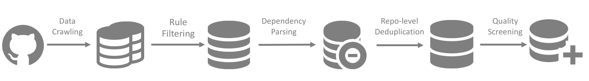
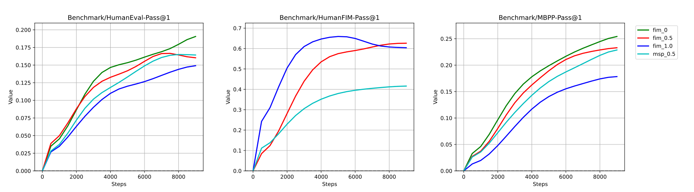

# DeepSeek-Coder：从仓库级数据到生成、补全与跨文件编程

> 将同一仓库的文件按依赖组织训练，同时学习 next-token prediction 与 Fill-in-the-Middle，再扩展长上下文和指令数据，构建 1.3B–33B 代码模型。
>
> DeepSeek-AI，2024 年 1 月 · [论文 v2](https://arxiv.org/abs/2401.14196v2) · [代码与模型](https://github.com/deepseek-ai/DeepSeek-Coder) · [补充解读](DeepSeek-Coder解读.md)

代码模型在真实开发中既要根据需求写程序，也要利用后缀补中间代码，还常常依赖同一工程的其他文件。只把独立文件拼起来做自回归预训练，不能充分表达这几类任务的结构。DeepSeek-Coder 从训练数据组织入手：解析仓库内依赖、按依赖拼接文件、在仓库粒度去重，并用 50% 概率加入 FIM 目标，随后训练 16K 上下文与代码指令跟随。

作者从零训练了 1.3B、6.7B、33B 模型，在多语言 HumanEval、数据科学代码、竞赛代码、补全、跨文件任务和程序辅助数学上评估。33B Base 的多语言 HumanEval 平均 50.3%，Instruct 在多项测试接近或超过 GPT-3.5。修订版还补充从通用 LLM 继续训练的 Coder-v1.5，展示代码、数学与通用语言能力之间的数据配比取舍。

## 摘要、背景与研究路线

Code LLM 的开源路线包括从代码语料训练的 StarCoder，以及从通用 LLaMA 继续训练的 CodeLlama。本文关注三个互相关联的问题：**怎样让训练数据接近工程结构、怎样同时学习续写与插入、怎样评估从小函数到真实仓库的不同能力。**

数据层面，以调用关系决定文件在上下文中的先后；目标层面，将中间片段移到后缀之后生成；模型层面，沿用 decoder-only Transformer，通过长上下文继续训练扩大可见代码范围。对应评测也分为生成、FIM、跨文件和程序数学，而不是仅用 HumanEval 代表全部编程能力。

## 数据构造：让项目结构保留在训练样本中

### 组成与 GitHub 初步过滤

初代配方为 **87% 源代码、10% 英文代码相关自然语言、3% 非代码中文文本**。英文部分包括 GitHub Markdown 和 StackExchange，补充 API、库用法及错误解释；中文高质量文本提高中文需求理解。

GitHub 收集范围为 **2023 年 2 月之前创建的公开仓库**，保留 87 种语言。借鉴 StarCoder 的规则过滤后，数据量降至原始的 **32.8%**。规则包括：

- 去除平均行长超过 100、最大行长超过 1000，或字母占比低于 25% 的文件；
- 对非 XSLT 文件过滤明显 XML 内容；
- HTML 的可见文本占比至少 20%，且不少于 100 字符；
- JSON／YAML 保留 50–5000 字符，减少纯数据大文件。

最终源代码统计约 **797.92 GB、603.173M 文件**。其中 Java 18.63%、Python 15.12%、C++ 11.39%、TypeScript 7.60%、PHP 7.38%、C# 7.34%、JavaScript 6.75%，其余语言组成长尾。它们是清洗后代码的磁盘体积比例，不是全部预训练 token 的语言配比。

### 依赖分析与文件排序



图中依次进行抓取、规则过滤、依赖分析、仓库级去重和质量筛选。依赖分析的目标，是让一个文件所需的上下文尽量出现在它之前，建立“先看到被调用定义，再看到调用代码”的训练顺序。

论文通过正则提取 Python `import`、C# `using`、C `include` 等文件调用关系，形成仓库内的有向图；先找到相互连通的子图，再执行修改后的拓扑排序。由于真实工程可能有循环，不要求每次都找到入度 0 的点，而选择当前最小入度点，输出后更新邻居入度，直至排完。

每个子图按所得顺序拼成一段样本，文件开头用注释记录路径。这样模型能同时看到文件边界、位置及跨文件定义。这里处理的是近似的静态调用关系，报告没有采用能够解析全部动态导入的完整编译器依赖系统。

### 仓库级去重、质量筛选与去污染

完成拼接后，将仓库级文本视作一个样本做近重复去重。与直接删掉重复文件相比，这样可以减少破坏某个保留仓库依赖结构的情况。

随后结合编译器、质量模型及规则去除语法错误、可读性差、模块化低的代码。去污染针对 HumanEval、MBPP、GSM8K、MATH 中的说明、题目与解答：出现相同 **10-gram** 的文件被过滤；测试片段短于 10-gram 但至少 3-gram 时，改用精确匹配。

## 训练目标：续写与 FIM 怎样共存

### Next-token prediction

普通自回归目标在打包的固定长度代码序列上预测下一个 token。它能学习从前缀继续写代码、复用上下文定义和项目惯例，但插入补全还需要同时利用待补位置之后的代码。

### PSM 格式的 Fill-in-the-Middle

将一个文件分为前缀 $f_{pre}$、中间段 $f_{middle}$ 与后缀 $f_{suf}$，训练时重新排列，使模型先看到前后文，再生成中间内容：

```text
<｜fim_start｜>{prefix}<｜fim_hole｜>{suffix}<｜fim_end｜>{middle}<|eos_token|>
```

这是 **PSM（Prefix–Suffix–Middle）** 顺序。SPM 则把 suffix 放在 prefix 之前；论文还比较 T5 风格的 MSP，将多个 span 遮盖后重建。DeepSeek-Coder 最终使用 PSM，在 document 级别先做 FIM 变换，再 packing，**FIM rate=0.5**。



消融使用 1.3B 架构和 Python 子集，比较 0%、50%、100% PSM 与 50% MSP。100% FIM 在 HumanEval-FIM 的单行插入任务上最强，但普通代码续写最弱；50% PSM 比 MSP 的综合表现更合适。因此最终配方选择 50%，平衡两类任务，而不是单独把插入分数最大化。

## 模型规格、预训练与长上下文

### 从零训练三个规模

报告描述的初代模型从零训练 **2T token**，包括 Base 与指令版本。BPE 词表 **32,000**；采用 RoPE、SwiGLU，33B 进一步采用 GQA，attention 使用 FlashAttention v2。

| Hyperparameter | DeepSeek-Coder 1.3B | DeepSeek-Coder 6.7B | DeepSeek-Coder 33B |
| --- | --- | --- | --- |
| Hidden Activation | SwiGLU | SwiGLU | SwiGLU |
| Hidden size | 2048 | 4096 | 7168 |
| Intermediate size | 5504 | 11008 | 19200 |
| Hidden layers number | 24 | 32 | 62 |
| Attention heads number | 16 | 32 | 56 |
| Attention | Multi-head | Multi-head | Grouped-query (8) |
| Batch Size | 1024 | 2304 | 3840 |
| Max Learning Rate | 5.3e-4 | 4.2e-4 | 3.5e-4 |

1.3B／6.7B／33B 分别为 24／32／62 层，隐藏维度 2048／4096／7168。论文表中的 `Grouped-query (8)` 沿用原文标记；batch 与学习率按 DeepSeek LLM 的规模经验选择。

AdamW 使用 $\beta_1=0.9,\beta_2=0.95$，预热 2000 步，分三阶段退火，后段逐次乘 $\sqrt{0.1}$，最终为峰值的 10%。训练系统为 HAI-LLM，在 A100／H800 集群上结合张量、ZeRO 数据、流水线并行及 InfiniBand。

### 16K 长上下文适配

初期训练后，RoPE 的线性缩放因子从 1 改为 **4**，base 从 **10,000 改为 100,000**。继续训练 **1,000 步**，每步 512 条、每条 16K token，学习率沿用预训练最后阶段。

作者据配置讨论更长的理论范围，但实测认为 **16K 内输出最可靠**，因此将 16K 作为主要能力描述。仓库级拼接、训练长度和实际可用的依赖范围，是这一路线中共同影响跨文件能力的因素。

### 指令微调

Instruct 在高质量人类指令上训练，采用 Alpaca 风格格式，用 `<|EOT|>` 区分轮次。SFT 总量 **2B token**，batch 为 4M token，学习率 $10^{-5}$，100 步 warm-up 后 cosine 下降。

正文和附录用 pygame 贪吃蛇、多轮增加功能等例子展示交互式编程。这些案例说明模型可以围绕既有代码继续修改；其系统性能力仍以下面的可执行 benchmark 衡量。

## 实验：从函数生成到工程上下文

### 评测协议与基线

基线包括 CodeGeeX2、StarCoder、CodeLlama、Codex，以及 GPT-3.5／GPT-4。HumanEval 为 164 个手写 Python 问题，另扩展到 C++、Java、PHP、TypeScript、C#、Bash、JavaScript；MBPP 使用 500 题的 few-shot 设置。作者用同一脚本和执行环境重新评测主要基线，采用贪心生成，报告 Pass@1。

HumanEval 与 MBPP 以独立函数题为主；DS-1000 更接近数据科学库调用，LeetCode 强调竞赛算法，CrossCodeEval 强调跨文件依赖。论文通过这些不同任务检验训练路线的各个部分。

### 多语言代码生成

**原文表 3 的主要对照。HumanEval 平均覆盖 8 种语言；最后一列单列 MBPP。**

| 模型 | 规模 | Python | C++ | Java | TS | C# | 多语言平均 | MBPP |
|---|---:|---:|---:|---:|---:|---:|---:|---:|
| StarCoderBase | 16B | 31.7 | 31.1 | 28.5 | 34.0 | 34.8 | 28.0 | 42.8 |
| CodeLlama Base | 7B | 31.7 | 29.8 | 34.2 | 36.5 | 36.7 | 29.2 | 38.6 |
| CodeLlama Base | 34B | 48.2 | 44.7 | 44.9 | 42.1 | 48.7 | 41.0 | 55.2 |
| DeepSeek-Coder Base | 1.3B | 34.8 | 31.1 | 32.3 | 28.9 | 36.7 | 28.3 | 46.2 |
| DeepSeek-Coder Base | 6.7B | 49.4 | 50.3 | 43.0 | 49.7 | 50.0 | 44.7 | 60.6 |
| DeepSeek-Coder Base | 33B | 56.1 | 58.4 | 51.9 | 52.8 | 51.3 | **50.3** | 66.0 |
| GPT-3.5-Turbo | — | 76.2 | 63.4 | 69.2 | 69.1 | 70.8 | 64.9 | 70.8 |
| GPT-4 | — | 84.1 | 76.4 | 81.6 | 77.4 | 79.1 | 76.5 | 80.0 |
| DeepSeek-Coder Instruct | 6.7B | 78.6 | 63.4 | 68.4 | 67.2 | 72.8 | 66.1 | 65.4 |
| DeepSeek-Coder Instruct | 33B | 79.3 | 68.9 | 73.4 | 67.9 | 74.1 | **69.2** | 70.0 |

全部结果以百分数表示。33B Base 的多语言平均比 CodeLlama 34B 高 **9.3 点**，MBPP 高 **10.8 点**；6.7B Base 的平均 44.7 也高于后者 41.0。指令版 33B 的 Python HumanEval 达到 79.3，多语言平均 69.2，超过表中的 GPT-3.5 64.9，但仍低于 GPT-4 76.5。

### DS-1000：数据科学库使用

DS-1000 包含 **1,000 个真实数据科学工作流问题**，覆盖 Matplotlib、NumPy、Pandas、PyTorch、SciPy、Scikit-Learn、TensorFlow。评估在补全设置下运行代码并通过测试，报告各库及总体 Pass@1。

| Model | Size | Matplotlib | Numpy | Pandas | Pytorch | Scipy | Scikit-Learn | Tensorflow | Avg |
| --- | --- | --- | --- | --- | --- | --- | --- | --- | --- |
| CodeGeeX2 | 6B | 38.7% | 26.8% | 14.4% | 11.8% | 19.8% | 27.0% | 17.8% | 22.9% |
| StarCoder-Base | 16B | 43.2% | 29.1% | 11.0% | 20.6% | 23.6% | 32.2% | 15.6% | 24.6% |
| CodeLlama-Base | 7B | 41.9% | 24.6% | 14.8% | 16.2% | 18.9% | 17.4% | 17.8% | 22.1% |
| CodeLlama-Base | 13B | 46.5% | 28.6% | 18.2% | 19.1% | 18.9% | 27.8% | 33.3% | 26.8% |
| CodeLlama-Base | 34B | 50.3% | 42.7% | 23.0% | 25.0% | 28.3% | 33.9% | 40.0% | 34.3% |
| DeepSeek-Coder-Base | 1.3B | 32.3% | 21.4% | 9.3% | 8.8% | 8.5% | 16.5% | 8.9% | 16.2% |
| DeepSeek-Coder-Base | 6.7B | 48.4% | 35.5% | 20.6% | 19.1% | 22.6% | 38.3% | 24.4% | 30.5% |
| DeepSeek-Coder-Base | 33B | 56.1% | 49.6% | 25.8% | 36.8% | 36.8% | 40.0% | 46.7% | 40.2% |

33B 平均 **40.2%**，高于 CodeLlama 34B 的 34.3%；6.7B 为 30.5%。各库难度差别明显：33B 的 Matplotlib 为 56.1%，Pandas 为 25.8%。这部分实验证明收益不只体现在标准算法函数，也延伸到库调用，但仍存在大量未解工作流。

### LeetCode：新近竞赛题

报告 v2 收集 **2023 年 7 月至 2024 年 1 月共 180 题**，含 45 Easy、91 Medium、44 Hard，每题收集 100 个测试。提示要求完成给定 Python 模板，另比较“先写逐步思路再写代码”的 CoT。

| Model | Size | Easy (45) | Medium (91) | Hard (44) | Overall(180) |
| --- | --- | --- | --- | --- | --- |
| WizardCoder-V1.0 | 15B | 17.8% | 1.1% | 0.0% | 5.0% |
| CodeLlama-Instruct | 34B | 24.4% | 4.4% | 4.5% | 9.4% |
| Phind-CodeLlama-V2 | 34B | 26.7% | 8.8% | 9.1% | 13.3% |
| GPT-3.5-Turbo | - | 46.7% | 15.4 % | 15.9% | 23.3% |
| GPT-3.5-Turbo + CoT | - | 42.2% | 15.4% | 20.5% | 23.3% |
| GPT-4-Turbo | - | 73.3% | 31.9% | 25.0% | 40.6% |
| GPT-4-Turbo + CoT | - | 71.1% | 35.2% | 25.0% | 41.8% |
| DeepSeek-Coder-Instruct | 1.3B | 22.2% | 1.1% | 4.5% | 7.2% |
| DeepSeek-Coder-Instruct + CoT | 1.3B | 22.2% | 2.2% | 2.3% | 7.2% |
| DeepSeek-Coder-Instruct | 6.7B | 44.4% | 12.1% | 9.1% | 19.4% |
| DeepSeek-Coder-Instruct + CoT | 6.7B | 44.4% | 17.6% | 4.5% | 21.1% |
| DeepSeek-Coder-Instruct | 33B | 57.8% | 22.0% | 9.1% | 27.8% |
| DeepSeek-Coder-Instruct + CoT | 33B | 53.3% | 25.3% | 11.4% | 28.9% |

33B Instruct 为 **27.8%**，加 CoT 为 **28.9%**；GPT-3.5 为 23.3%，GPT-4-Turbo 为 40.6%。CoT 对 6.7B 的整体分数从 19.4 提高到 21.1，但 Hard 子集从 9.1 降到 4.5，说明收益并非各难度一致。

作者还观察到某些模型在较早月份题目上更强，因此保留了污染可能性的讨论。这个 v2 的 180 题集合，也应与早期 DeepSeek LLM 报告使用的 126 题集合区分。

### 单行 FIM：根据前后文插入

单行补全测试覆盖 Python、Java 与 JavaScript，指标为该行的 exact match。

| Base 模型 | 规模 | Python | Java | JavaScript |
|---|---:|---:|---:|---:|
| StarCoder | 16B | 62.0 | 73.0 | 74.0 |
| CodeLlama | 7B | 67.6 | 74.3 | 80.2 |
| CodeLlama | 13B | 68.3 | 77.6 | 80.7 |
| DeepSeek-Coder | 1.3B | 57.4 | 82.2 | 71.7 |
| DeepSeek-Coder | 6.7B | 66.6 | 88.1 | 79.7 |
| DeepSeek-Coder | 33B | 65.4 | 86.6 | 82.5 |

分语言数值来自原表 6；其中部分原表 Mean 与这三列的简单平均不一致，这里保留分语言对照。结果显示 6.7B 的 Java 补全很强，但扩大到 33B 并未使每列都提高。作者据质量与成本的综合表现，推荐 6.7B 用于补全工具。

### CrossCodeEval：检验仓库级预训练

CrossCodeEval 从 **2023 年 3–6 月**新建的宽松许可仓库中构建 Python、Java、TypeScript、C# 任务，刻意要求使用其他文件的信息。输入最多 2048 token、输出最多 50 token，跨文件上下文最多 512 token，由官方 BM25 结果提供。指标为 EM 与 Edit Similarity（ES）。

| Model | Size | Python | Python | Java | Java | TypeScript | TypeScript | C# | C# |
| --- | --- | --- | --- | --- | --- | --- | --- | --- | --- |
| Model | Size | EM | ES | EM | ES | EM | ES | EM | ES |
| CodeGeex2 | 6B | 8.11% | 59.55% | 7.34% | 59.60% | 6.14% | 55.50% | 1.70% | 51.66% |
| 加入检索 |  | 10.73% | 61.76% | 10.10% | 59.56% | 7.72% | 55.17% | 4.64% | 52.30% |
| StarCoder-Base | 7B | 6.68% | 59.55% | 8.65% | 62.57% | 5.01% | 48.83% | 4.75% | 59.53% |
| 加入检索 |  | 13.06% | 64.24% | 15.61% | 64.78% | 7.54% | 42.06% | 14.20% | 65.03% |
| CodeLlama-Base | 7B | 7.32% | 59.66% | 9.68% | 62.64% | 8.19% | 58.50% | 4.07% | 59.19% |
| 加入检索 |  | 13.02% | 64.30% | 16.41% | 64.64% | 12.34% | 60.64% | 13.19% | 63.04% |
| DeepSeek-Coder-Base | 6.7B | 9.53% | 61.65% | 10.80% | 61.77% | 9.59% | 60.17% | 5.26% | 61.32% |
| 加入检索 |  | 16.14% | 66.51% | 17.72% | 63.18% | 14.03% | 61.77% | 16.23% | 63.42% |
| 加入检索，移除仓库级预训练 |  | 16.02% | 66.65% | 16.64% | 61.88% | 13.23% | 60.92% | 14.48% | 62.38% |

检索给各模型带来明显收益。DeepSeek-Coder 6.7B 的 EM 从 Python 9.53 到 **16.14**，Java 10.80 到 **17.72**，TypeScript 9.59 到 **14.03**，C# 5.26 到 **16.23**。

直接对应本文方法的消融是最后一行：移除仓库级预训练后，在相同检索上下文下，Java／TypeScript／C# EM 分别降到 16.64／13.23／14.48；Python 16.02 与 16.14 接近。仓库级组织的作用因语言而异，并且与推理时检索互补。

### 程序辅助数学：PAL

作者用 PAL 在七个数学集合上测试模型，将题目转化为程序计算。GSM8K／MATH 衡量应用题与较难数学；GSM-Hard 放大数值难度；SVAMP、ASDiv、MAWPS 是不同形式的文字题，TabMWP 加入表格。

| Model | Size | GSM8k | MATH | GSM-Hard | SVAMP | TabMWP | ASDiv | MAWPS | Avg |
| --- | --- | --- | --- | --- | --- | --- | --- | --- | --- |
| Multilingual Base Models | Multilingual Base Models | Multilingual Base Models | Multilingual Base Models | Multilingual Base Models | Multilingual Base Models | Multilingual Base Models | Multilingual Base Models | Multilingual Base Models | Multilingual Base Models |
| CodeGeex-2 | 7B | 22.2% | 9.7% | 23.6% | 39.0% | 44.6% | 48.5% | 66.0% | 36.2% |
| StarCoder-Base | 16B | 23.4% | 10.3% | 23.0% | 42.4% | 45.0% | 54.9% | 81.1% | 40.0% |
| CodeLlama-Base | 7B | 31.2% | 12.1% | 30.2% | 54.2% | 52.9% | 59.6% | 82.6% | 46.1% |
| CodeLlama-Base | 13B | 43.1% | 14.4% | 40.2% | 59.2% | 60.3% | 63.6% | 85.3% | 52.3% |
| CodeLlama-Base | 34B | 58.2% | 21.2% | 51.8% | 70.3% | 69.8% | 70.7% | 91.8% | 62.0% |
| DeepSeek-Coder-Base | 1.3B | 14.6% | 16.8% | 14.5% | 36.7% | 30.0% | 48.2% | 62.3% | 31.9% |
| DeepSeek-Coder-Base | 6.7B | 43.2% | 19.2% | 40.3% | 58.4% | 67.9% | 67.2% | 87.0% | 54.7% |
| DeepSeek-Coder-Base | 33B | 60.7% | 29.1% | 54.1% | 71.6% | 75.3% | 76.7% | 93.3% | 65.8% |

33B Base 平均 **65.8%**，高于 CodeLlama 34B 的 62.0%；MATH 为 29.1 vs 21.2，TabMWP 为 75.3 vs 69.8。这些结果使用程序执行帮助运算，需与纯自然语言 CoT 的数学成绩分开理解。

## 修订版补充：从通用 LLM 出发的 Coder-v1.5

本文 v2 在初代从零训练之外，增加了另一路线：从 **DeepSeek-LLM-7B Base** 出发，再进行 **2T token** 代码导向继续训练，得到 Coder-v1.5 7B。数据变为：源代码 70%、Markdown／StackExchange 10%、代码相关自然语言 7%、数学自然语言 7%、中英普通文本 6%。

这一配置在所述继续预训练中只用 next-token prediction、上下文 4K，不沿用初代的 FIM 配方。作者用同一评测流程重跑初代与 v1.5：

|  |  | Programming | Programming | Math Reasoning | Math Reasoning | Natural Language | Natural Language | Natural Language | Natural Language | Natural Language |
| --- | --- | --- | --- | --- | --- | --- | --- | --- | --- | --- |
| Models | Size | HumanEval | MBPP | GSM8K | MATH | MMLU | BBH | HellaSwag | WinoG | ARC-C |
| DeepSeek-Coder-Base | 6.7B | 44.7% | 60.6% | 43.2% | 19.2% | 36.6% | 44.3% | 53.8% | 57.1% | 32.5% |
| DeepSeek-Coder-Base-v1.5 | 6.9B | 43.2% | 60.4% | 62.4% | 24.7% | 49.1% | 55.2% | 69.9% | 63.8% | 47.2% |
| DeepSeek-Coder-Instruct | 6.7B | 66.1% | 65.4% | 62.8% | 28.6% | 37.2% | 46.9% | 55.0% | 57.6% | 37.4% |
| DeepSeek-Coder-Instruct-v1.5 | 6.9B | 64.1% | 64.6% | 72.6% | 34.1% | 49.5% | 53.3% | 72.2% | 63.4% | 48.1% |

Base 的多语言 HumanEval 平均从 44.7 小降到 43.2，MBPP 基本持平；GSM8K 从 **43.2 到 62.4**、MATH 从 **19.2 到 24.7**、MMLU 从 **36.6 到 49.1**、BBH 从 **44.3 到 55.2**。指令版也呈现类似趋势。

这一节展示了代码专用能力之外的另一种配方取舍：保留较强代码能力，同时通过通用基座与更丰富的自然语言／数学数据提高综合能力。它是同一报告的后续实验，不应与初代 33B 的全部设置混为一谈。

## 结论与局限

DeepSeek-Coder 把**仓库依赖组织、仓库级去重、混合 FIM 目标、长上下文继续训练、代码指令微调**连接起来，并以相对应的任务验证。论文的重要发现既包括更强的多语言生成，也包括 FIM 与续写的权衡、检索与仓库预训练的互补，以及 Coder-v1.5 中代码和综合能力的平衡。

依赖解析仍依赖静态近似，CrossCodeEval 中可见上下文有明确上限；竞赛题与函数 benchmark 不能覆盖完整软件开发过程。作者讨论了代码生成错误、数据污染的残余可能性，以及复杂推理与真实工程场景仍需改进。模型和代码公开，完整训练语料及所有质量筛选细节则未完全开放。
