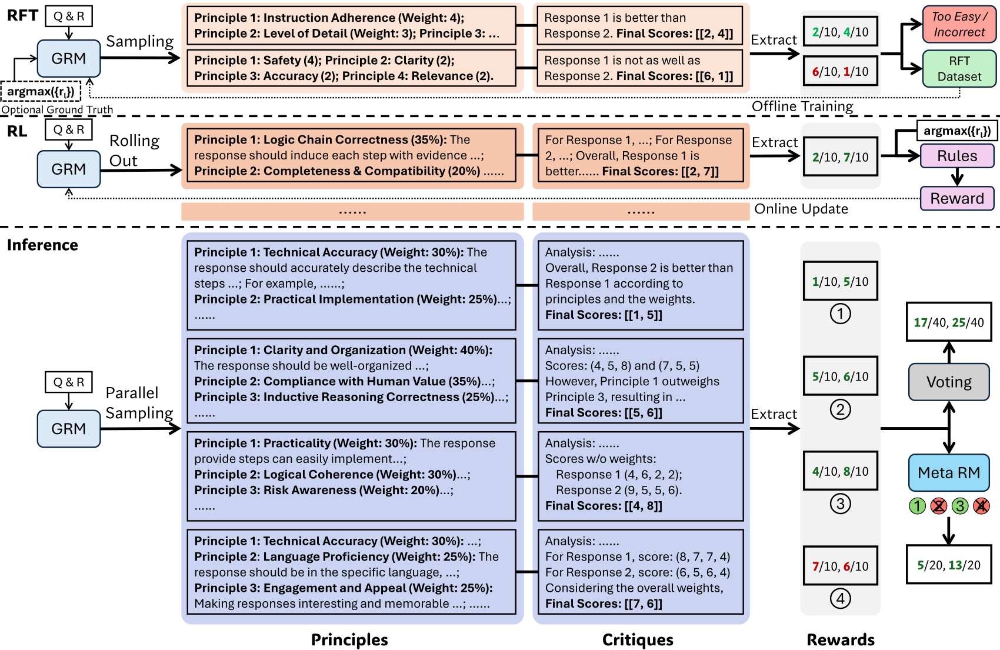

# DeepSeek-GRM：通过原则生成与自我批评训练通用奖励模型

> 💡 DeepSeek-GRM 先针对问题生成评价原则，再据此评论并评分，用偏好标签上的规则RL优化这整个过程，并通过多次评判与元奖励筛选扩展推理计算。
>
> [论文 v3](https://arxiv.org/abs/2504.02495v3) · [补充解读](DeepSeek-GRM解读.md)

通用奖励模型需要评价写作、指令遵循和复杂推理等不同任务，固定标量head或固定原则容易产生领域偏差。GRM研究让模型自己为当前候选生成适用原则，再给出批评和可提取的逐项分数。关键不是增加一段看似合理的解释，而是通过已知偏好结果强化有效原则，并在测试时采多个判断、筛掉不可靠轨迹。主要27B对照采用Gemma-2-27B，不能因为名称含DeepSeek就写成V3架构；其他MoE规模用于扩展实验。它是奖励模型研究，不是GRPO算法本身。

## 奖励表示与初步观察

论文区分标量RM、半标量RM与生成式RM；生成式又包括两两选优和对每个回答逐点评分。逐点评分更便于统一单条、两条或多条候选，保留分差和并列信息。

| Method | Chat Hard | IFEval |
| --- | --- | --- |
| GPT-4o-2024-08-06 | 76.1 | 56.0 |
| w/ Self-Gen. Principles | 75.9 | 55.6 |
| w/ Filtered Principles | 77.8 | 57.5 |
| Gemma-2-27B-it | 59.1 | 56.1 |
| w/ Self-Gen. Principles | 64.0 | 55.8 |
| w/ Filtered Principles | 68.0 | 57.3 |

随机自生成原则几乎没有改善；事后用正确偏好结果筛出的原则明显更好。这说明“让模型列评价标准”不足以保证标准有效，但正确结果可以提供训练选择信号。筛选过的原则使用了标签，不能作为推理时无需标签就已获得的现成能力。

## SPCT：拒绝微调与在线RL

给定问题$x$与候选$y_1,\ldots,y_n$，同一模型先生成原则$p$，再生成评论与评分$S_i$。原则不再是外部固定预处理，而是被优化的输出轨迹的一部分。

冷启动反复采样，保留能把已知最佳候选排到最高的轨迹；全都正确的过易题也过滤。单候选则检查评分是否等于标签。困难题可以加“最佳回答是第几条”的hint再采样，但这种方式会诱导评论直接为答案找理由，论文因此保留非hint数据并在后续用在线RL纠正。

RL采用GRPO，正确排序奖励+1，否则−1；不额外用format reward，而以较强KL约束保留格式。训练任务的奖励是“偏好判对没有”，不是人工逐条判断每一条原则的语义质量。

## 推理扩展与元奖励

每次采样生成一套原则、评论和逐点评分，最终对同一候选求和：

$$
S_i^*=\sum_{j=1}^{k}S_{i,j}.
$$

候选顺序先打乱以减少位置偏差。相比只投“谁胜”，分数汇总能保留更细的差别，但分数校准仍会影响结果。

另训练meta RM，输入原问题、候选、原则与评论，判断此次奖励轨迹是否可靠；用二元交叉熵，标签依据是否选对。它对$k$条轨迹排序，只对top-$k_{meta}$投票。meta RM评价的是奖励生成的可靠性，不是对最终任务答案直接重新求解。

## 训练对照与基准结果

主要27B体系在Gemma-2-27B上复现LLM-as-Judge、Bradley–Terry、CLoud半标量和PairRM，尽可能共享兼容数据与设置；meta RM也基于Gemma。默认greedy，多样采样temperature0.5。

| Model | RB | PPE Pref. | PPE Correct. | RMB | Overall | Avg. Rank ( $\downarrow$ ) |
| --- | --- | --- | --- | --- | --- | --- |
| Skywork-Reward-Gemma-2-27B | 94.1 | 56.6 | 56.6 | 60.2 | 66.9 | - |
| DeepSeek-V2.5-0905 | 81.5 | 62.8 | 58.5 | 65.7 | 67.1 | - |
| Gemini-1.5-Pro | 86.8 | 66.1 | 59.8 | 56.5 | 67.3 | - |
| ArmoRM-8B-v0.1 | 90.4 | 60.6 | 61.2 | 64.6 | 69.2 | - |
| InternLM2-20B-Reward | 90.2 | 61.0 | 63.0 | 62.9 | 69.3 | - |
| LLaMA-3.1-70b-Instruct | 84.1 | 65.3 | 59.2 | 68.9 | 69.4 | - |
| Claude-3.5-sonnet | 84.2 | 65.3 | 58.8 | 70.6 | 69.7 | - |
| Nemotron-4-340B-Reward | 92.0 | 59.3 | 60.8 | 69.9 | 70.5 | - |
| GPT-4o | 86.7 | 67.1 | 57.6 | 73.8 | 71.3 | - |
| LLM-as-a-Judge | 83.4 | 64.2 | 58.8 | 64.8 | 67.8 | 4.50 |
| DeepSeek-BTRM-27B | 81.7 | 68.3 | 66.7 | 57.9 | 68.6 | 3.50 |
| CLoud-Gemma-2-27B | 82.0 | 67.1 | 62.4 | 63.4 | 68.7 | 3.50 |
| DeepSeek-PairRM-27B | 87.1 | 65.8 | 64.8 | 58.2 | 69.0 | 2.75 |
| DeepSeek-GRM-27B-RFT (Ours) | 84.5 | 64.1 | 59.6 | 67.0 | 68.8 | 4.00 |
| DeepSeek-GRM-27B (Ours) | 86.0 | 64.7 | 59.8 | 69.0 | 69.9 | 2.75 |
| DeepSeek-GRM-27B (Ours) | 88.5 | 65.3 | 60.4 | 69.7 | 71.0 | - |
| DeepSeek-GRM-27B (MetaRM) (Ours) | 90.4 | 67.2 | 63.2 | 70.3 | 72.8 | - |

RewardBench、PPE偏好与正确性、RMB主要看选优准确率；ReaLMistake使用ROC-AUC，不与准确率混为同一个百分数。GRM整体较均衡，但部分标量方法在可验证正确性任务上更强，不能把通用平均优势写成逐领域全面胜出。

| Model | Overall |
| --- | --- |
| Nemotron-4-340B-Reward | 70.5 |
| GPT-4o | 71.3 |
| LLM-as-a-Judge | 67.0 |
| CLoud-Gemma-2-27B | 68.5 |
| DeepSeek-GRM-27B-RFT (Ours) | 67.8 |
| DeepSeek-GRM-27B (Ours) | 67.9 |
| LLM-as-a-Judge | 67.6 ( +0.6 ) |
| LLM-as-a-Judge w/ TokenProb | 68.1 ( +1.1 ) |
| CLoud-Gemma-2-27B | 68.8 ( +0.3 ) |
| DeepSeek-GRM-27B-RFT (Ours) | 69.3 ( +1.5 ) |
| DeepSeek-GRM-27B (Ours) | 70.6 ( +2.7 ) |
| DeepSeek-GRM-27B (MetaRM) (Ours) | 72.0 ( +4.1 ) |
| DeepSeek-GRM-27B (Ours) | 71.0 ( +3.1 ) |
| DeepSeek-GRM-27B (MetaRM) (Ours) | 72.8 ( +4.9 ) |

与公开系统比较包含不同基座、数据与规模，主贡献的因果证据应更多看相同27B基座的复现对照。

## 消融与扩展收益

| Method | Overall |
| --- | --- |
| DeepSeek-GRM-27B | 69.9 |
| w/o Principle Generation | 67.5 |
| w/o Rejective Sampling | 68.7 |
| DeepSeek-GRM-27B-RFT | 68.8 |
| w/o Hinted Sampling (①) | 68.0 |
| w/o Non-Hinted Sampling (②) | 67.4 |
| w/o Rejective Sampling (①&②) | 66.1 |
| w/o General Instruction Data | 63.3 |
| DeepSeek-GRM-27B | 70.6 |
| w/o Principle Generation | 68.0 |
| DeepSeek-GRM-27B | 71.0 |
| DeepSeek-GRM-27B ( $k_{\mathrm{meta}}=1$ ) | 71.5 |
| DeepSeek-GRM-27B ( $k_{\mathrm{meta}}=8$ ) | 72.7 |
| DeepSeek-GRM-27B ( $k_{\mathrm{meta}}=16$ ) | 72.8 |

没有rejective cold start时，通用指令模型仍可经在线RL由66.1提高到68.7，说明在线优化本身重要。移除非hint采样通常比移除hint更伤，符合hint轨迹可能走捷径的观察。

采样扩到8、32次可继续提升，meta筛选进一步改善。并非所有“生成解释”的RM都相同受益：半标量方案即使评论变化，标量变化很小，投票增益有限。本文将收益归因于自适应原则提供了更多有效评判视角，但多次采样仍可能共享偏差。

## 局限与论文结论

偏好标签决定训练的正确性，无法覆盖所有价值冲突；能排对最佳回答也不保证每条批评都忠实。增加采样和meta模型消耗额外计算，平均分会掩盖领域差异。报告主要验证奖励基准与选择能力，不能直接等价为用它训练任意下游策略都会同幅提升。

SPCT的价值是把原则生成、评论与评分联成可优化过程，让通用RM可以通过训练和测试时计算同时扩展。其效果建立在高质量偏好数据、适合的基座以及对生成判断可靠性的控制上。
