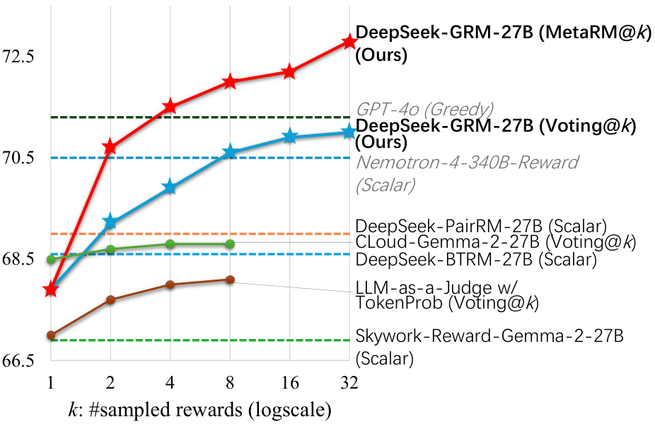
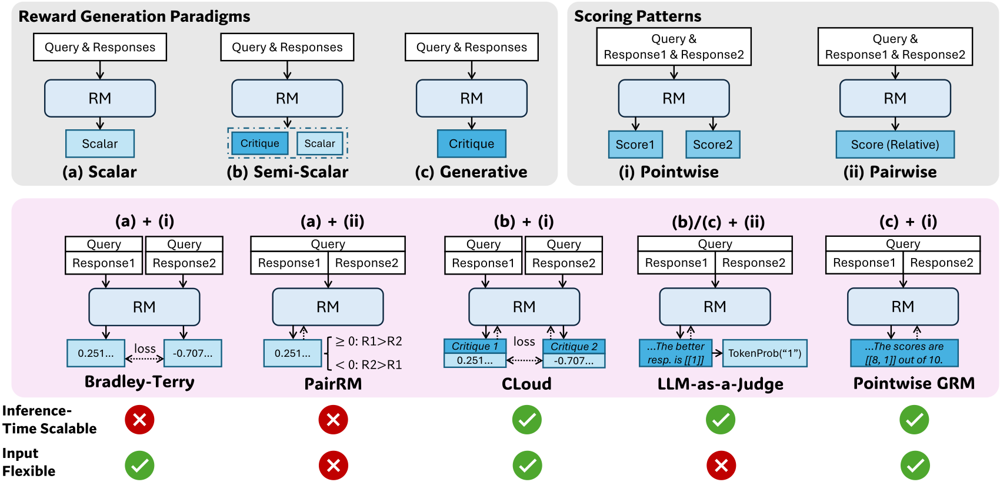
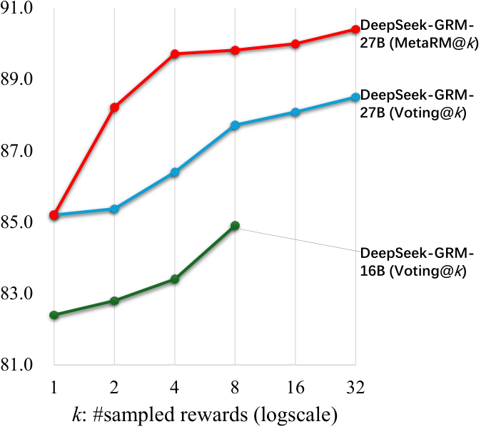
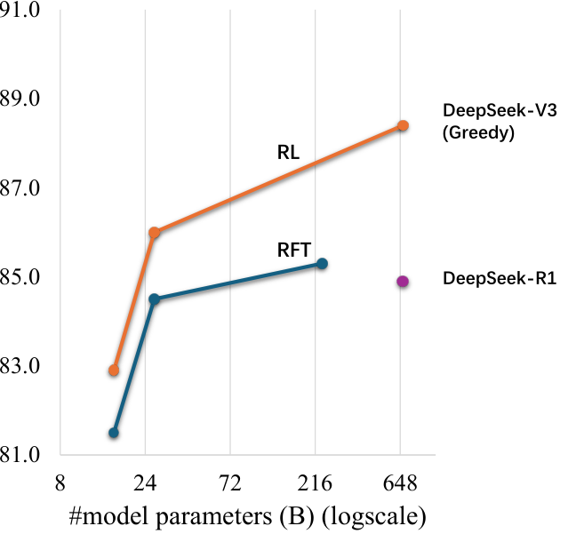
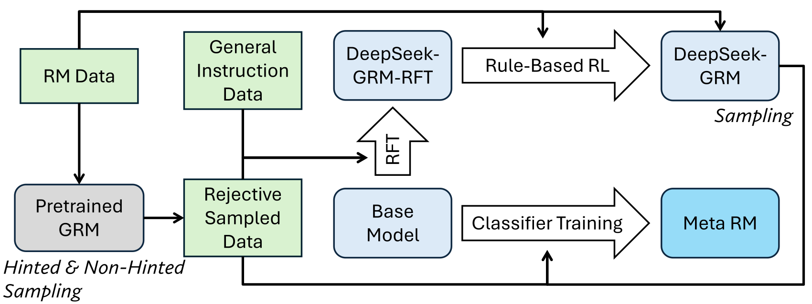
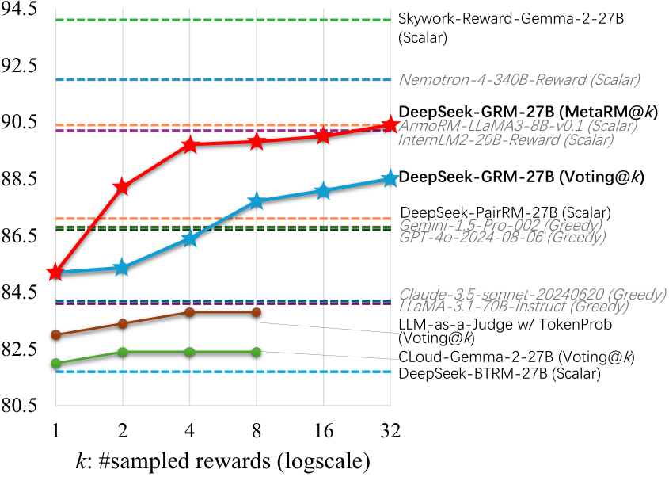
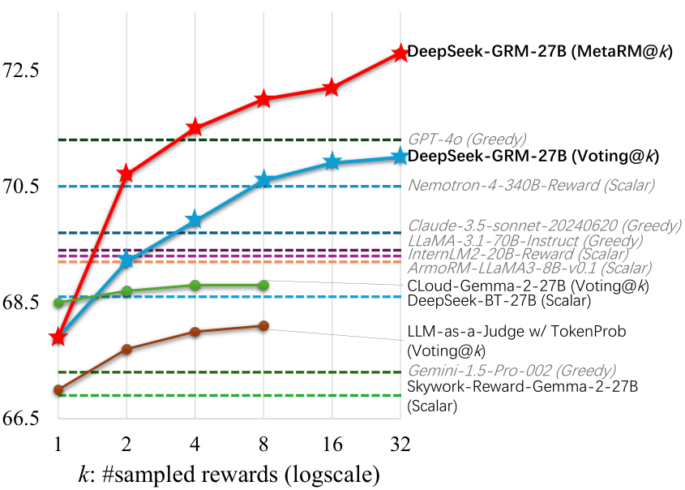
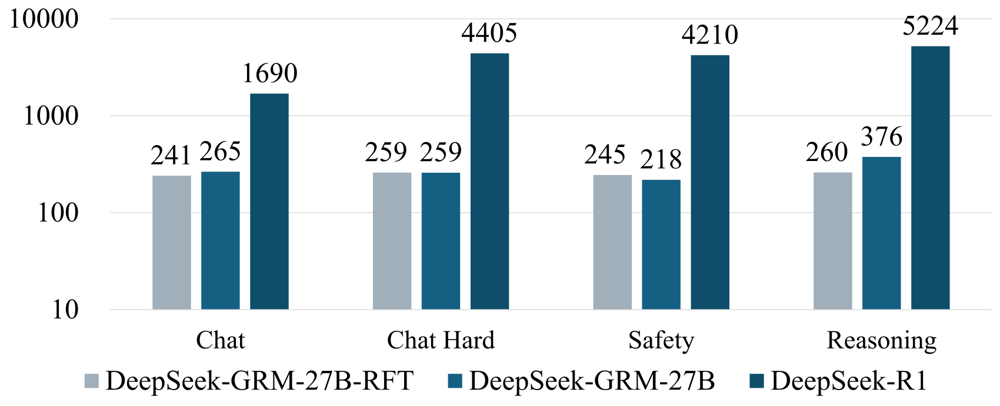
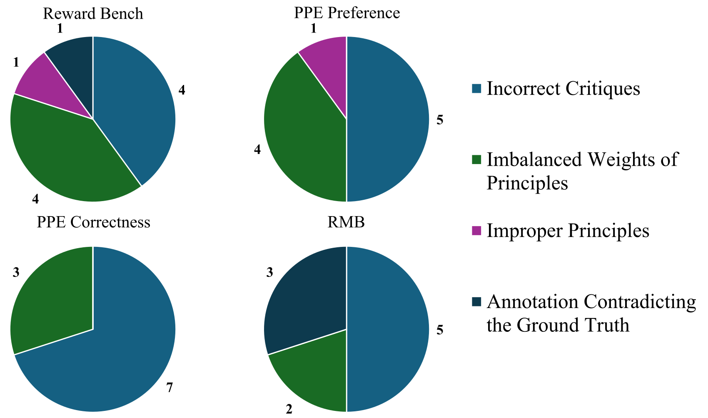

# Inference-Time Scaling for Generalist Reward Modeling / 全文中英对照

> 来源：[arXiv:2504.02495v3](https://arxiv.org/abs/2504.02495v3)。英文段落后紧接中文，覆盖所取 HTML 版本的主文、附录、图表、脚注与参考文献；公式、数字表和书目信息共用。中文以机器初译为底稿，进行了术语整理与结构核对，尚未逐句人工审定；遇到歧义请以紧邻英文和原论文为准。 原作版权归所列作者，许可见 [原作许可](http://creativecommons.org/licenses/by-sa/4.0/)；中文译文与版式改写在该许可条件下提供（涉及 SA 时沿用相同许可，涉及 NC 时仅限非商业使用）。

## Authors and affiliations / 作者与机构

Zijun Liu Affiliation: DeepSeek-AI Email: zj-liu24@mails.tsinghua.edu.cn Peiyi Wang Email: wangpeiyi9979@gmail.com Runxin Xu Affiliation: DeepSeek-AI Shirong Ma Affiliation: DeepSeek-AI Chong Ruan Affiliation: DeepSeek-AI Peng Li Affiliation: Institute for AI Industry Research (AIR), Tsinghua University Yang Liu Affiliation: Dept. of Computer Sci. & Tech., Tsinghua University Affiliation: Institute for AI Industry Research (AIR), Tsinghua University Yu Wu Affiliation: DeepSeek-AI

## Abstract / 摘要

**EN.** Reinforcement learning (RL) has been widely adopted in post-training for large language models (LLMs) at scale. Recently, the incentivization of reasoning capabilities in LLMs from RL indicates that proper learning methods could enable effective inference-time scalability . A key challenge of RL is to obtain accurate reward signals for LLMs in various domains beyond verifiable questions or artificial rules. In this work, we investigate how to improve reward modeling (RM) with more inference compute for general queries, i.e. the inference-time scalability of generalist RM . For the RM approach, we adopt pointwise generative reward modeling (GRM) to enable flexibility for different input types and the potential for inference-time scaling. For the learning method, we propose Self-Principled Critique Tuning (SPCT) to foster scalable reward generation behaviors in GRMs through online RL, to generate principles adaptively and critiques accurately, resulting in DeepSeek-GRM models. Furthermore, for effective inference-time scaling, we use parallel sampling to expand compute usage, and introduce a meta RM to guide the voting process for better scaling performance. Empirically, we show that SPCT significantly improves the quality and scalability of GRMs, outperforming existing methods and models in various RM benchmarks without severe biases, and it can achieve better performance compared to training-time scaling. DeepSeek-GRM still meets challenges in some tasks, which we believe can be addressed by future efforts in generalist reward systems. The models are released at [Hugging Face](https://huggingface.co/collections/BBQGOD/deepseek-grm-68b4681169dbb97fd30614b5) and [ModelScope](https://www.modelscope.cn/collections/DeepSeek-GRM-ff6a2d8babdd4a) .

**中.** 强化学习（RL）已广泛应用于大规模大型语言模型（LLM）的后训练中。最近，强化学习对LLM推理能力的激励表明，正确的学习方法可以实现有效的推理时间可扩展性。强化学习的一个关键挑战是在可验证的问题或人为规则之外为各个领域的LLM获得准确的奖励信号。在这项工作中，我们研究如何通过针对一般查询的更多推理计算来改进奖励建模（RM），即通才 RM 的推理时间可扩展性。对于 RM 方法，我们采用逐点生成奖励模型 (GRM)，以实现不同输入类型的灵活性和推理时间扩展的潜力。对于学习方法，我们提出了自我原则批判调整（SPCT），通过在线强化学习在 GRM 中培养可扩展的奖励生成行为，自适应地生成原则并准确地批判，从而形成 DeepSeek-GRM 模型。此外，为了有效地扩展推理时间，我们使用并行采样来扩展计算使用量，并引入元 RM 来指导投票过程以获得更好的扩展性能。根据经验，我们表明 SPCT 显着提高了 GRM 的质量和可扩展性，在各种 RM 基准中优于现有方法和模型，没有严重偏差，并且与训练时间缩放相比，它可以实现更好的性能。 DeepSeek-GRM 在某些任务中仍然面临挑战，我们相信这些问题可以通过未来在通用奖励系统方面的努力来解决。模型在[Hugging Face](https://huggingface.co/collections/BBQGOD/deepseek-grm-68b4681169dbb97fd30614b5)和[ModelScope](https://www.modelscope.cn/collections/DeepSeek-GRM-ff6a2d8babdd4a)发布。

**EN.** Figure 1: Inference-time scaling performance with different RMs on all tested RM benchmarks. Results are shown with up to 8 samples for each method, and are further scaled to 32 samples for ours. Non-italic font indicates models based on Gemma-2-27B.

**中.** 图 1：在所有测试的 RM 基准上，不同 RM 的推理时间扩展性能。每种方法显示的结果最多有 8 个样本，我们的方法进一步扩展到 32 个样本。非斜体字体表示基于 Gemma-2-27B 的型号。

## Introduction / 简介

**EN.** The remarkable advancements in large language models (LLMs) ( DeepSeek-AI, 2024b ; OpenAI, 2025b ) have catalyzed significant shifts in artificial intelligence research, enabling models to perform tasks that require understanding, generation, and nuanced decision-making capabilities. Recently, reinforcement learning (RL) as a post-training method for LLMs has been widely adopted at scale, and resulting in remarkable improvements in human value alignment ( Ouyang et al., 2022 ; Bai et al., 2022a ) , long-term reasoning ( DeepSeek-AI, 2025 ; OpenAI, 2025c ) , and environment adaptation ( OpenAI, 2025a ) for LLMs. Reward modeling (RM) ( Gao et al., 2023 ) , as a crucial component in RL, is essential for generating accurate reward signals for LLM responses. Current studies ( Lightman et al., 2024 ; DeepSeek-AI, 2025 ) also show that, with high-quality and robust rewards in either training or inference time, LLMs can achieve strong performance in specific domains.

**中.** 大型语言模型 (LLM)（DeepSeek-AI，2024b；OpenAI，2025b）的显着进步促进了人工智能研究的重大转变，使模型能够执行需要理解、生成和细致决策能力的任务。近年来，强化学习（RL）作为LLM的一种后训练方法已被大规模采用，并在LLM的人类价值取向（Ouyang等，2022；Bai等，2022a）、长期推理（DeepSeek-AI，2025；OpenAI，2025c）和环境适应（OpenAI，2025a）方面取得了显着的进步。奖励建模（RM）（Gao et al., 2023）作为强化学习的关键组成部分，对于为 LLM 响应生成准确的奖励信号至关重要。目前的研究（Lightman et al., 2024；DeepSeek-AI, 2025）还表明，通过在训练或推理时间内提供高质量和稳健的奖励，LLM可以在特定领域取得优异的表现。

**EN.** However, such high-quality rewards in specific domains are mainly obtained from human-designed environments with clear conditions ( Yao et al., 2022 ; Xie et al., 2024 ) or from hand-crafted rules for verifiable questions, e.g., mathematical problems ( Hendrycks et al., 2021 ; Veeraboina, 2023 ) and coding tasks ( Jimenez et al., 2024 ; Zhuo et al., 2025 ) . In general domains, reward generation is more challenging, as the criteria for rewards are more diverse and complex, and there are often no explicit reference or ground truth. Generalist reward modeling is thus crucial for improving the performance of LLMs in broader applications, either from post-training perspectives, e.g., RL at scale, or from inference perspectives, e.g., RM-guided search. Furthermore, RM performance should be improved by increasing both the training compute ( Gao et al., 2023 ) and the inference compute.

**中.** 然而，特定领域的这种高质量奖励主要是从具有明确条件的人类设计环境中获得的（Yao等，2022；Xie等，2024）或从可验证问题的手工制定规则中获得，例如数学问题（Hendrycks等，2021；Veeraboina，2023）和编码任务（Jimenez等，2024；Zhuo等）等，2025）。在一般领域，奖励的生成更具挑战性，因为奖励的标准更加多样化和复杂，并且通常没有明确的参考或基本事实。因此，通才奖励模型对于提高LLM在更广泛应用中的性能至关重要，无论是从训练后的角度（例如大规模强化学习）还是从推理的角度（例如 RM 引导搜索）。此外，应该通过增加训练计算（Gao et al., 2023）和推理计算来提高 RM 性能。

**EN.** In practice, challenges arise in making RMs both general and effectively scalable in inference time. The former demands (1) flexibility for different input types and (2) accurate reward generation in various domains. We refer to this paradigm as generalist reward modeling . Moreover, effective inference-time scalability requires the RM (3) to generate higher-quality reward signals with increased inference compute, and (4) to learn scalable behaviors for better performance-compute scaling. Existing research on reward modeling demonstrates several paradigms for reward generation, including scalar ( Cobbe et al., 2021 ; Wang et al., 2024e ; Liu et al., 2024 ) , semi-scalar ( Ye et al., 2025a ; Yu et al., 2025b ; Zhang et al., 2025a ) , and generative ( Li et al., 2024a ; Kim et al., 2024 ; Vu et al., 2024 ; Cao et al., 2024 ; Arabzadeh et al., 2024 ; Ye et al., 2025b ; Alexandru et al., 2025 ; Yu et al., 2025a ) approaches, and various scoring patterns, such as pointwise ( Kendall & Smith, 1940 ; Gao et al., 2023 ; Yuan et al., 2024 ; Winata et al., 2025 ; Guo et al., 2025 ) and pairwise ( Park et al., 2024 ; Zheng et al., 2023 ; Jiang et al., 2023 ; Wang et al., 2024c ; Liu et al., 2025 ) . These approaches inherently determine the input flexibility and the inference-time scalability of RMs ( (1)&(3) ), as shown in Figure 2 . For instance, pairwise RMs only consider the relative preference of paired responses, lacking flexibility to accept single or multiple responses as input; scalar RMs could hardly generate diverse reward signals for the same response, which obstructs getting better rewards through sampling-based inference-time scaling methods ( Snell et al., 2025 ) . Also, different learning methods ( Wang et al., 2024a ; Ankner et al., 2024 ; Wang et al., 2024c ; Mahan et al., 2024 ) have been proposed to improve the quality of rewards, but few of them focus on inference-time scalability and study the interconnection between the learned reward generation behaviors and the effectiveness of inference-time scaling of RMs, resulting in marginal performance improvement ( (2)&(4) ). Current research ( DeepSeek-AI, 2025 ) indicates that effective inference-time scalability could be enabled by proper learning methods, which raises the question: Can we design a learning method aiming to enable effective inference-time scaling for generalist reward modeling?

**中.** 在实践中，如何使 RM 在推理时间内具有通用性和有效可扩展性会带来挑战。前者要求（1）不同输入类型的灵活性和（2）在各个领域准确生成奖励。我们将这种范式称为通才奖励模型。此外，有效的推理时间可扩展性要求 RM (3) 通过增加推理计算来生成更高质量的奖励信号，以及 (4) 学习可扩展行为以实现更好的性能计算扩展。现有的奖励模型研究展示了奖励生成的几种范式，包括标量（Cobbe et al., 2021；Wang et al., 2024e；Liu et al., 2024）、半标量（Ye et al., 2025a；Yu et al., 2025b；Zhang et al., 2025a）和生成式（Li et al., 2025a）。 2024a ；Vu 等人，2024 ；Arabzadeh 等人，2024 ；Ye 等人，2025 ；Yu 等人，2025a ）以及各种评分模式（Kendall & Smith， 1940 ；Yuan 等，2024 ；Winata 等，2025 ；Guo 等，2025 ）和配对（ Park 等，2024 ；Zheng 等，2023 ；Wang 等，2024c ；Liu 等， 2025）。这些方法本质上决定了 RM 的输入灵活性和推理时间可扩展性 ((1)&(3))，如图 2 所示。例如，成对 RM 只考虑成对响应的相对偏好，缺乏接受单个或多个响应作为输入的灵活性；标量 RM 很难为相同的响应生成不同的奖励信号，这阻碍了通过基于采样的推理时间缩放方法获得更好的奖励（Snell 等人，2025）。此外，人们提出了不同的学习方法（Wang et al., 2024a；Ankner et al., 2024；Wang et al., 2024c；Mahan et al., 2024）来提高奖励质量，但很少有人关注推理时间可扩展性，并研究学习到的奖励生成行为与 RM 推理时间缩放有效性之间的互连，从而导致边际性能提高（ （2）和（4））。当前的研究（DeepSeek-AI，2025）表明，可以通过适当的学习方法来实现有效的推理时间可扩展性，这就提出了一个问题：我们是否可以设计一种学习方法，旨在为通才奖励建模实现有效的推理时间扩展？

**EN.** In this work, we investigated different approaches for RM, and found that pointwise generative reward modeling (GRM) could unify the scoring of single, paired, and multiple responses within pure language representation, overcoming challenge (1) . We explored that certain principles could guide reward generation within proper criteria for GRMs, improving the quality of rewards, which suggested that inference-time scalability of RM might be achieved by scaling the generation of high-quality principles and accurate critiques . Based on this preliminary, we propose a novel learning method, Self-Principled Critique Tuning (SPCT), to foster effective inference-time scalable behaviors in GRMs. By leveraging rule-based online RL, SPCT enables GRMs to learn to adaptively posit principles and critiques based on the input query and responses, leading to better outcome rewards in general domains (challenge (2) ). We then come up with DeepSeek-GRM-27B , which is post-trained with SPCT based on Gemma-2-27B ( Team, 2024 ) . For inference-time scaling, we expand compute usage by sampling multiple times. By sampling in parallel, DeepSeek-GRM could generate different sets of principles and corresponding critiques, and then vote for the final reward. With larger-scale sampling, DeepSeek-GRM could judge more accurately based on more diverse principles, and output rewards with finer granularity , which resolves challenge (3)&(4) . Furthermore, we train a meta RM in addition to voting for better scaling performance. Empirically, we show that SPCT significantly improves the quality and scalability of GRMs, outperforming existing methods and models in multiple comprehensive RM benchmarks without severe domain biases. We also compared the inference-time scaling performance of DeepSeek-GRM-27B with larger models up to 671B parameters, and found it could achieve better performance compared to training-time scaling on model sizes. Though the current method meets challenges in efficiency and specific tasks, with efforts beyond SPCT, we believe GRMs with enhanced scalability and efficiency could serve as a versatile interface for generalist reward systems, advancing the frontiers of LLM post-training and inference.

**中.** 在这项工作中，我们研究了 RM 的不同方法，发现逐点生成奖励模型 (GRM) 可以统一纯语言表示中的单个、配对和多个响应的评分，克服挑战 (1)。我们探索了某些原则可以指导在适当的 GRM 标准内生成奖励，提高奖励的质量，这表明 RM 的推理时间可扩展性可以通过扩展高质量原则和准确批评的生成来实现。在此基础上，我们提出了一种新颖的学习方法，即自我原则批判调整（SPCT），以促进 GRM 中有效的推理时间可扩展行为。通过利用基于规则的在线 RL，SPCT 使 GRM 能够学习根据输入查询和响应自适应地提出原则和批评，从而在一般领域获得更好的结果奖励（挑战 (2)）。然后我们提出了 DeepSeek-GRM-27B，它是基于 Gemma-2-27B（团队，2024）进行 SPCT 后训练的。对于推理时间扩展，我们通过多次采样来扩展计算使用量。通过并行采样，DeepSeek-GRM 可以生成不同的原则集和相应的批评，然后投票选出最终奖励。通过更大规模的采样，DeepSeek-GRM可以根据更多样化的原则进行更准确的判断，并输出更细粒度的奖励，从而解决了挑战（3）和（4）。此外，除了投票以获得更好的扩展性能之外，我们还训练元 RM。根据经验，我们表明 SPCT 显着提高了 GRM 的质量和可扩展性，在多个综合 RM 基准测试中优于现有方法和模型，且没有严重的领域偏差。我们还将 DeepSeek-GRM-27B 的推理时间扩展性能与高达 671B 参数的较大模型进行了比较，发现与模型大小的训练时间扩展相比，它可以获得更好的性能。尽管当前的方法在效率和特定任务方面遇到了挑战，但通过 SPCT 之外的努力，我们相信具有增强的可扩展性和效率的 GRM 可以作为通才奖励系统的通用接口，从而推进 LLM 后训练和推理的前沿。

**EN.** In general, our main contributions are as follows.

**中.** 总的来说，我们的主要贡献如下。

**EN.** 1.

**中.** 1.

**EN.** We propose a novel approach, Self-Principled Critique Tuning (SPCT), to foster effective inference-time scalability for generalist reward modeling, resulting in DeepSeek-GRM models. And we further introduce a meta RM to effectively improve the inference-time scaling performance of DeepSeek-GRM beyond voting.

**中.** 我们提出了一种新颖的方法，即自我原则批判调整（SPCT），以促进通才奖励建模的有效推理时间可扩展性，从而产生 DeepSeek-GRM 模型。我们进一步引入了元 RM，以有效提高 DeepSeek-GRM 除了投票之外的推理时间扩展性能。

**EN.** 2.

**中.** 2.

**EN.** We empirically show SPCT significantly improves the quality and inference-time scalability of GRMs over existing methods and several strong public models.

**中.** 我们的经验表明，与现有方法和几个强大的公共模型相比，SPCT 显着提高了 GRM 的质量和推理时间可扩展性。

**EN.** 3.

**中.** 3.

**EN.** We also applied the SPCT training schedule to LLMs with larger sizes and found that inference-time scaling could outperform model size scaling in training time.

**中.** 我们还将 SPCT 训练计划应用于规模较大的LLM，发现推理时间缩放在训练时间上可以优于模型大小缩放。

**EN.** Figure 2: Different paradigms for reward generation, including (a) scalar, (b) semi-scalar, and (c) generative approaches, and different scoring patterns, including (i) pointwise and (ii) pairwise approaches. We list the representative methods for each approach, and corresponding inference-time scalability (whether better rewards could be obtained from multiple sampling) and input flexibility (whether supports rating single and multiple responses).

**中.** 图 2：奖励生成的不同范例，包括 (a) 标量、(b) 半标量和 (c) 生成方法，以及不同的评分模式，包括 (i) 逐点方法和 (ii) 成对方法。我们列出了每种方法的代表性方法，以及相应的推理时间可扩展性（是否可以从多次采样中获得更好的奖励）和输入灵活性（是否支持对单个和多个响应进行评级）。

## Preliminaries / 预赛

### Comparisons of Different RM approaches / 不同 RM 方法的比较

**EN.** As shown in Figure 2 , RM approaches are mainly determined by reward generation paradigms and scoring patterns, which inherently affect the inference-time scalability and the input flexibility of the RM. For reward generation paradigms , we distinguish three main approaches: scalar, semi-scalar, and generative. For scoring patterns , we distinguish two main approaches: pointwise and pairwise. To expand compute usage in inference time, we focus on sampling-based methods, which generate multiple sets of rewards for the same query and responses, and then aggregate the final reward. Thus, the inference-time scalability of RMs is determined by whether different rewards could be obtained from multiple sampling, where scalar RMs would fail in most cases due to the invariant generation of rewards; and the input flexibility is defined by whether the RM supports rating single, paired, and multiple responses, where pairwise RMs could hardly rate single responses and usually require extra techniques ( Jiang et al., 2023 ; Liu et al., 2025 ) to handle multiple responses.

**中.** 如图 2 所示，RM 方法主要由奖励生成范式和评分模式决定，这本质上影响 RM 的推理时间可扩展性和输入灵活性。对于奖励生成范式，我们区分了三种主要方法：标量、半标量和生成。对于评分模式，我们区分两种主要方法：逐点和成对。为了扩大推理时间的计算使用量，我们专注于基于采样的方法，它为相同的查询和响应生成多组奖励，然后汇总最终奖励。因此，RM的推理时间可扩展性取决于是否可以从多次采样中获得不同的奖励，其中标量RM在大多数情况下会由于奖励生成不变而失败；输入灵活性由 RM 是否支持对单个、配对和多个响应进行评级来定义，其中成对 RM 很难对单个响应进行评级，通常需要额外的技术（Jiang et al., 2023；Liu et al., 2025）来处理多个响应。

#### Reward Generation Paradigms / 奖励生成范式

**EN.** Classic RMs adopt the (a) scalar approach to generate rewards ( $\mathcal{R}$ ), which assigns scalar values to the given query and responses. The scalar approach is further extended to the (b) semi-scalar approach, which generates texts in addition to the scalar value. And the (c) generative approach only generates textual rewards.

**中.** 经典 RM 采用 (a) 标量方法来生成奖励 ( $\mathcal{R}$ )，它将标量值分配给给定的查询和响应。标量方法进一步扩展到 (b) 半标量方法，除了标量值之外还生成文本。 (c) 生成方法仅生成文本奖励。

$$
\mathcal{R}=\begin{cases}\bm{S}&\text{(Scalar)}\\
\left(\bm{S},\bm{C}\right)&\text{(Semi-Scalar)}\\
\bm{C}&\text{(Generative)}\end{cases}\sim r_{\theta}\left(x,\{y_{i}\}_{i=1}^{n}\right),\tag{1}
$$

**EN.** where $x$ is the query, $y_{i}$ is the $i$ -th response, $r_{\theta}$ is the reward function parameterized by $\theta$ , $\bm{S}\in\mathbb{R}^{m},m\leq n$ is the scalar reward, and $\bm{C}$ is the critique.

**中.** 其中 $x$ 是查询，$y_{i}$ 是 $i$ 响应，$r_{\theta}$ 是由 $\theta$ 参数化的奖励函数，$\bm{S}\in\mathbb{R}^{m},m\leq n$ 是标量奖励，$\bm{C}$ 是批评。

#### Scoring Patterns / 评分模式

**EN.** We distinguish two main scoring approaches for rewards: pointwise and pairwise. The (i) pointwise approach assigns an individual score to each response:

**中.** 我们区分两种主要的奖励评分方法：逐点评分和成对评分。 (i) 逐点方法为每个响应分配单独的分数：

$$
\left\{S_{i}\right\}_{i=1}^{n}=f_{\mathrm{point}}\left(\mathcal{R},\{y_{i}\}_{i=1}^{n}\right),\quad\mathcal{R}\sim r_{\theta}\left(x,\{y_{i}\}_{i=1}^{n}\right),S_{i}\in\mathbb{R},\tag{2}
$$

**EN.** where $f_{\mathrm{point}}(\cdot,\cdot)$ is a splitting function. In contrast, the (ii) pairwise approach can be viewed as a best-of- $n$ method, selecting a single best response from all candidates:

**中.** 其中 $f_{\mathrm{point}}(\cdot,\cdot)$ 是分裂函数。相反，(ii) 成对方法可以被视为最佳 $n$ 方法，从所有候选者中选择一个最佳响应：

$$
\hat{y}=f_{\mathrm{pair}}(\mathcal{R},\{y_{i}\}_{i=1}^{n}),\quad\mathcal{R}\sim r_{\theta}\left(x,\{y_{i}\}_{i=1}^{n}\right),\hat{y}\in\{y_{i}\}_{i=1}^{n},\tag{3}
$$

**EN.** where $f_{\mathrm{pair}}(\cdot,\cdot)$ is a selection function and $n=2$ in most cases. Though the pairwise approach could be extended to $n>2$ , it could not be applied to single response scoring ( $n=1$ ).

**中.** 其中 $f_{\mathrm{pair}}(\cdot,\cdot)$ 是选择函数，大多数情况下是 $n=2$。尽管成对方法可以扩展到 $n>2$ ，但它不能应用于单一响应评分（ $n=1$ ）。

#### Representative Methods / 代表性方法

**EN.** Figure 2 illustrates how the three reward generation paradigms (scalar, semi-scalar, generative) can be combined with the two scoring patterns (pointwise, pairwise). Specifically, Bradley-Terry model ( Kendall & Smith, 1940 ) ( (a)+(i) ) is trained with pairwise preference data and outputs scalar rewards pointwisely

**中.** 图 2 说明了如何将三种奖励生成范例（标量、半标量、生成）与两种评分模式（逐点、成对）相结合。具体来说，Bradley-Terry 模型 (Kendall & Smith, 1940) ((a)+(i)) 使用成对偏好数据进行训练，并逐点输出标量奖励

$$
\left\{S_{i}\right\}_{i=1}^{n}=f_{\mathrm{point}}\left(\mathcal{R},\{y_{i}\}_{i=1}^{n}\right)=\bm{S}\in\mathbb{R}^{n}.\tag{4}
$$

**EN.** PairRM ( Jiang et al., 2023 ) ( (a)+(ii) ) compares a pair of responses with the sign of the scalar reward

**中.** PairRM ( Jiang et al., 2023 ) ( (a)+(ii) ) 将一对响应与标量奖励的符号进行比较

$$
\hat{y}=f_{\mathrm{pair}}\left(\mathcal{R},\{y_{i}\}_{i=1}^{n}\right)=y_{\lfloor\frac{1}{2}(3-\mathrm{sgn}(\bm{S}))\rfloor},\quad n=2,\mathcal{S}\in\mathbb{R}.\tag{5}
$$

**EN.** The scalar methods above could barely perform inference-time scaling due to the lack of diversity in reward generation. CLoud ( Ankner et al., 2024 ) ( (b)+(i) ) generates scalar rewards for each response based on pre-generated critiques, similar to Equation 4 . LLM-as-a-Judge ( Zheng et al., 2023 ; Wang et al., 2025a ) ( (c)+(ii) ) judges the preference order between paired responses textually,

**中.** 由于奖励生成缺乏多样性，上述标量方法几乎无法执行推理时间缩放。 CLoud（Ankner 等人，2024）（（b）+（i））根据预先生成的批评为每个响应生成标量奖励，类似于方程 4。 LLM-as-a-Judge ( Cheng et al., 2023 ; Wang et al., 2025a ) ( (c)+(ii) ) 从文本上判断配对响应之间的偏好顺序，

$$
\hat{y}=f_{\mathrm{pair}}\left(\mathcal{R},\{y_{i}\}_{i=1}^{n}\right)=y_{f_{\mathrm{extract}}(\bm{C})},\quad n=2,\tag{6}
$$

**EN.** where $f_{\mathrm{extract}}(\cdot)$ extracts the index of best response from language representations. However, this approach defaults to neglecting ties of the paired responses. Following Zhang et al. (2025a) , the generation probability of the token that indicates the preference order could be used as the scalar reward ( (b)+(ii) ): $\mathcal{S}=\mathrm{TokenProb}(\hat{C})=r_{\theta}(\hat{C}|x,\{y_{i}\}_{i=1}^{n})$ , where $\hat{C}$ is a pre-defined token related to the preference order. However, without additional constraints, GRMs are able to generate pointwise rewards for multiple responses within pure language representations ( (c)+(i) ):

**中.** 其中 $f_{\mathrm{extract}}(\cdot)$ 从语言表示中提取最佳响应的索引。然而，这种方法默认忽略配对响应的联系。继张等人之后。 (2025a) ，指示偏好顺序的令牌的生成概率可以用作标量奖励 ( (b)+(ii) )： $\mathcal{S}=\mathrm{TokenProb}(\hat{C})=r_{\theta}(\hat{C}|x,\{y_{i}\}_{i=1}^{n})$ ，其中 $\hat{C}$ 是与偏好顺序相关的预定义令牌。然而，在没有额外限制的情况下，GRM 能够为纯语言表示内的多个响应生成逐点奖励 ( (c)+(i) )：

$$
\left\{S_{i}\right\}_{i=1}^{n}=f_{\mathrm{point}}\left(\mathcal{R},\{y_{i}\}_{i=1}^{n}\right)=f_{\mathrm{extract}}(\bm{C}),\tag{7}
$$

**EN.** where $f_{\mathrm{extract}}(\cdot)$ extracts the rewards assigned to each response from generation results. Usually, the rewards are discrete, and in this work we assign $S_{i}\in\mathbb{N},1\leq S_{i}\leq 10$ by default. This approach enables both inference-time scalability and input flexibility.

**中.** 其中 $f_{\mathrm{extract}}(\cdot)$ 从生成结果中提取分配给每个响应的奖励。通常，奖励是离散的，在本工作中我们默认分配 $S_{i}\in\mathbb{N},1\leq S_{i}\leq 10$。这种方法可以实现推理时间的可扩展性和输入的灵活性。

### Boosting Reward Quality with Principles / 用原则提高奖励质量

**EN.** Generalist RM requires generating high-quality rewards beyond specific domains ( Hendrycks et al., 2021 ; Jimenez et al., 2024 ) , where the criteria for rewards are more diverse and complex, and there are often no explicit reference or ground truth. To this end, for general domains, we adopt principles to guide reward generation in place of artificial rules. Principles for LLMs are first introduced in Constitutional AI ( Bai et al., 2022b ; Sharma et al., 2025 ) , which are hand-crafted criteria that guide the LLMs or curated classifiers to construct safe data pipelines. With principles, the reward generation of GRMs changes to

**中.** 通才 RM 需要在特定领域之外产生高质量的奖励（Hendrycks 等人，2021；Jimenez 等人，2024），其中奖励的标准更加多样化和复杂，并且通常没有明确的参考或基本事实。为此，对于一般领域，我们采用指导奖励生成的原则来代替人为规则。LLM的原则首先在宪法人工智能中引入（Bai et al., 2022b；Sharma et al., 2025），这是指导LLM或策划的分类器构建安全数据管道的手工制定的标准。根据原则，GRM 的奖励生成变为

$$
\mathcal{R}=\bm{C}\sim r_{\theta}\left(x,\{y_{i}\}_{i=1}^{n},\{p_{i}\}_{i=1}^{m}\right),\tag{8}
$$

**EN.** where $\{p_{i}\}_{i=1}^{m}$ denotes the principles. We conduct a preliminary experiment to examine the influence of proper principles on reward quality, with the Chat Hard subset of Reward Bench ( Lambert et al., 2024 ) and the IFEval subset of the PPE benchmark ( Frick et al., 2025 ) .

**中.** 其中 $\{p_{i}\}_{i=1}^{m}$ 表示原理。我们使用奖励基准的 Chat Hard 子集（Lambert 等人，2024）和 PPE 基准的 IFEval 子集（Frick 等人，2025）进行了初步实验，以检验正确原则对奖励质量的影响。

| Method 方法 | Chat Hard 努力聊天 | IFEval IFE值 |
| --- | --- | --- |
| GPT-4o-2024-08-06 | 76.1 | 56.0 |
| w/ Self-Gen. Principles 带自我生成。原则 | 75.9 | 55.6 |
| w/ Filtered Principles 带过滤原则 | 77.8 | 57.5 |
| Gemma-2-27B-it 杰玛-2-27B-it | 59.1 | 56.1 |
| w/ Self-Gen. Principles 带自我生成。原则 | 64.0 | 55.8 |
| w/ Filtered Principles 带过滤原则 | 68.0 | 57.3 |

**EN.** Table 1: Preliminary experiments on the influence of principles on reward quality. The default setting of DeepSeek-GRM-27B includes self-generated principles.

**中.** 表1：原则对奖励质量影响的初步实验。 DeepSeek-GRM-27B的默认设置包括自行生成的原则。

**EN.** In the experiment, data samples contain a query and two responses, with the ground-truth label denoting the better response. We use GPT-4o-2024-08-06 to generate the principles and then pointwise rewards four times for each sample. We filter the principles from the correct reward generation process, where the larger reward value is assigned to the labeled better response. We test different LLMs with principles generated by themselves and the filtered principles, and compare them with the default setting with no principle guidance. The results are shown in Table 1 . We found that the self-generated principles barely improve performance, but the filtered principles could significantly boost the reward quality. The result is non-trivial and two main conclusions could be drawn: (a) Current LLMs could generate diverse principles, but not all of them are proper for reward generation. (b) A subset of generated principles could better guide reward generation under correct criteria, indicating a potential of self-bootstrapping. These findings are the foundation of the usage of online RL to optimize GRMs, where they could learn from the principles generated by themselves with a clear signal to tell whether the principles are proper or not. Other details are depicted in Appendix D .

**中.** 在实验中，数据样本包含一个查询和两个响应，真实标签表示更好的响应。我们使用 GPT-4o-2024-08-06 生成原理，然后对每个样本进行四次逐点奖励。我们从正确的奖励生成过程中过滤原则，其中较大的奖励值被分配给标记的更好的响应。我们使用自己生成的原则和过滤后的原则测试不同的LLM，并将它们与没有原则指导的默认设置进行比较。结果如表1所示。我们发现，自我生成的原则几乎无法提高绩效，但过滤后的原则可以显着提高奖励质量。结果很重要，可以得出两个主要结论：（a）当前的LLM可以产生不同的原则，但并非所有原则都适合奖励产生。 (b) 生成原则的子集可以更好地指导正确标准下的奖励生成，表明自我引导的潜力。这些发现是使用在线强化学习来优化 GRM 的基础，他们可以从自己生成的原则中学习，并提供明确的信号来判断这些原则是否正确。其他细节在附录 D 中描述。

**EN.** Figure 3: Illustration of SPCT, including rejective fine-tuning, rule-based RL, and corresponding scalable behaviors during inference. The inference-time scaling is achieved via naive voting or meta RM guided voting with principles generated at scale, resulting in finer-grained outcome rewards within an expanded value space.

**中.** 图 3：SPCT 图示，包括拒绝微调、基于规则的 RL 以及推理过程中相应的可扩展行为。推理时间扩展是通过朴素投票或元 RM 引导投票以及大规模生成的原则来实现的，从而在扩展的价值空间内产生更细粒度的结果奖励。

## Self-Principled Critique Tuning (SPCT) / 自我原则批评调整（SPCT）

**EN.** Inspired by the preliminary results, we developed a novel approach for pointwise GRMs to learn generating adaptive and high-quality principles that could effectively guide the generation of critiques, termed Self-Principled Critique Tuning (SPCT). As shown in Figure 3 , SPCT consists of two phases: rejective fine-tuning, as the cold start, and rule-based online RL, reinforcing generalist reward generation by advancing the generated principles and critiques. SPCT fosters these behaviors in GRMs for inference-time scaling as well.

**中.** 受初步结果的启发，我们为逐点 GRM 开发了一种新颖的方法来学习生成自适应和高质量的原则，可以有效地指导批评的生成，称为自我原则批评调整（SPCT）。如图 3 所示，SPCT 包括两个阶段：拒绝微调（作为冷启动）和基于规则的在线 RL，通过推进生成的原则和批评来增强通才奖励的生成。 SPCT 也在 GRM 中促进这些行为，以实现推理时间缩放。

### Unpinning Principles from Understanding to Generation / 将原则从理解到生成

**EN.** From preliminary experiments in Section 2.2 , we found that proper principles could guide reward generation within certain criteria, which is critical for high-quality rewards. However, it remains challenging to generate effective principles for generalist RM at scale. To address this challenge, we propose to unpin principles from understanding to generation, i.e. view principles as a part of reward generation instead of a preprocessing step.

**中.** 从2.2节的初步实验中，我们发现适当的原则可以指导在一定标准内的奖励生成，这对于高质量的奖励至关重要。然而，为大规模的通才 RM 制定有效的原则仍然具有挑战性。为了应对这一挑战，我们建议将原则从理解到生成取消固定，即将原则视为奖励生成的一部分，而不是预处理步骤。

**EN.** Formally, principles guide the generation of rewards following Equation 8 , when principles are pre-defined. GRMs could generate principles themselves, and then generate critiques based on the principles, formalized as

**中.** 形式上，当原则是预先定义的时，原则指导按照公式 8 生成奖励。 GRM 可以自己生成原则，然后根据这些原则生成批评，形式化为

$$
\{p_{i}\}_{i=1}^{m}\sim p_{\theta}\left(x,\{y_{i}\}_{i=1}^{n}\right),\quad\mathcal{R}=\bm{C}\sim r_{\theta}\left(x,\{y_{i}\}_{i=1}^{n},\{p_{i}\}_{i=1}^{m}\right),\tag{9}
$$

**EN.** where $p_{\theta}$ is the principle generation function parameterized by $\theta$ , that shares the same model with reward generation $r_{\theta}$ . In practice, they are implemented with the same language head in LLMs. This shift enables principles to be generated based on the input query and responses, adaptively aligning reward generation process, and the quality and granularity of the principles and corresponding critiques could be further improved with post-training on GRMs. With the principles generated at scale , GRMs could potentially output rewards with finer granularity and broader consideration to achieve better inference-time scalability.

**中.** 其中 $p_{\theta}$ 是由 $\theta$ 参数化的主要生成函数，与奖励生成 $r_{\theta}$ 具有相同的模型。在实践中，它们在LLM中使用相同的语言头来实现。这种转变使得能够根据输入查询和响应生成原则，自适应地调整奖励生成过程，并且原则的质量和粒度以及相应的批评可以通过 GRM 的后期培训得到进一步提高。通过大规模生成的原则，GRM 可能会输出更细粒度和更广泛考虑的奖励，以实现更好的推理时间可扩展性。

### Rule-Based Reinforcement Learning / 基于规则的强化学习

**EN.** To optimize principle and critique generation in GRMs simultaneously, we propose SPCT, which integrates rejective fine-tuning and rule-based RL . The former serves as a cold start.

**中.** 为了同时优化 GRM 中的原理和批评生成，我们提出了 SPCT，它集成了拒绝微调和基于规则的 RL 。前者用作冷启动。

**EN.** Rejective Fine-Tuning (Cold Start) The core idea of the rejective fine-tuning stage is to train the GRM to generate principles and critiques in the correct format and for various input types. Unlike previous works ( Vu et al., 2024 ; Cao et al., 2024 ; Alexandru et al., 2025 ) that mix RM data for single, paired, and multiple responses in different formats, we adopt pointwise GRM, introduced in Section 2.1 , to flexibly generate rewards for any number of responses in the same format. For data construction, besides general instruction data, we sample trajectories with a pretrained GRM by giving the query and corresponding responses. Each RM data point contains a query and one or multiple responses to the query, as well as the ground-truth label denoting the best response. For each RM data point, the sampling of principles and critiques is performed $N_{\mathrm{RFT}}$ times. The rejection strategy is also unified, which is to reject trajectories with predicted rewards that are incorrect, and the query and responses with all $N_{\mathrm{RFT}}$ trajectories correct (too easy). Formally, let $r_{i}$ denote the ground-truth reward for the $i$ -th response $y_{i}$ to the query $x$ , the predicted pointwise rewards $\{S_{i}\}_{i=1}^{n}$ are correct if

**中.** 拒绝微调（冷启动） 拒绝微调阶段的核心思想是训练 GRM 针对各种输入类型以正确的格式生成原则和批评。与之前的工作（Vu et al., 2024；Cao et al., 2024；Alexandru et al., 2025）将不同格式的单个、配对和多个响应的 RM 数据混合在一起不同，我们采用第 2.1 节中介绍的逐点 GRM 来灵活地为相同格式的任意数量的响应生成奖励。对于数据构建，除了一般指令数据外，我们还通过给出查询和相应的响应，使用预训练的 GRM 对轨迹进行采样。每个 RM 数据点包含一个查询和对该查询的一个或多个响应，以及表示最佳响应的真实标签。对于每个 RM 数据点，原则和批评的采样执行 $N_{\mathrm{RFT}}$ 次。拒绝策略也统一，就是拒绝预测奖励不正确的轨迹，所有$N_{\mathrm{RFT}}$轨迹正确的查询和响应（太简单了）。形式上，令 $r_{i}$ 表示对查询 $x$ 的第 $i$ 响应 $y_{i}$ 的真实奖励，则预测的逐点奖励 $\{S_{i}\}_{i=1}^{n}$ 是正确的，如果

$$
\begin{cases}\forall i\neq j,\quad S_{j}>S_{i},\quad j=\argmax_{l}\{r_{l}\}_{l=1}^{n},&\text{if }n\geq 2,\\
S_{1}=r_{1},&\text{if }n=1.\end{cases}\tag{10}
$$

**EN.** with a guarantee that the ground-truth rewards only contain one maximum. However, similar to previous works ( Zhang et al., 2025a ) , we found pretrained GRMs could hardly generate correct rewards for a portion of queries and corresponding responses within limited sampling quota. Thus, we optionally append $\argmax_{l}\{r_{l}\}_{l=1}^{n}$ to the prompt of the GRM, termed hinted sampling , with the expectation that the predicted rewards to align with the ground truth, besides non-hinted sampling . Specifically, an additional segment “The best response is: Response $\argmax_{l}\{r_{l}\}_{l=1}^{n}$ ” will be appended to the input. For hinted sampling, each query and the corresponding responses are sampled once, and trajectories are only rejected when incorrect. Beyond previous studies ( Li et al., 2024a ; Mahan et al., 2024 ) , we observed that hinted sampled trajectories sometimes take shortcuts in the generated critique, especially for reasoning tasks, indicating the necessity and potential benefits of online RL for the GRM.

**中.** 并保证真实奖励仅包含一个最大值。然而，与之前的工作类似（Zhang et al., 2025a），我们发现预训练的 GRM 很难在有限的采样配额内为部分查询和相应的响应生成正确的奖励。因此，我们可以选择将 $\argmax_{l}\{r_{l}\}_{l=1}^{n}$ 附加到 GRM 的提示中，称为暗示采样，期望除了非暗示采样之外，预测的奖励与地面事实保持一致。具体来说，附加段“最佳响应是：响应 $\argmax_{l}\{r_{l}\}_{l=1}^{n}$”将附加到输入中。对于提示采样，每个查询和相应的响应都会采样一​​次，并且仅在不正确时拒绝轨迹。除了之前的研究（Li et al., 2024a；Mahan et al., 2024）之外，我们观察到暗示采样轨迹有时会在生成的批评中走捷径，特别是对于推理任务，这表明在线强化学习对于 GRM 的必要性和潜在好处。

**EN.** Rule-Based RL The GRM is further fine-tuned with rule-based online RL. Specifically, we use the original setting of GRPO ( Shao et al., 2024 ) with rule-based outcome rewards. During rollout, the GRM generates principles and critiques based on the input query and responses, and then the predicted reward is extracted and compared to the ground truth with accuracy rules. Unlike DeepSeek-AI (2025) , no format rewards are used. Instead, a larger coefficient for the KL penalty is applied to ensure the format and avoid severe biases. Formally, the reward for the $i$ -th output $o_{i}$ to the given query $x$ and responses $\{y_{i}\}_{i=1}^{n}$ is

**中.** 基于规则的强化学习 GRM 通过基于规则的在线强化学习进行了进一步微调。具体来说，我们使用 GRPO 的原始设置（Shao et al., 2024）和基于规则的结果奖励。在推出期间，GRM 根据输入查询和响应生成原则和批评，然后提取预测奖励并与具有准确性规则的基本事实进行比较。与 DeepSeek-AI (2025) 不同，不使用格式奖励。相反，应用较大的 KL 惩罚系数来确保格式并避免严重偏差。形式上，对于给定查询 $x$ 和响应 $\{y_{i}\}_{i=1}^{n}$ 的第 $i$ 输出 $o_{i}$ 的奖励是

$$
\hat{r}_{i}=\begin{cases}1,&\text{if }n\geq 2\text{ and }\forall i^{\prime}\neq j^{\prime},\quad S_{j^{\prime}}>S_{i^{\prime}},\quad j^{\prime}=\argmax_{l}\{r_{l}\}_{l=1}^{n},\\
1,&\text{if }n=1\text{ and }S_{1}=r_{1},\\
-1,&\text{otherwise},\end{cases}\tag{11}
$$

**EN.** where the pointwise rewards $\{S_{i}\}_{i=1}^{n}$ are extracted from $o_{i}$ . The reward function encourages GRMs to distinguish the best responses with online optimized principles and critiques, in favor of effective inference-time scaling. The reward signal could be obtained seamlessly from any preference dataset and labeled LLM responses.

**中.** 其中逐点奖励 $\{S_{i}\}_{i=1}^{n}$ 是从 $o_{i}$ 中提取的。奖励函数鼓励 GRM 通过在线优化原则和批评来区分最佳响应，以支持有效的推理时间扩展。奖励信号可以从任何偏好数据集和标记的 LLM 响应中无缝获得。

## Inference-Time Scaling with SPCT / 使用 SPCT 进行推理时间缩放

**EN.** To further improve the performance of DeepSeek-GRM for generalist reward generation using more inference compute, we explore sampling-based strategies to achieve effective inference-time scalability.

**中.** 为了使用更多的推理计算进一步提高 DeepSeek-GRM 的通用奖励生成性能，我们探索基于采样的策略来实现有效的推理时间可扩展性。

**EN.** Voting with Generated Rewards Voting is a widely adopted method for inference-time scaling in RM. Recalling the approaches in Section 2.1 , we demonstrate voting results of $k$ samples for semi-scalar and generative RMs. For semi-scalar RMs ( Ankner et al., 2024 ; Zhang et al., 2025a ) , voting is performed as averaging:

**中.** 投票生成奖励投票是 RM 中广泛采用的推理时间缩放方法。回顾 2.1 节中的方法，我们展示了 $k$ 样本针对半标量和生成 RM 的投票结果。对于半标量 RM（Ankner et al., 2024；Zhang et al., 2025a），投票以平均方式进行：

$$
~\bm{S}^{*}=\frac{1}{k}\sum_{i=1}^{k}\bm{S}_{i},\quad\{\mathcal{R}_{i}=(\bm{S}_{i},\bm{C}_{i})\}_{i=1}^{k}\sim r_{\theta}\left(x,\{y_{i}\}_{i=1}^{n}\right),\tag{12}
$$

**EN.** where $\bm{S}^{*}$ is the final reward. In practice, the scalar value has limited variance which could hinder the scalability. For pairwise GRMs ( Mahan et al., 2024 ; Wang et al., 2024c ) , voting is performed as selecting the response identified to be the best with the highest frequency, i.e. majority:

**中.** 其中 $\bm{S}^{*}$ 是最终奖励。在实践中，标量值的方差有限，这可能会阻碍可扩展性。对于成对 GRM（Mahan 等人，2024；Wang 等人，2024c），投票是选择被识别为频率最高的最佳响应，即多数：

$$
\hat{y}^{*}=\argmax_{y}\sum_{i=1}^{k}\mathbb{I}(y=\hat{y}_{i}),\quad\{\mathcal{R}_{i}=\bm{C}_{i}\}_{i=1}^{k}\sim r_{\theta}\left(x,\{y_{i}\}_{i=1}^{n}\right),\tag{13}
$$

**EN.** where $\hat{y}^{*}$ is the final predicted best response, $f_{\mathrm{pair}}(\cdot,\cdot)$ is a selection function, $\hat{y}_{i}=f_{\mathrm{pair}}(\bm{C}_{i},\{y_{i}\}_{i=1}^{n})$ is the individually selected best response of each sample, and $\mathbb{I}(\cdot)$ is the indicator function. Though the voting process is scalable, the majority voted result might be biased since ties are not allowed in each sample, and may not be able to tell apart subtle differences between responses due to the lack of quantitative scores. The voting process for pointwise GRMs is defined as summing the rewards:

**中.** 其中$\hat{y}^{*}$是最终预测的最佳响应，$f_{\mathrm{pair}}(\cdot,\cdot)$是选择函数，$\hat{y}_{i}=f_{\mathrm{pair}}(\bm{C}_{i},\{y_{i}\}_{i=1}^{n})$是每个样本单独选择的最佳响应，$\mathbb{I}(\cdot)$是指示函数。尽管投票过程是可扩展的，但大多数投票结果可能会存在偏差，因为每个样本中不允许出现平局，并且由于缺乏定量分数，可能无法区分响应之间的细微差异。逐点 GRM 的投票过程定义为奖励总和：

$$
\footnotesize S_{i}^{*}=\sum_{j=1}^{k}S_{i,j},\hskip 8.50012pt\{p_{i,j}\}_{i=1}^{m_{j}}\sim p_{\theta}\left(x,\{y_{i}\}_{i=1}^{n}\right),\mathcal{R}_{j}=\bm{C}_{j}\sim r_{\theta}\left(x,\{y_{i}\}_{i=1}^{n},\{p_{i,j}\}_{i=1}^{m_{j}}\right),j=1,...,k,\tag{14}
$$

**EN.** where $S_{i}^{*}$ is the final reward for the $i$ -th response ( $i=1,...,n$ ) and $\{S_{i,j}\}_{i=1}^{n}=f_{\mathrm{point}}(\bm{C}_{j},\{y_{i}\}_{i=1}^{n})$ is the $j$ -th set of pointwise rewards. Since $S_{i,j}$ is usually set within a small discrete range, e.g., $\{1,...,10\}$ , the voting process actually expands the reward space by $k$ times, and enables the GRM to generate a large number of principles, which benefits the quality and granularity of the final rewards . An intuitive explanation is that, if each principle could be viewed as a proxy of judgement perspectives, a larger number of principles may reflect the real distribution more accurately, leading to scaling effectiveness. Notably, to avoid positional biases and for diversity, responses are shuffled before sampling.

**中.** 其中 $S_{i}^{*}$ 是第 $i$ 响应 ( $i=1,...,n$ ) 的最终奖励，$\{S_{i,j}\}_{i=1}^{n}=f_{\mathrm{point}}(\bm{C}_{j},\{y_{i}\}_{i=1}^{n})$ 是第 $j$ 的逐点奖励集。由于 $S_{i,j}$ 通常设置在一个较小的离散范围内，例如 $\{1,...,10\}$ ，因此投票过程实际上将奖励空间扩大了 $k$ 倍，并使 GRM 能够生成大量原则，这有利于最终奖励的质量和粒度。一个直观的解释是，如果每个原则都可以被视为判断视角的代理，那么更多的原则可能更准确地反映真实的分布，从而产生尺度有效性。值得注意的是，为了避免位置偏差和多样性，响应在采样之前被打乱。

**EN.** Meta Reward Modeling Guided Voting The voting process of DeepSeek-GRM requires multiple sampling and a few generated principles and critiques might be biased or low-quality due to randomness or model limitations. Thus, we train a meta RM to guide the voting process. The meta RM is a pointwise scalar RM, trained to identify the correctness of the principles and critiques generated by DeepSeek-GRM, with the binary cross-entropy loss, where the label is identified based on Equation 10 . The prompt template is in Appendix G , integrates the query, candidate responses, corresponding principles, and the critiques. The dataset comprises trajectories from non-hinted sampling in the RFT stage, and also trajectories sampled from the DeepSeek-GRM to be guided, to both provide enough positive and negative rewards and alleviate the gap between training and inference policy as suggested by Chow et al. (2025) . The guided voting is simple: The meta RM outputs meta rewards for $k$ sampled rewards, and the final outcome is voted by rewards with top $k_{\mathrm{meta}}\leq k$ meta rewards, so that filtering out low-quality samples.

**中.** 元奖励建模引导投票 DeepSeek-GRM 的投票过程需要多次采样，并且一些生成的原则和批评可能由于随机性或模型限制而存在偏见或低质量。因此，我们训练一个元 RM 来指导投票过程。元 RM 是一种逐点标量 RM，经过训练以识别 DeepSeek-GRM 生成的原理和批评的正确性，并具有二元交叉熵损失，其中标签是根据公式 10 识别的。提示模板在附录G中，集成了查询、候选人回答、相应原则和批评。该数据集包含来自 RFT 阶段无提示采样的轨迹，以及从 DeepSeek-GRM 采样的待引导轨迹，以提供足够的正向和负向奖励，并缩小训练和推理策略之间的差距，正如 Chow 等人所建议的那样。 （2025）。引导投票很简单：元 RM 对 $k$ 采样奖励输出元奖励，最终结果由 $k_{\mathrm{meta}}\leq k$ 元奖励最高的奖励进行投票，从而过滤掉低质量样本。

## Results on Reward Modeling Benchmarks / 奖励建模基准的结果

| Model 型号 | RB | PPE Pref. 个人防护装备首选 | PPE Correct. 个人防护装备 正确。 | RMB 人民币 | Overall 整体 | Avg. Rank ( $\downarrow$ ) 平均。排名（$\downarrow$） |
| --- | --- | --- | --- | --- | --- | --- |
| Reported Results of Public Models 公共模型的报告结果 | Reported Results of Public Models 公共模型的报告结果 | Reported Results of Public Models 公共模型的报告结果 | Reported Results of Public Models 公共模型的报告结果 | Reported Results of Public Models 公共模型的报告结果 | Reported Results of Public Models 公共模型的报告结果 | Reported Results of Public Models 公共模型的报告结果 |
| Skywork-Reward-Gemma-2-27B | 94.1 | 56.6 | 56.6 | 60.2 | 66.9 | - |
| DeepSeek-V2.5-0905 | 81.5 | 62.8 | 58.5 | 65.7 | 67.1 | - |
| Gemini-1.5-Pro 双子座-1.5-Pro | 86.8 | 66.1 | 59.8 | 56.5 | 67.3 | - |
| ArmoRM-8B-v0.1 | 90.4 | 60.6 | 61.2 | 64.6 | 69.2 | - |
| InternLM2-20B-Reward 实习生LM2-20B-奖励 | 90.2 | 61.0 | 63.0 | 62.9 | 69.3 | - |
| LLaMA-3.1-70b-Instruct LLaMA-3.1-70b-指令 | 84.1 | 65.3 | 59.2 | 68.9 | 69.4 | - |
| Claude-3.5-sonnet 克劳德 3.5 十四行诗 | 84.2 | 65.3 | 58.8 | 70.6 | 69.7 | - |
| Nemotron-4-340B-Reward Nemotron-4-340B-奖励 | 92.0 | 59.3 | 60.8 | 69.9 | 70.5 | - |
| GPT-4o | 86.7 | 67.1 | 57.6 | 73.8 | 71.3 | - |
| Reproduced Results of Baseline Methods 基线方法的再现结果 | Reproduced Results of Baseline Methods 基线方法的再现结果 | Reproduced Results of Baseline Methods 基线方法的再现结果 | Reproduced Results of Baseline Methods 基线方法的再现结果 | Reproduced Results of Baseline Methods 基线方法的再现结果 | Reproduced Results of Baseline Methods 基线方法的再现结果 | Reproduced Results of Baseline Methods 基线方法的再现结果 |
| LLM-as-a-Judge 法官LLM | 83.4 | 64.2 | 58.8 | 64.8 | 67.8 | 4.50 |
| DeepSeek-BTRM-27B | 81.7 | 68.3 | 66.7 | 57.9 | 68.6 | 3.50 |
| CLoud-Gemma-2-27B 云-Gemma-2-27B | 82.0 | 67.1 | 62.4 | 63.4 | 68.7 | 3.50 |
| DeepSeek-PairRM-27B | 87.1 | 65.8 | 64.8 | 58.2 | 69.0 | 2.75 |
| Results of Our Method 我们方法的结果 | Results of Our Method 我们方法的结果 | Results of Our Method 我们方法的结果 | Results of Our Method 我们方法的结果 | Results of Our Method 我们方法的结果 | Results of Our Method 我们方法的结果 | Results of Our Method 我们方法的结果 |
| DeepSeek-GRM-27B-RFT (Ours) DeepSeek-GRM-27B-RFT（我们的） | 84.5 | 64.1 | 59.6 | 67.0 | 68.8 | 4.00 |
| DeepSeek-GRM-27B (Ours) DeepSeek-GRM-27B（我们的） | 86.0 | 64.7 | 59.8 | 69.0 | 69.9 | 2.75 |
| Results of Inference-Time Scaling (Voting@32) 推理时间缩放的结果 (Voting@32) | Results of Inference-Time Scaling (Voting@32) 推理时间缩放的结果 (Voting@32) | Results of Inference-Time Scaling (Voting@32) 推理时间缩放的结果 (Voting@32) | Results of Inference-Time Scaling (Voting@32) 推理时间缩放的结果 (Voting@32) | Results of Inference-Time Scaling (Voting@32) 推理时间缩放的结果 (Voting@32) | Results of Inference-Time Scaling (Voting@32) 推理时间缩放的结果 (Voting@32) | Results of Inference-Time Scaling (Voting@32) 推理时间缩放的结果 (Voting@32) |
| DeepSeek-GRM-27B (Ours) DeepSeek-GRM-27B（我们的） | 88.5 | 65.3 | 60.4 | 69.7 | 71.0 | - |
| DeepSeek-GRM-27B (MetaRM) (Ours) DeepSeek-GRM-27B (MetaRM)（我们的） | 90.4 | 67.2 | 63.2 | 70.3 | 72.8 | - |

**EN.** Table 2: Overall results of different methods and models on RM benchmarks. Underlined numbers indicate the best performance, bold numbers indicate the best performance among baseline and our methods, and italicized font denotes scalar or semi-scalar RMs. For meta RM guided voting (MetaRM), $k_{\mathrm{meta}}=\frac{1}{2}k$ . “Avg. Rank ( $\downarrow$ )” is calculated based on the rank (from 1 to 6, better ranks denoted by darker shades) of baseline and our methods on each dataset.

**中.** 表 2：不同方法和模型在 RM 基准上的总体结果。下划线数字表示最佳性能，粗体数字表示基线和我们的方法之间的最佳性能，斜体字体表示标量或半标量 RM。对于元 RM 引导投票 (MetaRM)，$k_{\mathrm{meta}}=\frac{1}{2}k$ 。 “平均排名（$\downarrow$）”是根据基线的排名（从1到6，更好的排名用深色阴影表示）和我们在每个数据集上的方法来计算的。

### Experiment Settings / 实验设置

**EN.** Benchmarks and Evaluation Metrics We evaluate the performance of different methods on various RM benchmarks of different domains: Reward Bench (RB) ( Lambert et al., 2024 ) , PPE (Preference and Correctness subsets) ( Frick et al., 2025 ) , RMB ( Zhou et al., 2025 ) , ReaLMistake ( Kamoi et al., 2024 ) . We use the standard evaluation metrics for each benchmark: accuracy of picking the best response from a set of responses in Reward Bench, PPE, and RMB, and ROC-AUC for ReaLMistake. To deal with ties of the predicted rewards for multiple responses, we shuffle the responses and determine the best response by $\argmax_{i}S_{i}$ , where $S_{i}$ is the predicted reward for the $i$ -th response after shuffling. Details are in Appendix D .

**中.** 基准和评估指标我们在不同领域的各种 RM 基准上评估不同方法的性能：奖励基准（RB）（Lambert 等人，2024）、PPE（偏好和正确性子集）（Frick 等人，2025）、RMB（Zhou 等人，2025）、ReaLMistake（Kamoi 等人，2024）。我们对每个基准使用标准评估指标：从 Reward Bench、PPE 和 RMB 的一组响应中挑选最佳响应的准确性，以及 RealLMistake 的 ROC-AUC。为了处理多个响应的预测奖励的联系，我们对响应进行洗牌，并通过 $\argmax_{i}S_{i}$ 确定最佳响应，其中 $S_{i}$ 是洗牌后第 $i$ 响应的预测奖励。详情见附录D。

**EN.** Method Implementation For the baseline methods, we re-implement LLM-as-a-Judge ( Zheng et al., 2023 ) , DeepSeek-BTRM-27B (Bradley-Terry model) ( Kendall & Smith, 1940 ) , CLoud-Gemma-2-27B ( Ankner et al., 2024 ) , and DeepSeek-PairRM-27B ( Jiang et al., 2023 ) based on Gemma-2-27B ( Team, 2024 ) and with all compatible training data and settings as DeepSeek-GRM. For our methods, we implement DeepSeek-GRM-27B-RFT based on Gemma-2-27B, and DeepSeek-GRM on different sizes of LLMs, including DeepSeek-V2-Lite (16B MoE) ( DeepSeek-AI, 2024a ) , Gemma-2-27B, DeepSeek-V2.5 (236B MoE), and DeepSeek-V3 (671B MoE) ( DeepSeek-AI, 2024b ) . The meta RM is trained on Gemma-2-27B. Default results are reported with greedy decoding, and the inference-time scaling uses $\mathrm{temperature}=0.5$ . Other details are provided in Appendix C .

**中.** 方法实现 对于基线方法，我们重新实现了 LLM-as-a-Judge (Zheng et al., 2023)、DeepSeek-BTRM-27B (Bradley-Terry model) (Kendall & Smith, 1940)、CLoud-Gemma-2-27B (Ankner et al., 2024) 和 DeepSeek-PairRM-27B (Jiang et al., 2024)。 al.，2023）基于 Gemma-2-27B（Team，2024）并具有所有兼容的训练数据和设置作为 DeepSeek-GRM。对于我们的方法，我们基于 Gemma-2-27B 实现 DeepSeek-GRM-27B-RFT，并在不同大小的 LLM 上实现 DeepSeek-GRM，包括 DeepSeek-V2-Lite (16B MoE) ( DeepSeek-AI, 2024a )、Gemma-2-27B、DeepSeek-V2.5 (236B MoE) 和 DeepSeek-V3 (671B)教育部）（DeepSeek-AI，2024b）。元 RM 在 Gemma-2-27B 上进行训练。默认结果通过贪婪解码报告，推理时间缩放使用 $\mathrm{temperature}=0.5$ 。附录 C 中提供了其他详细信息。

### Results and Analysis / 结果与分析

**EN.** Performance on RM Benchmarks The overall results of different methods and models on RM benchmarks are shown in Table 2 . We compare the performance of DeepSeek-GRM-27B with the reported results of public models and the reproduced results of baseline methods. We find that DeepSeek-GRM-27B outperforms the baseline methods in overall performance, and achieves competitive performance with strong public RMs, such as Nemotron-4-340B-Reward and GPT-4o; with inference-time scaling, DeepSeek-GRM-27B could further improve and achieve the best overall results. For detailed comparisons, scalar (DeepSeek-BTRM-27B) and semi-scalar (CLoud-Gemma-2-27B) RMs demonstrate biased results on different benchmarks, with significantly better performance on verifiable tasks (PPE Correctness) than all generative RMs, but fail in different other benchmarks, respectively. Nonetheless, most public scalar RMs also exhibit severe domain biases. The PairRM approach could alleviate the problem. LLM-as-a-Judge shows similar trends with DeepSeek-GRM-27B with lower performance, potentially due to the lack of training on rating single responses. In conclusion, SPCT improves the generalist reward generation capability of GRMs, with significantly fewer biases compared to scalar and semi-scalar RMs .

**中.** RM 基准上的性能 不同方法和模型在 RM 基准上的总体结果如表 2 所示。我们将 DeepSeek-GRM-27B 的性能与公共模型的报告结果和基线方法的再现结果进行比较。我们发现 DeepSeek-GRM-27B 在整体性能上优于基线方法，并且与 Nemotron-4-340B-Reward 和 GPT-4o 等强大的公共 RM 具有竞争性的性能；通过推理时间缩放，DeepSeek-GRM-27B 可以进一步改进并实现最佳的整体结果。对于详细比较，标量 (DeepSeek-BTRM-27B) 和半标量 (CLoud-Gemma-2-27B) RM 在不同基准上表现出有偏差的结果，在可验证任务（PPE 正确性）上的性能明显优于所有生成 RM，但分别在不同的其他基准中失败。尽管如此，大多数公共标量 RM 也表现出严重的领域偏见。 PairRM 方法可以缓解这个问题。 LLM-as-a-Judge 显示了与 DeepSeek-GRM-27B 类似的趋势，但性能较低，这可能是由于缺乏对单一答案进行评级的培训。总之，SPCT 提高了 GRM 的通用奖励生成能力，与标量和半标量 RM 相比，偏差显着减少。

| Model 型号 | Overall 整体 |
| --- | --- |
| Reported Results of Public Models 公共模型的报告结果 | Reported Results of Public Models 公共模型的报告结果 |
| Nemotron-4-340B-Reward Nemotron-4-340B-奖励 | 70.5 |
| GPT-4o | 71.3 |
| Results of Inference-Time Scaling (Voting@1) 推理时间缩放的结果 (Voting@1) | Results of Inference-Time Scaling (Voting@1) 推理时间缩放的结果 (Voting@1) |
| LLM-as-a-Judge 法官LLM | 67.0 |
| CLoud-Gemma-2-27B 云-Gemma-2-27B | 68.5 |
| DeepSeek-GRM-27B-RFT (Ours) DeepSeek-GRM-27B-RFT（我们的） | 67.8 |
| DeepSeek-GRM-27B (Ours) DeepSeek-GRM-27B（我们的） | 67.9 |
| Results of Inference-Time Scaling (Voting@8) 推理时间缩放的结果 (Voting@8) | Results of Inference-Time Scaling (Voting@8) 推理时间缩放的结果 (Voting@8) |
| LLM-as-a-Judge 法官LLM | 67.6 ( +0.6 ) |
| LLM-as-a-Judge w/ TokenProb LLM作为法官与 TokenProb | 68.1 ( +1.1 ) |
| CLoud-Gemma-2-27B 云-Gemma-2-27B | 68.8 ( +0.3 ) |
| DeepSeek-GRM-27B-RFT (Ours) DeepSeek-GRM-27B-RFT（我们的） | 69.3 ( +1.5 ) |
| DeepSeek-GRM-27B (Ours) DeepSeek-GRM-27B（我们的） | 70.6 ( +2.7 ) |
| DeepSeek-GRM-27B (MetaRM) (Ours) DeepSeek-GRM-27B (MetaRM)（我们的） | 72.0 ( +4.1 ) |
| Results of Further Inference-Time Scaling (Voting@32) 进一步推理时间缩放的结果 (Voting@32) | Results of Further Inference-Time Scaling (Voting@32) 进一步推理时间缩放的结果 (Voting@32) |
| DeepSeek-GRM-27B (Ours) DeepSeek-GRM-27B（我们的） | 71.0 ( +3.1 ) |
| DeepSeek-GRM-27B (MetaRM) (Ours) DeepSeek-GRM-27B (MetaRM)（我们的） | 72.8 ( +4.9 ) |

| Method 方法 | Overall 整体 |
| --- | --- |
| Results of Greedy Decoding 贪心解码的结果 | Results of Greedy Decoding 贪心解码的结果 |
| DeepSeek-GRM-27B | 69.9 |
| w/o Principle Generation 无原理生成 | 67.5 |
| w/o Rejective Sampling 不带拒绝采样 | 68.7 |
| DeepSeek-GRM-27B-RFT | 68.8 |
| w/o Hinted Sampling (①) 不带提示采样 (①) | 68.0 |
| w/o Non-Hinted Sampling (②) 不带无提示采样 (②) | 67.4 |
| w/o Rejective Sampling (①&②) 不带拒绝抽样（①&②） | 66.1 |
| w/o General Instruction Data 不含一般指令数据 | 63.3 |
| Results of Inference-Time Scaling (Voting@8) 推理时间缩放的结果 (Voting@8) | Results of Inference-Time Scaling (Voting@8) 推理时间缩放的结果 (Voting@8) |
| DeepSeek-GRM-27B | 70.6 |
| w/o Principle Generation 无原理生成 | 68.0 |
| Results of Inference-Time Scaling (Voting@32) 推理时间缩放的结果 (Voting@32) | Results of Inference-Time Scaling (Voting@32) 推理时间缩放的结果 (Voting@32) |
| DeepSeek-GRM-27B | 71.0 |
| DeepSeek-GRM-27B ( $k_{\mathrm{meta}}=1$ ) | 71.5 |
| DeepSeek-GRM-27B ( $k_{\mathrm{meta}}=8$ ) | 72.7 |
| DeepSeek-GRM-27B ( $k_{\mathrm{meta}}=16$ ) | 72.8 |

**EN.** Inference-Time Scalability The inference-time scaling results of different methods are shown in Table 4 , and the overall trends are demonstrated in Figure 1 . Details are in Appendix D.3 . With up to 8 samples, we find that DeepSeek-GRM-27B has the highest performance increase over the greedy decoding and sampling results. DeepSeek-GRM-27B further shows a strong potential to increase performance with larger inference compute, up to 32 samples. We attribute the effectiveness to the refined principle generation, which expands the output length in a structural way and guides the outcome rewards closer to the ground-truth distribution. The meta RM also reveals its validity in filtering low-quality trajectories for DeepSeek-GRM on each benchmark. Voted with token probabilities, LLM-as-a-Judge also shows a significant performance increase, indicating that the token probability as quantitative weights could help the reliability over mere majority voting on discrete indices. For CLoud-Gemma-2-27B, the performance increase is limited, mainly due to the lack of variance in scalar reward generation, even though the critique has changed a lot. In summary, SPCT improves the inference-time scalability of GRMs, and the meta RM further boosts the scaling performance in general .

**中.** 推理时间可扩展性不同方法的推理时间扩展结果如表4所示，总体趋势如图1所示。详情见附录D.3。通过多达 8 个样本，我们发现 DeepSeek-GRM-27B 相对于贪婪解码和采样结果具有最高的性能提升。 DeepSeek-GRM-27B 进一步显示出通过更大的推理计算（最多 32 个样本）来提高性能的强大潜力。我们将有效性归因于精炼原则生成，它以结构性方式扩展了输出长度，并引导结果奖励更接近真实分布。元 RM 还揭示了其在每个基准测试中过滤 DeepSeek-GRM 低质量轨迹的有效性。通过代币概率进行投票，LLM-as-a-Judge 还显示出显着的性能提升，这表明代币概率作为定量权重可以帮助提高离散指数的可靠性，而不仅仅是多数投票。对于 CLoud-Gemma-2-27B，性能提升有限，主要是由于标量奖励生成缺乏方差，尽管批评已经发生了很大变化。总之，SPCT 提高了 GRM 的推理时间可扩展性，而元 RM 进一步提高了总体的扩展性能。

**EN.** Ablation Study Table 4 shows the ablation study results of different components of the proposed SPCT, detailed results are listed in Appendix D.3 . Surprisingly, without the cold start with rejective sampled critique data, general-instruction-tuned GRMs still improve significantly after undergoing the online RL ( $66.1\rightarrow 68.7$ ). Also, the non-hinted sampling seems more important than the hinted sampling, potentially because of the shortcuts appearing in hinted sampled trajectories. These indicate the importance of online training for GRMs . Aligned with previous works ( Cao et al., 2024 ) , we confirm that the general instruction data is essential for the performance of GRMs. We find that the principle generation is crucial for the performance of both greedy decoding and inference-time scaling of DeepSeek-GRM-27B . For inference-time scaling, the meta RM guided voting shows robustness with different $k_{\mathrm{meta}}$ . Further analysis on the generalist RM performance, including input flexibility, domain generalization of training data, etc., is discussed in Appendix E .

**中.** 消融研究表4显示了所提议的SPCT的不同组成部分的消融研究结果，详细结果列于附录D.3。令人惊讶的是，如果没有拒绝采样批评数据的冷启动，一般指令调整的 GRM 在经历在线 RL ($66.1\rightarrow 68.7$) 后仍然有显着改善。此外，非暗示采样似乎比暗示采样更重要，可能是因为暗示采样轨迹中出现了快捷方式。这些都表明了GRM在线培训的重要性。与之前的工作（Cao et al., 2024）相一致，我们确认通用指令数据对于 GRM 的性能至关重要。我们发现原理生成对于 DeepSeek-GRM-27B 的贪婪解码和推理时间缩放的性能至关重要。对于推理时间缩放，元 RM 引导投票显示了不同 $k_{\mathrm{meta}}$ 的鲁棒性。附录 E 讨论了对通用 RM 性能的进一步分析，包括输入灵活性、训练数据的领域泛化等。

**EN.** Scaling Inference and Training Costs We further investigate the inference-time and training-time scaling performance of DeepSeek-GRM-27B, by post-training LLMs of different sizes. The models are tested on the Reward Bench, and the results are shown in Figure 4 . We find that direct voting with 32 samples of DeepSeek-GRM-27B could achieve comparable performance to the 671B MoE model, and the meta RM guided voting could achieve the best results with 8 samples, demonstrating the effectiveness of inference-time scaling of DeepSeek-GRM-27B compared to scaling model sizes . Moreover, we test DeepSeek-R1-0120 with a downsampled test set containing 300 samples, and find that its performance is even worse than the 236B MoE RFT model, indicating that expanding long chain-of-thoughts for reasoning tasks could not significantly improve the performance of generalist RM.

**中.** 扩展推理和训练成本 我们通过不同规模的 LLM 进行后训练，进一步研究 DeepSeek-GRM-27B 的推理时间和训练时间扩展性能。模型在Reward Bench上进行测试，结果如图4所示。我们发现，使用 DeepSeek-GRM-27B 的 32 个样本进行直接投票可以达到与 671B MoE 模型相当的性能，而元 RM 引导投票可以使用 8 个样本达到最佳结果，这证明了 DeepSeek-GRM-27B 的推理时间缩放与缩放模型大小相比的有效性。此外，我们使用包含 300 个样本的下采样测试集对 DeepSeek-R1-0120 进行测试，发现其性能甚至比 236B MoE RFT 模型还要差，这表明扩展推理任务的长思路并不能显着提高通用 RM 的性能。

**EN.** Figure 4: Inference-time scaling performance v.s. training-time scaling performance on the Reward Bench benchmark.

**中.** 图 4：推理时间扩展性能与时间的比较奖励基准基准上的训练时间扩展性能。

## Related Work / 相关工作

**EN.** Generative Reward Models GRMs represent a paradigm shift from scalar RMs ( Ouyang et al., 2022 ) , modeling reward as textual feedback or scores. ( Li et al., 2024a ; Kim et al., 2024 ; Wang et al., 2024c ; Cao et al., 2024 ; Vu et al., 2024 ; Alexandru et al., 2025 ) , enabling richer reward representations and more flexible for judging single and multiple responses. Previously, the LLM-as-a-judge method ( Zheng et al., 2023 ; Wang et al., 2025a ) accommodates reference-based or reference-free pairwise judgement for evaluating LLMs. Recent studies use offline and online RL to train GRMs ( Wu et al., 2024 ; Mahan et al., 2024 ; Yu et al., 2025a ; Ye et al., 2025b ; Chen et al., 2025 ) , incorporate tools and external knowledge with GRMs ( Li et al., 2024b ; Peng et al., 2025 ) , and even train GRMs as an interface to adjust rewards from environments ( Baker et al., 2025 ) . Though these methods face challenges in efficiency, they demonstrate the potential to improve rewards at scale, towards a more generalist reward system.

**中.** 生成奖励模型 GRM 代表了标量 RM 的范式转变（Ouyang 等人，2022），将奖励建模为文本反馈或分数。 ( Li et al., 2024a ; Kim et al., 2024 ; Wang et al., 2024c ; Cao et al., 2024 ; Vu et al., 2024 ; Alexandru et al., 2025 )，使得奖励表示更丰富，判断单个和多个响应更加灵活。此前，LLM作为法官的方法（Zheng等人，2023；Wang等人，2025a）适应基于参考或无参考的成对判断来评估LLM。最近的研究使用离线和在线RL来训练GRM（Wu et al., 2024; Mahan et al., 2024; Yu et al., 2025a; Ye et al., 2025b; Chen et al., 2025），将工具和外部知识与GRM结合起来（Li et al., 2024b; Peng et al., 2025），甚至训练 GRM 作为调整环境奖励的界面（Baker 等人，2025）。尽管这些方法面临效率方面的挑战，但它们展示了大规模提高奖励的潜力，以实现更通用的奖励系统。

**EN.** Inference-Time Scaling for LLMs Inference-time scaling for LLMs has been a critical research direction parallel with scaling LLMs in training time. Studies focus on sampling and RM guided aggregation ( Lightman et al., 2024 ; Brown et al., 2024 ; Snell et al., 2025 ; Wu et al., 2025 ) . Recently, long-horizon chain-of-thoughts ( Wei et al., 2022 ) incentivized from LLMs significantly improve the reasoning capabilities of the models in both solving ( OpenAI, 2024 ; DeepSeek-AI, 2025 ; OpenAI, 2025c ) and judging ( Zheng et al., 2025 ; Kim et al., 2025 ) difficult verifiable questions, as another format of inference-time scaling. However, we do not find an effective way to incentivize long-horizon reward generation for generalist reward modeling as DeepSeek-AI (2025) , and we leave the combination of reasoning and principle-guided reward generation for future engineering efforts. There is also research using scalable rewards or verifiers to improve the performance of policy models, in domains of coding ( Chen et al., 2023 ) , reasoning ( Lifshitz et al., 2025 ) , etc. Thus, the development of inference-time scalable generalist RMs in this work might also contribute to the general performance of policy models by inference-time co-scaling.

**中.** LLM 的推理时间缩放 LLM 的推理时间缩放一直是与训练时间缩放 LLM 并行的关键研究方向。研究重点是采样和 RM 引导聚合（Lightman et al., 2024；Brown et al., 2024；Snell et al., 2025；Wu et al., 2025）。最近，LLM激励的长视野链思想（Wei et al., 2022）显着提高了模型在解决（OpenAI, 2024；DeepSeek-AI, 2025；OpenAI, 2025c）和判断（Zheng et al., 2025；Kim et al., 2025）困难可验证问题方面的推理能力，如推理时间缩放的另一种格式。然而，我们没有找到像 DeepSeek-AI (2025) 这样的有效方法来激励通才奖励模型的长期奖励生成，我们将推理和原则引导奖励生成的结合留给未来的工程工作。在编码（Chen et al., 2023）、推理（Lifshitz et al., 2025）等领域也有研究使用可扩展的奖励或验证器来提高策略模型的性能。因此，这项工作中推理时间可扩展的通用 RM 的开发也可能通过推理时间共同缩放来提高策略模型的总体性能。

## Conclusion and Future Work / 结论和未来的工作

**EN.** We introduced Self-Principled Critique Tuning (SPCT), a method that enhances the scalability of inference time for generalist reward modeling. With rule-based online RL, SPCT enables adaptive generation of principles and critiques, significantly boosting reward quality and inference-time scalability for GRMs in diverse domains. Empirical results demonstrate that DeepSeek-GRM surpasses baseline methods and a few strong public RMs, and shows notable improvement through inference-time scaling, particularly with the guidance of the meta RM. Future directions could include integrating GRMs into online RL pipelines as versatile interfaces of reward systems, exploring inference-time co-scaling with policy models, or serving as robust offline evaluators for foundation models.

**中.** 我们引入了自我原则批判调整（SPCT），这是一种增强通才奖励建模推理时间可扩展性的方法。借助基于规则的在线 RL，SPCT 能够自适应生成原则和批评，从而显着提高不同领域中 GRM 的奖励质量和推理时间可扩展性。实证结果表明，DeepSeek-GRM 超越了基线方法和一些强大的公共 RM，并且通过推理时间缩放显示出显着的改进，特别是在元 RM 的指导下。未来的方向可能包括将 GRM 集成到在线 RL 管道中，作为奖励系统的多功能接口，探索推理时间与策略模型的协同缩放，或者作为基础模型的强大离线评估器。

## Ethics Statement / 道德声明

**EN.** Our proposed method, Self-Principled Critique Tuning (SPCT), aims to enhance inference-time scalability of generative reward models (GRMs) for general domains. While this advancement promotes accuracy and consistency in reward modeling, several ethical implications might warrant explicit consideration.

**中.** 我们提出的方法，自我原则批判调整（SPCT），旨在增强一般领域的生成奖励模型（GRM）的推理时间可扩展性。虽然这一进步提高了奖励模型的准确性和一致性，但一些道德影响可能需要明确考虑。

**EN.** Firstly, even though through our empirical analysis that DeepSeek-GRM shows fewer biases on different domains, the automated generation of principles and critiques can inadvertently perpetuate or amplify biases when the training data is toxic. We argue that further investigation in the meta RM and other bias mitigation strategies should be prioritized to ensure equitable outcomes. Also, our approach does not aim to diminish human oversight. Instead, we advocate maintaining human-in-the-loop frameworks, and developing reliable proxy methods, like SPCT, to scale human oversight more efficiently and effectively.

**中.** 首先，尽管通过我们的实证分析，DeepSeek-GRM 在不同领域显示出较少的偏见，但当训练数据有毒时，自动生成的原则和批评可能会无意中延续或放大偏见。我们认为，应优先考虑对元 RM 和其他偏见缓解策略进行进一步调查，以确保公平的结果。此外，我们的方法并不是旨在减少人类监督。相反，我们主张维护“人在环”框架，并开发可靠的代理方法（例如 SPCT），以更有效地扩大人类监督。

**EN.** Secondly, expanded applicability of the inference-time scalable GRMs across diverse domains might raise concerns regarding transparency, accountability, etc. Since the reward generation behavior is largely emerged from self-bootstrapping, the potential for unfaithful principles and critiques is non-negligible. We demonstrate case studies in Appendix F.1 and limitations in Appendix B , and open-source the model under public supervision, which is essential for maintaining trust and ensuring responsible deployment of the artifact.

**中.** 其次，推理时间可扩展的GRM在不同领域的广泛适用性可能会引起人们对透明度、问责制等方面的担忧。由于奖励生成行为很大程度上是通过自我引导产生的，因此不忠实原则和批评的可能性是不可忽视的。我们在附录 F.1 中展示了案例研究，在附录 B 中展示了局限性，并在公共监督下开源了模型，这对于维护信任和确保负责任地部署工件至关重要。

**EN.** Finally, robust validation and ongoing vigilance across varied RM benchmarks and practical scenarios remain crucial. Ethical use of DeepSeek-GRM necessitates proactive management of risks and continuous evaluation against biases, requiring efforts in research about RM evaluation.

**中.** 最后，对各种 RM 基准和实际场景的稳健验证和持续警惕仍然至关重要。 DeepSeek-GRM 的道德使用需要积极主动的风险管理和针对偏见的持续评估，需要对 RM 评估进行研究。

## References / 参考文献

- Alexandru et al. (2025) Andrei Alexandru, Antonia Calvi, Henry Broomfield, Jackson Golden, Kyle Dai, Mathias Leys, Maurice Burger, Max Bartolo, Roman Engeler, Sashank Pisupati, Toby Drane, and Young Sun Park. Atla selene mini: A general purpose evaluation model. Computing Research Repository , arXiv:2501.17195, 2025. URL [https://arxiv.org/abs/2501.17195](https://arxiv.org/abs/2501.17195) .

- An et al. (2024) Wei An, Xiao Bi, Guanting Chen, Shanhuang Chen, Chengqi Deng, Honghui Ding, Kai Dong, Qiushi Du, Wenjun Gao, Kang Guan, Jianzhong Guo, Yongqiang Guo, Zhe Fu, Ying He, Panpan Huang, Jiashi Li, Wenfeng Liang, Xiaodong Liu, Xin Liu, Yiyuan Liu, Yuxuan Liu, Shanghao Lu, Xuan Lu, Xiaotao Nie, Tian Pei, Junjie Qiu, Hui Qu, Zehui Ren, Zhangli Sha, Xuecheng Su, Xiaowen Sun, Yixuan Tan, Minghui Tang, Shiyu Wang, Yaohui Wang, Yongji Wang, Ziwei Xie, Yiliang Xiong, Yanhong Xu, Shengfeng Ye, Shuiping Yu, Yukun Zha, Liyue Zhang, Haowei Zhang, Mingchuan Zhang, Wentao Zhang, Yichao Zhang, Chenggang Zhao, Yao Zhao, Shangyan Zhou, Shunfeng Zhou, and Yuheng Zou. Fire-flyer ai-hpc: A cost-effective software-hardware co-design for deep learning. Computing Research Repository , arXiv:2408.14158, 2024. URL [https://arxiv.org/abs/2408.14158](https://arxiv.org/abs/2408.14158) .

- Ankner et al. (2024) Zachary Ankner, Mansheej Paul, Brandon Cui, Jonathan D. Chang, and Prithviraj Ammanabrolu. Critique-out-loud reward models. Computing Research Repository , arXiv:2408.11791, 2024. URL [https://arxiv.org/abs/2408.11791](https://arxiv.org/abs/2408.11791) .

- Arabzadeh et al. (2024) Negar Arabzadeh, Siqing Huo, Nikhil Mehta, Qingyun Wu, Chi Wang, Ahmed Hassan Awadallah, Charles L. A. Clarke, and Julia Kiseleva. Assessing and verifying task utility in LLM-powered applications. In Yaser Al-Onaizan, Mohit Bansal, and Yun-Nung Chen (eds.), Proceedings of the 2024 Conference on Empirical Methods in Natural Language Processing , pp. 21868–21888, Miami, Florida, USA, November 2024. Association for Computational Linguistics. doi: 10.18653/v1/2024.emnlp-main.1219 . URL [https://aclanthology.org/2024.emnlp-main.1219/](https://aclanthology.org/2024.emnlp-main.1219/) .

- Askell et al. (2021) Amanda Askell, Yuntao Bai, Anna Chen, Dawn Drain, Deep Ganguli, Tom Henighan, Andy Jones, Nicholas Joseph, Ben Mann, Nova DasSarma, Nelson Elhage, Zac Hatfield-Dodds, Danny Hernandez, Jackson Kernion, Kamal Ndousse, Catherine Olsson, Dario Amodei, Tom Brown, Jack Clark, Sam McCandlish, Chris Olah, and Jared Kaplan. A general language assistant as a laboratory for alignment. Computing Research Repository , arXiv:2112.00861, 2021. URL [https://arxiv.org/abs/2112.00861](https://arxiv.org/abs/2112.00861) .

- Bai et al. (2022a) Yuntao Bai, Andy Jones, Kamal Ndousse, Amanda Askell, Anna Chen, Nova DasSarma, Dawn Drain, Stanislav Fort, Deep Ganguli, Tom Henighan, Nicholas Joseph, Saurav Kadavath, Jackson Kernion, Tom Conerly, Sheer El-Showk, Nelson Elhage, Zac Hatfield-Dodds, Danny Hernandez, Tristan Hume, Scott Johnston, Shauna Kravec, Liane Lovitt, Neel Nanda, Catherine Olsson, Dario Amodei, Tom Brown, Jack Clark, Sam McCandlish, Chris Olah, Ben Mann, and Jared Kaplan. Training a helpful and harmless assistant with reinforcement learning from human feedback. Computing Research Repository , arXiv:2204.05862, 2022a. URL [https://arxiv.org/abs/2204.05862](https://arxiv.org/abs/2204.05862) .

- Bai et al. (2022b) Yuntao Bai, Saurav Kadavath, Sandipan Kundu, Amanda Askell, Jackson Kernion, Andy Jones, Anna Chen, Anna Goldie, Azalia Mirhoseini, Cameron McKinnon, Carol Chen, Catherine Olsson, Christopher Olah, Danny Hernandez, Dawn Drain, Deep Ganguli, Dustin Li, Eli Tran-Johnson, Ethan Perez, Jamie Kerr, Jared Mueller, Jeffrey Ladish, Joshua Landau, Kamal Ndousse, Kamile Lukosuite, Liane Lovitt, Michael Sellitto, Nelson Elhage, Nicholas Schiefer, Noemi Mercado, Nova DasSarma, Robert Lasenby, Robin Larson, Sam Ringer, Scott Johnston, Shauna Kravec, Sheer El Showk, Stanislav Fort, Tamera Lanham, Timothy Telleen-Lawton, Tom Conerly, Tom Henighan, Tristan Hume, Samuel R. Bowman, Zac Hatfield-Dodds, Ben Mann, Dario Amodei, Nicholas Joseph, Sam McCandlish, Tom Brown, and Jared Kaplan. Constitutional ai: Harmlessness from ai feedback. Computing Research Repository , arXiv:2212.08073, 2022b. URL [https://arxiv.org/abs/2212.08073](https://arxiv.org/abs/2212.08073) .

- Baker et al. (2025) Bowen Baker, Joost Huizinga, Leo Gao, Zehao Dou, Melody Y. Guan, Aleksander Madry, Wojciech Zaremba, Jakub Pachocki, and David Farhi. Monitoring reasoning models for misbehavior and the risks of promoting obfuscation. OpenAI Publication , 2025. URL [https://cdn.openai.com/pdf/34f2ada6-870f-4c26-9790-fd8def56387f/CoT_Monitoring.pdf](https://cdn.openai.com/pdf/34f2ada6-870f-4c26-9790-fd8def56387f/CoT_Monitoring.pdf) .

- Brown et al. (2024) Bradley Brown, Jordan Juravsky, Ryan Ehrlich, Ronald Clark, Quoc V. Le, Christopher Ré, and Azalia Mirhoseini. Large language monkeys: Scaling inference compute with repeated sampling. Computing Research Repository , arXiv:2407.21787, 2024. URL [https://arxiv.org/abs/2407.21787](https://arxiv.org/abs/2407.21787) .

- Cai et al. (2024) Zheng Cai, Maosong Cao, Haojiong Chen, Kai Chen, Keyu Chen, Xin Chen, Xun Chen, Zehui Chen, Zhi Chen, Pei Chu, Xiaoyi Dong, Haodong Duan, Qi Fan, Zhaoye Fei, Yang Gao, Jiaye Ge, Chenya Gu, Yuzhe Gu, Tao Gui, Aijia Guo, Qipeng Guo, Conghui He, Yingfan Hu, Ting Huang, Tao Jiang, Penglong Jiao, Zhenjiang Jin, Zhikai Lei, Jiaxing Li, Jingwen Li, Linyang Li, Shuaibin Li, Wei Li, Yining Li, Hongwei Liu, Jiangning Liu, Jiawei Hong, Kaiwen Liu, Kuikun Liu, Xiaoran Liu, Chengqi Lv, Haijun Lv, Kai Lv, Li Ma, Runyuan Ma, Zerun Ma, Wenchang Ning, Linke Ouyang, Jiantao Qiu, Yuan Qu, Fukai Shang, Yunfan Shao, Demin Song, Zifan Song, Zhihao Sui, Peng Sun, Yu Sun, Huanze Tang, Bin Wang, Guoteng Wang, Jiaqi Wang, Jiayu Wang, Rui Wang, Yudong Wang, Ziyi Wang, Xingjian Wei, Qizhen Weng, Fan Wu, Yingtong Xiong, Chao Xu, Ruiliang Xu, Hang Yan, Yirong Yan, Xiaogui Yang, Haochen Ye, Huaiyuan Ying, Jia Yu, Jing Yu, Yuhang Zang, Chuyu Zhang, Li Zhang, Pan Zhang, Peng Zhang, Ruijie Zhang, Shuo Zhang, Songyang Zhang, Wenjian Zhang, Wenwei Zhang, Xingcheng Zhang, Xinyue Zhang, Hui Zhao, Qian Zhao, Xiaomeng Zhao, Fengzhe Zhou, Zaida Zhou, Jingming Zhuo, Yicheng Zou, Xipeng Qiu, Yu Qiao, and Dahua Lin. Internlm2 technical report. Computing Research Repository , arXiv:2403.17297, 2024. URL [https://arxiv.org/abs/2403.17297](https://arxiv.org/abs/2403.17297) .

- Cao et al. (2024) Maosong Cao, Alexander Lam, Haodong Duan, Hongwei Liu, Songyang Zhang, and Kai Chen. Compassjudger-1: All-in-one judge model helps model evaluation and evolution. Computing Research Repository , arXiv:2410.16256, 2024. URL [https://arxiv.org/abs/2410.16256](https://arxiv.org/abs/2410.16256) .

- Chen et al. (2023) Bei Chen, Fengji Zhang, Anh Nguyen, Daoguang Zan, Zeqi Lin, Jian-Guang Lou, and Weizhu Chen. Codet: Code generation with generated tests. In The Eleventh International Conference on Learning Representations , 2023. URL [https://openreview.net/forum?id=ktrw68Cmu9c](https://openreview.net/forum?id=ktrw68Cmu9c) .

- Chen et al. (2025) Nuo Chen, Zhiyuan Hu, Qingyun Zou, Jiaying Wu, Qian Wang, Bryan Hooi, and Bingsheng He. Judgelrm: Large reasoning models as a judge. Computing Research Repository , arXiv:2504.00050, 2025. URL [https://arxiv.org/abs/2504.00050](https://arxiv.org/abs/2504.00050) .

- Chow et al. (2025) Yinlam Chow, Guy Tennenholtz, Izzeddin Gur, Vincent Zhuang, Bo Dai, Aviral Kumar, Rishabh Agarwal, Sridhar Thiagarajan, Craig Boutilier, and Aleksandra Faust. Inference-aware fine-tuning for best-of-n sampling in large language models. In The Thirteenth International Conference on Learning Representations , 2025. URL [https://openreview.net/forum?id=77gQUdQhE7](https://openreview.net/forum?id=77gQUdQhE7) .

- Cobbe et al. (2021) Karl Cobbe, Vineet Kosaraju, Mohammad Bavarian, Mark Chen, Heewoo Jun, Lukasz Kaiser, Matthias Plappert, Jerry Tworek, Jacob Hilton, Reiichiro Nakano, Christopher Hesse, and John Schulman. Training verifiers to solve math word problems. Computing Research Repository , arXiv:2110.14168, 2021. URL [https://arxiv.org/abs/2110.14168](https://arxiv.org/abs/2110.14168) .

- Cui et al. (2024) Ganqu Cui, Lifan Yuan, Ning Ding, Guanming Yao, Bingxiang He, Wei Zhu, Yuan Ni, Guotong Xie, Ruobing Xie, Yankai Lin, Zhiyuan Liu, and Maosong Sun. ULTRAFEEDBACK: Boosting language models with scaled AI feedback. In Ruslan Salakhutdinov, Zico Kolter, Katherine Heller, Adrian Weller, Nuria Oliver, Jonathan Scarlett, and Felix Berkenkamp (eds.), Proceedings of the 41st International Conference on Machine Learning , volume 235 of Proceedings of Machine Learning Research , pp. 9722–9744. PMLR, 21–27 Jul 2024. URL [https://proceedings.mlr.press/v235/cui24f.html](https://proceedings.mlr.press/v235/cui24f.html) .

- DeepSeek-AI (2024a) DeepSeek-AI. Deepseek-v2: A strong, economical, and efficient mixture-of-experts language model. Computing Research Repository , arXiv:2405.04434, 2024a. URL [https://arxiv.org/abs/2405.04434](https://arxiv.org/abs/2405.04434) .

- DeepSeek-AI (2024b) DeepSeek-AI. Deepseek-v3 technical report. Computing Research Repository , arXiv:2412.19437, 2024b. URL [https://arxiv.org/abs/2412.19437](https://arxiv.org/abs/2412.19437) .

- DeepSeek-AI (2025) DeepSeek-AI. Deepseek-r1 incentivizes reasoning in llms through reinforcement learning. Nature , 645(7952):633–638, September 2025. doi: 10.1038/s41586-025-09422-z .

- Ethayarajh et al. (2022) Kawin Ethayarajh, Yejin Choi, and Swabha Swayamdipta. Understanding dataset difficulty with $\mathcal{V}$ -usable information. In Kamalika Chaudhuri, Stefanie Jegelka, Le Song, Csaba Szepesvari, Gang Niu, and Sivan Sabato (eds.), Proceedings of the 39th International Conference on Machine Learning , volume 162 of Proceedings of Machine Learning Research , pp. 5988–6008. PMLR, 17–23 Jul 2022. URL [https://proceedings.mlr.press/v162/ethayarajh22a.html](https://proceedings.mlr.press/v162/ethayarajh22a.html) .

- Fränken et al. (2024) Jan-Philipp Fränken, Eric Zelikman, Rafael Rafailov, Kanishk Gandhi, Tobias Gerstenberg, and Noah Goodman. Self-supervised alignment with mutual information: Learning to follow principles without preference labels. In The Thirty-eighth Annual Conference on Neural Information Processing Systems , 2024. URL [https://openreview.net/forum?id=UvbpbEhGaw](https://openreview.net/forum?id=UvbpbEhGaw) .

- Frick et al. (2025) Evan Frick, Tianle Li, Connor Chen, Wei-Lin Chiang, Anastasios Nikolas Angelopoulos, Jiantao Jiao, Banghua Zhu, Joseph E. Gonzalez, and Ion Stoica. How to evaluate reward models for RLHF. In The Thirteenth International Conference on Learning Representations , 2025. URL [https://openreview.net/forum?id=cbttLtO94Q](https://openreview.net/forum?id=cbttLtO94Q) .

- Gao et al. (2023) Leo Gao, John Schulman, and Jacob Hilton. Scaling laws for reward model overoptimization. In Andreas Krause, Emma Brunskill, Kyunghyun Cho, Barbara Engelhardt, Sivan Sabato, and Jonathan Scarlett (eds.), Proceedings of the 40th International Conference on Machine Learning , volume 202 of Proceedings of Machine Learning Research , pp. 10835–10866. PMLR, 23–29 Jul 2023. URL [https://proceedings.mlr.press/v202/gao23h.html](https://proceedings.mlr.press/v202/gao23h.html) .

- Glaese et al. (2022) Amelia Glaese, Nat McAleese, Maja Trębacz, John Aslanides, Vlad Firoiu, Timo Ewalds, Maribeth Rauh, Laura Weidinger, Martin Chadwick, Phoebe Thacker, Lucy Campbell-Gillingham, Jonathan Uesato, Po-Sen Huang, Ramona Comanescu, Fan Yang, Abigail See, Sumanth Dathathri, Rory Greig, Charlie Chen, Doug Fritz, Jaume Sanchez Elias, Richard Green, Soňa Mokrá, Nicholas Fernando, Boxi Wu, Rachel Foley, Susannah Young, Iason Gabriel, William Isaac, John Mellor, Demis Hassabis, Koray Kavukcuoglu, Lisa Anne Hendricks, and Geoffrey Irving. Improving alignment of dialogue agents via targeted human judgements. Computing Research Repository , arXiv:2209.14375, 2022. URL [https://arxiv.org/abs/2209.14375](https://arxiv.org/abs/2209.14375) .

- Guo et al. (2025) Fang Guo, Wenyu Li, Honglei Zhuang, Yun Luo, Yafu Li, Le Yan, Qi Zhu, and Yue Zhang. Mcranker: Generating diverse criteria on-the-fly to improve pointwise llm rankers. In Proceedings of the Eighteenth ACM International Conference on Web Search and Data Mining , WSDM ’25, pp. 944–953, New York, NY, USA, 2025. Association for Computing Machinery. ISBN 9798400713293. doi: 10.1145/3701551.3703583 . URL [https://doi.org/10.1145/3701551.3703583](https://doi.org/10.1145/3701551.3703583) .

- Hendrycks et al. (2021) Dan Hendrycks, Collin Burns, Saurav Kadavath, Akul Arora, Steven Basart, Eric Tang, Dawn Song, and Jacob Steinhardt. Measuring mathematical problem solving with the MATH dataset. In Thirty-fifth Conference on Neural Information Processing Systems Datasets and Benchmarks Track (Round 2) , 2021. URL [https://openreview.net/forum?id=7Bywt2mQsCe](https://openreview.net/forum?id=7Bywt2mQsCe) .

- Jiang et al. (2023) Dongfu Jiang, Xiang Ren, and Bill Yuchen Lin. LLM-blender: Ensembling large language models with pairwise ranking and generative fusion. In Anna Rogers, Jordan Boyd-Graber, and Naoaki Okazaki (eds.), Proceedings of the 61st Annual Meeting of the Association for Computational Linguistics (Volume 1: Long Papers) , pp. 14165–14178, Toronto, Canada, July 2023. Association for Computational Linguistics. doi: 10.18653/v1/2023.acl-long.792 . URL [https://aclanthology.org/2023.acl-long.792/](https://aclanthology.org/2023.acl-long.792/) .

- Jimenez et al. (2024) Carlos E Jimenez, John Yang, Alexander Wettig, Shunyu Yao, Kexin Pei, Ofir Press, and Karthik R Narasimhan. SWE-bench: Can language models resolve real-world github issues? In The Twelfth International Conference on Learning Representations , 2024. URL [https://openreview.net/forum?id=VTF8yNQM66](https://openreview.net/forum?id=VTF8yNQM66) .

- Kamoi et al. (2024) Ryo Kamoi, Sarkar Snigdha Sarathi Das, Renze Lou, Jihyun Janice Ahn, Yilun Zhao, Xiaoxin Lu, Nan Zhang, Yusen Zhang, Haoran Ranran Zhang, Sujeeth Reddy Vummanthala, Salika Dave, Shaobo Qin, Arman Cohan, Wenpeng Yin, and Rui Zhang. Evaluating LLMs at detecting errors in LLM responses. In First Conference on Language Modeling , 2024. URL [https://openreview.net/forum?id=dnwRScljXr](https://openreview.net/forum?id=dnwRScljXr) .

- Kendall & Smith (1940) M. G. Kendall and B. Babington Smith. On the method of paired comparisons. Biometrika , 31(3/4):324–345, 1940. ISSN 00063444. URL [http://www.jstor.org/stable/2332613](http://www.jstor.org/stable/2332613) .

- Kim et al. (2024) Seungone Kim, Juyoung Suk, Shayne Longpre, Bill Yuchen Lin, Jamin Shin, Sean Welleck, Graham Neubig, Moontae Lee, Kyungjae Lee, and Minjoon Seo. Prometheus 2: An open source language model specialized in evaluating other language models. In Yaser Al-Onaizan, Mohit Bansal, and Yun-Nung Chen (eds.), Proceedings of the 2024 Conference on Empirical Methods in Natural Language Processing , pp. 4334–4353, Miami, Florida, USA, November 2024. Association for Computational Linguistics. doi: 10.18653/v1/2024.emnlp-main.248 . URL [https://aclanthology.org/2024.emnlp-main.248/](https://aclanthology.org/2024.emnlp-main.248/) .

- Kim et al. (2025) Seungone Kim, Ian Wu, Jinu Lee, Xiang Yue, Seongyun Lee, Mingyeong Moon, Kiril Gashteovski, Carolin Lawrence, Julia Hockenmaier, Graham Neubig, and Sean Welleck. Scaling evaluation-time compute with reasoning models as process evaluators. Computing Research Repository , arXiv:2503.19877, 2025. URL [https://arxiv.org/abs/2503.19877](https://arxiv.org/abs/2503.19877) .

- Lambert et al. (2024) Nathan Lambert, Valentina Pyatkin, Jacob Morrison, LJ Miranda, Bill Yuchen Lin, Khyathi Chandu, Nouha Dziri, Sachin Kumar, Tom Zick, Yejin Choi, Noah A. Smith, and Hannaneh Hajishirzi. Rewardbench: Evaluating reward models for language modeling. Computing Research Repository , arXiv:2403.13787, 2024. URL [https://arxiv.org/abs/2403.13787](https://arxiv.org/abs/2403.13787) .

- Li et al. (2024a) Junlong Li, Shichao Sun, Weizhe Yuan, Run-Ze Fan, hai zhao, and Pengfei Liu. Generative judge for evaluating alignment. In The Twelfth International Conference on Learning Representations , 2024a. URL [https://openreview.net/forum?id=gtkFw6sZGS](https://openreview.net/forum?id=gtkFw6sZGS) .

- Li et al. (2024b) Lei Li, Yekun Chai, Shuohuan Wang, Yu Sun, Hao Tian, Ningyu Zhang, and Hua Wu. Tool-augmented reward modeling. In The Twelfth International Conference on Learning Representations , 2024b. URL [https://openreview.net/forum?id=d94x0gWTUX](https://openreview.net/forum?id=d94x0gWTUX) .

- Li et al. (2023) Xuechen Li, Tianyi Zhang, Yann Dubois, Rohan Taori, Ishaan Gulrajani, Carlos Guestrin, Percy Liang, and Tatsunori B. Hashimoto. Alpacaeval: An automatic evaluator of instruction-following models. [https://github.com/tatsu-lab/alpaca_eval](https://github.com/tatsu-lab/alpaca_eval) , 5 2023.

- Lifshitz et al. (2025) Shalev Lifshitz, Sheila A. McIlraith, and Yilun Du. Multi-agent verification: Scaling test-time compute with multiple verifiers. In Second Conference on Language Modeling , 2025. URL [https://openreview.net/forum?id=LriQ3NY9uL](https://openreview.net/forum?id=LriQ3NY9uL) .

- Lightman et al. (2024) Hunter Lightman, Vineet Kosaraju, Yuri Burda, Harrison Edwards, Bowen Baker, Teddy Lee, Jan Leike, John Schulman, Ilya Sutskever, and Karl Cobbe. Let’s verify step by step. In The Twelfth International Conference on Learning Representations , 2024. URL [https://openreview.net/forum?id=v8L0pN6EOi](https://openreview.net/forum?id=v8L0pN6EOi) .

- Liu et al. (2024) Chris Yuhao Liu, Liang Zeng, Jiacai Liu, Rui Yan, Jujie He, Chaojie Wang, Shuicheng Yan, Yang Liu, and Yahui Zhou. Skywork-reward: Bag of tricks for reward modeling in llms. Computing Research Repository , arXiv:2410.18451, 2024. URL [https://arxiv.org/abs/2410.18451](https://arxiv.org/abs/2410.18451) .

- Liu et al. (2025) Yantao Liu, Zijun Yao, Rui Min, Yixin Cao, Lei Hou, and Juanzi Li. Pairjudge rm: Perform best-of-n sampling with knockout tournament. Computing Research Repository , arXiv:2501.13007, 2025. URL [https://arxiv.org/abs/2501.13007](https://arxiv.org/abs/2501.13007) .

- Mahan et al. (2024) Dakota Mahan, Duy Van Phung, Rafael Rafailov, Chase Blagden, Nathan Lile, Louis Castricato, Jan-Philipp Fränken, Chelsea Finn, and Alon Albalak. Generative reward models. Computing Research Repository , arXiv:2410.12832, 2024. URL [https://arxiv.org/abs/2410.12832](https://arxiv.org/abs/2410.12832) .

- Mu et al. (2024) Tong Mu, Alec Helyar, Johannes Heidecke, Joshua Achiam, Andrea Vallone, Ian D Kivlichan, Molly Lin, Alex Beutel, John Schulman, and Lilian Weng. Rule based rewards for language model safety. In The Thirty-eighth Annual Conference on Neural Information Processing Systems , 2024. URL [https://openreview.net/forum?id=QVtwpT5Dmg](https://openreview.net/forum?id=QVtwpT5Dmg) .

- Muennighoff et al. (2024) Niklas Muennighoff, Qian Liu, Armel Randy Zebaze, Qinkai Zheng, Binyuan Hui, Terry Yue Zhuo, Swayam Singh, Xiangru Tang, Leandro Von Werra, and Shayne Longpre. Octopack: Instruction tuning code large language models. In The Twelfth International Conference on Learning Representations , 2024. URL [https://openreview.net/forum?id=mw1PWNSWZP](https://openreview.net/forum?id=mw1PWNSWZP) .

- OpenAI (2024) OpenAI. Openai o1 system card. Computing Research Repository , arXiv:2412.16720, 2024. URL [https://arxiv.org/abs/2412.16720](https://arxiv.org/abs/2412.16720) .

- OpenAI (2025a) OpenAI. Deep research system card. OpenAI Publication , 2025a. URL [https://cdn.openai.com/deep-research-system-card.pdf](https://cdn.openai.com/deep-research-system-card.pdf) .

- OpenAI (2025b) OpenAI. Openai gpt-4.5 system card. OpenAI Publication , 2025b. URL [https://cdn.openai.com/gpt-4-5-system-card-2272025.pdf](https://cdn.openai.com/gpt-4-5-system-card-2272025.pdf) .

- OpenAI (2025c) OpenAI. Openai o3-mini system card. OpenAI Publication , 2025c. URL [https://cdn.openai.com/o3-mini-system-card-feb10.pdf](https://cdn.openai.com/o3-mini-system-card-feb10.pdf) .

- Ouyang et al. (2022) Long Ouyang, Jeff Wu, Xu Jiang, Diogo Almeida, Carroll L. Wainwright, Pamela Mishkin, Chong Zhang, Sandhini Agarwal, Katarina Slama, Alex Ray, John Schulman, Jacob Hilton, Fraser Kelton, Luke Miller, Maddie Simens, Amanda Askell, Peter Welinder, Paul Christiano, Jan Leike, and Ryan Lowe. Training language models to follow instructions with human feedback. In Proceedings of the 36th International Conference on Neural Information Processing Systems , NIPS ’22, Red Hook, NY, USA, 2022. Curran Associates Inc. ISBN 9781713871088.

- Park et al. (2024) Junsoo Park, Seungyeon Jwa, Ren Meiying, Daeyoung Kim, and Sanghyuk Choi. OffsetBias: Leveraging debiased data for tuning evaluators. In Yaser Al-Onaizan, Mohit Bansal, and Yun-Nung Chen (eds.), Findings of the Association for Computational Linguistics: EMNLP 2024 , pp. 1043–1067, Miami, Florida, USA, November 2024. Association for Computational Linguistics. doi: 10.18653/v1/2024.findings-emnlp.57 . URL [https://aclanthology.org/2024.findings-emnlp.57/](https://aclanthology.org/2024.findings-emnlp.57/) .

- Peng et al. (2025) Hao Peng, Yunjia Qi, Xiaozhi Wang, Zijun Yao, Bin Xu, Lei Hou, and Juanzi Li. Agentic reward modeling: Integrating human preferences with verifiable correctness signals for reliable reward systems. In Wanxiang Che, Joyce Nabende, Ekaterina Shutova, and Mohammad Taher Pilehvar (eds.), Proceedings of the 63rd Annual Meeting of the Association for Computational Linguistics (Volume 1: Long Papers) , pp. 15934–15949, Vienna, Austria, July 2025. Association for Computational Linguistics. ISBN 979-8-89176-251-0. doi: 10.18653/v1/2025.acl-long.775 . URL [https://aclanthology.org/2025.acl-long.775/](https://aclanthology.org/2025.acl-long.775/) .

- Röttger et al. (2024) Paul Röttger, Hannah Kirk, Bertie Vidgen, Giuseppe Attanasio, Federico Bianchi, and Dirk Hovy. XSTest: A test suite for identifying exaggerated safety behaviours in large language models. In Kevin Duh, Helena Gomez, and Steven Bethard (eds.), Proceedings of the 2024 Conference of the North American Chapter of the Association for Computational Linguistics: Human Language Technologies (Volume 1: Long Papers) , pp. 5377–5400, Mexico City, Mexico, June 2024. Association for Computational Linguistics. doi: 10.18653/v1/2024.naacl-long.301 . URL [https://aclanthology.org/2024.naacl-long.301/](https://aclanthology.org/2024.naacl-long.301/) .

- Shao et al. (2024) Zhihong Shao, Peiyi Wang, Qihao Zhu, Runxin Xu, Junxiao Song, Xiao Bi, Haowei Zhang, Mingchuan Zhang, Y. K. Li, Y. Wu, and Daya Guo. Deepseekmath: Pushing the limits of mathematical reasoning in open language models. Computing Research Repository , arXiv:2402.0330, 2024. URL [https://arxiv.org/abs/2402.03300](https://arxiv.org/abs/2402.03300) .

- Sharma et al. (2025) Mrinank Sharma, Meg Tong, Jesse Mu, Jerry Wei, Jorrit Kruthoff, Scott Goodfriend, Euan Ong, Alwin Peng, Raj Agarwal, Cem Anil, Amanda Askell, Nathan Bailey, Joe Benton, Emma Bluemke, Samuel R. Bowman, Eric Christiansen, Hoagy Cunningham, Andy Dau, Anjali Gopal, Rob Gilson, Logan Graham, Logan Howard, Nimit Kalra, Taesung Lee, Kevin Lin, Peter Lofgren, Francesco Mosconi, Clare O’Hara, Catherine Olsson, Linda Petrini, Samir Rajani, Nikhil Saxena, Alex Silverstein, Tanya Singh, Theodore Sumers, Leonard Tang, Kevin K. Troy, Constantin Weisser, Ruiqi Zhong, Giulio Zhou, Jan Leike, Jared Kaplan, and Ethan Perez. Constitutional classifiers: Defending against universal jailbreaks across thousands of hours of red teaming. Computing Research Repository , arXiv:2501.18837, 2025. URL [https://arxiv.org/abs/2501.18837](https://arxiv.org/abs/2501.18837) .

- Snell et al. (2025) Charlie Victor Snell, Jaehoon Lee, Kelvin Xu, and Aviral Kumar. Scaling LLM test-time compute optimally can be more effective than scaling parameters for reasoning. In The Thirteenth International Conference on Learning Representations , 2025. URL [https://openreview.net/forum?id=4FWAwZtd2n](https://openreview.net/forum?id=4FWAwZtd2n) .

- Stiennon et al. (2020) Nisan Stiennon, Long Ouyang, Jeff Wu, Daniel M. Ziegler, Ryan Lowe, Chelsea Voss, Alec Radford, Dario Amodei, and Paul Christiano. Learning to summarize from human feedback. In Proceedings of the 34th International Conference on Neural Information Processing Systems , NIPS ’20, Red Hook, NY, USA, 2020. Curran Associates Inc. ISBN 9781713829546.

- Sun et al. (2023) Zhiqing Sun, Yikang Shen, Qinhong Zhou, Hongxin Zhang, Zhenfang Chen, David Daniel Cox, Yiming Yang, and Chuang Gan. Principle-driven self-alignment of language models from scratch with minimal human supervision. In Thirty-seventh Conference on Neural Information Processing Systems , 2023. URL [https://openreview.net/forum?id=p40XRfBX96](https://openreview.net/forum?id=p40XRfBX96) .

- Sun et al. (2024) Zhiqing Sun, Yikang Shen, Hongxin Zhang, Qinhong Zhou, Zhenfang Chen, David Daniel Cox, Yiming Yang, and Chuang Gan. SALMON: Self-alignment with instructable reward models. In The Twelfth International Conference on Learning Representations , 2024. URL [https://openreview.net/forum?id=xJbsmB8UMx](https://openreview.net/forum?id=xJbsmB8UMx) .

- Team (2024) Gemma Team. Gemma 2: Improving open language models at a practical size. Computing Research Repository , arXiv:2408.0011, 2024. URL [https://arxiv.org/abs/2408.00118](https://arxiv.org/abs/2408.00118) .

- Veeraboina (2023) Hemish Veeraboina. Aime problem set 1983-2024, 2023. URL [https://www.kaggle.com/datasets/hemishveeraboina/aime-problem-set-1983-2024](https://www.kaggle.com/datasets/hemishveeraboina/aime-problem-set-1983-2024) .

- Vu et al. (2024) Tu Vu, Kalpesh Krishna, Salaheddin Alzubi, Chris Tar, Manaal Faruqui, and Yun-Hsuan Sung. Foundational autoraters: Taming large language models for better automatic evaluation. In Yaser Al-Onaizan, Mohit Bansal, and Yun-Nung Chen (eds.), Proceedings of the 2024 Conference on Empirical Methods in Natural Language Processing , pp. 17086–17105, Miami, Florida, USA, November 2024. Association for Computational Linguistics. doi: 10.18653/v1/2024.emnlp-main.949 . URL [https://aclanthology.org/2024.emnlp-main.949/](https://aclanthology.org/2024.emnlp-main.949/) .

- Wang et al. (2025a) Chenglong Wang, Yang Gan, Yifu Huo, Yongyu Mu, Qiaozhi He, MuRun Yang, Bei Li, Tong Xiao, Chunliang Zhang, Tongran Liu, and JingBo Zhu. GRAM: A generative foundation reward model for reward generalization. In Forty-second International Conference on Machine Learning , 2025a. URL [https://openreview.net/forum?id=rxKC8v2uHc](https://openreview.net/forum?id=rxKC8v2uHc) .

- Wang et al. (2024a) Haoxiang Wang, Wei Xiong, Tengyang Xie, Han Zhao, and Tong Zhang. Interpretable preferences via multi-objective reward modeling and mixture-of-experts. In Yaser Al-Onaizan, Mohit Bansal, and Yun-Nung Chen (eds.), Findings of the Association for Computational Linguistics: EMNLP 2024 , pp. 10582–10592, Miami, Florida, USA, November 2024a. Association for Computational Linguistics. doi: 10.18653/v1/2024.findings-emnlp.620 . URL [https://aclanthology.org/2024.findings-emnlp.620/](https://aclanthology.org/2024.findings-emnlp.620/) .

- Wang et al. (2024b) Peiyi Wang, Lei Li, Zhihong Shao, Runxin Xu, Damai Dai, Yifei Li, Deli Chen, Yu Wu, and Zhifang Sui. Math-shepherd: Verify and reinforce LLMs step-by-step without human annotations. In Lun-Wei Ku, Andre Martins, and Vivek Srikumar (eds.), Proceedings of the 62nd Annual Meeting of the Association for Computational Linguistics (Volume 1: Long Papers) , pp. 9426–9439, Bangkok, Thailand, August 2024b. Association for Computational Linguistics. doi: 10.18653/v1/2024.acl-long.510 . URL [https://aclanthology.org/2024.acl-long.510/](https://aclanthology.org/2024.acl-long.510/) .

- Wang et al. (2024c) Tianlu Wang, Ilia Kulikov, Olga Golovneva, Ping Yu, Weizhe Yuan, Jane Dwivedi-Yu, Richard Yuanzhe Pang, Maryam Fazel-Zarandi, Jason Weston, and Xian Li. Self-taught evaluators. Computing Research Repository , arXiv:2408.02666, 2024c. URL [https://arxiv.org/abs/2408.02666](https://arxiv.org/abs/2408.02666) .

- Wang et al. (2024d) Yuxia Wang, Haonan Li, Xudong Han, Preslav Nakov, and Timothy Baldwin. Do-not-answer: Evaluating safeguards in LLMs. In Yvette Graham and Matthew Purver (eds.), Findings of the Association for Computational Linguistics: EACL 2024 , pp. 896–911, St. Julian’s, Malta, March 2024d. Association for Computational Linguistics. URL [https://aclanthology.org/2024.findings-eacl.61/](https://aclanthology.org/2024.findings-eacl.61/) .

- Wang et al. (2024e) Zhilin Wang, Yi Dong, Olivier Delalleau, Jiaqi Zeng, Gerald Shen, Daniel Egert, Jimmy J. Zhang, Makesh Narsimhan Sreedhar, and Oleksii Kuchaiev. Helpsteer 2: Open-source dataset for training top-performing reward models. In The Thirty-eight Conference on Neural Information Processing Systems Datasets and Benchmarks Track , 2024e. URL [https://openreview.net/forum?id=PvVKUFhaNy](https://openreview.net/forum?id=PvVKUFhaNy) .

- Wang et al. (2025b) Zhilin Wang, Alexander Bukharin, Olivier Delalleau, Daniel Egert, Gerald Shen, Jiaqi Zeng, Oleksii Kuchaiev, and Yi Dong. Helpsteer2-preference: Complementing ratings with preferences. In The Thirteenth International Conference on Learning Representations , 2025b. URL [https://openreview.net/forum?id=MnfHxPP5gs](https://openreview.net/forum?id=MnfHxPP5gs) .

- Wei et al. (2022) Jason Wei, Xuezhi Wang, Dale Schuurmans, Maarten Bosma, brian ichter, Fei Xia, Ed H. Chi, Quoc V Le, and Denny Zhou. Chain of thought prompting elicits reasoning in large language models. In Alice H. Oh, Alekh Agarwal, Danielle Belgrave, and Kyunghyun Cho (eds.), Advances in Neural Information Processing Systems , 2022. URL [https://openreview.net/forum?id=_VjQlMeSB_J](https://openreview.net/forum?id=_VjQlMeSB_J) .

- Winata et al. (2025) Genta Indra Winata, David Anugraha, Lucky Susanto, Garry Kuwanto, and Derry Tanti Wijaya. Metametrics: Calibrating metrics for generation tasks using human preferences. In The Thirteenth International Conference on Learning Representations , 2025. URL [https://openreview.net/forum?id=slO3xTt4CG](https://openreview.net/forum?id=slO3xTt4CG) .

- Wu et al. (2024) Tianhao Wu, Weizhe Yuan, Olga Golovneva, Jing Xu, Yuandong Tian, Jiantao Jiao, Jason Weston, and Sainbayar Sukhbaatar. Meta-rewarding language models: Self-improving alignment with llm-as-a-meta-judge. Computing Research Repository , arXiv:2407.19594, 2024. URL [https://arxiv.org/abs/2407.19594](https://arxiv.org/abs/2407.19594) .

- Wu et al. (2025) Yangzhen Wu, Zhiqing Sun, Shanda Li, Sean Welleck, and Yiming Yang. Inference scaling laws: An empirical analysis of compute-optimal inference for LLM problem-solving. In The Thirteenth International Conference on Learning Representations , 2025. URL [https://openreview.net/forum?id=VNckp7JEHn](https://openreview.net/forum?id=VNckp7JEHn) .

- Xie et al. (2024) Tianbao Xie, Danyang Zhang, Jixuan Chen, Xiaochuan Li, Siheng Zhao, Ruisheng Cao, Toh Jing Hua, Zhoujun Cheng, Dongchan Shin, Fangyu Lei, Yitao Liu, Yiheng Xu, Shuyan Zhou, Silvio Savarese, Caiming Xiong, Victor Zhong, and Tao Yu. OSWorld: Benchmarking multimodal agents for open-ended tasks in real computer environments. In The Thirty-eight Conference on Neural Information Processing Systems Datasets and Benchmarks Track , 2024. URL [https://openreview.net/forum?id=tN61DTr4Ed](https://openreview.net/forum?id=tN61DTr4Ed) .

- Yao et al. (2022) Shunyu Yao, Howard Chen, John Yang, and Karthik R Narasimhan. Webshop: Towards scalable real-world web interaction with grounded language agents. In Alice H. Oh, Alekh Agarwal, Danielle Belgrave, and Kyunghyun Cho (eds.), Advances in Neural Information Processing Systems , 2022. URL [https://openreview.net/forum?id=R9KnuFlvnU](https://openreview.net/forum?id=R9KnuFlvnU) .

- Ye et al. (2025a) Zihuiwen Ye, Fraser David Greenlee, Max Bartolo, Phil Blunsom, Jon Ander Campos, and Matthias Gallé. Improving reward models with synthetic critiques. In Luis Chiruzzo, Alan Ritter, and Lu Wang (eds.), Findings of the Association for Computational Linguistics: NAACL 2025 , pp. 4506–4520, Albuquerque, New Mexico, April 2025a. Association for Computational Linguistics. ISBN 979-8-89176-195-7. doi: 10.18653/v1/2025.findings-naacl.254 . URL [https://aclanthology.org/2025.findings-naacl.254/](https://aclanthology.org/2025.findings-naacl.254/) .

- Ye et al. (2025b) Ziyi Ye, Xiangsheng Li, Qiuchi Li, Qingyao Ai, Yujia Zhou, Wei Shen, Dong Yan, and Yiqun LIU. Learning LLM-as-a-judge for preference alignment. In The Thirteenth International Conference on Learning Representations , 2025b. URL [https://openreview.net/forum?id=HZVIQE1MsJ](https://openreview.net/forum?id=HZVIQE1MsJ) .

- Yu et al. (2025a) Jiachen Yu, Shaoning Sun, Xiaohui Hu, Jiaxu Yan, Kaidong Yu, and Xuelong Li. Improve llm-as-a-judge ability as a general ability. Computing Research Repository , arXiv:2502.11689, 2025a. URL [https://arxiv.org/abs/2502.11689](https://arxiv.org/abs/2502.11689) .

- Yu et al. (2025b) Yue Yu, Zhengxing Chen, Aston Zhang, Liang Tan, Chenguang Zhu, Richard Yuanzhe Pang, Yundi Qian, Xuewei Wang, Suchin Gururangan, Chao Zhang, Melanie Kambadur, Dhruv Mahajan, and Rui Hou. Self-generated critiques boost reward modeling for language models. In Luis Chiruzzo, Alan Ritter, and Lu Wang (eds.), Proceedings of the 2025 Conference of the Nations of the Americas Chapter of the Association for Computational Linguistics: Human Language Technologies (Volume 1: Long Papers) , pp. 11499–11514, Albuquerque, New Mexico, April 2025b. Association for Computational Linguistics. ISBN 979-8-89176-189-6. doi: 10.18653/v1/2025.naacl-long.573 . URL [https://aclanthology.org/2025.naacl-long.573/](https://aclanthology.org/2025.naacl-long.573/) .

- Yuan et al. (2024) Weizhe Yuan, Richard Yuanzhe Pang, Kyunghyun Cho, Xian Li, Sainbayar Sukhbaatar, Jing Xu, and Jason E Weston. Self-rewarding language models. In Ruslan Salakhutdinov, Zico Kolter, Katherine Heller, Adrian Weller, Nuria Oliver, Jonathan Scarlett, and Felix Berkenkamp (eds.), Proceedings of the 41st International Conference on Machine Learning , volume 235 of Proceedings of Machine Learning Research , pp. 57905–57923. PMLR, 21–27 Jul 2024. URL [https://proceedings.mlr.press/v235/yuan24d.html](https://proceedings.mlr.press/v235/yuan24d.html) .

- Zeng et al. (2024) Zhiyuan Zeng, Jiatong Yu, Tianyu Gao, Yu Meng, Tanya Goyal, and Danqi Chen. Evaluating large language models at evaluating instruction following. In The Twelfth International Conference on Learning Representations , 2024. URL [https://openreview.net/forum?id=tr0KidwPLc](https://openreview.net/forum?id=tr0KidwPLc) .

- Zhang et al. (2025a) Lunjun Zhang, Arian Hosseini, Hritik Bansal, Mehran Kazemi, Aviral Kumar, and Rishabh Agarwal. Generative verifiers: Reward modeling as next-token prediction. In The Thirteenth International Conference on Learning Representations , 2025a. URL [https://openreview.net/forum?id=Ccwp4tFEtE](https://openreview.net/forum?id=Ccwp4tFEtE) .

- Zhang et al. (2025b) Zhenru Zhang, Chujie Zheng, Yangzhen Wu, Beichen Zhang, Runji Lin, Bowen Yu, Dayiheng Liu, Jingren Zhou, and Junyang Lin. The lessons of developing process reward models in mathematical reasoning. In Wanxiang Che, Joyce Nabende, Ekaterina Shutova, and Mohammad Taher Pilehvar (eds.), Findings of the Association for Computational Linguistics: ACL 2025 , pp. 10495–10516, Vienna, Austria, July 2025b. Association for Computational Linguistics. ISBN 979-8-89176-256-5. doi: 10.18653/v1/2025.findings-acl.547 . URL [https://aclanthology.org/2025.findings-acl.547/](https://aclanthology.org/2025.findings-acl.547/) .

- Zheng et al. (2025) Chujie Zheng, Zhenru Zhang, Beichen Zhang, Runji Lin, Keming Lu, Bowen Yu, Dayiheng Liu, Jingren Zhou, and Junyang Lin. ProcessBench: Identifying process errors in mathematical reasoning. In Wanxiang Che, Joyce Nabende, Ekaterina Shutova, and Mohammad Taher Pilehvar (eds.), Proceedings of the 63rd Annual Meeting of the Association for Computational Linguistics (Volume 1: Long Papers) , pp. 1009–1024, Vienna, Austria, July 2025. Association for Computational Linguistics. ISBN 979-8-89176-251-0. doi: 10.18653/v1/2025.acl-long.50 . URL [https://aclanthology.org/2025.acl-long.50/](https://aclanthology.org/2025.acl-long.50/) .

- Zheng et al. (2023) Lianmin Zheng, Wei-Lin Chiang, Ying Sheng, Siyuan Zhuang, Zhanghao Wu, Yonghao Zhuang, Zi Lin, Zhuohan Li, Dacheng Li, Eric P. Xing, Hao Zhang, Joseph E. Gonzalez, and Ion Stoica. Judging llm-as-a-judge with mt-bench and chatbot arena. In Proceedings of the 37th International Conference on Neural Information Processing Systems , NIPS ’23, Red Hook, NY, USA, 2023. Curran Associates Inc.

- Zhou et al. (2025) Enyu Zhou, Guodong Zheng, Binghai Wang, Zhiheng Xi, Shihan Dou, Rong Bao, Wei Shen, Limao Xiong, Jessica Fan, Yurong Mou, Rui Zheng, Tao Gui, Qi Zhang, and Xuanjing Huang. RMB: Comprehensively benchmarking reward models in LLM alignment. In The Thirteenth International Conference on Learning Representations , 2025. URL [https://openreview.net/forum?id=kmgrlG9TR0](https://openreview.net/forum?id=kmgrlG9TR0) .

- Zhuo et al. (2025) Terry Yue Zhuo, Vu Minh Chien, Jenny Chim, Han Hu, Wenhao Yu, Ratnadira Widyasari, Imam Nur Bani Yusuf, Haolan Zhan, Junda He, Indraneil Paul, Simon Brunner, Chen GONG, James Hoang, Armel Randy Zebaze, Xiaoheng Hong, Wen-Ding Li, Jean Kaddour, Ming Xu, Zhihan Zhang, Prateek Yadav, Naman Jain, Alex Gu, Zhoujun Cheng, Jiawei Liu, Qian Liu, Zijian Wang, David Lo, Binyuan Hui, Niklas Muennighoff, Daniel Fried, Xiaoning Du, Harm de Vries, and Leandro Von Werra. Bigcodebench: Benchmarking code generation with diverse function calls and complex instructions. In The Thirteenth International Conference on Learning Representations , 2025. URL [https://openreview.net/forum?id=YrycTjllL0](https://openreview.net/forum?id=YrycTjllL0) .

## Additional Related Work / 其他相关工作

#### Constitutional AI / 宪法人工智能

**EN.** Constitutional AI has emerged as a scalable alternative to traditional reinforcement learning from human feedback ( Ouyang et al., 2022 ) , aiming to align language models with human values through a set of guiding principles or “constitutions” ( Bai et al., 2022b ; Sun et al., 2023 ; Sun et al., 2024 ) , replacing human critiques with AI-generated feedback ( Fränken et al., 2024 ) or classifiers ( Sharma et al., 2025 ) based on these hand-crafted principles. Similarly, rule-based approaches like Sparrow ( Glaese et al., 2022 ) and Rule-Based Rewards (RBR) ( Mu et al., 2024 ) incorporate explicit natural language rules into the training loop for specific domains like safety. Although effective, these methods rely on static, manually written constitutions that are limited in scope, potentially biased, and inflexible. This has motivated interests in automating the generation or refinement of principles, which aligns with our target in this work.

**中.** 宪政人工智能已经成为传统强化学习的可扩展替代方案（Ouyang et al., 2022），旨在通过一套指导原则或“宪法”使语言模型与人类价值观保持一致（Bai et al., 2022b；Sun et al., 2023；Sun et al., 2024），用人工智能生成的反馈取代人类批评（Fränken et al., 2024）。 2024）或基于这些手工原理的分类器（Sharma 等人，2025）。同样，基于规则的方法，如 Sparrow（Glaese 等人，2022）和基于规则的奖励（RBR）（Mu 等人，2024）将明确的自然语言规则纳入安全等特定领域的训练循环中。尽管有效，但这些方法依赖于静态的、手动编写的章程，这些章程的范围有限、可能存在偏见且不灵活。这激发了人们对自动生成或完善原则的兴趣，这与我们这项工作的目标是一致的。

#### Scalar Reward Models / 标量奖励模型

**EN.** Scalar reward modeling for LLMs are proposed the earliest to serve as a proxy model for human feedback ( Stiennon et al., 2020 ; Gao et al., 2023 ) . Recent studies focus on Bradley-Terry modeling ( Kendall & Smith, 1940 ) and other regression approaches for better expressiveness for scalar reward models ( Cai et al., 2024 ; Wang et al., 2024e ; Wang et al., 2024a ; Liu et al., 2024 ; Wang et al., 2025b ) of general preference. In contrast to these outcome reward models, process reward models are proposed as step verifiers for reasoning problems, e.g., math, etc. ( Cobbe et al., 2021 ; Wang et al., 2024b ; Zhang et al., 2025b ) , demonstrating the feasibility of scalar RMs in a formal domain with extensive reasoning and knowledge. Scalar RM excels in simplicity and is computationally efficient, but suffers from limited expressivity and struggles to generalize across diverse input types or refine reward signals at inference time.

**中.** LLM 的标量奖励模型最早被提出作为人类反馈的代理模型（Stiennon 等人，2020；Gao 等人，2023）。最近的研究主要集中在 Bradley-Terry 模型（Kendall & Smith，1940）和其他回归方法上，以提高标量奖励模型的更好表现力（Cai et al., 2024；Wang et al., 2024e；Wang et al., 2024a；Liu et al., 2024；Wang et al., 2025b）。与这些结果奖励模型相反，过程奖励模型被提出作为推理问题（例如数学等）的步骤验证器（Cobbe et al., 2021；Wang et al., 2024b；Zhang et al., 2025b），证明了标量 RM 在具有广泛推理和知识的形式领域中的可行性。标量 RM 在简单性和计算效率方面表现出色，但其表达能力有限，并且难以在不同的输入类型之间进行泛化或在推理时细化奖励信号。

#### Semi-Scalar Reward Models / 半标量奖励模型

**EN.** Semi-scalar reward models aim to enrich scalar reward signals through textual intermediate representations. ( Ye et al., 2025a ; Ankner et al., 2024 ) Consequently, works ( Yu et al., 2025b ) proposed to enhance the quality of generated critiques to eventually improve reward generation. Some studies use the token probability to substitute the scalar head for reward extraction ( Mahan et al., 2024 ; Zhang et al., 2025a ) . These works show that semi-scalar RMs face challenges in inference-time scaling based on sampling and voting, resulting in limited performance improvement. The semi-scalar approach trades off between scalar RMs and GRMs in terms of both efficiency and effectiveness.

**中.** 半标量奖励模型旨在通过文本中间表示来丰富标量奖励信号。 （Ye 等人，2025a；Ankner 等人，2024）因此，研究工作（Yu 等人，2025b）提出提高生成批评的质量，以最终改善奖励的生成。一些研究使用令牌概率来替代标量头来进行奖励提取（Mahan et al., 2024；Zhang et al., 2025a）。这些工作表明，半标量 RM 在基于采样和投票的推理时间缩放方面面临挑战，导致性能提升有限。半标量方法在标量 RM 和 GRM 之间在效率和有效性方面进行权衡。

**EN.** Figure 5: Illustration of the derivation of DeepSeek-GRM-RFT, DeepSeek-GRM, and Meta RM in the SPCT pipeline.

**中.** 图 5：SPCT 管道中 DeepSeek-GRM-RFT、DeepSeek-GRM 和 Meta RM 的推导说明。

## Limitations and Future Directions / 局限性和未来方向

#### Limitations / 局限性

**EN.** Though SPCT significantly leverages the performance and inference-time scalability of GRMs and surpasses (semi-)scalar RMs in general domains, it still faces a few limitations. (1) The efficiency of the generative RMs is largely lagging behind the scalar RMs at the same scale by nature, which inhibits its large-scale usage in online RL pipelines. However, since we adopt parallel sampling for inference-time scaling, the latency of reward generation with a reasonable amount of, e.g., eight samplings will not increase significantly. Further research around the efficient generation of LLMs and innovations in RM applications could alleviate the problem. (2) In specific domains such as verifiable tasks, DeepSeek-GRM still lags behind scalar models. This could be because the scalar RMs capture hidden features of reasoning queries and responses, while GRMs need stronger reasoning capabilities to examine responses thoroughly. However, scalar RMs suffer severe biases and scalability issues. For GRMs, we found that both reference-based reward generation (Appendix E.1.3 and long-horizon reasoning (Appendix D.3 ) could mitigate this limitation. (3) Due to the universality of the pointwise GRM approach, DeepSeek-GRM could potentially serve as a process RM in addition to the outcome RM. Though we have not explored much in this direction in the paper, the performance in the Reasoning subset of Reward Bench, which mainly comprises of MATH-prm data ( Lightman et al., 2024 ) , could partially support the potential of this application.

**中.** 尽管 SPCT 显着利用了 GRM 的性能和推理时间可扩展性，并在一般领域超越了（半）标量 RM，但它仍然面临一些限制。 （1）生成 RM 的效率本质上大大落后于相同规模的标量 RM，这抑制了其在在线 RL 管道中的大规模使用。然而，由于我们采用并行采样来进行推理时间缩放，因此合理数量（例如八个采样）的奖励生成延迟不会显着增加。围绕LLM的高效生成和 RM 应用程序创新的进一步研究可以缓解这个问题。 （2）在可验证任务等特定领域，DeepSeek-GRM仍然落后于标量模型。这可能是因为标量 RM 捕获推理查询和响应的隐藏特征，而 GRM 需要更强的推理能力来彻底检查响应。然而，标量 RM 遭受严重的偏差和可扩展性问题。对于 GRM，我们发现基于参考的奖励生成（附录 E.1.3 和长范围推理（附录 D.3））都可以缓解这一限制。（3）由于点式 GRM 方法的普遍性，DeepSeek-GRM 除了结果 RM 之外还可以充当过程 RM。虽然我们在论文中没有在这个方向上进行太多探索，但奖励基准的推理子集中的性能（主要由 MATH-prm 数据组成） （Lightman 等人，2024）可以部分支持该应用程序的潜力。

#### Future Directions / 未来的方向

**EN.** There are also several promising directions for future research based on SPCT or DeepSeek-GRM models. (1) Tool incorporation of RMs is studied by previous work ( Li et al., 2024b ) , and could also be used for DeepSeek-GRM augmentation. With tools such as code interpreters and search engine interfaces , the generated critiques could be more accurate for tasks that requires strict procedures or extensive knowledge, and the cases in which GRMs fail to follow principles related to numeric calculations, pattern matching, etc. could be avoided. (2) The generation paradigm for principles and critiques could be decomposed into separate stages, that is, the principles could be generated ahead of time for each query and the responses to be rated and stored, and then the critiques are generated with GRMs, rules, or other agentic approaches. The principle generation serves as an interface for the following critiques. This might improve the efficiency of current GRMs for the integration of RL pipelines. (3) The DeepSeek-GRM could be potentially used in LLM offline evaluation . Since each principle reflects a criteria, we can get criteria from all data points that a particular LLM is inferior than one another, as a interpretable protocol of the weaknesses of the particular LLM. (4) The DeepSeek-GRM might be benefit from long-horizon reasoning . However, this will further affect its efficiency. These directions should be studied in the future work.

**中.** 基于 SPCT 或 DeepSeek-GRM 模型的未来研究也有几个有前景的方向。 (1) 之前的工作（Li et al., 2024b）研究了 RM 的工具合并，也可用于 DeepSeek-GRM 增强。借助代码解释器和搜索引擎接口等工具，对于需要严格程序或广泛知识的任务，生成的批评可以更加准确，并且可以避免GRM未能遵循与数值计算、模式匹配等相关原则的情况。 （2）原则和批评的生成范式可以分解为不同的阶段，即可以为每个查询提前生成原则，并对要评分和存储的响应进行评分，然后使用GRM、规则或其他代理方法生成批评。原理生成充当以下批评的接口。这可能会提高当前 GRM 集成 RL 管道的效率。 (3) DeepSeek-GRM可以潜在地用于LLM离线评估。由于每项原则都反映了一个标准，因此我们可以从所有数据点中获取某个特定LLM优于另一个的标准，作为特定LLM弱点的可解释协议。 (4) DeepSeek-GRM 可能受益于长视野推理。然而，这将进一步影响其效率。这些方向值得在今后的工作中研究。

## Implementation Details / 实施细节

### Model Training / 模型训练

**EN.** For the rule-based online RL, we use the standard GRPO setting ( Shao et al., 2024 ) . The overall objective is

**中.** 对于基于规则的在线强化学习，我们使用标准 GRPO 设置（Shao et al., 2024）。总体目标是

$$
\footnotesize\begin{split}&\mathcal{J}_{\mathrm{GRPO}}(\theta)=\mathbb{E}{[q\sim P(Q),\{o_{i}\}_{i=1}^{G}\sim\pi_{\theta_{old}}(O|q)]}\frac{1}{G}\sum_{i=1}^{G}\frac{1}{|o_{i}|}\sum_{t=1}^{|o_{i}|}\\
&\left\{\min\left[\frac{\pi_{\theta}(o_{i,t}|q,o_{i,<t})}{\pi_{\theta_{old}}(o_{i,t}|q,o_{i,<t})}\hat{A}_{i,t},\text{clip}\left(\frac{\pi_{\theta}(o_{i,t}|q,o_{i,<t})}{\pi_{\theta_{old}}(o_{i,t}|q,o_{i,<t})},1-\epsilon,1+\epsilon\right)\hat{A}_{i,t}\right]-\beta\mathbb{D}_{KL}\left[\pi_{\theta}||\pi_{ref}\right]\right\},\end{split}\tag{15}
$$

**EN.** where $\hat{A}_{i,t}=\frac{\hat{r}_{i}-{\rm mean}(\hat{\mathbf{r}})}{{\rm std}(\hat{\mathbf{r}})}$ , $G$ is the group size, $\beta$ is the coefficient of KL penalty, and $q=(x,\{y_{i}\}_{i=1}^{n})$ with prompts. We performed grid search on hyper-parameter $\beta\in\{0.00,0.01,0.02,0.08\}$ and found that $\beta=0.08$ is the most stable configuration for DeepSeek-GRM-27B. And with too small KL coefficient, DeepSeek-GRM-27B tends to collapse on a few subsets in benchmarks, e.g., Chat in the Reward Bench benchmark and Harmlessness in the RMB benchmark, and shows biases towards some other domains. For smaller DeepSeek-GRM-16B, we use $\beta=0.002$ because it is less vulnerable to the KL loss coefficient. We set $G=4$ for a better trade-off between efficiency and performance.

**中.** 其中 $\hat{A}_{i,t}=\frac{\hat{r}_{i}-{\rm mean}(\hat{\mathbf{r}})}{{\rm std}(\hat{\mathbf{r}})}$ 、 $G$ 为组大小，$\beta$ 为 KL 惩罚系数，$q=(x,\{y_{i}\}_{i=1}^{n})$ 带提示。我们对超参数$\beta\in\{0.00,0.01,0.02,0.08\}$进行网格搜索，发现$\beta=0.08$是DeepSeek-GRM-27B最稳定的配置。由于 KL 系数太小，DeepSeek-GRM-27B 往往会在基准测试中的几个子集上崩溃，例如奖励基准基准中的聊天和人民币基准中的无害性，并且对其他一些领域表现出偏见。对于较小的 DeepSeek-GRM-16B，我们使用 $\beta=0.002$，因为它不易受到 KL 损失系数的影响。我们设置$G=4$是为了在效率和性能之间更好地权衡。

**EN.** The training set comprises of 1256K RFT data, including 1070K general instruction data and 186K rejective sampled data, and 237K RL data. General instruction data are from in-house datasets. Rejective sampled data and RL data are from the same RM datasets, containing the preference for single, paired, and multiple responses, constructed from internal data and open-source datasets, including the training sets from MATH ( Hendrycks et al., 2021 ) , UltraFeedback ( Cui et al., 2024 ) , OffsetBias ( Park et al., 2024 ) , Skywork-Reward-Preference-80K-v0.2 ( Liu et al., 2024 ) , and HelpSteer2-Preference ( Wang et al., 2025b ) . Specifically, we re-tagged the preference label of a part of UltraFeedback due to its quality issues; we sampled and filtered trajectories on MATH by rule-based ground-truth matching, resulting in pairwise preference data; for rating single responses, we set the ground-truth reward to 1 for correct responses and 0 for incorrect ones, only incorporating verifiable questions. For rejective sampling, we use DeepSeek-v2.5-0905 to generate the trajectories with principles and critiques. The sampling time $N_{\mathrm{RFT}}$ is set to 3. During hinted sampling on HelpSteer2, we add the preference strengths labeled in the original dataset as the hint. We also remove the samples that are viewed too easy for DeepSeek-V2-Lite-Chat, i.e. all generated rewards are correct for three times according to Equation 10 , from the RL data.

**中.** 训练集由1256K RFT数据组成，其中包括1070K通用指令数据和186K拒绝采样数据，以及237K RL数据。一般说明数据来自内部数据集。拒绝采样数据和 RL 数据来自相同的 RM 数据集，包含对单个、配对和多个响应的偏好，由内部数据和开源数据集构建，包括 MATH (Hendrycks et al., 2021)、UltraFeedback (Cui et al., 2024)、OffsetBias (Park et al., 2024) 的训练集， Skywork-Reward-Preference-80K-v0.2（Liu 等人，2024）和 HelpSteer2-Preference（Wang 等人，2025b）。具体来说，由于UltraFeedback的质量问题，我们重新标记了部分偏好标签；我们通过基于规则的真实匹配对 MATH 上的轨迹进行采样和过滤，从而产生成对的偏好数据；为了对单个答案进行评分，我们将正确答案的真实奖励设置为 1，将错误答案设置为 0，仅包含可验证的问题。对于拒绝采样，我们使用 DeepSeek-v2.5-0905 生成带有原则和批评的轨迹。采样时间 $N_{\mathrm{RFT}}$ 设置为 3。在 HelpSteer2 上的提示采样期间，我们添加原始数据集中标记的偏好强度作为提示。我们还从 RL 数据中删除了对于 DeepSeek-V2-Lite-Chat 来说太容易查看的样本，即根据等式 10，所有生成的奖励都正确了 3 次。

| Stage 舞台 | Time (h) 时间（小时） |
| --- | --- |
| RFT 射频技术 | 19.2 |
| Rule-Based RL 基于规则的强化学习 | 15.6 |

**EN.** Table 5: Training times of RFT and RL stages for DeepSeek-GRM-27B in hours.

**中.** 表 5：DeepSeek-GRM-27B 的 RFT 和 RL 阶段的训练时间（以小时为单位）。

**EN.** The derivation of DeepSeek-GRM models and the meta RM is illustrated in Figure 5 . All DeepSeek-GRM models are trained from the pretrained version of LLMs. For the training of the meta RM, we reuse the rejective sampled data from the RFT stage, and use DeepSeek-GRM-27B to perform rejective sampling with $N_{\mathrm{RFT}}=3$ , in order to avoid potential bias ( Chow et al., 2025 ) in the meta RM guided voting. The learning rate is $1\times 10^{-5}$ and the batch size is $512$ for the meta RM training. The training time of RFT and RL for DeepSeek-GRM-27B is depicted in Table 5 , Gemma-2-27B based models are trained with 128 A100 GPUs on the Fire-Flyer platform ( An et al., 2024 ) . The learning rate is $5\times 10^{-6}$ for the RFT stage and $4\times 10^{-7}$ for the RL stage, and the batch size is $1024$ for the RFT stage and $512$ for the RL stage. Both stages are trained for 900 steps. Due to resource constraints, DeepSeek-GRM models larger than 27B does not undergo the rule-based RL and only trained with 50K rejective sampled data.

**中.** DeepSeek-GRM模型和元RM的推导如图5所示。所有 DeepSeek-GRM 模型都是根据 LLM 的预训练版本进行训练的。对于元 RM 的训练，我们重用了 RFT 阶段的拒绝采样数据，并使用 DeepSeek-GRM-27B 与 $N_{\mathrm{RFT}}=3$ 进行拒绝采样，以避免元 RM 引导投票中的潜在偏差（Chow et al., 2025）。元 RM 训练的学习率为 $1\times 10^{-5}$，批量大小为 $512$。 DeepSeek-GRM-27B 的 RFT 和 RL 训练时间如表 5 所示，基于 Gemma-2-27B 的模型在 Fire-Flyer 平台上使用 128 个 A100 GPU 进行训练（An et al., 2024）。 RFT阶段的学习率为$5\times 10^{-6}$，RL阶段的学习率为$4\times 10^{-7}$，RFT阶段的批量大小为$1024$，RL阶段的批量大小为$512$。两个阶段都经过 900 步的训练。由于资源限制，大于27B的DeepSeek-GRM模型不进行基于规则的RL，仅使用50K拒绝采样数据进行训练。

### Baseline Implementation / 基线实施

**EN.** For the baseline methods, we re-implement LLM-as-a-Judge ( Zheng et al., 2023 ) , DeepSeek-BTRM-27B ( Kendall & Smith, 1940 ) , CLoud-Gemma-2-27B ( Ankner et al., 2024 ) , and DeepSeek-PairRM-27B ( Jiang et al., 2023 ) based on Gemma-2-27B ( Team, 2024 ) and with all compatible training data and settings as DeepSeek-GRM.

**中.** 对于基线方法，我们基于以下方法重新实现了 LLM-as-a-Judge (Zheng et al., 2023)、DeepSeek-BTRM-27B (Kendall & Smith, 1940)、CLoud-Gemma-2-27B (Ankner et al., 2024) 和 DeepSeek-PairRM-27B (Jiang et al., 2023) Gemma-2-27B（团队，2024）以及所有兼容的训练数据和设置作为 DeepSeek-GRM。

**EN.** For LLM-as-a-Judge , we use exactly the same training configuration as DeepSeek-GRM-27B, including RFT with rejective sampled data from DeepSeek-v2.5-0905 and rule-based online RL. Due to its scoring pattern, only pairwise data could be used in the RL stage. For CLoud-Gemma-2-27B , we also generate pointwise critiques from DeepSeek-v2.5-0905 using the same prompt template. However, it is not feasible to perform rejective sampling, since no rewards could be extracted without a trained value head. We fine-tune Gemma-2-27B with the same general instruction data of DeepSeek-GRM-27B along with the sampled critique, resulting in a critique generation model. Specifically, we fine-tune another Gemma-2-27B model with a value head for reward generation, instead of training value heads post hoc on the critique model. The training of the value head of CLoud-Gemma-2-27B, DeepSeek-BTRM-27B , and DeepSeek-PairRM-27B ( Jiang et al., 2023 ) uses the same dataset from the RL stage of DeepSeek-GRM-27B, except for single response rating data.

**中.** 对于 LLM-as-a-Judge ，我们使用与 DeepSeek-GRM-27B 完全相同的训练配置，包括来自 DeepSeek-v2.5-0905 的拒绝采样数据的 RFT 和基于规则的在线 RL。由于其评分模式，RL 阶段只能使用成对数据。对于 CLoud-Gemma-2-27B ，我们还使用相同的提示模板从 DeepSeek-v2.5-0905 生成逐点批评。然而，执行拒绝采样是不可行的，因为没有经过训练的值头就无法提取奖励。我们使用 DeepSeek-GRM-27B 相同的通用指令数据以及采样的批评对 Gemma-2-27B 进行微调，从而形成批评生成模型。具体来说，我们对另一个 Gemma-2-27B 模型进行了微调，该模型具有用于奖励生成的价值头，而不是在批评模型上事后训练价值头。 CLoud-Gemma-2-27B、DeepSeek-BTRM-27B 和 DeepSeek-PairRM-27B（Jiang et al., 2023）的价值头的训练使用 DeepSeek-GRM-27B RL 阶段的相同数据集，除了单个响应评级数据。

## Experiment Details / 实验详情

### Hyper-Parameters / 超参数

**EN.** For inference-time scaling results of DeepSeek-GRM-27B, DeepSeek-GRM-16B, LLM-as-a-Judge, and CLoud-Gemma-2-27B, the temperature is set to 0.5 for each model. And for other experiments, temperature is set to 0 for all models. Without specific description, $k_{\mathrm{meta}}=\frac{1}{2}k$ by default in the meta RM guided voting for DeepSeek-GRM-27B. For inference on DeepSeek-R1-0120, the temperature is set to 0.6. Please note that we let DeepSeek-GRM to output rewards in the same range for rating single responses in the ReaLMistake benchmark as other benchmarks.

**中.** 对于 DeepSeek-GRM-27B、DeepSeek-GRM-16B、LLM-as-a-Judge 和 CLoud-Gemma-2-27B 的推理时间缩放结果，每个模型的温度设置为 0.5。对于其他实验，所有模型的温度均设置为 0。如果没有具体说明，$k_{\mathrm{meta}}=\frac{1}{2}k$默认在meta RM引导投票给DeepSeek-GRM-27B。对于 DeepSeek-R1-0120 的推理，温度设置为 0.6。请注意，我们让 DeepSeek-GRM 输出与其他基准相同范围的奖励，以对 RealLMistake 基准中的单个响应进行评级。

**EN.** Figure 6: Inference-time scaling performance with different RMs on different reward modeling benchmarks. Non-italic font indicates models based on Gemma-2-27B.

**中.** 图 6：不同 RM 在不同奖励建模基准上的推理时间扩展性能。非斜体字体表示基于 Gemma-2-27B 的型号。

| Model 型号 | Reward Bench 奖励长凳 | PPE Preference 个人防护装备偏好 | PPE Correctness 个人防护装备的正确性 | RMB 人民币 | Overall 整体 |
| --- | --- | --- | --- | --- | --- |
| Reported Results of Public Models 公共模型的报告结果 | Reported Results of Public Models 公共模型的报告结果 | Reported Results of Public Models 公共模型的报告结果 | Reported Results of Public Models 公共模型的报告结果 | Reported Results of Public Models 公共模型的报告结果 | Reported Results of Public Models 公共模型的报告结果 |
| Nemotron-4-340B-Reward Nemotron-4-340B-奖励 | 92.0 | 59.3 | 60.8 | 69.9 | 70.5 |
| GPT-4o | 86.7 | 67.1 | 57.6 | 73.8 | 71.3 |
| Results of Inference-Time Scaling (Voting@1) 推理时间缩放的结果 (Voting@1) | Results of Inference-Time Scaling (Voting@1) 推理时间缩放的结果 (Voting@1) | Results of Inference-Time Scaling (Voting@1) 推理时间缩放的结果 (Voting@1) | Results of Inference-Time Scaling (Voting@1) 推理时间缩放的结果 (Voting@1) | Results of Inference-Time Scaling (Voting@1) 推理时间缩放的结果 (Voting@1) | Results of Inference-Time Scaling (Voting@1) 推理时间缩放的结果 (Voting@1) |
| LLM-as-a-Judge 法官LLM | 83.0 | 63.4 | 57.4 | 64.3 | 67.0 |
| CLoud-Gemma-2-27B 云-Gemma-2-27B | 82.0 | 67.0 | 62.0 | 63.2 | 68.5 |
| DeepSeek-GRM-27B-RFT (Ours) DeepSeek-GRM-27B-RFT（我们的） | 84.0 | 62.2 | 59.4 | 65.8 | 67.8 |
| DeepSeek-GRM-27B (Ours) DeepSeek-GRM-27B（我们的） | 85.2 | 62.4 | 59.5 | 64.4 | 67.9 |
| Results of Inference-Time Scaling (Voting@8) 推理时间缩放的结果 (Voting@8) | Results of Inference-Time Scaling (Voting@8) 推理时间缩放的结果 (Voting@8) | Results of Inference-Time Scaling (Voting@8) 推理时间缩放的结果 (Voting@8) | Results of Inference-Time Scaling (Voting@8) 推理时间缩放的结果 (Voting@8) | Results of Inference-Time Scaling (Voting@8) 推理时间缩放的结果 (Voting@8) | Results of Inference-Time Scaling (Voting@8) 推理时间缩放的结果 (Voting@8) |
| LLM-as-a-Judge 法官LLM | 83.4 | 63.8 | 58.2 | 65.2 | 67.6 ( +0.6 ) |
| LLM-as-a-Judge w/ TokenProb LLM作为法官与 TokenProb | 83.8 | 64.6 | 58.8 | 65.2 | 68.1 ( +1.1 ) |
| CLoud-Gemma-2-27B 云-Gemma-2-27B | 82.4 | 67.3 | 62.4 | 63.2 | 68.8 ( +0.3 ) |
| DeepSeek-GRM-27B-RFT (Ours) DeepSeek-GRM-27B-RFT（我们的） | 85.3 | 64.5 | 59.7 | 67.7 | 69.3 ( +1.5 ) |
| DeepSeek-GRM-27B (Ours) DeepSeek-GRM-27B（我们的） | 87.7 | 64.9 | 60.3 | 69.5 | 70.6 ( +2.7 ) |
| DeepSeek-GRM-27B (MetaRM) (Ours) DeepSeek-GRM-27B (MetaRM)（我们的） | 89.8 | 66.4 | 63.0 | 68.8 | 72.0 ( +4.1 ) |
| Results of Further Inference-Time Scaling (Voting@32) 进一步推理时间缩放的结果 (Voting@32) | Results of Further Inference-Time Scaling (Voting@32) 进一步推理时间缩放的结果 (Voting@32) | Results of Further Inference-Time Scaling (Voting@32) 进一步推理时间缩放的结果 (Voting@32) | Results of Further Inference-Time Scaling (Voting@32) 进一步推理时间缩放的结果 (Voting@32) | Results of Further Inference-Time Scaling (Voting@32) 进一步推理时间缩放的结果 (Voting@32) | Results of Further Inference-Time Scaling (Voting@32) 进一步推理时间缩放的结果 (Voting@32) |
| DeepSeek-GRM-27B (Ours) DeepSeek-GRM-27B（我们的） | 88.5 | 65.3 | 60.4 | 69.7 | 71.0 ( +3.1 ) |
| DeepSeek-GRM-27B (MetaRM) (Ours) DeepSeek-GRM-27B (MetaRM)（我们的） | 90.4 | 67.2 | 63.2 | 70.3 | 72.8 ( +4.9 ) |

**EN.** Table 6: Detailed results of inference-time scalability experiments (Table 4 ) of different methods and models on RM benchmarks. Underlined numbers indicate the best performance, bold numbers indicate the best performance among baseline and our methods, and italicized font denotes scalar or semi-scalar RMs. For meta RM guided voting (MetaRM), $k_{\mathrm{meta}}=\frac{1}{2}k$ . Numbers in the parentheses is the performance change after inference-time scaling.

**中.** 表 6：不同方法和模型在 RM 基准上的推理时间可扩展性实验（表 4）的详细结果。下划线数字表示最佳性能，粗体数字表示基线和我们的方法之间的最佳性能，斜体字体表示标量或半标量 RM。对于元 RM 引导投票 (MetaRM)，$k_{\mathrm{meta}}=\frac{1}{2}k$ 。括号中的数字是推理时间缩放后的性能变化。

| Model 型号 | Reward Bench 奖励长凳 | PPE Preference 个人防护装备偏好 | PPE Correctness 个人防护装备的正确性 | RMB 人民币 | Overall 整体 |
| --- | --- | --- | --- | --- | --- |
| Results of Greedy Decoding 贪心解码的结果 | Results of Greedy Decoding 贪心解码的结果 | Results of Greedy Decoding 贪心解码的结果 | Results of Greedy Decoding 贪心解码的结果 | Results of Greedy Decoding 贪心解码的结果 | Results of Greedy Decoding 贪心解码的结果 |
| DeepSeek-GRM-27B | 86.0 | 64.7 | 59.8 | 69.0 | 69.9 |
| w/o Principle Generation 无原理生成 | 82.0 | 62.8 | 58.2 | 67.1 | 67.5 |
| w/o Rejective Sampling 不带拒绝采样 | 84.0 | 63.2 | 59.4 | 68.0 | 68.7 |
| DeepSeek-GRM-27B-RFT | 84.5 | 64.1 | 59.6 | 67.0 | 68.8 |
| w/o Hinted Sampling (①) 不带提示采样 (①) | 83.0 | 63.8 | 58.2 | 65.8 | 68.0 |
| w/o Non-Hinted Sampling (②) 不带无提示采样 (②) | 82.5 | 63.4 | 58.6 | 65.2 | 67.4 |
| w/o Rejective Sampling (①&②) 不带拒绝抽样（①&②） | 81.5 | 61.8 | 57.8 | 63.1 | 66.1 |
| w/o General Instruction Data 不含一般指令数据 | 79.1 | 59.2 | 51.5 | 63.2 | 63.3 |
| Results of Inference-Time Scaling (Voting@8) 推理时间缩放的结果 (Voting@8) | Results of Inference-Time Scaling (Voting@8) 推理时间缩放的结果 (Voting@8) | Results of Inference-Time Scaling (Voting@8) 推理时间缩放的结果 (Voting@8) | Results of Inference-Time Scaling (Voting@8) 推理时间缩放的结果 (Voting@8) | Results of Inference-Time Scaling (Voting@8) 推理时间缩放的结果 (Voting@8) | Results of Inference-Time Scaling (Voting@8) 推理时间缩放的结果 (Voting@8) |
| DeepSeek-GRM-27B | 87.7 | 64.9 | 60.3 | 69.5 | 70.6 |
| w/o Principle Generation 无原理生成 | 83.0 | 63.2 | 58.6 | 67.1 | 68.0 |
| Results of Inference-Time Scaling (Voting@32) 推理时间缩放的结果 (Voting@32) | Results of Inference-Time Scaling (Voting@32) 推理时间缩放的结果 (Voting@32) | Results of Inference-Time Scaling (Voting@32) 推理时间缩放的结果 (Voting@32) | Results of Inference-Time Scaling (Voting@32) 推理时间缩放的结果 (Voting@32) | Results of Inference-Time Scaling (Voting@32) 推理时间缩放的结果 (Voting@32) | Results of Inference-Time Scaling (Voting@32) 推理时间缩放的结果 (Voting@32) |
| DeepSeek-GRM-27B | 88.5 | 65.3 | 60.4 | 69.7 | 71.0 |
| DeepSeek-GRM-27B ( $k_{\mathrm{meta}}=1$ ) | 88.5 | 67.1 | 65.2 | 65.2 | 71.5 |
| DeepSeek-GRM-27B ( $k_{\mathrm{meta}}=8$ ) | 89.7 | 67.2 | 64.7 | 69.1 | 72.7 |
| DeepSeek-GRM-27B ( $k_{\mathrm{meta}}=16$ ) | 90.4 | 67.2 | 63.2 | 70.3 | 72.8 |

| Method 方法 | Chat 聊天 | Chat Hard 努力聊天 | Safety 安全 | Reasoning 推理 | Prior Sets 先前组 | Reward Bench 奖励长凳 |
| --- | --- | --- | --- | --- | --- | --- |
| Results of Other Models 其他模型的结果 | Results of Other Models 其他模型的结果 | Results of Other Models 其他模型的结果 | Results of Other Models 其他模型的结果 | Results of Other Models 其他模型的结果 | Results of Other Models 其他模型的结果 | Results of Other Models 其他模型的结果 |
| DeepSeek-R1-0120 | 97.1 | 73.7 | 73.3 | 95.6 | - | 84.9 |
| DeepSeek-GRM-16B | 90.8 | 74.3 | 84.7 | 81.8 | 62.5 | 82.9 |
| DeepSeek-GRM-230B | 96.5 | 72.5 | 87.8 | 84.3 | - | 85.3 |
| DeepSeek-GRM-671B | 95.8 | 82.9 | 88.3 | 86.6 | - | 88.4 |
| Results of Greedy Decoding 贪心解码的结果 | Results of Greedy Decoding 贪心解码的结果 | Results of Greedy Decoding 贪心解码的结果 | Results of Greedy Decoding 贪心解码的结果 | Results of Greedy Decoding 贪心解码的结果 | Results of Greedy Decoding 贪心解码的结果 | Results of Greedy Decoding 贪心解码的结果 |
| LLM-as-a-Judge 法官LLM | 96.7 | 69.3 | 83.5 | 84.3 | - | 83.4 |
| DeepSeek-BTRM-27B | 96.7 | 86.2 | 75.7 | 89.8 | 68.5 | 81.7 |
| CLoud-Gemma-2-27B 云-Gemma-2-27B | 96.7 | 69.3 | 83.5 | 84.3 | - | 82.0 |
| DeepSeek-PairRM-27B | 95.5 | 86.8 | 52.3 | 92.0 | 67.6 | 87.1 |
| DeepSeek-GRM-27B-RFT (Ours) DeepSeek-GRM-27B-RFT（我们的） | 94.7 | 77.2 | 87.0 | 79.2 | 65.9 | 84.5 |
| DeepSeek-GRM-27B (Ours) DeepSeek-GRM-27B（我们的） | 94.1 | 78.3 | 88.0 | 83.8 | 66.7 | 86.0 |
| Results of Inference-Time Scaling (Voting@8) 推理时间缩放的结果 (Voting@8) | Results of Inference-Time Scaling (Voting@8) 推理时间缩放的结果 (Voting@8) | Results of Inference-Time Scaling (Voting@8) 推理时间缩放的结果 (Voting@8) | Results of Inference-Time Scaling (Voting@8) 推理时间缩放的结果 (Voting@8) | Results of Inference-Time Scaling (Voting@8) 推理时间缩放的结果 (Voting@8) | Results of Inference-Time Scaling (Voting@8) 推理时间缩放的结果 (Voting@8) | Results of Inference-Time Scaling (Voting@8) 推理时间缩放的结果 (Voting@8) |
| LLM-as-a-Judge 法官LLM | 95.0 | 70.0 | 83.5 | 85.0 | - | 83.4 |
| LLM-as-a-Judge w/ TokenProb LLM作为法官与 TokenProb | 95.8 | 71.3 | 83.3 | 84.8 | - | 83.8 |
| CLoud-Gemma-2-27B 云-Gemma-2-27B | 96.7 | 85.8 | 56.2 | 91.0 | - | 82.4 |
| DeepSeek-GRM-27B-RFT (Ours) DeepSeek-GRM-27B-RFT（我们的） | 94.7 | 79.0 | 87.3 | 80.2 | - | 85.3 |
| DeepSeek-GRM-27B (Ours) DeepSeek-GRM-27B（我们的） | 95.3 | 80.9 | 89.3 | 85.4 | 66.8 | 87.7 |
| DeepSeek-GRM-27B (MetaRM) (Ours) DeepSeek-GRM-27B (MetaRM)（我们的） | 95.5 | 85.7 | 88.5 | 89.5 | 69.4 | 89.8 |
| Results of Further Inference-Time Scaling (Voting@32) 进一步推理时间缩放的结果 (Voting@32) | Results of Further Inference-Time Scaling (Voting@32) 进一步推理时间缩放的结果 (Voting@32) | Results of Further Inference-Time Scaling (Voting@32) 进一步推理时间缩放的结果 (Voting@32) | Results of Further Inference-Time Scaling (Voting@32) 进一步推理时间缩放的结果 (Voting@32) | Results of Further Inference-Time Scaling (Voting@32) 进一步推理时间缩放的结果 (Voting@32) | Results of Further Inference-Time Scaling (Voting@32) 进一步推理时间缩放的结果 (Voting@32) | Results of Further Inference-Time Scaling (Voting@32) 进一步推理时间缩放的结果 (Voting@32) |
| DeepSeek-GRM-27B (Ours) DeepSeek-GRM-27B（我们的） | 95.5 | 81.8 | 90.0 | 86.9 | 68.1 | 88.5 |
| DeepSeek-GRM-27B (MetaRM) (Ours) DeepSeek-GRM-27B (MetaRM)（我们的） | 95.3 | 85.7 | 89.5 | 91.0 | 69.4 | 90.4 |

**EN.** Table 7: Detailed results of ablation studies (Table 4 ) for different components of the proposed SPCT. Bold numbers indicate the best performance.

**中.** 表 7：针对所提议的 SPCT 的不同组成部分的消融研究的详细结果（表 4）。粗体数字表示最佳性能。

### Benchmarks / 基准

**EN.** We evaluate the performance of different methods on various RM benchmarks of different domains: (1) Reward Bench ( Lambert et al., 2024 ) , a common benchmark for RM evaluation, with semi-automatically collected chat ( Li et al., 2023 ; Zheng et al., 2023 ; Zeng et al., 2024 ) , reasoning ( Lightman et al., 2024 ; Muennighoff et al., 2024 ) , and safety ( Röttger et al., 2024 ; Wang et al., 2024d ) preference data, where two responses require to be ranked for each query; (2) PPE ( Frick et al., 2025 ) , a large-scale benchmark containing crowdsourced preference data and correctness data for verifiable tasks, and each query has two responses; (3) RMB ( Zhou et al., 2025 ) , a more comprehensive benchmark with various types of preference data, focusing on helpfulness and harmlessness, and each query has two responses or more response in pairwise and best-of-N (BoN) subsets, respectively; (4) ReaLMistake ( Kamoi et al., 2024 ) , a benchmark for diagnosing the error within single responses. Specifically, we do not include the prior sets ( Bai et al., 2022a ; Askell et al., 2021 ; Ethayarajh et al., 2022 ; Stiennon et al., 2020 ) of the Reward Bench benchmark in overall score calculations. For the reported results of public models, we use the scores released with each benchmark. Specifically, the version of gpt-4o is slightly different, as we reported results of gpt-4o-2024-08-06 for Reward Bench and PPE (the Correctness subset is reproduced with AlpacaEval prompt templates), and gpt-4o-2024-05-13 for RMB.

**中.** 我们在不同领域的各种RM基准上评估不同方法的性能：（1）Reward Bench（Lambert et al., 2024），RM评估的通用基准，具有半自动收集的聊天（Li et al., 2023；Zheng et al., 2023；Zeng et al., 2024）、推理（Lightman et al., 2024；Muennighoff et al., 2024） al., 2024) 和安全性 (Röttger et al., 2024; Wang et al., 2024d) 偏好数据，其中每个查询需要对两个响应进行排名； （2）PPE（Frick et al., 2025），一个大规模基准，包含众包偏好数据和可验证任务的正确性数据，每个查询有两个响应； （3）RMB（Zhou et al., 2025），一个更全面的基准，包含各种类型的偏好数据，侧重于有用性和无害性，每个查询分别在pairwise和best-of-N（BoN）子集中有两个或多个响应； (4) RealLMistake (Kamoi et al., 2024)，用于诊断单个响应中的错误的基准。具体来说，我们在总体分数计算中不包括奖励基准基准的先前集（Bai 等人，2022a；Askel 等人，2021；Ethayarajh 等人，2022；Stiennon 等人，2020）。对于公共模型的报告结果，我们使用每个基准测试发布的分数。具体来说，gpt-4o 的版本略有不同，因为我们报告了 Reward Bench 和 PPE 的 gpt-4o-2024-08-06 的结果（使用 AlpacaEval 提示模板复制了正确性子集），以及人民币的 gpt-4o-2024-05-13 的结果。

**EN.** We use the standard evaluation metrics for each benchmark: accuracy of picking the best response from a set of responses in Reward Bench, PPE, and RMB, and ROC-AUC for ReaLMistake. The BoN subsets of the RMB benchmark contains multiple responses for each query, and each data point is correct only when the best response is identified. The default setting to evaluate models on RMB BoN subsets is to pairwise evaluate $(n-1)$ pairs, where each pair includes the best response and another different response, if there is totally $n$ responses. For baseline methods, we adopt this approach for evaluation. And for our models (DeepSeek-GRM), we directly input all responses to the model and identify the best response with $\argmax_{i}{S_{i}}_{i=1}^{n}$ , where $S_{i}$ is the predicted reward for $i$ -th response, which is a more direct but harder way, and barely affects the performance. Please refer to Appendix E.1.1 for empirical analysis.

**中.** 我们对每个基准使用标准评估指标：从 Reward Bench、PPE 和 RMB 的一组响应中挑选最佳响应的准确性，以及 RealLMistake 的 ROC-AUC。人民币基准的 BoN 子集包含每个查询的多个响应，并且仅当识别出最佳响应时每个数据点才是正确的。在人民币 BoN 子集上评估模型的默认设置是成对评估 $(n-1)$ 对，其中每对包括最佳响应和另一个不同的响应（如果总共有 $n$ 响应）。对于基线方法，我们采用这种方法进行评估。对于我们的模型（DeepSeek-GRM），我们直接将所有响应输入到模型中，并用 $\argmax_{i}{S_{i}}_{i=1}^{n}$ 识别最佳响应，其中 $S_{i}$ 是 $i$ 响应的预测奖励，这是一种更直接但更困难的方法，几乎​​不影响性能。实证分析参见附录E.1.1。

**EN.** For DeepSeek-R1-0120, due to the large costs and latency of inference, we evenly down-sampled 300 data points from the Reward Bench benchmark, and test DeepSeek-R1-0120 on this subset. The result is illustrated in Figure 4b .

**中.** 对于 DeepSeek-R1-0120，由于推理成本和延迟较大，我们从 Reward Bench 基准中均匀下采样 300 个数据点，并在此子集上测试 DeepSeek-R1-0120。结果如图4b所示。

| Method 方法 | MMLU-Pro MMLU-专业版 | MATH 数学 | GPQA GP质量保证 | MBPP-Plus | IFEval IFE值 | PPE Correctness 个人防护装备的正确性 |
| --- | --- | --- | --- | --- | --- | --- |
| Results of Greedy Decoding 贪心解码的结果 | Results of Greedy Decoding 贪心解码的结果 | Results of Greedy Decoding 贪心解码的结果 | Results of Greedy Decoding 贪心解码的结果 | Results of Greedy Decoding 贪心解码的结果 | Results of Greedy Decoding 贪心解码的结果 | Results of Greedy Decoding 贪心解码的结果 |
| LLM-as-a-Judge 法官LLM | 66.0 | 68.0 | 52.8 | 50.2 | 56.8 | 58.8 |
| DeepSeek-BTRM-27B | 68.8 | 73.2 | 56.8 | 68.8 | 66.0 | 66.7 |
| CLoud-Gemma-2-27B 云-Gemma-2-27B | 68.7 | 68.8 | 53.5 | 59.0 | 62.0 | 62.4 |
| DeepSeek-PairRM-27B | 68.3 | 74.7 | 55.0 | 63.1 | 62.9 | 64.8 |
| DeepSeek-GRM-27B-RFT (Ours) DeepSeek-GRM-27B-RFT（我们的） | 64.8 | 68.7 | 55.5 | 49.0 | 60.2 | 59.6 |
| DeepSeek-GRM-27B (Ours) DeepSeek-GRM-27B（我们的） | 64.8 | 68.8 | 55.6 | 50.1 | 59.8 | 59.8 |
| w/ Reference 带参考 | 98.2 | 97.5 | 99.8 | 86.6 | 75.9 | 91.6 |
| Results of Inference-Time Scaling (Voting@8) 推理时间缩放的结果 (Voting@8) | Results of Inference-Time Scaling (Voting@8) 推理时间缩放的结果 (Voting@8) | Results of Inference-Time Scaling (Voting@8) 推理时间缩放的结果 (Voting@8) | Results of Inference-Time Scaling (Voting@8) 推理时间缩放的结果 (Voting@8) | Results of Inference-Time Scaling (Voting@8) 推理时间缩放的结果 (Voting@8) | Results of Inference-Time Scaling (Voting@8) 推理时间缩放的结果 (Voting@8) |  |
| LLM-as-a-Judge 法官LLM | 66.2 | 66.4 | 51.9 | 49.9 | 56.8 | 58.2 |
| LLM-as-a-Judge w/ TokenProb LLM作为法官与 TokenProb | 66.4 | 68.1 | 53.0 | 49.5 | 57.0 | 58.8 |
| CLoud-Gemma-2-27B 云-Gemma-2-27B | 68.7 | 68.9 | 53.5 | 59.0 | 62.0 | 62.4 |
| DeepSeek-GRM-27B-RFT (Ours) DeepSeek-GRM-27B-RFT（我们的） | 64.8 | 68.7 | 55.5 | 49.5 | 60.2 | 59.7 |
| DeepSeek-GRM-27B (Ours) DeepSeek-GRM-27B（我们的） | 65.7 | 68.7 | 55.5 | 50.0 | 61.6 | 60.3 |
| DeepSeek-GRM-27B (MetaRM) (Ours) DeepSeek-GRM-27B (MetaRM)（我们的） | 68.0 | 68.7 | 57.3 | 51.3 | 69.9 | 63.0 |
| Results of Further Inference-Time Scaling (Voting@32) 进一步推理时间缩放的结果 (Voting@32) | Results of Further Inference-Time Scaling (Voting@32) 进一步推理时间缩放的结果 (Voting@32) | Results of Further Inference-Time Scaling (Voting@32) 进一步推理时间缩放的结果 (Voting@32) | Results of Further Inference-Time Scaling (Voting@32) 进一步推理时间缩放的结果 (Voting@32) | Results of Further Inference-Time Scaling (Voting@32) 进一步推理时间缩放的结果 (Voting@32) | Results of Further Inference-Time Scaling (Voting@32) 进一步推理时间缩放的结果 (Voting@32) |  |
| DeepSeek-GRM-27B (Ours) DeepSeek-GRM-27B（我们的） | 65.5 | 69.4 | 56.0 | 49.9 | 61.0 | 60.4 |
| DeepSeek-GRM-27B (MetaRM) (Ours) DeepSeek-GRM-27B (MetaRM)（我们的） | 68.1 | 70.0 | 56.9 | 50.8 | 70.4 | 63.2 |

| Method 方法 | Helpfulness BoN 乐于助人的BoN | Helpfulness Pairwise 成对帮助 | Harmlessness BoN 无害化BoN | Harmlessness Pairwise 无害成对 | RMB 人民币 |
| --- | --- | --- | --- | --- | --- |
| Results of Greedy Decoding 贪心解码的结果 | Results of Greedy Decoding 贪心解码的结果 | Results of Greedy Decoding 贪心解码的结果 | Results of Greedy Decoding 贪心解码的结果 | Results of Greedy Decoding 贪心解码的结果 | Results of Greedy Decoding 贪心解码的结果 |
| LLM-as-a-Judge 法官LLM | 55.8 | 78.5 | 50.8 | 73.9 | 64.8 |
| DeepSeek-BTRM-27B | 64.0 | 83.0 | 33.6 | 51.0 | 57.9 |
| CLoud-Gemma-2-27B 云-Gemma-2-27B | 64.7 | 81.1 | 41.7 | 66.1 | 63.4 |
| DeepSeek-PairRM-27B | 59.9 | 83.3 | 34.1 | 55.5 | 58.2 |
| DeepSeek-GRM-27B-RFT (Ours) DeepSeek-GRM-27B-RFT（我们的） | 58.4 | 79.3 | 54.2 | 76.0 | 67.0 |
| DeepSeek-GRM-27B (Ours) DeepSeek-GRM-27B（我们的） | 62.3 | 80.5 | 57.0 | 76.1 | 69.0 |
| Results of Inference-Time Scaling (Voting@8) 推理时间缩放的结果 (Voting@8) | Results of Inference-Time Scaling (Voting@8) 推理时间缩放的结果 (Voting@8) | Results of Inference-Time Scaling (Voting@8) 推理时间缩放的结果 (Voting@8) | Results of Inference-Time Scaling (Voting@8) 推理时间缩放的结果 (Voting@8) | Results of Inference-Time Scaling (Voting@8) 推理时间缩放的结果 (Voting@8) | Results of Inference-Time Scaling (Voting@8) 推理时间缩放的结果 (Voting@8) |
| LLM-as-a-Judge 法官LLM | 56.0 | 78.5 | 52.5 | 73.8 | 65.2 |
| LLM-as-a-Judge w/ TokenProb LLM作为法官与 TokenProb | 56.0 | 78.5 | 52.5 | 73.8 | 65.2 |
| CLoud-Gemma-2-27B 云-Gemma-2-27B | 63.8 | 82.1 | 40.9 | 66.1 | 63.2 |
| DeepSeek-GRM-27B-RFT (Ours) DeepSeek-GRM-27B-RFT（我们的） | 59.2 | 80.1 | 54.8 | 76.5 | 67.7 |
| DeepSeek-GRM-27B (Ours) DeepSeek-GRM-27B（我们的） | 63.9 | 79.5 | 57.6 | 77.1 | 69.5 |
| DeepSeek-GRM-27B (MetaRM) (Ours) DeepSeek-GRM-27B (MetaRM)（我们的） | 63.4 | 80.5 | 56.8 | 74.6 | 68.8 |
| Results of Further Inference-Time Scaling (Voting@32) 进一步推理时间缩放的结果 (Voting@32) | Results of Further Inference-Time Scaling (Voting@32) 进一步推理时间缩放的结果 (Voting@32) | Results of Further Inference-Time Scaling (Voting@32) 进一步推理时间缩放的结果 (Voting@32) | Results of Further Inference-Time Scaling (Voting@32) 进一步推理时间缩放的结果 (Voting@32) | Results of Further Inference-Time Scaling (Voting@32) 进一步推理时间缩放的结果 (Voting@32) | Results of Further Inference-Time Scaling (Voting@32) 进一步推理时间缩放的结果 (Voting@32) |
| DeepSeek-GRM-27B (Ours) DeepSeek-GRM-27B（我们的） | 63.9 | 79.8 | 58.0 | 77.0 | 69.7 |
| DeepSeek-GRM-27B (MetaRM) (Ours) DeepSeek-GRM-27B (MetaRM)（我们的） | 64.2 | 81.6 | 58.0 | 77.4 | 70.3 |

**EN.** Table 9: Detailed results of different methods on the PPE Correctness benchmark.

**中.** 表 9：不同方法在 PPE 正确性基准上的详细结果。

### Detailed Results / 详细结果

**EN.** We provide detailed results of Figure 1 in Figure 6 , with performance of more public models for reference. We provide detailed results of Table 4 in Table 6 , and detailed results of Table 4 in Table 8 , with scores on each RM benchmark. Furthermore, we list detailed results for all tested methods on each RM benchmarks, with the Reward Bench benchmark in Table 8 , the PPE Correctness benchmark in Table 10 , and the RMB benchmark in Table 10 . We found that DeepSeek-R1 achieves the highest result in the Reasoning subset of the Reward Bench benchmark, indicating that long-horizon reasoning could boost GRMs in reasoning extensive scenarios.

**中.** 我们在图6中提供了图1的详细结果，以及更多公共模型的性能可供参考。我们在表 6 中提供了表 4 的详细结果，在表 8 中提供了表 4 的详细结果，以及每个 RM 基准的分数。此外，我们列出了每个 RM 基准上所有测试方法的详细结果，表 8 中为奖励基准基准，表 10 中为 PPE 正确性基准，表 10 中为人民币基准。我们发现 DeepSeek-R1 在 Reward Bench 基准的推理子集中取得了最高的结果，这表明长视野推理可以在推理广泛的场景中提升 GRM。

## Additional Experiments / 额外的实验

### Input Flexibility of the Pointwise GRM Approach / 逐点 GRM 方法的输入灵活性

**EN.** In Section 2.1 , we demonstrate the input flexibility of the pointwise GRM approach theoretically. In this section, we provide empirical evidence on various input types to support it.

**中.** 在2.1节中，我们从理论上证明了逐点GRM方法的输入灵活性。在本节中，我们提供各种输入类型的经验证据来支持它。

#### Generating Rewards for Many Responses / 为许多响应生成奖励

**EN.** In Table 13 , we show the experimental results of DeepSeek-GRM-27B on the BoN subsets of the RMB benchmark, where each query has multiple responses. If there is at total $n,(n>2)$ responses for a query, the pair input setting is to evaluate $(n-1)$ pairs comprise of the best response and the other responses, and only when the best response is correctly identified from all $(n-1)$ pairs, the data point is considered as correct. It is also the default setting for the original benchmark. We compare the performance of DeepSeek-GRM-27B with pair input and list input, where the list input setting is to identify the best response with inputting all $n$ responses. The result shows that DeepSeek-GRM-27B is barely affected by the input types, and the performance difference is less than 1% on both helpfulness and harmlessness subsets. This indicates that the pointwise GRM is flexible to input many responses, and the performance is not sensitive to the input types .

**中.** 在表 13 中，我们展示了 DeepSeek-GRM-27B 在人民币基准的 BoN 子集上的实验结果，其中每个查询都有多个响应。如果查询的响应总数为 $n,(n>2)$，则对输​​入设置将评估由最佳响应和其他响应组成的 $(n-1)$ 对，并且只有当从所有 $(n-1)$ 对中正确识别出最佳响应时，数据点才被认为是正确的。这也是原始基准测试的默认设置。我们将 DeepSeek-GRM-27B 与配对输入和列表输入的性能进行比较，其中列表输入设置是通过输入所有 $n$ 响应来识别最佳响应。结果表明，DeepSeek-GRM-27B几乎不受输入类型的影响，在有用性和无害性子集上的性能差异均小于1%。这表明逐点GRM可以灵活地输入许多响应，并且性能对输入类型不敏感。

| Method 方法 | Helpfulness 乐于助人 | Harmlessness 无害化 |
| --- | --- | --- |
| DeepSeek-GRM-27B |  |  |
| w/ Pair Input 带配对输入 | 62.1 | 57.5 |
| w/ List Input 带列表输入 | 62.3 | 57.0 |
| $\bm{\|}\bm{\Delta}\bm{\|}$ | 0 0.2 | 0 0.5 |

| Method 方法 | Overall 整体 |
| --- | --- |
| DeepSeek-GRM-27B | 59.8 |
| w/ Voting@32 带投票@32 | 60.4 |
| w/ Meta RM ( $k_{\mathrm{meta}}=8$ ) 带元 RM ( $k_{\mathrm{meta}}=8$ ) | 64.7 |
| w/ Reference 带参考 | 91.6 |

| Model 型号 | Overall 整体 |
| --- | --- |
| DeepSeek-V2.5-0905 | 69.4 |
| GPT-4o-2024-08-06 | 74.3 |
| DeepSeek-V2-Lite-Chat DeepSeek-V2-Lite-聊天 | 61.9 |
| DeepSeek-GRM-16B (Ours) DeepSeek-GRM-16B（我们的） | 64.9 |
| Gemma-2-27B-it 杰玛-2-27B-it | 65.8 |
| DeepSeek-BTRM-27B | 69.3 |
| DeepSeek-GRM-27B (Ours) DeepSeek-GRM-27B（我们的） | 72.2 |
| DeepSeek-GRM-27B (Voting@8) (Ours) DeepSeek-GRM-27B（投票@8）（我们的） | 74.4 |

#### Generating Rewards for Single Responses / 为单个响应生成奖励

**EN.** In Table 13 , we show the experimental results of DeepSeek-GRM in 16B and 27B on the ReaLMistake benchmark, where each query has only one response. We compare with public models, e.g., DeepSeek-V2.5-0905, GPT-4o-2024-08-06, DeepSeek-V2-Lite, and Gemma-2-27B-it, and DeepSeek-BTRM-27B. The result shows that DeepSeek-GRM achieves the best performance among models with the same size, and comparable performance with the best public models with inference-time scaling. This indicates that the pointwise GRM could effectively rate single responses .

**中.** 在表13中，我们展示了DeepSeek-GRM在ReaLMistake基准上的16B和27B的实验结果，其中每个查询只有一个响应。我们与公共模型进行比较，例如 DeepSeek-V2.5-0905、GPT-4o-2024-08-06、DeepSeek-V2-Lite、Gemma-2-27B-it 和 DeepSeek-BTRM-27B。结果表明，DeepSeek-GRM 在相同大小的模型中实现了最佳性能，并且与推理时间缩放的最佳公共模型的性能相当。这表明逐点 GRM 可以有效地对单个响应进行评分。

#### Generating Rewards with Reference / 参考生成奖励

**EN.** In Section 5.2 , we show that scalar and semi-scalar RMs could have significant domain biases, and generally perform better on verifiable questions. To alleviate this issue, we test DeepSeek-GRM-27B to generate rewards for these tasks with reference, where the reference is the ground truth for each query. The results are shown in Table 13 . We find that DeepSeek-GRM-27B could achieve a more than 90% accuracy with reference provided. This indicates that the pointwise GRM could effectively judge responses with reference, mitigating performance on verifiable tasks .

**中.** 在第 5.2 节中，我们表明标量和半标量 RM 可能具有显着的领域偏差，并且通常在可验证问题上表现更好。为了缓解这个问题，我们测试 DeepSeek-GRM-27B 以通过参考为这些任务生成奖励，其中参考是每个查询的基本事实。结果如表13所示。我们发现，根据提供的参考，DeepSeek-GRM-27B 可以达到 90% 以上的准确率。这表明逐点 GRM 可以有效地参考参考判断响应，从而降低可验证任务的性能。

### Transferability of Generated Principles / 生成原理的可移植性

| Method 方法 | Chat Hard 努力聊天 | IFEval IFE值 |
| --- | --- | --- |
| GPT-4o-2024-08-06 | 76.1 | 56.0 |
| +Self-Gen. Principles +自我生成。原则 | 75.9 | 55.6 |
| +Filtered Principles +过滤原则 | 77.8 | 57.5 |
| +DGRM-27B-Gen. Principles +DGRM-27B-Gen。原则 | 78.1 | 58.3 |
| DeepSeek-GRM-27B | 78.3 | 59.8 |
| +Filtered Principles +过滤原则 | 77.0 | 58.5 |

**EN.** Table 14: Experiments of the transferability of principles generated by different models.

**中.** 表 14：不同模型生成原理的可迁移性实验。

**EN.** We extend the preliminary experiment in Section 2.2 with DeepSeek-GRM-27B generated principles. We test GPT-4o-2024-08-06 and DeepSeek-GRM-27B with the filtered principles exactly the same as Table 1 , and aforementioned DeepSeek-GRM-27B generated ones. The results are shown in Table 14 . We find that the principles generated by DeepSeek-GRM-27B could be transferred to other models, and are even sightly better than manually filtered principles from GPT-4o. This indicates that the principles generated by DeepSeek-GRM-27B are robust and transferable to other models .

**中.** 我们用 DeepSeek-GRM-27B 生成的原理扩展了 2.2 节中的初步实验。我们测试了 GPT-4o-2024-08-06 和 DeepSeek-GRM-27B，其过滤原理与表 1 完全相同，以及上述 DeepSeek-GRM-27B 生成的原理。结果如表14所示。我们发现 DeepSeek-GRM-27B 生成的原理可以转移到其他模型，甚至比 GPT-4o 中手动过滤的原理要好得多。这表明 DeepSeek-GRM-27B 生成的原理是稳健的并且可以转移到其他模型。

### Generalization beyond Training Data / 训练数据之外的泛化

| Model 型号 | Chat 聊天 | Chat Hard 努力聊天 | Safety 安全 | Reasoning 推理 | Reward Bench 奖励长凳 |
| --- | --- | --- | --- | --- | --- |
| Results of Greedy Decoding 贪心解码的结果 | Results of Greedy Decoding 贪心解码的结果 | Results of Greedy Decoding 贪心解码的结果 | Results of Greedy Decoding 贪心解码的结果 | Results of Greedy Decoding 贪心解码的结果 | Results of Greedy Decoding 贪心解码的结果 |
| DeepSeek-GRM-27B | 94.1 | 78.3 | 88.0 | 83.8 | 86.0 |
| w/o MATH RM Data 不含 MATH RM 数据 | 96.1 | 70.4 | 85.3 | 82.5 | 83.0 |
| DeepSeek-GRM-16B | 90.8 | 74.3 | 84.7 | 81.8 | 82.9 |
| w/o MATH RM Data 不含 MATH RM 数据 | 95.0 | 63.4 | 76.9 | 74.3 | 77.4 |

**EN.** Table 15: Results of training data generalization experiments on the Reward Bench benchmark. Bold numbers indicate the best performance.

**中.** 表 15：Reward Bench 基准上的训练数据泛化实验结果。粗体数字表示最佳性能。

**EN.** We conduct ablation study on the generalization of training data for DeepSeek-GRM-27B. We remove the all data from MATH training set, and re-implement the training recipe. Results on the Reward Bench benchmark are shown in Table 15 . We found that merely adding math related preference data could also boost generalist RM performance on various domains, especially on the Chat Hard subset. The result reveals that DeepSeek-GRM-27B could generalize to domains beyond the coverage of training data.

**中.** 我们对 DeepSeek-GRM-27B 的训练数据的泛化进行了消融研究。我们从 MATH 训练集中删除所有数据，并重新实现训练配方。奖励基准基准的结果如表 15 所示。我们发现，仅添加与数学相关的偏好数据也可以提高各个领域的通才 RM 性能，尤其是在“聊天困难”子集上。结果表明，DeepSeek-GRM-27B 可以推广到训练数据覆盖范围之外的领域。

### Response Length Analysis for Rule-Based RL / 基于规则的 RL 的响应长度分析

**EN.** Figure 7: The changes of response lengths (#tokens) of DeepSeek-GRM-27B before and after rule-based online RL on the Reward Bench benchmark, compared with DeepSeek-R1-0120.

**中.** 图 7：Reward Bench 基准上基于规则的在线强化学习前后 DeepSeek-GRM-27B 响应长度（#tokens）的变化，与 DeepSeek-R1-0120 相比。

**EN.** We calculate the response lengths of DeepSeek-GRM-27B before and after rule-based online RL on each subset of the Reward Bench benchmark in Figure 7 . The token count of DeepSeek-GRM-27B is calculated based on the tokenizer of Gemma-2-27B, while the result of DeepSeek-R1-0120 uses its corresponding tokenizer. We found that the response length for the Chat subset barely increases in RL, and the response length for the Safety subset even drops slightly. The largest increase of response lengths occurs in the Reasoning subset, where the performance of DeepSeek-GRM-27B also improves greatly compared to DeepSeek-GRM-27B-RFT, according to Table 8 . This might indicate that DeepSeek-GRM-27B learns to adaptively use more inference compute on reasoning extensive tasks, and the compute could be saved for some other domains, such as safety, after the model learns to generate principles accurately. However, DeepSeek-R1-0120 uses way more tokens and achieves lower results, except for Reasoning, which shows that long-horizon reasoning also helps RM tasks regarding to extensive reasoning.

**中.** 我们在图 7 中的 Reward Bench 基准的每个子集上计算了 DeepSeek-GRM-27B 在基于规则的在线 RL 之前和之后的响应长度。 DeepSeek-GRM-27B的标记计数是基于Gemma-2-27B的标记器计算的，而DeepSeek-R1-0120的结果使用其相应的标记器。我们发现聊天子集的响应长度在强化学习中几乎没有增加，而安全子集的响应长度甚至略有下降。响应长度的最大增加出现在推理子集中，根据表 8，与 DeepSeek-GRM-27B-RFT 相比，DeepSeek-GRM-27B 的性能也大大提高。这可能表明 DeepSeek-GRM-27B 学会在推理广泛任务上自适应地使用更多推理计算，并且在模型学会准确生成原理后，可以为其他一些领域（例如安全性）保存计算。然而，DeepSeek-R1-0120 使用更多的标记并获得较低的结果，除了推理之外，这表明长范围推理也有助于有关扩展推理的 RM 任务。

## Qualitative Analysis / 定性分析

### Case Study / 案例研究

**EN.** We provide a case study on DeepSeek-GRM-27B in Table 16 , 17 and 18 . The first case shows that DeepSeek-BTRM-27B as a scalar RM could be hacked or biased under specific circumstances, and DeepSeek-GRM-27B generates textual principles and critiques, showing better robustness. The second case shows the scalable behaviors of DeepSeek-GRM-27B, generating accurate rewards after voting on multiple samples. The according meta RM scores also show the effectiveness of the meta RM in guiding the voting process. The third case shows the potential failure of DeepSeek-GRM-27B which is caused by the inability of the model to accurately judge responses following some principles, e.g., assessing real-time data, and the weights of each principle might not be balanced. The critique processes including weight attribution and score collection are largely emerged from RFT and online RL training, which can largely vary among different samplings and test cases.

**中.** 我们在表 16、17 和 18 中提供了 DeepSeek-GRM-27B 的案例研究。第一个案例表明，DeepSeek-BTRM-27B 作为标量 RM 在特定情况下可能会被黑客攻击或产生偏见，而 DeepSeek-GRM-27B 会生成文本原则和批评，表现出更好的鲁棒性。第二个案例展示了 DeepSeek-GRM-27B 的可扩展行为，在对多个样本进行投票后生成准确的奖励。相应的元 RM 分数也显示了元 RM 在指导投票过程中的有效性。第三个案例显示了 DeepSeek-GRM-27B 的潜在失败，这是由于模型无法按照某些原则准确判断响应，例如评估实时数据，并且每个原则的权重可能不平衡。包括权重归因和分数收集在内的批评过程主要来自 RFT 和在线 RL 训练，这些过程在不同的样本和测试用例之间可能有很大差异。

| Query 查询 | Please help me review for my behavioral neuroscience exam by giving me the core information that is essential to this course. Please give an expansive review and include explanations in analogy or metaphors 请向我提供本课程必需的核心信息，帮助我复习行为神经科学考试。请进行广泛的评论，并包括类比或隐喻的解释 |
| --- | --- |
| Response 1 回应1 | Behavioral neuroscience, also known as biological psychology, explores the relationship between the brain and behavior. It examines how the nervous system influences cognitive processes, emotions, and motor functions. Here’s a comprehensive review with analogies and metaphors: `\n` 1. **Neuroanatomy**: Imagine the brain as a complex city with different neighborhoods (lobes) and roads (neuronal pathways). The cerebral cortex is the outer layer, like the skin of the city, responsible for higher functions like thinking and perception. The cerebellum is like a choreographer, ensuring smooth and coordinated movements. The brainstem acts as the city’s backbone, connecting the brain with the spinal cord, and controlling basic life functions. 2. **Neurons**: These are the building blocks of the nervous system. Think of them as the city’s messengers, transmitting information via electrical and chemical signals. The dendrites receive messages, the cell body processes them, and the axon sends the signal to other neurons at the synapse. 3. **Synapses and neurotransmitters**: The synapse is like a tiny bridge between neurons. Neurotransmitters are the messengers that cross this bridge, transmitting signals from one neuron to another. Analogous to different languages, there are various neurotransmitters (e.g., dopamine, serotonin, glutamate) that influence distinct aspects of behavior and mood. 4. **Sensory Systems**: These are the city’s surveillance cameras, detecting external stimuli. For example, the visual system (retina) captures light, and the auditory system (cochlea) picks up sound waves. These systems transmit information to the brain for processing. 5. **Motor Systems**: The motor systems act like the city’s transportation network, sending signals from the brain to muscles, enabling movement. The somatic motor system controls voluntary movements, while the autonomic nervous system is like an unseen hand managing involuntary functions like heart rate and digestion. 6. ** Plasticity**: Brain plasticity is like the city’s ability to adapt and change over time. It refers to the brain’s capacity to reorganize itself by forming new neural connections in response to experiences, learning, or injury. 7. **Memory**: Memory can be thought of as a vast library where information is stored and retrieved. There are three main types: sensory memory (like a quick glance at a book), short-term memory (reading a paragraph), and long-term memory (remembering the entire book). 8. **Learning**: Learning is the process of acquiring new knowledge, skills, or behaviors. It’s like adding new books to the library or updating old information. There are different types, such as classical conditioning (learning through association, like Pavlov’s dogs) and operant conditioning (learning through consequences, like reinforcements and punishments). 9. **Emotions and Motivation**: Emotions are like the city’s weather, influencing how we perceive and respond to events. Different brain regions, like the amygdala (the emotional storm center), contribute to emotional experiences. Motivation can be seen as the city’s energy, driving us to act in pursuit of goals, with systems like the mesolimbic dopamine pathway playing a key role. 10. **Hormones and the Endocrine System**: These are the city’s internal postal service, sending chemical messages throughout the body. Hormones, like cortisol and oxytocin, can influence behavior and mood by interacting with the brain and nervous system. `\n` Understanding these core concepts will help you navigate the complex world of behavioral neuroscience and prepare for your exam. Remember that this field is constantly evolving, so stay curious and engaged with the latest research. 行为神经科学，也称为生物心理学，探索大脑与行为之间的关系。它检查神经系统如何影响认知过程、情绪和运动功能。以下是类比和隐喻的全面回顾：`\n` 1. **神经解剖学**：将大脑想象成一个复杂的城市，具有不同的社区（脑叶）和道路（神经元通路）。大脑皮层是最外层，就像城市的皮肤一样，负责思考和感知等高级功能。小脑就像一位编舞师，确保动作流畅、协调。脑干是城市的脊梁，连接大脑和脊髓，控制着基本的生命功能。 2. **神经元**：这些是神经系统的组成部分。将它们视为城市的信使，通过电信号和化学信号传输信息。树突接收信息，细胞体处理它们，轴突将信号发送到突触的其他神经元。 3. **突触和神经递质**：突触就像神经元之间的一座小桥梁。神经递质是跨越这座桥梁的信使，将信号从一个神经元传递到另一个神经元。与不同的语言类似，有多种神经递质（例如多巴胺、血清素、谷氨酸）会影响行为和情绪的不同方面。 4. **感觉系统**：这些是城市的监控摄像头，检测外部刺激。例如，视觉系统（视网膜）捕获光，听觉系统（耳蜗）拾取声波。这些系统将信息传输到大脑进行处理。 5. **运动系统**：运动系统就像城市的交通网络，将信号从大脑发送到肌肉，从而实现运动。躯体运动系统控制自主运动，而自主神经系统就像一只看不见的手，管理心率和消化等非自主功能。 6. **可塑性**：大脑的可塑性就像城市随着时间的推移适应和变化的能力。它指的是大脑通过形成新的神经连接来响应经验、学习或伤害来重组自身的能力。 7. **内存**：内存可以被认为是一个巨大的图书馆，用于存储和检索信息。主要分为三种类型：感觉记忆（如快速浏览一本书）、短期记忆（阅读一段文字）和长期记忆（记住整本书）。 8. **学习**：学习是获取新知识、技能或行为的过程。这就像向图书馆添加新书或更新旧信息一样。有不同的类型，例如经典条件反射（通过联想学习，如巴甫洛夫的狗）和操作性条件反射（通过结果学习，如强化和惩罚）。 9. **情绪和动机**：情绪就像城市的天气，影响我们对事件的感知和反应。不同的大脑区域，如杏仁核（情绪风暴中心），有助于情绪体验。动机可以被视为城市的能量，驱使我们采取行动追求目标，其中中边缘多巴胺通路等系统发挥着关键作用。 10. **激素和内分泌系统**：这些是城市的内部邮政服务，向全身发送化学信息。皮质醇和催产素等激素可以通过与大脑和神经系统相互作用来影响行为和情绪。 `\n` 了解这些核心概念将帮助您驾驭行为神经科学的复杂世界并为考试做好准备。请记住，这个领域在不断发展，因此请保持好奇心并参与最新研究。 |
| Response 2 回应2 | Certainly! Behavioral neuroscience is a fascinating field that explores the intricate relationship between the brain and behavior. It’s like unraveling the mysteries of a complex machine, where the brain is the central processing unit, and behavior is the output. Let’s dive into the core concepts that form the foundation of this course. `\n` 1. Neuroanatomy: Understanding the Brain’s Architecture `\n` The brain is a remarkable structure, and understanding its anatomy is crucial. Think of it as a vast city, with different regions serving as specialized districts. The cerebral cortex is the bustling metropolis, where higher cognitive functions like decision-making and problem-solving take place. The limbic system, on the other hand, is the emotional heart, regulating feelings and memories. And deep within, the brainstem acts as the city’s control center, managing essential functions like breathing and heartbeat. `\n` 2. Neurophysiology: The Language of the Brain `\n` Just as a city communicates through intricate networks of roads and signals, the brain uses electrical and chemical signals to transmit information. Neurons, the brain’s messengers, fire action potentials like lightning bolts, carrying vital information. Neurotransmitters, on the other hand, are the chemical couriers, facilitating communication between neurons at synapses, akin to the handoff of a letter from one postal worker to another. `\n` 3. Sensory and Motor Systems: The Brain’s Gateways `\n` The brain is not an isolated entity; it constantly interacts with the external world. The sensory systems act as the brain’s eyes, ears, and touch receptors, gathering information from the environment. Imagine them as surveillance cameras and sensors, feeding data into the brain’s processing centers. Conversely, the motor systems are the brain’s actuators, executing commands and translating neural signals into physical movements, like a robotic arm carrying out instructions. `\n` 4. Learning and Memory: The Brain’s Database `\n` Just like a computer stores and retrieves data, the brain has its own mechanisms for learning and memory. Long-term potentiation (LTP) is like upgrading the bandwidth between neurons, strengthening connections and facilitating information storage. Consolidation is akin to backing up data, transferring memories from short-term to long-term storage. And retrieval is like accessing a file, recalling stored information when needed. `\n` 5. Motivation and Emotion: The Brain’s Driving Forces `\n` Behavior is not just a product of cognitive processes; it’s also influenced by motivation and emotion. The reward system, centered around structures like the nucleus accumbens, acts as the brain’s carrot-and-stick, reinforcing desirable behaviors with pleasurable sensations. The amygdala, on the other hand, is the brain’s security guard, processing emotional cues and triggering appropriate responses, like the fight-or-flight reflex. `\n` 6. Neuroplasticity: The Brain’s Adaptability `\n` The brain is not a static entity; it’s a dynamic and ever-changing landscape. Neuroplasticity is the brain’s ability to reorganize and rewire itself in response to experience and environmental changes. It’s like a city constantly undergoing renovations, adapting to new demands and challenges. This plasticity allows the brain to recover from injuries, acquire new skills, and adapt to changing circumstances. `\n` 7. Neurological Disorders: When the Brain Malfunctions `\n` Just as a city can experience breakdowns and malfunctions, the brain is susceptible to various disorders and dysfunctions. Neurodegenerative diseases like Alzheimer’s and Parkinson’s are akin to the gradual deterioration of a city’s infrastructure, leading to cognitive and motor impairments. Psychiatric disorders, such as depression and anxiety, can be viewed as imbalances in the brain’s chemical signaling system, disrupting emotional regulation and behavior. `\n` By understanding these core concepts and embracing the analogies and metaphors, you’ll gain a deeper appreciation for the intricate workings of the brain and its profound influence on behavior. Remember, the brain is a complex and fascinating realm, and behavioral neuroscience is the key to unlocking its secrets. 当然！行为神经科学是一个迷人的领域，它探索大脑与行为之间的复杂关系。这就像揭开一台复杂机器的神秘面纱，大脑是中央处理单元，行为是输出。让我们深入探讨构成本课程基础的核心概念。 `\n` 1. 神经解剖学：了解大脑的结构 `\n` 大脑是一个非凡的结构，了解其解剖结构至关重要。把它想象成一个巨大的城市，不同的区域作为专门的区域。大脑皮层是繁华的大都市，决策和解决问题等高级认知功能在这里发生。另一方面，边缘系统是情绪的心脏，调节感觉和记忆。在内心深处，脑干充当城市的控制中心，管理呼吸和心跳等基本功能。 `\n` 2. 神经生理学：大脑的语言 `\n` 正如城市通过复杂的道路和信号网络进行通信一样，大脑也使用电信号和化学信号来传输信息。神经元是大脑的信使，发出像闪电一样的动作电位，携带着重要的信息。另一方面，神经递质是化学信使，促进突触神经元之间的通信，类似于将信件从一个邮政工作人员传递到另一个邮政工作人员。 `\n` 3. 感觉和运动系统：大脑的网关 `\n` 大脑不是一个孤立的实体；它是一个独立的实体。它不断地与外部世界相互作用。感觉系统充当大脑的眼睛、耳朵和触觉感受器，从环境中收集信息。将它们想象成监控摄像头和传感器，将数据输入大脑的处理中心。相反，运动系统是大脑的执行器，执行命令并将神经信号转化为物理运动，就像执行指令的机械臂一样。 `\n` 4. 学习和记忆：大脑的数据库 `\n` 就像计算机存储和检索数据一样，大脑也有自己的学习和记忆机制。长时程增强（LTP）就像升级神经元之间的带宽，加强连接并促进信息存储。整合类似于备份数据，将内存从短期存储转移到长期存储。检索就像访问文件，在需要时调用存储的信息。 `\n` 5. 动机和情感：大脑的驱动力 `\n` 行为不仅仅是认知过程的产物；它也是认知过程的产物。它还受到动机和情感的影响。奖励系统以伏隔核等结构为中心，充当大脑的胡萝卜加大棒的角色，通过愉悦的感觉强化理想的行为。另一方面，杏仁核是大脑的保安，处理情绪线索并触发适当的反应，例如战斗或逃跑反射。 `\n` 6. 神经可塑性：大脑的适应性 `\n` 大脑不是一个静态的实体；这是一个动态且不断变化的景观。神经可塑性是大脑根据经验和环境变化进行重组和重新连接的能力。这就像一座不断进行改造的城市，以适应新的需求和挑战。这种可塑性使大脑能够从损伤中恢复、获得新技能并适应不断变化的环境。 `\n` 7. 神经系统疾病：大脑功能障碍时 `\n` 正如城市可能会出现故障和功能障碍一样，大脑也容易受到各种疾病和功能障碍的影响。阿尔茨海默氏症和帕金森氏症等神经退行性疾病类似于城市基础设施的逐渐恶化，导致认知和运动障碍。抑郁和焦虑等精神疾病可以被视为大脑化学信号系统失衡，扰乱情绪调节和行为。 `\n` 通过理解这些核心概念并采用类比和隐喻，您将对大脑的复杂运作及其对行为的深远影响有更深入的了解。请记住，大脑是一个复杂而迷人的领域，行为神经科学是解开其秘密的关键。 |
| DeepSeek-BTRM-27B Result DeepSeek-BTRM-27B 结果 | Response 1: 0.4665 ; Response 2: 0.3209 . 响应1：0.4665；响应 2：0.3209。 |
| DeepSeek-GRM-27B Result DeepSeek-GRM-27B 结果 | Specific Criteria: 1. **Depth of Analogies and Metaphors** (Weight: 30%): The extent to which the analogies and metaphors used are deep, creative, and effectively convey complex concepts. 2. **Comprehensiveness of Core Information** (Weight: 30%): The thoroughness with which the core information essential to behavioral neuroscience is covered. 3. **Clarity and Organization** (Weight: 20%): The clarity of explanations and the logical organization of the information. 4. **Engagement and Appeal** (Weight: 20%): The level of engagement and appeal the response has, making the information interesting and memorable. Analysis: - **Response 1**: This response excels in comprehensiveness and clarity, covering all major aspects of behavioral neuroscience with detailed and well-organized explanations. The analogies and metaphors are well-crafted and effectively enhance understanding. However, some metaphors could be more creative to enhance engagement further. - **Response 2**: This response is also comprehensive and clear, but it stands out more in the depth and creativity of its analogies and metaphors. The organization is logical, and the explanations are clear. The engagement level is high, making the information appealing and memorable. Scores: `\` boxed{8, 9} 具体标准： 1. **类比和隐喻的深度**（权重：30%）：所使用的类比和隐喻的深度、创造性和有效传达复杂概念的程度。 2. **核心信息的全面性**（权重：30%）：涵盖行为神经科学必需的核心信息的彻底性。 3. **清晰度和组织**（权重：20%）：解释的清晰度和信息的逻辑组织。 4. **参与度和吸引力**（权重：20%）：响应的参与度和吸引力程度，使信息变得有趣且令人难忘。分析： - **回应 1**：该回应在全面性和清晰度方面表现出色，涵盖了行为神经科学的所有主要方面，并提供了详细且条理清晰的解释。类比和隐喻精心设计，有效增强理解。然而，一些隐喻可能更有创意，可以进一步增强参与度。 - **回应2**：这个回应同样全面、清晰，但更突出的是其类比和隐喻的深度和创造性。组织逻辑严密，解释清晰。参与度很高，使信息有吸引力且令人难忘。分数：`\` 盒装{8, 9} |
| Ground Truth 地面真相 | Response 2 is better than Response 1. 响应 2 优于响应 1。 |

**EN.** Table 16: A case of DeepSeek-GRM-27B and DeepSeek-BTRM-27B, where DeepSeek-GRM-27B shows better robustness in distinguishing slight differences of responses.

**中.** 表 16：DeepSeek-GRM-27B 和 DeepSeek-BTRM-27B 的情况，其中 DeepSeek-GRM-27B 在区分响应的细微差异方面表现出更好的鲁棒性。

| Query 查询 | Write a JavaScript function ‘const tri = (n)‘ to solve the following problem: Everyone knows Fibonacci sequence, it was studied deeply by mathematicians in the last couple centuries. However, what people don’t know is Tribonacci sequence. Tribonacci sequence is defined by the recurrence: tri(1) = 3 tri(n) = 1 + n / 2, if n is even. tri(n) = tri(n - 1) + tri(n - 2) + tri(n + 1), if n is odd. For example: tri(2) = 1 + (2 / 2) = 2 tri(4) = 3 tri(3) = tri(2) + tri(1) + tri(4) = 2 + 3 + 3 = 8 You are given a non-negative integer number n, you have to a return a list of the first n + 1 numbers of the Tribonacci sequence. Examples: tri(3) = [1, 3, 2, 8] 编写一个 JavaScript 函数 const tri = (n) 来解决以下问题：每个人都知道斐波那契数列，在过去的几个世纪里数学家们对它进行了深入的研究。然而，人们不知道的是Tribonacci序列。 Tribonacci 序列由递推定义：tri(1) = 3 tri(n) = 1 + n / 2（如果 n 为偶数）。 tri(n) = tri(n - 1) + tri(n - 2) + tri(n + 1)（如果 n 为奇数）。例如： tri(2) = 1 + (2 / 2) = 2 tri(4) = 3 tri(3) = tri(2) + tri(1) + tri(4) = 2 + 3 + 3 = 8 给定一个非负整数 n，您必须返回 Tribonacci 序列的前 n + 1 个数字的列表。示例：tri(3) = [1, 3, 2, 8] |
| --- | --- |
| Response 1 回应1 | `` if (n == 0) { return [1] } `` if (n == 1) { return [1, 3] } `` let p = [1, 3] `` for (let i = 2; i <= n; i++) { `` if (i % 2 == 0) { `` p.push(1 + i / 2) `` } `` else { `` p.push(p[i - 2] + p[i - 1] + 1 + i + (i + 1) / 2) `` } `` } `` return p } `` if (n == 0) { return [1] } `` if (n == 1) { return [1, 3] } `` let p = [1, 3] `` for (let i = 2; i <= n; i++) { `` for (let i = 2; i <= n; i++) { `` if (i % 2 == 0) { `` p.push(1 + i / 2) `` } `` else { `` p.push(p[i - 2] + p[i - 1] + 1 + i + (i + 1) / 2) `` } `` } `` 返回 p } |
| Response 2 回应2 | `` if (n == 0) { return [1] } `` if (n == 1) { return [1, 3] } `` let p = [1, 3] `` for (let i = 2; i <= n; i++) { `` if (i % 2 == 0) { `` p.push(1 + i / 2) `` } `` else { `` p.push(p[i - 2] + p[i - 1] + 1 + (i + 1) / 2) `` } `` } `` return p } `` if (n == 0) { return [1] } `` if (n == 1) { return [1, 3] } `` let p = [1, 3] `` for (let i = 2; i <= n; i++) { `` for (let i = 2; i <= n; i++) { `` if (i % 2 == 0) { `` p.push(1 + i / 2) `` } `` else { `` p.push(p[i - 2] + p[i - 1] + 1 + (i + 1) / 2) `` } `` } `` 返回 p } |
| DeepSeek-GRM-27B Result 1 DeepSeek-GRM-27B 结果 1 | ### Output **Specific Criteria:** 1. **Correctness of Sequence Calculation (Weight: 40%)**: The response must correctly implement the Tribonacci sequence as defined, including handling both even and odd cases accurately. 2. **Initialization and Base Cases (Weight: 20%)**: The response should correctly initialize the sequence and handle base cases (n = 0 and n = 1) appropriately. 3. **Loop and Conditional Logic (Weight: 20%)**: The response should use appropriate loop and conditional logic to generate the sequence. 4. **Output Format (Weight: 20%)**: The response should return the sequence in the correct format as specified. **Analysis:** - **Response 1**: - **Correctness of Sequence Calculation**: The logic for even and odd cases is mostly correct, but there is a mistake in the calculation for odd numbers where it incorrectly adds ‘1 + i + (i + 1) / 2‘. - **Initialization and Base Cases**: Correctly initializes and handles base cases. - **Loop and Conditional Logic**: Uses appropriate loop and conditional logic. - **Output Format**: Returns the sequence in the correct format. - **Response 2**: - **Correctness of Sequence Calculation**: Similar to Response 1, the logic for even and odd cases is mostly correct, but there is a mistake in the calculation for odd numbers where it incorrectly adds ‘1 + (i + 1) / 2‘. - **Initialization and Base Cases**: Correctly initializes and handles base cases. - **Loop and Conditional Logic**: Uses appropriate loop and conditional logic. - **Output Format**: Returns the sequence in the correct format. **Scores:** - **Response 1**: - Instruction Adherence: 8 (Partially Adhered) `\n` - Usefulness: 7 (Useful but Incomplete) `\n` - Level of Detail: 8 (Detailed but Slightly Lacking) `\n` - Relevance: 9 (Highly Relevant) `\n` - **Overall Score**: 8 `\n` - **Response 2**: - Instruction Adherence: 8 (Partially Adhered) `\n` - Usefulness: 7 (Useful but Incomplete) `\n` - Level of Detail: 8 (Detailed but Slightly Lacking) `\n` - Relevance: 9 (Highly Relevant) `\n` - **Overall Score**: 8 **Scores: `\` boxed{8, 8}** ### 输出 **具体标准：** 1. **序列计算的正确性（权重：40%）**：响应必须正确实现所定义的 Tribonacci 序列，包括准确处理偶数和奇数情况。 2. **初始化和基本情况（权重：20%）**：响应应正确初始化序列并适当处理基本情况（n = 0 和 n = 1）。 3. **循环和条件逻辑（权重：20%）**：响应应使用适当的循环和条件逻辑来生成序列。 4. **输出格式（权重：20%）**：响应应以指定的正确格式返回序列。 **分析：** - **响应1**： - **序列计算的正确性**：偶数和奇数情况的逻辑基本正确，但奇数情况的计算存在错误，错误地添加了‘1 + i + (i + 1) / 2’。 - **初始化和基本情况**：正确初始化和处理基本情况。 - **循环和条件逻辑**：使用适当的循环和条件逻辑。 - **输出格式**：以正确的格式返回序列。 - **响应2**： - **序列计算的正确性**：与响应1类似，偶数和奇数情况的逻辑基本正确，但奇数的计算存在错误，错误地添加了‘1 + (i + 1) / 2’。 - **初始化和基本情况**：正确初始化和处理基本情况。 - **循环和条件逻辑**：使用适当的循环和条件逻辑。 - **输出格式**：以正确的格式返回序列。 **分数：** - **回应 1**： - 指令遵守：8（部分遵守）`\n` - 有用性：7（有用但不完整）`\n` - 详细程度：8（详细但略有缺乏）`\n` - 相关性：9（高度相关）`\n` - **总分**：8 `\n` - **回答 2**： - 指令遵守：8（部分遵守） `\n` - 有用性：7（有用但不完整） `\n` - 详细程度：8（详细但略有缺乏） `\n` - 相关性：9（高度相关） `\n` - **总分**：8 **分数：`\` 盒装{8, 8}** |
| Meta RM Score 1 元 RM 分数 1 | -15.7781 |
| DeepSeek-GRM-27B Result 2 DeepSeek-GRM-27B 结果 2 | ### Output Specific Criteria: 1. **Correctness of Tribonacci Sequence Calculation** (Weight: 40%): The response must correctly implement the Tribonacci sequence as defined in the problem. 2. **Code Structure and Readability** (Weight: 30%): The code should be well-structured, readable, and follow best practices. 3. **Edge Case Handling** (Weight: 20%): The response should correctly handle edge cases such as ‘n = 0‘ and ‘n = 1‘. 4. **Efficiency** (Weight: 10%): The code should efficiently compute the sequence without unnecessary computations. Analysis: - **Response 1**: - **Correctness of Tribonacci Sequence Calculation**: The response correctly implements the Tribonacci sequence for both even and odd indices. - **Code Structure and Readability**: The code is structured well and is readable. It uses a loop to generate the sequence and correctly handles the conditions for even and odd indices. - **Edge Case Handling**: The response correctly handles the edge cases for ‘n = 0‘ and ‘n = 1‘. - **Efficiency**: The code efficiently computes the sequence with a single loop. - **Response 2**: - **Correctness of Tribonacci Sequence Calculation**: The response incorrectly computes the sequence for odd indices by adding an extra ‘1 + i + (i + 1) / 2‘, which deviates from the defined Tribonacci sequence. - **Code Structure and Readability**: The code is structured similarly to Response 1 but includes an incorrect computation. - **Edge Case Handling**: The response correctly handles the edge cases for ‘n = 0‘ and ‘n = 1‘. - **Efficiency**: The code is efficient but the incorrect computation affects its usefulness. Scores: `\` boxed{9, 5} ### 输出特定标准： 1. **Tribonacci 序列计算的正确性**（权重：40%）：响应必须正确实现问题中定义的 Tribonacci 序列。 2. **代码结构和可读性**（权重：30%）：代码应该结构良好、可读并遵循最佳实践。 3. **边缘情况处理**（权重：20%）：响应应正确处理边缘情况，例如“n = 0”和“n = 1”。 4. **效率**（权重：10%）：代码应有效地计算序列，而无需进行不必要的计算。分析： - **响应 1**： - **Tribonacci 序列计算的正确性**：响应正确地实现了偶数和奇数索引的 Tribonacci 序列。 - **代码结构和可读性**：代码结构良好且可读。它使用循环来生成序列并正确处理偶数和奇数索引的条件。 - **边缘情况处理**：响应正确处理“n = 0”和“n = 1”的边缘情况。 - **效率**：代码通过单个循环有效地计算序列。 - **响应 2**： - **Tribonacci 序列计算的正确性**：响应通过添加额外的“1 + i + (i + 1) / 2”来错误地计算奇数索引的序列，这偏离了定义的 Tribonacci 序列。 - **代码结构和可读性**：代码的结构与响应 1 类似，但包含不正确的计算。 - **边缘情况处理**：响应正确处理“n = 0”和“n = 1”的边缘情况。 - **效率**：代码是高效的，但不正确的计算影响了它的实用性。分数：`\` 盒装{9, 5} |
| Meta RM Score 2 元 RM 分数 2 | 1.3126 |
| DeepSeek-GRM-27B Result 3 DeepSeek-GRM-27B 结果 3 | ### Specific Criteria: 1. **Correctness of Tribonacci Sequence Calculation (Weight: 40%)**: - The response must correctly implement the Tribonacci sequence as defined, including handling both even and odd cases accurately. 2. **Code Structure and Readability (Weight: 30%)**: - The code should be well-structured, readable, and follow best practices in JavaScript. 3. **Edge Case Handling (Weight: 20%)**: - The response should correctly handle edge cases such as ‘n = 0‘ and ‘n = 1‘. 4. **Efficiency (Weight: 10%)**: - The code should be efficient in terms of time and space complexity, avoiding unnecessary computations. ### Analysis: - **Response 1**: - **Correctness of Tribonacci Sequence Calculation**: The response correctly implements the Tribonacci sequence for both even and odd cases. It accurately follows the given recurrence relations. - **Code Structure and Readability**: The code is structured well and is readable. It uses a loop to generate the sequence and handles the initial conditions correctly. - **Edge Case Handling**: The response correctly handles the edge cases ‘n = 0‘ and ‘n = 1‘. - **Efficiency**: The code is efficient, with a time complexity of O(n) and space complexity of O(n). - **Response 2**: - **Correctness of Tribonacci Sequence Calculation**: The response has a logical error in the calculation for odd ‘n‘. It incorrectly adds ‘1 + i + (i + 1) / 2‘ instead of ‘p[i - 2] + p[i - 1] + 1 + (i + 1) / 2‘. - **Code Structure and Readability**: The code structure is similar to Response 1, but the logical error makes it less readable. - **Edge Case Handling**: The response correctly handles the edge cases ‘n = 0‘ and ‘n = 1‘. - **Efficiency**: The code is efficient in terms of time and space complexity, but the logical error impacts its correctness. ### Scores: - **Response 1**: - Instruction Adherence: 10 `\n` - Usefulness: 10 `\n` - Level of Detail: 9 `\n` - Relevance: 10 `\n` - **Overall Score**: 10 `\n` - **Response 2**: - Instruction Adherence: 8 `\n` - Usefulness: 6 `\n` - Level of Detail: 8 `\n` - Relevance: 8 `\n` - **Overall Score**: 7 ### Output: `\` boxed{10, 7} ### 具体标准： 1. **Tribonacci 序列计算的正确性（权重：40%）**： - 响应必须正确实现所定义的 Tribonacci 序列，包括准确处理偶数和奇数情况。 2. **代码结构和可读性（权重：30%）**： - 代码应该结构良好、可读，并遵循 JavaScript 的最佳实践。 3. **边缘情况处理（权重：20%）**： - 响应应正确处理边缘情况，例如“n = 0”和“n = 1”。 4. **效率（权重：10%）**： - 代码在时间和空间复杂度方面应该是高效的，避免不必要的计算。 ### 分析： - **响应 1**： - **Tribonacci 序列计算的正确性**：响应正确地实现了偶数和奇数情况下的 Tribonacci 序列。它准确地遵循给定的递归关系。 - **代码结构和可读性**：代码结构良好且可读。它使用循环来生成序列并正确处理初始条件。 - **边缘情况处理**：响应正确处理边缘情况“n = 0”和“n = 1”。 - **效率**：代码高效，时间复杂度为O(n)，空间复杂度为O(n)。 - **响应 2**： - **Tribonacci 序列计算的正确性**：响应在计算奇数“n”时存在逻辑错误。它错误地添加了“1 + i + (i + 1) / 2”，而不是“p[i - 2] + p[i - 1] + 1 + (i + 1) / 2”。 - **代码结构和可读性**：代码结构与响应1类似，但逻辑错误使其可读性较差。 - **边缘情况处理**：响应正确处理边缘情况“n = 0”和“n = 1”。 - **效率**：代码在时间和空间复杂度上是高效的，但逻辑错误会影响其正确性。 ### 分数： - **回答 1**： - 指令遵循：10 `\n` - 实用性：10 `\n` - 详细程度：9 `\n` - 相关性：10 `\n` - **总体得分**：10 `\n` - **回答 2**： - 指令遵循： 8 `\n` - 实用性：6 `\n` - 详细程度：8 `\n` - 相关性：8 `\n` - **总体得分**：7 ### 输出：`\` 盒装{10, 7} |
| Meta RM Score 3 元 RM 分数 3 | 1.6739 |
| Voted Result 投票结果 | Response 1: 20 ; Response 2: 27 . 响应1：20；回复2：27。 |
| Ground Truth 地面真相 | Response 2 is better than Response 1. 响应 2 优于响应 1。 |

**EN.** Table 17: A case of DeepSeek-GRM-27B in the inference-time scaling setting. The input order of responses is reversed for DeepSeek-GRM-27B when generating result 2 and result 3.

**中.** 表 17：DeepSeek-GRM-27B 在推理时间缩放设置中的情况。 DeepSeek-GRM-27B 在生成结果 2 和结果 3 时，响应的输入顺序相反。

| Query 查询 | User: Make a research and find the best coins opportunities and relatively obscure coins that have the potential for significant growth for a short-term & mid-term from coingecko and it must be listed in centralized exchange. Remove all coins with price higher than 1$. By implementing fundamental analysis to assessing the intrinsic value, news and crypto social sentiment and voulume of discussion analysis, On-Chain analysis, time series analysis and technical analysis, You will decide which cryptocurrencies is the best to invest. Then show me the best 5 coins that met the all of the conditions. Then show me the real time price of each coin. Then calculate the weekly support and resistance. Then show the best price to buy, for each coin. Then show me the target price. Then insert all of the above in a table and show it to me. Assistant: Based on the given criteria, here are the top 5 relatively obscure coins with potential for significant growth for short-term and mid-term investment. Please note that these recommendations should not be considered as financial advice, and are subject to change. \| Coin \| Real-time Price \| Weekly Support \| Weekly Resistance \| Best Price to Buy \| Target Price \| \|——\|—————–\|—————-\|——————\|——————-\|————–\| \| XTZ (Tezos) \| $0.70 \| $0.65 \| $0.80 \| $0.68 \| $1.2 \| \| REN (Ren) \| $0.40 \| $0.35 \| $0.48 \| $0.38 \| $0.72 \| \| LRC (Loopring) \| $0.08 \| $0.07 \| $0.10 \| $0.075 \| $0.14 \| \| OCEAN (Ocean Protocol) \| $0.32 \| $0.28 \| $0.38 \| $0.305 \| $0.52 \| \| ZRX (0x) \| $0.96 \| $0.89 \| $1.10 \| $0.94 \| $1.5 \| Please note that the real-time prices mentioned above will change according to the current market rate. It is vital to conduct your due diligence and re-evaluate the investments regularly. The target prices mentioned are speculative estimates based on assessed potential growth and technical analysis. Always exercise caution and consult a financial advisor before making any investment decisions. User: The real time prices aren’t correct. 用户：进行研究并找到最好的代币机会和相对不知名的代币，这些代币在短期和中期有可能从 coingecko 显着增长，并且必须在中心化交易所上市。删除所有价格高于1$. By implementing fundamental analysis to assessing the intrinsic value, news and crypto social sentiment and voulume of discussion analysis, On-Chain analysis, time series analysis and technical analysis, You will decide which cryptocurrencies is the best to invest. Then show me the best 5 coins that met the all of the conditions. Then show me the real time price of each coin. Then calculate the weekly support and resistance. Then show the best price to buy, for each coin. Then show me the target price. Then insert all of the above in a table and show it to me. Assistant: Based on the given criteria, here are the top 5 relatively obscure coins with potential for significant growth for short-term and mid-term investment. Please note that these recommendations should not be considered as financial advice, and are subject to change. \| Coin \| Real-time Price \| Weekly Support \| Weekly Resistance \| Best Price to Buy \| Target Price \| \|——\|—————–\|—————-\|——————\|——————-\|————–\| \| XTZ (Tezos) \| $0.70的币\| $0.65 \| $0.80 \| $0.68 \| $1.2 \| \|任（任）\| $0.40 \| $0.35 \| $0.48 \| $0.38 \| $0.72 \| \| LRC (Loopring) \| $0.08 \| $0.07 \| $0.10 \| $0.075 \| $0.14 \| \| OCEAN（海洋协议）\| $0.32 \| $0.28 \| $0.38 \| $0.305 \| $0.52 \| \| ZRX (0x) \| $0.96 \| $0.89 \| $1.10 \| $0.94 \| $1.5 \|请注意，上述实时价格将根据当前市场汇率而变化。定期进行尽职调查并重新评估投资至关重要。上述目标价格是基于评估的潜在增长和技术分析的投机估计。在做出任何投资决定之前，请务必谨慎行事并咨询财务顾问。用户：实时价格不正确。 |
| --- | --- |
| Response 1 回应1 | I apologize for the misunderstanding, as I do not have real-time data access to provide current cryptocurrency prices or market conditions. However, I can guide you on how to find this information and analyze it. `\n` To identify potential investment opportunities in cryptocurrencies priced under $1, you can follow these steps: `\n` 1. **Use CoinGecko or CoinMarketCap**: These platforms allow you to filter cryptocurrencies by price, market cap, and trading volume. You can set the price filter to under $1. `\n` 2. **Fundamental Analysis**: Look for coins with strong fundamentals, such as: `\n` - Active development teams `\n` - Real-world use cases `\n` - Partnerships and collaborations `\n` - Community support and engagement `\n` 3. **News and Sentiment Analysis**: Use tools like Google Trends, Twitter, and Reddit to gauge the sentiment around specific coins. Positive news can drive short-term price increases. `\n` 4. **On-Chain Analysis**: Examine metrics like transaction volume, active addresses, and network growth to assess the health of the blockchain. `\n` 5. **Technical Analysis**: Use charting tools to identify support and resistance levels, trends, and potential entry and exit points. `\n` 6. **Volume of Discussion**: Monitor forums and social media platforms to see which coins are being discussed frequently, as this can indicate growing interest. `\n` Once you gather this information, you can create a table similar to the one I provided earlier, but with accurate real-time data. `\n` If you need help with specific analysis techniques or tools, feel free to ask! 对于造成的误解，我深表歉意，因为我无法访问实时数据来提供当前的加密货币价格或市场状况。不过，我可以指导您如何查找这些信息并进行分析。 `\n` 识别以 $1, you can follow these steps: `\n` 1. **Use CoinGecko or CoinMarketCap**: These platforms allow you to filter cryptocurrencies by price, market cap, and trading volume. You can set the price filter to under $1 定价的加密货币的潜在投资机会。 `\n` 2. **基本面分析**：寻找具有强大基本面的代币，例如： `\n` - 活跃的开发团队 `\n` - 实际用例 `\n` - 伙伴关系和协作 `\n` - 社区支持和参与 `\n` 3. **新闻和情绪分析**：使用 Google 趋势、Twitter 和 Reddit 等工具来衡量特定代币的情绪。利好消息可以推动短期价格上涨。 `\n` 4. **链上分析**：检查交易量、活跃地址和网络增长等指标，以评估区块链的健康状况。 `\n` 5. **技术分析**：使用图表工具确定支撑位和阻力位、趋势以及潜在的进入和退出点。 `\n` 6. **讨论量**：监控论坛和社交媒体平台，看看哪些代币被频繁讨论，因为这表明兴趣不断增长。 `\n` 一旦收集到这些信息，您就可以创建一个与我之前提供的类似的表，但具有准确的实时数据。 `\n` 如果您需要特定分析技术或工具的帮助，请随时询问！ |
| Response 2 回应2 | I apologize for any confusion in the real-time prices mentioned in the previous response. It is quite challenging to ensure real-time accuracy due to the rapidly changing nature of cryptocurrency prices. Here are the updated real-time prices at the time of this response. `\n` \| Coin \| Real-time Price \| \|——\|—————–\| \| XTZ (Tezos) \| $0.63 \| \| REN (Ren) \| $0.36 \| \| LRC (Loopring) \| $0.08 \| \| OCEAN (Ocean Protocol) \| $0.29 \| \| ZRX (0x) \| $0.93 \| `\n` To obtain accurate real-time prices, I recommend using reliable cryptocurrency tracking websites such as CoinGecko, CoinMarketCap, or Binance. Please note that the table containing other information provided earlier stands, as it is not dependent on real-time prices. `\n` Keep in mind that investing in cryptocurrencies always carries risk, and it’s essential to do your own research, consider your investment strategy, and exercise caution before making investment decisions. Always consult a financial advisor for professional guidance. 对于之前回复中提到的实时价格造成的任何混乱，我深表歉意。由于加密货币价格的快速变化，确保实时准确性非常具有挑战性。以下是本次回复时的最新实时价格。 `\n` \|硬币\|实时价格\| \|——\|————–\| \| XTZ（特所思）\| $0.63 \| \| REN (Ren) \| $0.36 \| \| LRC（路印协议）\| $0.08 \| \| OCEAN (Ocean Protocol) \| $0.29 \| \| ZRX (0x) \| $0.93 \| `\n` 为了获得准确的实时价格，我建议使用可靠的加密货币跟踪网站，例如 CoinGecko、CoinMarketCap 或 Binance。请注意，包含之前提供的其他信息的表格仍然有效，因为它不依赖于实时价格。 `\n` 请记住，投资加密货币总是带有风险，在做出投资决策之前，必须进行自己的研究，考虑您的投资策略并谨慎行事。请务必咨询财务顾问以获得专业指导。 |
| DeepSeek-GRM-27B Result DeepSeek-GRM-27B 结果 | Specific Criteria: - Real-time Price Accuracy (Weight: 30%): The response must provide accurate real-time prices for the listed coins. - Guidance on Analysis Techniques (Weight: 20%): The response should offer clear guidance on how to conduct the required analyses. - Table Update (Weight: 15%): The response should update the table with the correct real-time prices. - Risk Disclosure (Weight: 10%): The response should include a clear disclaimer about the risks of investing in cryptocurrencies. - Resource Recommendations (Weight: 10%): The response should recommend reliable resources for obtaining real-time data. - Clarity and Structure (Weight: 15%): The response should be clear, well-structured, and easy to follow. Analysis: - **Response 1**: This response acknowledges the lack of real-time data access and provides a comprehensive guide on how to find and analyze cryptocurrency data. It scores well on Guidance on Analysis Techniques and Clarity and Structure but lacks in Real-time Price Accuracy and Table Update. It includes a Risk Disclosure and Resource Recommendations. - **Response 2**: This response attempts to provide updated real-time prices but lacks the comprehensive analysis techniques and detailed guidance offered in Response 1. It scores well on Real-time Price Accuracy and Table Update but poorly on Guidance on Analysis Techniques and Clarity and Structure. It includes a Risk Disclosure and Resource Recommendations. Scores: `\` boxed{7, 5} 具体标准： - 实时价格准确性（权重：30%）：响应必须提供所列币种的准确实时价格。 - 分析技术指南（权重：20%）：答复应提供关于如何进行所需分析的明确指导。 - 表更新（权重：15%）：响应应使用正确的实时价格更新表。 - 风险披露（权重：10%）：回复应包括关于投资加密货币风险的明确免责声明。 - 资源推荐（权重：10%）：响应应推荐可靠的资源来获取实时数据。 - 清晰度和结构（权重：15%）：回答应该清晰、结构良好且易于遵循。分析： - **响应 1**：该响应承认缺乏实时数据访问，并提供有关如何查找和分析加密货币数据的全面指南。它在分析技术指南、清晰度和结构方面得分很高，但在实时价格准确性和表格更新方面缺乏。它包括风险披露和资源建议。 - **响应 2**：此响应试图提供更新的实时价格，但缺乏响应 1 中提供的全面分析技术和详细指导。它在实时价格准确性和表格更新方面得分较高，但在分析技术指导以及清晰度和结构方面得分较差。它包括风险披露和资源建议。分数：`\` 盒装{7, 5} |
| Ground Truth 地面真相 | Response 2 is better than Response 1. 响应 2 优于响应 1。 |

**EN.** Table 18: A failure case of DeepSeek-GRM-27B due to the incapability of distinguish responses according to the principles, such as real-time accuracy examination.

**中.** 表18：DeepSeek-GRM-27B因无法根据实时精度检查等原理区分响应而失败的案例。

### Failure Mode Analysis / 失效模式分析

**EN.** Figure 8: The distributions of failure modes of DeepSeek-GRM-27B on different RM benchmarks. We manually examined and categorized the modes into four classes. “Annotation Contradicting the Ground Truth” represents the preference label provided in the benchmark is disagreed by the annotator.

**中.** 图 8：DeepSeek-GRM-27B 在不同 RM 基准上的故障模式分布。我们手动检查这些模式并将其分为四类。 “Annotation Contradicting the Ground Truth”表示注释者不同意基准中提供的偏好标签。

**EN.** We randomly sampled 10 incorrect data points from test results of DeepSeek-GRM-27B on each benchmark and summarize the failure modes in Figure 8 . Analysis of the failure cases indicates that the challenge lies mainly in the incapability of the model to judge responses that are too complex or within specific domains, such as pattern matching, counting, etc., and the lack of expert knowledge, resulting in incorrect critiques. Although the principles are correctly generated in most cases, the weights assigned by the model for each principle affect the generation of rewards and sometimes cause incorrect results. However, we also found that the ground truths of a few data points in the RM benchmarks are inconsistent with the preference of the human annotator, probably because of the bias from this small-scale human annotation study or potential mistakes in ground truth labeling.

**中.** 我们从 DeepSeek-GRM-27B 在每个基准上的测试结果中随机采样了 10 个不正确的数据点，并总结了图 8 中的故障模式。对失败案例的分析表明，挑战主要在于模型无法判断过于复杂或特定领域内的响应，例如模式匹配、计数等，以及缺乏专业知识，从而导致错误的批评。尽管在大多数情况下原则都能正确生成，但模型为每个原则分配的权重会影响奖励的生成，有时会导致不正确的结果。然而，我们还发现 RM 基准中一些数据点的基本事实与人类注释者的偏好不一致，这可能是因为这种小规模人类注释研究的偏差或基本事实标记中的潜在错误。

## Prompt Templates / 提示模板

**EN.** We demonstrate the prompt templates used for DeepSeek-GRM, for DeepSeek-GRM with a single response during training, for the meta-RM, and for LLM-as-a-Judge below. For prompt engineering, we design a few example principles for both in-context learning and basic critique guidance. We use a plainer template for the meta RM to ensure the query, responses, and the generated principles and critiques could fit in the context window. After assembling with the template of the meta RM, we further enclose the content with chat templates designed for DeepSeek-V3-1226 ( DeepSeek-AI, 2024b ) before input.

**中.** 我们演示了用于 DeepSeek-GRM、训练期间具有单一响应的 DeepSeek-GRM、元 RM 和 LLM-as-a-Judge 的提示模板。为了快速工程，我们设计了一些用于情境学习和基本批评指导的示例原则。我们为元 RM 使用更简单的模板，以确保查询、响应以及生成的原则和批评能够适合上下文窗口。在与meta RM的模板组装后，我们在输入之前进一步用为DeepSeek-V3-1226（DeepSeek-AI，2024b）设计的聊天模板封装内容。

**EN.** DeepSeek-GRM (Default)

**中.** DeepSeek-GRM（默认）

**EN.** You are a skilled little expert at scoring responses. You should evaluate given responses based on the given judging criteria. `\n` Given the context of the conversation (the last round is the User’s query) and multiple responses from the Assistant, you need to refer to the [General Evaluation Criteria] to score the responses. Based on the general evaluation criteria, state potential other specific criteria to the query, the weights of different criteria, and then provide an overall comprehensive score upon them. `\n` Each score is an integer between 1 and 10, with a higher score indicating that the response meets the relevant criteria more closely. For example, a score of 1 means the response does not meet the criteria at all, a score of 6 means the response meets only some parts, and a score of 10 means the response perfectly meets the evaluation criteria. `\n` Before scoring, please analyze step by step. Your scoring needs to be as strict as possible. #### Evaluation Criteria #### 1. Instruction Adherence: `\n` - Fully Adhered (9-10 points): The response fully complies with all instructions and requirements of the question. `\n` - Partially Adhered (6-8 points): The response meets most of the instructions but has some omissions or misunderstandings. `\n` - Basically Adhered (3-5 points): The response meets some instructions, but the main requirements are not fulfilled. `\n` - Not Adhered (1-2 points): The response does not meet any instructions. `\n` Example: If the question requires three examples and the response provides only one, it falls under “Partially Adhered.” 2. Usefulness: `\n` - Highly Useful (9-10 points): The response provides comprehensive and accurate information, fully addressing the issue. `\n` - Useful but Incomplete (6-8 points): The response provides some useful information, but lacks details or accuracy. `\n` - Limited Usefulness (3-5 points): The response offers little useful information, with most content being irrelevant or incorrect. `\n` - Useless or Incorrect (1-2 points): The response is completely irrelevant or incorrect. `\n` Example: If there are factual errors in the response but the overall direction is correct, it falls under “Useful but Incomplete.” 3. Level of Detail: `\n` - Very Detailed (9-10 points): The response includes ample details covering all aspects of the issue. `\n` - Detailed but Slightly Lacking (6-8 points): The response is fairly detailed but misses some important details. `\n` - Basically Detailed (3-5 points): The response provides some details but is not thorough enough overall. `\n` - Not Detailed (1-2 points): The response is very brief and lacks necessary details. `\n` Example: If the response provides only a simple conclusion without an explanation, it falls under “Not Detailed.” 4. Relevance: `\n` - Highly Relevant (9-10 points): The response is highly relevant to the question, with information closely aligned with the topic. `\n` - Generally Relevant (6-8 points): The response is generally relevant but includes some unnecessary information. `\n` - Partially Relevant (3-5 points): The response has a lot of content that deviates from the topic. `\n` - Not Relevant (1-2 points): The response is completely irrelevant. `\n` Example: If the response strays from the topic but still provides some relevant information, it falls under “Partially Relevant.” #### Conversation Context #### `\n` `{conversation context & query}` `\n` #### Responses to be Scored #### `[The Begin of Response i]\n{the i-th response}\n[The End of Response i]\n` #### Output Format Requirements #### Output with three lines Specific Criteria: <Other potential criteria specific to the query and the context, and the weights of each criteria>. Analysis: <Compare different responses based on given Criteria>. Scores: <the overall comprehensive score of all responses in order, separate by comma in the boxed, e.g., `\` boxed{x, x} if there exists 2 responeses>.

**中.** 您是一位熟练的评分回复小专家。您应该根据给定的判断标准评估给定的回答。 `\n` 鉴于对话的上下文（最后一轮是用户的查询）和助理的多次回复，您需要参考【通用评估标准】对回复进行评分。在一般评估标准的基础上，陈述查询的潜在其他具体标准，以及不同标准的权重，然后提供总体综合评分。 `\n` 每个分数都是 1 到 10 之间的整数，分数越高表明响应越符合相关标准。例如，1分表示回答完全不符合标准，6分表示回答仅满足部分标准，10分表示回答完全符合评估标准。 `\n` 评分前请先一步步分析。您的评分需要尽可能严格。 #### 评估标准 #### 1. 遵守说明：`\n` - 完全遵守（9-10 分）：回答完全符合问题的所有说明和要求。 `\n` - 部分遵守（6-8 分）：回答符合大部分说明，但有一些遗漏或误解。 `\n` - 基本遵守（3-5分）：回答满足一些说明，但未满足主要要求。 `\n` - 不遵守（1-2 分）：响应不符合任何说明。 `\n` 示例：如果问题需要三个示例，而回答仅提供一个，则属于“部分遵守”。 2. 有用性：`\n` - 非常有用（9-10 分）：回复提供了全面、准确的信息，充分解决了问题。 `\n` - 有用但不完整（6-8 分）：响应提供了一些有用的信息，但缺乏细节或准确性。 `\n` - 有用性有限（3-5 分）：回复提供的有用信息很少，大多数内容不相关或不正确。 `\n` - 无用或不正确（1-2 分）：回答完全不相关或不正确。 `\n` 示例：如果回复中存在事实错误，但总体方向正确，则属于“有用但不完整”。 3. 详细程度：`\n` - 非常详细（9-10 分）：响应包括涵盖问题各个方面的充足细节。 `\n` - 详细但略有缺乏（6-8分）：回复相当详细，但遗漏了一些重要的细节。 `\n` - 基本详细（3-5 分）：答复提供了一些细节，但总体上不够彻底。 `\n` - 不详细（1-2分）：答复非常简短，缺乏必要的细节。 `\n` 示例：如果回复仅提供简单的结论而没有解释，则属于“不详细”。 4. 相关性：`\n` - 高度相关（9-10 分）：回答与问题高度相关，信息与主题密切相关。 `\n` - 一般相关（6-8 分）：响应一般相关，但包含一些不必要的信息。 `\n` - 部分相关（3-5分）：回复有很多偏离主题的内容。 `\n` - 不相关（1-2 分）：响应完全不相关。 `\n` 示例：如果回复偏离主题但仍提供一些相关信息，则属于“部分相关”。 #### 对话上下文 #### `\n` `{conversation context & query}` `\n` #### 要评分的响应 #### `[The Begin of Response i]\n{the i-th response}\n[The End of Response i]\n` #### 输出格式要求 #### 三行输出 具体标准：<特定于查询和上下文的其他潜在标准，以及每个标准的权重>。分析：<根据给定标准比较不同的响应>。分数：<按顺序排列的所有回答的总体综合得分，框内用逗号分隔，例如，如果存在 2 个回答，则为 `\` boxed{x, x}>。

**EN.** DeepSeek-GRM (Training on Rating Single Response)

**中.** DeepSeek-GRM（单一响应评级培训）

**EN.** You are a skilled little expert at scoring responses. You should evaluate given responses based on the given judging criteria. `\n` Given the context of the conversation (the last round is the User’s query) and multiple responses from the Assistant, you need to refer to the [General Evaluation Criteria] to score the responses. Based on the general evaluation criteria, state potential other specific criteria to the query, the weights of different criteria, and then provide an overall comprehensive score upon them. The score is 0 or 1, with 1 indicating that the response is correct. `\n` Before scoring, please analyze step by step. Your scoring needs to be as strict as possible. #### Evaluation Criteria #### 1. Instruction Adherence: `\n` - Fully Adhered: The response fully complies with all instructions and requirements of the question. `\n` - Partially Adhered: The response meets most of the instructions but has some omissions or misunderstandings. `\n` - Basically Adhered: The response meets some instructions, but the main requirements are not fulfilled. `\n` - Not Adhered: The response does not meet any instructions. `\n` Example: If the question requires three examples and the response provides only one, it falls under “Partially Adhered.” 2. Clarity: `\n` - Very Clear: The response is fluent, well-structured, and logically clear. `\n` - Clear but Minor Issues: The response is mostly clear but has some minor language or structural issues. `\n` - Basically Clear: The response has noticeable language or logic issues but is still understandable. `\n` - Not Clear: The response is disjointed, illogical, and hard to understand. `\n` Example: If the response has complex sentence structures and lacks punctuation, it falls under “Basically Clear” or “Not Clear.” 3. Accuracy: `\n` - Completely Accurate: All information and data are completely accurate. `\n` - Mostly Accurate: Most information is accurate, with minor errors. `\n` - Some Errors: There are some noticeable errors affecting comprehension. `\n` - Mostly Incorrect: There are numerous errors seriously affecting the credibility of the information. `\n` Example: If a specific data point is incorrectly cited but doesn’t affect the overall conclusion, it falls under “Mostly Accurate.” #### Conversation Context #### `\n` `{conversation context & query}` `\n` #### Responses to be Scored #### `[The Begin of Response]\n{the response}\n[The End of Response]\n` #### Output Format Requirements #### Output with three lines Specific Criteria: <Other potential criteria specific to the query and the context, and the weights of each criteria>. Analysis: <Compare different responses based on given Criteria>. Scores: <the overall comprehensive score of the response, e.g., `\` boxed{x}>.

**中.** 您是一位熟练的评分回复小专家。您应该根据给定的判断标准评估给定的回答。 `\n` 鉴于对话的上下文（最后一轮是用户的查询）和助理的多次回复，您需要参考【通用评估标准】对回复进行评分。在一般评估标准的基础上，陈述查询的潜在其他具体标准，以及不同标准的权重，然后提供总体综合评分。分数为 0 或 1，其中 1 表示响应正确。 `\n` 评分前请先一步步分析。您的评分需要尽可能严格。 #### 评估标准 #### 1. 遵守说明：`\n` - 完全遵守：回答完全符合问题的所有说明和要求。 `\n` - 部分遵守：响应符合大部分说明，但有一些遗漏或误解。 `\n` - 基本遵守：响应满足一些说明，但未满足主要要求。 `\n` - 不遵守：响应不符合任何说明。 `\n` 示例：如果问题需要三个示例，而回答仅提供一个，则属于“部分遵守”。 2. 清晰度：`\n` - 非常清晰：回答流畅、结构良好、逻辑清晰。 `\n` - 清晰但次要的问题：响应大部分是清晰的，但存在一些次要的语言或结构问题。 `\n` - 基本清晰：响应有明显的语言或逻辑问题，但仍然可以理解。 `\n` - 不清楚：响应脱节、不合逻辑且难以理解。 `\n` 示例：如果回复句子结构复杂且缺少标点符号，则属于“基本清楚”或“不清楚”。 3. 准确性：`\n` - 完全准确：所有信息和数据完全准确。 `\n` - 大部分准确：大多数信息准确，只有少量错误。 `\n` - 一些错误：有一些明显的错误影响理解。 `\n` - 大部分不正确：存在大量错误，严重影响信息的可信度。 `\n` 示例：如果某个特定数据点被错误引用，但不影响整体结论，则属于“基本准确”。 #### 对话上下文 #### `\n` `{conversation context & query}` `\n` #### 要评分的响应 #### `[The Begin of Response]\n{the response}\n[The End of Response]\n` #### 输出格式要求 #### 三行输出 具体标准：<特定于查询和上下文的其他潜在标准，以及每个标准的权重>。分析：<根据给定标准比较不同的响应>。分数：<响应的总体综合分数，例如，`\` boxed{x}>。

**EN.** Meta RM

**中.** 元RM

**EN.** Prompt: Please score the responses. #### Conversation Context #### `\n` `{conversation context & query}` `\n` #### Responses to be Scored #### `[The Begin of Response i]\n{the i-th response}\n[The End of Response i]\n`

**中.** 提示：请对答案进行评分。 #### 对话上下文 #### `\n` `{conversation context & query}` `\n` #### 要评分的响应 #### `[The Begin of Response i]\n{the i-th response}\n[The End of Response i]\n`

**EN.** Response: `{principle & critique}`

**中.** 响应：`{principle & critique}`

**EN.** LLM-as-a-Judge

**中.** 法官LLM

**EN.** You are a skilled little expert at scoring responses. You should evaluate given responses based on the given judging criteria. `\n` Given the context of the conversation (the last round is the User’s query) and multiple responses from the Assistant, you need to refer to the [General Evaluation Criteria] to score the responses. Based on the general evaluation criteria, state potential other specific criteria to the query, the weights of different criteria, and then select the best response among all candidates. `\n` Before judging, please analyze step by step. Your judgement needs to be as strict as possible. #### Evaluation Criteria #### 1. Instruction Adherence: `\n` - Fully Adhered: The response fully complies with all instructions and requirements of the question. `\n` - Partially Adhered: The response meets most of the instructions but has some omissions or misunderstandings. `\n` - Basically Adhered: The response meets some instructions, but the main requirements are not fulfilled. `\n` - Not Adhered: The response does not meet any instructions. `\n` Example: If the question requires three examples and the response provides only one, it falls under “Partially Adhered.” 2. Usefulness: `\n` - Highly Useful: The response provides comprehensive and accurate information, fully addressing the issue. `\n` - Useful but Incomplete: The response provides some useful information, but lacks details or accuracy. `\n` - Limited Usefulness: The response offers little useful information, with most content being irrelevant or incorrect. `\n` - Useless or Incorrect: The response is completely irrelevant or incorrect. `\n` Example: If there are factual errors in the response but the overall direction is correct, it falls under “Useful but Incomplete.” 3. Level of Detail: `\n` - Very Detailed: The response includes ample details covering all aspects of the issue. `\n` - Detailed but Slightly Lacking: The response is fairly detailed but misses some important details. `\n` - Basically Detailed: The response provides some details but is not thorough enough overall. `\n` - Not Detailed: The response is very brief and lacks necessary details. `\n` Example: If the response provides only a simple conclusion without an explanation, it falls under “Not Detailed.” 4. Relevance: `\n` - Highly Relevant: The response is highly relevant to the question, with information closely aligned with the topic. `\n` - Generally Relevant: The response is generally relevant but includes some unnecessary information. `\n` - Partially Relevant: The response has a lot of content that deviates from the topic. `\n` - Not Relevant: The response is completely irrelevant. `\n` Example: If the response strays from the topic but still provides some relevant information, it falls under “Partially Relevant.” #### Conversation Context #### `\n` `{conversation context & query}` `\n` #### Responses to be Scored #### `[The Begin of Response]\n{the response}\n[The End of Response]\n` #### Output Format Requirements #### Output with three lines Specific Criteria: <Other potential criteria specific to the query and the context, and the weights of each criteria>. Analysis: <Compare different responses based on given Criteria>. Scores: <the index of the best response based on the judgement, in the format of `\` boxed{x}>.

**中.** 您是一位熟练的评分回复小专家。您应该根据给定的判断标准评估给定的回答。 `\n` 鉴于对话的上下文（最后一轮是用户的查询）和助理的多次回复，您需要参考【通用评估标准】对回复进行评分。根据一般评估标准，陈述查询的潜在其他具体标准以及不同标准的权重，然后在所有候选者中选择最佳响应。 `\n` 判断之前，请先一步一步分析。你的判断需要尽可能严格。 #### 评估标准 #### 1. 遵守说明：`\n` - 完全遵守：回答完全符合问题的所有说明和要求。 `\n` - 部分遵守：响应符合大部分说明，但有一些遗漏或误解。 `\n` - 基本遵守：响应满足一些说明，但未满足主要要求。 `\n` - 不遵守：响应不符合任何说明。 `\n` 示例：如果问题需要三个示例，而回答仅提供一个，则属于“部分遵守”。 2. 有用性：`\n` - 非常有用：回复提供了全面、准确的信息，完全解决了问题。 `\n` - 有用但不完整：响应提供了一些有用的信息，但缺乏细节或准确性。 `\n` - 有用性有限：响应提供的有用信息很少，大多数内容不相关或不正确。 `\n` - 无用或不正确：响应完全不相关或不正确。 `\n` 示例：如果回复中存在事实错误，但总体方向正确，则属于“有用但不完整”。 3. 详细程度：`\n` - 非常详细：响应包含涵盖问题各个方面的充足详细信息。 `\n` - 详细但略有缺乏：响应相当详细，但遗漏了一些重要的细节。 `\n` - 基本详细：回复提供了一些详细信息，但总体上不够彻底。 `\n` - 不详细：回复非常简短，缺乏必要的细节。 `\n` 示例：如果回复仅提供简单的结论而没有解释，则属于“不详细”。 4. 相关性：`\n` - 高度相关：回答与问题高度相关，信息与主题密切相关。 `\n` - 一般相关：响应一般相关，但包含一些不必要的信息。 `\n` - 部分相关：回复有很多偏离主题的内容。 `\n` - 不相关：响应完全不相关。 `\n` 示例：如果回复偏离主题但仍提供一些相关信息，则属于“部分相关”。 #### 对话上下文 #### `\n` `{conversation context & query}` `\n` #### 要评分的响应 #### `[The Begin of Response]\n{the response}\n[The End of Response]\n` #### 输出格式要求 #### 三行输出 具体标准：<特定于查询和上下文的其他潜在标准，以及每个标准的权重>。分析：<根据给定标准比较不同的响应>。分数：<基于判断的最佳响应索引，格式为`\` boxed{x}>。

## Footnotes / 脚注

[^footnotex1]: **EN.** Equal contribution. Work done during internship at DeepSeek-AI. **中.** 同等贡献。在 DeepSeek-AI 实习期间完成的工作。
