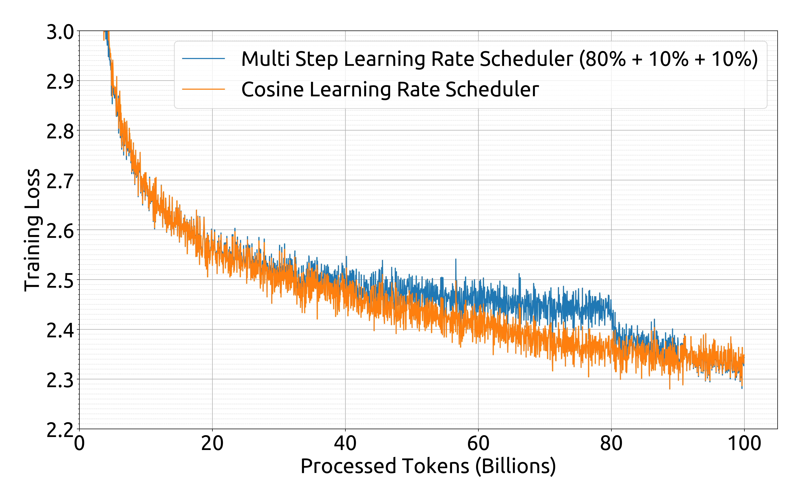
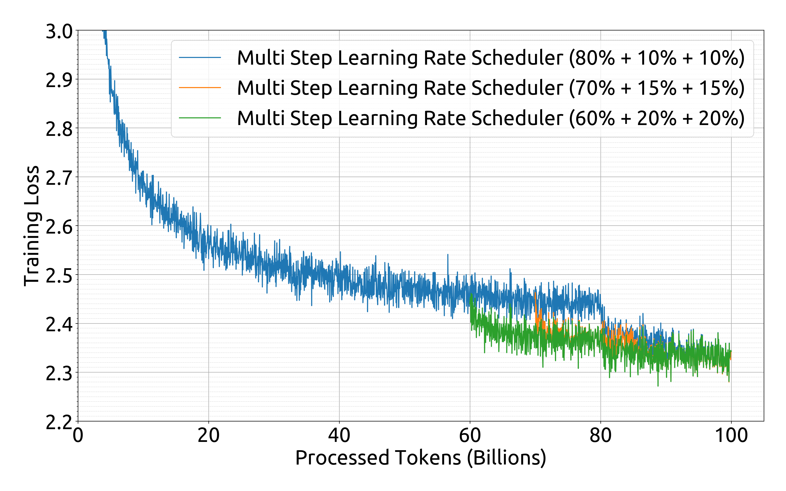
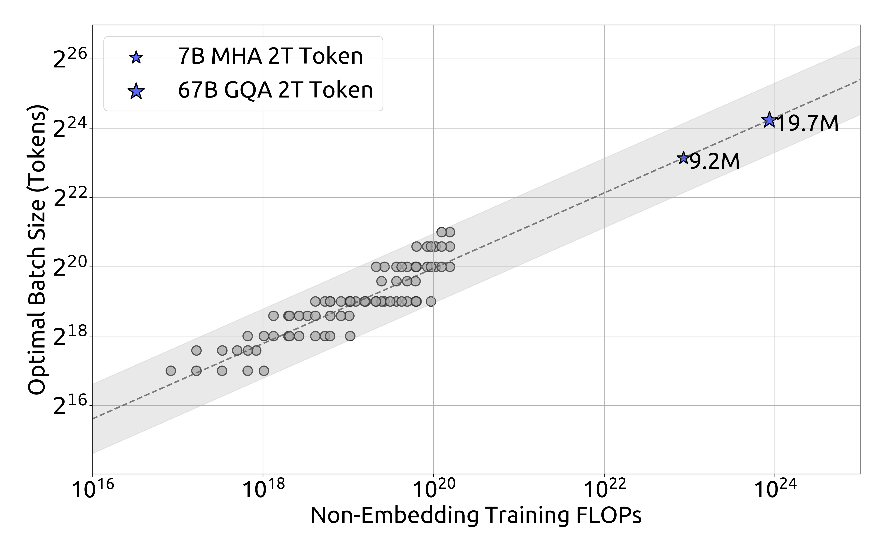
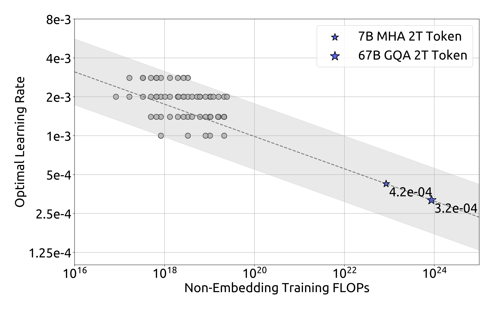
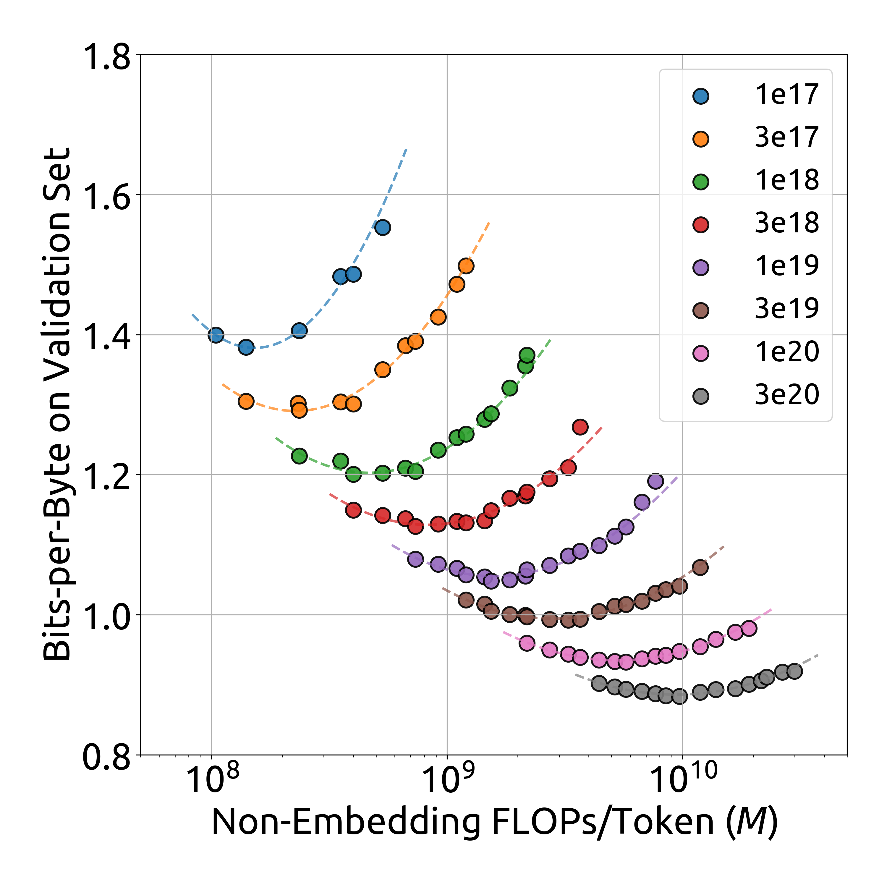
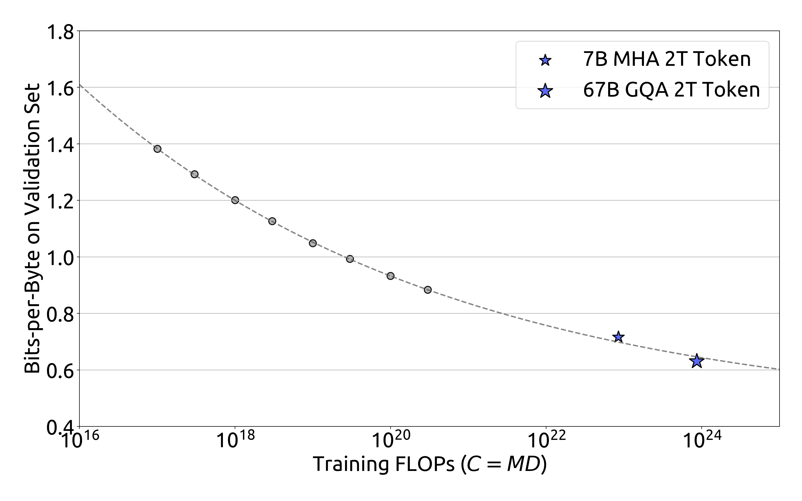

# DeepSeek LLM：面向长期扩展的开源语言模型

> 从中英数据建设出发，先用小规模实验拟合学习率、batch size 与模型／数据的算力分配，再训练 7B、67B 基座并用 SFT、DPO 得到对话模型。
>
> DeepSeek-AI，2024 年 1 月 · [论文 v1](https://arxiv.org/abs/2401.02954v1) · [代码与模型](https://github.com/deepseek-ai/DeepSeek-LLM) · [补充解读](DeepSeek-LLM解读.md)

开源模型训练往往先固定 7B、70B 等参数量，再寻找能提高榜单成绩的数据配方。DeepSeek LLM 把问题向前推进了一步：给定更多算力，应该扩大模型还是增加训练 token？不同预算下，学习率与 batch size 又该怎样变化？报告先校准超参数，再在等算力实验中研究模型和数据的最优分配，发现数据质量会改变拟合的规模规律。

作者据此从零训练两个中英稠密模型，各消耗 2T token，再进行指令微调与偏好优化。67B 在代码、数学、中文和开放式生成上表现突出；报告也保留了对话微调后的退步任务、重复输出、选择题数据消融等结果。整篇工作的核心，是将**数据、规模预测、训练系统和对齐评测**连接成一个可以继续扩展的训练项目。

## 摘要与研究背景

自回归预训练赋予 decoder-only Transformer 文本生成、知识问答和代码补全等能力；SFT 与偏好优化进一步让模型按照用户意图回答。LLaMA 已建立较成熟的开源架构与规模基线，但早期 scaling law 对新增算力应如何分配存在明显差异：Kaplan 等研究倾向更快扩大模型，Chinchilla 则强调模型与数据近似均衡增长。

本文认为，解释这些差异之前，需要先排除两个混杂因素。其一，不同预算的模型是否使用了接近最优的学习率与 batch size；其二，参数量是否足够准确地表示训练计算，尤其小模型中 attention 与词表的计算占比并不相同。作者先研究这两个问题，再比较不同数据分布上的最优扩展比例。

这份报告没有提出新的 Transformer 主模块。其贡献主要是训练方法与经验：公开中英数据处理思路、建立近优超参数的幂律拟合、用每 token 的非 embedding FLOPs 表示模型规模，并完整评估 7B／67B 的 Base 与 Chat 模型。

## 预训练数据：去重、质量过滤与重混合

预训练集共 **2T token，以中文、英文为主**。数据管线分为三个步骤：

1. **跨来源／跨 dump 去重**：扩大去重范围，避免同一网页或相近内容在不同时间的 Common Crawl 快照中被重复计入。
2. **质量过滤**：结合语言特征与语义评估，从文档局部和整体质量两方面提高有效信息密度。
3. **重混合**：调整来源与领域采样，补足代表性不足的内容，使数据覆盖更加均衡。

**原文表 1：扩大 Common Crawl 去重范围后的删除比例。**

| 使用的 dump 数 | 1 | 2 | 6 | 12 | 16 | 22 | 41 | 91 |
|---|---:|---:|---:|---:|---:|---:|---:|---:|
| 去重比例（%） | 22.2 | 46.7 | 55.7 | 69.9 | 75.7 | 76.3 | 81.6 | 89.8 |

单个 dump 内部去重只移除 22.2%，联合 91 个 dump 则移除 89.8%。这组对照说明，相同抓取量中包含多少独立内容，很大程度上取决于去重范围；作者因此采用更激进的全局处理。报告没有公开所有数据来源的完整配比，也没有给出可直接复建全部 2T 语料的清洗代码。

### 分词器与词表

分词使用 **Byte-level BPE（BBPE）**，在约 24 GB 多语言语料上训练。预切分使换行、标点、CJK 字符等不同类别不被任意合并；数字拆成单个 digit，以便不同数值共享基础表示。

常规 token 为 100,000，另加 15 个特殊 token，最终 tokenizer 词表为 **100,015**。训练 embedding 则使用 **102,400** 的对齐大小，为算子效率和未来特殊 token 留空间。分词器的实际词表与模型矩阵的行数，因此是两个不同配置。

## 模型架构与预训练配方

### 沿用 LLaMA 微观结构，调整深度与 KV 组织

模型采用 **Pre-Norm + RMSNorm + SwiGLU + RoPE**。FFN 中间维度约为 $\frac83d_{\mathrm{model}}$。7B 使用标准 MHA；67B 使用 GQA，将 64 个 query head 映射到 8 个 KV head，降低自回归推理的 KV cache 负担。

宏观结构上，作者选择 7B 的 30 层与 67B 的 95 层，兼顾参数量及流水线切分。67B 因 GQA 节省的参数主要用于增加网络深度，而不是通常采用的扩大 FFN 宽度。

**原文表 2：最终训练配置。**

| 配置 | DeepSeek LLM 7B | DeepSeek LLM 67B |
|---|---:|---:|
| Transformer 层数 | 30 | 95 |
| 隐藏维度 | 4096 | 8192 |
| Query head 数 | 32 | 64 |
| KV head 数 | 32 | 8 |
| 上下文长度 | 4096 | 4096 |
| 每步序列数 | 2304 | 4608 |
| 峰值学习率 | $4.2\times10^{-4}$ | $3.2\times10^{-4}$ |
| 预训练 token | 2.0T | 2.0T |

优化器为 AdamW，$\beta_1=0.9$、$\beta_2=0.95$、weight decay 0.1；参数初始化标准差为 0.006，梯度裁剪阈值为 1.0。两个模型的学习率与 batch size 根据后文的小规模拟合选择。

### Multi-step 学习率：让训练前段能够复用

学习率先 warm-up **2,000 步**至峰值，在消耗完 80% 训练 token 后降到峰值的 **31.6%**，90% 后再降到 **10%**。

图 1 使用 1.6B 模型、100B token。multi-step 与 cosine 的训练中间轨迹不同，但最终性能接近。multi-step 的主要用途是复用：同样模型在不同总预算实验中，可以共享第一段稳定学习率训练，再分别进入退火。作者也观察到调整阶段比例可能略有收益，最终选择 80%／10%／10%，以平衡最终效果与可复用训练量。

### HAI-LLM 训练与恢复

训练框架融合数据并行、张量并行、序列并行和 1F1B 流水线并行。FlashAttention 提高 attention 算子的硬件利用率，ZeRO-1 将优化器状态分片；计算与通信重叠则覆盖序列并行的 all-gather／reduce-scatter，以及最后一个 micro-batch 反向与优化器分片通信。

主体计算使用 BF16，梯度使用 FP32 累积。交叉熵内核按需将 logits 转为 FP32，在计算后直接用梯度覆盖原 logits，减少 HBM 占用。模型和优化器每 **5 分钟异步保存**一次，并允许改变并行配置后恢复，服务于长期训练中的硬件和网络故障处理。评测中，生成任务使用 vLLM，非生成任务使用 continuous batching。

## Scaling law：先让每个预算都训得接近最优

### 学习率与 batch size 的拟合

作者先在 $10^{17}$ FLOPs 预算下网格搜索，再扩展到 $10^{17}$ 至 $2\times10^{19}$。将验证误差不超过该预算最小值 **0.25%** 的配置都视为“近优”，而不是只保留单一最优点。

灰色圆点构成较宽的近优区域；虚线由小实验拟合，蓝色星号对应最终 7B／67B。拟合为：

$$
\eta_{\mathrm{opt}}=0.3118C^{-0.1250},\qquad
B_{\mathrm{opt}}=0.2920C^{0.3271}. \tag{1}
$$

$C$ 为论文口径下的训练 FLOPs，$B$ 为 batch 大小。计算预算增加时，较大 batch 和较小学习率成为更合适的组合。作者在 $10^{20}$ FLOPs 的新实验中验证了外推结果，拟合配置位于近优区域中间。由于近优区域较宽，这套拟合的意义在于缩小搜索范围。

### 为什么用非 embedding FLOPs/token 表示模型规模

常见估算 $C\approx6ND$ 用参数量 $N$ 与 token 数 $D$ 计算总预算。本文比较三种模型规模表示：非 embedding 参数 $N_1$、总参数 $N_2$，以及真正包含 attention 计算的非 embedding FLOPs/token $M$：

$$
\begin{aligned}
6N_1&=72n_{\mathrm{layer}}d_{\mathrm{model}}^2,\\
6N_2&=72n_{\mathrm{layer}}d_{\mathrm{model}}^2+6n_{\mathrm{vocab}}d_{\mathrm{model}},\\
M&=72n_{\mathrm{layer}}d_{\mathrm{model}}^2+12n_{\mathrm{layer}}d_{\mathrm{model}}l_{\mathrm{seq}}.
\end{aligned} \tag{2}
$$

$n_{\mathrm{layer}}$ 是层数，$d_{\mathrm{model}}$ 是宽度，$n_{\mathrm{vocab}}$ 是词表大小，$l_{\mathrm{seq}}$ 是序列长度。第一式忽略随序列长度增长的 attention 项；第二式又把词表计算计入规模。小模型中这两类误差尤其明显：原文表 3 中，8 层、512 维模型的 $6N_1/M=0.43$，$6N_2/M=1.32$；扩大到 80 层、8192 维后，两者才分别接近 0.92 和 0.94。

作者因此用 **$C=MD$** 定义预算：比较同样算力下，较大的每 token 模型计算与较多训练 token 应怎样配合。

### IsoFLOP：寻找模型与数据的最佳组合

对固定预算 $C$，目标是找到最小验证损失对应的组合：

$$
(M_{\mathrm{opt}},D_{\mathrm{opt}})
=\underset{M,D:\,MD=C}{\arg\min}\ L(M,D). \tag{3}
$$

实验取 **8 个预算，从 $10^{17}$ 到 $3\times10^{20}$ FLOPs**，每个预算约测试 10 种模型／数据分配。小模型能看更多 token，大模型则用更少 token；作者在与训练分布相近的独立 100M-token 验证集上计算损失，以 bits-per-byte（BPB）展示结果。

曲线谷底对应每个预算的最佳分配。把各预算的谷底连接并做幂律拟合，得到：

$$
M_{\mathrm{opt}}=0.1715C^{0.5243},\qquad
D_{\mathrm{opt}}=5.8316C^{0.4757}. \tag{4}
$$

两个指数之和为 1，与 $C=MD$ 一致。在当前数据上，新增计算近似均衡地分给模型和数据，模型规模增长略快。作者还将最优验证损失对预算作拟合，用小实验预测约 **1,000 倍算力**的 7B／67B 损失，最终大模型点接近预测曲线。

### 数据质量会改变最优扩展比例

**原文表 4：不同数据分布下的模型／数据规模指数。**

| 研究与数据 | 模型指数 $a$ | 数据指数 $b$ |
|---|---:|---:|
| OpenAI，OpenWebText2 | 0.73 | 0.27 |
| Chinchilla，MassiveText | 0.49 | 0.51 |
| 本文，早期内部数据 | 0.450 | 0.550 |
| 本文，当前内部数据 | 0.524 | 0.476 |
| 本文，OpenWebText2 | 0.578 | 0.422 |

作者自己的三组实验中，内部评估认为质量更高的数据对应更大的 $a$、更小的 $b$：高质量 token 更有利于训练更大模型，新增计算可相应增加模型占比。这也被提出为不同论文 scaling 结论存在差异的一种解释。作者将原因解释为高质量数据逻辑更清楚、充分训练后更易预测，但没有将该解释作为已证明的机制。

## 对齐：SFT、重复行为与 DPO

SFT 共约 **1.5M 条中英指令**。其中帮助性数据 1.2M：通用语言任务 31.2%、数学 46.6%、代码 22.2%；安全数据 300k。7B 用 $10^{-5}$ 学习率训练 4 epoch，67B 用 $5\times10^{-6}$ 训练 2 epoch。大模型较快达到数学和代码性能上限，也较早出现过拟合。

作者除 benchmark 外，还在 **3,868 条中英 prompt** 上监控重复：生成是否不能正常终止，而无限复述同一文本片段。数学 SFT 增多时，该比例上升。7B 因此采用分阶段 SFT：第一阶段使用全部数据，第二阶段移除数学和代码、侧重对话；67B 第一阶段后重复率已低于 1%，第二阶段反而影响成绩，故不采用同样处理。

DPO 的候选回答由当前 DeepSeek Chat 生成，偏好数据覆盖写作、问答、指令跟随等帮助性任务及无害性。训练 **1 epoch、学习率 $5\times10^{-6}$、batch size 512**，使用 warm-up 与 cosine。其主要收益体现在开放式生成；附录中大部分客观 benchmark 的变化较小。

## 评测设置与主结果

### 任务、指标与比较条件

评测同时包括语言理解、知识、推理、阅读理解、数学、代码和中文文化。MMLU／C-Eval／CMMLU 为多学科选择题；GSM8K 为小学数学应用题，MATH 覆盖更难的数学题；HumanEval／MBPP 通过执行测试衡量代码；BBH 为复杂推理任务集合。

选择题通常比较各选项的 perplexity，并使用长度归一化；ARC／OpenBookQA 使用 unconditional normalization。生成任务使用贪心解码后抽取答案。Pile-test 用 **BPB，越低越好**，DROP 报 F1，其余表中结果按论文对应准确率／代码成功率报告。不同任务采用 2K 或 4K 最大长度，few-shot 数受上下文限制。

### Base：同样 2T token 下与 LLaMA2 比较

**原文表 5，保留完整主要任务对照。**

| 语言 | 任务 | Few-shot | LLaMA2 7B | DeepSeek 7B | LLaMA2 70B | DeepSeek 67B |
| --- | --- | --- | --- | --- | --- | --- |
| English | HellaSwag | 0-shot | 75.6 | 75.4 | 84.0 | 84.0 |
| English | PIQA | 0-shot | 78.0 | 79.2 | 82.0 | 83.6 |
| English | WinoGrande | 0-shot | 69.6 | 70.5 | 80.4 | 79.8 |
| English | RACE-Middle | 5-shot | 60.7 | 63.2 | 70.1 | 69.9 |
| English | RACE-High | 5-shot | 45.8 | 46.5 | 54.3 | 50.7 |
| English | TriviaQA | 5-shot | 63.8 | 59.7 | 79.5 | 78.9 |
| English | NaturalQuestions | 5-shot | 25.5 | 22.2 | 36.1 | 36.6 |
| English | MMLU | 5-shot | 45.8 | 48.2 | 69.0 | 71.3 |
| English | ARC-Easy | 0-shot | 69.1 | 67.9 | 76.5 | 76.9 |
| English | ARC-Challenge | 0-shot | 49.0 | 48.1 | 59.5 | 59.0 |
| English | OpenBookQA | 0-shot | 57.4 | 55.8 | 60.4 | 60.2 |
| English | DROP | 1-shot | 39.8 | 41.0 | 69.2 | 67.9 |
| English | MATH | 4-shot | 2.5 | 6.0 | 13.5 | 18.7 |
| English | GSM8K | 8-shot | 15.5 | 17.4 | 58.4 | 63.4 |
| English | HumanEval | 0-shot | 14.6 | 26.2 | 28.7 | 42.7 |
| English | MBPP | 3-shot | 21.8 | 39.0 | 45.6 | 57.4 |
| English | BBH | 3-shot | 38.5 | 39.5 | 62.9 | 68.7 |
| English | AGIEval | 0-shot | 22.8 | 26.4 | 37.2 | 41.3 |
| English | Pile-test | - | 0.741 | 0.725 | 0.649 | 0.642 |
| Chinese | CLUEWSC | 5-shot | 64.0 | 73.1 | 76.5 | 81.0 |
| Chinese | CHID | 0-shot | 37.9 | 89.3 | 55.5 | 92.1 |
| Chinese | C-Eval | 5-shot | 33.9 | 45.0 | 51.4 | 66.1 |
| Chinese | CMMLU | 5-shot | 32.6 | 47.2 | 53.1 | 70.8 |
| Chinese | CMath | 3-shot | 25.1 | 34.5 | 53.9 | 63.0 |
| Chinese | C3 | 0-shot | 47.4 | 65.4 | 61.7 | 75.3 |
| Chinese | CCPM | 0-shot | 60.7 | 76.9 | 66.2 | 88.5 |

表头第二行区分 7B 与大模型。DeepSeek 67B 与 LLaMA2 70B 在 HellaSwag 均为 84.0，但数学和代码差距更明显：MATH **18.7 vs 13.5**、HumanEval **42.7 vs 28.7**、MBPP **57.4 vs 45.6**，BBH 为 **68.7 vs 62.9**。中文 C-Eval 为 66.1 vs 51.4，CMMLU 为 70.8 vs 53.1。

这组结果也保留了退步项：例如 RACE-High、TriviaQA、WinoGrande 并非 DeepSeek 全面领先。作者进一步区分可跨语言迁移的数学能力，与必须接触大量中文才能掌握的成语等文化知识。

### Base 与 Chat：任务能力和回答形式共同变化

**原文表 6 的代表性任务；7B／67B 均保留前后对照。**

| 任务 | 7B Base | 7B Chat | 67B Base | 67B Chat |
|---|---:|---:|---:|---:|
| HellaSwag | 75.4 | 68.5 | 84.0 | 75.7 |
| TriviaQA | 59.7 | 57.9 | 78.9 | 81.5 |
| NaturalQuestions | 22.2 | 32.5 | 36.6 | 47.0 |
| MMLU | 48.2 | 49.4 | 71.3 | 71.1 |
| GSM8K | 17.4 | 63.0 | 63.4 | 84.1 |
| MATH | 6.0 | 15.8 | 18.7 | 32.6 |
| HumanEval | 26.2 | 48.2 | 42.7 | 73.8 |
| MBPP | 39.0 | 35.2 | 57.4 | 61.4 |
| BBH | 39.5 | 42.3 | 68.7 | 71.7 |
| C-Eval | 45.0 | 47.0 | 66.1 | 65.2 |
| CMMLU | 47.2 | 49.7 | 70.8 | 67.8 |
| CMath | 34.5 | 68.4 | 63.0 | 80.3 |

原表对 Chat 的 MMLU、GSM8K、MATH、C-Eval、CMMLU 使用 **0-shot**，Base 保留 few-shot。作者据此强调 SFT 可以让模型不依赖示例就按要求回答。数学、代码提升明显，补全文本类的 HellaSwag 则持续下降，展示了对话训练对不同任务的不同影响。

### 开放式生成：中文 AlignBench 与英文 MT-Bench

中文 AlignBench 中，67B Chat 得分 **6.43**，DPO 后 **6.69**，GPT-3.5-turbo-0613 为 **6.08**，GPT-4-1106-preview 为 **8.01**。英文多轮 MT-Bench 结果如下：

| 模型 | MT-Bench 平均分 |
|---|---:|
| GPT-4-1106-preview | 9.26 |
| GPT-3.5-turbo-0613 | 8.39 |
| LLaMA-2-Chat 70B | 6.86 |
| TÜLU 2+DPO 70B | 7.89 |
| DeepSeek LLM 67B Chat | 8.35 |
| DeepSeek LLM 67B Chat DPO | **8.76** |

DPO 在此将平均分提高 **0.41**，主要改善开放式对话质量；数学、推理、写作和角色扮演等子类并不完全同步变化。例如原表 coding 从 7.35 降为 6.75，reasoning 从 8.00 升至 9.05。

### 新近发布的保留集与安全评测

LeetCode 集由 2023 年 7–11 月比赛的 **126 题**构成，每题超过 20 个测试；匈牙利高中数学考卷有 **33 题**并人工阅卷；IFEval 包含约 500 个可验证指令 prompt，报告 prompt-level loose accuracy。

| Model | LeetCode | Hungarian Exam | IFEval |
| --- | --- | --- | --- |
| GPT-4 | 48.4 | 68 | 79.3 |
| ChatGLM3 6B | 2.4 | 32 | 29.7 |
| DeepSeek LLM 7B Chat | 4.7 | 28.5 | 41.2 |
| Baichuan2-Chat 13B | 1.6 | 19.5 | 44.5 |
| Yi-Chat 34B | 7.9 | 39 | 48.4 |
| Qwen 72B Chat | 12.7 | 52 | 50.8 |
| DeepSeek LLM 67B Chat | 17.5 | 58 | 55.5 |

67B 在三项上均明显优于 7B，也优于表中的其他开源对话模型。作者以此说明，经典 benchmark 的高分不必然反映新题能力，模型规模带来的差距在保留集上仍然明显。

安全测试由 20 人跨领域团队构建，含 **2,400 题**，覆盖歧视、权益、商业与知识产权、违法行为及其他敏感问题。安全回答和合理拒绝都计入通过；67B 五大类通过数分别为 486/500、473/500、281/300、290/300、767/800。Do-Not-Answer 的 939 个 prompt 上得分 **97.8**。这些是对应风险问题集合上的安全响应指标。

## 训练消融与讨论

### 分阶段 SFT 能否减少重复

| Model | HumanEval | GSM8K | Repetition | IFEval |
| --- | --- | --- | --- | --- |
| DeepSeek LLM 7B Chat Stage1 | 48.2 | 63.9 | 0.020 | 38.0 |
| DeepSeek LLM 7B Chat Stage2 | 48.2 | 63.0 | 0.014 | 41.2 |

第二阶段使重复比例从 **2.0% 降至 1.4%**，IFEval 从 38.0 升到 41.2，HumanEval 保持 48.2，GSM8K 从 63.9 小幅降到 63.0。这是作者给 7B 采用分阶段训练的直接依据；67B 不采用第二阶段，是因为相同操作没有同样收益。

### 选择题训练为何提高榜单，却未改善生成问答

作者在对齐阶段额外加入 **20M 中文选择题**，并对 C-Eval 验证集与 CMMLU 测试集去重：

| Model | MMLU | C-Eval | CMMLU | TriviaQA | ChineseQA |
| --- | --- | --- | --- | --- | --- |
| DeepSeek LLM 7B Chat | 49.4 | 47.0 | 49.7 | 57.9 | 75.0 |
| DeepSeek LLM 7B Chat + MC | 60.9 | 71.3 | 73.8 | 57.9 | 74.4 |

MMLU 从 49.4 升到 60.9，C-Eval 从 47.0 升到 71.3，CMMLU 从 49.7 升到 73.8；但生成型 TriviaQA 保持 57.9，内部 ChineseQA 从 75.0 降到 74.4。作者认为这里大量提升来自对选择题形式的适配，最终没有将这批选择题加入正式训练。

将约 5M 指令样本放到预训练最后 10% 时，也会提高 Base 的 benchmark 分数，但最终效果与将相同数据放入 SFT 接近。报告因此把“在哪一阶段接触指令”与“最终可达到的能力”分开讨论。

### System prompt 的效果依赖模型规模

| Model | MT Bench |
| --- | --- |
| DeepSeek LLM 7B Chat | 7.15 |
| DeepSeek LLM 7B Chat + System Prompt | 7.11 |
| DeepSeek LLM 67B Chat | 8.35 |
| DeepSeek LLM 67B Chat + System Prompt | 8.58 |

同样增加帮助性、安全性等 system 指令，7B 的 MT-Bench 从 7.15 到 7.11，67B 则从 8.35 到 8.58。作者将差异归因于大模型更能理解复杂系统指令，小模型则更容易受到训练与推理格式不一致的影响。

## 结论、附录与局限

本文建立了从数据清洗、超参数搜索、IsoFLOP 预测到基座与对话模型评测的完整路线。核心发现是：**最优模型／数据分配取决于数据分布；固定预算的超参数应先校准；客观题、开放式生成与真实新题需要分开评估。**

附录进一步比较三种模型规模表示的拟合偏差，展示 benchmark 随训练计算增长的曲线，并与专门的代码／数学模型比较。Base 与 Chat 的差异和 DPO 前后结果均有单独表格，评测 prompt 也按任务列出，便于回查 few-shot、答案格式与长度设置。

作者承认，初版模型仍存在知识时效、事实错误与幻觉；中文数据覆盖尚不全面，中英以外的语言能力较弱。Scaling 拟合也仅建模了计算预算的主要影响，同预算但不同模型／数据分配的近优超参数区域仍有差别。完整数据配方未公开，使得这套经验可以指导后续研究，却不能仅靠报告完全复建训练语料。
