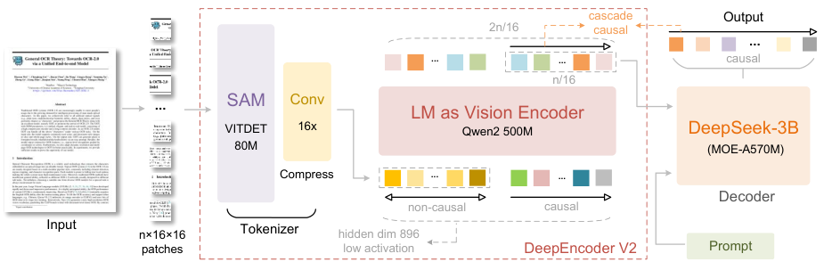
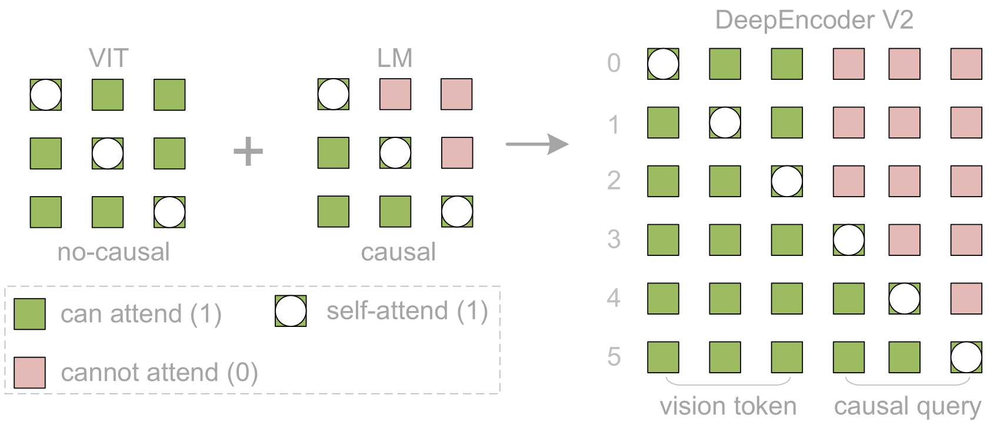

# DeepSeek-OCR 2：用因果查询重组视觉阅读顺序

> 💡 OCR 2 在视觉编码器中加入可学习的因果查询，让它们在看完全图特征后依次组织语义，再把重组后的视觉序列交给 MoE 解码器读文档。
>
> [论文](https://arxiv.org/abs/2601.20552) · [官方仓库](https://github.com/deepseek-ai/DeepSeek-OCR-2) · [补充解读](DeepSeek-OCR-2解读.md)

把图像 patch 按固定行列顺序拉平，不一定符合多栏文档、表格或复杂版面的阅读逻辑。OCR 2 继承初代的压缩 tokenizer 和 3B MoE 解码器，主要更换压缩后编码器：让原始视觉 token 双向交互，再附加一组因果查询，从全图信息中形成有顺序的输出表示。目标不是单纯提高图像分辨率，而是缓解二维结构进入一维语言模型时的顺序偏置。报告以相近视觉 token 上限比较 OmniDocBench，尤其检查阅读顺序与生产重复率，同时保留报纸等高密度输入上的不足。

## DeepEncoder V2 的两段结构

SAM-base 加两个卷积保留十六倍 token 压缩，通道改为896以匹配后段 Qwen2-0.5B。压缩不是 VQ 码本查找，而是连续视觉特征转换。

原来 CLIP 部分被 LLM 风格 Transformer 替代：前半序列是视觉 token，后半是数量相同的 learnable causal flow queries。**只把查询输出送给最终解码器**，原视觉特征一直作为查询读取的上下文。

## 双向视觉与因果查询的注意力

令视觉 token 为 $m$ 个、查询为 $n=m$ 个，可见性矩阵：

$$
M=\begin{bmatrix}\mathbf1_{m\times m}&\mathbf0_{m\times n}\\\mathbf1_{n\times m}&\operatorname{LowerTri}(n)\end{bmatrix}.
$$

视觉部分互相可见，但不读查询；每个查询读全部视觉和此前查询。它不是普通全双向 ViT，也不是让图像所有 patch 从一开始只看左上角。

“重排序”指查询学习顺序化的语义汇聚，不是显式求一个 patch 置换矩阵，也没有保证第 $i$ 个 query 对应第 $i$ 个文字位置。报告尝试过 mBART 风格 cross-attention，但未收敛，作者认为 prefix 让视觉 token 在各层持续互动更有效。

## 多分辨率查询与解码

全局1024方图用256个query；局部768方图每块144个、最多六块，共 $N=256+144k$，范围256–1120。局部块共享查询参数，全局使用另一套，避免每种分辨率维护完全独立查询组。

最终仍用初代约3B总量、约500M激活的MoE decoder。注意“输出1120个视觉表示”不是最终文字输出只有1120 token，也不代表编码器内部仅处理1120个状态；原视觉和query在后段共同计算。

## 数据与三阶段训练

沿用初代来源，OCR采样占80%；普通OCR按文字:公式:表格3:1:1平衡，布局标签合并语义相近类别。数据并非完全不变，因此系统差异不能全部算成纯架构净增益。

| 阶段 | 更新范围 | 关键配置 |
| --- | --- | --- |
| 编码器预训练 | 压缩tokenizer与Qwen风格encoder，接小decoder | 40k steps，batch640，160张A100，学习率$10^{-4}\to10^{-6}$ |
| 查询增强 | 冻结tokenizer，更新encoder与3B decoder | 15k steps，batch1280，$5\times10^{-5}\to10^{-6}$ |
| decoder特化 | 编码器全部冻结，只更新decoder | 20k steps，$10^{-6}\to5\times10^{-8}$ |

第一阶段8K packing约涉及100M图文样本；第二阶段使用四段流水线。第三阶段在同global batch下训练速度超过翻倍，但这是冻结范围变化后的训练吞吐，不是最终识别推理快两倍。

## OmniDocBench v1.5 主结果

主集为中英1355页、九大文档类别。下表摘取核心对照，保留指标方向：

| 模型 | 最大视觉token | Overall↑ | Text Edit↓ | Formula CDM↑ | Table TEDS↑ | 阅读顺序Edit↓ |
| --- | ---: | ---: | ---: | ---: | ---: | ---: |
| 初代OCR，9-crops | 1156 | 87.36 | 0.073 | 84.14 | 85.25 | 0.085 |
| OCR 2 | 1120 | 91.09 | 0.048 | 90.31 | 87.75 | 0.057 |
| PaddleOCR-VL | 未列 | 92.86 | 0.035 | 91.22 | 90.89 | 0.043 |

Overall提升3.73个点；阅读顺序编辑距离0.085→0.057，**越低越好**，原表个别列箭头错误不能照抄。OCR2表现先进，但不是表中所有指标最佳。

| Model | V-token max $\downarrow$ | Text Edit $\downarrow$ | Formula Edit $\downarrow$ | Table Edit $\downarrow$ | R-order Edit $\downarrow$ | Overall Edit $\downarrow$ |
| --- | --- | --- | --- | --- | --- | --- |
| Gemini-3 pro [ 44 ] | 1120 | - | - | - | - | 0.115 |
| Seed-1.8 [ 41 ] | 5120 | - | - | - | - | 0.106 |
| DeepSeek-OCR | 1156 | 0.073 | 0.236 | 0.123 | 0.085 | 0.129 |
| DeepSeek-OCR 2 | 1120 | 0.048 | 0.198 | 0.096 | 0.057 | 0.100 |

另一表将全部分项换成编辑距离，OCR2 Overall Edit为0.100，初代0.129，Gemini3 Pro0.115。这个0.100不能和前表91.09%当成简单互补值，二者汇总口径不同。

## 文档分层与生产结果

| Model | Edit $\downarrow$ | PPT | Academic Paper | Book | Colorful Textbook | Exam Paper | Magazine | Newspaper | Note | Research Report |
| --- | --- | --- | --- | --- | --- | --- | --- | --- | --- | --- |
| DS-OCR | Text | 0.052 | 0.028 | 0.022 | 0.130 | 0.074 | 0.049 | 0.131 | 0.145 | 0.015 |
| DS-OCR | R-order | 0.052 | 0.021 | 0.040 | 0.125 | 0.083 | 0.101 | 0.217 | 0.089 | 0.016 |
| DS-OCR 2 | Text | 0.031 | 0.013 | 0.033 | 0.053 | 0.047 | 0.026 | 0.139 | 0.068 | 0.008 |
| DS-OCR 2 | R-order | 0.025 | 0.013 | 0.027 | 0.066 | 0.048 | 0.100 | 0.176 | 0.035 | 0.011 |

阅读顺序在各类均改善，文字识别却不是：Book由0.022变0.033，报纸0.131变0.139。作者将报纸不足归因于token预算和约250k报纸训练样本，提出扩crop和补数据；这不是已经完成的消融证明。

| Model | Metric | online-user-logs (image) | pretrain-data (PDF) |
| --- | --- | --- | --- |
| DeepSeek-OCR | Repeat $\downarrow$ | 6.25% | 3.69% |
| DeepSeek-OCR 2 | Repeat $\downarrow$ | 4.17% $\downarrow 2.08\%$ | 2.88% $\downarrow 0.81\%$ |

在线图片重复率6.25%→4.17%，PDF生产3.69%→2.88%。真实流量缺少ground truth，因此重复率是可观测质量信号，不是完整准确率或幻觉率。减少重复不能单独证明所有内容更正确。

## 结论与未来方向

报告证明LLM风格的视觉编码、全局可见且顺序化的query，可改善文档阅读组织；没有提供每个新部件完全隔离的消融，数据与训练流程也有调整。更长query、多轮重看、真正二维推理和统一音文视觉encoder属于展望。当前成果仍主要在OCR，不能因称为“因果推理”就推断已获得通用二维逻辑能力。
