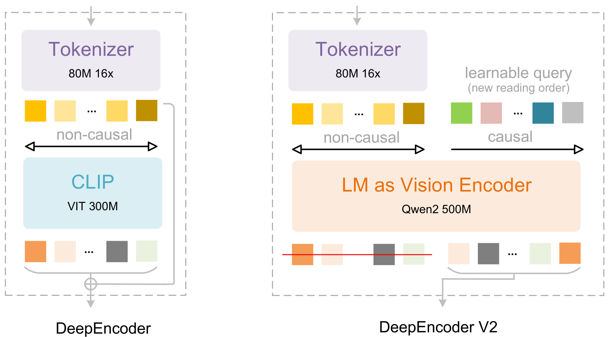
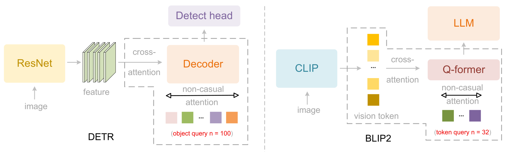
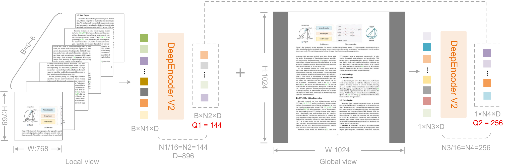

# DeepSeek-OCR 2: Visual Causal Flow / 全文中英对照

> 来源：[arXiv:2601.20552v1](https://arxiv.org/abs/2601.20552v1)。英文段落后紧接中文，覆盖所取 HTML 版本的主文、附录、图表、脚注与参考文献；公式、数字表和书目信息共用。中文以机器初译为底稿，进行了术语整理与结构核对，尚未逐句人工审定；遇到歧义请以紧邻英文和原论文为准。 原作版权归所列作者，许可见 [原作许可](http://creativecommons.org/licenses/by/4.0/)；中文译文与版式改写在该许可条件下提供（涉及 SA 时沿用相同许可，涉及 NC 时仅限非商业使用）。

## Authors and affiliations / 作者与机构

Haoran Wei Yaofeng Sun Yukun Li Affiliation: DeepSeek-AI

**EN.** \reportnumber

**中.** \报告编号

**EN.** 001

**中.** 001

## Abstract / 摘要

**EN.** We present DeepSeek-OCR 2 to investigate the feasibility of a novel encoder—DeepEncoder V2—capable of dynamically reordering visual tokens upon image semantics. Conventional vision-language models (VLMs) invariably process visual tokens in a rigid raster-scan order (top-left to bottom-right) with fixed positional encoding when fed into LLMs. However, this contradicts human visual perception, which follows flexible yet semantically coherent scanning patterns driven by inherent logical structures. Particularly for images with complex layouts, human vision exhibits causally-informed sequential processing. Inspired by this cognitive mechanism, DeepEncoder V2 is designed to endow the encoder with causal reasoning capabilities, enabling it to intelligently reorder visual tokens prior to LLM-based content interpretation. This work explores a novel paradigm: whether 2D image understanding can be effectively achieved through two-cascaded 1D causal reasoning structures, thereby offering a new architectural approach with the potential to achieve genuine 2D reasoning. Codes and model weights are publicly accessible at [http://github.com/deepseek-ai/DeepSeek-OCR-2](http://github.com/deepseek-ai/DeepSeek-OCR-2) .

**中.** 我们提出 DeepSeek-OCR 2 来研究新型编码器 DeepEncoder V2 的可行性，该编码器能够根据图像语义动态重新排序视觉标记。传统的视觉语言模型 (VLM) 在输入 LLM 时总是以严格的光栅扫描顺序（从左上到右下）处理视觉标记，并使用固定的位置编码。然而，这与人类视觉感知相矛盾，人类视觉感知遵循由固有逻辑结构驱动的灵活但语义连贯的扫描模式。特别是对于具有复杂布局的图像，人类视觉表现出因果信息顺序处理。受这种认知机制的启发，DeepEncoder V2 旨在赋予编码器因果推理能力，使其能够在基于 LLM 的内容解释之前智能地重新排序视觉标记。这项工作探索了一种新颖的范式：是否可以通过两个级联的一维因果推理结构有效地实现二维图像理解，从而提供一种新的架构方法，有可能实现真正的二维推理。代码和模型权重可在 [http://github.com/deepseek-ai/DeepSeek-OCR-2](http://github.com/deepseek-ai/DeepSeek-OCR-2) 上公开访问。

**EN.** Figure 1 : We substitute the CLIP component in DeepEncoder with an LLM-style architecture. By customizing the attention mask, visual tokens utilize bidirectional attention while learnable queries adopt causal attention. Each query token can thus attend to all visual tokens and preceding queries, allowing progressive causal reordering over visual information.

**中.** 图 1：我们用 LLM 风格的架构替代 DeepEncoder 中的 CLIP 组件。通过定制注意力掩码，视觉标记利用双向注意力，而可学习查询则采用因果注意力。因此，每个查询标记可以关注所有视觉标记和之前的查询，从而允许对视觉信息进行渐进因果重新排序。

## Introduction / 简介

**EN.** The human visual system closely mirrors transformer-based vision encoders [ 12 , 10 ] : foveal fixations function as visual tokens, locally sharp yet globally aware. However, unlike existing encoders that rigidly scan tokens from top-left to bottom-right, human vision follows a causally-driven flow guided by semantic understanding. Consider tracing a spiral—our eye movements follow inherent logic where each subsequent fixation causally depends on previous ones. By analogy, visual tokens in models should be selectively processed with ordering highly contingent on visual semantics rather than spatial coordinates.

**中.** 人类视觉系统密切反映基于Transformer的视觉编码器 [12, 10]：中心凹注视点起到视觉标记的作用，局部清晰但全局感知。然而，与严格从左上到右下扫描标记的现有编码器不同，人类视觉遵循由语义理解引导的因果驱动流。考虑追踪一个螺旋——我们的眼球运动遵循固有的逻辑，其中每个后续的注视都因果地依赖于之前的注视。通过类比，模型中的视觉标记应该根据视觉语义而不是空间坐标进行选择性处理，排序高度取决于视觉语义。

**EN.** This insight motivates us to fundamentally reconsider the architectural design of vision-language models (VLMs), particularly the encoder component. LLMs are inherently trained on 1D sequential data, while images are 2D structures. Directly flattening image patches in a predefined raster-scan order introduces unwarranted inductive bias that ignores semantic relationships. To address this, we present DeepSeek-OCR 2 with a novel encoder design—DeepEncoder V2—to advance toward more human-like visual encoding. Following DeepSeek-OCR [ 53 ] , we adopt document reading as our primary experimental testbed. Documents present rich challenges including complex layout orders, intricate formulas, and tables. These structured elements inherently carry causal visual logic, demanding sophisticated reasoning capabilities that make document OCR an ideal platform for validating our approach.

**中.** 这种见解促使我们从根本上重新考虑视觉语言模型（VLM）的架构设计，特别是编码器组件。 LLM 本质上是针对一维序列数据进行训练的，而图像是二维结构。以预定义的光栅扫描顺序直接展平图像块会引入忽略语义关系的无根据的归纳偏差。为了解决这个问题，我们为 DeepSeek-OCR 2 提供了一种新颖的编码器设计——DeepEncoder V2——以向更接近人类的视觉编码迈进。遵循 DeepSeek-OCR [53]，我们采用文档阅读作为我们的主要实验测试平台。文档提出了丰富的挑战，包括复杂的布局顺序、复杂的公式和表格。这些结构化元素本质上带有因果视觉逻辑，需要复杂的推理能力，使文档 OCR 成为验证我们方法的理想平台。

**EN.** Our main contributions are threefold:

**中.** 我们的主要贡献有三个：

**EN.** First, we present DeepEncoder V2, featuring several key innovations: (1) we replace the CLIP [ 37 ] component in DeepEncoder [ 53 ] with a compact LLM [ 48 ] architecture, as illustrated in Figure 1 , to achieve visual causal flow; (2) to enable parallelized processing, we introduce learnable queries [ 6 ] , termed causal flow tokens, with visual tokens prepended as a prefix—through a customized attention mask, visual tokens maintain global receptive fields, while causal flow tokens can obtain visual token reordering ability; (3) we maintain equal cardinality between causal and visual tokens (with redundancy such as padding and borders) to provide sufficient capacity for re-fixation; (4) only the causal flow tokens—the latter half of the encoder outputs—are fed to the LLM [ 20 ] decoder, enabling cascade causal-aware visual understanding.

**中.** 首先，我们介绍 DeepEncoder V2，具有几个关键创新：（1）我们用紧凑的 LLM [48] 架构替换 DeepEncoder [53] 中的 CLIP [37] 组件，如图 1 所示，以实现视觉因果流； （2）为了实现并行处理，我们引入了可学习的查询[6]，称为因果流标记，以视觉标记作为前缀——通过定制的注意掩模，视觉标记保持全局感受野，而因果流标记可以获得视觉标记重新排序的能力； （3）我们在因果标记和视觉标记之间保持相等的基数（具有填充和边框等冗余），以提供足够的重新固定能力； (4) 只有因果流标记（编码器输出的后半部分）被馈送到 LLM [20] 解码器，从而实现级联因果感知视觉理解。

**EN.** Second, leveraging DeepEncoder V2, we present DeepSeek-OCR 2, which preserves the image compression ratio and decoding efficiency of DeepSeek-OCR while achieving substantial performance improvements. We constrain visual tokens fed to the LLM between 256 and 1120. The lower bound (256) corresponds to DeepSeek-OCR’s tokenization of 1024×1024 images, while the upper bound (1120) matches Gemini-3 pro’s [ 44 ] maximum visual token budget. This design positions DeepSeek-OCR 2 as both a novel VLM architecture for research exploration and a practical tool for generating high-quality training data for LLM pretraining.

**中.** 其次，利用 DeepEncoder V2，我们推出了 DeepSeek-OCR 2，它保留了 DeepSeek-OCR 的图像压缩比和解码效率，同时实现了显着的性能改进。我们将输入到 LLM 的视觉标记限制在 256 到 1120 之间。下限 (256) 对应于 DeepSeek-OCR 对 1024×1024 图像的标记化，而上限 (1120) 与 Gemini-3 pro 的 [44] 最大视觉标记预算相匹配。该设计将 DeepSeek-OCR 2 定位为一种用于研究探索的新颖 VLM 架构，以及为 LLM 预训练生成高质量训练数据的实用工具。

**EN.** Finally, we provide preliminary validation for employing language model architectures as VLM encoders—a promising pathway toward unified omni-modal encoding. This framework enables feature extraction and token compression across diverse modalities (images, audio, text [ 24 ] ) by simply configuring modality-specific learnable queries. Crucially, it naturally succeeds to advanced infrastructure optimizations from the LLM community, including Mixture-of-Experts (MoE) architectures, efficient attention mechanisms [ 22 ] , and so on.

**中.** 最后，我们对使用语言模型架构作为 VLM 编码器进行了初步验证——这是实现统一全模态编码的一条有希望的途径。该框架通过简单地配置特定于模态的可学习查询来实现跨不同模态（图像、音频、文本[24]）的特征提取和标记压缩。至关重要的是，它自然继承了 LLM 社区的高级基础设施优化，包括专家混合 (MoE) 架构、高效的注意力机制 [22] 等。

**EN.** In summary, we propose DeepEncoder V2 for DeepSeek-OCR 2, employing specialized attention mechanisms to effectively model the causal visual flow of document reading. Compared to the DeepSeek-OCR baseline, DeepSeek-OCR 2 achieves 3.73% performance gains on OmniDocBench v1.5 [ 34 ] and yields considerable advances in visual reading logic.

**中.** 总之，我们为 DeepSeek-OCR 2 提出了 DeepEncoder V2，采用专门的注意力机制来有效地建模文档阅读的因果视觉流。与 DeepSeek-OCR 基准相比，DeepSeek-OCR 2 在 OmniDocBench v1.5 [34] 上实现了 3.73% 的性能提升，并在视觉阅读逻辑方面取得了相当大的进步。

**EN.** Figure 2 : This figure shows two computer vision models with parallelized queries: DETR’s decoder [ 6 ] for object detection and BLIP2’s Q-former [ 18 ] for visual token compression. Both employ bidirectional self-attention among queries.

**中.** 图 2：该图显示了两个具有并行查询的计算机视觉模型：用于对象检测的 DETR 解码器 [6] 和用于视觉标记压缩的 BLIP2 的 Q-former [18]。两者都在查询之间采用双向自注意力。

## Related Works / 相关作品

### Parallelized Queries in Decoder / 解码器中的并行查询

**EN.** DETR [ 6 ] pioneered the integration of transformer architecture into object detection, fundamentally breaking away from traditional detection paradigms [ 40 , 38 ] . To overcome the efficiency limitations of serial decoding in transformer blocks, DETR introduced preset parallelized learnable queries—a set of 100 object queries that encode object priors such as shape and position through training. These queries interact with feature maps [ 14 ] via cross-attention mechanisms, while simultaneously engaging in bidirectional information exchange among themselves through self-attention. DETR established a foundational paradigm that enables transformers to handle parallelized tokens. The object query design has since become the de facto standard architectural component in subsequent transformer-based detection methods [ 56 , 25 ] .

**中.** DETR [6] 率先将 Transformer 架构集成到目标检测中，从根本上脱离了传统的检测范式 [40, 38]。为了克服 Transformer 块中串行解码的效率限制，DETR 引入了预设并行可学习查询 - 一组 100 个对象查询，通过训练对形状和位置等对象先验进行编码。这些查询通过交叉注意机制与特征图[14]交互，同时通过自注意在它们之间进行双向信息交换。 DETR 建立了一个基础范例，使 Transformer 能够处理并行化令牌。此后，对象查询设计已成为后续基于Transformer的检测方法中事实上的标准架构组件[56, 25]。

### Parallelized Queries in Projector / Projector 中的并行查询

**EN.** In recent years, vision-language models [ 18 , 3 , 5 , 50 ] have developed rapidly, with architectures converging toward the encoder-projector-LLM paradigm. The projector aligns visual tokens with the LLM’s embedding space, serving as a critical bridge that enables LLMs to understand visual content. Q-former, introduced in BLIP-2 [ 18 ] , exemplifies an effective projector design that employs learnable queries for visual token compression. Adopting a BERT-like [ 11 ] architecture and drawing inspiration from DETR’s object queries [ 6 ] , Q-former utilizes 32 learnable queries that interact with hundreds of CLIP [ 37 ] visual tokens through cross-attention. These compressed query representations are subsequently fed into the LLM, achieving effective mapping from visual to language space. The success of Q-former demonstrates that parallelized learnable queries are effective not only for feature decoding in detection tasks but also for token compression in multimodal alignment.

**中.** 近年来，视觉语言模型[18,3,5,50]发展迅速，其架构趋向于编码器-投影仪-LLM范式。投影仪将视觉标记与LLM的嵌入空间对齐，充当LLM理解视觉内容的关键桥梁。 BLIP-2 [18] 中引入的 Q-former 例证了一种有效的投影仪设计，该设计采用可学习的查询来进行视觉标记压缩。 Q-former 采用类似 BERT 的 [11] 架构，并从 DETR 的对象查询 [6] 中汲取灵感，利用 32 个可学习的查询，通过交叉注意力与数百个 CLIP [37] 视觉标记进行交互。这些压缩的查询表示随后被输入到LLM中，实现从视觉空间到语言空间的有效映射。 Q-former 的成功表明，并行可学习查询不仅对于检测任务中的特征解码有效，而且对于多模态对齐中的标记压缩也有效。

### LLM-based Multimodal Initialization / 基于LLM的多模态初始化

**EN.** LLMs trained on large-scale internet data have proven effective as initialization for multimodal models. Pang et al. [ 35 ] demonstrated that frozen LLM transformer layers enhance visual discriminative tasks. Moreover, encoder-free or lightweight-encoder models such as Fuyu [ 1 ] and Chameleon [ 43 ] in vision, as well as VALL-E [ 47 ] in speech, further validate the potential of LLM pretrained weights for multimodal initialization.

**中.** 经过大规模互联网数据训练的LLM已被证明对于多模式模型的初始化是有效的。庞等人。 [35]证明了冻结的LLM转换器层增强了视觉判别任务。此外，无编码器或轻量级编码器模型，例如视觉领域的 Fuyu [1] 和 Chameleon [43]，以及语音领域的 VALL-E [47]，进一步验证了 LLM 预训练权重用于多模态初始化的潜力。

**EN.** Figure 3 : DeepSeek-OCR 2 adopts the visual token compression mechanism from DeepEncoder, employing an 80M-parameter image compressor that reduces visual tokens by a factor of 16. DeepEncoder V2 differs by replacing DeepEncoder’s CLIP module with a compact language model architecture. Through customized attention masks, this LM-style vision encoder acquires CLIP’s knowledge compression capabilities while initiating causal modeling of visual sequences.

**中.** 图 3：DeepSeek-OCR 2 采用 DeepEncoder 的视觉标记压缩机制，采用 80M 参数的图像压缩器，将视觉标记减少了 16 倍。DeepEncoder V2 的不同之处在于用紧凑的语言模型架构替换了 DeepEncoder 的 CLIP 模块。通过定制的注意力掩模，这种 LM 风格的视觉编码器获得了 CLIP 的知识压缩能力，同时启动视觉序列的因果建模。

## Methodology / 方法论

### Architecture / 建筑

**EN.** As shown in Figure 3 , DeepSeek-OCR 2 inherits the overall architecture of DeepSeek-OCR, which consists of an encoder and a decoder. The encoder discretizes images into visual tokens, while the decoder generates outputs conditioned on these visual tokens and text prompts. The key distinction lies in the encoder: we upgrade DeepEncoder to DeepEncoder V2, which retains all capabilities of its predecessor while introducing causal reasoning through a novel architectural design. We elaborate on the details of DeepSeek-OCR 2 in the following sections.

**中.** 如图3所示，DeepSeek-OCR 2继承了DeepSeek-OCR的整体架构，由编码器和解码器组成。编码器将图像离散化为视觉标记，而解码器则根据这些视觉标记和文本提示生成输出。关键区别在于编码器：我们将 DeepEncoder 升级为 DeepEncoder V2，它保留了其前身的所有功能，同时通过新颖的架构设计引入了因果推理。我们将在以下部分详细介绍 DeepSeek-OCR 2 的详细信息。

### DeepEncoder V2 / 深度编码器V2

**EN.** The vanilla encoder serves as an important component that extracts and compresses image features through attention mechanisms, where each token attends to all others, achieving full-image receptive fields analogous to human foveal and peripheral vision. However, flattening 2D image patches into a 1D sequence imposes a rigid ordering bias through text-oriented positional encodings (e.g., RoPE [ 42 ] ). This contradicts natural visual reading patterns, especially non-linear layouts in optical texts, forms and tables.

**中.** 普通编码器是通过注意力机制提取和压缩图像特征的重要组件，其中每个标记都关注所有其他标记，从而实现类似于人类中心凹和周边视觉的全图像感受野。然而，将 2D 图像块展平为 1D 序列会通过面向文本的位置编码（例如 RoPE [42]）施加严格的排序偏差。这与自然的视觉阅读模式相矛盾，尤其是光学文本、表格和表格中的非线性布局。

**EN.** Figure 4 : Token count calculation in DeepEncoder V2. DeepEncoder V2 outputs 256 $-$ 1120 tokens per image using a multi-crop strategy with 0 $-$ 6 local views. With 0 local views, only the global view produces 256 tokens; with 6 local views, the count reaches 1120 (6 $\times$ 144+256).

**中.** 图 4：DeepEncoder V2 中的令牌计数计算。 DeepEncoder V2 使用具有 0 $-$ 6 个局部视图的多裁剪策略，为每个图像输出 256 $-$ 1120 个标记。局部视图为0，仅全局视图产生256个token；本地视图6个，计数达到1120（6个$\times$ 144+256）。

#### Vision tokenizer / 视觉分词器

**EN.** The first component of DeepEncoder V2 is a vision tokenizer. Following DeepEncoder, we employ an architecture combining an 80M-parameter SAM-base [ 17 ] along with two convolutional layers [ 50 ] . The output dimension of the final convolutional layer is reduced from 1024 in DeepEncoder to 896 to align with the subsequent pipeline. Note that this compression-based tokenizer is not mandatory and can be replaced with simple patch embedding. We retain it because it achieves 16 $\times$ token compression [ 52 , 45 , 51 , 15 ] through window attention with minimal parameters, significantly reducing both computational cost and activation memory for the subsequent global attention module. Moreover, its parameter count ( 80M) remains comparable to the typical 100M parameters used for text input embeddings in LLMs.

**中.** DeepEncoder V2 的第一个组件是视觉分词器。继 DeepEncoder 之后，我们采用了一种结合了 80M 参数 SAM 库 [17] 和两个卷积层 [50] 的架构。最终卷积层的输出维度从 DeepEncoder 中的 1024 减少到 896，以与后续管道保持一致。请注意，这种基于压缩的分词器不是强制性的，可以用简单的补丁嵌入来替换。我们保留它是因为它通过最小参数的窗口注意力实现了 16 $\times$ 令牌压缩 [52,45,51,15]，显着降低了后续全局注意力模块的计算成本和激活内存。此外，其参数数量 (80M) 仍然与LLM中用于文本输入嵌入的典型 100M 参数相当。

#### Language model as vision encoder / 作为视觉编码器的语言模型

**EN.** In DeepEncoder, a CLIP ViT follows the vision tokenizer to compress visual knowledge. DeepEncoder V2 redesigns this component into an LLM-style architecture with a dual-stream attention mechanism. Visual tokens utilize bidirectional attention to preserve CLIP’s global modeling capability, while newly introduced causal flow queries employ causal attention. These learnable queries are appended after visual tokens as a suffix, where each query attends to all visual tokens and preceding queries. By maintaining equal cardinality between queries and visual tokens, this design imposes semantic ordering and distilling on visual features without altering token count. Finally, only the causal query outputs are fed to the LLM decoder.

**中.** 在 DeepEncoder 中，CLIP ViT 遵循视觉分词器来压缩视觉知识。 DeepEncoder V2 将此组件重新设计为具有双流注意力机制的 LLM 风格架构。视觉标记利用双向注意力来保留 CLIP 的全局建模能力，而新引入的因果流查询则利用因果注意力。这些可学习的查询作为后缀附加在视觉标记之后，其中每个查询都会处理所有视觉标记和前面的查询。通过在查询和视觉标记之间保持相等的基数，该设计在不改变标记计数的情况下对视觉特征施加语义排序和提炼。最后，只有因果查询输出被馈送到 LLM 解码器。

**EN.** We instantiate this architecture using Qwen2-0.5B [ 48 ] , whose 500M parameters are comparable to CLIP ViT (300M) without introducing excessive computational overhead. The decoder-only architecture with prefix-concatenation of visual tokens proves crucial: extra experiments with cross-attention in an mBART-style [ 26 ] encoder-decoder structure fail to converge. We hypothesize this failure stems from insufficient visual token interaction when isolated in a separate encoder. In contrast, the prefix design keeps visual tokens active throughout all layers, fostering effective visual information exchange with causal queries.

**中.** 我们使用 Qwen2-0.5B [48] 实例化该架构，其 500M 参数与 CLIP ViT (300M) 相当，而不会引入过多的计算开销。具有视觉标记前缀串联的仅解码器架构被证明是至关重要的：在 mBART 式 [26] 编码器-解码器结构中进行交叉注意的额外实验无法收敛。我们假设这种失败源于在单独的编码器中隔离时视觉令牌交互不足。相比之下，前缀设计使视觉标记在所有层中保持活跃，从而促进与因果查询的有效视觉信息交换。

**EN.** This architecture actually establishes two-stage cascade causal reasoning: the encoder semantically reorders visual tokens through learnable queries, while the LLM decoder performs autoregressive reasoning over the ordered sequence. Unlike vanilla encoders that impose rigid spatial ordering through positional encodings, our causally-ordered queries adapt to smooth visual semantics while naturally aligning with the LLM’s unidirectional attention pattern. This design may bridge the gap between 2D spatial structure and 1D causal language modeling.

**中.** 该架构实际上建立了两阶段级联因果推理：编码器通过可学习的查询在语义上重新排序视觉标记，而LLM解码器对有序序列执行自回归推理。与通过位置编码强加严格空间排序的普通编码器不同，我们的因果排序查询适应平滑的视觉语义，同时自然地与LLM的单向注意力模式保持一致。这种设计可以弥合 2D 空间结构和 1D 因果语言建模之间的差距。

**EN.** Figure 5 : Attention mask architecture of DeepEncoder V2. Concatenation of bidirectional mask (vision tokens, ViT-like) and causal triangular mask (flow tokens, LLM decoder-style).

**中.** 图 5：DeepEncoder V2 的注意力掩码架构。双向掩码（视觉标记，类似 ViT）和因果三角掩码（流标记，LLM 解码器样式）的串联。

#### Causal flow query / 因果流查询

**EN.** As aforementioned, the number of causal query tokens equals the number of visual tokens, computed as $\frac{W\times H}{16^{2}\times 16}$ , where $W$ and $H$ denote the width and height of the image input to the encoder. To avoid maintaining multiple query sets for different resolutions, we adopt a multi-crop strategy with fixed query configurations at predefined resolutions.

**中.** 如上所述，因果查询标记的数量等于视觉标记的数量，计算为 $\frac{W\times H}{16^{2}\times 16}$ ，其中 $W$ 和 $H$ 表示输入到编码器的图像的宽度和高度。为了避免为不同的分辨率维护多个查询集，我们采用了多裁剪策略，在预定义的分辨率下具有固定的查询配置。

**EN.** Specifically, the global view uses a resolution of $1024\times 1024$ , corresponding to 256 query embeddings denoted as $\text{query}_{\text{global}}$ . Local crops adopt a resolution of $768\times 768$ , with the number of crops $k$ ranging from 0 to 6 (no cropping is applied when both image dimensions are smaller than 768). All local views share a unified set of 144 query embeddings, denoted as $\text{query}_{\text{local}}$ . Therefore, the total number of reordered visual tokens fed to the LLM is $k\times 144+256$ , ranging from $[256,1120]$ . This maximum token count (1120) is lower than DeepSeek-OCR’s 1156 (Gundam mode) and matches Gemini-3-Pro’s maximum visual token budget.

**中.** 具体来说，全局视图使用的分辨率为 $1024\times 1024$ ，对应于表示为 $\text{query}_{\text{global}}$ 的 256 个查询嵌入。局部裁剪采用分辨率 $768\times 768$ ，裁剪数量 $k$ 范围为 0 到 6（当图像尺寸均小于 768 时不进行裁剪）。所有本地视图共享一组统一的 144 个查询嵌入，表示为 $\text{query}_{\text{local}}$ 。因此，提供给 LLM 的重新排序的视觉标记总数为 $k\times 144+256$ ，范围为 $[256,1120]$ 。此最大令牌数 (1120) 低于 DeepSeek-OCR 的 1156（Gundam 模式），并且与 Gemini-3-Pro 的最大视觉令牌预算相匹配。

#### Attention mask / 注意面膜

**EN.** To better illustrate the attention mechanism of DeepEncoder V2, we visualize the attention mask in Figure 5 . The attention mask is composed of two distinct regions. The left region applies bidirectional attention (similar to ViT) to original visual tokens, allowing full token-to-token visibility. The right region employs causal attention (triangular mask, identical to decoder-only LLMs) for causal flow tokens, where each token attends only to previous tokens. These two components are concatenated along the sequence dimension to construct DeepEncoder V2’s attention mask (M), as follows:

**中.** 为了更好地说明 DeepEncoder V2 的注意力机制，我们将注意力掩模可视化，如图 5 所示。注意掩模由两个不同的区域组成。左侧区域将双向注意力（类似于 ViT）应用于原始视觉标记，从而允许完整的标记到标记的可见性。右侧区域对因果流标记采用因果注意（三角形掩码，与仅解码器的 LLM 相同），其中每个标记仅关注先前的标记。这两个组件沿着序列维度连接起来，构建 DeepEncoder V2 的注意力掩码 (M)，如下所示：

$$
M=\begin{bmatrix}\mathbf{1}_{m\times m}&\mathbf{0}_{m\times n}\\
\mathbf{1}_{n\times m}&\text{LowerTri}(n)\end{bmatrix},\quad\text{where }n=m\tag{1}
$$

**EN.** where $n$ is the number of causal query tokens, $m$ represents vanilla visual tokens number, and LowerTri denotes a lower triangular matrix (with ones on and below the diagonal, zeros above).

**中.** 其中 $n$ 是因果查询标记的数量，$m$ 表示普通视觉标记数量，LowerTri 表示下三角矩阵（对角线上方和下方有 1，上方有 0）。

### DeepSeek-MoE Decoder / DeepSeek-MoE 解码器

**EN.** Since DeepSeek-OCR 2 primarily focuses on encoder improvements, we do not upgrade the decoder component. Following this design principle, we retain DeepSeek-OCR’s decoder $-$ a 3B-parameter MoE structure with about 500M active parameters. The core forward pass of DeepSeek-OCR 2 can be formulated as:

**中.** 由于 DeepSeek-OCR 2 主要关注编码器改进，因此我们不会升级解码器组件。遵循这一设计原则，我们保留了 DeepSeek-OCR 的解码器 $-$ 的 3B 参数 MoE 结构，约有 500M 的活动参数。 DeepSeek-OCR 2 的核心前向传播可以表述为：

$$
\mathbf{O}=\mathcal{D}\left(\pi_{Q}\left(\mathcal{T}^{L}\left(\mathcal{E}(\mathbf{I})\oplus\mathbf{Q}_{0};\mathbf{M}\right)\right)\right)\tag{2}
$$

**EN.** where $\mathbf{I}\in\mathbb{R}^{H\times W\times 3}$ is the input image, $\mathcal{E}$ is the vision tokenizer mapping images to $m$ visual tokens $\mathbf{V}\in\mathbb{R}^{m\times d}$ , $\mathbf{Q}_{0}\in\mathbb{R}^{n\times d}$ are learnable causal query embeddings, $\oplus$ denotes sequence concatenation, $\mathcal{T}^{L}$ represents an $L$ -layer Transformer with masked attention, $\mathbf{M}\in\{0,1\}^{2n\times 2n}$ is the block causal attention mask defined in Equation 1 , $\pi_{Q}$ is the projection operator that extracts the last $n$ tokens (i.e., $\mathbf{Z}=\mathbf{X}_{m+1:m+n}$ ), $\mathcal{D}$ is the language decoder, and $\mathbf{O}\in\mathbb{R}^{n\times|\mathcal{V}|}$ is the output logits over LLM vocabulary.

**中.** 其中 $\mathbf{I}\in\mathbb{R}^{H\times W\times 3}$ 是输入图像，$\mathcal{E}$ 是将图像映射到 $m$ 视觉标记的视觉标记器 $\mathbf{V}\in\mathbb{R}^{m\times d}$ 、 $\mathbf{Q}_{0}\in\mathbb{R}^{n\times d}$ 是可学习的因果查询嵌入，$\oplus$ 表示序列串联，$\mathcal{T}^{L}$ 表示$L$ 具有屏蔽注意力的层 Transformer，$\mathbf{M}\in\{0,1\}^{2n\times 2n}$ 是方程 1 中定义的块因果注意力屏蔽，$\pi_{Q}$ 是提取最后一个 $n$ 标记（即 $\mathbf{Z}=\mathbf{X}_{m+1:m+n}$ ）的投影算子，$\mathcal{D}$ 是语言解码器，并且$\mathbf{O}\in\mathbb{R}^{n\times|\mathcal{V}|}$ 是 LLM 词汇表的输出 logits。

## Experimental Settings / 实验设置

### Data Engine / 数据引擎

**EN.** DeepSeek-OCR 2 employs the same data sources as DeepSeek-OCR, comprising OCR 1.0, OCR 2.0 [ 7 , 54 , 23 ] , and general vision data [ 53 ] , with OCR data constituting 80% of the training mixture. We also introduce two modifications: (1) a more balanced sampling strategy for OCR 1.0 data, partitioning pages by content type (text, formulas, tables) with a 3:1:1 ratio, and (2) label refinement for layout detection by merging semantically similar categories (e.g., unifying "figure caption" and "figure title"). Given these minimal differences, we consider DeepSeek-OCR a valid baseline for comparison.

**中.** DeepSeek-OCR 2 采用与 DeepSeek-OCR 相同的数据源，包括 OCR 1.0、OCR 2.0 [7,54,23] 和通用视觉数据 [53]，其中 OCR 数据占训练混合物的 80%。我们还引入了两项修改：(1) OCR 1.0 数据更加平衡的采样策略，按内容类型（文本、公式、表格）以 3:1:1 的比例对页面进行分区，以及 (2) 通过合并语义相似的类别（例如，统一“图形标题”和“图形标题”）来细化布局检测的标签细化。鉴于这些微小的差异，我们认为 DeepSeek-OCR 是一个有效的比较基准。

### Training Pipelines / 培训渠道

**EN.** We train DeepSeek-OCR 2 in three stages: (1) encoder pretraining, (2) query enhancement, and (3) decoder specialization. The stage-1 enables the vision tokenizer and LLM-style encoder to acquire fundamental capabilities in feature extraction, token compression, and token reordering capabilities. The stage-2 further strengthens the token reordering capability of the encoder while enhancing visual knowledge compression. The stage-3 freezes the encoder parameters and optimizes only the decoder, enabling higher data throughput under the same FLOPs.

**中.** 我们分三个阶段训练 DeepSeek-OCR 2：(1) 编码器预训练，(2) 查询增强，(3) 解码器专业化。第一阶段使视觉标记器和 LLM 式编码器能够获得特征提取、标记压缩和标记重新排序功能方面的基本功能。 stage-2进一步增强了编码器的标记重新排序能力，同时增强了视觉知识压缩。第三阶段冻结编码器参数并仅优化解码器，从而在相同的 FLOP 下实现更高的数据吞吐量。

#### Training DeepEncoder V2 / 训练 DeepEncoder V2

**EN.** Following DeepSeek-OCR and Vary [ 50 ] , we train DeepEncoder V2 using a language modeling objective, coupling the encoder with a lightweight decoder [ 16 ] for joint optimization via next token prediction. We employ two dataloaders at resolutions of 768 $\times$ 768 and 1024 $\times$ 1024. The vision tokenizer is initialized from DeepEncoder, and the LLM-like encoder from Qwen2-0.5B-base [ 48 ] . After pretraining, only the encoder parameters are retained for subsequent stages. We use the AdamW [ 28 ] optimizer with cosine learning rate decay from 1e-4 to 1e-6, training on 160 A100 GPUs (20 nodes $\times$ 8 GPUs) with batch size 640 for 40k iterations (with sequence packing at 8K length, about 100M image-text pair samples).

**中.** 继 DeepSeek-OCR 和 Vary [50] 之后，我们使用语言建模目标训练 DeepEncoder V2，将编码器与轻量级解码器耦合 [16]，以便通过下一个令牌预测进行联合优化。我们使用分辨率分别为 768 $\times$ 768 和 1024 $\times$ 1024 的两个数据加载器。视觉分词器由 DeepEncoder 初始化，类似 LLM 的编码器由 Qwen2-0.5B-base [48] 初始化。预训练后，仅保留编码器参数用于后续阶段。我们使用 AdamW [28] 优化器，余弦学习率从 1e-4 衰减到 1e-6，在 160 个 A100 GPU（20 个节点 $\times$ 8 个 GPU）上进行训练，批量大小为 640，进行 40k 次迭代（序列打包为 8K 长度，大约 100M 图像-文本对样本）。

#### Query enhancement / 查询增强

**EN.** After DeepEncoder V2 pretraining, we integrate it with DeepSeek-3B-A500M [ 20 , 21 ] as our final pipeline. We freeze the visual tokenizer (SAM-conv structure) while jointly optimizing the LLM encoder and LLM decoder to enhance query representations. At this stage, we unify the two resolutions into a single dataloader via multi-crop strategy. We adopt 4-stage pipeline parallelism: vision tokenizer (PP0), LLM-style encoder (PP1), and DeepSeek-LLM layers (6 layers per stage on PP2-3). With 160 GPUs (40GB/per-GPU), we configure 40 data parallel replicas (4 GPUs per replica) and train with global batch size 1280 using the same optimizer and learning rate decay from 5e-5 to 1e-6 over 15k iterations.

**中.** 经过 DeepEncoder V2 预训练后，我们将其与 DeepSeek-3B-A500M [20, 21] 集成作为我们的最终管道。我们冻结视觉分词器（SAM-conv 结构），同时联合优化 LLM 编码器和 LLM 解码器以增强查询表示。在此阶段，我们通过多作物策略将两种分辨率统一到单个数据加载器中。我们采用 4 级管道并行性：视觉分词器 (PP0)、LLM 式编码器 (PP1) 和 DeepSeek-LLM 层（PP2-3 上每级 6 层）。使用 160 个 GPU（40GB/每个 GPU），我们配置 40 个数据并行副本（每个副本 4 个 GPU），并使用相同的优化器和学习率在 15k 次迭代中从 5e-5 衰减到 1e-6，以全局批量大小 1280 进行训练。

#### Continue-training LLM / 继续培训LLM

**EN.** To rapidly consume training data, we freeze all DeepEncoder V2 parameters in this stage and only update the DeepSeek-LLM parameters. This stage accelerates training (more than doubles the training speed under the same global batch size) while helping the LLM better understand DeepEncoder V2’s reordered visual tokens. Continuing from stage-2, we perform another learning rate decay from 1e-6 to 5e-8 training for 20k iterations in this stage.

**中.** 为了快速消耗训练数据，我们在此阶段冻结所有 DeepEncoder V2 参数，仅更新 DeepSeek-LLM 参数。此阶段加速了训练（在相同的全局批量大小下，训练速度提高了一倍以上），同时帮助 LLM 更好地理解 DeepEncoder V2 重新排序的视觉标记。从第 2 阶段继续，我们在此阶段执行另一个学习率衰减，从 1e-6 到 5e-8 训练，进行 20k 次迭代。

| Model 型号 | V-token max $\downarrow$ V代币最大$\downarrow$ | Overall $\uparrow$ 整体 $\uparrow$ | Text Edit $\downarrow$ 文本编辑 $\downarrow$ | Formula CDM $\uparrow$ 公式CDM $\uparrow$ | Table TEDs $\uparrow$ 表 TED $\uparrow$ | Table ${}^{TEDS_{s}}$ $\uparrow$ 表 ${}^{TEDS_{s}}$ $\uparrow$ | R-order Edit $\uparrow$ R顺序编辑$\uparrow$ |
| --- | --- | --- | --- | --- | --- | --- | --- |
| Pipline 管道 | Pipline 管道 | Pipline 管道 | Pipline 管道 | Pipline 管道 | Pipline 管道 | Pipline 管道 | Pipline 管道 |
| Marker-1.8.2 [ 29 ] 标记-1.8.2 [ 29 ] | - | 71.30 | 0.206 | 76.66 | 57.88 | 71.17 | 0.250 |
| MinerU2-pp [ 46 ] | - | 71.51 | 0.209 | 76.55 | 70.90 | 79.11 | 0.225 |
| Dolphin [ 13 ] 海豚 [ 13 ] | - | 74.67 | 0.125 | 67.85 | 68.70 | 77.77 | 0.124 |
| Dolphin-1.5 [ 13 ] 海豚-1.5 [ 13 ] | - | 83.21 | 0.092 | 80.78 | 78.06 | 84.10 | 0.080 |
| PP-StructureV3 [ 9 ] PP-结构V3 [ 9 ] | - | 86.73 | 0.073 | 85.79 | 81.68 | 89.48 | 0.073 |
| MonkeyOCR-pro-1.2B [ 19 ] | - | 86.96 | 0.084 | 85.02 | 84.24 | 89.02 | 0.130 |
| MonkeyOCR-3B [ 19 ] | - | 87.13 | 0.075 | 87.45 | 81.39 | 85.92 | 0.129 |
| MonkeyOCR-pro-3B [ 19 ] | - | 88.85 | 0.075 | 87.25 | 86.78 | 90.63 | 0.128 |
| MinerU2.5 [ 46 ] 矿工U2.5 [ 46 ] | - | 90.67 | 0.047 | 88.46 | 88.22 | 92.38 | 0.044 |
| PaddleOCR-VL [ 8 ] | - | 92.86 | 0.035 | 91.22 | 90.89 | 94.76 | 0.043 |
| End-to-end Model 端到端模型 | End-to-end Model 端到端模型 | End-to-end Model 端到端模型 | End-to-end Model 端到端模型 | End-to-end Model 端到端模型 | End-to-end Model 端到端模型 | End-to-end Model 端到端模型 | End-to-end Model 端到端模型 |
| OCRFlux [ 31 ] | >6000 | 74.82 | 0.193 | 68.03 | 75.75 | 80.23 | 0.202 |
| GPT-4o [ 33 ] | - | 75.02 | 0.217 | 79.70 | 67.07 | 76.09 | 0.148 |
| InternVL3 [ 55 ] 实习生VL3 [ 55 ] | >7000 | 80.33 | 0.131 | 83.42 | 70.64 | 77.74 | 0.113 |
| POINTS-Reader [ 27 ] POINTS-读者 [ 27 ] | >6000 | 80.98 | 0.134 | 79.20 | 77.13 | 81.66 | 0.145 |
| olmOCR [ 36 ] | >6000 | 81.79 | 0.096 | 86.04 | 68.92 | 74.77 | 0.121 |
| InternVL3.5-241B [ 49 ] 实习生VL3.5-241B [ 49 ] | >7000 | 82.67 | 0.142 | 87.23 | 75.00 | 81.28 | 0.125 |
| MinerU2-VLM [ 46 ] | >7000 | 85.56 | 0.078 | 80.95 | 83.54 | 87.66 | 0.086 |
| Nanonets-OCR-s [ 30 ] 纳米网-OCR-s [ 30 ] | >7000 | 85.59 | 0.093 | 85.90 | 80.14 | 85.57 | 0.108 |
| Qwen2.5-VL-72B [ 5 ] | >6000 | 87.02 | 0.094 | 88.27 | 82.15 | 86.22 | 0.102 |
| Gemini-2.5 Pro [ 2 ] | - | 88.03 | 0.075 | 85.82 | 85.71 | 90.29 | 0.097 |
| dots.ocr [ 39 ] 点.ocr [ 39 ] | >6000 | 88.41 | 0.048 | 83.22 | 86.78 | 90.62 | 0.053 |
| OCRVerse [ 32 ] | >6000 | 88.56 | 0.058 | 86.91 | 84.55 | 88.45 | 0.071 |
| Qwen3-VL-235B [ 4 ] | >6000 | 89.15 | 0.069 | 88.14 | 86.21 | 90.55 | 0.068 |
| DeepSeek-OCR (9-crops) DeepSeek-OCR（9 种裁剪） | 1156 | 87.36 | 0.073 | 84.14 | 85.25 | 89.01 | 0.085 |
| DeepSeek-OCR 2 | 1120 | 91.09 | 0.048 | 90.31 | 87.75 | 92.06 | 0.057 |
|  | $\downarrow 36$ | $\uparrow 3.73$ | $\downarrow 0.025$ | $\uparrow 6.17$ | $\uparrow 2.5$ | $\uparrow 3.05$ | $\downarrow 0.028$ |

**EN.** Table 1 : Comprehensive evaluation of document reading on OmniDocBench v1.5. V-token max represents the maximum number of visual tokens used per page in this benchmark. R-order denotes reading order. Except for DeepSeek OCR and DeepSeek OCR 2, all other model results in this table are sourced from the OmniDocBench repository.

**中.** 表1：OmniDocBench v1.5上文档阅读的综合评估。 V-token max 表示此基准测试中每页使用的视觉令牌的最大数量。 R-order 表示阅读顺序。除 DeepSeek OCR 和 DeepSeek OCR 2 外，此表中的所有其他模型结果均源自 OmniDocBench 存储库。

## Evaluation / 评价

**EN.** We select OmniDocBench v1.5 [ 34 ] as our primary benchmark for evaluation. This benchmark comprises 1,355 document pages spanning 9 major categories (including magazines, academic papers, research reports, and so on) in both Chinese and English. With its diverse test samples and robust evaluation criteria, OmniDocBench provides an effective framework for validating the performance of DeepSeek-OCR 2, particularly the effectiveness of DeepEncoder V2.

**中.** 我们选择 OmniDocBench v1.5 [34] 作为我们的主要评估基准。该基准包含 1,355 个中英文文档页，涵盖 9 个主要类别（包括杂志、学术论文、研究报告等）。凭借其多样化的测试样本和稳健的评估标准，OmniDocBench 为验证 DeepSeek-OCR 2 的性能，特别是 DeepEncoder V2 的有效性提供了有效的框架。

### Main Results / 主要结果

**EN.** As shown in Table 1 , DeepSeek-OCR 2 achieves advanced performance of 91.09% while using the smallest upper limit of visual tokens (V-token max ). Compared to the DeepSeek-OCR baseline, it demonstrates a 3.73% improvement under similar train data sources, validating the effectiveness of our newly designed architecture. Beyond the overall improvement, the Edit Distance (ED) for reading order (R-order) has also significantly decreased (from 0.085 to 0.057), indicating that the new DeepEncoder V2 can effectively select and arrange initial visual tokens based on image information. As illustrated in Table 2 , DeepSeek-OCR 2 (0.100) achieves lower ED in document parsing compared to Gemini-3 Pro (0.115) under a similar visual token budget (1120), further demonstrating that our new model maintains high compression rates of visual tokens while ensuring superior performance, with exceptionally high potential.

**中.** 如表 1 所示，DeepSeek-OCR 2 在使用视觉令牌的最小上限（V-token max ）时实现了 91.09% 的高级性能。与 DeepSeek-OCR 基线相比，在类似的训练数据源下表现出 3.73% 的改进，验证了我们新设计的架构的有效性。除了整体改进之外，阅读顺序（R-order）的编辑距离（ED）也显着下降（从0.085到0.057），这表明新的DeepEncoder V2可以有效地根据图像信息选择和排列初始视觉标记。如表 2 所示，在相似的视觉令牌预算（1120）下，与 Gemini-3 Pro（0.115）相比，DeepSeek-OCR 2（0.100）在文档解析方面实现了更低的 ED，进一步证明我们的新模型在保证卓越性能的同时保持了视觉令牌的高压缩率，具有异常高的潜力。

| Model 型号 | V-token max $\downarrow$ V代币最大$\downarrow$ | Text Edit $\downarrow$ 文本编辑 $\downarrow$ | Formula Edit $\downarrow$ 公式编辑 $\downarrow$ | Table Edit $\downarrow$ 表格编辑 $\downarrow$ | R-order Edit $\downarrow$ R顺序编辑$\downarrow$ | Overall Edit $\downarrow$ 总体编辑 $\downarrow$ |
| --- | --- | --- | --- | --- | --- | --- |
| Gemini-3 pro [ 44 ] | 1120 | - | - | - | - | 0.115 |
| Seed-1.8 [ 41 ] 种子-1.8 [ 41 ] | 5120 | - | - | - | - | 0.106 |
| DeepSeek-OCR | 1156 | 0.073 | 0.236 | 0.123 | 0.085 | 0.129 |
| DeepSeek-OCR 2 | 1120 | 0.048 | 0.198 | 0.096 | 0.057 | 0.100 |

**EN.** Table 2: Edit Distances for different categories of document-elements in OmniDocBench v1.5. V-token max denotes the lowest maximum number of visual tokens.

**中.** 表 2：OmniDocBench v1.5 中不同类别文档元素的编辑距离。 V-token max 表示视觉标记的最低最大数量。

### Improvement Headroom / 改进空间

**EN.** We conduct a detailed performance comparison between DeepSeek-OCR and DeepSeek-OCR 2 across 9 document types and found that DeepSeek-OCR 2 still has considerable room for improvement, as shown in Table 3 . For text recognition Edit Distance (ED), DeepSeek-OCR 2 outperforms DeepSeek-OCR in most cases, but there are also notable weaknesses, such as newspapers, where it performs $>0.13$ ED. We believe there are two main reasons: (1) the lower upper limit of visual tokens may affect the recognition of text-super-rich newspapers, which can be simply addressed in the future by increasing the number of local crops; (2) insufficient newspaper data $-$ our training data contains only 250k relevant samples, which is inadequate for training DeepEncoder V2 for this class. Of course, for the reading order (R-order) metric, DeepSeek-OCR 2 consistently outperforms DeepSeek-OCR across the board, further validating the effectiveness of our visual causal flow encoder design.

**中.** 我们对 DeepSeek-OCR 和 DeepSeek-OCR 2 在 9 种文档类型上进行了详细的性能比较，发现 DeepSeek-OCR 2 仍有相当大的改进空间，如表 3 所示。对于文本识别编辑距离 (ED)，DeepSeek-OCR 2 在大多数情况下优于 DeepSeek-OCR，但也存在明显的弱点，例如报纸，它执行 $>0.13$ ED。我们认为主要原因有两个：（1）视觉符号上限的下限可能会影响文本超丰富报纸的识别，未来可以通过增加当地农作物的数量来简单解决； （2）报纸数据不足 $-$ 我们的训练数据仅包含 250k 相关样本，不足以训练该类的 DeepEncoder V2。当然，对于阅读顺序（R 顺序）指标，DeepSeek-OCR 2 始终全面优于 DeepSeek-OCR，进一步验证了我们的视觉因果流编码器设计的有效性。

| Model 型号 | Edit $\downarrow$ 编辑$\downarrow$ | PPT | Academic Paper 学术论文 | Book 预订 | Colorful Textbook 多彩教科书 | Exam Paper 试卷 | Magazine 杂志 | Newspaper 报纸 | Note 注意事项 | Research Report 研究报告 |
| --- | --- | --- | --- | --- | --- | --- | --- | --- | --- | --- |
| DS-OCR | Text 文字 | 0.052 | 0.028 | 0.022 | 0.130 | 0.074 | 0.049 | 0.131 | 0.145 | 0.015 |
| DS-OCR | R-order R阶 | 0.052 | 0.021 | 0.040 | 0.125 | 0.083 | 0.101 | 0.217 | 0.089 | 0.016 |
| DS-OCR 2 | Text 文字 | 0.031 | 0.013 | 0.033 | 0.053 | 0.047 | 0.026 | 0.139 | 0.068 | 0.008 |
| DS-OCR 2 | R-order R阶 | 0.025 | 0.013 | 0.027 | 0.066 | 0.048 | 0.100 | 0.176 | 0.035 | 0.011 |

**EN.** Table 3: Detailed comparison between DeepSeek-OCR 2 and DeepSeek-OCR across 9 document types. R-order denotes reading order. All metrics are Edit Distances, where lower is better.

**中.** 表 3：DeepSeek-OCR 2 和 DeepSeek-OCR 在 9 种文档类型中的详细比较。 R-order 表示阅读顺序。所有指标均为编辑距离，越低越好。

| Model 型号 | Metric 公制 | online-user-logs (image) 在线用户日志（图片） | pretrain-data (PDF) 预训练数据 (PDF) |
| --- | --- | --- | --- |
| DeepSeek-OCR | Repeat $\downarrow$ 重复$\downarrow$ | 6.25% | 3.69% |
| DeepSeek-OCR 2 | Repeat $\downarrow$ 重复$\downarrow$ | 4.17% $\downarrow 2.08\%$ | 2.88% $\downarrow 0.81\%$ |

**EN.** Table 4: Production performance comparison between DeepSeek-OCR and DeepSeek-OCR 2. For OCR models serving LLM pipelines, ground truth is not accessible in production environments. Therefore, Repetition rate constitutes the primary observable quality metric.

**中.** 表 4：DeepSeek-OCR 和 DeepSeek-OCR 2 之间的生产性能比较。对于服务于 LLM 管道的 OCR 模型，在生产环境中无法访问真实情况。因此，重复率构成了主要的可观察质量指标。

### Practical Readiness / 实际准备情况

**EN.** DeepSeek-OCR serves two primary production use cases: an online OCR service that reads image/documents for DeepSeek-LLMs, and a pretraining data pipeline that performs batch PDF processing. We compare the production performance between DeepSeek-OCR 2 and DeepSeek-OCR. Since ground truth is unavailable in production environments, we focus primarily on repetition rate as our key metric. As shown in Table 4 , DeepSeek-OCR 2 demonstrates markedly improved practical readiness compared to its predecessor (DeepSeek-OCR), reducing the repetition rate from 6.25% to 4.17% for online user-log images, and from 3.69% to 2.88% for PDF data production. These results further validate the effectiveness of the DeepSeek-OCR 2 architecture, particularly its logical visual comprehension capabilities.

**中.** DeepSeek-OCR 服务于两个主要生产用例：为 DeepSeek-LLM 读取图像/文档的在线 OCR 服务，以及执行批量 PDF 处理的预训练数据管道。我们比较了 DeepSeek-OCR 2 和 DeepSeek-OCR 之间的生产性能。由于实际情况在生产环境中不可用，因此我们主要关注重复率作为我们的关键指标。如表 4 所示，与前代产品 (DeepSeek-OCR) 相比，DeepSeek-OCR 2 的实际准备度显着提高，将在线用户日志图像的重复率从 6.25% 降低到 4.17%，将 PDF 数据生成的重复率从 3.69% 降低到 2.88%。这些结果进一步验证了 DeepSeek-OCR 2 架构的有效性，特别是其逻辑视觉理解能力。

## Discussion and Future Works / 讨论和未来的工作

### Towards Genuine 2D Reasoning / 迈向真正的二维推理

**EN.** DeepSeek-OCR 2 presents a novel architectural paradigm with an LLM-style encoder cascaded with an LLM decoder. This cascade of two 1D causal reasoners holds promise for genuine 2D reasoning: the encoder performs reading logic reasoning (causally reordering visual information through query tokens), while the decoder executes visual task reasoning over these causally-ordered representations. Decomposing 2D understanding into two complementary/orthogonal 1D causal reasoning subtasks may represent a breakthrough toward genuine 2D reasoning. Of course, achieving this goal remains a long journey. For instance, to enable multiple re-examinations and multi-hop reordering of visual content, we may need substantially longer causal flow tokens than the original visual token sequence. We will continue to refine this architecture and explore its effectiveness on general visual reasoning tasks in future work.

**中.** DeepSeek-OCR 2 提出了一种新颖的架构范例，其中 LLM 样式编码器与 LLM 解码器级联。两个 1D 因果推理器的级联为真正的 2D 推理带来了希望：编码器执行读取逻辑推理（通过查询标记因果地重新排序视觉信息），而解码器对这些因果排序的表示执行视觉任务推理。将 2D 理解分解为两个互补/正交的 1D 因果推理子任务可能代表着真正的 2D 推理的突破。当然，实现这一目标还有很长的路要走。例如，为了实现视觉内容的多次重新检查和多跳重新排序，我们可能需要比原始视觉令牌序列长得多的因果流令牌。我们将在未来的工作中继续完善该架构并探索其在一般视觉推理任务上的有效性。

### Towards Native Multimodality / 迈向原生多模态

**EN.** DeepEncoder V2 provides initial validation of the LLM-style encoder’s viability for visual tasks. More importantly, this architecture enjoys the potential to evolve into a unified omni-modal encoder: a single encoder with shared $Wk,Wv$ projections, attention mechanisms, and FFNs can process multiple modalities through modality-specific learnable query embeddings. Such an encoder could compress text, extract speech features, and reorganize visual content within the same parameter space, differing only in the learned weights of their query embeddings. DeepSeek-OCR’s optical compression represents an initial exploration toward native multimodality, while we believe DeepSeek-OCR 2’s LLM-style encoder architecture marks our further step in this direction. We will also continue exploring the integration of additional modalities through this shared encoder framework in the future.

**中.** DeepEncoder V2 提供了 LLM 风格编码器在视觉任务中的可行性的初步验证。更重要的是，该架构有可能发展成为统一的全模态编码器：具有共享 $Wk,Wv$ 投影、注意力机制和 FFN 的单个编码器可以通过特定于模态的可学习查询嵌入来处理多种模态。这样的编码器可以在同一参数空间内压缩文本、提取语音特征并重新组织视觉内容，仅在查询嵌入的学习权重方面有所不同。 DeepSeek-OCR 的光学压缩代表了对原生多模态的初步探索，而我们相信 DeepSeek-OCR 2 的 LLM 式编码器架构标志着我们朝这个方向迈出了进一步的一步。未来我们还将继续探索通过这个共享编码器框架集成其他模式。

## Conclusion / 结论

**EN.** In this technical report, we present DeepSeek-OCR 2, a significant upgrade to DeepSeek-OCR, that maintains high visual token compression while achieving meaningfully performance improvements. This advancement is powered by the newly proposed DeepEncoder V2, which implicitly distills causal understanding of the visual world through the integration of both bidirectional and causal attention mechanisms, leading to causal reasoning capabilities in the vision encoder and, consequently, marked lifts in visual reading logic.

**中.** 在本技术报告中，我们介绍了 DeepSeek-OCR 2，它是 DeepSeek-OCR 的重大升级，可保持高视觉令牌压缩，同时实现有意义的性能改进。这一进步由新提出的 DeepEncoder V2 提供支持，它通过双向和因果注意机制的集成隐式地提炼出对视觉世界的因果理解，从而导致视觉编码器中的因果推理能力，从而显着提升视觉阅读逻辑。

**EN.** While optical text reading, particularly document parsing, represents one of the most practical vision tasks in the LLM era, it constitutes only a small part of the broader visual understanding landscape. Looking ahead, we will refine and adapt this architecture to more diverse scenarios, seeking deeper toward a more comprehensive vision of multimodal intelligence.

**中.** 虽然光学文本阅读，特别是文档解析，代表了LLM时代最实用的视觉任务之一，但它只构成了更广泛的视觉理解领域的一小部分。展望未来，我们将进一步完善和适应这一架构，使其适应更多样化的场景，向更深入、更全面的多模态智能愿景迈进。

## References / 参考文献

- [1] Adept (2023) Fuyu-8b . Hugging Face . Note: [https://huggingface.co/adept/fuyu-8b](https://huggingface.co/adept/fuyu-8b) Cited by: §2.3 .

- [2] G. AI (2025) Gemini 2.5-pro . External Links: [Link](https://gemini.google.com/) Cited by: Table 1 .

- [3] J. Bai, S. Bai, S. Yang, S. Wang, S. Tan, P. Wang, J. Lin, C. Zhou, and J. Zhou (2023) Qwen-vl: a versatile vision-language model for understanding, localization, text reading, and beyond . arXiv preprint arXiv:2308.12966 . Cited by: §2.2 .

- [4] S. Bai, Y. Cai, R. Chen, et al. (2025) Qwen3-vl technical report . arXiv preprint arXiv:2511.21631 . External Links: [Link](https://arxiv.org/abs/2511.21631) Cited by: Table 1 .

- [5] S. Bai, K. Chen, X. Liu, J. Wang, W. Ge, S. Song, K. Dang, P. Wang, S. Wang, J. Tang, H. Zhong, Y. Zhu, M. Yang, Z. Li, J. Wan, P. Wang, W. Ding, Z. Fu, Y. Xu, J. Ye, X. Zhang, T. Xie, Z. Cheng, H. Zhang, Z. Yang, H. Xu, and J. Lin (2025) Qwen2.5-vl technical report . arXiv preprint arXiv:2502.13923 . Cited by: §2.2 , Table 1 .

- [6] N. Carion, F. Massa, G. Synnaeve, N. Usunier, A. Kirillov, and S. Zagoruyko (2020) End-to-end object detection with transformers . In European conference on computer vision , pp. 213–229 . Cited by: Figure 2 , Figure 2 , §1 , §2.1 , §2.2 .

- [7] J. Chen, L. Kong, H. Wei, C. Liu, Z. Ge, L. Zhao, J. Sun, C. Han, and X. Zhang (2024) Onechart: purify the chart structural extraction via one auxiliary token . In Proceedings of the 32nd ACM International Conference on Multimedia , pp. 147–155 . Cited by: §4.1 .

- [8] C. Cui, T. Sun, S. Liang, et al. (2025) Paddleocr-vl: boosting multilingual document parsing via a 0.9 b ultra-compact vision-language model . arXiv preprint arXiv:2510.14528 . Cited by: Table 1 .

- [9] C. Cui, T. Sun, M. Lin, T. Gao, Y. Zhang, J. Liu, X. Wang, Z. Zhang, C. Zhou, H. Liu, et al. (2025) Paddleocr 3.0 technical report . arXiv preprint arXiv:2507.05595 . Cited by: Table 1 .

- [10] M. Dehghani, J. Djolonga, B. Mustafa, P. Padlewski, J. Heek, J. Gilmer, A. Steiner, M. Caron, R. Geirhos, I. Alabdulmohsin, et al. (2023) Patch n’ pack: navit, a vision transformer for any aspect ratio and resolution . Advances in Neural Information Processing Systems 36 , pp. 3632–3656 . Cited by: §1 .

- [11] J. Devlin, M. Chang, K. Lee, and K. Toutanova (2019) Bert: pre-training of deep bidirectional transformers for language understanding . In Proceedings of the 2019 conference of the North American chapter of the association for computational linguistics: human language technologies, volume 1 (long and short papers) , pp. 4171–4186 . Cited by: §2.2 .

- [12] A. Dosovitskiy (2020) An image is worth 16x16 words: transformers for image recognition at scale . arXiv preprint arXiv:2010.11929 . Cited by: §1 .

- [13] H. Feng, S. Wei, X. Fei, W. Shi, Y. Han, L. Liao, J. Lu, B. Wu, Q. Liu, C. Lin, et al. (2025) Dolphin: document image parsing via heterogeneous anchor prompting . arXiv preprint arXiv:2505.14059 . Cited by: Table 1 , Table 1 .

- [14] K. He, X. Zhang, S. Ren, and J. Sun (2016) Deep residual learning for image recognition . In Proceedings of the IEEE conference on computer vision and pattern recognition , pp. 770–778 . Cited by: §2.1 .

- [15] A. Huang, C. Yao, C. Han, F. Wan, H. Guo, H. Lv, H. Zhou, J. Wang, J. Zhou, J. Sun, et al. (2026) STEP3-vl-10b technical report . arXiv preprint arXiv:2601.09668 . Cited by: §3.2.1 .

- [16] S. Iyer, X. V. Lin, R. Pasunuru, T. Mihaylov, D. Simig, P. Yu, K. Shuster, T. Wang, Q. Liu, P. S. Koura, et al. (2022) OPT-iml: scaling language model instruction meta learning through the lens of generalization . arXiv preprint arXiv:2212.12017 . Cited by: §4.2.1 .

- [17] A. Kirillov, E. Mintun, N. Ravi, H. Mao, C. Rolland, L. Gustafson, T. Xiao, S. Whitehead, A. C. Berg, W. Lo, et al. (2023) Segment anything . arXiv preprint arXiv:2304.02643 . Cited by: §3.2.1 .

- [18] J. Li, D. Li, S. Savarese, and S. Hoi (2023) Blip-2: bootstrapping language-image pre-training with frozen image encoders and large language models . In International conference on machine learning , pp. 19730–19742 . Cited by: Figure 2 , Figure 2 , §2.2 .

- [19] Z. Li, Y. Liu, Q. Liu, Z. Ma, Z. Zhang, S. Zhang, Z. Guo, J. Zhang, X. Wang, and X. Bai (2025) MonkeyOCR: document parsing with a structure-recognition-relation triplet paradigm . arXiv preprint arXiv:2506.05218 . Cited by: Table 1 , Table 1 , Table 1 .

- [20] A. Liu, B. Feng, B. Wang, B. Wang, B. Liu, C. Zhao, C. Dengr, C. Ruan, D. Dai, D. Guo, et al. (2024) Deepseek-v2: a strong, economical, and efficient mixture-of-experts language model . arXiv preprint arXiv:2405.04434 . Cited by: §1 , §4.2.2 .

- [21] A. Liu, B. Feng, B. Xue, B. Wang, B. Wu, C. Lu, C. Zhao, C. Deng, C. Zhang, C. Ruan, et al. (2024) Deepseek-v3 technical report . arXiv preprint arXiv:2412.19437 . Cited by: §4.2.2 .

- [22] A. Liu, A. Mei, B. Lin, B. Xue, B. Wang, B. Xu, B. Wu, B. Zhang, C. Lin, C. Dong, et al. (2025) Deepseek-v3. 2: pushing the frontier of open large language models . arXiv preprint arXiv:2512.02556 . Cited by: §1 .

- [23] C. Liu, H. Wei, J. Chen, L. Kong, Z. Ge, Z. Zhu, L. Zhao, J. Sun, C. Han, and X. Zhang (2024) Focus anywhere for fine-grained multi-page document understanding . arXiv preprint arXiv:2405.14295 . Cited by: §4.1 .

- [24] F. Liu and H. Qiu (2025) Context cascade compression: exploring the upper limits of text compression . arXiv preprint arXiv:2511.15244 . Cited by: §1 .

- [25] F. Liu, H. Wei, W. Zhao, G. Li, J. Peng, and Z. Li (2021) WB-detr: transformer-based detector without backbone . In Proceedings of the IEEE/CVF International Conference on Computer Vision , pp. 2979–2987 . Cited by: §2.1 .

- [26] Y. Liu, J. Gu, N. Goyal, X. Li, S. Edunov, M. Ghazvininejad, M. Lewis, and L. Zettlemoyer (2020) Multilingual denoising pre-training for neural machine translation . Transactions of the Association for Computational Linguistics 8 , pp. 726–742 . Cited by: §3.2.2 .

- [27] Y. Liu, Z. Zhao, L. Tian, et al. (2025) POINTS-reader: distillation-free adaptation of vision-language models for document conversion . In Proceedings of the 2025 Conference on Empirical Methods in Natural Language Processing , pp. 1576–1601 . Cited by: Table 1 .

- [28] I. Loshchilov and F. Hutter (2019) Decoupled weight decay regularization . In ICLR , Cited by: §4.2.1 .

- [29] () Marker . External Links: [Link](https://github.com/datalab-to/marker) Cited by: Table 1 .

- [30] (2025) Nanonets-ocr-s . External Links: [Link](https://huggingface.co/nanonets/Nanonets-OCR-s) Cited by: Table 1 .

- [31] (2025) OCRFlux . External Links: [Link](https://github.com/chatdoc-com/OCRFlux) Cited by: Table 1 .

- [32] (2025) OCRVerse . External Links: [Link](https://github.com/DocTron-hub/OCRVerse) Cited by: Table 1 .

- [33] OpenAI (2023) GPT-4 technical report . External Links: arXiv preprint arXiv:2303.08774 Cited by: Table 1 .

- [34] L. Ouyang, Y. Qu, H. Zhou, J. Zhu, R. Zhang, Q. Lin, B. Wang, Z. Zhao, M. Jiang, X. Zhao, et al. (2025) Omnidocbench: benchmarking diverse pdf document parsing with comprehensive annotations . In Proceedings of the Computer Vision and Pattern Recognition Conference , pp. 24838–24848 . Cited by: §1 , §5 .

- [35] Z. Pang, Z. Xie, Y. Man, and Y. Wang (2023) Frozen transformers in language models are effective visual encoder layers . arXiv preprint arXiv:2310.12973 . Cited by: §2.3 .

- [36] J. Poznanski, A. Rangapur, J. Borchardt, J. Dunkelberger, R. Huff, D. Lin, C. Wilhelm, K. Lo, and L. Soldaini (2025) Olmocr: unlocking trillions of tokens in pdfs with vision language models . arXiv preprint arXiv:2502.18443 . Cited by: Table 1 .

- [37] A. Radford, J. W. Kim, C. Hallacy, A. Ramesh, G. Goh, S. Agarwal, G. Sastry, A. Askell, P. Mishkin, J. Clark, et al. (2021) Learning transferable visual models from natural language supervision . In International conference on machine learning , pp. 8748–8763 . Cited by: §1 , §2.2 .

- [38] J. Redmon and A. Farhadi (2017) YOLO9000: better, faster, stronger . In Proceedings of the IEEE conference on computer vision and pattern recognition , pp. 7263–7271 . Cited by: §2.1 .

- [39] Rednote (2025) Dots.ocr . External Links: [Link](https://github.com/rednote-hilab/dots.ocr) Cited by: Table 1 .

- [40] S. Ren, K. He, R. Girshick, and J. Sun (2015) Faster r-cnn: towards real-time object detection with region proposal networks . In Advances in neural information processing systems , pp. 91–99 . Cited by: §2.1 .

- [41] B. Seed (2025) Seed1. 8 model card: towards generalized real-world agency . Cited by: Table 2 .

- [42] J. Su, Y. Lu, S. Pan, B. Wen, and Y. Liu (2021) RoFormer: enhanced transformer with rotary position embedding . arXiv preprint arXiv:2104.09864 . Cited by: §3.2 .

- [43] C. Team (2024) Chameleon: mixed-modal early-fusion foundation models . arXiv preprint arXiv:2405.09818 . Cited by: §2.3 .

- [44] G. Team, R. Anil, S. Borgeaud, J. Alayrac, J. Yu, R. Soricut, J. Schalkwyk, A. M. Dai, A. Hauth, K. Millican, et al. (2023) Gemini: a family of highly capable multimodal models . arXiv preprint arXiv:2312.11805 . Cited by: §1 , Table 2 .

- [45] B. Wang, B. Wang, C. Wan, G. Huang, H. Hu, H. Jia, H. Nie, M. Li, N. Chen, S. Chen, et al. (2025) Step-3 is large yet affordable: model-system co-design for cost-effective decoding . arXiv preprint arXiv:2507.19427 . Cited by: §3.2.1 .

- [46] B. Wang, C. Xu, X. Zhao, L. Ouyang, F. Wu, Z. Zhao, R. Xu, K. Liu, Y. Qu, F. Shang, et al. (2024) Mineru: an open-source solution for precise document content extraction . arXiv preprint arXiv:2409.18839 . Cited by: Table 1 , Table 1 , Table 1 .

- [47] C. Wang, S. Chen, Y. Wu, Z. Zhang, L. Zhou, S. Liu, Z. Chen, Y. Liu, H. Wang, J. Li, et al. (2023) Neural codec language models are zero-shot text to speech synthesizers . arXiv preprint arXiv:2301.02111 . Cited by: §2.3 .

- [48] P. Wang, S. Bai, S. Tan, S. Wang, Z. Fan, J. Bai, K. Chen, X. Liu, J. Wang, W. Ge, et al. (2024) Qwen2-vl: enhancing vision-language model’s perception of the world at any resolution . arXiv preprint arXiv:2409.12191 . Cited by: §1 , §3.2.2 , §4.2.1 .

- [49] W. Wang, Z. Gao, L. Gu, et al. (2025) InternVL3.5: advancing open-source multimodal models in versatility, reasoning, and efficiency . arXiv preprint arXiv:2508.18265 . Cited by: Table 1 .

- [50] H. Wei, L. Kong, J. Chen, L. Zhao, Z. Ge, J. Yang, J. Sun, C. Han, and X. Zhang (2024) Vary: scaling up the vision vocabulary for large vision-language model . In European Conference on Computer Vision , pp. 408–424 . Cited by: §2.2 , §3.2.1 , §4.2.1 .

- [51] H. Wei, L. Kong, J. Chen, L. Zhao, Z. Ge, E. Yu, J. Sun, C. Han, and X. Zhang (2024) Small language model meets with reinforced vision vocabulary . arXiv preprint arXiv:2401.12503 . Cited by: §3.2.1 .

- [52] H. Wei, C. Liu, J. Chen, J. Wang, L. Kong, Y. Xu, Z. Ge, L. Zhao, J. Sun, Y. Peng, et al. (2024) General ocr theory: towards ocr-2.0 via a unified end-to-end model . arXiv preprint arXiv:2409.01704 . Cited by: §3.2.1 .

- [53] H. Wei, Y. Sun, and Y. Li (2025) Deepseek-ocr: contexts optical compression . arXiv preprint arXiv:2510.18234 . Cited by: §1 , §1 , §4.1 .

- [54] H. Wei, Y. Yin, Y. Li, J. Wang, L. Zhao, J. Sun, Z. Ge, X. Zhang, and D. Jiang (2024) Slow perception: let’s perceive geometric figures step-by-step . arXiv preprint arXiv:2412.20631 . Cited by: §4.1 .

- [55] J. Zhu, W. Wang, Z. Chen, Z. Liu, S. Ye, L. Gu, H. Tian, Y. Duan, W. Su, J. Shao, et al. (2025) Internvl3: exploring advanced training and test-time recipes for open-source multimodal models . arXiv preprint arXiv:2504.10479 . Cited by: Table 1 .

- [56] X. Zhu, W. Su, L. Lu, B. Li, X. Wang, and J. Dai (2020) Deformable detr: deformable transformers for end-to-end object detection . arXiv preprint arXiv:2010.04159 . Cited by: §2.1 .
