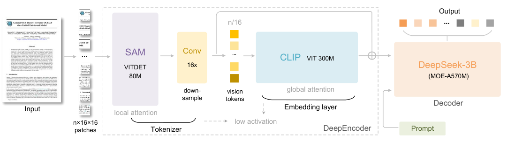

# DeepSeek-OCR：补充解读

> 十倍视觉压缩能否直接等于十倍上下文能力？以下为直觉解释与应用延伸，论文内容见 [精炼主笔记](DeepSeek-OCR详解.md)。

## 视觉 token 少，不等于完整成本少同样倍数

将 1000 个文本 token 变成 100 个视觉 token，只比较了送入解码器的序列长度。还要计算文本渲染、视觉编码、输出解码，以及识别错误后的处理。若最后仍把全部文字重新生成，输出 token 的成本不会消失。

图中先压缩再全局处理，是实际效率来源之一。简单将普通高分辨率 VLM 输入切成许多图块，不会自动获得相同收益。

## 97% 对什么任务够用

阅读一般文章时少量识别误差可能可接受；身份证号、公式负号、代码缩进或金额中的一个字符却可能改变结论。除平均 precision，还要按数字、公式、表格结构和关键字段评估错误。

## 对话记忆的假说还需要什么证据

至少比较原文本、光学压缩输入和摘要三者在相同成本下的问答、定位、跨段推理与长期更新能力。能 OCR 出来是一项必要证据，却不是长上下文理解能力的完整证据。

## 用一个具体场景串起来

把一千语言token的页面变成一百视觉token，只说明LLM输入长度少了；前面还有渲染和视觉编码，后面OCR重建也可能有错误。数字、标点、代码缩进错几个字符就可能改变任务答案。

如果目标是历史问答，应直接测压缩后的问答准确率及总成本；若目标是数据生产，则测转录和结构质量。压缩率和下游可靠性需要各自报告，不能用一个97%替代所有用途。
