# DeepSeek-OCR: Contexts Optical Compression / 全文中英对照

> 来源：[arXiv:2510.18234v1](https://arxiv.org/abs/2510.18234v1)。英文段落后紧接中文，覆盖所取 HTML 版本的主文、附录、图表、脚注与参考文献；公式、数字表和书目信息共用。中文以机器初译为底稿，进行了术语整理与结构核对，尚未逐句人工审定；遇到歧义请以紧邻英文和原论文为准。 原作版权归所列作者，许可见 [原作许可](http://creativecommons.org/licenses/by/4.0/)；中文译文与版式改写在该许可条件下提供（涉及 SA 时沿用相同许可，涉及 NC 时仅限非商业使用）。

## Authors and affiliations / 作者与机构

Haoran Wei Yaofeng Sun Yukun Li Affiliation: DeepSeek-AI

**EN.** \reportnumber

**中.** \报告编号

**EN.** 001

**中.** 001

## Abstract / 摘要

**EN.** We present DeepSeek-OCR as an initial investigation into the feasibility of compressing long contexts via optical 2D mapping. DeepSeek-OCR consists of two components: DeepEncoder and DeepSeek3B-MoE-A570M as the decoder. Specifically, DeepEncoder serves as the core engine, designed to maintain low activations under high-resolution input while achieving high compression ratios to ensure an optimal and manageable number of vision tokens. Experiments show that when the number of text tokens is within 10 times that of vision tokens (i.e., a compression ratio < 10 $\times$ ), the model can achieve decoding (OCR) precision of 97%. Even at a compression ratio of 20 $\times$ , the OCR accuracy still remains at about 60%. This shows considerable promise for research areas such as historical long-context compression and memory forgetting mechanisms in LLMs. Beyond this, DeepSeek-OCR also demonstrates high practical value. On OmniDocBench, it surpasses GOT-OCR2.0 (256 tokens/page) using only 100 vision tokens, and outperforms MinerU2.0 (6000+ tokens per page on average) while utilizing fewer than 800 vision tokens. In production, DeepSeek-OCR can generate training data for LLMs/VLMs at a scale of 200k+ pages per day (a single A100-40G). Codes and model weights are publicly accessible at [http://github.com/deepseek-ai/DeepSeek-OCR](http://github.com/deepseek-ai/DeepSeek-OCR) .

**中.** 我们提出 DeepSeek-OCR 作为对通过光学 2D 映射压缩长上下文的可行性的初步研究。 DeepSeek-OCR 由两个组件组成：DeepEncoder 和作为解码器的 DeepSeek3B-MoE-A570M。具体来说，DeepEncoder 作为核心引擎，旨在在高分辨率输入下保持低激活，同时实现高压缩比，以确保最佳且可管理的视觉令牌数量。实验表明，当文本标记数量在视觉标记数量的10倍以内（即压缩比<10 $\times$ ）时，该模型可以实现97%的解码（OCR）精度。即使压缩比为 20 $\times$ ，OCR 准确率仍保持在 60% 左右。这为LLM中的历史长上下文压缩和记忆遗忘机制等研究领域显示了巨大的前景。除此之外，DeepSeek-OCR还表现出很高的实用价值。在 OmniDocBench 上，它仅使用 100 个视觉令牌就超越了 GOT-OCR2.0（256 个令牌/页），并且在使用少于 800 个视觉令牌的情况下超越了 MinerU2.0（平均每页 6000 多个令牌）。在生产中，DeepSeek-OCR 可以每天生成 200k+ 页规模的 LLM/VLM 训练数据（单个 A100-40G）。代码和模型权重可在 [http://github.com/deepseek-ai/DeepSeek-OCR](http://github.com/deepseek-ai/DeepSeek-OCR) 上公开访问。

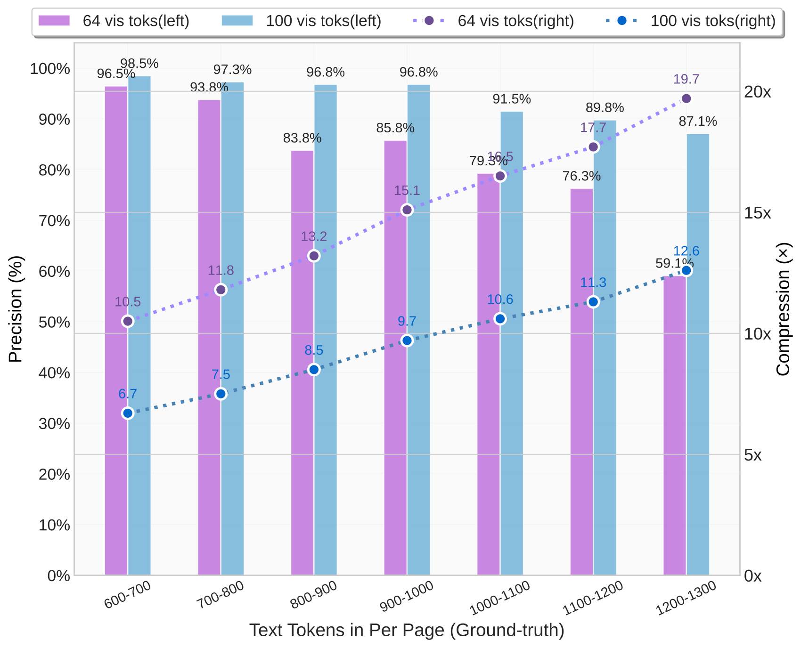

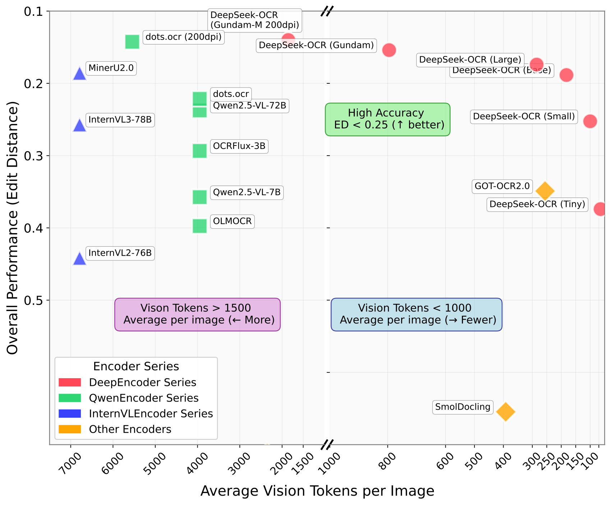

**EN.** Figure 1 : Figure (a) shows the compression ratio (number of text tokens in ground truth/number of vision tokens model used) testing on Fox [ 21 ] benchmark; Figure (b) shows performance comparisons on OmniDocBench [ 27 ] . DeepSeek-OCR can achieve state-of-the-art performance among end-to-end models enjoying the fewest vision tokens.

**中.** 图1：图(a)显示了在Fox[21]基准上测试的压缩比（groundtruth中的文本标记数量/所使用的视觉标记模型数量）；图 (b) 显示了 OmniDocBench [27] 上的性能比较。 DeepSeek-OCR 可以在享受最少视觉令牌的端到端模型中实现最先进的性能。

## Introduction / 简介

**EN.** Current Large Language Models (LLMs) face significant computational challenges when processing long textual content due to quadratic scaling with sequence length. We explore a potential solution: leveraging visual modality as an efficient compression medium for textual information. A single image containing document text can represent rich information using substantially fewer tokens than the equivalent digital text, suggesting that optical compression through vision tokens could achieve much higher compression ratios.

**中.** 由于序列长度的二次缩放，当前的大型语言模型 (LLM) 在处理长文本内容时面临着巨大的计算挑战。我们探索一个潜在的解决方案：利用视觉模态作为文本信息的有效压缩介质。包含文档文本的单个图像可以使用比等效数字文本少得多的令牌来表示丰富的信息，这表明通过视觉令牌进行光学压缩可以实现更高的压缩比。

**EN.** This insight motivates us to reexamine vision-language models (VLMs) from an LLM-centric perspective, focusing on how vision encoders can enhance LLMs’ efficiency in processing textual information rather than basic VQA [ 12 , 24 , 32 , 41 , 16 ] what humans excel at. OCR tasks, as an intermediate modality bridging vision and language, provide an ideal testbed for this vision-text compression paradigm, as they establish a natural compression-decompression mapping between visual and textual representations while offering quantitative evaluation metrics.

**中.** 这一见解促使我们从以LLM为中心的角度重新审视视觉语言模型（VLM），重点关注视觉编码器如何提高LLM处理文本信息的效率，而不是人类擅长的基本 VQA [12,24,32,41,16]。 OCR 任务作为桥接视觉和语言的中间模态，为这种视觉文本压缩范式提供了理想的测试平台，因为它们在视觉和文本表示之间建立了自然的压缩-解压映射，同时提供定量评估指标。

**EN.** Accordingly, we present DeepSeek-OCR, a VLM designed as a preliminary proof-of-concept for efficient vision-text compression. Our work makes three primary contributions:

**中.** 因此，我们提出了 DeepSeek-OCR，这是一种 VLM，旨在作为高效视觉文本压缩的初步概念验证。我们的工作做出了三个主要贡献：

**EN.** First, we provide comprehensive quantitative analysis of vision-text token compression ratios. Our method achieves 96%+ OCR decoding precision at 9-10 $\times$ text compression, $\sim$ 90% at 10-12 $\times$ compression, and $\sim$ 60% at 20 $\times$ compression on Fox [ 21 ] benchmarks featuring diverse document layouts (with actual accuracy being even higher when accounting for formatting differences between output and ground truth), as shown in Figure 1(a) . The results demonstrate that compact language models can effectively learn to decode compressed visual representations, suggesting that larger LLMs could readily acquire similar capabilities through appropriate pretraining design.

**中.** 首先，我们对视觉文本标记压缩率进行全面的定量分析。我们的方法在具有不同文档布局的 Fox [21] 基准测试中，在 9-10 $\times$ 文本压缩时实现了 96% 以上的 OCR 解码精度，在 10-12 $\times$ 压缩时实现了 $\sim$ 90% 的 OCR 解码精度，在 20 $\times$ 压缩时实现了 $\sim$ 60% 的 OCR 解码精度（实际精度甚至更高）当考虑输出和真实值之间的格式差异时），如图 1(a) 所示。结果表明，紧凑的语言模型可以有效地学习解码压缩的视觉表示，这表明较大的LLM可以通过适当的预训练设计轻松获得类似的能力。

**EN.** Second, we introduce DeepEncoder, a novel architecture that maintains low activation memory and minimal vision tokens even with high-resolution inputs. It serially connects window attention and global attention encoder components through a 16 $\times$ convolutional compressor. This design ensures that the window attention component processes a large number of vision tokens, while the compressor reduces vision tokens before they enter the dense global attention component, achieving effective memory and token compression.

**中.** 其次，我们介绍 DeepEncoder，这是一种新颖的架构，即使在高分辨率输入的情况下也能保持低激活内存和最少的视觉标记。它通过 16 个 $\times$ 卷积压缩器串联连接窗口注意力和全局注意力编码器组件。这种设计确保窗口注意组件处理大量视觉标记，而压缩器在视觉标记进入密集全局注意组件之前减少视觉标记，从而实现有效的内存和标记压缩。

**EN.** Third, we develop DeepSeek-OCR based on DeepEncoder and DeepSeek3B-MoE [ 19 , 20 ] . As shown in Figure 1(b) , it achieves state-of-the-art performance within end-to-end models on OmniDocBench while using the fewest vision tokens. Additionally, we equip the model with capabilities for parsing charts, chemical formulas, simple geometric figures, and natural images to enhance its practical utility further. In production, DeepSeek-OCR can generate 33 million pages of data per day for LLMs or VLMs using 20 nodes (each with 8 A100-40G GPUs).

**中.** 第三，我们基于 DeepEncoder 和 DeepSeek3B-MoE 开发 DeepSeek-OCR [19, 20]。如图 1(b) 所示，它在 OmniDocBench 上的端到端模型中实现了最先进的性能，同时使用最少的视觉标记。此外，我们还为模型配备了解析图表、化学公式、简单几何图形和自然图像的功能，进一步增强其实用性。在生产中，DeepSeek-OCR 每天可以使用 20 个节点（每个节点配备 8 个 A100-40G GPU）为 LLM 或 VLM 生成 3300 万页数据。

**EN.** In summary, this work presents a preliminary exploration of using visual modality as an efficient compression medium for textual information processing in LLMs. Through DeepSeek-OCR, we demonstrate that vision-text compression can achieve significant token reduction (7-20 $\times$ ) for different historical context stages, offering a promising direction for addressing long-context challenges in large language models. Our quantitative analysis provides empirical guidelines for VLM token allocation optimization, while the proposed DeepEncoder architecture showcases practical feasibility with real-world deployment capabilities. Although focused on OCR as a proof-of-concept, this paradigm opens new possibilities for rethinking how vision and language modalities can be synergistically combined to enhance computational efficiency in large-scale text processing and agent systems.

**中.** 总之，这项工作提出了使用视觉模态作为LLM文本信息处理的有效压缩介质的初步探索。通过 DeepSeek-OCR，我们证明了视觉文本压缩可以在不同的历史上下文阶段实现显着的标记减少（7-20 $\times$ ），为解决大型语言模型中的长上下文挑战提供了一个有前途的方向。我们的定量分析为 VLM 代币分配优化提供了经验指南，而提出的 DeepEncoder 架构则展示了实际部署能力的实际可行性。尽管专注于 OCR 作为概念验证，但该范例为重新思考如何协同组合视觉和语言模式以提高大规模文本处理和代理系统的计算效率提供了新的可能性。

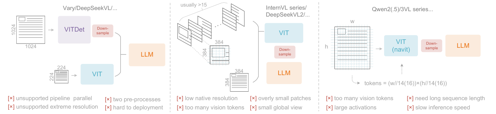

**EN.** Figure 2 : Typical vision encoders in popular VLMs. Here are three types of encoders commonly used in current open-source VLMs, all of which suffer from their respective deficiencies.

**中.** 图 2：流行 VLM 中的典型视觉编码器。以下是当前开源 VLM 中常用的三种编码器，它们都有各自的缺陷。

## Related Works / 相关作品

### Typical Vision Encoders in VLMs / VLM 中的典型视觉编码器

**EN.** Current open-source VLMs employ three main types of vision encoders, as illustrated in Figure 2 . The first type is a dual-tower architecture represented by Vary [ 36 ] , which utilizes parallel SAM [ 17 ] encoder to increase visual vocabulary parameters for high-resolution image processing. While offering controllable parameters and activation memory, this approach suffers from significant drawbacks: it requires dual image preprocessing that complicates deployment and makes encoder pipeline parallelism challenging during training. The second type is tile-based method exemplified by InternVL2.0 [ 8 ] , which processes images by dividing them into small tiles for parallel computation, reducing activation memory under high-resolution settings. Although capable of handling extremely high resolutions, this approach has notable limitations due to its typically low native encoder resolution (below 512 $\times$ 512), causing large images to be excessively fragmented and resulting in numerous vision tokens. The third type is adaptive resolution encoding represented by Qwen2-VL [ 35 ] , which adopts the NaViT [ 10 ] paradigm to directly process full images through patch-based segmentation without tile parallelization. While this encoder can handle diverse resolutions flexibly, it faces substantial challenges with large images due to massive activation memory consumption that can cause GPU memory overflow, and sequence packing requires extremely long sequence lengths during training. Long vision tokens will slow down both prefill and generation phases of inference.

**中.** 当前的开源 VLM 采用三种主要类型的视觉编码器，如图 2 所示。第一类是以Vary[36]为代表的双塔架构，它利用并行SAM[17]编码器来增加高分辨率图像处理的视觉词汇参数。虽然提供可控参数和激活内存，但这种方法存在明显的缺点：它需要双重图像预处理，这使部署变得复杂，并使编码器管道并行性在训练期间面临挑战。第二种是基于图块的方法，以 InternVL2.0 [8] 为例，它通过将图像划分为小图块进行并行计算来处理图像，减少高分辨率设置下的激活内存。尽管能够处理极高的分辨率，但这种方法具有明显的局限性，因为其通常较低的本机编码器分辨率（低于 512 $\times$ 512），导致大图像过度碎片化并产生大量视觉标记。第三种是以Qwen2-VL[35]为代表的自适应分辨率编码，它采用NaViT[10]范式，通过基于块的分割直接处理全图像，无需瓦片并行化。虽然该编码器可以灵活地处理不同的分辨率，但由于大量的激活内存消耗可能导致 GPU 内存溢出，并且在训练期间序列打包需要极长的序列长度，因此它在处理大图像时面临着巨大的挑战。长期愿景令牌将减慢推理的预填充和生成阶段。

### End-to-end OCR Models / 端到端 OCR 模型

**EN.** OCR, particularly document parsing task, has been a highly active topic in the image-to-text domain. With the advancement of VLMs, a large number of end-to-end OCR models have emerged, fundamentally transforming the traditional pipeline architecture (which required separate detection and recognition expert models) by simplifying OCR systems. Nougat [ 6 ] first employs end-to-end framework for academic paper OCR on arXiv, demonstrating the potential of models in handling dense perception tasks. GOT-OCR2.0 [ 38 ] expands the scope of OCR2.0 to include more synthetic image parsing tasks and designs an OCR model with performance-efficiency trade-offs, further highlighting the potential of end-to-end OCR researches. Additionally, general vision models such as Qwen-VL series [ 35 ] , InternVL series [ 8 ] , and many their derivatives continuously enhance their document OCR capabilities to explore dense visual perception boundaries. However, a crucial research question that current models have not addressed is: for a document containing 1000 words, how many vision tokens are at least needed for decoding? This question holds significant importance for research in the principle that " a picture is worth a thousand words. "

**中.** OCR，特别是文档解析任务，一直是图像到文本领域的一个高度活跃的话题。随着VLM的进步，大量端到端的OCR模型出现，通过简化OCR系统从根本上改变了传统的管道架构（需要单独的检测和识别专家模型）。 Nougat [6] 首先在 arXiv 上的学术论文 OCR 中采用端到端框架，展示了模型在处理密集感知任务方面的潜力。 GOT-OCR2.0 [38]扩展了OCR2.0的范围，包括更多的合成图像解析任务，并设计了具有性能效率权衡的OCR模型，进一步凸显了端到端OCR研究的潜力。此外，通用视觉模型如Qwen-VL系列[35]、InternVL系列[8]及其许多衍生模型不断增强其文档OCR能力，以探索密集的视觉感知边界。然而，当前模型尚未解决的一个关键研究问题是：对于包含 1000 个单词的文档，至少需要多少个视觉标记进行解码？这个问题对于“一图胜千言”的研究具有重要意义。

**EN.** Figure 3 : The architecture of DeepSeek-OCR. DeepSeek-OCR consists of a DeepEncoder and a DeepSeek-3B-MoE decoder. DeepEncoder is the core of DeepSeek-OCR, comprising three components: a SAM [ 17 ] for perception dominated by window attention, a CLIP [ 29 ] for knowledge with dense global attention, and a 16 $\times$ token compressor that bridges between them.

**中.** 图 3：DeepSeek-OCR 的架构。 DeepSeek-OCR 由 DeepEncoder 和 DeepSeek-3B-MoE 解码器组成。 DeepEncoder 是 DeepSeek-OCR 的核心，由三个组件组成：用于以窗口注意力为主的感知的 SAM [17]，用于具有密集全局注意力的知识的 CLIP [29]，以及桥接它们之间的 16 $\times$ 令牌压缩器。

## Methodology / 方法论

### Architecture / 建筑

**EN.** As shown in Figure 3 , DeepSeek-OCR enjoys a unified end-to-end VLM architecture consisting of an encoder and a decoder. The encoder (namely DeepEncoder) is responsible for extracting image features and tokenizing as well as compressing visual representations. The decoder is used for generating the required result based on image tokens and prompts. DeepEncoder is approximately 380M in parameters, mainly composed of an 80M SAM-base [ 17 ] and a 300M CLIP-large [ 29 ] connected in series. The decoder adopts a 3B MoE [ 19 , 20 ] architecture with 570M activated parameters. In the following paragraphs, we will delve into the model components, data engineering, and training skills.

**中.** 如图3所示，DeepSeek-OCR具有统一的端到端VLM架构，由编码器和解码器组成。编码器（即 DeepEncoder）负责提取图像特征和标记以及压缩视觉表示。解码器用于根据图像标记和提示生成所需的结果。 DeepEncoder的参数约为380M，主要由80M SAM-base[17]和300M CLIP-large[29]串联组成。解码器采用3B MoE[19,20]架构，具有570M激活参数。在接下来的段落中，我们将深入研究模型组件、数据工程和训练技能。

### DeepEncoder / 深度编码器

**EN.** To explore the feasibility of contexts optical compression, we need a vision encoder with the following features: 1.Capable of processing high resolutions; 2.Low activation at high resolutions; 3.Few vision tokens; 4.Support for multiple resolution inputs; 5. Moderate parameter count. However, as described in the Section 2.1 , current open-source encoders cannot fully satisfy all these conditions. Therefore, we design a novel vision encoder ourselves, named DeepEncoder.

**中.** 为了探索上下文光学压缩的可行性，我们需要一个具有以下特性的视觉编码器： 1.能够处理高分辨率； 2.高分辨率下激活率低； 3.愿景代币少； 4.支持多种分辨率输入； 5. 参数数量适中。然而，如2.1节所述，当前的开源编码器无法完全满足所有这些条件。因此，我们自己设计了一种新颖的视觉编码器，命名为DeepEncoder。

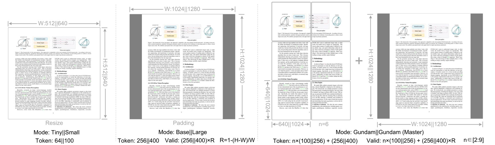

**EN.** Figure 4 : To test model performance under different compression ratios (requiring different numbers of vision tokens) and enhance the practicality of DeepSeek-OCR, we configure it with multiple resolution modes.

**中.** 图4：为了测试不同压缩比下的模型性能（需要不同数量的视觉令牌）并增强DeepSeek-OCR的实用性，我们为其配置了多种分辨率模式。

#### Architecture of DeepEncoder / DeepEncoder的架构

**EN.** DeepEncoder mainly consists of two components: a visual perception feature extraction component dominated by window attention, and a visual knowledge feature extraction component with dense global attention. To benefit from the pretraining gains of previous works, we use SAM-base (patch-size 16) and CLIP-large as the main architectures for the two components respectively. For CLIP, we remove the first patch embedding layer since its input is no longer images but output tokens from the previous pipeline. Between the two components, we borrow from Vary [ 36 ] and use a 2-layer convolutional module to perform 16 $\times$ downsampling of vision tokens. Each convolutional layer has a kernel size of 3, stride of 2, padding of 1, and channels increase from 256 to 1024. Assuming we input a 1024 $\times$ 1024 image, the DeepEncoder will segment it into 1024/16 $\times$ 1024/16=4096 patch tokens. Since the first half of encoder is dominated by window attention and only 80M, the activation is acceptable. Before entering global attention, the 4096 tokens go through the compression module and the token count becomes 4096/16=256, thus making the overall activation memory controllable.

**中.** DeepEncoder主要由两个组件组成：以窗口注意力为主的视觉感知特征提取组件，以及以密集全局注意力为主的视觉知识特征提取组件。为了受益于之前工作的预训练成果，我们分别使用 SAM-base（补丁大小 16）和 CLIP-large 作为两个组件的主要架构。对于 CLIP，我们删除了第一个补丁嵌入层，因为它的输入不再是图像，而是来自先前管道的输出标记。在这两个组件之间，我们借鉴了 Vary [36]，并使用 2 层卷积模块对视觉标记执行 16 $\times$ 下采样。每个卷积层的内核大小为3，步长为2，填充为1，通道从256增加到1024。假设我们输入一张1024 $\times$ 1024图像，DeepEncoder会将其分割为1024/16 $\times$ 1024/16=4096个补丁标记。由于编码器的前半部分以窗口注意力为主，并且只有 80M，因此激活是可以接受的。在进入全局注意力之前，4096个令牌经过压缩模块，令牌数变为4096/16=256，从而使整体激活内存可控。

| Mode 模式 | Native Resolution 原始分辨率 | Native Resolution 原始分辨率 | Native Resolution 原始分辨率 | Native Resolution 原始分辨率 | Dynamic Resolution 动态分辨率 | Dynamic Resolution 动态分辨率 |
| --- | --- | --- | --- | --- | --- | --- |
| Mode 模式 | Tiny 微小的 | Small 小号 | Base 基地 | Large 大号 | Gundam 高达 | Gundam-M 高达M |
| Resolution 分辨率 | 512 | 640 | 1024 | 1280 | 640+1024 | 1024+1280 |
| Tokens 代币 | 64 | 100 | 256 | 400 | n $\times$ 100+256 | n $\times$ 256+400 |
| Process 工艺流程 | resize 调整大小 | resize 调整大小 | padding 填充 | padding 填充 | resize + padding 调整大小+填充 | resize + padding 调整大小+填充 |

**EN.** Table 1 : Multi resolution support of DeepEncoder. For both research and application purposes, we design DeepEncoder with diverse native resolution and dynamic resolution modes.

**中.** 表 1：DeepEncoder 的多分辨率支持。出于研究和应用目的，我们设计了具有多种原始分辨率和动态分辨率模式的 DeepEncoder。

#### Multiple resolution support / 多分辨率支持

**EN.** Suppose we have an image with 1000 optical characters and we want to test how many vision tokens are needed for decoding. This requires the model to support a variable number of vision tokens. That is to say the DeepEncoder needs to support multiple resolutions.

**中.** 假设我们有一张包含 1000 个光学字符的图像，我们想要测试解码需要多少个视觉标记。这要求模型支持可变数量的视觉标记。也就是说DeepEncoder需要支持多种分辨率。

**EN.** We meet the requirement aforementioned through dynamic interpolation of positional encodings, and design several resolution modes for simultaneous model training to achieve the capability of a single DeepSeek-OCR model supporting multiple resolutions. As shown in Figure 4 , DeepEncoder mainly supports two major input modes: native resolution and dynamic resolution. Each of them contains multiple sub-modes.

**中.** 我们通过位置编码的动态插值来满足上述要求，并设计多种分辨率模式进行同时模型训练，以实现单个 DeepSeek-OCR 模型支持多种分辨率的能力。如图4所示，DeepEncoder主要支持两种主要的输入模式：原生分辨率和动态分辨率。每个模式都包含多个子模式。

**EN.** Native resolution supports four sub-modes: Tiny, Small, Base, and Large, with corresponding resolutions and token counts of 512 $\times$ 512 (64), 640 $\times$ 640 (100), 1024 $\times$ 1024 (256), and 1280 $\times$ 1280 (400) respectively. Since Tiny and Small modes have relatively small resolutions, to avoid wasting vision tokens, images are processed by directly resizing the original shape. For Base and Large modes, in order to preserve the original image aspect ratio, images are padded to the corresponding size. After padding, the number of valid vision tokens is less than the actual number of vision tokens, with the calculation formula being:

**中.** 原生分辨率支持 Tiny、Small、Base、Large 四种子模式，对应的分辨率和 token 数量为 512 $\times$ 512 (64)、640 $\times$ 640 (100)、1024 $\times$ 1024 (256) 和 1280 $\times$分别为 1280 (400)。由于Tiny和Small模式的分辨率相对较小，为了避免浪费视觉标记，通过直接调整原始形状的大小来处理图像。对于“基本”和“大”模式，为了保留原始图像的长宽比，图像将被填充到相应的尺寸。填充后，有效视觉标记的数量小于实际视觉标记的数量，计算公式为：

$$
N_{valid}=\lceil N_{actual}\times[1-((max(w,h)-min(w,h))/(max(w,h)))]\rceil\tag{1}
$$

**EN.** where $w$ and $h$ represent the width and height of the original input image.

**中.** 其中$w$和$h$表示原始输入图像的宽度和高度。

**EN.** Dynamic resolution can be composed of two native resolutions. For example, Gundam mode consists of n $\times$ 640 $\times$ 640 tiles (local views) and a 1024 $\times$ 1024 global view. The tiling method following InternVL2.0 [ 8 ] . Supporting dynamic resolution is mainly for application considerations, especially for ultra-high-resolution inputs (such as newspaper images). Tiling is a form of secondary window attention that can effectively reduce activation memory further. It’s worth noting that due to our relatively large native resolutions, images won’t be fragmented too much under dynamic resolution (the number of tiles is controlled within the range of 2 to 9). The vision token number output by the DeepEncoder under Gundam mode is: $n\times 100+256$ , where $n$ is the number of tiles. For images with both width and height smaller than 640, $n$ is set to 0, i.e., Gundam mode will degrade to Base mode.

**中.** 动态分辨率可以由两个原始分辨率组成。例如，Gundam模式由n个$\times$ 640 $\times$ 640个图块（局部视图）和1024个$\times$ 1024个全局视图组成。平铺方法遵循InternVL2.0[8]。支持动态分辨率主要是出于应用考虑，特别是对于超高分辨率输入（例如报纸图像）。平铺是二次窗口注意力的一种形式，可以有效地进一步减少激活记忆。值得注意的是，由于我们的原生分辨率比较大，动态分辨率下图像不会出现太多碎片（图块数量控制在2到9个范围内）。高达模式下 DeepEncoder 输出的视觉 token 数量为： $n\times 100+256$ ，其中 $n$ 为方块数量。对于宽度和高度都小于640的图像，$n$设置为0，即Gundam模式将降级为Base模式。

**EN.** Gundam mode is trained together with the four native resolution modes to achieve the goal of one model supporting multiple resolutions. Note that Gundam-master mode (1024 $\times$ 1024 local views+1280 $\times$ 1280 global view) is obtained through continued training on a trained DeepSeek-OCR model. This is mainly for load balancing, as Gundam-master’s resolution is too large and training it together would slow down the overall training speed.

**中.** 高达模式与四种原生分辨率模式一起训练，达到一个模型支持多种分辨率的目标。请注意，Gundam-master 模式（1024 $\times$ 1024 局部视图+1280 $\times$ 1280 全局视图）是通过在经过训练的 DeepSeek-OCR 模型上继续训练获得的。这主要是为了负载平衡，因为Gundam-master的分辨率太大，一起训练会降低整体训练速度。

### The MoE Decoder / 教育部解码器

**EN.** Our decoder uses the DeepSeekMoE [ 19 , 20 ] , specifically DeepSeek-3B-MoE. During inference, the model activates 6 out of 64 routed experts and 2 shared experts, with about 570M activated parameters. The 3B DeepSeekMoE is very suitable for domain-centric (OCR for us) VLM research, as it obtains the expressive capability of a 3B model while enjoying the inference efficiency of a 500M small model.

**中.** 我们的解码器使用 DeepSeekMoE [19, 20]，特别是 DeepSeek-3B-MoE。在推理过程中，模型激活了 64 个路由专家中的 6 个和 2 个共享专家，激活参数约为 5.7 亿个。 3B DeepSeekMoE非常适合以领域为中心（对我们来说是OCR）的VLM研究，因为它获得了3B模型的表达能力，同时享受500M小模型的推理效率。

**EN.** The decoder reconstructs the original text representation from the compressed latent vision tokens of DeepEncoder as:

**中.** 解码器根据 DeepEncoder 的压缩潜在视觉标记重建原始文本表示形式：

$$
f_{\text{dec}}:\mathbb{R}^{n\times d_{\text{latent}}}\rightarrow\mathbb{R}^{N\times d_{\text{text}}};\quad\hat{\mathbf{X}}=f_{\text{dec}}(\mathbf{Z})\quad\text{where }n\leq N\tag{2}
$$

**EN.** where $\mathbf{Z}\in\mathbb{R}^{n\times d_{\text{latent}}}$ are the compressed latent(vision) tokens from DeepEncoder and $\hat{\mathbf{X}}\in\mathbb{R}^{N\times d_{\text{text}}}$ is the reconstructed text representation. The function $f_{\text{dec}}$ represents a non-linear mapping that can be effectively learned by compact language models through OCR-style training. It is reasonable to conjecture that LLMs, through specialized pretraining optimization, would demonstrate more natural integration of such capabilities.

**中.** 其中 $\mathbf{Z}\in\mathbb{R}^{n\times d_{\text{latent}}}$ 是来自 DeepEncoder 的压缩潜在（视觉）标记，$\hat{\mathbf{X}}\in\mathbb{R}^{N\times d_{\text{text}}}$ 是重建的文本表示。函数 $f_{\text{dec}}$ 表示非线性映射，可以通过 OCR 式训练通过紧凑语言模型有效学习。可以合理地推测，LLM通过专门的预训练优化，将展示出这些能力的更自然的整合。

### Data Engine / 数据引擎

**EN.** We constructe complex and diverse training data for DeepSeek-OCR, including OCR 1.0 data, which mainly consists of traditional OCR tasks such as scene image OCR and document OCR; OCR 2.0 data, which mainly includes parsing tasks for complex artificial images, such as common charts, chemical formulas, and plane geometry parsing data; General vision data, which is mainly used to inject certain general image understanding capabilities into DeepSeek-OCR and preserve the general vision interface.

**中.** 我们为DeepSeek-OCR构建了复杂多样的训练数据，包括OCR 1.0数据，主要由场景图像OCR和文档OCR等传统OCR任务组成； OCR 2.0数据，主要包括复杂人工图像的解析任务，如常见图表、化学公式、平面几何解析数据；通用视觉数据，主要用于向DeepSeek-OCR注入一定的通用图像理解能力，并保留通用视觉接口。

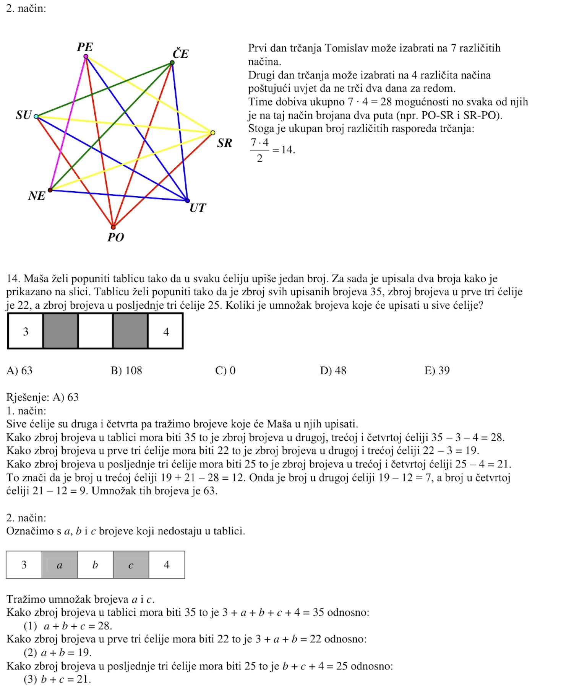

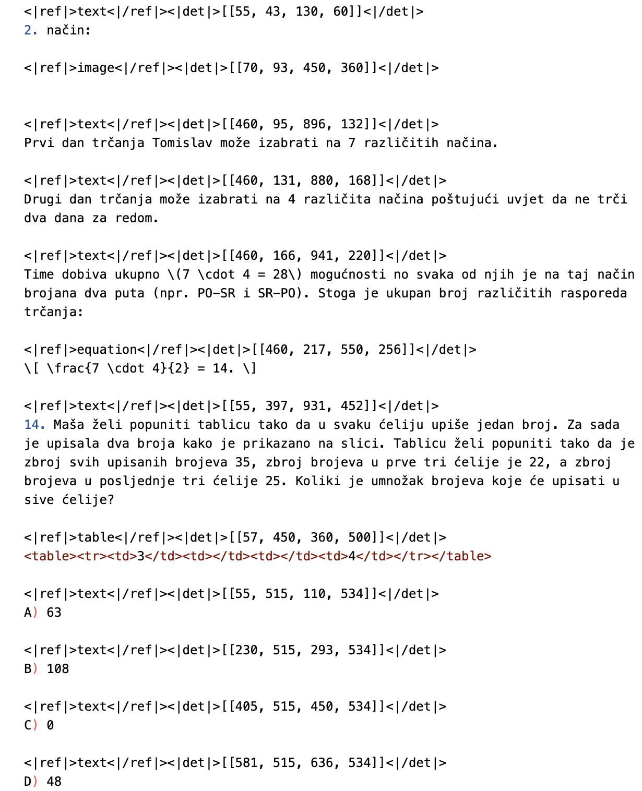

**EN.** Figure 5 : OCR 1.0 fine annotations display. We format the ground truth into an interleaved layout and text format, where each paragraph of text is preceded by the coordinates and label of it in the original image. All coordinates are normalized into 1000 bins.

**中.** 图5：OCR 1.0精细注释显示。我们将基本事实格式化为交错的布局和文本格式，其中每个文本段落前面都有它在原始图像中的坐标和标签。所有坐标均标准化为 1000 个 bin。

#### OCR 1.0 data / OCR 1.0数据

**EN.** Document data is the top priority for DeepSeek-OCR. We collect 30M pages of diverse PDF data covering about 100 languages from the Internet, with Chinese and English accounting for approximately 25M and other languages accounting for 5M. For this data, we create two types of ground truth: coarse annotations and fine annotations. Coarse annotations are extracted directly from the full dataset using fitz , aimed at teaching the model to recognize optical text, especially in minority languages. Fine annotations include 2M pages each for Chinese and English, labeled using advanced layout models (such as PP-DocLayout [ 33 ] ) and OCR models (such as MinuerU [ 34 ] and GOT-OCR2.0 [ 38 ] ) to construct detection and recognition interleaved data. For minority languages, in the detection part, we find that the layout model enjoys certain generalization capabilities. In the recognition part, we use fitz to create small patch data to train a GOT-OCR2.0, then use the trained model to label small patches after layout processing, employing a model flywheel to create 600K data samples. During the training of DeepSeek-OCR, coarse labels and fine labels are distinguished using different prompts. The ground truth for fine annotation image-text pairs can be seen in Figure 5 . We also collect 3M Word data, constructing high-quality image-text pairs without layout by directly extracting content. This data mainly brings benefits to formulas and HTML-formatted tables. Additionally, we select some open-source data [ 28 , 37 ] as supplements.

**中.** 文档数据是 DeepSeek-OCR 的首要任务。我们从互联网上收集了3000万页涵盖约100种语言的多样化PDF数据，其中中文和英文约2500万页，其他语言约500万页。对于这些数据，我们创建两种类型的基本事实：粗略注释和精细注释。使用 fitz 直接从完整数据集中提取粗略注释，旨在教导模型识别光学文本，尤其是少数语言的文本。精细标注包括中文和英文各2M页，使用高级布局模型（如PP-DocLayout[33]）和OCR模型（如MinuerU[34]和GOT-OCR2.0[38]）进行标记，构建检测和识别交错数据。对于小语种，在检测部分，我们发现布局模型具有一定的泛化能力。在识别部分，我们使用fitz创建小块数据来训练GOT-OCR2.0，然后使用训练好的模型在布局处理后标记小块，使用模型飞轮创建600K数据样本。 DeepSeek-OCR的训练过程中，通过不同的提示来区分粗标签和细标签。精细注释图像-文本对的基本事实如图 5 所示。我们还收集 3M Word 数据，通过直接提取内容构建高质量的无布局图文对。这些数据主要给公式和HTML格式的表格带来好处。此外，我们选择了一些开源数据[28,37]作为补充。

**EN.** For natural scene OCR, our model mainly supports Chinese and English. The image data sources come from LAION [ 31 ] and Wukong [ 13 ] , labeled using PaddleOCR [ 9 ] , with 10M data samples each for Chinese and English. Like document OCR, natural scene OCR can also control whether to output detection boxes through prompts.

**中.** 对于自然场景OCR，我们的模型主要支持中文和英文。图像数据源来自LAION[31]和Wukong[13]，使用PaddleOCR[9]进行标记，中文和英文各10M数据样本。与文档OCR一样，自然场景OCR也可以通过提示控制是否输出检测框。

#### OCR 2.0 data / OCR 2.0数据

**EN.** Following GOT-OCR2.0 [ 38 ] , we refer to chart, chemical formula, and plane geometry parsing data as OCR 2.0 data. For chart data, following OneChart [ 7 ] , we use pyecharts and matplotlib to render 10M images, mainly including commonly used line, bar, pie, and composite charts. We define chart parsing as image-to-HTML-table conversion task, as shown in Figure 6(a) . For chemical formulas, we utilize SMILES format from PubChem as the data source and render them into images using RDKit, constructing 5M image-text pairs. For plane geometry images, we follow Slow Perception [ 39 ] for generation. Specifically, we use perception-ruler size as 4 to model each line segment. To increase the diversity of rendered data, we introduce geometric translation-invariant data augmentation, where the same geometric image is translated in the original image, corresponding to the same ground truth drawn at the centered position in the coordinate system. Based on this, we construct a total of 1M plane geometry parsing data, as illustrated in Figure 6(b) .

**中.** 继GOT-OCR2.0[38]之后，我们将图表、化学式、平面几何解析数据称为OCR 2.0数据。对于图表数据，继OneChart[7]之后，我们使用pyecharts和matplotlib渲染10M图像，主要包括常用的折线图、条形图、饼图和复合图。我们将图表解析定义为图像到 HTML 表格的转换任务，如图 6(a) 所示。对于化学式，我们利用 PubChem 的 SMILES 格式作为数据源，并使用 RDKit 将其渲染为图像，构建 500 万个图像文本对。对于平面几何图像，我们遵循慢感知[39]来生成。具体来说，我们使用感知标尺大小为 4 来对每个线段进行建模。为了增加渲染数据的多样性，我们引入了几何平移不变数据增强，其中相同的几何图像在原始图像中平移，对应于在坐标系的中心位置绘制的相同的地面实况。基于此，我们构建了总共1M的平面几何解析数据，如图6(b)所示。

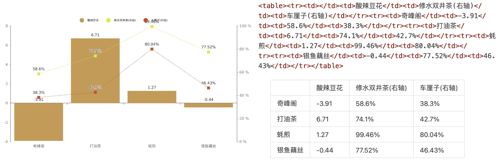

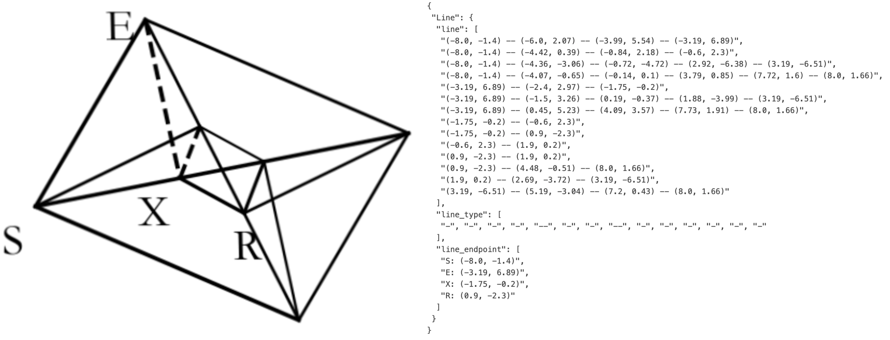

**EN.** Figure 6 : For charts, we do not use OneChart’s [ 7 ] dictionary format, but instead use HTML table format as labels, which can save a certain amount of tokens. For plane geometry, we convert the ground truth to dictionary format, where the dictionary contains keys such as line segments, endpoint coordinates, line segment types, etc., for better readability. Each line segment is encoded using the Slow Perception [ 39 ] manner.

**中.** 图6：对于图表，我们没有使用OneChart的[7]字典格式，而是使用HTML表格格式作为标签，这样可以节省一定的tokens。对于平面几何，我们将groundtruth转换为字典格式，其中字典包含线段、端点坐标、线段类型等键，以提高可读性。每个线段都使用慢感知[39]方式进行编码。

#### General vision data / 一般视力数据

**EN.** DeepEncoder can benefit from CLIP’s pretraining gains and has sufficient parameters to incorporate general visual knowledge. Therefore, we also prepare some corresponding data for DeepSeek-OCR. Following DeepSeek-VL2 [ 40 ] , we generate relevant data for tasks such as caption, detection, and grounding. Note that DeepSeek-OCR is not a general VLM model, and this portion of data accounts for only 20% of the total data. We introduce such type of data mainly to preserve the general vision interface, so that researchers interested in our model and general vision task can conveniently advance their work in the future.

**中.** DeepEncoder 可以受益于 CLIP 的预训练增益，并且具有足够的参数来合并一般视觉知识。因此，我们也为DeepSeek-OCR准备了一些相应的数据。遵循 DeepSeek-VL2 [40]，我们为标题、检测和接地等任务生成相关数据。需要注意的是，DeepSeek-OCR并不是通用的VLM模型，这部分数据仅占总数据的20%。我们引入此类数据主要是为了保留通用视觉接口，以便对我们的模型和通用视觉任务感兴趣的研究人员将来可以方便地推进他们的工作。

#### Text-only data / 纯文本数据

**EN.** To ensure the model’s language capabilities, we introduced 10% of in-house text-only pretrain data, with all data processed to a length of 8192 tokens, which is also the sequence length for DeepSeek-OCR. In summary, when training DeepSeek-OCR, OCR data accounts for 70%, general vision data accounts for 20%, and text-only data accounts for 10%.

**中.** 为了保证模型的语言能力，我们引入了10%的内部纯文本预训练数据，所有数据处理后的长度为8192个token，这也是DeepSeek-OCR的序列长度。综上所述，在训练 DeepSeek-OCR 时，OCR 数据占 70%，一般视觉数据占 20%，纯文本数据占 10%。

### Training Pipelines / 培训渠道

**EN.** Our training pipeline is very simple and consists mainly of two stages: a).Training DeepEncoder independently; b).Training the DeepSeek-OCR. Note that the Gundam-master mode is obtained by continuing training on a pre-trained DeepSeek-OCR model with 6M sampled data. Since the training protocol is identical to other modes, we omit the detailed description hereafter.

**中.** Our training pipeline is very simple and consists mainly of two stages: a).Training DeepEncoder independently; b).训练 DeepSeek-OCR。请注意，Gundam-master 模式是通过在具有 6M 采样数据的预训练 DeepSeek-OCR 模型上继续训练获得的。由于训练协议与其他模式相同，因此我们在下文中省略详细描述。

#### Training DeepEncoder / 训练深度编码器

**EN.** Following Vary [ 36 ] , we utilize a compact language model [ 15 ] and use the next token prediction framework to train DeepEncoder. In this stage, we use all OCR 1.0 and 2.0 data aforementioned, as well as 100M general data sampled from the LAION [ 31 ] dataset. All data is trained for 2 epochs with a batch size of 1280, using the AdamW [ 23 ] optimizer with cosine annealing scheduler [ 22 ] and a learning rate of 5e-5. The training sequence length is 4096.

**中.** Following Vary [ 36 ] , we utilize a compact language model [ 15 ] and use the next token prediction framework to train DeepEncoder. In this stage, we use all OCR 1.0 and 2.0 data aforementioned, as well as 100M general data sampled from the LAION [ 31 ] dataset.所有数据均使用 AdamW [23] 优化器和余弦退火调度器 [22] 进行 2 个周期的训练，批量大小为 1280，学习率为 5e-5。训练序列长度为4096。

#### Training DeepSeek-OCR / 训练 DeepSeek-OCR

**EN.** After DeepEncoder is ready, we use data mentioned in Section 3.4 to train the DeepSeek-OCR. with the entire training process conducted on the HAI-LLM [ 14 ] platform. The entire model uses pipeline parallelism (PP) and is divided into 4 parts, with DeepEncoder taking two parts and the decoder taking two parts. For DeepEncoder, we treat SAM and the compressor as the vision tokenizer, place them in PP0 and freeze their parameters, while treating the CLIP part as input embedding layer and place it in PP1 with unfrozen weights for training. For the language model part, since DeepSeek3B-MoE has 12 layers, we place 6 layers each on PP2 and PP3. We use 20 nodes (each with 8 A100-40G GPUs) for training, with a data parallelism (DP) of 40 and a global batch size of 640. We use the AdamW optimizer with a step-based scheduler and an initial learning rate of 3e-5. For text-only data, the training speed is 90B tokens/day, while for multimodal data, the training speed is 70B tokens/day.

**中.** After DeepEncoder is ready, we use data mentioned in Section 3.4 to train the DeepSeek-OCR. with the entire training process conducted on the HAI-LLM [ 14 ] platform.整个模型采用管道并行（PP），分为4部分，其中DeepEncoder占两部分，解码器占两部分。对于DeepEncoder，我们将SAM和压缩器视为视觉分词器，将它们放置在PP0中并冻结其参数，同时将CLIP部分视为输入嵌入层并将其放置在未冻结权重的PP1中进行训练。对于语言模型部分，由于 DeepSeek3B-MoE 有 12 层，因此我们在 PP2 和 PP3 上各放置 6 层。我们使用 20 个节点（每个节点有 8 个 A100-40G GPU）进行训练，数据并行度 (DP) 为 40，全局批量大小为 640。我们使用 AdamW 优化器和基于步骤的调度器，初始学习率为 3e-5。 For text-only data, the training speed is 90B tokens/day, while for multimodal data, the training speed is 70B tokens/day.

| Text Tokens 文本标记 | Vision Tokens =64 愿景代币=64 | Vision Tokens =64 愿景代币=64 | Vision Tokens=100 愿景代币=100 | Vision Tokens=100 愿景代币=100 |  |
| --- | --- | --- | --- | --- | --- |
| Text Tokens 文本标记 | Precision 精度 | Compression 压缩 | Precision 精度 | Compression 压缩 | Pages 页数 |
| 600-700 | 96.5% | 10.5 $\times$ | 98.5% | 6.7 $\times$ | 7 |
| 700-800 | 93.8% | 11.8 $\times$ | 97.3% | 7.5 $\times$ | 28 |
| 800-900 | 83.8% | 13.2 $\times$ | 96.8% | 8.5 $\times$ | 28 |
| 900-1000 | 85.9% | 15.1 $\times$ | 96.8% | 9.7 $\times$ | 14 |
| 1000-1100 | 79.3% | 16.5 $\times$ | 91.5% | 10.6 $\times$ | 11 |
| 1100-1200 | 76.4% | 17.7 $\times$ | 89.8% | 11.3 $\times$ | 8 |
| 1200-1300 | 59.1% | 19.7 $\times$ | 87.1% | 12.6 $\times$ | 4 |

**EN.** Table 2 : We test DeepSeek-OCR’s vision-text compression ratio using all English documents with 600-1300 tokens from the Fox [ 21 ] benchmarks. Text tokens represent the number of tokens after tokenizing the ground truth text using DeepSeek-OCR’s tokenizer. Vision Tokens=64 or 100 respectively represent the number of vision tokens output by DeepEncoder after resizing input images to 512 $\times$ 512 and 640 $\times$ 640.

**中.** 表 2：我们使用来自 Fox [21] 基准的具有 600-1300 个标记的所有英文文档来测试 DeepSeek-OCR 的视觉文本压缩比。文本标记表示使用 DeepSeek-OCR 标记器对真实文本进行标记后的标记数量。 Vision Tokens=64 或 100 分别表示将输入图像大小调整为 512 $\times$ 512 和 640 $\times$ 640 后 DeepEncoder 输出的视觉 token 数量。

| Model 型号 | Tokens 代币 | English 英语 | English 英语 | English 英语 | English 英语 | English 英语 | Chinese 中文 | Chinese 中文 | Chinese 中文 | Chinese 中文 | Chinese 中文 |
| --- | --- | --- | --- | --- | --- | --- | --- | --- | --- | --- | --- |
| Model 型号 | Tokens 代币 | overall 整体 | text 文字 | formula 公式 | table 表 | order 订单 | overall 整体 | text 文字 | formula 公式 | table 表 | order 订单 |
| Pipline Models 管道模型 | Pipline Models 管道模型 | Pipline Models 管道模型 | Pipline Models 管道模型 | Pipline Models 管道模型 | Pipline Models 管道模型 | Pipline Models 管道模型 | Pipline Models 管道模型 | Pipline Models 管道模型 | Pipline Models 管道模型 | Pipline Models 管道模型 | Pipline Models 管道模型 |
| Dolphin [ 11 ] 海豚 [ 11 ] | - | 0.356 | 0.352 | 0.465 | 0.258 | 0.35 | 0.44 | 0.44 | 0.604 | 0.367 | 0.351 |
| Marker [ 1 ] 标记 [1] | - | 0.296 | 0.085 | 0.374 | 0.609 | 0.116 | 0.497 | 0.293 | 0.688 | 0.678 | 0.329 |
| Mathpix [ 2 ] 数学像素 [2] | - | 0.191 | 0.105 | 0.306 | 0.243 | 0.108 | 0.364 | 0.381 | 0.454 | 0.32 | 0.30 |
| MinerU-2.1.1 [ 34 ] 矿工U-2.1.1 [ 34 ] | - | 0.162 | 0.072 | 0.313 | 0.166 | 0.097 | 0.244 | 0.111 | 0.581 | 0.15 | 0.136 |
| MonkeyOCR-1.2B [ 18 ] | - | 0.154 | 0.062 | 0.295 | 0.164 | 0.094 | 0.263 | 0.179 | 0.464 | 0.168 | 0.243 |
| PPstructure-v3 [ 9 ] PP结构-v3 [ 9 ] | - | 0.152 | 0.073 | 0.295 | 0.162 | 0.077 | 0.223 | 0.136 | 0.535 | 0.111 | 0.11 |
| End-to-end Models 端到端模型 | End-to-end Models 端到端模型 | End-to-end Models 端到端模型 | End-to-end Models 端到端模型 | End-to-end Models 端到端模型 | End-to-end Models 端到端模型 | End-to-end Models 端到端模型 | End-to-end Models 端到端模型 | End-to-end Models 端到端模型 | End-to-end Models 端到端模型 | End-to-end Models 端到端模型 | End-to-end Models 端到端模型 |
| Nougat [ 6 ] 牛轧糖 [ 6 ] | 2352 | 0.452 | 0.365 | 0.488 | 0.572 | 0.382 | 0.973 | 0.998 | 0.941 | 1.00 | 0.954 |
| SmolDocling [ 25 ] 斯摩尔多克林 [25] | 392 | 0.493 | 0.262 | 0.753 | 0.729 | 0.227 | 0.816 | 0.838 | 0.997 | 0.907 | 0.522 |
| InternVL2-76B [ 8 ] 实习生VL2-76B [ 8 ] | 6790 | 0.44 | 0.353 | 0.543 | 0.547 | 0.317 | 0.443 | 0.29 | 0.701 | 0.555 | 0.228 |
| Qwen2.5-VL-7B [ 5 ] | 3949 | 0.316 | 0.151 | 0.376 | 0.598 | 0.138 | 0.399 | 0.243 | 0.5 | 0.627 | 0.226 |
| OLMOCR [ 28 ] 奥尔莫克 [ 28 ] | 3949 | 0.326 | 0.097 | 0.455 | 0.608 | 0.145 | 0.469 | 0.293 | 0.655 | 0.652 | 0.277 |
| GOT-OCR2.0 [ 38 ] | 256 | 0.287 | 0.189 | 0.360 | 0.459 | 0.141 | 0.411 | 0.315 | 0.528 | 0.52 | 0.28 |
| OCRFlux-3B [ 3 ] | 3949 | 0.238 | 0.112 | 0.447 | 0.269 | 0.126 | 0.349 | 0.256 | 0.716 | 0.162 | 0.263 |
| GPT4o [ 26 ] | - | 0.233 | 0.144 | 0.425 | 0.234 | 0.128 | 0.399 | 0.409 | 0.606 | 0.329 | 0.251 |
| InternVL3-78B [ 42 ] 实习生VL3-78B [ 42 ] | 6790 | 0.218 | 0.117 | 0.38 | 0.279 | 0.095 | 0.296 | 0.21 | 0.533 | 0.282 | 0.161 |
| Qwen2.5-VL-72B [ 5 ] | 3949 | 0.214 | 0.092 | 0.315 | 0.341 | 0.106 | 0.261 | 0.18 | 0.434 | 0.262 | 0.168 |
| dots.ocr [ 30 ] 点.ocr [ 30 ] | 3949 | 0.182 | 0.137 | 0.320 | 0.166 | 0.182 | 0.261 | 0.229 | 0.468 | 0.160 | 0.261 |
| Gemini2.5-Pro [ 4 ] | - | 0.148 | 0.055 | 0.356 | 0.13 | 0.049 | 0.212 | 0.168 | 0.439 | 0.119 | 0.121 |
| MinerU2.0 [ 34 ] 矿工U2.0 [ 34 ] | 6790 | 0.133 | 0.045 | 0.273 | 0.15 | 0.066 | 0.238 | 0.115 | 0.506 | 0.209 | 0.122 |
| dots.ocr †200dpi [ 30 ] | 5545 | 0.125 | 0.032 | 0.329 | 0.099 | 0.04 | 0.16 | 0.066 | 0.416 | 0.092 | 0.067 |
| DeepSeek-OCR (end2end) DeepSeek-OCR（端到端） | DeepSeek-OCR (end2end) DeepSeek-OCR（端到端） | DeepSeek-OCR (end2end) DeepSeek-OCR（端到端） | DeepSeek-OCR (end2end) DeepSeek-OCR（端到端） | DeepSeek-OCR (end2end) DeepSeek-OCR（端到端） | DeepSeek-OCR (end2end) DeepSeek-OCR（端到端） | DeepSeek-OCR (end2end) DeepSeek-OCR（端到端） | DeepSeek-OCR (end2end) DeepSeek-OCR（端到端） | DeepSeek-OCR (end2end) DeepSeek-OCR（端到端） | DeepSeek-OCR (end2end) DeepSeek-OCR（端到端） | DeepSeek-OCR (end2end) DeepSeek-OCR（端到端） | DeepSeek-OCR (end2end) DeepSeek-OCR（端到端） |
| Tiny 微小的 | 64 | 0.386 | 0.373 | 0.469 | 0.422 | 0.283 | 0.361 | 0.307 | 0.635 | 0.266 | 0.236 |
| Small 小号 | 100 | 0.221 | 0.142 | 0.373 | 0.242 | 0.125 | 0.284 | 0.24 | 0.53 | 0.159 | 0.205 |
| Base 基地 | 256(182) | 0.137 | 0.054 | 0.267 | 0.163 | 0.064 | 0.24 | 0.205 | 0.474 | 0.1 | 0.181 |
| Large 大号 | 400(285) | 0.138 | 0.054 | 0.277 | 0.152 | 0.067 | 0.208 | 0.143 | 0.461 | 0.104 | 0.123 |
| Gundam 高达 | 795 | 0.127 | 0.043 | 0.269 | 0.134 | 0.062 | 0.181 | 0.097 | 0.432 | 0.089 | 0.103 |
| Gundam-M †200dpi 高达-M †200dpi | 1853 | 0.123 | 0.049 | 0.242 | 0.147 | 0.056 | 0.157 | 0.087 | 0.377 | 0.08 | 0.085 |

**EN.** Table 3: We use OmniDocBench [ 27 ] to test the performance of DeepSeek-OCR on real document parsing tasks. All metrics in the table are edit distances, where smaller values indicate better performance. "Tokens" represents the average number of vision tokens used per page, and " †200dpi " means using fitz to interpolate the original image to 200dpi. For the DeepSeek-OCR model, the values in parentheses in the "Tokens" column represent valid vision tokens, calculated according to Equation 1 .

**中.** 表 3：我们使用 OmniDocBench [27] 测试 DeepSeek-OCR 在真实文档解析任务上的性能。 All metrics in the table are edit distances, where smaller values indicate better performance. “Tokens”代表每页平均使用的视觉令牌数量，“†200dpi”表示使用fitz将原始图像插值到200dpi。 For the DeepSeek-OCR model, the values in parentheses in the "Tokens" column represent valid vision tokens, calculated according to Equation 1 .

## Evaluation / 评价

### Vision-text Compression Study / 视觉文本压缩研究

**EN.** We select Fox [ 21 ] benchmarks to verify DeepSeek-OCR’s compression-decompression capability for text-rich documents, in order to preliminarily explore the feasibility and boundaries of contexts optical compression. We use the English document portion of Fox, tokenize the ground truth text with DeepSeek-OCR’s tokenizer (vocabulary size of approximately 129k), and select documents with 600-1300 tokens for testing, which happens to be 100 pages. Since the number of text tokens is not large, we only need to test performance in Tiny and Small modes, where Tiny mode corresponds to 64 tokens and Small mode corresponds to 100 tokens. We use the prompt without layout: "<image> `\n` Free OCR." to control the model’s output format. Nevertheless, the output format still cannot completely match Fox benchmarks, so the actual performance would be somewhat higher than the test results.

**中.** 我们选择Fox[21]基准来验证DeepSeek-OCR对文本丰富的文档的压缩解压缩能力，以初步探讨上下文光学压缩的可行性和边界。我们使用Fox的英文文档部分，使用DeepSeek-OCR的分词器对groundtruth文本进行分词（词汇量约为129k），并选择具有600-1300个分词的文档进行测试，恰好有100页。由于文本token数量并不多，我们只需要测试Tiny和Small模式下的性能，其中Tiny模式对应64个token，Small模式对应100个token。 We use the prompt without layout: "<image> `\n` Free OCR."控制模型的输出格式。尽管如此，输出格式仍然无法完全匹配Fox基准测试，因此实际性能会比测试结果稍高。

**EN.** As shown in Table 2 , within a 10 $\times$ compression ratio, the model’s decoding precision can reach approximately 97%, which is a very promising result. In the future, it may be possible to achieve nearly 10 $\times$ lossless contexts compression through text-to-image approaches. When the compression ratio exceeds 10 $\times$ , performance begins to decline, which may have two reasons: one is that the layout of long documents becomes more complex, and another reason may be that long texts become blurred at 512 $\times$ 512 or 640 $\times$ 640 resolution. The first issue can be solved by rendering texts onto a single layout page, while we believe the second issue will become a feature of the forgetting mechanism. When compressing tokens by nearly 20 $\times$ , we find that precision can still approach 60%. These results indicate that optical contexts compression is a very promising and worthwhile research direction, and this approach does not bring any overhead because it can leverage VLM infrastructure, as multimodal systems inherently require an additional vision encoder.

**中.** As shown in Table 2 , within a 10 $\times$ compression ratio, the model’s decoding precision can reach approximately 97%, which is a very promising result.未来，通过文本转图像的方式，或许可以实现近10个$\times$的无损上下文压缩。 When the compression ratio exceeds 10 $\times$ , performance begins to decline, which may have two reasons: one is that the layout of long documents becomes more complex, and another reason may be that long texts become blurred at 512 $\times$ 512 or 640 $\times$ 640 resolution. The first issue can be solved by rendering texts onto a single layout page, while we believe the second issue will become a feature of the forgetting mechanism.当将 token 压缩近 20 个 $\times$ 时，我们发现精度仍然可以接近 60%。 These results indicate that optical contexts compression is a very promising and worthwhile research direction, and this approach does not bring any overhead because it can leverage VLM infrastructure, as multimodal systems inherently require an additional vision encoder.

| Mode Type 模式类型 | Book 预订 | Slides 幻灯片 | Financial Report 财务报告 | Textbook 教科书 | Exam Paper 试卷 | Magazine 杂志 | Academic Papers 学术论文 | Notes 注释 | Newspaper 报纸 | Overall 整体 |
| --- | --- | --- | --- | --- | --- | --- | --- | --- | --- | --- |
| Tiny 微小的 | 0.147 | 0.116 | 0.207 | 0.173 | 0.294 | 0.201 | 0.395 | 0.297 | 0.94 | 0.32 |
| Small 小号 | 0.085 | 0.111 | 0.079 | 0.147 | 0.171 | 0.107 | 0.131 | 0.187 | 0.744 | 0.205 |
| Base 基地 | 0.037 | 0.08 | 0.027 | 0.1 | 0.13 | 0.073 | 0.052 | 0.176 | 0.645 | 0.156 |
| Large 大号 | 0.038 | 0.108 | 0.022 | 0.084 | 0.109 | 0.06 | 0.053 | 0.155 | 0.353 | 0.117 |
| Gundam 高达 | 0.035 | 0.085 | 0.289 | 0.095 | 0.094 | 0.059 | 0.039 | 0.153 | 0.122 | 0.083 |
| Guandam-M 关丹-M | 0.052 | 0.09 | 0.034 | 0.091 | 0.079 | 0.079 | 0.048 | 0.1 | 0.099 | 0.077 |

**EN.** Table 4: Edit distances for different categories of documents in OmniDocBench. The results show that some types of documents can achieve good performance with just 64 or 100 vision tokens, while others require Gundam mode.

**中.** 表 4：在 OmniDocBench 中编辑不同类别文档的距离。结果表明，某些类型的文档只需 64 或 100 个视觉令牌即可实现良好的性能，而其他类型的文档则需要 Gundam 模式。

### OCR Practical Performance / OCR实际表现

**EN.** DeepSeek-OCR is not only an experimental model; it has strong practical capabilities and can construct data for LLM/VLM pretraining. To quantify OCR performance, we test DeepSeek-OCR on OmniDocBench [ 27 ] , with results shown in Table 3 . Requiring only 100 vision tokens (640 $\times$ 640 resolution), DeepSeek-OCR surpasses GOT-OCR2.0 [ 38 ] which uses 256 tokens; with 400 tokens (285 valid tokens, 1280 $\times$ 1280 resolution), it achieves on-par performance with state-of-the-arts on this benchmark. Using fewer than 800 tokens (Gundam mode), DeepSeek-OCR outperforms MinerU2.0 [ 34 ] which needs nearly 7,000 vision tokens. These results demonstrate that our DeepSeek-OCR model is powerful in practical applications, and because the higher tokens compression, it enjoys a higher research ceiling.

**中.** DeepSeek-OCR 不仅是一个实验模型；实践能力强，可以构建LLM/VLM预训练的数据。为了量化 OCR 性能，我们在 OmniDocBench [27] 上测试 DeepSeek-OCR，结果如表 3 所示。 DeepSeek-OCR 仅需要 100 个视觉令牌（640 $\times$ 640 分辨率），超过了使用 256 个令牌的 GOT-OCR2.0 [38]；凭借 400 个令牌（285 个有效令牌、1280 个 $\times$ 1280 分辨率），它在该基准测试中实现了与最先进的性能相当的性能。使用少于 800 个令牌（Gundam 模式），DeepSeek-OCR 优于需要近 7,000 个视觉令牌的 MinerU2.0 [34]。这些结果表明我们的DeepSeek-OCR模型在实际应用中是强大的，并且由于更高的token压缩，它享有更高的研究上限。

**EN.** As shown in Table 4 , some categories of documents require very few tokens to achieve satisfactory performance, such as slides which only need 64 vision tokens. For book and report documents, DeepSeek-OCR can achieve good performance with only 100 vision tokens. Combined with the analysis from Section 4.1 , this may be because most text tokens in these document categories are within 1,000, meaning the vision-token compression ratio does not exceed 10 $\times$ . For newspapers, Gundam or even Gundam-master mode is required to achieve acceptable edit distances, because the text tokens in newspapers are 4-5,000, far exceeding the 10 $\times$ compression of other modes. These experimental results further demonstrate the boundaries of contexts optical compression, which may provide effective references for researches on the vision token optimization in VLMs and context compression, forgetting mechanisms in LLMs.

**中.** 如表4所示，某些类别的文档需要很少的标记就可以达到令人满意的性能，例如幻灯片只需要64个视觉标记。对于书籍和报告文档，DeepSeek-OCR 只需 100 个视觉标记即可实现良好的性能。结合4.1节的分析，这可能是因为这些文档类别中的大多数文本标记都在1,000以内，这意味着视觉标记压缩比不超过10 $\times$ 。对于报纸来说，需要Gundam甚至Gundam-master模式才能达到可接受的编辑距离，因为报纸中的文本标记为4-5,000，远远超过其他模式的10 $\times$压缩。这些实验结果进一步证明了上下文光学压缩的边界，可以为VLM中的视觉标记优化和LLM中的上下文压缩、遗忘机制的研究提供有效的参考。

### Qualitative Study / 定性研究

#### Deep parsing / 深度解析

**EN.** DeepSeek-OCR possesses both layout and OCR 2.0 capabilities, enabling it to further parse images within documents through secondary model calls, a feature we refer to as "deep parsing". As shown in Figures 7 , 8 , 9 , 10 , our model can perform deep parsing on charts, geometry, chemical formulas, and even natural images, requiring only a unified prompt.

**中.** DeepSeek-OCR 同时具备布局和 OCR 2.0 功能，使其能够通过二次模型调用进一步解析文档中的图像，我们将这一功能称为“深度解析”。如图7、8、9、10所示，我们的模型可以对图表、几何、化学式甚至自然图像进行深度解析，只需要统一的提示。

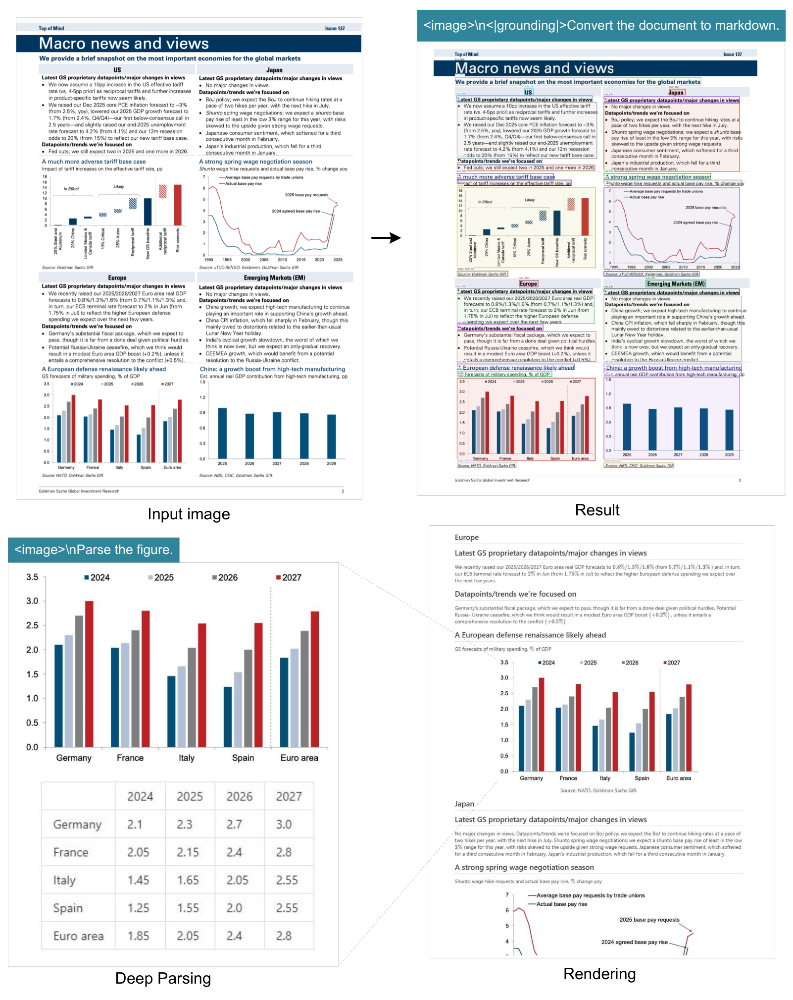

**EN.** Figure 7 : In the field of financial research reports, the deep parsing mode of DeepSeek-OCR can be used to obtain structured results of charts within documents. Charts are a crucial form of data representation in finance and scientific fields, and the chart structured extraction is an indispensable capability for future OCR models.

**中.** 图7：在金融研究报告领域，可以利用DeepSeek-OCR的深度解析模式获得文档内图表的结构化结果。图表是金融和科学领域重要的数据表示形式，图表结构化提取是未来OCR模型不可或缺的能力。

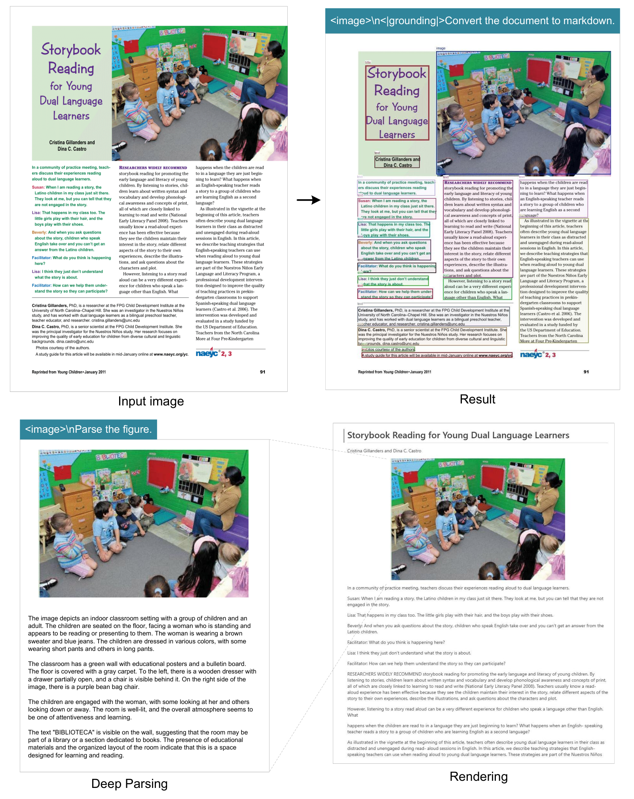

**EN.** Figure 8 : For books and articles, the deep parsing mode can output dense captions for natural images in the documents. With just a prompt, the model can automatically identify what type of image it is and output the required results.

**中.** 图8：对于书籍和文章，深度解析模式可以为文档中的自然图像输出密集的标题。只需提示，模型即可自动识别图像类型并输出所需结果。

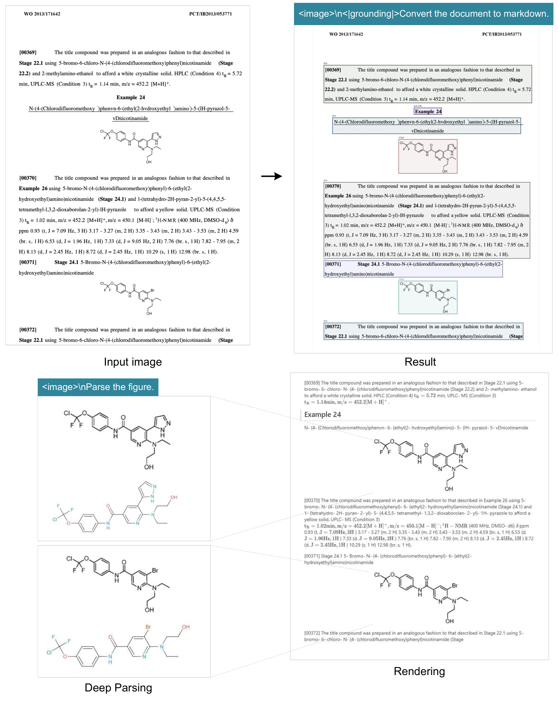

**EN.** Figure 9 : DeepSeek-OCR in deep parsing mode can also recognize chemical formulas within chemical documents and convert them to SMILES format. In the future, OCR 1.0+2.0 technology may play a significant role in the development of VLM/LLM in STEM fields.

**中.** 图 9：深度解析模式下的 DeepSeek-OCR 还可以识别化学文档中的化学式并将其转换为 SMILES 格式。未来，OCR 1.0+2.0技术可能会在STEM领域VLM/LLM的发展中发挥重要作用。

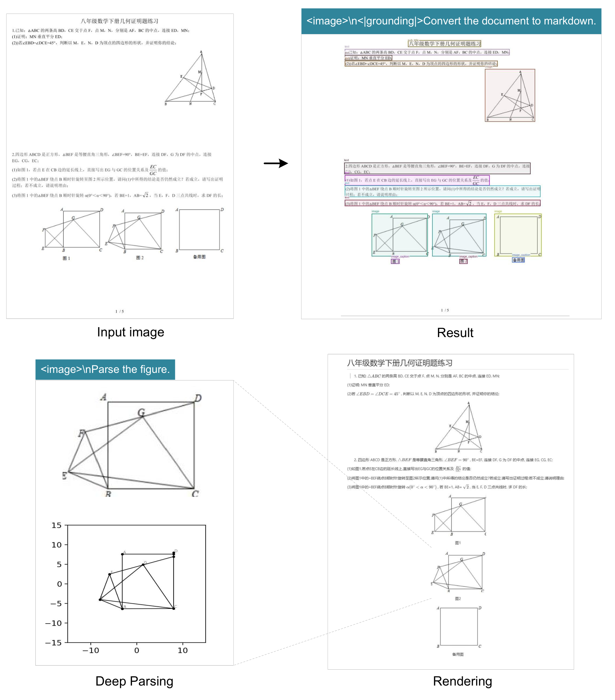

**EN.** Figure 10 : DeepSeek-OCR also possesses the capability to copy (structure) simple planar geometric figures. Due to the intricate interdependencies among line segments in geometric shapes, parsing geometry task is extremely challenging and has a long way to go.

**中.** 图 10：DeepSeek-OCR 还具有复制（构造）简单平面几何图形的能力。由于几何形状中线段之间错综复杂的相互依赖关系，解析几何任务极具挑战性，并且还有很长的路要走。

#### Multilingual recognition / 多语言识别

**EN.** PDF data on the Internet contains not only Chinese and English, but also a large amount of multilingual data, which is also crucial when training LLMs. For PDF documents, DeepSeek-OCR can handle nearly 100 languages. Like Chinese and English documents, multilingual data also supports both layout and non-layout OCR formats. The visualization results are shown in Figure 11 , where we select Arabic and Sinhala languages to demonstrate results.

**中.** 互联网上的PDF数据不仅包含中文和英文，还包含大量的多语言数据，这在培养LLM时也至关重要。对于 PDF 文档，DeepSeek-OCR 可以处理近 100 种语言。与中文和英文文档一样，多语言数据也支持布局和非布局 OCR 格式。可视化结果如图11所示，其中我们选择阿拉伯语和僧伽罗语来演示结果。

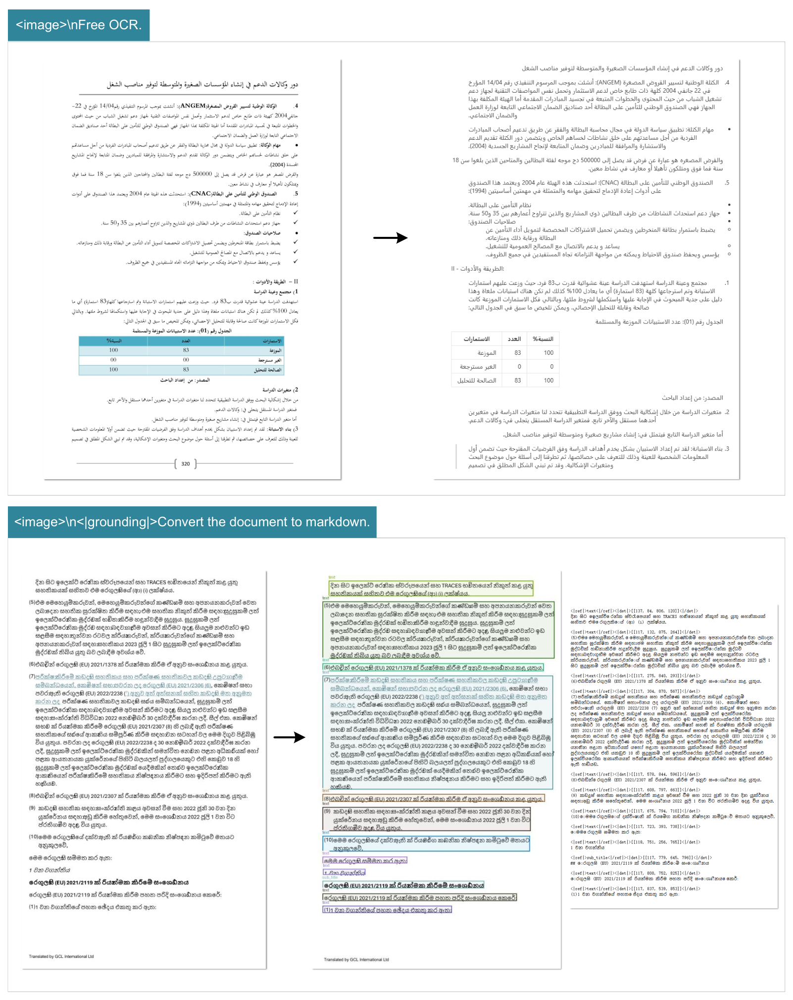

**EN.** Figure 11 : To endow the capability of processing widely crawled PDFs (multilingual data), we train our model with OCR capabilities for nearly 100 languages. Minority language documents can also support both layout and non-layout outputs through different prompts.

**中.** 图 11：为了赋予处理广泛爬取的 PDF（多语言数据）的能力，我们使用近 100 种语言的 OCR 功能来训练我们的模型。小语种文档还可以通过不同的提示支持布局和非布局输出。

#### General vision understanding / 一般视觉理解

**EN.** We also provide DeepSeek-OCR with a certain degree of general image understanding capabilities. The related visualization results are shown in Figure 12 .

**中.** 我们还为 DeepSeek-OCR 提供一定程度的通用图像理解能力。相关可视化结果如图12所示。

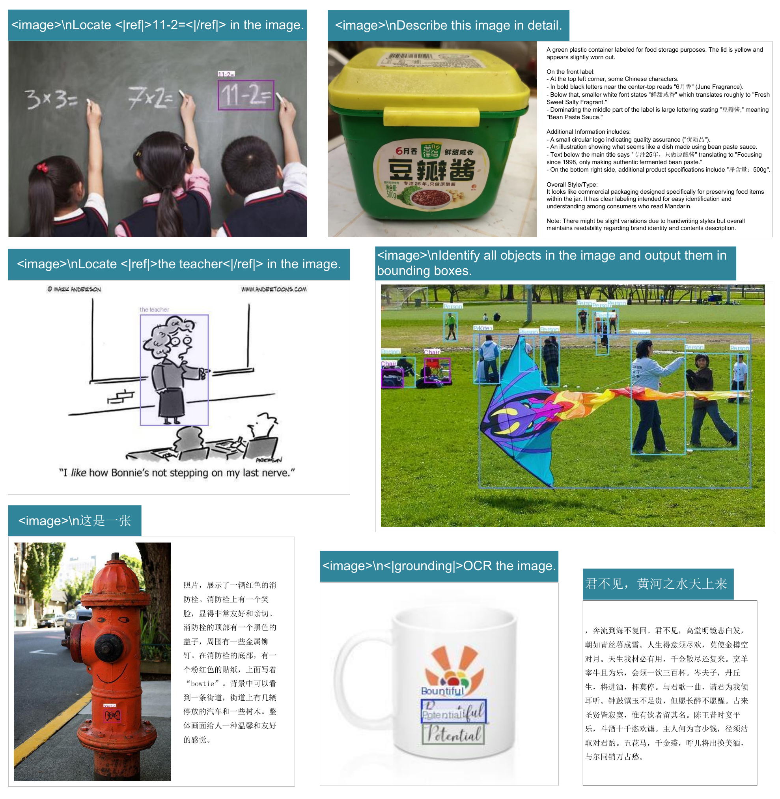

**EN.** Figure 12 : We retain DeepSeek-OCR’s capabilities in general visual understanding, mainly including image description, object detection, grounding, etc. Meanwhile, due to the inclusion of text-only data, DeepSeek-OCR’s language capabilities are also retained. Note that since we do not include SFT (Supervised Fine-Tuning) stage, the model is not a chatbot, and some capabilities need completion prompts to be activated.

**中.** 图12：我们保留了DeepSeek-OCR在一般视觉理解方面的能力，主要包括图像描述、物体检测、接地等。同时，由于包含纯文本数据，DeepSeek-OCR的语言能力也被保留。请注意，由于我们不包括 SFT（监督微调）阶段，因此该模型不是聊天机器人，并且某些功能需要完成提示才能激活。

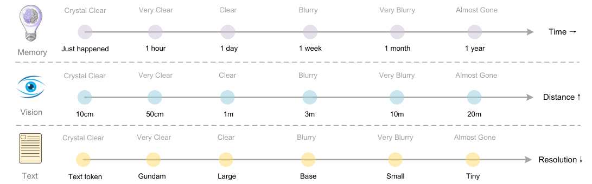

**EN.** Figure 13 : Forgetting mechanisms constitute one of the most fundamental characteristics of human memory. The contexts optical compression approach can simulate this mechanism by rendering previous rounds of historical text onto images for initial compression, then progressively resizing older images to achieve multi-level compression, where token counts gradually decrease and text becomes increasingly blurred, thereby accomplishing textual forgetting.

**中.** 图 13：遗忘机制构成人类记忆最基本的特征之一。上下文光学压缩方法可以模拟这种机制，将前几轮历史文本渲染到图像上进行初始压缩，然后逐步调整旧图像的大小以实现多级压缩，其中标记数逐渐减少，文本变得越来越模糊，从而实现文本遗忘。

## Discussion / 讨论

**EN.** Our work represents an initial exploration into the boundaries of vision-text compression, investigating how many vision tokens are required to decode $N$ text tokens. The preliminary results are encouraging: DeepSeek-OCR achieves near-lossless OCR compression at approximately 10 $\times$ ratios, while 20 $\times$ compression still retains 60% accuracy. These findings suggest promising directions for future applications, such as implementing optical processing for dialogue histories beyond $k$ rounds in multi-turn conversations to achieve 10 $\times$ compression efficiency.

**中.** 我们的工作代表了对视觉文本压缩边界的初步探索，研究了解码 $N$ 文本标记需要多少视觉标记。初步结果令人鼓舞：DeepSeek-OCR 在大约 10 $\times$ 比率下实现了近乎无损的 OCR 压缩，而 20 $\times$ 压缩仍保留 60% 的准确度。这些发现为未来的应用提出了有希望的方向，例如对多轮对话中超过 $k$ 轮的对话历史实施光学处理，以实现 10 $\times$ 的压缩效率。

**EN.** For older contexts, we could progressively downsizing the rendered images to further reduce token consumption. This assumption draws inspiration from the natural parallel between human memory decay over time and visual perception degradation over spatial distance—both exhibit similar patterns of progressive information loss, as shown in Figure 13 . By combining these mechanisms, contexts optical compression method enables a form of memory decay that mirrors biological forgetting curves, where recent information maintains high fidelity while distant memories naturally fade through increased compression ratios.

**中.** 对于较旧的上下文，我们可以逐步缩小渲染图像的大小，以进一步减少令牌消耗。这一假设的灵感来自于人类记忆随时间的衰减和视觉感知随空间距离的衰减之间的自然相似性——两者都表现出相似的渐进信息丢失模式，如图 13 所示。通过结合这些机制，上下文光学压缩方法可以实现一种反映生物遗忘曲线的记忆衰减形式，其中最近的信息保持高保真度，而遥远的记忆通过增加压缩比自然消失。

**EN.** While our initial exploration shows potential for scalable ultra-long context processing, where recent contexts preserve high resolution and older contexts consume fewer resources, we acknowledge this is early-stage work that requires further investigation. The approach suggests a path toward theoretically unlimited context architectures that balance information retention with computational constraints, though the practical implications and limitations of such vision-text compression systems warrant deeper study in future research.

**中.** 虽然我们的初步探索显示了可扩展的超长上下文处理的潜力，其中最近的上下文保留了高分辨率，而旧的上下文消耗了更少的资源，但我们承认这是需要进一步研究的早期工作。该方法提出了一条通往理论上无限的上下文架构的道路，该架构可以平衡信息保留与计算约束，尽管这种视觉文本压缩系统的实际含义和局限性值得在未来的研究中进行更深入的研究。

## Conclusion / 结论

**EN.** In this technical report, we propose DeepSeek-OCR and preliminarily validate the feasibility of contexts optical compression through this model, demonstrating that the model can effectively decode text tokens exceeding 10 times the quantity from a small number of vision tokens. We believe this finding will facilitate the development of VLMs and LLMs in the future. Additionally, DeepSeek-OCR is a highly practical model capable of large-scale pretraining data production, serving as an indispensable assistant for LLMs. Of course, OCR alone is insufficient to fully validate true context optical compression and we will conduct digital-optical text interleaved pretraining, needle-in-a-haystack testing, and other evaluations in the future. From another perspective, optical contexts compression still offers substantial room for research and improvement, representing a promising new direction.

**中.** 在本技术报告中，我们提出了DeepSeek-OCR，并通过该模型初步验证了上下文光学压缩的可行性，证明该模型可以有效地从少量视觉令牌中解码超过10倍数量的文本令牌。我们相信这一发现将促进VLM和LLM未来的发展。此外，DeepSeek-OCR是一个实用性很强的模型，能够大规模生产预训练数据，是LLM不可或缺的助手。当然，仅靠 OCR 不足以完全验证真实上下文光学压缩，未来我们将进行数字光学文本交错预训练、大海捞针测试和其他评估。从另一个角度来看，光学上下文压缩仍然具有很大的研究和改进空间，代表着一个有前途的新方向。

## References / 参考文献

- [1] Marker. URL [https://github.com/datalab-to/marker](https://github.com/datalab-to/marker) .

- [2] Mathpix. URL [https://mathpix.com/](https://mathpix.com/) .

- [3] Ocrflux, 2025. URL [https://github.com/chatdoc-com/OCRFlux](https://github.com/chatdoc-com/OCRFlux) .

- [4] G. AI. Gemini 2.5-pro, 2025. URL [https://gemini.google.com/](https://gemini.google.com/) .

- [5] S. Bai, K. Chen, X. Liu, J. Wang, W. Ge, S. Song, K. Dang, P. Wang, S. Wang, J. Tang, H. Zhong, Y. Zhu, M. Yang, Z. Li, J. Wan, P. Wang, W. Ding, Z. Fu, Y. Xu, J. Ye, X. Zhang, T. Xie, Z. Cheng, H. Zhang, Z. Yang, H. Xu, and J. Lin. Qwen2.5-vl technical report. arXiv preprint arXiv:2502.13923 , 2025.

- [6] L. Blecher, G. Cucurull, T. Scialom, and R. Stojnic. Nougat: Neural optical understanding for academic documents. arXiv preprint arXiv:2308.13418 , 2023.

- [7] J. Chen, L. Kong, H. Wei, C. Liu, Z. Ge, L. Zhao, J. Sun, C. Han, and X. Zhang. Onechart: Purify the chart structural extraction via one auxiliary token. In Proceedings of the 32nd ACM International Conference on Multimedia , pages 147–155, 2024a.

- [8] Z. Chen, W. Wang, H. Tian, S. Ye, Z. Gao, E. Cui, W. Tong, K. Hu, J. Luo, Z. Ma, et al. How far are we to gpt-4v? closing the gap to commercial multimodal models with open-source suites. arXiv preprint arXiv:2404.16821 , 2024b.

- [9] C. Cui, T. Sun, M. Lin, T. Gao, Y. Zhang, J. Liu, X. Wang, Z. Zhang, C. Zhou, H. Liu, et al. Paddleocr 3.0 technical report. arXiv preprint arXiv:2507.05595 , 2025.

- [10] M. Dehghani, J. Djolonga, B. Mustafa, P. Padlewski, J. Heek, J. Gilmer, A. Steiner, M. Caron, R. Geirhos, I. Alabdulmohsin, et al. Patch n’ pack: Navit, a vision transformer for any aspect ratio and resolution. Advances in Neural Information Processing Systems , 36:3632–3656, 2023.

- [11] H. Feng, S. Wei, X. Fei, W. Shi, Y. Han, L. Liao, J. Lu, B. Wu, Q. Liu, C. Lin, et al. Dolphin: Document image parsing via heterogeneous anchor prompting. arXiv preprint arXiv:2505.14059 , 2025.

- [12] Y. Goyal, T. Khot, D. Summers-Stay, D. Batra, and D. Parikh. Making the v in vqa matter: Elevating the role of image understanding in visual question answering. In Proceedings of the IEEE conference on computer vision and pattern recognition , pages 6904–6913, 2017.

- [13] J. Gu, X. Meng, G. Lu, L. Hou, N. Minzhe, X. Liang, L. Yao, R. Huang, W. Zhang, X. Jiang, et al. Wukong: A 100 million large-scale chinese cross-modal pre-training benchmark. Advances in Neural Information Processing Systems , 35:26418–26431, 2022.

- [14] High-flyer. HAI-LLM: Efficient and lightweight training tool for large models, 2023. URL [https://www.high-flyer.cn/en/blog/hai-llm](https://www.high-flyer.cn/en/blog/hai-llm) .

- [15] S. Iyer, X. V. Lin, R. Pasunuru, T. Mihaylov, D. Simig, P. Yu, K. Shuster, T. Wang, Q. Liu, P. S. Koura, et al. Opt-iml: Scaling language model instruction meta learning through the lens of generalization. arXiv preprint arXiv:2212.12017 , 2022.

- [16] S. Kazemzadeh, V. Ordonez, M. Matten, and T. Berg. Referitgame: Referring to objects in photographs of natural scenes. In Proceedings of the 2014 conference on empirical methods in natural language processing (EMNLP) , pages 787–798, 2014.

- [17] A. Kirillov, E. Mintun, N. Ravi, H. Mao, C. Rolland, L. Gustafson, T. Xiao, S. Whitehead, A. C. Berg, W.-Y. Lo, et al. Segment anything. arXiv preprint arXiv:2304.02643 , 2023.

- [18] Z. Li, Y. Liu, Q. Liu, Z. Ma, Z. Zhang, S. Zhang, Z. Guo, J. Zhang, X. Wang, and X. Bai. Monkeyocr: Document parsing with a structure-recognition-relation triplet paradigm. arXiv preprint arXiv:2506.05218 , 2025.

- [19] A. Liu, B. Feng, B. Wang, B. Wang, B. Liu, C. Zhao, C. Dengr, C. Ruan, D. Dai, D. Guo, et al. Deepseek-v2: A strong, economical, and efficient mixture-of-experts language model. arXiv preprint arXiv:2405.04434 , 2024a.

- [20] A. Liu, B. Feng, B. Xue, B. Wang, B. Wu, C. Lu, C. Zhao, C. Deng, C. Zhang, C. Ruan, et al. Deepseek-v3 technical report. arXiv preprint arXiv:2412.19437 , 2024b.

- [21] C. Liu, H. Wei, J. Chen, L. Kong, Z. Ge, Z. Zhu, L. Zhao, J. Sun, C. Han, and X. Zhang. Focus anywhere for fine-grained multi-page document understanding. arXiv preprint arXiv:2405.14295 , 2024c.

- [22] I. Loshchilov and F. Hutter. Sgdr: Stochastic gradient descent with warm restarts. arXiv preprint arXiv:1608.03983 , 2016.

- [23] I. Loshchilov and F. Hutter. Decoupled weight decay regularization. In ICLR , 2019.

- [24] A. Masry, D. X. Long, J. Q. Tan, S. Joty, and E. Hoque. Chartqa: A benchmark for question answering about charts with visual and logical reasoning. arXiv preprint arXiv:2203.10244 , 2022.

- [25] A. Nassar, A. Marafioti, M. Omenetti, M. Lysak, N. Livathinos, C. Auer, L. Morin, R. T. de Lima, Y. Kim, A. S. Gurbuz, et al. Smoldocling: An ultra-compact vision-language model for end-to-end multi-modal document conversion. arXiv preprint arXiv:2503.11576 , 2025.

- [26] OpenAI. Gpt-4 technical report, 2023.

- [27] L. Ouyang, Y. Qu, H. Zhou, J. Zhu, R. Zhang, Q. Lin, B. Wang, Z. Zhao, M. Jiang, X. Zhao, et al. Omnidocbench: Benchmarking diverse pdf document parsing with comprehensive annotations. In Proceedings of the Computer Vision and Pattern Recognition Conference , pages 24838–24848, 2025.

- [28] J. Poznanski, A. Rangapur, J. Borchardt, J. Dunkelberger, R. Huff, D. Lin, C. Wilhelm, K. Lo, and L. Soldaini. olmocr: Unlocking trillions of tokens in pdfs with vision language models. arXiv preprint arXiv:2502.18443 , 2025.

- [29] A. Radford, J. W. Kim, C. Hallacy, A. Ramesh, G. Goh, S. Agarwal, G. Sastry, A. Askell, P. Mishkin, J. Clark, et al. Learning transferable visual models from natural language supervision. In International conference on machine learning , pages 8748–8763. PMLR, 2021.

- [30] Rednote. dots.ocr, 2025. URL [https://github.com/rednote-hilab/dots.ocr](https://github.com/rednote-hilab/dots.ocr) .

- [31] C. Schuhmann, R. Vencu, R. Beaumont, R. Kaczmarczyk, C. Mullis, A. Katta, T. Coombes, J. Jitsev, and A. Komatsuzaki. Laion-400m: Open dataset of clip-filtered 400 million image-text pairs. arXiv preprint arXiv:2111.02114 , 2021.

- [32] A. Singh, V. Natarajan, M. Shah, Y. Jiang, X. Chen, D. Batra, D. Parikh, and M. Rohrbach. Towards vqa models that can read. In Proceedings of the IEEE/CVF conference on computer vision and pattern recognition , pages 8317–8326, 2019.

- [33] T. Sun, C. Cui, Y. Du, and Y. Liu. Pp-doclayout: A unified document layout detection model to accelerate large-scale data construction. arXiv preprint arXiv:2503.17213 , 2025.

- [34] B. Wang, C. Xu, X. Zhao, L. Ouyang, F. Wu, Z. Zhao, R. Xu, K. Liu, Y. Qu, F. Shang, et al. Mineru: An open-source solution for precise document content extraction. arXiv preprint arXiv:2409.18839 , 2024a.

- [35] P. Wang, S. Bai, S. Tan, S. Wang, Z. Fan, J. Bai, K. Chen, X. Liu, J. Wang, W. Ge, et al. Qwen2-vl: Enhancing vision-language model’s perception of the world at any resolution. arXiv preprint arXiv:2409.12191 , 2024b.

- [36] H. Wei, L. Kong, J. Chen, L. Zhao, Z. Ge, J. Yang, J. Sun, C. Han, and X. Zhang. Vary: Scaling up the vision vocabulary for large vision-language model. In European Conference on Computer Vision , pages 408–424. Springer, 2024a.

- [37] H. Wei, L. Kong, J. Chen, L. Zhao, Z. Ge, E. Yu, J. Sun, C. Han, and X. Zhang. Small language model meets with reinforced vision vocabulary. arXiv preprint arXiv:2401.12503 , 2024b.

- [38] H. Wei, C. Liu, J. Chen, J. Wang, L. Kong, Y. Xu, Z. Ge, L. Zhao, J. Sun, Y. Peng, et al. General ocr theory: Towards ocr-2.0 via a unified end-to-end model. arXiv preprint arXiv:2409.01704 , 2024c.

- [39] H. Wei, Y. Yin, Y. Li, J. Wang, L. Zhao, J. Sun, Z. Ge, X. Zhang, and D. Jiang. Slow perception: Let’s perceive geometric figures step-by-step. arXiv preprint arXiv:2412.20631 , 2024d.

- [40] Z. Wu, X. Chen, Z. Pan, X. Liu, W. Liu, D. Dai, H. Gao, Y. Ma, C. Wu, B. Wang, et al. Deepseek-vl2: Mixture-of-experts vision-language models for advanced multimodal understanding. arXiv preprint arXiv:2412.10302 , 2024.

- [41] W. Yu, Z. Yang, L. Li, J. Wang, K. Lin, Z. Liu, X. Wang, and L. Wang. Mm-vet: Evaluating large multimodal models for integrated capabilities. arXiv preprint arXiv:2308.02490 , 2023.

- [42] J. Zhu, W. Wang, Z. Chen, Z. Liu, S. Ye, L. Gu, H. Tian, Y. Duan, W. Su, J. Shao, et al. Internvl3: Exploring advanced training and test-time recipes for open-source multimodal models. arXiv preprint arXiv:2504.10479 , 2025.
