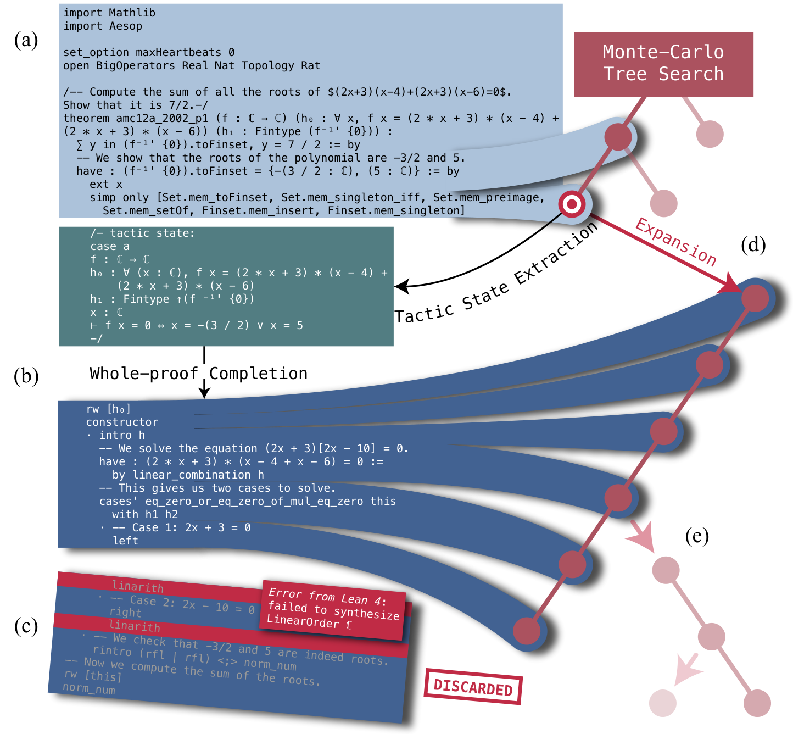

# DeepSeek-Prover-V1.5：补充解读

> 训练奖励和搜索探索奖励为什么要分开理解？以下为直觉解释与应用延伸，论文内容见 [精炼主笔记](DeepSeek-Prover-V1.5详解.md)。

## 为什么要同时保留整段生成和逐步搜索

每生成一个 tactic 都请求模型与 Lean，容易被通信和调度开销拖慢；一次写完又容易在早期犯错后浪费后面的 token。截断续写取两者折中：模型仍能整段发挥，检验器把其中确实成立的前缀保存下来。

图中的关键资产是已验证前缀。若在普通代码任务中借鉴，可以把可独立运行的子步骤视为检查点，但不要把“代码运行了”误当作“需求已经实现”。

## RMaxTS 的探索奖励与训练奖励不是同一个东西

GRPO 训练时的奖励来自整份证明是否被 Lean 接受；搜索时的内在奖励用于鼓励访问新状态。一个指导参数学习，一个指导本题的计算分配。新状态可以非常偏僻甚至毫无帮助，所以仍然需要最终严格检验。

## 先算清单位成本再比较方法

pass@128 与 32×6400 的最高成绩相差很大，也对应完全不同的 token 和 CPU 预算。实践中至少同时记录成功率、平均生成 token、Lean 调用数、墙钟时延与尾部超时比例。对低时延系统，更好的 SFT/RL 模型可能比更复杂的搜索更划算。

## 用一个具体场景串起来

完整proof正确给1，是训练策略要优化的最终目标；搜索时发现新tactic状态给1，是让搜索继续探索的启发。若把“新状态”直接当证明正确，模型可以不停制造新目标而永不完成。

truncate-and-resume的价值类似保存可验证的中间检查点：第五步错误，不必丢掉前四步。它不需要假定自然语言思考都正确，只保留Lean实际接受的前缀，再让模型从真实状态续写。
