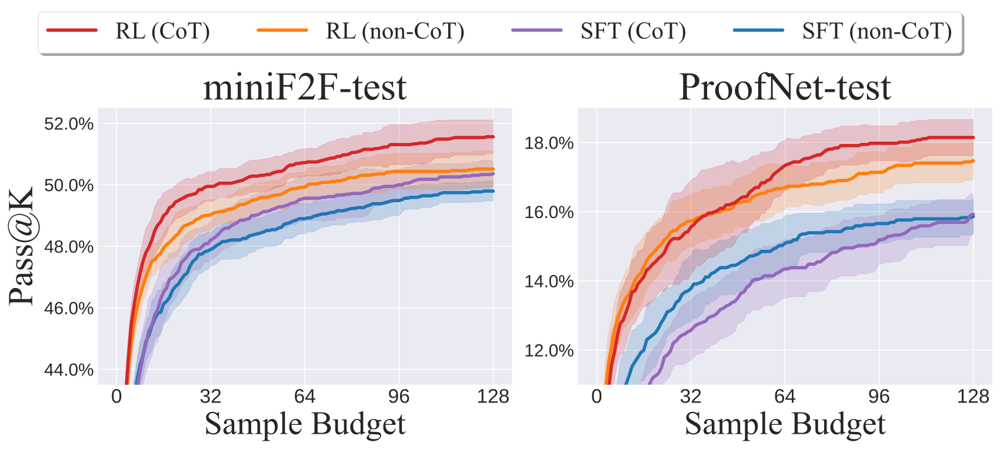
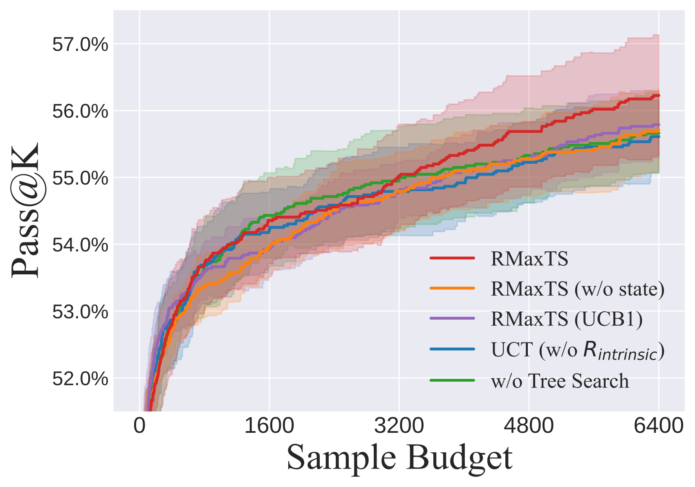

# DeepSeek-Prover-V1.5：证明助手反馈、推理注释与探索式树搜索

> 💡 Prover-V1.5 用 Lean 验证结果做 GRPO 强化学习，并把完整证明拆成可恢复的 tactic 状态树，以发现新状态的内在奖励驱动搜索。
>
> [论文](https://arxiv.org/abs/2408.08152) · [官方仓库](https://github.com/deepseek-ai/DeepSeek-Prover-V1.5) · [补充解读](DeepSeek-Prover-V1.5解读.md)

初代 Prover 依靠大规模合成数据和反复生成完整证明，但错误发生后，前面已经正确的步骤往往也被丢弃。V1.5 围绕这个问题改进训练与推理两侧：训练时加入自然语言解释、Lean 中间状态和验证反馈；推理时保留有效证明前缀，通过 truncate-and-resume 继续搜索。论文还针对“只有完整证明才有奖励”的稀疏反馈，设计 RMaxTS，让发现新的 tactic 状态也能获得搜索奖励。7B 模型因此从独立整篇采样进一步发展为与证明助手交互的系统，在 miniF2F 与本科数学 ProofNet 上同时验证训练和搜索收益。

## 继续预训练与带思考的证明数据

基础模型继续学习代码、自然语言数学，以及 Lean、Isabelle、Metamath 等形式语言。SFT 语料来自 Mathlib4、初代合成定理、Lean Workbook，并使用 miniF2F/ProofNet 的 validation 数据；test 集用于最终比较。

生成—验证—再训练的 expert iteration 得到更多正确 proof，再由 Coder-V2 236B 在证明开头插入整体思路、在 tactic 前插入局部说明，累计约 964.5 万序列。自然语言思考写成 Lean 注释，因此可以与代码交错，又不改变 proof 的形式语义。

训练同时保留 CoT 与 non-CoT 两类提示。这里的推理注释是构造出的监督，不应与 R1-Zero 的无推理 SFT 实验混同。

## 中间状态监督与恢复能力

修改 Lean REPL，并结合 LeanDojo 工具，提取每个 tactic 的位置、执行前状态和执行后状态。把状态写成 `/- tactic state: ... -/` 注释，让模型学习从给定的有效前缀及状态继续生成。

SFT 训练约 9B token，batch 2048、上下文 4096、学习率 $10^{-4}$、预热 100 步，样本随机拼接。对于带状态的训练样本，状态标记前的内容作为提示，后续内容承担监督。这为后面的树节点恢复建立了分布一致的接口。

## 用严格验证反馈做 RL

从 SFT 证明成功率适中的题目中选约 4.5k 条命题，分别加 CoT/non-CoT 提示。太容易会让候选组全对，太难会全错；中间难度更容易在同组中形成可用于 GRPO 的奖励差异。

每个完整 proof 经 Lean 验证，成功奖励 1，失败 0。不需要学习型 RM，也没有把新状态探索奖励混入这里的训练正确性奖励。

RL 使用 GRPO，同题采样 32 条，最大 2048 token，batch 512，恒定学习率 $5\times10^{-6}$、KL 系数 0.02，以 SFT 为初始及参考模型。组内相对优势省掉 critic，严格反馈减少了主观打分误差，但正奖励仍然稀疏。

曲线显示 SFT 明显优于 Base，RL 在较小和较大采样预算上都继续改善。作者据此认为此处收益不仅是把少数正确答案重新排到前面；不过这是该任务下的实证结论，不等于所有 RL 都必然扩展能力边界。

## Truncate-and-resume：把整篇输出变成状态树

一次仍然生成整段后续 proof，再交给 Lean 执行。出现第一处错误时，保留错误前的全部有效 tactic，把它们依次变成树上的状态迁移；错误之后的内容丢弃。若整篇完成则成功终止。

树节点由 tactic state 表示，不同代码可以到达同一状态，节点保存这些等价前缀。再次扩展时，从中随机选取一个前缀，附上真实 Lean 状态，让模型继续生成。这既复用正确前缀，又减少对同一状态的重复探索。

与标准一步扩展的 MCTS 不同，一次完整生成可能插入一整条有效路径。节点还包含“继续扩展当前节点”的虚拟动作，使非叶节点也能不断尝试新 tactic。

## RMaxTS：探索新状态，而非猜测证明有多接近成功

完整证明成功前，外部奖励几乎全为零。RMaxTS 给新增状态的 rollout 一个内在奖励：

$$
R_{\rm intrinsic}(\tau)=\mathbb1[\text{此次扩展至少插入一个此前未见的状态}].
$$

搜索因此偏向能产生多样有效状态的分支，而不是重复生成语法不同、结果状态相同的代码。这里不需要另训“离证明成功还有多远”的价值模型。

状态越探索越难发现新节点，奖励分布会变化，所以使用折扣 UCB：

$$
Q_{\rm DUCB}(s,a)=\frac{W_\gamma(s,a)}{N_\gamma(s,a)}+\sqrt{\frac{2\log\sum_{a'}N_\gamma(s,a')}{N_\gamma(s,a)}},
$$

其中 $W_\gamma=\sum_t\gamma^{N-t}R(\tau_t)$，$N_\gamma=\sum_{t=0}^{N-1}\gamma^t$，$\gamma=0.99$。折扣针对历史搜索反馈的新旧程度，不是对同一条 proof 中未来步骤的回报折扣。

并行采用每节点 256 个 MCTS runners、每树 32 个线程，GPU 批量生成，CPU Lean 异步验证；在途任务暂时回传零作为 virtual loss，减少线程都选同一分支。

## 评测设置与主结果

miniF2F 有 244 valid、244 test；ProofNet 为 185 valid、186 test，采用 Lean 4.9.0。单模型 A100-40G、vLLM，temperature 1、top-p 0.95、输出上限 2048，Lean 验证最长 300 秒，并导入 Mathlib4/Aesop。

| Method | Sample budget | miniF2F-test |
| --- | --- | --- |
| TheoremLlama [ 49 ] | 128 | $33.6\%$ |
| DeepSeek-Prover-V1 [ 53 ] | $128$ | $46.1\%\pm 0.5\%$ |
| DeepSeek-Prover-V1 [ 53 ] | $16\times 4096$ | $50.0\%$ |
| DeepSeek-Prover-V1.5-Base | 128 | $29.7\%\pm 0.5\%$ |
| DeepSeek-Prover-V1.5-Base | 3200 | $39.2\%$ |
| DeepSeek-Prover-V1.5-Base | 6400 | $42.2\%$ |
| DeepSeek-Prover-V1.5-SFT | 32 | $48.2\%\pm 0.6\%$ |
| DeepSeek-Prover-V1.5-SFT | 64 | $49.6\%\pm 0.7\%$ |
| DeepSeek-Prover-V1.5-SFT | $128$ | $50.4\%\pm 0.4\%$ |
| DeepSeek-Prover-V1.5-SFT | $3200$ | $53.3\%\pm 0.5\%$ |
| DeepSeek-Prover-V1.5-SFT | $4\times 6400$ | $55.8\%\pm 0.7\%$ |
| DeepSeek-Prover-V1.5-SFT | $16\times 6400$ | $57.4\%$ |
| DeepSeek-Prover-V1.5-RL | 32 | $50.0\%\pm 0.5\%$ |
| DeepSeek-Prover-V1.5-RL | 64 | $50.7\%\pm 0.4\%$ |
| DeepSeek-Prover-V1.5-RL | $128$ | $51.6\%\pm 0.5\%$ |
| DeepSeek-Prover-V1.5-RL | $3200$ | $54.9\%\pm 0.7\%$ |
| DeepSeek-Prover-V1.5-RL | $4\times 6400$ | $58.4\%\pm 0.6\%$ |
| DeepSeek-Prover-V1.5-RL | $16\times 6400$ | $\mathbf{60.2\%}$ |
| COPRA (Code Llama) [ 45 ] | $1\times 500$ | $5.7\%$ |
| COPRA (GPT-3.5) [ 45 ] | $1\times 60$ | $9.0\%$ |
| COPRA (GPT-4) [ 45 ] | $1\times 60$ | $26.6\%$ |
| Llemma-7B [ 5 ] | $1\times 32\times 100$ | $26.2\%$ |
| Llemma-34B [ 5 ] | $1\times 32\times 100$ | $25.8\%$ |
| ReProver [ 55 ] | - | $26.5\%$ |
| LLMStep [ 51 ] | $1\times 32\times 100$ | $27.9\%$ |
| GPT-f [ 35 ] | $64\times 8\times 512$ | $36.6\%$ |
| Hypertree Proof Search [ 23 ] | $64\times 5000$ | $41.0\%$ |
| Lean-STaR [ 26 ] | $64\times 1\times 50$ | $46.3\%$ |
| InternLM2-Math-7B [ 58 ] | $1\times 32\times 100$ | $30.3\%$ |
| InternLM2-Math-Plus-7B [ 58 ] | $1\times 32\times 100$ | $43.4\%$ |
| InternLM2-StepProver [ 52 ] | $1\times 32\times 100$ | $48.8\%$ |
| InternLM2-StepProver [ 52 ] | $64\times 32\times 100$ | $54.5\%$ |
| DeepSeek-Prover-V1.5-SFT + RMaxTS | $1\times 3200$ | $53.5\%\pm 0.4\%$ |
| DeepSeek-Prover-V1.5-SFT + RMaxTS | $4\times 6400$ | $56.3\%\pm 0.3\%$ |
| DeepSeek-Prover-V1.5-SFT + RMaxTS | $16\times 6400$ | $59.0\%$ |
| DeepSeek-Prover-V1.5-SFT + RMaxTS | $32\times 6400^{\dagger}$ | $60.2\%$ |
| DeepSeek-Prover-V1.5-RL + RMaxTS | $1\times 3200$ | $55.0\%\pm 0.7\%$ |
| DeepSeek-Prover-V1.5-RL + RMaxTS | $4\times 6400$ | $59.6\%\pm 0.6\%$ |
| DeepSeek-Prover-V1.5-RL + RMaxTS | $16\times 6400$ | $\mathbf{62.7\%}$ |
| DeepSeek-Prover-V1.5-RL + RMaxTS | $32\times 6400^{\dagger}$ | $\mathbf{63.5\%}$ |

表中同时列整篇独立采样和树搜索，预算必须随成绩一起读。V1.5 的 RL 整篇生成在相应 pass@128 设置达到约 51.6%；RMaxTS 进一步提升 miniF2F-test 到 63.5%。后者含搜索计算，不能称为模型单次正确率。

| Method | Sample budget | ProofNet | ProofNet | ProofNet |
| --- | --- | --- | --- | --- |
| Method | Sample budget | valid ‡ | test | all |
| Single-pass Whole-Proof Generation Methods | Single-pass Whole-Proof Generation Methods | Single-pass Whole-Proof Generation Methods | Single-pass Whole-Proof Generation Methods |  |
| DeepSeek-Prover-V1.5-Base | $128$ | $6.6\%\pm 0.9\%$ | $9.7\%\pm 0.7\%$ | $7.5\%\pm 0.7\%$ |
| DeepSeek-Prover-V1.5-Base | $3200$ | $10.8\%$ | $15.6\%$ | $13.2\%$ |
| DeepSeek-Prover-V1.5-SFT | $128$ | $19.9\%\pm 0.4\%$ | $15.9\%\pm 0.6\%$ | $17.9\%\pm 0.3\%$ |
| DeepSeek-Prover-V1.5-SFT | $3200$ | $20.7\%\pm 0.7\%$ | $21.0\%\pm 0.9\%$ | $20.9\%\pm 0.6\%$ |
| DeepSeek-Prover-V1.5-SFT | $4\times 6400$ | $22.2\%$ | $23.7\%$ | $22.9\%$ |
| DeepSeek-Prover-V1.5-RL | $128$ | $20.1\%\pm 0.5\%$ | $18.2\%\pm 0.5\%$ | $19.1\%\pm 0.4\%$ |
| DeepSeek-Prover-V1.5-RL | $3200$ | $21.4\%\pm 0.3\%$ | $22.0\%\pm 0.5\%$ | $21.7\%\pm 0.4\%$ |
| DeepSeek-Prover-V1.5-RL | $4\times 6400$ | $21.6\%$ | $23.7\%$ | $22.6\%$ |
| Tree Search Methods | Tree Search Methods | Tree Search Methods | Tree Search Methods |  |
| ReProver [ 55 ] | - | - | - | $13.8\%$ |
| InternLM2-StepProver [ 52 ] | $1\times 32\times 100$ | - | - | $18.1\%$ |
| DeepSeek-Prover-V1.5-SFT + RMaxTS | $1\times 3200$ | $22.2\%\pm 0.7\%$ | $21.6\%\pm 0.2\%$ | $21.9\%\pm 0.4\%$ |
| DeepSeek-Prover-V1.5-SFT + RMaxTS | $4\times 6400$ | $23.8\%$ | 25.8% | $24.8\%$ |
| DeepSeek-Prover-V1.5-RL + RMaxTS | $1\times 3200$ | $22.0\%\pm 0.3\%$ | $21.5\%\pm 0.8\%$ | $21.8\%\pm 0.4\%$ |
| DeepSeek-Prover-V1.5-RL + RMaxTS | $4\times 6400$ | $25.4\%$ | 25.3% | $25.3\%$ |

ProofNet 面向本科实分析、复分析、代数和拓扑，明显更难；RL 整篇生成约 18.2%，搜索后 test 达 25.3%。跨基准百分数不是相同难度上的直接比较。

## 消融与方法边界

|  | Prompt mode | Sample budget | DeepSeek-Prover-V1.5 | DeepSeek-Prover-V1.5 |
| --- | --- | --- | --- | --- |
|  | Prompt mode | Sample budget | SFT | RL |
|  | non-CoT | $4\times 6400$ | $54.7\%\pm 0.4\%$ | $56.5\%\pm 0.5\%$ |
|  | non-CoT | $16\times 6400$ | $56.1\%$ | $57.4\%$ |
| Single-Pass | CoT | $4\times 6400$ | $55.8\%\pm 0.7\%$ | $58.4\%\pm 0.5\%$ |
| Generation | CoT | $16\times 6400$ | $57.4\%$ | $60.2\%$ |
| Generation | non-CoT & CoT | $(2+2)\times 6400$ | $56.1\%\pm 0.8\%$ | $58.3\%\pm 0.6\%$ |
|  | non-CoT & CoT | $(8+8)\times 6400$ | $58.2\%$ | $60.7\%$ |
|  | non-CoT & CoT | $(16+16)\times 6400$ | $58.6\%$ | $61.1\%$ |
| RMaxTS | non-CoT | $4\times 6400$ | $55.7\%\pm 0.6\%$ | $58.4\%\pm 0.6\%$ |
| RMaxTS | non-CoT | $16\times 6400$ | $57.8\%$ | $59.4\%$ |
| RMaxTS | CoT | $4\times 6400$ | $56.3\%\pm 0.3\%$ | $59.6\%\pm 0.6\%$ |
| RMaxTS | CoT | $16\times 6400$ | $59.0\%$ | $62.7\%$ |
| RMaxTS | non-CoT & CoT | $(2+2)\times 6400$ | $56.1\%\pm 0.8\%$ | $60.0\%\pm 0.8\%$ |
| RMaxTS | non-CoT & CoT | $(8+8)\times 6400$ | $59.0\%$ | $63.1\%$ |
| RMaxTS | non-CoT & CoT | $(16+16)\times 6400$ | $60.2\%$ | 63.5% |

CoT 在多数中小预算下更强，但 CoT 与 non-CoT 能解决不同题目，大预算混合二者可提高覆盖。这表明更长思考不是所有题目的唯一最佳生成模式。

去掉新状态奖励或使用不折扣的 UCB，会降低搜索效率；去掉真实 tactic state 提示也损害恢复质量。三个部件分别对应探索动力、非平稳反馈适配和模型状态感知，不能把全部搜索收益笼统归为“用了 MCTS”。

附录通过 CoT/non-CoT 各自成功的案例说明互补性。方法仍需要大量 CPU 验证与 GPU 生成，依赖形式库覆盖，并受训练数据领域限制。严格证明检查保证的是给定形式命题的推导有效，不处理自然语言题意是否翻译准确。本文将数据驱动证明、验证反馈 RL 和可恢复搜索联在一起，是相较初代单纯扩大独立采样的主要进展。
