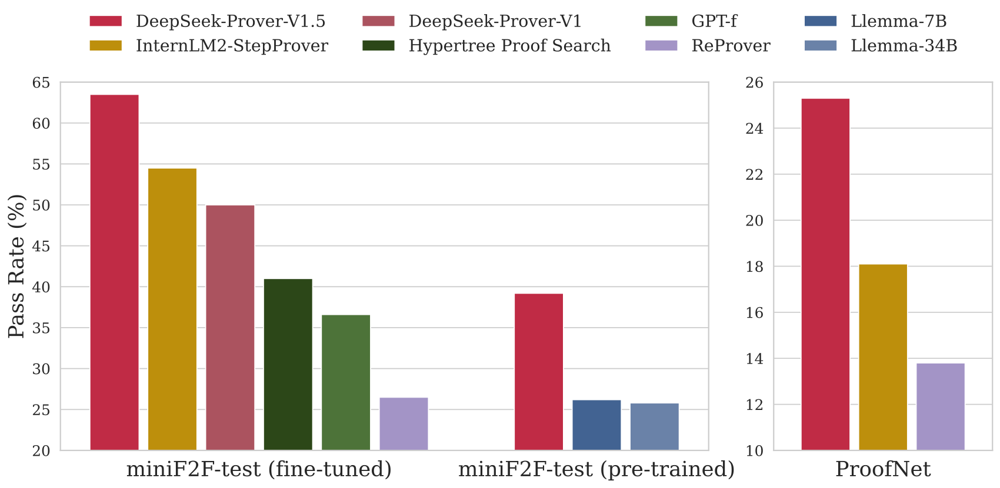
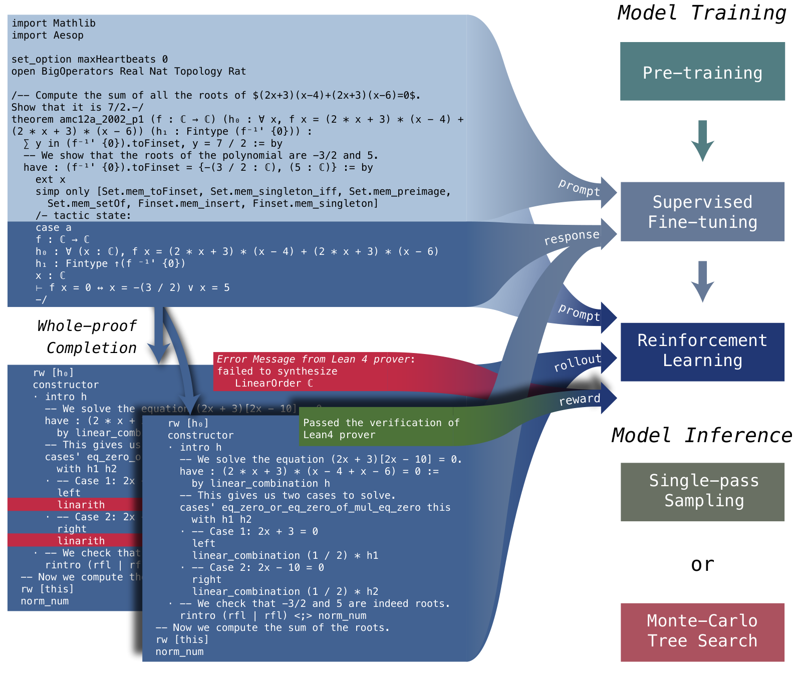

# DeepSeek-Prover-V1.5: Harnessing Proof Assistant Feedback for Reinforcement Learning and Monte-Carlo Tree Search / 全文中英对照

> 来源：[arXiv:2408.08152v1](https://arxiv.org/abs/2408.08152v1)。英文段落后紧接中文，覆盖所取 HTML 版本的主文、附录、图表、脚注与参考文献；公式、数字表和书目信息共用。中文以机器初译为底稿，进行了术语整理与结构核对，尚未逐句人工审定；遇到歧义请以紧邻英文和原论文为准。 原作版权归所列作者，许可见 [原作许可](http://creativecommons.org/licenses/by/4.0/)；中文译文与版式改写在该许可条件下提供（涉及 SA 时沿用相同许可，涉及 NC 时仅限非商业使用）。

## Authors and affiliations / 作者与机构

Huajian Xin*, Z.Z. Ren*, Junxiao Song*, Zhihong Shao*, Wanjia Zhao, Haocheng Wang, Bo Liu, Liyue Zhang Xuan Lu, Qiushi Du, Wenjun Gao, Qihao Zhu, Dejian Yang, Zhibin Gou, Z.F. Wu, Fuli Luo, Chong Ruan DeepSeek-AI [https://github.com/deepseek-ai/DeepSeek-Prover-V1.5](https://github.com/deepseek-ai/DeepSeek-Prover-V1.5) Corresponding author: Core contributors

**EN.** \reportnumber

**中.** \报告编号

**EN.** 001

**中.** 001

## Abstract / 摘要

**EN.** We introduce DeepSeek-Prover-V1.5, an open-source language model designed for theorem proving in Lean 4, which enhances DeepSeek-Prover-V1 by optimizing both training and inference processes. Pre-trained on DeepSeekMath-Base with specialization in formal mathematical languages, the model undergoes supervised fine-tuning using an enhanced formal theorem proving dataset derived from DeepSeek-Prover-V1. Further refinement is achieved through reinforcement learning from proof assistant feedback (RLPAF). Beyond the single-pass whole-proof generation approach of DeepSeek-Prover-V1, we propose RMaxTS, a variant of Monte-Carlo tree search that employs an intrinsic-reward-driven exploration strategy to generate diverse proof paths. DeepSeek-Prover-V1.5 demonstrates significant improvements over DeepSeek-Prover-V1, achieving new state-of-the-art results on the test set of the high school level miniF2F benchmark (63.5%) and the undergraduate level ProofNet benchmark (25.3%).

**中.** 我们推出了 DeepSeek-Prover-V1.5，这是一种专为 Lean 4 中的定理证明而设计的开源语言模型，它通过优化训练和推理过程来增强 DeepSeek-Prover-V1。该模型在专门针对形式数学语言的 DeepSeekMath-Base 上进行了预训练，并使用源自 DeepSeek-Prover-V1 的增强型形式定理证明数据集进行监督微调。通过证明辅助反馈（RLPAF）的强化学习可以实现进一步的细化。除了 DeepSeek-Prover-V1 的单遍整体证明生成方法之外，我们还提出了 RMaxTS，这是蒙特卡罗树搜索的一种变体，它采用内在奖励驱动的探索策略来生成不同的证明路径。 DeepSeek-Prover-V1.5 比 DeepSeek-Prover-V1 表现出显着改进，在高中水平 miniF2F 基准（63.5%）和本科水平 ProofNet 基准（25.3%）的测试集上取得了新的最先进结果。



**EN.** Figure 1: Pass rates of models on formal theorem proving benchmarks in Lean 4: the high school level miniF2F-test benchmark ( Zheng et al., 2022 ) and the undergraduate level ProofNet benchmark ( Azerbayev et al., 2023 ) . We compare both the pre-trained and fine-tuned versions of DeepSeek-Prover-V1.5 with strong baselines.

**中.** 图 1：精益 4 中模型在形式定理证明基准上的通过率：高中水平的 miniF2F 测试基准（Zheng 等人，2022）和本科水平的 ProofNet 基准（Azerbayev 等人，2023）。我们将 DeepSeek-Prover-V1.5 的预训练版本和微调版本与强大的基线进行比较。

## Introduction / 简介

**EN.** Recent advancements in large language models have significantly influenced mathematical reasoning and theorem proving in artificial intelligence. Despite notable progress in natural language domains, language models still encounter substantial challenges in formal theorem proving, e.g. using Lean ( Moura and Ullrich, 2021 ) and Isabelle ( Paulson, 1994 ) , which requires rigorous derivations satisfying formal specifications of the verification system. Even advanced models like GPT-4 ( OpenAI, 2023 ) struggle with complex formal proofs, underscoring the intricate nature of both the coding and the mathematics involved. A formal theorem proving model must not only grasp the syntax and semantics of formal systems like the Lean theorem prover but also align abstract mathematical reasoning with precise formal representation.

**中.** 大型语言模型的最新进展极大地影响了人工智能中的数学推理和定理证明。尽管自然语言领域取得了显着的进展，但语言模型在形式定理证明方面仍然面临着巨大的挑战，例如使用 Lean（Moura 和 Ullrich，2021）和 Isabelle（Paulson，1994），这需要严格的推导来满足验证系统的正式规范。即使像 GPT-4（OpenAI，2023）这样的高级模型也难以应对复杂的形式证明，这凸显了所涉及的编码和数学的复杂性。形式定理证明模型不仅必须掌握像精益定理证明器这样的形式系统的语法和语义，而且还要将抽象的数学推理与精确的形式表示结合起来。

**EN.** Language models in formal theorem proving typically employ two strategies: proof-step generation ( Polu and Sutskever, 2020 ; Jiang et al., 2022a ; Lample et al., 2022 ; Yang et al., 2023 ; Wu et al., 2024 ) and whole-proof generation ( Jiang et al., 2022b ; Zhao et al., 2023 ; Wang et al., 2023a ) . Proof-step generation predicts each subsequent tactic and verifies it using the formal verifier to obtain updated information about the current tactic state, often utilizing tree search techniques to construct valid proofs. In contrast, whole-proof generation is computationally efficient, which produces an entire proof code based on the theorem statement, requiring less communication budget to coordinate between the prover model and the formal theorem verifier. While DeepSeek-Prover-V1 ( Xin et al., 2024 ) has achieved state-of-the-art results in Lean 4 with whole-proof generation, this paradigm presents its unique challenges. It requires long-horizon sequence prediction without access to intermediate tactic states, and future tactics depend on these hidden results. In Lean’s tactic mode, proofs are constructed through a sequence of tactics that transform the proof state. This sequential nature introduces the risk of compounding errors ( Ross et al., 2011 ) , where a single misinterpretation can lead to significant deviations from a valid proof path. More specifically, the auto-regressive model may have incorrect believes on intermediate tactic states when generating long proofs.

**中.** 形式定理证明中的语言模型通常采用两种策略：证明步骤生成（Polu and Sutskever，2020；Jiang et al.，2022a；Lample et al.，2022；Yang et al.，2023；Wu et al.，2024）和整体证明生成（Jiang et al.，2022b；Zhao et al.，2023；Wang et al.）等人，2023a）。证明步骤生成预测每个后续策略，并使用形式验证器对其进行验证，以获得有关当前策略状态的更新信息，通常利用树搜索技术来构建有效的证明。相比之下，整体证明生成在计算上是高效的，它根据定理陈述生成完整的证明代码，需要较少的通信预算来协调证明者模型和形式定理验证者之间的通信预算。虽然 DeepSeek-Prover-V1（Xin 等人，2024）在 Lean 4 中通过整体证明生成取得了最先进的结果，但这种范式提出了其独特的挑战。它需要长视野序列预测，而无需访问中间策略状态，而未来的策略取决于这些隐藏的结果。在精益的策略模式中，证明是通过一系列改变证明状态的策略来构造的。这种顺序性质引入了复合错误的风险（Ross 等人，2011），其中单个误解可能导致与有效证明路径的重大偏差。更具体地说，在生成长证明时，自回归模型可能对中间策略状态有错误的信念。

**EN.** To seamlessly integrate intermediate tactic states in proof-step generation while maintaining the simplicity and computational efficiency of whole-proof generation, we have developed a unified approach in DeepSeek-Prover-V1.5. This method combines the strengths of both proof-step and whole-proof generation techniques through a truncate-and-resume mechanism. The process begins with standard whole-proof generation, where the language model completes the proof code following the theorem statement prefix. The Lean prover then verifies this code. If the proof is correct and complete, the procedure terminates. If an error is detected, the code is truncated at the first error message, and any subsequent code is discarded. The successfully generated proof code is then used as a prompt for the generation of next proof segment. To enhance the accuracy of the model’s new completions, we append the latest state from the Lean 4 prover as a comment at the end of the prompt. Notably, our method is not restricted to resuming from the last successfully applied tactic. We integrate the truncate-and-resume mechanism into Monte-Carlo tree search ( Coulom, 2006 , MCTS;) in which the truncation points are scheduled by the tree search policy. In addition, we propose a novel reward-free exploration algorithm for MCTS to address the reward sparsity issue of proof search. We assign the tree search agent intrinsic motivation, a.k.a. curiosity ( Schmidhuber, 2010 ) , to extensively explore the tactic state space. These algorithmic modules extend the functionality of our whole-proof generation model to become a flexible tool for interactive theorem proving, which can effectively utilize the proof assistant feedback and generate diverse solution candidates.

**中.** 为了在证明步骤生成中无缝集成中间策略状态，同时保持整体证明生成的简单性和计算效率，我们在 DeepSeek-Prover-V1.5 中开发了一种统一的方法。该方法通过截断和恢复机制结合了证明步骤和整体证明生成技术的优点。该过程从标准的整体证明生成开始，其中语言模型在定理语句前缀之后完成证明代码。然后精益证明者验证此代码。如果证明正确且完整，则程序终止。如果检测到错误，代码将在第一个错误消息处被截断，并丢弃任何后续代码。然后，成功生成的证明代码将用作生成下一个证明段的提示。为了提高模型新完成结果的准确性，我们在提示末尾附加来自 Lean 4 证明者的最新状态作为注释。值得注意的是，我们的方法并不限于从上次成功应用的策略中恢复。我们将截断和恢复机制集成到蒙特卡罗树搜索中（Coulom，2006，MCTS；），其中截断点由树搜索策略调度。此外，我们为 MCTS 提出了一种新颖的无奖励探索算法，以解决证明搜索的奖励稀疏问题。我们分配树搜索代理内在动机，又名好奇心（Schmidhuber，2010），以广泛探索策略状态空间。这些算法模块扩展了我们的整体证明生成模型的功能，成为交互式定理证明的灵活工具，可以有效地利用证明辅助反馈并生成多样化的候选解决方案。



**EN.** Figure 2: Overall Framework. DeepSeek-Prover-V1.5 is trained through pre-training, supervised fine-tuning, and reinforcement learning. During supervised fine-tuning, the pre-trained model receives an incomplete theorem proof ending with a tactic state comment keyword. The model is trained to predict the content of this tactic state (auxiliary objective) and complete the subsequent proof steps (main objective). In the reinforcement learning stage, given an incomplete theorem proof and ground-truth tactic state from the Lean prover, we roll out the fine-tuned model to generate multiple proof candidates, which are then verified by the Lean prover. The verification results for these candidates are used as binary (0-1) rewards to further optimize the model and enhance its alignment with the formal specifications of the verification system. For model inference, we offer two alternatives: single-pass sampling and Monte-Carlo tree search.

**中.** 图 2：总体框架。 DeepSeek-Prover-V1.5通过预训练、监督微调和强化学习进行训练。在监督微调期间，预训练模型收到一个以策略状态注释关键字结尾的不完整定理证明。该模型经过训练来预测该策略状态的内容（辅助目标）并完成后续的证明步骤（主要目标）。在强化学习阶段，给定精益证明者的不完整定理证明和真实策略状态，我们推出微调模型以生成多个候选证明，然后由精益证明者进行验证。这些候选者的验证结果被用作二元（0-1）奖励，以进一步优化模型并增强其与验证系统的正式规范的一致性。对于模型推理，我们提供两种替代方案：单遍采样和蒙特卡罗树搜索。

### Contributions / 贡献

**EN.** We present a comprehensive framework for developing a language model-based formal mathematics prover, integrating several key components: large-scale mathematical pre-training, formal mathematics corpus construction and augmentation, online reinforcement learning from proof assistant feedback, and a tree search methodology for long-term planning in theorem proving. The pre-trained model, supervised fine-tuned model, and reinforcement learning model, along with the code for the Monte-Carlo tree search algorithm, are publicly available for further research and application.

**中.** 我们提出了一个用于开发基于语言模型的形式数学证明器的综合框架，集成了几个关键组件：大规模数学预训练、形式数学语料库构建和增强、来自证明辅助反馈的在线强化学习，以及用于定理证明中长期规划的树搜索方法。预训练模型、监督微调模型和强化学习模型以及蒙特卡罗树搜索算法的代码已公开供进一步研究和应用。

**EN.** Pre-Training : We enhance our base model’s capabilities in formal theorem proving and mathematical reasoning by further pre-training on high-quality mathematics and code data, with a focus on formal languages such as Lean, Isabelle, and Metamath.

**中.** 预训练：我们通过对高质量数学和代码数据的进一步预训练，增强基础模型在形式定理证明和数学推理方面的能力，重点关注 Lean、Isabelle 和 Metamath 等形式语言。

**EN.** Supervised Fine-Tuning : We improve the Lean 4 code completion dataset by implementing two data augmentation techniques. First, we use DeepSeek-Coder V2 236B ( Zhu et al., 2024 ) to annotate natural language chain-of-thought comments alongside Lean 4 code, aligning formal theorem proving with natural language reasoning. Second, we insert intermediate tactic state information within the Lean 4 proof code, enabling our model to leverage compiler feedback effectively. The resulting dataset is then used to fine-tune the pre-trained model.

**中.** 监督微调：我们通过实施两种数据增强技术来改进 Lean 4 代码完成数据集。首先，我们使用 DeepSeek-Coder V2 236B ( Zhu et al., 2024 ) 与 Lean 4 代码一起注释自然语言思想链注释，使形式定理证明与自然语言推理保持一致。其次，我们在 Lean 4 证明代码中插入中间策略状态信息，使我们的模型能够有效地利用编译器反馈。然后使用生成的数据集来微调预训练模型。

**EN.** Reinforcement Learning : We employ the GRPO algorithm ( Shao et al., 2024 ) to perform reinforcement learning from proof assistant feedback (RLPAF) on the supervised fine-tuned model. Verification results from the Lean prover serve as reward supervision, enhancing the model’s alignment with the formal specifications of the verification system.

**中.** 强化学习：我们采用 GRPO 算法（Shao et al., 2024）在监督微调模型上根据证明辅助反馈（RLPAF）执行强化学习。精益证明者的验证结果作为奖励监督，增强模型与验证系统正式规范的一致性。

**EN.** Monte-Carlo Tree Search : We advance the tree search method in formal theorem proving by introducing a novel abstraction and a corresponding search algorithm. Our truncate-and-resume mechanism acts as a state-action abstraction, seamlessly integrating the tree search process into the whole-proof generation framework. We present RMaxTS, an innovative Monte-Carlo tree search algorithm that leverages the RMax ( Brafman and Tennenholtz, 2002 ) strategy to tackle exploration challenges in sparse-reward proof search problems. By assigning intrinsic rewards, this algorithm encourages the prover agent to generate diverse planning paths, thereby fostering extensive exploration of the proof space.

**中.** 蒙特卡罗树搜索：我们通过引入一种新颖的抽象和相应的搜索算法，在形式定理证明中改进了树搜索方法。我们的截断和恢复机制充当状态动作抽象，将树搜索过程无缝集成到整体证明生成框架中。我们提出了 RMaxTS，一种创新的蒙特卡洛树搜索算法，它利用 RMax（Brafman 和 Tennenholtz，2002）策略来解决稀疏奖励证明搜索问题中的探索挑战。通过分配内在奖励，该算法鼓励证明者代理生成不同的规划路径，从而促进对证明空间的广泛探索。

### Summary of Evaluations and Metrics / 评估和指标摘要

**EN.** miniF2F : In the single-pass whole-proof generation setting, DeepSeek-Prover-V1.5 achieved a pass rate of 60.2% on the test set of miniF2F, marking a significant improvement of absolute 10.2 percentage points over DeepSeek-Prover-V1’s 50.0%. Incorporating tree search techniques further elevated the pass rate to a new state-of-the-art 63.5% .

**中.** miniF2F：在单遍全证明生成设置中，DeepSeek-Prover-V1.5在miniF2F的测试集上取得了60.2%的通过率，比DeepSeek-Prover-V1的50.0%显着提升了绝对10.2个百分点。结合树搜索技术进一步将通过率提高到新的最先进的 63.5%。

**EN.** ProofNet : DeepSeek-Prover-V1.5 also demonstrated strong performance in the single-pass whole-proof generation setting for ProofNet, with pass rates of 21.6% on the validation set and 23.7% on the test set. The integration of tree search techniques further enhanced these results, achieving new state-of-the-art pass rates of 25.4% on the validation set and 25.3% on the test set.

**中.** ProofNet：DeepSeek-Prover-V1.5在ProofNet的单遍整体证明生成设置中也表现出了强大的性能，验证集上的通过率为21.6%，测试集上的通过率为23.7%。树搜索技术的集成进一步增强了这些结果，在验证集上实现了 25.4% 的最新通过率，在测试集上实现了 25.3% 的最新通过率。

## Model Training / 模型训练

### Pre-training / 预训练

**EN.** To enhance our language model’s proficiency in generating formal proofs and reasoning through mathematical language, we further pre-train our base model ( Shao et al., 2024 ) . This refinement involved training on high-quality datasets that include both code and natural language mathematical content. We specifically focused on formal languages widely used in proof assistants, such as Lean, Isabelle, and Metamath. We designate this improved model as DeepSeek-Prover-V1.5-Base.

**中.** 为了提高我们的语言模型通过数学语言生成形式证明和推理的能力，我们进一步预训练了我们的基础模型（Shao et al., 2024）。这种改进涉及对高质量数据集的培训，其中包括代码和自然语言数学内容。我们特别关注在证明助手中广泛使用的形式语言，例如 Lean、Isabelle 和 Metamath。我们将这个改进的模型指定为 DeepSeek-Prover-V1.5-Base。

### Supervised Fine-tuning / 监督微调

**EN.** In this section, we explore the methodology and processes involved in the supervised fine-tuning (SFT) of DeepSeek-Prover-V1.5. Specifically, we augment the proof dataset from DeepSeek-Prover-V1 by adding detailed explanatory comments. This enhancement aims to improve the alignment between natural language descriptions and Lean 4 code, thereby facilitating better formal mathematical reasoning. Additionally, we incorporate intermediate tactic state information as an auxiliary prediction task to support the truncate-and-resume mechanism used in the Monte-Carlo Tree Search process. We refer to the resulting model as DeepSeek-Prover-V1.5-SFT.

**中.** 在本节中，我们将探讨 DeepSeek-Prover-V1.5 的监督微调（SFT）所涉及的方法和流程。具体来说，我们通过添加详细的解释性注释来扩充 DeepSeek-Prover-V1 的证明数据集。此增强功能旨在提高自然语言描述和 Lean 4 代码之间的一致性，从而促进更好的形式数学推理。此外，我们将中间策略状态信息合并为辅助预测任务，以支持蒙特卡罗树搜索过程中使用的截断和恢复机制。我们将生成的模型称为 DeepSeek-Prover-V1.5-SFT。

#### Data Curation. / 数据管理。

**EN.** We develop a comprehensive Lean 4 code completion dataset for the supervised fine-tuning. This dataset includes synthetic proof code derived from a wide range of formal theorems. These theorems are sourced from various projects, such as the standard Lean 4 math library Mathlib4 ( Mathlib Community, 2020 ) , synthetic theorems from DeepSeek-Prover-V1 ( Xin et al., 2024 ) and Lean Workbook ( Ying et al., 2024a ) , and validation sets from the miniF2F ( Zheng et al., 2022 ) and ProofNet ( Azerbayev et al., 2023 ) benchmarks. To augment the formal proof data, we employed an expert iteration process ( Polu and Sutskever, 2020 ) . This involves generating proofs using the language model, verifying the generated proof data, retraining the model with the verified data, and then using the optimized model to generate additional proof data. Between each iteration, we use DeepSeek-Coder V2 236B ( Zhu et al., 2024 ) to annotate the thought process before the proof code as comments. Finally, we tailor these data for the truncate-and-resume mechanism for Monte-Carlo Tree Search (details in Section 3.1 ). The resulting proof dataset consists of 9,645k sequences.

**中.** 我们开发了一个全面的 Lean 4 代码完成数据集，用于监督微调。该数据集包括源自各种形式定理的综合证明代码。这些定理来源于各种项目，例如标准 Lean 4 数学库 Mathlib4 (Mathlib Community, 2020)、DeepSeek-Prover-V1 (Xin et al., 2024) 和 Lean Workbook (Ying et al., 2024a) 的综合定理、以及来自 miniF2F (Zheng et al., 2022) 和 ProofNet ( Azerbayev 等人，2023）基准。为了增强形式证明数据，我们采用了专家迭代过程（Polu 和 Sutskever，2020）。这涉及使用语言模型生成证明、验证生成的证明数据、使用验证的数据重新训练模型，然后使用优化的模型生成额外的证明数据。在每次迭代之间，我们使用 DeepSeek-Coder V2 236B ( Zhu et al., 2024 ) 将证明代码之前的思维过程注释为注释。最后，我们为蒙特卡罗树搜索的截断和恢复机制定制这些数据（详细信息请参见第 3.1 节）。生成的证明数据集由 9,645k 个序列组成。

#### Thought-augmented Proof Generation. / 思想增强的证明生成。

**EN.** In DeepSeek-Prover-V1, we identified a significant gap between problem-solving strategies in natural language and theorem proving in Lean. In natural language, models generate detailed deduction steps to construct proofs, whereas in Lean, they often rely on a sequence of high-level tactic calls to brute-force solutions. These high-level tactics, while effective, obscure their internal workings and outcomes, hindering the model’s ability to resolve complex proof goals with structured mathematical reasoning. To address this issue, we develop an approach that incorporates natural language reasoning before generating theorem proof code. Similar to Lean-STaR ( Lin et al., 2024 ) , which performs isolated chain-of-thought reasoning ( Wei et al., 2022 ; Feng et al., 2023 ) before each proof step, our method integrates this reasoning directly as comments within the proof code. We use the DeepSeek-Coder V2 236B ( Zhu et al., 2024 ) to enhance existing data in DeepSeek-Prover-V1 in two ways: first, by inserting a complete natural language solution at the beginning of the proof block, and second, by alternately inserting specific natural language steps for corresponding Lean tactics. Training the model with this data format enforces it to propose complete mathematical reasoning at the beginning of the proof block and detailed step planning before each tactic. This approach successfully develops new behaviors, employing delicate mathematical thinking to guide the generation of tactics. In the training data, two distinct guiding prompts are used to differentiate between the CoT (Chain of Thought) mode and the non-CoT mode for proof code completion. Examples of input and output in both modes can be found in Appendix A .

**中.** 在 DeepSeek-Prover-V1 中，我们发现自然语言中的问题解决策略与精益中的定理证明之间存在显着差距。在自然语言中，模型生成详细的推导步骤来构造证明，而在精益中，它们通常依赖于一系列对强力解决方案的高级策略调用。这些高级策略虽然有效，但掩盖了其内部运作和结果，阻碍了模型通过结构化数学推理解决复杂证明目标的能力。为了解决这个问题，我们开发了一种在生成定理证明代码之前结合自然语言推理的方法。类似于 Lean-STaR（Lin et al., 2024），它在每个证明步骤之前执行孤立的思想链推理（Wei et al., 2022；Feng et al., 2023），我们的方法直接将此推理集成为证明代码中的注释。我们使用 DeepSeek-Coder V2 236B（Zhu et al., 2024）通过两种方式增强 DeepSeek-Prover-V1 中的现有数据：第一，在证明块的开头插入完整的自然语言解决方案，第二，通过交替插入相应精益策略的特定自然语言步骤。使用这种数据格式训练模型会强制它在证明块的开头提出完整的数学推理，并在每个策略之前提出详细的步骤规划。这种方法成功地开发了新的行为，利用微妙的数学思维来指导策略的生成。在训练数据中，使用两个不同的引导提示来区分证明代码完成的CoT（思想链）模式和非CoT模式。两种模式下的输入和输出示例可以在附录 A 中找到。

#### Prompt Augmentation with Tactic State Information. / 通过战术状态信息进行即时增强。

**EN.** To implement the truncate-and-resume mechanism for Monte-Carlo Tree Search, we needed to extract tactic information from the code generated by the model. We enhanced the Lean REPL ( Leanprover Community, 2023 , Read-Eval-Print Loop;) with data extraction tools from the LeanDojo ( Yang et al., 2023 ) project. This allowed us to extract tactic information in triples, which include the position of each tactic, as well as the tactic states before and after its application. This information helps us identify the specific tactic code that triggers verification errors (used in the expansion step for tree search, see Section 3.2 ). For each tactic in a generated valid formal proof, we insert the tactic state returned by the verifier as a comment "/- tactic state: … -/". During training, we use all tokens following "/- tactic state: " as responses to calculate the supervised fine-tuning loss, while the tokens before this comment is used as prompts and do not contribute to the training loss calculation.

**中.** 为了实现蒙特卡罗树搜索的截断和恢复机制，我们需要从模型生成的代码中提取策略信息。我们使用 LeanDojo（Yang 等人，2023）项目中的数据提取工具增强了 Lean REPL（Leanprover Community，2023，Read-Eval-Print Loop；）。这使我们能够以三元组的形式提取战术信息，其中包括每个战术的位置以及其应用之前和之后的战术状态。此信息帮助我们识别触发验证错误的特定策略代码（在树搜索的扩展步骤中使用，请参见第 3.2 节）。对于生成的有效形式证明中的每个策略，我们插入验证者返回的策略状态作为注释“/-策略状态：…-/”。在训练过程中，我们使用“/- 战术状态：”之后的所有标记作为响应来计算监督微调损失，而该注释之前的标记用作提示，不参与训练损失计算。

#### Training Setting. / 训练设置。

**EN.** We conduct supervised fine-tuning based on the pre-trained model and train for 9B tokens, using a batch size of 2,048 and a constant learning rate of 1e-4. The training process begins with 100 warm-up steps to stabilize the learning dynamics. Training examples are randomly concatenated to form sequences, with a maximum context length of 4,096 tokens.

**中.** 我们基于预训练模型进行监督微调，并使用 2,048 的批量大小和 1e-4 的恒定学习率训练 9B 代币。训练过程从 100 个热身步骤开始，以稳定学习动态。训练示例随机连接形成序列，最大上下文长度为 4,096 个标记。

### Reinforcement Learning from Proof Assistant Feedback / 从证明助理反馈中强化学习

**EN.** Reinforcement learning (RL) has been proven effective in enhancing the mathematical reasoning capabilities of supervised fine-tuned language models ( Shao et al., 2024 ) . To further advance DeepSeek-Prover-V1.5-SFT, we incorporate a reinforcement learning phase, resulting in the model DeepSeek-Prover-V1.5-RL. This phase leverages RL to enhance performance based on verification feedback from the Lean 4 prover. The specifics of this RL process are detailed below.

**中.** 强化学习（RL）已被证明可以有效增强监督微调语言模型的数学推理能力（Shao et al., 2024）。为了进一步推进 DeepSeek-Prover-V1.5-SFT，我们纳入了强化学习阶段，从而形成了模型 DeepSeek-Prover-V1.5-RL。此阶段利用 RL 根据 Lean 4 证明者的验证反馈来增强性能。下面详细介绍了这个 RL 过程的细节。

#### Prompts. / 提示。

**EN.** In the reinforcement learning stage, we use a subset of theorem statements from the supervised fine-tuning dataset as training prompts. We select theorems for which DeepSeek-Prover-V1.5-SFT has a moderate success rate in generating correct proofs upon multiple attempts. This ensures that the model has room for improvement while still being able to receive positive feedback. After filtering, we retain approximately 4.5k unique theorem statements. Each theorem is prefixed with both CoT and non-CoT guiding prompts to enhance the model’s proof generation capabilities in both modes.

**中.** 在强化学习阶段，我们使用监督微调数据集中的定理陈述子集作为训练提示。我们选择 DeepSeek-Prover-V1.5-SFT 在多次尝试后生成正确证明具有中等成功率的定理。这确保了模型有改进的空间，同时仍然能够收到积极的反馈。过滤后，我们保留了大约 4.5k 个独特的定理陈述。每个定理都带有 CoT 和非 CoT 指导提示作为前缀，以增强模型在两种模式下的证明生成能力。

#### Rewards. / 奖励。

**EN.** When training LLMs via RL, a trained reward model typically provides feedback signals. In contrast, formal theorem proving benefits from the rigorous verification of generated proofs by proof assistants, offering a significant advantage. Specifically, each generated proof receives a reward of 1 if verified as correct, and 0 otherwise. While this binary reward signal is accurate, it is also sparse, especially for theorems that are challenging for the supervised fine-tuned model. To mitigate this sparsity, we select training prompts that are challenging yet achievable for the supervised fine-tuned model, as described above.

**中.** 当通过强化学习训练LLM时，经过训练的奖励模型通常会提供反馈信号。相比之下，形式定理证明受益于证明助手对生成的证明的严格验证，提供了显着的优势。具体来说，如果验证正确，每个生成的证明都会获得 1 奖励，否则获得 0 奖励。虽然这个二元奖励信号是准确的，但它也是稀疏的，特别是对于监督微调模型具有挑战性的定理。为了减轻这种稀疏性，我们选择了具有挑战性但对于监督微调模型可实现的训练提示，如上所述。

#### Reinforcement Learning Algorithm. / 强化学习算法。

**EN.** We employ the Group Relative Policy Optimization ( Shao et al., 2024 , GRPO;) as our RL algorithm, which has demonstrated superior effectiveness and efficiency compared to PPO ( Schulman et al., 2017 ) , primarily because it eliminates the necessity of training an additional critic model. Specifically, GRPO samples a group of candidate proofs for each theorem prompt and optimizes the model based on the relative rewards of the outputs within the group. Our prompt selection strategy is designed to likely include both correct and incorrect proofs among the candidates, aligning well with the group-relative nature of GRPO and thereby enhancing the training process.

**中.** 我们采用组相对策略优化（Shao et al.，2024，GRPO；）作为我们的 RL 算法，与 PPO（Schulman et al.，2017）相比，该算法表现出优越的有效性和效率，主要是因为它消除了训练额外批评家模型的必要性。具体来说，GRPO 对每个定理提示的一组候选证明进行采样，并根据组内输出的相对奖励来优化模型。我们的及时选择策略旨在可能包括候选者中正确和错误的证明，与 GRPO 的群体相关性质很好地保持一致，从而增强培训过程。

#### Training Setting. / 训练设置。

**EN.** We conduct RL training based on the SFT model, which serves as both the initial model and the reference model for imposing the Kullback-Leibler (KL) divergence penalty. We use a constant learning rate of 5e-6, and the KL penalty coefficient is set to 0.02. For each theorem, we sample a group of 32 candidate proofs, with maximum length set to 2,048. The training batch size is configured to 512.

**中.** 我们基于 SFT 模型进行强化学习训练，该模型既作为初始模型，又作为施加 Kullback-Leibler (KL) 散度惩罚的参考模型。我们使用恒定的学习率5e-6，KL惩罚系数设置为0.02。对于每个定理，我们对一组 32 个候选证明进行抽样，最大长度设置为 2,048。训练批量大小配置为 512。

### Evaluation / 评价

#### Benchmarks. / 基准。

**EN.** We evaluate theorem-proving performance on the following benchmarks to compare model capabilities after each training stage:

**中.** 我们根据以下基准评估定理证明性能，以比较每个训练阶段后的模型能力：

**EN.** MiniF2F ( Zheng et al., 2022 ) focuses on formal problem-solving skills for high-school level exercises and competitions, such as AMC, AIME, and IMO, with an emphasis on algebra and number theory. The benchmark includes 244 validation and 244 test problems, originally in Lean 3 and manually converted to Lean 4.9.0, based on the version provided by Yang (2023) .

**中.** MiniF2F（Zheng et al., 2022）侧重于高中水平练习和竞赛的正式问题解决技能，例如 AMC、AIME 和 IMO，重点是代数和数论。该基准包括 244 个验证问题和 244 个测试问题，最初位于 Lean 3 中，并基于 Yang (2023) 提供的版本手动转换为 Lean 4.9.0。

**EN.** ProofNet ( Azerbayev et al., 2023 ) evaluates formal theorem-proving capabilities at the undergraduate level in mathematics. It comprises 185 validation and 186 test problems from widely-used undergraduate textbooks, covering real and complex analysis, linear algebra, abstract algebra, and topology. These problems were initially in Lean 3 and manually converted to Lean 4.9.0.

**中.** ProofNet（Azerbayev et al., 2023）评估数学本科阶段的形式定理证明能力。它包含来自广泛使用的本科教材的 185 个验证问题和 186 个测试问题，涵盖实分析和复分析、线性代数、抽象代数和拓扑。这些问题最初出现在 Lean 3 中，并手动转换为 Lean 4.9.0。


**EN.** Figure 3: Comparison of model capabilities at different training stages. "CoT" and "non-CoT" refer to evaluations using two guiding prompts. The shaded region represents the range of standard deviations around the mean values. The notation $\mu\pm\sigma$ indicates the average accuracy $\mu$ and the standard deviation $\sigma$ .

**中.** 图 3：不同训练阶段的模型能力比较。 “CoT”和“非 CoT”是指使用两个指导提示进行评估。阴影区域表示平均值周围的标准偏差范围。符号 $\mu\pm\sigma$ 表示平均精度 $\mu$ 和标准偏差 $\sigma$ 。

#### Prompting Configurations. / 提示配置。

**EN.** For each proof attempt of DeepSeek-Prover-V1.5-Base, we independently sample three proof demonstrations from the validation set to construct the few-shot prompts. For the miniF2F benchmark, we use human-written proofs from Yang (2023) , while for the ProofNet benchmark, we use correct proofs generated by DeepSeek-Prover-V1.5-RL as few-shot demonstrations. For DeepSeek-Prover-V1.5-SFT and DeepSeek-Prover-V1.5-RL, we employ two types of guiding prompts: one that encourages chain-of-thought (CoT) reasoning before each proof step, and one that does not (non-CoT). Detailed examples are provided in Appendix A .

**中.** 对于 DeepSeek-Prover-V1.5-Base 的每次证明尝试，我们从验证集中独立采样三个证明演示，以构建少样本提示。对于 miniF2F 基准，我们使用 Yang (2023) 的人工编写证明，而对于 ProofNet 基准，我们使用 DeepSeek-Prover-V1.5-RL 生成的正确证明作为少样本演示。对于 DeepSeek-Prover-V1.5-SFT 和 DeepSeek-Prover-V1.5-RL，我们采用两种类型的指导提示：一种鼓励在每个证明步骤之前进行思想链 (CoT) 推理，另一种则不鼓励（非 CoT）。附录 A 中提供了详细示例。

#### Metric. / 公制。

**EN.** We evaluate theorem-proving performance using the pass@ $K$ accuracy metric, which measures the model’s success in generating a correct proof within $K$ attempts. Each model is deployed on a single A100-40G GPU, utilizing the vLLM framework ( Kwon et al., 2023 ) for sample generation. The sampling parameters are set with a temperature of 1, a top-p value of 0.95, and a maximum token limit of 2,048. The generated proofs are then verified using the Lean 4 theorem prover. For this verification, we import Mathlib4 ( Mathlib Community, 2020 ) and Aesop ( Limperg and From, 2023 ) to access predefined premises and tactics. The verification process is subject to a time limit of 300 seconds.

**中.** 我们使用 pass@ $K$ 准确性指标来评估定理证明性能，该指标衡量模型在 $K$ 尝试中生成正确证明的成功程度。每个模型都部署在单个 A100-40G GPU 上，利用 vLLM 框架（Kwon 等人，2023）进行样本生成。采样参数设置为温度为 1、top-p 值为 0.95、最大令牌限制为 2,048。然后使用 Lean 4 定理证明器验证生成的证明。为了进行此验证，我们导入 Mathlib4（Mathlib Community，2020）和 Aesop（Limperg 和 From，2023）来访问预定义的前提和策略。验证过程的时间限制为 300 秒。

#### Comparison across Training Stages. / 不同训练阶段的比较。

**EN.** Figure 3 presents a comparative analysis of each training stage on the miniF2F and ProofNet datasets. Our base model, DeepSeek-Prover-V1.5-Base, achieves a notable pass rate, solving nearly one-third of the problems on the test set of the miniF2F benchmark using 3-shot prompting. The supervised fine-tuning stage, resulting in DeepSeek-Prover-V1.5-SFT, significantly outperforms the base model, with Pass@128 accuracy increasing by approximately two-thirds on miniF2F and doubling on ProofNet. The subsequent reinforcement learning stage further enhances the model’s performance, improving Pass@ $K$ accuracy across all values of $K$ . In contrast to findings in natural language mathematics, such as those reported in DeepSeekMath ( Shao et al., 2024 ) , where reinforcement learning primarily boosts the correct response from TopK, we observe a genuine enhancement of fundamental capabilities in formal theorem proving. This improvement is evident not only with a small sample budget but also remains stable as the sample budget increases. This conclusion is further supported by later Monte-Carlo Tree Search experiments with larger sample budgets, as discussed in Section 4.2 .

**中.** 图 3 展示了 miniF2F 和 ProofNet 数据集上每个训练阶段的比较分析。我们的基础模型 DeepSeek-Prover-V1.5-Base 实现了显着的通过率，使用 3-shot 提示解决了 miniF2F 基准测试集上近三分之一的问题。监督微调阶段产生的 DeepSeek-Prover-V1.5-SFT 显着优于基础模型，Pass@128 准确度在 miniF2F 上增加了约三分之二，在 ProofNet 上增加了一倍。随后的强化学习阶段进一步增强了模型的性能，提高了 $K$ 所有值的 Pass@ $K$ 准确性。与自然语言数学的发现相反，例如 DeepSeekMath（Shao 等人，2024）中报告的结果，其中强化学习主要提高 TopK 的正确响应，我们观察到形式定理证明中基本能力的真正增强。这种改进不仅在样本预算较小的情况下很明显，而且随着样本预算的增加也保持稳定。这一结论得到了后来具有更大样本预算的蒙特卡罗树搜索实验的进一步支持，如第 4.2 节所述。

#### Comparison between CoT and non-CoT. / CoT 和非 CoT 之间的比较。

**EN.** We compare the performance of non-CoT and CoT generation modes for both DeepSeek-Prover-V1.5-SFT and DeepSeek-Prover-V1.5-RL. The results in Figure 3 demonstrate that the CoT mode consistently outperforms the non-CoT mode across most settings. Specifically, DeepSeek-Prover-V1.5-RL, leveraging these enhanced theorem-proving patterns, achieves superior performance on both benchmarks, with an average accuracy of $51.6\%$ on miniF2F and $18.2\%$ on ProofNet. The integration of natural language reasoning in CoT mode significantly enhances the planning and execution of formal proof writing. For a detailed comparison of proof strategies with and without the use of natural language chain-of-thought, refer to the examples provided in Appendix A .

**中.** 我们比较 DeepSeek-Prover-V1.5-SFT 和 DeepSeek-Prover-V1.5-RL 的非 CoT 和 CoT 生成模式的性能。图 3 中的结果表明，在大多数设置中，CoT 模式始终优于非 CoT 模式。具体来说，DeepSeek-Prover-V1.5-RL 利用这些增强的定理证明模式，在两个基准测试中实现了卓越的性能，在 miniF2F 上的平均准确度为 $51.6\%$，在 ProofNet 上的平均准确度为 $18.2\%$。 CoT 模式中自然语言推理的集成显着增强了形式证明写作的规划和执行。有关使用和不使用自然语言思维链的证明策略的详细比较，请参阅附录 A 中提供的示例。

## Exploration-oriented Monte-Carlo Tree Search / 面向探索的蒙特卡罗树搜索

### Tactic-level Tree Abstraction / 策略级树抽象

**EN.** To implement the tree search method in the whole-proof generation setting, we introduce a proof tree abstraction to define the tailored state and action space, leveraging a truncate-and-resume mechanism. Roughly following the paradigm of Yao et al. (2023) , we begin by decomposing an incomplete proof into a sequence of tree nodes that correspond to individual proof steps, and then we utilize the partial content stored in these tree nodes to continue the proof generation process. Figure 4 illustrates the process of constructing a proof search tree from whole-proof generation.

**中.** 为了在整体证明生成设置中实现树搜索方法，我们引入了证明树抽象来定义定制的状态和动作空间，利用截断和恢复机制。大致遵循姚等人的范例。 (2023)，我们首先将不完整的证明分解为与各个证明步骤相对应的树节点序列，然后利用存储在这些树节点中的部分内容继续证明生成过程。图 4 说明了从整体证明生成构建证明搜索树的过程。

#### Truncate: Proof Decomposition into Tree Nodes. / 截断：证明分解为树节点。

**EN.** We construct the proof search tree at the tactic level, where each tree edge represents a single transition step of the tactic state. Initially, we submit the entire proof the model generated to the Lean prover to parse it into tactics. We then truncate the proof at the earliest verification error, ensuring that all subsequent tactic codes can be successfully applied to advance the proof towards the desired theorem. The tactic codes are segmented into several code fractions, each containing a valid tactic code and its associated chain-of-thought comments, corresponding to a single tree edge that represents a tactic state transition. Through this abstraction, each tactic code is converted into a series of tree nodes, forming a path from the root to a specific node.

**中.** 我们在策略级别构建证明搜索树，其中每个树边代表策略状态的单个转换步骤。最初，我们将模型生成的整个证明提交给精益证明者，以将其解析为策略。然后，我们在最早的验证错误处截断证明，确保所有后续策略代码都可以成功应用，以将证明推进到所需的定理。策略代码被分割成几个代码部分，每个代码部分包含一个有效的策略代码及其相关的思想链注释，对应于表示策略状态转换的单个树边。通过这种抽象，每个策略代码被转换为一系列树节点，形成从根到特定节点的路径。

#### Resume: Proof Generation from a Tree Node. / 恢复：从树节点生成证明。

**EN.** In Lean 4, different tactics can lead to the same tactic state, meaning each node in our proof tree can correspond to various tactic codes that achieve the same outcome. To handle this, we store a set of these equivalent tactic codes at each node. When the tree search agent expands a node, it randomly selects one tactic to use as a prompt for the language model. This prompt includes the incomplete proof code ending with the chosen tactic and the tactic state information from the Lean prover as a comment block. The fine-tuned model (see Section 2.2 ) has been trained to recognize and utilize this format, using the incomplete code augmented with tactic state comments to guide subsequent proof generation.

**中.** 在精益 4 中，不同的策略可以导致相同的策略状态，这意味着我们的证明树中的每个节点都可以对应于实现相同结果的各种策略代码。为了解决这个问题，我们在每个节点存储一组等效的策略代码。当树搜索代理展开一个节点时，它会随机选择一种策略用作语言模型的提示。该提示包括以所选策略结尾的不完整的证明代码以及来自精益证明者的策略状态信息作为注释块。微调模型（参见第 2.2 节）已经过训练来识别和利用这种格式，使用不完整的代码和策略状态注释来指导后续的证明生成。


**EN.** Figure 4: Truncate-and-Resume Mechanism in the Expansion Step of MCTS. (a) After selecting a node, we trace its corresponding incomplete proof code prefix, which includes the file header, initial statement, and successfully applied tactics from the ancestor nodes. (b) The language model then generates the subsequent proof based on this prefix along with a comment block containing the current tactic state. (c) The combined proof code (prefix and newly generated code) is verified by the Lean 4 prover. If no errors are found, the tree-search procedure terminates. If errors are detected, we truncate the newly generated code at the first error message, discard the subsequent code, and parse the successful portion into tactics. (d) Each tactic is added as a new node in the search tree, extending a chain of descendants beneath the selected node. (e) Once the tree updates are complete, the next iteration of expansion begins by selecting an alternative candidate node, which is not limited to leaf nodes. This process repeats until a correct proof is found or the sample budget is exhausted.

**中.** 图 4：MCTS 扩展步骤中的截断和恢复机制。 (a) 选择一个节点后，我们跟踪其相应的不完整证明代码前缀，其中包括文件头、初始语句以及从祖先节点成功应用的策略。 (b) 然后，语言模型根据该前缀以及包含当前策略状态的注释块生成后续证明。 (c) 组合证明代码（前缀和新生成的代码）由 Lean 4 证明者验证。如果没有发现错误，则树搜索过程终止。如果检测到错误，我们会在第一条错误消息处截断新生成的代码，丢弃后续代码，并将成功部分解析为策略。 (d) 每个策略都作为新节点添加到搜索树中，从而在所选节点下方扩展后代链。 (e) 一旦树更新完成，下一次扩展迭代将通过选择替代候选节点开始，该候选节点不限于叶节点。重复此过程，直到找到正确的证明或样本预算耗尽。

### Interactive Theorem Proving via Monte-Carlo Tree Search / 通过蒙特卡罗树搜索进行交互式定理证明

**EN.** Our proof search tree is developed using the standard Monte-Carlo Tree Search (MCTS) paradigm ( Coulom, 2006 ; Browne et al., 2012 , MCTS;) , which iteratively applies four steps: Selection , Expansion , Simulation , and Backpropagation . We integrate the Simulation step into Expansion because our whole-proof generation model inherently performs a rollout from the expanded node. The detailed design of the algorithm workflow is as follows.

**中.** 我们的证明搜索树是使用标准蒙特卡洛树搜索 (MCTS) 范例（Coulom，2006；Browne 等人，2012，MCTS；）开发的，它迭代地应用四个步骤：选择、扩展、模拟和反向传播。我们将模拟步骤集成到扩展中，因为我们的整体证明生成模型本质上是从扩展节点执行转出。算法工作流程的详细设计如下。

#### Selection. / 选择。

**EN.** The selection step, a.k.a. the tree policy, starts from the root node and traverses downward to identify a promising node for expansion. The objective of this algorithmic step is to trade off between exploration and exploitation ( Kocsis and Szepesvári, 2006 ) . The tree policy at a tree node $s$ is computed by selecting the action that maximizes the value from the set of valid operations:

**中.** 选择步骤，又称树策略，从根节点开始，向下遍历以识别有希望进行扩展的节点。该算法步骤的目标是在探索和利用之间进行权衡（Kocsis 和 Szepesvári，2006）。树节点 $s$ 处的树策略是通过从有效操作集中选择最大化值的操作来计算的：

$$
\displaystyle TreePolicy(s)=\mathop{\arg\max}_{a\in Children(s)\cup\{\oslash\}}Q_{UCB}(s,a),\tag{1}
$$

**EN.** where the action $a$ can be either moving to a child node, denoted by $a\in Children(s)$ , or expanding the current node $s$ , denoted by a special token $a=\oslash$ . This approach uses a technique called virtual node ( Wang et al., 2023b ) , which assigns each node an imaginary child to represent the selection of the current node $s$ for expansion. It enables the tree search agent to continually expand non-leaf nodes, as the action space is supported by a generative model whose output scope cannot be determined by a fixed number of trails. The value estimation $Q_{UCB}(s,a)$ of performing action $a$ on node $s$ is composed by two components:

**中.** 其中操作 $a$ 可以是移动到子节点（用 $a\in Children(s)$ 表示），也可以扩展当前节点 $s$（用特殊标记 $a=\oslash$ 表示）。这种方法使用了一种称为虚拟节点的技术（Wang et al., 2023b），该技术为每个节点分配一个虚构的子节点来表示选择当前节点 $s$ 进行扩展。它使树搜索代理能够不断扩展非叶节点，因为动作空间由生成模型支持，而生成模型的输出范围不能由固定数量的路径确定。在节点 $s$ 上执行操作 $a$ 的价值估计 $Q_{UCB}(s,a)$ 由两个部分组成：

$$
\displaystyle\forall a\in Children(s)\cup\{\oslash\},\quad Q_{UCB}(s,a) \displaystyle=\underbrace{Q(s,a)}_{\text{Exploitation}}+\penalty\ \penalty\ \penalty\ \underbrace{UCB(s,a)}_{\text{Exploration}},\tag{2}
$$

**EN.** where $Q(s,a)$ denotes a sample-based estimation of action values derived from the selection history, functioning as the exploitation component that retrieves high-value candidates from previous trials. $UCB(s,a)$ denotes the exploration bonus computed by upper confidence bounds ( Auer, 2002 , UCB;) , which diminishes with the repeated execution of the state-action pair $(s,a)$ . More specifically, $Q_{UCB}(s,a)$ stands for an optimistic estimation of $Q(s,a)$ and can serve as an upper bound with high probability. We defer the discussion of detailed settings of node values and UCB bonus to Section 3.3 .

**中.** 其中 $Q(s,a)$ 表示从选择历史中导出的基于样本的动作值估计，充当从先前试验中检索高价值候选者的开发组件。 $UCB(s,a)$ 表示由置信上限计算的探索奖励（Auer，2002，UCB；），它随着状态-动作对 $(s,a)$ 的重复执行而减少。更具体地说，$Q_{UCB}(s,a)$ 代表 $Q(s,a)$ 的乐观估计，并且可以作为高概率的上限。我们将节点值和UCB奖励的详细设置的讨论推迟到3.3节。

#### Expansion. / 扩张。

**EN.** The next step is invoking the proof generation model to expand the node nominated by the selection phase. Resuming the incomplete proof codes stored on the node designated for expansion, we perform whole-proof generation to propose a series of subsequent tactics and submit the generated proof to Lean prover for verification. Such a trial of proof completion is equivalent to conducting a single rollout of simulation within the standard MCTS framework. When the verification result indicates the proof is complete, the search procedure is ready to be terminated, having found a new proof of the desired theorem. Otherwise, we parse the verification feedback and truncate the generated proof to the assertion of the earliest verification error. The remaining tactics are transformed into a path of nodes to be merged into the search tree (see Figure 4 ). It is important to note that, because we use the whole-proof generation setting—where the output is an entire proof consisting of a sequence of tactics, rather than just the next tactic—our expansion procedure may insert a path of tree nodes into the search tree during each iteration. This differs from the conventional MCTS designed for competitive games, which typically expands only one layer of children nodes per iteration ( Silver et al., 2016 ; Silver et al., 2018 ; Schrittwieser et al., 2020 ) .

**中.** 下一步是调用证明生成模型来扩展选择阶段指定的节点。恢复指定扩展节点上存储的不完整证明代码，进行整体证明生成，提出一系列后续策略，并将生成的证明提交给精益证明者进行验证。这种证明完成试验相当于在标准 MCTS 框架内进行一次模拟推广。当验证结果表明证明完成时，搜索过程准备终止，找到了所需定理的新证明。否则，我们解析验证反馈并将生成的证明截断为最早的验证错误的断言。剩余的策略被转换为要合并到搜索树中的节点路径（见图4）。值得注意的是，因为我们使用整体证明生成设置（输出是由一系列策略组成的完整证明，而不仅仅是下一个策略），所以我们的扩展过程可能会在每次迭代期间将树节点路径插入到搜索树中。这与为竞技游戏设计的传统 MCTS 不同，后者通常每次迭代仅扩展一层子节点（Silver 等人，2016；Silver 等人，2018；Schrittwieser 等人，2020）。

#### Backpropagation. / 反向传播。

**EN.** The final phase of each tree search iteration is to update value statistics along the selection trajectory from the root to the expanded node, i.e. , updating the values associated with the tree policy stated in Eq. ( 1 ). Let $\tau=\{(root,s^{(1)}),(s^{(1)},s^{(2)}),(s^{(2)},s^{(3)}),\dots,(s^{(|\tau|-1)}=s_{t},\oslash)\}$ denote the selection trajectory of $t$ -th iteration that ends with $s_{t}$ as the expanding node. We update $Q_{UCB}(s,a)$ for all $(s,a)\in\tau$ by taking the most recent trajectory reward $R(\tau)$ into account (details refer to Eq. ( 7 )). The extrinsic source of rewards comes from the compiler feedback, specifically assigning a reward of $R_{\text{extrinsic}}(\tau)=1$ for completed proofs and $R_{\text{extrinsic}}(\tau)=0$ for unsolved ones. In Section 3.3 , we will introduce an intrinsic reward mechanism to augment the reward assignment that enhances the agent’s incentive for exploration.

**中.** 每次树搜索迭代的最后阶段是沿着从根到扩展节点的选择轨迹更新值统计，即更新与等式1中所述的树策略相关联的值。 （1）。令$\tau=\{(root,s^{(1)}),(s^{(1)},s^{(2)}),(s^{(2)},s^{(3)}),\dots,(s^{(|\tau|-1)}=s_{t},\oslash)\}$表示以$s_{t}$为扩展节点结束的$t$第次迭代的选择轨迹。我们通过考虑最近的轨迹奖励$R(\tau)$来更新所有$(s,a)\in\tau$的$Q_{UCB}(s,a)$（详细信息参见等式（7））。奖励的外在来源来自编译器反馈，具体为已完成的证明分配奖励 $R_{\text{extrinsic}}(\tau)=1$，为未解决的证明分配奖励 $R_{\text{extrinsic}}(\tau)=0$。在 3.3 节中，我们将引入一种内在的奖励机制来增强奖励分配，从而增强智能体的探索动机。

### Intrinsic Rewards for Monte-Carlo Tree Search / 蒙特卡洛树搜索的内在奖励

**EN.** In the search problem of formal theorem proving, the extrinsic rewards are extremely sparse, i.e. , the search agent only obtains non-zero rewards when the proof is completely solved. More specifically, the proof search process forms a tree structure with only a narrow set of leaves delivering non-zero rewards, which matches a famous hard-exploration case ( Krishnamurthy et al., 2016 ) in the literature of statistical reinforcement learning. To promote exploration in sparse-reward sequential decision making, one classical paradigm is constructing intrinsic rewards ( Schmidhuber, 2010 ) that encourage the agent to not only optimize extrinsic rewards but also acquire general information about the interactive environment ( Bellemare et al., 2016 ; Houthooft et al., 2016 ; Pathak et al., 2017 ; Burda et al., 2019 ) . In this section, we present our intrinsic-reward-driven exploration algorithm, RMax applied to Tree Search (RMaxTS), to incorporate reward-free exploration in the proof search problem.

**中.** 在形式定理证明的搜索问题中，外在奖励极其稀疏，即搜索代理仅在证明完全解决时才获得非零奖励。更具体地说，证明搜索过程形成了一个树结构，只有一组狭窄的叶子提供非零奖励，这与统计强化学习文献中著名的硬探索案例（Krishnamurthy et al., 2016）相匹配。为了促进稀疏奖励顺序决策的探索，一种经典范式是构建内在奖励（Schmidhuber，2010），它鼓励代理不仅优化外在奖励，而且还获取有关交互环境的一般信息（Bellemare et al.，2016；Houthooft et al.，2016；Pathak et al.，2017；Burda et al.，2019）。在本节中，我们将介绍我们的内在奖励驱动的探索算法，即应用于树搜索的 RMax (RMaxTS)，以将无奖励探索纳入证明搜索问题中。

#### RMax applied to MCTS. / RMax 应用于 MCTS。

**EN.** We adopt RMax ( Brafman and Tennenholtz, 2002 ) , a classical exploration mechanism, to construct intrinsic rewards for Monte-Carlo tree search. The core idea of RMax is to explore a broad coverage of the state space. The agent awards itself a maximal amount of reward upon reaching an unseen state. In the context of proof search, where no extrinsic rewards are provided until the proof is completed, our algorithmic procedure resembles ZeroRMax ( Jin et al., 2020 ) , in which the agent’s exploration is driven solely by intrinsic rewards, i.e. , setting $R(\tau)=R_{\text{intrinsic}}(\tau)$ . The intrinsic reward of a tree expansion step is determined by whether a new node is added to the search tree,

**中.** 我们采用经典的探索机制RMax（Brafman and Tennenholtz，2002）来构建蒙特卡罗树搜索的内在奖励。 RMax的核心思想是探索广泛的状态空间覆盖范围。当达到一个看不见的状态时，代理会奖励自己最大数量的奖励。在证明搜索的背景下，在证明完成之前不会提供外在奖励，我们的算法过程类似于 ZeroRMax (Jin et al., 2020)，其中代理的探索仅由内在奖励驱动，即设置 $R(\tau)=R_{\text{intrinsic}}(\tau)$ 。树扩展步骤的内在奖励取决于是否将新节点添加到搜索树中，

$$
\displaystyle R_{\text{intrinsic}}(\tau)=\mathbb{I}\left[\text{at least one new node is added to the search tree}\right],\tag{3}
$$

**EN.** where $\tau$ denotes the most recent selection trajectory that requires a reward assignment for backpropagation. This exploration strategy prioritizes the expansion of nodes where the prover model generates tactics that lead to a diverse range of tactic states. As multiple Lean codes can result in the same transition of intermediate states, this heuristics can potentially reduce redundant generation and improve sample efficiency.

**中.** 其中 $\tau$ 表示需要反向传播奖励分配的最新选择轨迹。这种探索策略优先考虑节点的扩展，其中证明者模型生成导致各种策略状态的策略。由于多个精益代码可以导致相同的中间状态转换，因此这种启发式方法可以潜在地减少冗余生成并提高样本效率。

#### UCB for Non-stationary Rewards. / UCB 用于非固定奖励。

**EN.** The common setting of UCB exploration bonus for Monte-Carlo tree search is using UCB1 ( Auer et al., 2002 ) :

**中.** 蒙特卡罗树搜索的 UCB 探索奖励的常见设置是使用 UCB1 (Auer et al., 2002)：

$$
\displaystyle Q_{UCB1}(s,a) \displaystyle=\frac{W(s,a)}{N(s,a)}+\sqrt{\frac{2\ln\sum_{a^{\prime}}N(s,a^{\prime})}{N(s,a)}},\tag{4}
$$

$$
\displaystyle W(s,a) \displaystyle=\textstyle{\sum_{\tau\in\Gamma(s,a)}}\penalty\ R(\tau),\tag{5}
$$

$$
\displaystyle N(s,a) \displaystyle=\left|\Gamma(s,a)\right|,\tag{6}
$$

**EN.** where $\Gamma(s,a)=\{\tau\mid(s,a)\in\tau\}$ denotes the list of tree-policy trajectory $\tau$ containing $(s,a)$ as an intermediate selection step. To facilitate discussions, we organize the list $\Gamma(s,a)=\{\tau_{1},\tau_{2},\cdots\}$ such that newly collected trajectories have larger subscript indices. In this work, we propose to use an alternative variant of UCB method. Note that the derived intrinsic reward in Eq. ( 3 ) is a non-stationary reward signal whose expected value decays with the progress of exploration. That is because it becomes definitely harder to discover new nodes with unseen tactic states as the search tree expands through sophisticated exploration. To tackle the non-stationarity, we consider discounted upper confidence bounds ( Garivier and Moulines, 2011 , DUCB;) , which uses a discount factor $\gamma\in(0,1)$ to smoothly drop those outdated feedback records:

**中.** 其中 $\Gamma(s,a)=\{\tau\mid(s,a)\in\tau\}$ 表示包含 $(s,a)$ 作为中间选择步骤的树策略轨迹 $\tau$ 的列表。为了方便讨论，我们组织了列表 $\Gamma(s,a)=\{\tau_{1},\tau_{2},\cdots\}$，使得新收集的轨迹具有更大的下标索引。在这项工作中，我们建议使用 UCB 方法的替代变体。请注意，方程中导出的内在奖励。 (3)是一个非平稳奖励信号，其期望值随着探索的进展而衰减。这是因为，随着搜索树通过复杂的探索而扩展，发现具有未见策略状态的新节点肯定会变得更加困难。为了解决非平稳性，我们考虑贴现置信上限（Garivier and Moulines，2011，DUCB；），它使用贴现因子 $\gamma\in(0,1)$ 来平滑地删除那些过时的反馈记录：

$$
\displaystyle Q_{DUCB}(s,a) \displaystyle=\frac{W_{\gamma}(s,a)}{N_{\gamma}(s,a)}+\sqrt{\frac{2\ln\sum_{a^{\prime}}N_{\gamma}(s,a^{\prime})}{N_{\gamma}(s,a)}},\tag{7}
$$

$$
\displaystyle W_{\gamma}(s,a) \displaystyle=\textstyle{\sum_{t=1}^{N(s,a)}}\penalty\ \gamma^{N(s,a)-t}R(\tau_{t}),\tag{8}
$$

$$
\displaystyle N_{\gamma}(s,a) \displaystyle=\textstyle{\sum_{t=0}^{N(s,a)-1}}\penalty\ \gamma^{t},\tag{9}
$$

**EN.** where newly received feedback would be assigned a larger weight in the value estimation. In practice, we set $\gamma=0.99$ . Note that the role of discount factor $\gamma$ in DUCB differs from its role in value iteration for infinite-horizon MDPs. The discounting is applied to tree search iterations rather than to the action-step horizon within a single trajectory.

**中.** 其中新收到的反馈将在价值估计中被分配更大的权重。在实践中，我们设置 $\gamma=0.99$ 。请注意，折扣因子 $\gamma$ 在 DUCB 中的作用与其在无限范围 MDP 的值迭代中的作用不同。折扣应用于树搜索迭代，而不是应用于单个轨迹内的动作步骤范围。

### Parallelization of Monte-Carlo Tree Search / 蒙特卡罗树搜索的并行化

**EN.** To enhance the efficiency of Monte-Carlo Tree Search (MCTS), we implement several established parallelization techniques as described by Chaslot et al. (2008) .

**中.** 为了提高蒙特卡洛树搜索 (MCTS) 的效率，我们实现了 Chaslot 等人所描述的几种已建立的并行化技术。 （2008）。

**EN.** Root Parallelization: We deploy 256 MCTS runners per node, with one language model per GPU and a batch size of 512 for proof generation. The Lean prover is invoked through REPL and executed on a cluster with thousands of CPU cores, where each proof verification task is handled by an individual process, created and terminated in a sandbox. Both proof generation by language models and verification by Lean provers are handled asynchronously. This setup allows MCTS runners to perform concurrent tree search operations, significantly accelerating the process.

**中.** 根并行化：我们在每个节点部署 256 个 MCTS 运行器，每个 GPU 一个语言模型，用于生成证明的批量大小为 512。 Lean证明器通过REPL调用并在具有数千个CPU核心的集群上执行，其中每个证明验证任务由单独的进程处理，在沙箱中创建和终止。语言模型的证明生成和精益证明者的验证都是异步处理的。此设置允许 MCTS 运行者执行并发树搜索操作，从而显着加速该过程。

**EN.** Tree Parallelization: We manage each search tree with 32 thread workers to parallelize the tree iteration steps. This method effectively schedules and balances the tasks of proof generation and Lean verification. Each thread worker iteratively performs the tree search loop by selecting a candidate node for expansion, invoking the language model to generate the proof, verifying the generated proof with the Lean prover, and performing backpropagation.

**中.** 树并行化：我们用 32 个线程工作者管理每个搜索树，以并行化树迭代步骤。该方法有效地调度和平衡了证明生成和精益验证的任务。每个线程工作者通过选择用于扩展的候选节点、调用语言模型来生成证明、使用精益证明器验证生成的证明以及执行反向传播来迭代地执行树搜索循环。

**EN.** Virtual Loss: To encourage diverse node selection among concurrent thread workers, we assign a virtual reward $R(\tau)=0$ for ongoing iterations. This involves backpropagating a reward of $0$ temporarily and updating it to the true reward upon completion. This strategy promotes exploration of different nodes for expansion, thereby enhancing the overall search efficiency.

**中.** 虚拟损失：为了鼓励并发线程工作者之间的多样化节点选择，我们为正在进行的迭代分配虚拟奖励 $R(\tau)=0$。这涉及暂时反向传播 $0$ 的奖励，并在完成后将其更新为真实奖励。该策略促进了对不同节点的探索进行扩展，从而提高了整体搜索效率。

### Comparison with Existing Methods / 与现有方法的比较

**EN.** In this section, we compare our proposed proof tree search method, which introduces a novel truncate-and-resume mechanism for whole-proof generation, with existing approaches. Current methods for using language models in formal mathematics proof search generally fall into two main strategies:

**中.** 在本节中，我们将我们提出的证明树搜索方法与现有方法进行比较，该方法引入了一种用于整体证明生成的新颖的截断和恢复机制。当前在形式数学证明搜索中使用语言模型的方法通常分为两种主要策略：

**EN.** Multi-pass proof-step generation : This strategy breaks down the proving process into multiple episodes of tactic generation and verification, typically following a tree search pattern. It involves generating and verifying one tactic at a time, repeating the process for the next tactic until no proof goals remain. Notable examples include GPT-f ( Polu and Sutskever, 2020 ; Polu et al., 2022 ) , Thor ( Jiang et al., 2022a ) , ReProver ( Yang et al., 2023 ) , Hypertree Proof Search ( Lample et al., 2022 ) , and InternLM2-StepProver ( Wu et al., 2024 ) .

**中.** 多遍证明步骤生成：该策略将证明过程分解为策略生成和验证的多个阶段，通常遵循树搜索模式。它涉及一次生成和验证一种策略，对下一种策略重复该过程，直到没有证据目标剩余。著名的例子包括 GPT-f（Polu 和 Sutskever，2020；Polu 等人，2022）、Thor（Jiang 等人，2022a）、ReProver（Yang 等人，2023）、Hypertree Proof Search（Lample 等人，2022）和 InternLM2-StepProver（Wu 等人，2024） 。

**EN.** Single-pass whole-proof generation : This approach generates and verify an entire proof in one attempt. If the proof is incorrect, the model generates a new proof in the next attempt. Methods in this category include DSP ( Jiang et al., 2022b ) , Subgoal-Prover Zhao et al. (2023) , LEGO-Prover ( Wang et al., 2023a ) , Lyra ( Zheng et al., 2023 ) , and miniCTX ( Hu et al., 2024 ) .

**中.** 单遍完整证明生成：这种方法一次性生成并验证整个证明。如果证明不正确，模型会在下一次尝试中生成新的证明。此类方法包括 DSP (Jiang et al., 2022b)、Subgoal-Prover Zhuang 等人。 (2023)、LEGO-Prover (Wang 等人，2023a)、Lyra (Zheng 等人，2023) 和 miniCTX (Hu 等人，2024)。

**EN.** Our proof tree search method uniquely bridges these two strategies, offering a novel hybrid approach. It starts with whole-proof generation, similar to the single-pass approach, but extends this by implementing a sophisticated truncate-and-resume mechanism. This process involves truncating the generated proof to its successful initial segment, parsing this segment into individual tactics, and resuming the tree search from this point. This iterative process effectively implements a Monte-Carlo Tree Search, seamlessly integrating single-pass whole-proof generation with multi-pass proof-step generation. Consequently, we can train a single model with nearly identical objectives to support both strategies simultaneously. Our experimental results demonstrate that this unified approach achieves superior performance in both settings. By combining the strengths of existing methods and introducing innovative techniques, our method offers a more versatile and effective solution for formal mathematics proof search, potentially paving the way for future advancements in this field.

**中.** 我们的证明树搜索方法独特地连接了这两种策略，提供了一种新颖的混合方法。它从整体证明生成开始，类似于单遍方法，但通过实现复杂的截断和恢复机制来扩展它。此过程涉及将生成的证明截断为其成功的初始段，将该段解析为单独的策略，并从该点恢复树搜索。这个迭代过程有效地实现了蒙特卡罗树搜索，将单遍整体证明生成与多遍证明步骤生成无缝集成。因此，我们可以训练具有几乎相同目标的单一模型来同时支持两种策略。我们的实验结果表明，这种统一的方法在两种设置中都实现了卓越的性能。通过结合现有方法的优势并引入创新技术，我们的方法为形式数学证明搜索提供了更加通用和有效的解决方案，可能为该领域的未来进步铺平道路。

## Experimental Results / 实验结果

**EN.** In this section, we evaluate the theorem-proving capabilities of DeepSeek-Prover-V1.5 using two distinct benchmarks: miniF2F, which encompasses high-school level exercises and competition problems, and ProofNet, which pertains to undergraduate-level theorems. We present the results for both complete proof generation and Monte-Carlo tree search methodologies, utilizing the same trained model and inference configuration as Section 2.4 to ensure consistency.

**中.** 在本节中，我们使用两个不同的基准来评估 DeepSeek-Prover-V1.5 的定理证明能力：miniF2F（包含高中水平练习和竞赛问题）和 ProofNet（涉及本科水平定理）。我们展示了完整证明生成和蒙特卡罗树搜索方法的结果，利用与第 2.4 节相同的训练模型和推理配置来确保一致性。

### Main Results / 主要结果

**EN.** We present a comparative analysis of DeepSeek-Prover-V1.5 against previous state-of-the-art language models, highlighting its performance and advancements.

**中.** 我们对 DeepSeek-Prover-V1.5 与之前最先进的语言模型进行了比较分析，强调了其性能和进步。

**EN.** General-purpose Models: GPT-3.5 and GPT-4 ( OpenAI, 2023 ) are advanced generative AI models developed by OpenAI, known for their effectiveness across diverse tasks, including code generation. Despite not being specifically designed for theorem proving, their extensive parameter scales provide significant capabilities. The evaluation of these models in formal theorem proving is facilitated by COPRA ( Thakur et al., 2023 ) , an in-context learning agent that leverages these large language models to propose tactic applications. Additionally, we examine Llemma ( Azerbayev et al., 2024 ) , a series of language models trained on extensive general mathematical corpora, commonly used as the base model for formal theorem proving.

**中.** 通用模型：GPT-3.5 和 GPT-4（OpenAI，2023）是 OpenAI 开发的高级生成人工智能模型，以其在包括代码生成在内的各种任务中的有效性而闻名。尽管不是专门为定理证明而设计的，但它们广泛的参数范围提供了重要的功能。 COPRA（Thakur et al., 2023）促进了这些模型在形式定理证明中的评估，COPRA 是一种上下文学习代理，利用这些大型语言模型来提出策略应用。此外，我们还研究了 Llemma（Azerbayev 等人，2024），这是一系列在广泛的通用数学语料库上训练的语言模型，通常用作形式定理证明的基础模型。

**EN.** Specialized Models for Formal Mathematics: GPT-f ( Polu and Sutskever, 2020 ; Polu et al., 2022 ) represents an initial effort to apply Transformers ( Vaswani et al., 2017 ) to proof-step generation for theorem proving tasks, utilizing a best-first search module to construct complete proofs. Subsequent advancements include ReProver ( Yang et al., 2023 ) , LLMStep ( Welleck and Saha, 2023 ) , and Lean-STaR ( Lin et al., 2024 ) . Hypertree Proof Search ( Lample et al., 2022 ) explores the use of Monte Carlo tree search in formal theorem proving using Lean. Concurrent works, InternLM2-Math ( Ying et al., 2024b ) and InternLM2-StepProver ( Wu et al., 2024 ) , also demonstrate outstanding performance.

**中.** 形式数学专用模型：GPT-f（Polu 和 Sutskever，2020；Polu 等人，2022）代表了将 Transformer（Vaswani 等人，2017）应用于定理证明任务的证明步骤生成的初步努力，利用最佳优先搜索模块构建完整的证明。随后的进展包括 ReProver（Yang 等人，2023）、LLMStep（Welleck 和 Saha，2023）和 Lean-STaR（Lin 等人，2024）。超树证明搜索（Lample 等人，2022）探索了蒙特卡洛树搜索在精益形式定理证明中的使用。同期的工作 InternLM2-Math (Ying et al., 2024b) 和 InternLM2-StepProver (Wu et al., 2024) 也表现出了出色的性能。

#### Metric. / 公制。

**EN.** We compare the performance of DeepSeek-Prover-V1.5 with state-of-the-art models using the pass@ $K$ accuracy metric, which evaluates the model’s ability to generate a correct proof within $K$ attempts. We display the sample budget $K$ according to the the following rules to align the computation budget across different generation schemes.

**中.** 我们使用 pass@ $K$ 准确度指标将 DeepSeek-Prover-V1.5 的性能与最先进的模型进行比较，该指标评估模型在 $K$ 尝试中生成正确证明的能力。我们根据以下规则显示样本预算 $K$，以调整不同生成方案之间的计算预算。

**EN.** For single-pass sampling methods, we define the sample budget $K$ as the total number of proofs generated, with large values of $K$ factorized for the ease of comparison to tree search methods.

**中.** 对于单遍采样方法，我们将样本预算 $K$ 定义为生成的证明总数，并对 $K$ 的大值进行因式分解，以便于与树搜索方法进行比较。

**EN.** For best-first-search methods, following the notation of Azerbayev et al. (2024) , we present $K=N\times S\times T$ where $N$ denotes the number of best-first-search attempts, $S$ denotes the number of tactics generated for each expansion, and $T$ denotes the number of expansion iterations.

**中.** 对于最佳优先搜索方法，遵循 Azerbayev 等人的符号。 (2024)，我们提出了 $K=N\times S\times T$，其中 $N$ 表示最佳优先搜索尝试的次数，$S$ 表示每次扩展生成的策略数量，$T$ 表示扩展迭代的次数。

**EN.** For tree search methods, e.g. , RMaxTS and HTPS ( Lample et al., 2022 ) , we present $K=N\times T$ where $N$ denotes the number of tree search attempts, and $T$ denotes the number of model generations invoked in tree expansions.

**中.** 对于树搜索方法，例如、RMaxTS 和 HTPS（Lample 等人，2022），我们提出了 $K=N\times T$，其中 $N$ 表示树搜索尝试的次数，$T$ 表示树扩展中调用的模型生成的数量。

#### Results on miniF2F. / miniF2F 上的结果。

**EN.** Table 1 provides a comparative analysis of various theorem-proving methods on the miniF2F-test dataset. In the single-pass whole-proof generation setting, DeepSeek-Prover-V1.5-RL achieved the highest pass rate at 60.2%, marking a significant improvement of 10.2 percentage points over DeepSeek-Prover-V1’s 50.0%. With a sampling budget limited to 128 attempts, DeepSeek-Prover-V1.5-RL proved 51.6% of the problems, significantly outperforming other whole-proof generation methods and is comparable to the leading tree search methods. In the Tree Search Methods category, DeepSeek-Prover-V1.5-RL + RMaxTS leads with a pass rate of 62.7%, establishing a new state-of-the-art and creating a substantial gap with existing methods. Notably, DeepSeek-Prover-V1.5-RL requires only 3200 whole-proof generation samplings to achieve a pass rate of 54.9%, surpassing the previous state-of-the-art result of InternLM2-StepProver, which performs $64\times 3200$ tree searches to achieve 54.5%.

**中.** 表 1 提供了在 miniF2F 测试数据集上各种定理证明方法的比较分析。在单次完整证明生成设置中，DeepSeek-Prover-V1.5-RL 取得了最高的通过率，达到 60.2%，比 DeepSeek-Prover-V1 的 50.0% 显着提高了 10.2 个百分点。在采样预算限制为 128 次尝试的情况下，DeepSeek-Prover-V1.5-RL 证明了 51.6% 的问题，显着优于其他整体证明生成方法，并且与领先的树搜索方法相当。在树搜索方法类别中，DeepSeek-Prover-V1.5-RL + RMaxTS 以 62.7% 的通过率领先，建立了新的最先进技术，并与现有方法形成了巨大差距。值得注意的是，DeepSeek-Prover-V1.5-RL 只需要 3200 个整体证明生成采样即可实现 54.9% 的通过率，超过了 InternLM2-StepProver 之前的最先进结果，后者执行 $64\times 3200$ 树搜索可达到 54.5%。

| Method<br>方法 | Sample budget<br>预算样本 | miniF2F-test<br>miniF2F 测试 |
| --- | --- | --- |
| Single-pass Whole-Proof Generation Methods<br>单遍整体证明生成方法 | Single-pass Whole-Proof Generation Methods<br>单遍整体证明生成方法 | Single-pass Whole-Proof Generation Methods<br>单遍整体证明生成方法 |
| TheoremLlama [ 49 ]<br>定理羊驼 [ 49 ] | 128 | $33.6\%$ |
| DeepSeek-Prover-V1 [ 53 ] | $128$ | $46.1\%\pm 0.5\%$ |
| DeepSeek-Prover-V1 [ 53 ] | $16\times 4096$ | $50.0\%$ |
| DeepSeek-Prover-V1.5-Base | 128 | $29.7\%\pm 0.5\%$ |
| DeepSeek-Prover-V1.5-Base | 3200 | $39.2\%$ |
| DeepSeek-Prover-V1.5-Base | 6400 | $42.2\%$ |
| DeepSeek-Prover-V1.5-SFT | 32 | $48.2\%\pm 0.6\%$ |
| DeepSeek-Prover-V1.5-SFT | 64 | $49.6\%\pm 0.7\%$ |
| DeepSeek-Prover-V1.5-SFT | $128$ | $50.4\%\pm 0.4\%$ |
| DeepSeek-Prover-V1.5-SFT | $3200$ | $53.3\%\pm 0.5\%$ |
| DeepSeek-Prover-V1.5-SFT | $4\times 6400$ | $55.8\%\pm 0.7\%$ |
| DeepSeek-Prover-V1.5-SFT | $16\times 6400$ | $57.4\%$ |
| DeepSeek-Prover-V1.5-RL | 32 | $50.0\%\pm 0.5\%$ |
| DeepSeek-Prover-V1.5-RL | 64 | $50.7\%\pm 0.4\%$ |
| DeepSeek-Prover-V1.5-RL | $128$ | $51.6\%\pm 0.5\%$ |
| DeepSeek-Prover-V1.5-RL | $3200$ | $54.9\%\pm 0.7\%$ |
| DeepSeek-Prover-V1.5-RL | $4\times 6400$ | $58.4\%\pm 0.6\%$ |
| DeepSeek-Prover-V1.5-RL | $16\times 6400$ | $\mathbf{60.2\%}$ |
| Tree Search Methods<br>树搜索方法 | Tree Search Methods<br>树搜索方法 | Tree Search Methods<br>树搜索方法 |
| COPRA (Code Llama) [ 45 ]<br>COPRA（骆驼代码）[ 45 ] | $1\times 500$ | $5.7\%$ |
| COPRA (GPT-3.5) [ 45 ]<br>干椰肉 (GPT-3.5) [ 45 ] | $1\times 60$ | $9.0\%$ |
| COPRA (GPT-4) [ 45 ]<br>干椰肉 (GPT-4) [ 45 ] | $1\times 60$ | $26.6\%$ |
| Llemma-7B [ 5 ] | $1\times 32\times 100$ | $26.2\%$ |
| Llemma-34B [ 5 ] | $1\times 32\times 100$ | $25.8\%$ |
| ReProver [ 55 ]<br>重新证明者 [ 55 ] | - | $26.5\%$ |
| LLMStep [ 51 ]<br>LLM步骤 [ 51 ] | $1\times 32\times 100$ | $27.9\%$ |
| GPT-f [ 35 ] | $64\times 8\times 512$ | $36.6\%$ |
| Hypertree Proof Search [ 23 ]<br>超树证明搜索 [ 23 ] | $64\times 5000$ | $41.0\%$ |
| Lean-STaR [ 26 ]<br>精益之星 [ 26 ] | $64\times 1\times 50$ | $46.3\%$ |
| InternLM2-Math-7B [ 58 ]<br>实习生LM2-数学-7B [ 58 ] | $1\times 32\times 100$ | $30.3\%$ |
| InternLM2-Math-Plus-7B [ 58 ]<br>实习生LM2-Math-Plus-7B [ 58 ] | $1\times 32\times 100$ | $43.4\%$ |
| InternLM2-StepProver [ 52 ]<br>实习生 LM2-StepProver [ 52 ] | $1\times 32\times 100$ | $48.8\%$ |
| InternLM2-StepProver [ 52 ]<br>实习生 LM2-StepProver [ 52 ] | $64\times 32\times 100$ | $54.5\%$ |
| DeepSeek-Prover-V1.5-SFT + RMaxTS | $1\times 3200$ | $53.5\%\pm 0.4\%$ |
| DeepSeek-Prover-V1.5-SFT + RMaxTS | $4\times 6400$ | $56.3\%\pm 0.3\%$ |
| DeepSeek-Prover-V1.5-SFT + RMaxTS | $16\times 6400$ | $59.0\%$ |
| DeepSeek-Prover-V1.5-SFT + RMaxTS | $32\times 6400^{\dagger}$ | $60.2\%$ |
| DeepSeek-Prover-V1.5-RL + RMaxTS | $1\times 3200$ | $55.0\%\pm 0.7\%$ |
| DeepSeek-Prover-V1.5-RL + RMaxTS | $4\times 6400$ | $59.6\%\pm 0.6\%$ |
| DeepSeek-Prover-V1.5-RL + RMaxTS | $16\times 6400$ | $\mathbf{62.7\%}$ |
| DeepSeek-Prover-V1.5-RL + RMaxTS | $32\times 6400^{\dagger}$ | $\mathbf{63.5\%}$ |

**EN.** Table 1: Comparison with state-of-the-art methods on the miniF2F-test dataset. The notation $\mu\pm\sigma$ denotes the average accuracy $\mu$ and the standard deviation $\sigma$ . Unless otherwise specified, DeepSeek-Prover-V1.5-Base results are based on 3-shot prompting, while DeepSeek-Prover-V1.5-SFT and RL employ CoT mode prompting. The symbol ${\dagger}$ indicates performance using a mixture strategy with two guiding prompts (see Section 4.2 for details).

**中.** 表 1：在 miniF2F 测试数据集上与最先进的方法进行比较。符号 $\mu\pm\sigma$ 表示平均精度 $\mu$ 和标准偏差 $\sigma$ 。除非另有说明，DeepSeek-Prover-V1.5-Base 结果基于 3-shot 提示，而 DeepSeek-Prover-V1.5-SFT 和 RL 采用 CoT 模式提示。符号 ${\dagger}$ 表示使用带有两个指导提示的混合策略的性能（详细信息请参见第 4.2 节）。

#### Results on ProofNet. / ProofNet 上的结果。

**EN.** Table 2 presents a comparative analysis of various theorem-proving methods on the ProofNet dataset. DeepSeek-Prover-V1.5-RL achieved pass rates of 22.6% and 25.3% for the overall ProofNet dataset in the single-pass whole-proof generation setting and with the enhancement of RMaxTS, respectively. These results surpass the existing state-of-the-art methods, ReProver (13.8%) and InternLM2-StepProver (18.1%). When the number of whole-proof generation attempts is restricted to 3200, DeepSeek-Prover-V1.5 also proved 21.7% of the theorems, demonstrating a 3.6% improvement over the previous state-of-the-art, InternLM2-StepProver.

**中.** 表 2 展示了 ProofNet 数据集上各种定理证明方法的比较分析。 DeepSeek-Prover-V1.5-RL 在单遍整体证明生成设置和 RMaxTS 增强的情况下，整个 ProofNet 数据集的通过率分别为 22.6% 和 25.3%。这些结果超过了现有最先进的方法 ReProver (13.8%) 和 InternLM2-StepProver (18.1%)。当整体证明生成尝试次数限制为 3200 次时，DeepSeek-Prover-V1.5 也证明了 21.7% 的定理，比之前最先进的 InternLM2-StepProver 提高了 3.6%。

| Method<br>方法 | Sample budget<br>预算样本 | ProofNet<br>证明网 | ProofNet<br>证明网 | ProofNet<br>证明网 |
| --- | --- | --- | --- | --- |
| Method<br>方法 | Sample budget<br>预算样本 | valid ‡<br>有效‡ | test<br>测试 | all<br>全部 |
| Single-pass Whole-Proof Generation Methods<br>单遍整体证明生成方法 | Single-pass Whole-Proof Generation Methods<br>单遍整体证明生成方法 | Single-pass Whole-Proof Generation Methods<br>单遍整体证明生成方法 | Single-pass Whole-Proof Generation Methods<br>单遍整体证明生成方法 |  |
| DeepSeek-Prover-V1.5-Base | $128$ | $6.6\%\pm 0.9\%$ | $9.7\%\pm 0.7\%$ | $7.5\%\pm 0.7\%$ |
| DeepSeek-Prover-V1.5-Base | $3200$ | $10.8\%$ | $15.6\%$ | $13.2\%$ |
| DeepSeek-Prover-V1.5-SFT | $128$ | $19.9\%\pm 0.4\%$ | $15.9\%\pm 0.6\%$ | $17.9\%\pm 0.3\%$ |
| DeepSeek-Prover-V1.5-SFT | $3200$ | $20.7\%\pm 0.7\%$ | $21.0\%\pm 0.9\%$ | $20.9\%\pm 0.6\%$ |
| DeepSeek-Prover-V1.5-SFT | $4\times 6400$ | $22.2\%$ | $23.7\%$ | $22.9\%$ |
| DeepSeek-Prover-V1.5-RL | $128$ | $20.1\%\pm 0.5\%$ | $18.2\%\pm 0.5\%$ | $19.1\%\pm 0.4\%$ |
| DeepSeek-Prover-V1.5-RL | $3200$ | $21.4\%\pm 0.3\%$ | $22.0\%\pm 0.5\%$ | $21.7\%\pm 0.4\%$ |
| DeepSeek-Prover-V1.5-RL | $4\times 6400$ | $21.6\%$ | $23.7\%$ | $22.6\%$ |
| Tree Search Methods<br>树搜索方法 | Tree Search Methods<br>树搜索方法 | Tree Search Methods<br>树搜索方法 | Tree Search Methods<br>树搜索方法 |  |
| ReProver [ 55 ]<br>重新证明者 [ 55 ] | - | - | - | $13.8\%$ |
| InternLM2-StepProver [ 52 ]<br>实习生 LM2-StepProver [ 52 ] | $1\times 32\times 100$ | - | - | $18.1\%$ |
| DeepSeek-Prover-V1.5-SFT + RMaxTS | $1\times 3200$ | $22.2\%\pm 0.7\%$ | $21.6\%\pm 0.2\%$ | $21.9\%\pm 0.4\%$ |
| DeepSeek-Prover-V1.5-SFT + RMaxTS | $4\times 6400$ | $23.8\%$ | 25.8% | $24.8\%$ |
| DeepSeek-Prover-V1.5-RL + RMaxTS | $1\times 3200$ | $22.0\%\pm 0.3\%$ | $21.5\%\pm 0.8\%$ | $21.8\%\pm 0.4\%$ |
| DeepSeek-Prover-V1.5-RL + RMaxTS | $4\times 6400$ | $25.4\%$ | 25.3% | $25.3\%$ |

**EN.** Table 2: Comparing with state-of-the-arts on the ProofNet dataset. ‡ Note that the validation set of ProofNet is used to perform expert iteration in supervised fine-tuning.

**中.** 表 2：与 ProofNet 数据集上的最新技术进行比较。 ‡ 请注意，ProofNet 的验证集用于在监督微调中执行专家迭代。

### Re-Examining the Effectiveness of Training Strategies on Large-scale Sampling / 重新审视大规模抽样训练策略的有效性

**EN.** We revisit the effects of several training modules in n a large-scale sampling setting, focusing on both single-pass whole-proof generation and Monte-Carlo tree search. The results demonstration that the observations and findings presented in Section 2.4 generalize to sampling scenarios with a large sample size.

**中.** 我们重新审视了大规模采样设置中多个训练模块的效果，重点关注单遍整体证明生成和蒙特卡罗树搜索。结果表明，第 2.4 节中提出的观察结果和发现可以推广到大样本量的采样场景。

#### General Enhancement of Reinforcement Learning. / 强化学习的总体增强。

**EN.** To support the claim that online reinforcement learning from verification feedback generally enhances the model capabilities, we compare our final model to the SFT-only version using a large sample budget. The comparison results are presented as two columns in Table 3 . DeepSeek-Prover-V1.5-RL consistently outperforms the SFT model across all generation settings, regardless of whether the chain-of-thought strategy is applied. The results also indicate that the improvements gained from conducting online RL is orthogonal to those achieved through RMaxTS, which can be further combined to boost the performance. By integrating both CoT prompting and RMaxTS, DeepSeek-Prover-V1.5-RL achieves a pass rate of $62.7\%$ on miniF2F-test. This performance shows a notable $3.7\%$ improvement over the SFT model, highlighting the critical role of reinforcement learning in enhancing the overall effectiveness of the proof completion model.

**中.** 为了支持来自验证反馈的在线强化学习通常可以增强模型能力的说法，我们使用大样本预算将最终模型与仅 SFT 版本进行了比较。比较结果以两列形式呈现在表3中。无论是否应用思想链策略，DeepSeek-Prover-V1.5-RL 在所有生成设置中始终优于 SFT 模型。结果还表明，通过进行在线 RL 获得的改进与通过 RMaxTS 实现的改进正交，可以进一步组合以提高性能。通过集成 CoT 提示和 RMaxTS，DeepSeek-Prover-V1.5-RL 在 miniF2F 测试中实现了 $62.7\%$ 的通过率。这一性能显示出 $3.7\%$ 相对于 SFT 模型的显着改进，凸显了强化学习在增强证明完成模型的整体有效性方面的关键作用。

#### CoT, non-CoT, and Mixture Strategy. / CoT、非 CoT 和混合策略。

**EN.** We compare the performance of two generation modes, i.e. , non-CoT and CoT, on miniF2F-test dataset. The results, shown in Table 3 , indicate that the advantage of CoT over the non-CoT mode is amplified as the sample budget increases. This suggests that the incorporation of natural language chain-of-thought can diversify the planning pathways of theorem proving, potentially leading to a broader range of reasoning strategies and more innovative solutions. Results also show that these two modes have complementary advantages across different problems. The model’s theorem proving strategy in the CoT mode is more systematic and proactive in mathematical thinking, while in the non-CoT mode, the model can efficiently use Lean high-level tactics to solve computational problems that can be addressed within Lean’s automation mechanisms. To leverage these advantages, we consider a mixture strategy, denoted by non-CoT & CoT in Table 3 , allocates half of sample budget to the CoT mode and the remains to the non-CoT mode. This simple combination of two guiding prompts shows great promise in further bootstrapping the performance of our proof completion model, achieving a pass rate of $63.5\%$ on miniF2F-test. In Appendix B , we present example problems that illustrate the different advantages of the two generation modes.

**中.** 我们在 miniF2F 测试数据集上比较了两种生成模式（即非 CoT 和 CoT）的性能。表 3 所示的结果表明，CoT 相对于非 CoT 模式的优势随着样本预算的增加而放大。这表明自然语言思维链的结合可以使定理证明的规划路径多样化，从而有可能带来更广泛的推理策略和更具创新性的解决方案。结果还表明，这两种模式在解决不同问题时具有互补优势。 CoT 模式下模型的定理证明策略在数学思维上更加系统和主动，而在非 CoT 模式下，模型可以有效地使用 Lean 高级策略来解决 Lean 自动化机制中可以解决的计算问题。为了利用这些优势，我们考虑采用混合策略，在表 3 中用非 CoT 和 CoT 表示，将一半的样本预算分配给 CoT 模式，剩余的分配给非 CoT 模式。两个引导提示的简单组合显示了进一步引导我们的证明完成模型的性能的巨大前景，在 miniF2F 测试中实现了 $63.5\%$ 的通过率。在附录 B 中，我们提供了示例问题来说明两种生成模式的不同优点。

|  | Prompt mode<br>提示方式 | Sample budget<br>预算样本 | DeepSeek-Prover-V1.5 | DeepSeek-Prover-V1.5 |
| --- | --- | --- | --- | --- |
|  | Prompt mode<br>提示方式 | Sample budget<br>预算样本 | SFT<br>快速傅里叶变换 | RL |
|  | non-CoT<br>非CoT | $4\times 6400$ | $54.7\%\pm 0.4\%$ | $56.5\%\pm 0.5\%$ |
|  | non-CoT<br>非CoT | $16\times 6400$ | $56.1\%$ | $57.4\%$ |
| Single-Pass<br>单程 | CoT<br>钴酸甲酯 | $4\times 6400$ | $55.8\%\pm 0.7\%$ | $58.4\%\pm 0.5\%$ |
| Generation<br>一代 | CoT<br>钴酸甲酯 | $16\times 6400$ | $57.4\%$ | $60.2\%$ |
| Generation<br>一代 | non-CoT & CoT<br>非 COT 和 COT | $(2+2)\times 6400$ | $56.1\%\pm 0.8\%$ | $58.3\%\pm 0.6\%$ |
|  | non-CoT & CoT<br>非 COT 和 COT | $(8+8)\times 6400$ | $58.2\%$ | $60.7\%$ |
|  | non-CoT & CoT<br>非 COT 和 COT | $(16+16)\times 6400$ | $58.6\%$ | $61.1\%$ |
| RMaxTS<br>最大传输时间 | non-CoT<br>非CoT | $4\times 6400$ | $55.7\%\pm 0.6\%$ | $58.4\%\pm 0.6\%$ |
| RMaxTS<br>最大传输时间 | non-CoT<br>非CoT | $16\times 6400$ | $57.8\%$ | $59.4\%$ |
| RMaxTS<br>最大传输时间 | CoT<br>钴酸甲酯 | $4\times 6400$ | $56.3\%\pm 0.3\%$ | $59.6\%\pm 0.6\%$ |
| RMaxTS<br>最大传输时间 | CoT<br>钴酸甲酯 | $16\times 6400$ | $59.0\%$ | $62.7\%$ |
| RMaxTS<br>最大传输时间 | non-CoT & CoT<br>非 COT 和 COT | $(2+2)\times 6400$ | $56.1\%\pm 0.8\%$ | $60.0\%\pm 0.8\%$ |
| RMaxTS<br>最大传输时间 | non-CoT & CoT<br>非 COT 和 COT | $(8+8)\times 6400$ | $59.0\%$ | $63.1\%$ |
| RMaxTS<br>最大传输时间 | non-CoT & CoT<br>非 COT 和 COT | $(16+16)\times 6400$ | $60.2\%$ | 63.5% |

**EN.** Table 3: A large-scale ablation study to investigate the effectiveness of several algorithmic designs on model training. The results are evaluated on the miniF2F-test dataset.

**中.** 表 3：一项大规模消融研究，旨在调查几种算法设计对模型训练的有效性。结果在 miniF2F 测试数据集上进行评估。

### Ablation Studies on RMaxTS / RMaxTS 的消融研究

#### Intrinsic Rewards and Discounted UCB. / 内在奖励和 UCB 折扣。

**EN.** We investigate the effectiveness of two core components of RMaxTS, i.e. , the intrinsic rewards defined in Eq. ( 3 ) and the discounted upper confidence bound stated in Eq. ( 7 ). We start with a baseline implementing the standard UCT algorithm ( Kocsis and Szepesvári, 2006 ) without intrinsic rewards, in which the exploration is driven exclusively by the UCB bonus. Note that, since no non-zero rewards are provided for this baseline, all variants of the UCB formula become equivalent, as node selection is determined solely by visitation counts. The experimental results in Figure 5 show that, in the absence of intrinsic rewards, the performance of UCT (without $R_{\text{intrinsic}}$ ) degenerates into a level comparable to that of non-search methods. Furthermore, we consider RMaxTS using the standard UCB1 (refer to Eq. ( 4 )) instead of the discounted UCB, denoted by RMaxTS (DUCB $\rightarrow$ UCB1). The results indicate that the performance of RMaxTS with UCB1 bonus is also moderate, comparable to that of UCT (without $R_{\text{intrinsic}}$ ). That is because UCB1 is designed to guarantee asymptotic performance through exhausted exploration ( Auer et al., 2002 ) assuming the sample size to be sufficiently large. In contrast, the discounted UCB can accelerate the value propagation of non-stationary intrinsic rewards, preventing the guidance of $R_{\text{intrinsic}}$ from being dominated by that of visitation counts. This demonstrates that the discounted UCB mechanism is a crucial complement to intrinsic-reward-driven exploration.

**中.** 我们研究了 RMaxTS 两个核心组成部分的有效性，即等式 1 中定义的内在奖励。 ( 3 ) 和等式中所述的贴现置信上限。 （7）。我们从实施标准 UCT 算法（Kocsis 和 Szepesvári，2006）的基线开始，没有内在奖励，其中探索完全由 UCB 奖金驱动。请注意，由于没有为此基线提供非零奖励，因此 UCB 公式的所有变体都变得等效，因为节点选择仅由访问计数决定。图5中的实验结果表明，在没有内在奖励的情况下，UCT（没有$R_{\text{intrinsic}}$）的性能退化到与非搜索方法相当的水平。此外，我们考虑使用标准UCB1（参见方程（4））而不是折扣UCB的RMaxTS，用RMaxTS（DUCB $\rightarrow$ UCB1）表示。结果表明，具有 UCB1 奖励的 RMaxTS 的性能也中等，与 UCT（没有 $R_{\text{intrinsic}}$ ）的性能相当。这是因为 UCB1 旨在通过假设样本量足够大的穷举探索来保证渐近性能（Auer 等人，2002）。相比之下，贴现的 UCB 可以加速非平稳内在奖励的价值传播，防止 $R_{\text{intrinsic}}$ 的指导受到访问次数的指导。这表明贴现 UCB 机制是对内在奖励驱动型探索的重要补充。


**EN.** Figure 5: A modular ablation study examining the algorithmic design of RMaxTS. The experiments are conducted on the miniF2F-test dataset with DeepSeek-Prover-V1.5-RL using the CoT mode. The left panel presents the curves of Pass@K accuracy within 6400 generation samples. The results with a larger sample size are presented in the right panel.

**中.** 图 5：检查 RMaxTS 算法设计的模块化消融研究。实验是使用 CoT 模式在 DeepSeek-Prover-V1.5-RL 的 miniF2F-test 数据集上进行的。左图展示了 6400 代样本中 Pass@K 精度的曲线。右侧面板显示了较大样本量的结果。

#### Guidance of Tactic State Information. / 战术状态信息指导。

**EN.** When expanding a tree node, we concatenate the intermediate tactic state information as a comment block to the incomplete code to guide the proof completion. With the provided auxiliary information, the proof completion model can enhance its internal representation of the tactic state, offering intermediate guidance for long-horizon planning. To demonstrate this advantage, we present experiments on RMaxTS that performs code completion directly from the raw incomplete code without accessing tactic state information, denoted by RMaxTS (without tactic state) in Figure 5 . The results indicate that the performance gain from applying tree search becomes moderate in the absence of tactic state information, especially when tackling hard problems that require a large amount of samples. This highlights that the integration of compiler information is an essential component of the tree search algorithm, enhancing its overall effectiveness and sample efficiency.

**中.** 当扩展树节点时，我们将中间策略状态信息作为注释块连接到不完整的代码以指导证明完成。通过提供的辅助信息，证明完成模型可以增强其策略状态的内部表示，为长期规划提供中间指导。为了证明这一优势，我们在 RMaxTS 上进行了实验，该实验直接从原始不完整代码执行代码完成，无需访问策略状态信息，如图 5 中的 RMaxTS（无策略状态）所示。结果表明，在缺乏策略状态信息的情况下，应用树搜索的性能增益变得中等，特别是在解决需要大量样本的难题时。这凸显了编译器信息的集成是树搜索算法的重要组成部分，可以提高其整体有效性和样本效率。

## Conclusion, Limitation, and Future Work / 结论、局限性和未来的工作

**EN.** We present DeepSeek-Prover-V1.5, a language model with 7 billion parameters that outperforms all open-source models in formal theorem proving in Lean 4. DeepSeek-Prover-V1.5 is initialized with DeepSeek-Prover-V1.5-Base, which extends the pre-training of DeepSeekMath-Base 7B using a specialized corpus for formal mathematical reasoning. Supervised fine-tuning is conducted on a comprehensive Lean 4 code completion dataset, encompassing a wide range of formal theorems from various mathematical domains. Subsequently, we employ GRPO to enhance whole-proof generation through online reinforcement learning. Upon developing the DeepSeek-Prover-V1.5 model, we introduce RMaxTS, a variant of Monte-Carlo tree search, to improve problem-solving capabilities via large-scale search with extensive exploration. These components form a comprehensive pipeline for training an LLM-based proof assistant, enabling DeepSeek-Prover-V1.5 to achieve significant improvements over DeepSeek-Prover-V1.

**中.** 我们推出了 DeepSeek-Prover-V1.5，这是一个具有 70 亿个参数的语言模型，在 Lean 4 的形式定理证明中，其性能优于所有开源模型。DeepSeek-Prover-V1.5 使用 DeepSeek-Prover-V1.5-Base 进行初始化，它使用用于形式数学推理的专用语料库扩展了 DeepSeekMath-Base 7B 的预训练。有监督的微调是在全面的 Lean 4 代码完成数据集上进行的，其中包含来自各个数学领域的各种形式定理。随后，我们使用 GRPO 通过在线强化学习来增强整体证明生成。在开发 DeepSeek-Prover-V1.5 模型时，我们引入了 RMaxTS（蒙特卡罗树搜索的一种变体），通过大规模搜索和广泛探索来提高解决问题的能力。这些组件构成了用于训练基于 LLM 的证明助手的综合管道，使 DeepSeek-Prover-V1.5 能够比 DeepSeek-Prover-V1 实现显着改进。

**EN.** The framework of DeepSeek-Prover-V1.5 is designed to establish an AlphaZero-like pipeline for formal theorem proving. The use of expert iteration and synthetic data mirrors the core trial-and-error loop of reinforcement learning, with the compiler oracle serving as the world model to provide environmental supervision. Within the RL paradigm, the integrated tree search module has proven to be highly effective in advancing superhuman performance across various domains ( Silver et al., 2016 ; Fawzi et al., 2022 ; Lutz et al., 2023 ) . In developing DeepSeek-Prover-V1.5, we focus on the exploration aspect of RL, introducing RMaxTS to diversify the generation of proof steps. However, the exploitation aspect, specifically the problem of proof search, remains unexplored. A promising future direction is training a critic model to assess incomplete proofs and prune search branches. Such a partial-proof critic model would implicitly perform temporal credit assignment ( Sutton, 1984 ) , decomposing proof-level feedback into step-wise value differences ( Arjona-Medina et al., 2019 ) . Developing critic models for assessing long planning paths and providing guidance rewards presents a crucial and challenging problem ( Ng and Russell, 2000 ; Sorg et al., 2010 ) that warrants further investigation.

**中.** DeepSeek-Prover-V1.5的框架旨在建立一个类似AlphaZero的管道用于形式定理证明。专家迭代和合成数据的使用反映了强化学习的核心试错循环，编译器预言机充当提供环境监督的世界模型。在强化学习范式中，集成树搜索模块已被证明在各个领域提升超人性能方面非常有效（Silver 等人，2016 年；Fawzi 等人，2022 年；Lutz 等人，2023 年）。在开发 DeepSeek-Prover-V1.5 时，我们专注于 RL 的探索方面，引入 RMaxTS 来多样化证明步骤的生成。然而，利用方面，特别是证据搜索问题，仍未得到探索。一个有前途的未来方向是训练批评家模型来评估不完整的证明并修剪搜索分支。这种部分证明批评家模型将隐式执行时间信用分配（Sutton，1984），将证明级反馈分解为逐步的价值差异（Arjona-Medina 等人，2019）。开发用于评估长期规划路径并提供指导奖励的批评模型提出了一个关键且具有挑战性的问题（Ng 和 Russell，2000；Sorg 等人，2010），值得进一步研究。

**EN.** Finally, recent work has progressed beyond proving individual theorems to addressing real-world theory proving within complex, multi-theorem Lean files ( Hu et al., 2024 ) . This shift is a natural extension of our whole-proof generation approach. Our observations indicate that the current model already possesses some understanding of file-level context. Moving forward, we will focus on enhancing this aspect to support cutting-edge Lean mathematical formalization developers with our language model advancements.

**中.** 最后，最近的工作已经超越了证明单个定理，发展到在复杂的多定理精益文件中解决现实世界的理论证明（Hu et al., 2024）。这种转变是我们整体证明生成方法的自然延伸。我们的观察表明，当前模型已经对文件级上下文有了一定的了解。展望未来，我们将专注于增强这方面，以通过我们的语言模型进步来支持尖端精益数学形式化开发人员。

## References / 参考文献

- (1) J. A. Arjona-Medina, M. Gillhofer, M. Widrich, T. Unterthiner, J. Brandstetter, and S. Hochreiter. Rudder: Return decomposition for delayed rewards. In Proceedings of the 33rd International Conference on Neural Information Processing Systems , pages 13566–13577, 2019.

- (2) P. Auer. Using confidence bounds for exploitation-exploration trade-offs. Journal of Machine Learning Research , 3(Nov):397–422, 2002.

- (3) P. Auer, N. Cesa-Bianchi, and P. Fischer. Finite-time analysis of the multiarmed bandit problem. Machine learning , 47:235–256, 2002.

- (4) Z. Azerbayev, B. Piotrowski, H. Schoelkopf, E. W. Ayers, D. Radev, and J. Avigad. Proofnet: Autoformalizing and formally proving undergraduate-level mathematics. arXiv preprint arXiv:2302.12433 , 2023.

- (5) Z. Azerbayev, H. Schoelkopf, K. Paster, M. Dos Santos, S. M. McAleer, A. Q. Jiang, J. Deng, S. Biderman, and S. Welleck. Llemma: An open language model for mathematics. In The Twelfth International Conference on Learning Representations , 2024.

- (6) M. G. Bellemare, S. Srinivasan, G. Ostrovski, T. Schaul, D. Saxton, and R. Munos. Unifying count-based exploration and intrinsic motivation. In Proceedings of the 30th International Conference on Neural Information Processing Systems , pages 1479–1487, 2016.

- (7) R. I. Brafman and M. Tennenholtz. R-max-a general polynomial time algorithm for near-optimal reinforcement learning. Journal of Machine Learning Research , 3(Oct):213–231, 2002.

- (8) C. B. Browne, E. Powley, D. Whitehouse, S. M. Lucas, P. I. Cowling, P. Rohlfshagen, S. Tavener, D. Perez, S. Samothrakis, and S. Colton. A survey of monte carlo tree search methods. IEEE Transactions on Computational Intelligence and AI in games , 4(1):1–43, 2012.

- (9) Y. Burda, H. Edwards, A. Storkey, and O. Klimov. Exploration by random network distillation. In Seventh International Conference on Learning Representations , pages 1–17, 2019.

- (10) G. M. B. Chaslot, M. H. Winands, and H. J. van Den Herik. Parallel monte-carlo tree search. In Computers and Games: 6th International Conference, CG 2008, Beijing, China, September 29-October 1, 2008. Proceedings 6 , pages 60–71. Springer, 2008.

- (11) R. Coulom. Efficient selectivity and backup operators in Monte-Carlo tree search. In International conference on computers and games , pages 72–83. Springer, 2006.

- (12) A. Fawzi, M. Balog, A. Huang, T. Hubert, B. Romera-Paredes, M. Barekatain, A. Novikov, F. J. R Ruiz, J. Schrittwieser, G. Swirszcz, et al. Discovering faster matrix multiplication algorithms with reinforcement learning. Nature , 610(7930):47–53, 2022.

- (13) G. Feng, B. Zhang, Y. Gu, H. Ye, D. He, and L. Wang. Towards revealing the mystery behind chain of thought: A theoretical perspective. In Thirty-seventh Conference on Neural Information Processing Systems , volume 36, 2023.

- (14) A. Garivier and E. Moulines. On upper-confidence bound policies for switching bandit problems. In International conference on algorithmic learning theory , pages 174–188. Springer, 2011.

- (15) R. Houthooft, X. Chen, Y. Duan, J. Schulman, F. De Turck, and P. Abbeel. Vime: variational information maximizing exploration. In Proceedings of the 30th International Conference on Neural Information Processing Systems , pages 1117–1125, 2016.

- (16) J. Hu, T. Zhu, and S. Welleck. minictx: Neural theorem proving with (long-)contexts, 2024.

- (17) A. Q. Jiang, W. Li, S. Tworkowski, K. Czechowski, T. Odrzygóźdź, P. Miłoś, Y. Wu, and M. Jamnik. Thor: wielding hammers to integrate language models and automated theorem provers. In Proceedings of the 36th International Conference on Neural Information Processing Systems , pages 8360–8373, 2022a.

- (18) A. Q. Jiang, S. Welleck, J. P. Zhou, T. Lacroix, J. Liu, W. Li, M. Jamnik, G. Lample, and Y. Wu. Draft, sketch, and prove: Guiding formal theorem provers with informal proofs. In The Eleventh International Conference on Learning Representations , 2022b.

- (19) C. Jin, A. Krishnamurthy, M. Simchowitz, and T. Yu. Reward-free exploration for reinforcement learning. In International Conference on Machine Learning , pages 4870–4879. PMLR, 2020.

- (20) L. Kocsis and C. Szepesvári. Bandit based Monte-Carlo planning. In European conference on machine learning , pages 282–293. Springer, 2006.

- (21) A. Krishnamurthy, A. Agarwal, and J. Langford. PAC reinforcement learning with rich observations. In Proceedings of the 30th International Conference on Neural Information Processing Systems , pages 1848–1856, 2016.

- (22) W. Kwon, Z. Li, S. Zhuang, Y. Sheng, L. Zheng, C. H. Yu, J. E. Gonzalez, H. Zhang, and I. Stoica. Efficient memory management for large language model serving with pagedattention. In Proceedings of the ACM SIGOPS 29th Symposium on Operating Systems Principles , 2023.

- (23) G. Lample, M.-A. Lachaux, T. Lavril, X. Martinet, A. Hayat, G. Ebner, A. Rodriguez, and T. Lacroix. Hypertree proof search for neural theorem proving. In Proceedings of the 36th International Conference on Neural Information Processing Systems , pages 26337–26349, 2022.

- (24) Leanprover Community. A read-eval-print-loop for Lean 4. [https://github.com/leanprover-community/repl](https://github.com/leanprover-community/repl) , 2023.

- (25) J. Limperg and A. H. From. Aesop: White-box best-first proof search for lean. In Proceedings of the 12th ACM SIGPLAN International Conference on Certified Programs and Proofs , pages 253–266, 2023.

- (26) H. Lin, Z. Sun, Y. Yang, and S. Welleck. Lean-star: Learning to interleave thinking and proving. arXiv preprint arXiv:2407.10040 , 2024.

- (27) I. D. Lutz, S. Wang, C. Norn, A. Courbet, A. J. Borst, Y. T. Zhao, A. Dosey, L. Cao, J. Xu, E. M. Leaf, et al. Top-down design of protein architectures with reinforcement learning. Science , 380(6642):266–273, 2023.

- (28) Mathlib Community. The Lean mathematical library. In Proceedings of the 9th ACM SIGPLAN International Conference on Certified Programs and Proofs , page 367–381. Association for Computing Machinery, 2020.

- (29) L. d. Moura and S. Ullrich. The lean 4 theorem prover and programming language. In Automated Deduction–CADE 28: 28th International Conference on Automated Deduction, Virtual Event, July 12–15, 2021, Proceedings 28 , pages 625–635. Springer, 2021.

- (30) A. Y. Ng and S. J. Russell. Algorithms for inverse reinforcement learning. In Proceedings of the Seventeenth International Conference on Machine Learning , pages 663–670, 2000.

- (31) OpenAI. Gpt-4 technical report. arXiv preprint arXiv:2303.08774 , 2023.

- (32) D. Pathak, P. Agrawal, A. A. Efros, and T. Darrell. Curiosity-driven exploration by self-supervised prediction. In International conference on machine learning , pages 2778–2787. PMLR, 2017.

- (33) L. C. Paulson. Isabelle a Generic Theorem Prover . Springer Verlag, 1994.

- (34) S. Polu and I. Sutskever. Generative language modeling for automated theorem proving. arXiv preprint arXiv:2009.03393 , 2020.

- (35) S. Polu, J. M. Han, K. Zheng, M. Baksys, I. Babuschkin, and I. Sutskever. Formal mathematics statement curriculum learning. arXiv preprint arXiv:2202.01344 , 2022.

- (36) S. Ross, G. Gordon, and D. Bagnell. A reduction of imitation learning and structured prediction to no-regret online learning. In Proceedings of the fourteenth international conference on artificial intelligence and statistics , pages 627–635. JMLR Workshop and Conference Proceedings, 2011.

- (37) J. Schmidhuber. Formal theory of creativity, fun, and intrinsic motivation (1990–2010). IEEE transactions on autonomous mental development , 2(3):230–247, 2010.

- (38) J. Schrittwieser, I. Antonoglou, T. Hubert, K. Simonyan, L. Sifre, S. Schmitt, A. Guez, E. Lockhart, D. Hassabis, T. Graepel, et al. Mastering atari, go, chess and shogi by planning with a learned model. Nature , 588(7839):604–609, 2020.

- (39) J. Schulman, F. Wolski, P. Dhariwal, A. Radford, and O. Klimov. Proximal policy optimization algorithms. arXiv preprint arXiv:1707.06347 , 2017.

- (40) Z. Shao, P. Wang, Q. Zhu, R. Xu, J. Song, M. Zhang, Y. Li, Y. Wu, and D. Guo. DeepSeekMath: Pushing the limits of mathematical reasoning in open language models. arXiv preprint arXiv:2402.03300 , 2024.

- (41) D. Silver, A. Huang, C. J. Maddison, A. Guez, L. Sifre, G. Van Den Driessche, J. Schrittwieser, I. Antonoglou, V. Panneershelvam, M. Lanctot, et al. Mastering the game of go with deep neural networks and tree search. nature , 529(7587):484–489, 2016.

- (42) D. Silver, T. Hubert, J. Schrittwieser, I. Antonoglou, M. Lai, A. Guez, M. Lanctot, L. Sifre, D. Kumaran, T. Graepel, et al. A general reinforcement learning algorithm that masters chess, shogi, and go through self-play. Science , 362(6419):1140–1144, 2018.

- (43) J. Sorg, S. Singh, and R. L. Lewis. Reward design via online gradient ascent. In Proceedings of the 23rd International Conference on Neural Information Processing Systems-Volume 2 , pages 2190–2198, 2010.

- (44) R. S. Sutton. Temporal credit assignment in reinforcement learning. Phd thesis, University of Massachusetts , 1984.

- (45) A. Thakur, Y. Wen, and S. Chaudhuri. A language-agent approach to formal theorem-proving. In The 3rd Workshop on Mathematical Reasoning and AI at NeurIPS , 2023.

- (46) A. Vaswani, N. Shazeer, N. Parmar, J. Uszkoreit, L. Jones, A. N. Gomez, Ł. Kaiser, and I. Polosukhin. Attention is all you need. Advances in neural information processing systems , 30, 2017.

- (47) H. Wang, H. Xin, C. Zheng, Z. Liu, Q. Cao, Y. Huang, J. Xiong, H. Shi, E. Xie, J. Yin, et al. Lego-prover: Neural theorem proving with growing libraries. In The Twelfth International Conference on Learning Representations , 2023a.

- (48) H. Wang, Y. Yuan, Z. Liu, J. Shen, Y. Yin, J. Xiong, E. Xie, H. Shi, Y. Li, L. Li, et al. DT-solver: Automated theorem proving with dynamic-tree sampling guided by proof-level value function. In Proceedings of the 61st Annual Meeting of the Association for Computational Linguistics (Volume 1: Long Papers) , pages 12632–12646, 2023b.

- (49) R. Wang, J. Zhang, Y. Jia, R. Pan, S. Diao, R. Pi, and T. Zhang. Theoremllama: Transforming general-purpose llms into lean4 experts. arXiv preprint arXiv:2407.03203 , 2024.

- (50) J. Wei, X. Wang, D. Schuurmans, M. Bosma, B. Ichter, F. Xia, E. H. Chi, Q. V. Le, and D. Zhou. Chain-of-thought prompting elicits reasoning in large language models. In Proceedings of the 36th International Conference on Neural Information Processing Systems , pages 24824–24837, 2022.

- (51) S. Welleck and R. Saha. llmstep: Llm proofstep suggestions in lean. In The 3rd Workshop on Mathematical Reasoning and AI at NeurIPS’23 , 2023.

- (52) Z. Wu, J. Wang, D. Lin, and K. Chen. Lean-github: Compiling github lean repositories for a versatile lean prover. arXiv preprint arXiv:2407.17227 , 2024.

- (53) H. Xin, D. Guo, Z. Shao, Z. Ren, Q. Zhu, B. Liu, C. Ruan, W. Li, and X. Liang. Deepseek-prover: Advancing theorem proving in llms through large-scale synthetic data. arXiv preprint arXiv:2405.14333 , 2024.

- (54) K. Yang. minif2f-lean4. [https://github.com/yangky11/miniF2F-lean4](https://github.com/yangky11/miniF2F-lean4) , 2023.

- (55) K. Yang, A. M. Swope, A. Gu, R. Chalamala, P. Song, S. Yu, S. Godil, R. Prenger, and A. Anandkumar. Leandojo: theorem proving with retrieval-augmented language models. In Proceedings of the 37th International Conference on Neural Information Processing Systems , pages 21573–21612, 2023.

- (56) S. Yao, D. Yu, J. Zhao, I. Shafran, T. L. Griffiths, Y. Cao, and K. Narasimhan. Tree of thoughts: deliberate problem solving with large language models. In Proceedings of the 37th International Conference on Neural Information Processing Systems , pages 11809–11822, 2023.

- (57) H. Ying, Z. Wu, Y. Geng, J. Wang, D. Lin, and K. Chen. Lean workbook: A large-scale lean problem set formalized from natural language math problems. arXiv preprint arXiv:2406.03847 , 2024a.

- (58) H. Ying, S. Zhang, L. Li, Z. Zhou, Y. Shao, Z. Fei, Y. Ma, J. Hong, K. Liu, Z. Wang, et al. Internlm-math: Open math large language models toward verifiable reasoning. arXiv preprint arXiv:2402.06332 , 2024b.

- (59) X. Zhao, W. Li, and L. Kong. Decomposing the enigma: Subgoal-based demonstration learning for formal theorem proving. arXiv preprint arXiv:2305.16366 , 2023.

- (60) C. Zheng, H. Wang, E. Xie, Z. Liu, J. Sun, H. Xin, J. Shen, Z. Li, and Y. Li. Lyra: Orchestrating dual correction in automated theorem proving. arXiv preprint arXiv:2309.15806 , 2023.

- (61) K. Zheng, J. M. Han, and S. Polu. miniF2F: a cross-system benchmark for formal olympiad-level mathematics. In International Conference on Learning Representations , 2022.

- (62) Q. Zhu, D. Guo, Z. Shao, D. Yang, P. Wang, R. Xu, Y. Wu, Y. Li, H. Gao, S. Ma, et al. DeepSeek-Coder-V2: Breaking the barrier of closed-source models in code intelligence. arXiv preprint arXiv:2406.11931 , 2024.

## Illustrative Examples of Non-CoT and CoT Prompting for Proof Completion / 非 CoT 和 CoT 提示完成证明的说明性示例

**EN.** In this section, we present examples of non-CoT and CoT prompting and the generated proofs for $\mathtt{aime\_1983\_p9}$ , a problem from the miniF2F benchmark ( Zheng et al., 2022 ) . For clarity, inline LaTeX expressions are utilized. Firstly, here is an example of whole-proof generation in non-CoT prompting mode:

**中.** 在本节中，我们将介绍非 CoT 和 CoT 提示的示例以及 $\mathtt{aime\_1983\_p9}$ 生成的证明，这是 miniF2F 基准测试中的一个问题（Zheng 等人，2022）。为了清楚起见，使用内联 LaTeX 表达式。首先，这是一个非CoT提示模式下的整体证明生成的例子：

**EN.** Input :

**中.** 输入：

```text
Complete the following Lean 4 code:

```lean4
import Mathlib
import Aesop

set_option maxHeartbeats 0

open BigOperators Real Nat Topology Rat

/-- Show that $\frac{9x^2\sin^2 x + 4}{x\sin x} \geq 12$ for $0 < x < \pi$.-/
theorem aime_1983_p9 (x : ℝ) (h₀ : 0 < x ∧ x < Real.pi) :
  12 ≤ (9 * (x ^ 2 * Real.sin x ^ 2) + 4) / (x * Real.sin x) := by
```

**EN.** Output :

**中.** 输出：

```text
rw [le_div_iff (mul_pos h₀.1 (Real.sin_pos_of_pos_of_lt_pi h₀.1 h₀.2))]
  nlinarith [mul_self_nonneg (3 * x * Real.sin x - 2)]
```
```

**EN.** Next, here is an example of whole-proof generation in CoT prompting mode. This proof was found using a Monte-Carlo tree search with a truncate-and-resume mechanism (see Section 3 for details). The model receives a prompt including a proof code in progress, ending with a comment block containing the intermediate tactic state from the Lean 4 prover. The subsequent code is generated with guidance from this annotated code prefix.

**中.** 接下来，这是一个 CoT 提示模式下的整体证明生成的示例。该证明是使用带有截断和恢复机制的蒙特卡罗树搜索找到的（详细信息请参阅第 3 节）。该模型收到一条提示，其中包括正在进行的证明代码，并以包含来自 Lean 4 证明者的中间策略状态的注释块结束。后续代码是在此带注释的代码前缀的指导下生成的。

**EN.** Input :

**中.** 输入：

```text
Complete the following Lean 4 code with explanatory comments preceding each line of code:

```lean4
import Mathlib
import Aesop

set_option maxHeartbeats 0

open BigOperators Real Nat Topology Rat

/-- Show that $\frac{9x^2\sin^2 x + 4}{x\sin x} \geq 12$ for $0 < x < \pi$.-/
theorem aime_1983_p9 (x : ℝ) (h₀ : 0 < x ∧ x < Real.pi) :
  12 ≤ (9 * (x ^ 2 * Real.sin x ^ 2) + 4) / (x * Real.sin x) := by
  /-
  To find the minimum value of $\frac{9x^2\sin^2 x + 4}{x\sin x}$ for $0 < x < \pi$, we need to show that it is at least 12. We start by noting that the expression can be rewritten using the division property of inequalities. We then use the fact that $\sin x$ and $x$ are positive in the given range to establish the necessary inequalities. Finally, we apply these results to conclude that the minimum value is indeed 12.
  -/
  -- We start by ensuring that the product $x * \sin x$ is positive in the given range.
  have h₁ : 0 < x * Real.sin x := by
    apply mul_pos
    -- $x$ is positive in the range $(0, \pi)$.
    exact h₀.1
    -- $\sin x$ is positive in the range $(0, \pi)$.
    exact Real.sin_pos_of_pos_of_lt_pi h₀.1 h₀.2
  -- Using the division property of inequalities, we rewrite the expression.
  rw [le_div_iff h₁]
  /- tactic state:
    x : ℝ
    h₀ : 0 < x ∧ x < π
    h₁ : 0 < x * x.sin
    ⊢ 12 * (x * x.sin) ≤ 9 * (x ^ 2 * x.sin ^ 2) + 4
  -/
```

**EN.** Output :

**中.** 输出：

```text
-- This is equivalent to showing that $9x^2 \sin^2 x - 12x \sin x + 4 \geq 0$, and the left-hand side can be rewritten as a perfect square $(3x \sin x - 2)^2$.
  -- We use the fact that $(3x \sin x - 2)^2$ is non-negative to establish this.
  nlinarith [sq_nonneg (3 * x * Real.sin x - 2)]
```
```

**EN.** In this case, the proof completion model first extracts the goal expression from the tactic state, i.e. , the inequality $12(x\sin x)\leqslant 9(x^{2}\sin^{2}x)+4$ at the last line of the comment block, and then arranges it into the form $9x^{2}\sin^{2}x-12x\sin x+4\geqslant 0$ as part of the chain-of-thought process. Finally, the left-hand side is rewritten as a square term to establish non-negativity, closing the proof.

**中.** 在这种情况下，证明完成模型首先从策略状态中提取目标表达式，即注释块最后一行的不等式 $12(x\sin x)\leqslant 9(x^{2}\sin^{2}x)+4$，然后将其排列成 $9x^{2}\sin^{2}x-12x\sin x+4\geqslant 0$ 的形式，作为思维链过程的一部分。最后，左边被重写为平方项以建立非负性，结束证明。

## Example Solutions to MiniF2F-test Problems / MiniF2F 测试问题的示例解决方案

**EN.** To illustrate the different advantages and complementary of non-CoT mode and CoT mode of prompting, we provide examples where non-CoT mode succeeds while CoT mode fails, and vice versa.

**中.** 为了说明非CoT模式和CoT模式提示的不同优势和互补性，我们提供了非CoT模式成功而CoT模式失败的例子，反之亦然。

### Problems that non-CoT outperforms CoT / 非 CoT 优于 CoT 的问题

```text
theorem induction_pord1p1on2powklt5on2 (n : ℕ) (h₀ : 0 < n) :
    ($\Pi$ k in Finset.Icc 1 n, 1 + (1 : ℝ) / 2 ^ k) < 5 / 2 := by
  rw [Finset.Icc]
  simp_all [Nat.succ_le_iff, Nat.one_le_iff_ne_zero]
  have h₁ : 0 < 2 ^ k := by apply pow_pos <;> norm_num
  norm_num
  have h₂ : (2 : ℝ) ≠ 0 := by norm_num
  field_simp
  rw [div_lt_div_iff]
  ring_nf
  norm_cast
  nlinarith
  all_goals norm_cast
  all_goals linarith
```

```text
theorem imo_1960_p2 (x : ℝ) (h₀ : 0 ≤ 1 + 2 * x) (h₁ : (1 - Real.sqrt (1 + 2 * x)) ^ 2 ≠ 0)
    (h₂ : 4 * x ^ 2 / (1 - Real.sqrt (1 + 2 * x)) ^ 2 < 2 * x + 9) : -(1 / 2) ≤ x ∧ x < 45 / 8 := by
  norm_num at h₀ h₁ h₂
  have h₃ : 0 ≤ 1 + 2 * x := by linarith
  have h₄ : 0 < 1 + Real.sqrt (1 + 2 * x) := by
    nlinarith [Real.sqrt_nonneg (1 + 2 * x)]
  have h₅ : 4 * x ^ 2 / (1 - Real.sqrt (1 + 2 * x)) ^ 2 < 2 * x + 9 := by linarith
  have h₆ : 1 - Real.sqrt (1 + 2 * x) ≠ 0 := by
    intro h
    apply h₁
    nlinarith
  have h₇ : 4 * x ^ 2 / (1 - Real.sqrt (1 + 2 * x)) ^ 2 = (1 + Real.sqrt (1 + 2 * x)) ^ 2 := by
    field_simp [h₆]
    nlinarith [sq_sqrt (show 0 ≤ 1 + 2 * x by linarith)]
  rw [h₇] at h₅
  constructor <;> nlinarith [sq_sqrt (show 0 ≤ 1 + 2 * x by linarith)]
```

### Problems that CoT outperforms non-CoT / CoT 优于非 CoT 的问题

```text
theorem mathd_algebra_459 (a b c d : ℚ) (h₀ : 3 * a = b + c + d) (h₁ : 4 * b = a + c + d)
    (h₂ : 2 * c = a + b + d) (h₃ : 8 * a + 10 * b + 6 * c = 24) : ↑d.den + d.num = 28 := by
  /-
  Given the system of equations involving the times that Anna (a), Bertram (b), Carli (c), and David (d) can hold their breaths:
  1. $ 3a = b + c + d $
  2. $ 4b = a + c + d $
  3. $ 2c = a + b + d $
  4. $ 8a + 10b + 6c = 24 $
  We need to find the sum of the numerator and the denominator of the fraction representing David's time in minutes, simplified to its lowest terms, and show that it is 28.
  First, we solve the system of equations step by step:
  - From the first equation, we can express $ d $ in terms of $ a, b, $ and $ c $:
    $ d = 3a - b - c $
  - Substitute $ d $ into the second equation:
    $ 4b = a + c + (3a - b - c) $
    Simplifying, we get:
    $ 4b = 4a - b $
    $ 5b = 4a $
    $ b = \frac{4a}{5} $
  - Substitute $ b $ into the third equation:
    $ 2c = a + \frac{4a}{5} + (3a - b - c) $
    Simplifying, we get:
    $ 2c = a + \frac{4a}{5} + 3a - \frac{4a}{5} - c $
    $ 2c = 4a - c $
    $ 3c = 4a $
    $ c = \frac{4a}{3} $
  - Substitute $ b $ and $ c $ into the fourth equation:
    $ 8a + 10 \left(\frac{4a}{5}\right) + 6 \left(\frac{4a}{3}\right) = 24 $
    Simplifying, we get:
    $ 8a + 8a + 8a = 24 $
    $ 24a = 24 $
    $ a = 1 $
  Now, we find $ b $ and $ c $:
  - $ b = \frac{4a}{5} = \frac{4}{5} $
  - $ c = \frac{4a}{3} = \frac{4}{3} $
  Finally, we find $ d $:
  - $ d = 3a - b - c = 3 \cdot 1 - \frac{4}{5} - \frac{4}{3} = 3 - \frac{4}{5} - \frac{4}{3} = \frac{45}{15} - \frac{12}{15} - \frac{20}{15} = \frac{13}{15} $
  The fraction $ \frac{13}{15} $ is already in its simplest form, and the sum of the numerator and the denominator is:
  $ 13 + 15 = 28 $
  -/
  have h₄ : a = 1 := by
    have h₅ : 8 * a + 10 * b + 6 * c = 24 := h₃
    have h₆ : 24 * a = 24 := by
      -- Solve the system of equations to find the value of a
      linarith
    exact mul_right_cancel₀ (show (24 : ℚ) ≠ 0 by norm_num)
      (by linarith)
  have h₅ : b = 4 / 5 := by
    -- Solve for b using the value of a
    linarith
  have h₆ : c = 4 / 3 := by
    -- Solve for c using the value of a
    linarith
  have h₇ : d = 13 / 15 := by
    -- Solve for d using the values of a, b, and c
    linarith
  -- Sum the numerator and the denominator of d
  norm_num [h₇]
  <;> rfl
```

```text
theorem numbertheory_x5neqy2p4 (x y : ℤ) : x ^ 5 ≠ y ^ 2 + 4 := by
  /-
  To show that for any two integers $ x $ and $ y $, $ x^5 \neq y^2 + 4 $, we can use modular arithmetic to demonstrate that the equation $ x^5 \equiv y^2 + 4 \pmod{11} $ has no solutions. Specifically, we will consider the possible values of $ x $ and $ y $ modulo 11 and show that none of these combinations satisfy the equation.
  -/
  -- Use modular arithmetic to show that the equation has no solutions modulo 11.
  have : ¬(x ^ 5 % 11 = (y ^ 2 + 4) % 11) := by
    -- Consider all possible values of x modulo 11.
    have : x % 11 = 0 ∨ x % 11 = 1 ∨ x % 11 = 2 ∨ x % 11 = 3 ∨ x % 11 = 4 ∨ x % 11 = 5 ∨
        x % 11 = 6 ∨ x % 11 = 7 ∨ x % 11 = 8 ∨ x % 11 = 9 ∨ x % 11 = 10 := by
      omega
    -- Consider all possible values of y modulo 11.
    have : y % 11 = 0 ∨ y % 11 = 1 ∨ y % 11 = 2 ∨ y % 11 = 3 ∨ y % 11 = 4 ∨ y % 11 = 5 ∨
        y % 11 = 6 ∨ y % 11 = 7 ∨ y % 11 = 8 ∨ y % 11 = 9 ∨ y % 11 = 10 := by
      omega
    -- For each combination of x and y modulo 11, check if the equation holds.
    rcases this with (h | h | h | h | h | h | h | h | h | h | h) <;>
      rcases this with (h' | h' | h' | h' | h' | h' | h' | h' | h' | h' | h') <;>
        simp [h, h', pow_succ, Int.mul_emod, Int.add_emod]
  -- Use the result from modular arithmetic to conclude the theorem.
  omega
```

```text
theorem amc12_2000_p12 (a m c : ℕ) (h₀ : a + m + c = 12) :
    a * m * c + a * m + m * c + a * c ≤ 112 := by
  /-
  Given nonnegative integers $A, M, $ and $ C $ such that $ A + M + C = 12 $, we need to find the maximum value of $ A \cdot M \cdot C + A \cdot M + M \cdot C + A \cdot C $.
  To solve this, we can use the fact that the expression $ A \cdot M \cdot C + A \cdot M + M \cdot C + A \cdot C $ is a polynomial in terms of $ A, M, $ and $ C $. We can try different values of $ A, M, $ and $ C $ that sum to 12 and compute the value of the polynomial for each combination. The maximum value of the polynomial will then be the solution.
  -/
  -- We use a lemma that states if the sum of three numbers is less than or equal to a certain value, then the product of these numbers is also less than or equal to a certain value.
  have h₁ : a ≤ 12 ∧ m ≤ 12 ∧ c ≤ 12 := by
    constructor
    · -- Since a + m + c = 12, a cannot be greater than 12.
      omega
    · constructor
      · -- Similarly, m cannot be greater than 12.
        omega
      · -- And c cannot be greater than 12.
        omega
  -- Using the lemma, we compute the value of the polynomial for different values of a, m, and c that sum to 12.
  cases' h₁ with h₁_left h₁_right
  cases' h₁_right with h₁_middle h₁_right
  -- We use interval_cases to try different values of a, m, and c.
  interval_cases a <;> interval_cases m <;> interval_cases c <;>
    -- For each combination, we compute the value of the polynomial and check if it is less than or equal to 112.
    simp_all (config := {decide := true})
```
