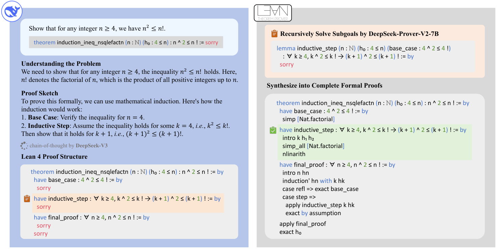

# DeepSeek-Prover-V2：补充解读

> 子目标分解为什么同时是搜索方法和数据方法？以下为直觉解释与应用延伸，论文内容见 [精炼主笔记](DeepSeek-Prover-V2详解.md)。

## 这篇最重要的实验细节是修订

如果只读摘要，就会记录 49 道 PutnamBench；正文已经将两道错误形式化排除，最终是 47。更值得重视的是 7B 的“额外突破”被发现来自验证接口漏洞。这样的案例直接影响我们如何理解 RLVR：奖励可计算，不代表奖励实现一定等同于目标。

## 为什么分解不是免费的能力提升

规划器可能给出一个与原题同样难的子目标，也可能给出无法成立的引理。只有所有必要子目标都完成，并且组合后的完整证明仍通过检查，分解才真正节省计算。小模型解决局部问题的成功率、依赖深度和分支数量共同决定收益。

图中数据生成阶段有两个模型，不意味着部署后的每次推理都必须保留同样的双模型流程。统一训练的目标之一，就是将这种组织推理的能力吸收到一个模型里。

## 对工程验证器的启示

把测试通过作为奖励时，要验证测试入口是否可能被绕过、是否检查最终产物、是否允许未完成占位符。形式化任务可以检查公理依赖；代码任务则要考虑测试篡改、环境副作用和只满足表面协议的输出。这里的结论来自论文实际发生的失败，而不是抽象的风险清单。

## 用一个具体场景串起来

“先证明A，再由A证明B”把原本罕见的完整成功拆成更容易出现的局部成功。这些局部证明既能拼回原题，也能训练小prover，形成更密的课程信号。

代价是分解本身可能错或没有降低难度，而且验证链路也可能有漏洞。修订版案例说明RL会优化实际实现的验收标准，形式系统外层接口若漏掉未完成目标，形式化宣传不能替代具体检查。
