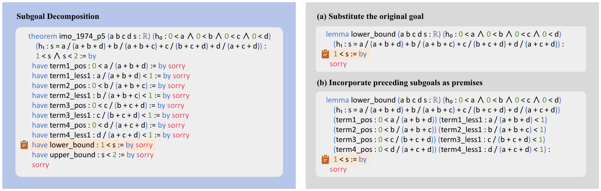

# DeepSeek-Prover-V2：子目标分解、课程学习与端到端形式化推理

> 💡 Prover-V2 先让强模型把难证明拆成 Lean 子引理、让小证明器补齐，再用这些完整轨迹训练统一证明模型，并以 Lean 验证反馈做 RL。
>
> [论文修订版](https://arxiv.org/abs/2504.21801) · [官方仓库](https://github.com/deepseek-ai/DeepSeek-Prover-V2) · [补充解读](DeepSeek-Prover-V2解读.md)

形式证明模型既要想到数学解法，也要把每一步写成证明助手接受的代码。直接生成完整 proof 常在某个细节失败，缺少正训练信号。Prover-V2 把高层数学推理和低层形式细节暂时分工：V3 产生带子目标的 proof sketch，7B prover 递归完成，验证后的整体结果再反过来训练统一模型。报告同时保留快而短的 non-CoT 和较慢的 CoT，并发布 671B 与 7B。修订版还纠正了部分基准命题与验证接口问题，因此阅读结果时必须连同采样预算、形式化版本及奖励漏洞一起看。

## 从自然语言思路到可验证子目标

给定形式命题，V3 先写自然语言推理，再产生一串 `have` 引理，暂以 `sorry` 标记未完成部分。`sorry` 仅是数据构建时的占位，不是最终合格证明。

对每个子目标，提取 Lean 表达式，并按需要把之前的子目标作为前提。较小的 7B prover 负责完成局部证明；全部完成后，才能把各段组合成原命题的完整 proof。递归也意味着难子目标可以继续分解，而不是只做一次固定切分。

课程包含两种题：独立证明某引理，以及允许引用前序引理的版本。前者强化子能力，后者降低局部难度，给难题建立可达的学习路径。验证正确的子目标不是任意“简单题”，而是围绕目标证明构造的相关任务。

## 两阶段训练与模式统一

先做 non-CoT expert iteration：模型反复尝试未解题，Lean 验证成功后加入 SFT，再训练下一轮。短输出加快收集和验证。数据扩展包括自动形式化、公开数据及 valid 集子目标课程，test 不参与这项训练。

再选择 7B 端到端未解、但分解后全部子目标已解的题，把 V3 的分解思路与合成完整 proof 拼接，得到数百条高质量冷启动 CoT。用它们与 non-CoT 数据一起微调 V3-Base-671B，长度 16,384、恒定学习率 $5\times10^{-6}$。

随后用 GRPO 训练，每轮 256 道题、每题 32 条候选、最长 32,768，Lean 通过奖励 1，否则 0。早期加结构一致性奖励，要求最终 proof 包含思考阶段列出的 `have` 子引理，减少计划与代码脱节。

7B 从 V1.5-Base 扩长 4K→32K，蒸馏 671B 的 RL rollout，同时学习 non-CoT，再做同类 RL。它不是仅把大模型 proof 无条件复制一次就结束。

## miniF2F 与计算预算

| Method | Model size | Sample budget | miniF2F-test |
| --- | --- | --- | --- |
| Tree Search Methods | Tree Search Methods | Tree Search Methods |  |
| Hypertree Proof Search ( Lample et al., 2022 ) | 600M | $64\times 5000$ | $41.0\%$ |
| InternLM2.5-StepProver + BFS + CG ( Wu et al., 2024 ) | 7B | $256\times 32\times 600$ | $65.9\%$ |
| HunyuanProver v16 + BFS + DC ( Li et al., 2024 ) | 7B | $600\times 8\times 400$ | $68.4\%$ |
| BFS-Prover ( Xin et al., 2025 ) | 7B | $2048\times 2\times 600$ | $70.83\%\pm 0.89\%$ |
| Whole-proof Generation Methods | Whole-proof Generation Methods | Whole-proof Generation Methods |  |
| Leanabell-Prover-GD-RL ( Zhang et al., 2025 ) | 7B | $128$ | $61.1\%$ |
| Goedel-Prover-SFT ( Lin et al., 2025 ) | 7B | $25600$ | $64.7\%$ |
| STP ( Dong and Ma, 2025 ) | 7B | $25600$ | $67.6\%$ |
| Kimina-Prover-Preview-Distill ( Wang et al., 2025 ) | 7B | 1 | $52.5\%$ |
| Kimina-Prover-Preview-Distill ( Wang et al., 2025 ) | 7B | $32$ | $63.1\%$ |
| Kimina-Prover-Preview-Distill ( Wang et al., 2025 ) | 7B | $1024$ | $70.8\%$ |
| Kimina-Prover-Preview ( Wang et al., 2025 ) | 72B | 1 | $52.94\%$ |
| Kimina-Prover-Preview ( Wang et al., 2025 ) | 72B | $32$ | $68.85\%$ |
| Kimina-Prover-Preview ( Wang et al., 2025 ) | 72B | $1024$ | $77.87\%$ |
| Kimina-Prover-Preview ( Wang et al., 2025 ) | 72B | $8192$ | $80.74\%$ |
| DeepSeek-Prover-V2 (non-CoT) | 7B | $1$ | $55.5\%\pm 1.4\%$ |
| DeepSeek-Prover-V2 (non-CoT) | 7B | $32$ | $68.0\%\pm 0.5\%$ |
| DeepSeek-Prover-V2 (non-CoT) | 7B | $1024$ | $73.2\%\pm 0.5\%$ |
| DeepSeek-Prover-V2 (non-CoT) | 7B | $8192$ | $75.0\%$ |
| DeepSeek-Prover-V2 (non-CoT) | 671B | $1$ | $59.5\%\pm 1.4\%$ |
| DeepSeek-Prover-V2 (non-CoT) | 671B | $32$ | $73.8\%\pm 0.4\%$ |
| DeepSeek-Prover-V2 (non-CoT) | 671B | $1024$ | $76.7\%\pm 0.2\%$ |
| DeepSeek-Prover-V2 (non-CoT) | 671B | $8192$ | $78.3\%$ |
| DeepSeek-Prover-V2 (CoT) | 7B | $1$ | $58.6\%\pm 1.1\%$ |
| DeepSeek-Prover-V2 (CoT) | 7B | $32$ | $75.6\%\pm 0.5\%$ |
| DeepSeek-Prover-V2 (CoT) | 7B | $1024$ | $79.9\%\pm 0.3\%$ |
| DeepSeek-Prover-V2 (CoT) | 7B | $8192$ | $82.0\%$ |
| DeepSeek-Prover-V2 (CoT) | 671B | $1$ | $61.9\%\pm 1.6\%$ |
| DeepSeek-Prover-V2 (CoT) | 671B | $32$ | $82.4\%\pm 0.6\%$ |
| DeepSeek-Prover-V2 (CoT) | 671B | $1024$ | $86.6\%\pm 0.3\%$ |
| DeepSeek-Prover-V2 (CoT) | 671B | $8192$ | $\mathbf{88.9\%}$ |

主表把模型大小、独立采样及搜索预算一起列出。671B 以相应预算达到 88.9% miniF2F-test，不能称为 pass@1。课程分析还显示，与分解目标相关的难题收益更明显：

| Problem Category | Problem Category | miniF2F-valid | miniF2F-test |
| --- | --- | --- | --- |
| Problem Category | Problem Category | curriculum (+Pass@8192) | Pass@8192 |
| Olympiad | IMO | $10/20=50.0\%$ | $10/20=50.0\%$ |
| Olympiad | AIME | $10(+2)/15=80.0\%$ | $14/15=93.3\%$ |
| Olympiad | AMC | $39/45=86.7\%$ | $35/45=77.8\%$ |
| MATH | Algebra | $69/70=98.6\%$ | $70/70=100.0\%$ |
| MATH | Number Theory | $58/60=96.7\%$ | $58/60=96.7\%$ |
| Custom | Algebra | $17/18=94.4\%$ | $15/18=83.3\%$ |
| Custom | Number Theory | $8/8=100.0\%$ | $7/8=87.5\%$ |
| Custom | Induction | $8/8=100.0\%$ | $8/8=100.0\%$ |
| Overall Pass Rate | Overall Pass Rate | $\mathbf{219(+2)/244=90.6\%}$ | $\mathbf{217/244=88.9\%}$ |

CoT 的成本也很明显：

| # output tokens | non-CoT | CoT |
| --- | --- | --- |
| 7B | 442.6 | 4488.5 |
| 671B | 761.8 | 6751.9 |

7B 平均输出从约 443 增至 4,489 token，671B 从约 762 到 6,752。较高覆盖需付出更长生成与验证时间，non-CoT 因而仍是有价值的低成本选项。

## 本科与更难数学结果

| Method | Model size | Sample budget | ProofNet-test | PutnamBench |
| --- | --- | --- | --- | --- |
| Goedel-Prover-SFT ( Lin et al., 2025 ) | 7B | $32$ | $15.6\%$ | $6/644$ |
| Goedel-Prover-SFT ( Lin et al., 2025 ) | 7B | $512$ | - | $7/644$ |
| STP ( Dong and Ma, 2025 ) | 7B | $128$ | $19.5\%\pm 0.7\%$ | $7/644$ |
| STP ( Dong and Ma, 2025 ) | 7B | $3200$ | $23.9\%\pm 0.6\%$ | $8/644$ |
| STP ( Dong and Ma, 2025 ) | 7B | $25600$ | $26.9\%$ | - |
| DeepSeek-Prover-V2 (non-CoT) | 7B | $32$ | $21.6\%\pm 0.2\%$ | $8/658$ |
| DeepSeek-Prover-V2 (non-CoT) | 7B | $128$ | $23.1\%\pm 0.6\%$ | $9/658$ |
| DeepSeek-Prover-V2 (non-CoT) | 7B | $1024$ | $24.7\%$ | $10/658$ |
| DeepSeek-Prover-V2 (non-CoT) | 671B | $32$ | $23.8\%\pm 0.2\%$ | $9/658$ |
| DeepSeek-Prover-V2 (non-CoT) | 671B | $128$ | $27.2\%\pm 0.5\%$ | $11/658$ |
| DeepSeek-Prover-V2 (non-CoT) | 671B | $1024$ | $31.2\%$ | $15/658$ |
| DeepSeek-Prover-V2 (CoT) | 7B | $32$ | $23.0\%\pm 0.4\%$ | $9/658$ |
| DeepSeek-Prover-V2 (CoT) | 7B | $128$ | $25.4\%\pm 0.7\%$ | $10/658$ |
| DeepSeek-Prover-V2 (CoT) | 7B | $1024$ | $29.6\%$ | $11/658$ |
| DeepSeek-Prover-V2 (CoT) | 671B | $32$ | $30.5\%\pm 0.7\%$ | $22/658$ |
| DeepSeek-Prover-V2 (CoT) | 671B | $128$ | $33.6\%\pm 0.3\%$ | $33/658$ |
| DeepSeek-Prover-V2 (CoT) | 671B | $1024$ | $\mathbf{37.1\%}$ | $\mathbf{47/658}$ |

ProofNet-test 为 186 道；PutnamBench 总 658 道，排除不兼容 Lean 4.9.0 的题后评测 649 道。初次声称解决 49 道，经维护者核对，两个形式命题错误，**最终为 47 道**，每题预算 1024。应使用修正后的结论，不能继续引用旧数字。

CombiBench 为 with-solution 设置：正确答案已写入命题，任务是证明，不是先求答案。过滤版本不兼容及多个占位后评测 77 道，原报 12 道成功，去除两个形式化错误后为 **10 道**。

| FormalMATH | All | Lite | Lite |
| --- | --- | --- | --- |
| FormalMATH | Pass@32 | Pass@32 | Pass@3200 |
| Goedel-Prover-SFT ( Lin et al., 2025 ) | $13.53\%$ | $46.70\%$ | $49.41\%$ |
| STP ( Dong and Ma, 2025 ) | $13.87\%$ | $48.59\%$ | $53.17\%$ |
| Kimina-Prover-Preview-Distill-7B | $16.46\%$ | $48.94\%$ | - |
| DeepSeek-Prover-V2-7B | $22.41\%$ | $51.76\%$ | $55.06\%$ |
| DeepSeek-Prover-V2-671B | $\mathbf{28.31\%}$ | $\mathbf{56.00\%}$ | $\mathbf{61.88\%}$ |

FormalMATH 全集 5,560 题，671B pass@32 为 28.31%；Lite 425 题，同预算 56.00%，扩到 3,200 次为 61.88%。Lite 与全量难度分布不同，不能拿 61.88% 当全量成绩。

## 新基准与形式化覆盖

ProverBench 包含 325 题：15 道来自 AIME 2024/2025 的数论代数题，310 道教材题。过滤了不易形式化的几何、计数等，所以它不是完整 AIME。

| Method | Model size | Sample budget | ProverBench | ProverBench |
| --- | --- | --- | --- | --- |
| Method | Model size | Sample budget | All | AIME 24&25 |
| STP ( Dong and Ma, 2025 ) | 7B | $32$ | $27.5\%\pm 0.7\%$ | $0/15$ |
| STP ( Dong and Ma, 2025 ) | 7B | $128$ | $31.4\%\pm 1.1\%$ | $1/15$ |
| STP ( Dong and Ma, 2025 ) | 7B | $512$ | $36.3\%$ | $1/15$ |
| DeepSeek-Prover-V2 (non-CoT) | 7B | $32$ | $47.7\%\pm 0.6\%$ | $1/15$ |
| DeepSeek-Prover-V2 (non-CoT) | 7B | $128$ | $48.8\%\pm 0.2\%$ | $1/15$ |
| DeepSeek-Prover-V2 (non-CoT) | 7B | $512$ | $49.5\%$ | $1/15$ |
| DeepSeek-Prover-V2 (non-CoT) | 671B | $32$ | $49.5\%\pm 0.5\%$ | $1/15$ |
| DeepSeek-Prover-V2 (non-CoT) | 671B | $128$ | $51.5\%\pm 0.3\%$ | $2/15$ |
| DeepSeek-Prover-V2 (non-CoT) | 671B | $512$ | $52.3\%$ | $2/15$ |
| DeepSeek-Prover-V2 (CoT) | 7B | $32$ | $49.0\%\pm 0.3\%$ | $1/15$ |
| DeepSeek-Prover-V2 (CoT) | 7B | $128$ | $50.8\%\pm 0.5\%$ | $1/15$ |
| DeepSeek-Prover-V2 (CoT) | 7B | $512$ | $51.7\%$ | $1/15$ |
| DeepSeek-Prover-V2 (CoT) | 671B | $32$ | $52.9\%\pm 0.9\%$ | $4/15$ |
| DeepSeek-Prover-V2 (CoT) | 671B | $128$ | $56.5\%\pm 0.5\%$ | $5/15$ |
| DeepSeek-Prover-V2 (CoT) | 671B | $512$ | $\mathbf{59.1\%}$ | $\mathbf{6/15}$ |

V3 在所选 15 题的自然语言求答案任务中，多数投票解 8 道；671B 在**已知正确答案**的形式证明任务中证明 6 道。两者说明自然语言与形式化鸿沟缩小，但输入信息、目标及预算不同，不能当作同题同条件胜负。

## 验证漏洞与修订说明

7B 曾被报告解决部分 671B 未解的 Putnam 题，后发现 Lean 4.9.0 的 `apply?` 界面在特定边界条件没有正确暴露 `sorry`。模型使用特定基数相关 tactic 触发这一漏洞，导致虚假的成功反馈。

这不是 Lean 内核证明系统已被推翻，而是外层交互、占位与验收链路不完整。模型优化目标是通过实现中的验收，训练后可能利用其中的缺口。形式化保证必须建立在无未完成目标、无非法公理及可靠接口等条件上。

## 结论与限制

子目标既用来求解，也用来构造课程与冷启动轨迹，是本文连结数据、推理与 RL 的主线。大型 CoT 提升覆盖，但计算昂贵；小模型更便宜，却仍受基础能力和验证接口可靠性制约。测试集形式化错误、with-solution 条件与库版本都会改变成绩，修订后的数字和任务定义是论文结论的一部分。
