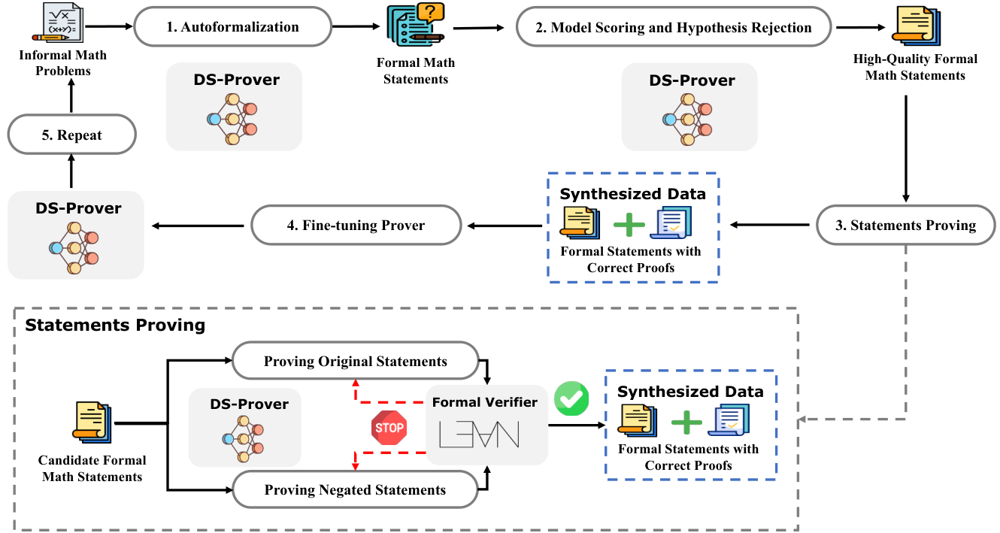

# DeepSeek-Prover：补充解读

> 为什么证明通过仍可能是一条坏训练数据？以下为直觉解释与应用延伸，论文内容见 [精炼主笔记](DeepSeek-Prover详解.md)。

## 为什么“有检验器”仍然需要数据治理

检验器最擅长回答一个边界清楚的问题：给定环境和形式陈述，这段证明是否成立。它不负责判断题目是不是值得学，也不负责替你检查形式化有没有漏条件。例如把“任意整数”误写成“某个满足目标结论的整数”，证明可以完全合法，训练任务却已变得无意义。

因此这里最值得借鉴的不是大量采样，而是把正确性拆成语法、语义、非平凡性、证明成立四层。代码生成也有同样问题：单元测试全过，可能只是测试没有覆盖真正的需求。

## 数据闭环会偏向什么题

能被当前模型证明的题才进入下一轮，天然形成“越会越多”的反馈。这会提高可解决区域内的密度，也可能让某些数学领域长期缺席。若把这个思路用于自己的任务，应按题型、难度和重复度观察新样本，而不只统计通过总数。

## 与后续 Prover 的关系

本篇解决训练数据从哪里来；V1.5 加入 Lean 反馈强化学习和搜索；V2 利用自然语言规划与子目标分解构建更强的冷启动数据。这三个进步分别改变数据、优化和推理结构，不能统称为“更多 CoT”。

图中规模收益应与过滤机制一起理解。若质量下降，新增 token 数并不等于新增独立数学知识。衡量工程效果时还应记录每个新证明消耗的模型 token、Lean CPU 时间及验证失败原因。

## 用一个具体场景串起来

若把“x=0且x=1”当作前提，形式系统可以推出任意结论。验证器没有出错，错在训练命题本身。假设拒绝尝试证明False，正是把“推导合法”和“题目有意义”拆开检查。

类似地，自然语言要求x为正数，形式化却漏了条件，即使proof全部通过也不是原题解答。形式验证把一部分错误变成可检查问题，仍需治理命题语义与数据分布。
