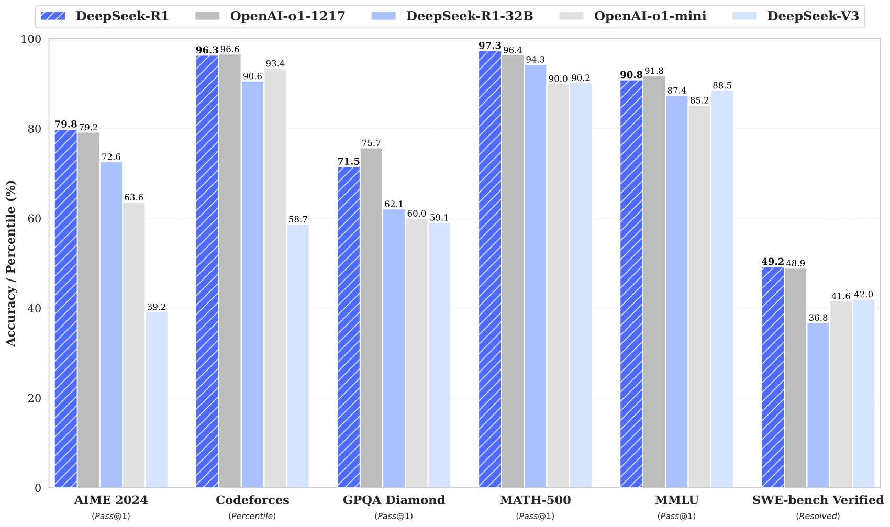
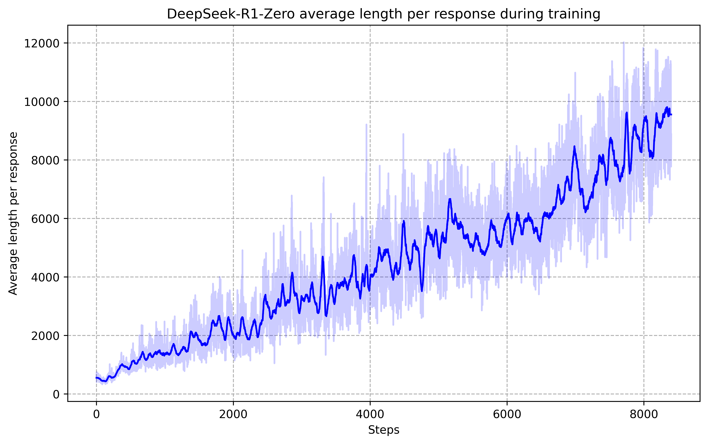

# DeepSeek-R1: Incentivizing Reasoning Capability in LLMs via Reinforcement Learning / 全文中英对照

> 来源：[arXiv:2501.12948v1](https://arxiv.org/abs/2501.12948v1)。英文段落后紧接中文，覆盖所取 HTML 版本的主文、附录、图表、脚注与参考文献；公式、数字表和书目信息共用。中文以机器初译为底稿，进行了术语整理与结构核对，尚未逐句人工审定；遇到歧义请以紧邻英文和原论文为准。 本文采用作者官方仓库公开报告，其许可证及版权声明随目录保留；中文为该版本的翻译改写。 本对照采用官方仓库 22 页初版（与 arXiv v1 正文核对一致），不是后续扩展为 86 页的 arXiv v2。

## Authors and affiliations / 作者与机构

DeepSeek-AI research@deepseek.com

**EN.** \reportnumber

**中.** \报告编号

**EN.** 001

**中.** 001

## Abstract / 摘要

**EN.** We introduce our first-generation reasoning models, DeepSeek-R1-Zero and DeepSeek-R1. DeepSeek-R1-Zero, a model trained via large-scale reinforcement learning (RL) without supervised fine-tuning (SFT) as a preliminary step, demonstrates remarkable reasoning capabilities. Through RL, DeepSeek-R1-Zero naturally emerges with numerous powerful and intriguing reasoning behaviors. However, it encounters challenges such as poor readability, and language mixing. To address these issues and further enhance reasoning performance, we introduce DeepSeek-R1, which incorporates multi-stage training and cold-start data before RL. DeepSeek-R1 achieves performance comparable to OpenAI-o1-1217 on reasoning tasks. To support the research community, we open-source DeepSeek-R1-Zero, DeepSeek-R1, and six dense models (1.5B, 7B, 8B, 14B, 32B, 70B) distilled from DeepSeek-R1 based on Qwen and Llama.

**中.** 我们介绍我们的第一代推理模型 DeepSeek-R1-Zero 和 DeepSeek-R1。 DeepSeek-R1-Zero 是一种通过大规模强化学习 (RL) 训练的模型，无需监督微调 (SFT) 作为初步步骤，展示了卓越的推理能力。通过强化学习，DeepSeek-R1-Zero 自然而然地出现了许多强大且有趣的推理行为。然而，它遇到了可读性差、语言混合等挑战。为了解决这些问题并进一步提高推理性能，我们推出了 DeepSeek-R1，它在 RL 之前结合了多阶段训练和冷启动数据。 DeepSeek-R1 在推理任务上实现了与 OpenAI-o1-1217 相当的性能。为了支持研究社区，我们开源了 DeepSeek-R1-Zero、DeepSeek-R1 以及基于 Qwen 和 Llama 从 DeepSeek-R1 中提炼出来的六个稠密模型（1.5B、7B、8B、14B、32B、70B）。

**EN.** Figure 1: Benchmark performance of DeepSeek-R1.

**中.** 图 1：DeepSeek-R1 的基准性能。

## Introduction / 简介

**EN.** In recent years, Large Language Models (LLMs) have been undergoing rapid iteration and evolution ( OpenAI, 2024a ; Anthropic, 2024 ; Google, 2024 ) , progressively diminishing the gap towards Artificial General Intelligence (AGI).

**中.** 近年来，大型语言模型（LLM）一直在经历快速迭代和进化（OpenAI，2024a；Anthropic，2024；Google，2024），逐渐缩小与通用人工智能（AGI）的差距。

**EN.** Recently, post-training has emerged as an important component of the full training pipeline. It has been shown to enhance accuracy on reasoning tasks, align with social values, and adapt to user preferences, all while requiring relatively minimal computational resources against pre-training. In the context of reasoning capabilities, OpenAI’s o1 ( OpenAI, 2024b ) series models were the first to introduce inference-time scaling by increasing the length of the Chain-of-Thought reasoning process. This approach has achieved significant improvements in various reasoning tasks, such as mathematics, coding, and scientific reasoning. However, the challenge of effective test-time scaling remains an open question for the research community. Several prior works have explored various approaches, including process-based reward models ( Uesato et al., 2022 ; Lightman et al., 2023 ; Wang et al., 2023 ) , reinforcement learning ( Kumar et al., 2024 ) , and search algorithms such as Monte Carlo Tree Search and Beam Search ( Feng et al., 2024 ; Xin et al., 2024 ; Trinh et al., 2024 ) . However, none of these methods has achieved general reasoning performance comparable to OpenAI’s o1 series models.

**中.** 最近，后期培训已成为整个培训渠道的重要组成部分。它已被证明可以提高推理任务的准确性，与社会价值观保持一致，并适应用户偏好，同时在预训练中需要相对最少的计算资源。在推理能力方面，OpenAI 的 o1（OpenAI，2024b）系列模型率先通过增加思想链推理过程的长度来引入推理时间缩放。这种方法在数学、编码和科学推理等各种推理任务中取得了显着的改进。然而，有效测试时间扩展的挑战对于研究界来说仍然是一个悬而未决的问题。之前的几项工作探索了各种方法，包括基于过程的奖励模型（Uesato et al., 2022；Lightman et al., 2023；Wang et al., 2023）、强化学习（Kumar et al., 2024）以及搜索算法，如蒙特卡罗树搜索和束搜索（Feng et al., 2024；Xin et al., 2024；Trinh et al.）等，2024）。然而，这些方法都没有达到与 OpenAI 的 o1 系列模型相媲美的通用推理性能。

**EN.** In this paper, we take the first step toward improving language model reasoning capabilities using pure reinforcement learning (RL). Our goal is to explore the potential of LLMs to develop reasoning capabilities without any supervised data, focusing on their self-evolution through a pure RL process. Specifically, we use DeepSeek-V3-Base as the base model and employ GRPO ( Shao et al., 2024 ) as the RL framework to improve model performance in reasoning. During training, DeepSeek-R1-Zero naturally emerged with numerous powerful and interesting reasoning behaviors. After thousands of RL steps, DeepSeek-R1-Zero exhibits super performance on reasoning benchmarks. For instance, the pass@1 score on AIME 2024 increases from 15.6% to 71.0%, and with majority voting, the score further improves to 86.7%, matching the performance of OpenAI-o1-0912.

**中.** 在本文中，我们迈出了使用纯强化学习（RL）提高语言模型推理能力的第一步。我们的目标是探索LLM在没有任何监督数据的情况下发展推理能力的潜力，重点关注它们通过纯强化学习过程的自我进化。具体来说，我们使用 DeepSeek-V3-Base 作为基础模型，并采用 GRPO（Shao et al., 2024）作为 RL 框架来提高模型的推理性能。在训练过程中，DeepSeek-R1-Zero自然而然地表现出了许多强大而有趣的推理行为。经过数千个 RL 步骤后，DeepSeek-R1-Zero 在推理基准测试中展现出超强的性能。例如，AIME 2024 上的 pass@1 分数从 15.6% 提高到 71.0%，通过多数投票，分数进一步提高到 86.7%，与 OpenAI-o1-0912 的性能相当。

**EN.** However, DeepSeek-R1-Zero encounters challenges such as poor readability, and language mixing. To address these issues and further enhance reasoning performance, we introduce DeepSeek-R1, which incorporates a small amount of cold-start data and a multi-stage training pipeline. Specifically, we begin by collecting thousands of cold-start data to fine-tune the DeepSeek-V3-Base model. Following this, we perform reasoning-oriented RL like DeepSeek-R1-Zero. Upon nearing convergence in the RL process, we create new SFT data through rejection sampling on the RL checkpoint, combined with supervised data from DeepSeek-V3 in domains such as writing, factual QA, and self-cognition, and then retrain the DeepSeek-V3-Base model. After fine-tuning with the new data, the checkpoint undergoes an additional RL process, taking into account prompts from all scenarios. After these steps, we obtained a checkpoint referred to as DeepSeek-R1, which achieves performance on par with OpenAI-o1-1217.

**中.** 然而，DeepSeek-R1-Zero 遇到了可读性差、语言混合等挑战。为了解决这些问题并进一步提高推理性能，我们推出了 DeepSeek-R1，它结合了少量的冷启动数据和多阶段训练管道。具体来说，我们首先收集数千个冷启动数据来微调 DeepSeek-V3-Base 模型。接下来，我们执行面向推理的强化学习，如 DeepSeek-R1-Zero。当 RL 过程接近收敛时，我们通过 RL 检查点上的拒绝采样创建新的 SFT 数据，并结合 DeepSeek-V3 在写作、事实 QA 和自我认知等领域的监督数据，然后重新训练 DeepSeek-V3-Base 模型。在使用新数据进行微调后，检查点会经历额外的强化学习过程，同时考虑所有场景的提示。经过这些步骤，我们获得了一个名为 DeepSeek-R1 的检查点，其性能与 OpenAI-o1-1217 相当。

**EN.** We further explore distillation from DeepSeek-R1 to smaller dense models. Using Qwen2.5-32B ( Qwen, 2024b ) as the base model, direct distillation from DeepSeek-R1 outperforms applying RL on it. This demonstrates that the reasoning patterns discovered by larger base models are crucial for improving reasoning capabilities. We open-source the distilled Qwen and Llama ( Dubey et al., 2024 ) series. Notably, our distilled 14B model outperforms state-of-the-art open-source QwQ-32B-Preview ( Qwen, 2024a ) by a large margin, and the distilled 32B and 70B models set a new record on the reasoning benchmarks among dense models.

**中.** 我们进一步探索从 DeepSeek-R1 到更小的稠密模型的蒸馏。使用 Qwen2.5-32B（Qwen，2024b）作为基础模型，DeepSeek-R1 的直接蒸馏优于在其上应用 RL。这表明较大的基础模型发现的推理模式对于提高推理能力至关重要。我们开源了经过蒸馏的 Qwen 和 Llama（Dubey 等人，2024）系列。值得注意的是，我们的蒸馏 14B 模型大幅优于最先进的开源 QwQ-32B-Preview（Qwen，2024a），并且蒸馏 32B 和 70B 模型在稠密模型的推理基准上创下了新记录。

### Contributions / 贡献

#### Post-Training: Large-Scale Reinforcement Learning on the Base Model / 训练后：基础模型上的大规模强化学习

**EN.** We directly apply RL to the base model without relying on supervised fine-tuning (SFT) as a preliminary step. This approach allows the model to explore chain-of-thought (CoT) for solving complex problems, resulting in the development of DeepSeek-R1-Zero. DeepSeek-R1-Zero demonstrates capabilities such as self-verification, reflection, and generating long CoTs, marking a significant milestone for the research community. Notably, it is the first open research to validate that reasoning capabilities of LLMs can be incentivized purely through RL, without the need for SFT. This breakthrough paves the way for future advancements in this area.

**中.** 我们直接将强化学习应用于基本模型，而不依赖监督微调（SFT）作为初步步骤。这种方法允许模型探索解决复杂问题的思路（CoT），从而开发了 DeepSeek-R1-Zero。 DeepSeek-R1-Zero 展示了自我验证、反射和生成长 CoT 等功能，这标志着研究界的一个重要里程碑。值得注意的是，这是第一个开放研究，验证了LLM的推理能力可以纯粹通过强化学习来激励，而不需要 SFT。这一突破为该领域未来的进步铺平了道路。

**EN.** We introduce our pipeline to develop DeepSeek-R1. The pipeline incorporates two RL stages aimed at discovering improved reasoning patterns and aligning with human preferences, as well as two SFT stages that serve as the seed for the model’s reasoning and non-reasoning capabilities. We believe the pipeline will benefit the industry by creating better models.

**中.** 我们介绍了开发 DeepSeek-R1 的流程。该管道包含两个 RL 阶段，旨在发现改进的推理模式并与人类偏好保持一致，以及两个 SFT 阶段，作为模型推理和非推理能力的种子。我们相信该管道将通过创建更好的模型使整个行业受益。

#### Distillation: Smaller Models Can Be Powerful Too / 蒸馏：较小的模型也可以很强大

**EN.** We demonstrate that the reasoning patterns of larger models can be distilled into smaller models, resulting in better performance compared to the reasoning patterns discovered through RL on small models. The open source DeepSeek-R1, as well as its API, will benefit the research community to distill better smaller models in the future.

**中.** 我们证明，较大模型的推理模式可以被提炼成较小的模型，与通过 RL 在小型模型上发现的推理模式相比，可以获得更好的性能。开源 DeepSeek-R1 及其 API 将有利于研究社区在未来提炼出更好的小型模型。

**EN.** Using the reasoning data generated by DeepSeek-R1, we fine-tuned several dense models that are widely used in the research community. The evaluation results demonstrate that the distilled smaller dense models perform exceptionally well on benchmarks. DeepSeek-R1-Distill-Qwen-7B achieves 55.5% on AIME 2024, surpassing QwQ-32B-Preview. Additionally, DeepSeek-R1-Distill-Qwen-32B scores 72.6% on AIME 2024, 94.3% on MATH-500, and 57.2% on LiveCodeBench. These results significantly outperform previous open-source models and are comparable to o1-mini. We open-source distilled 1.5B, 7B, 8B, 14B, 32B, and 70B checkpoints based on Qwen2.5 and Llama3 series to the community.

**中.** 使用 DeepSeek-R1 生成的推理数据，我们对研究界广泛使用的几个稠密模型进行了微调。评估结果表明，经过蒸馏的较小稠密模型在基准测试中表现非常出色。 DeepSeek-R1-Distill-Qwen-7B 在 AIME 2024 上达到 55.5%，超过 QwQ-32B-Preview。此外，DeepSeek-R1-Distill-Qwen-32B 在 AIME 2024 上得分为 72.6%，在 MATH-500 上得分为 94.3%，在 LiveCodeBench 上得分为 57.2%。这些结果明显优于之前的开源模型，与 o1-mini 相当。我们将基于Qwen2.5和Llama3系列的1.5B、7B、8B、14B、32B和70B检查点开源给社区。

### Summary of Evaluation Results / 评估结果总结

**EN.** Reasoning tasks : (1) DeepSeek-R1 achieves a score of 79.8% Pass@1 on AIME 2024, slightly surpassing OpenAI-o1-1217. On MATH-500, it attains an impressive score of 97.3%, performing on par with OpenAI-o1-1217 and significantly outperforming other models. (2) On coding-related tasks, DeepSeek-R1 demonstrates expert level in code competition tasks, as it achieves 2,029 Elo rating on Codeforces outperforming 96.3% human participants in the competition. For engineering-related tasks, DeepSeek-R1 performs slightly better than DeepSeek-V3, which could help developers in real world tasks.

**中.** 推理任务：（1）DeepSeek-R1 在 AIME 2024 上取得了 79.8% Pass@1 的成绩，略高于 OpenAI-o1-1217。在 MATH-500 上，它获得了 97.3% 的骄人成绩，与 OpenAI-o1-1217 相当，并且明显优于其他模型。 （2）在编码相关任务上，DeepSeek-R1 在代码竞赛任务中展现了专家水平，它在 Codeforces 上获得了 2,029 Elo 评级，优于竞赛中 96.3% 的人类参与者。对于工程相关任务，DeepSeek-R1 的表现略优于 DeepSeek-V3，这可以帮助开发人员完成实际任务。

**EN.** Knowledge : On benchmarks such as MMLU, MMLU-Pro, and GPQA Diamond, DeepSeek-R1 achieves outstanding results, significantly outperforming DeepSeek-V3 with scores of 90.8% on MMLU, 84.0% on MMLU-Pro, and 71.5% on GPQA Diamond. While its performance is slightly below that of OpenAI-o1-1217 on these benchmarks, DeepSeek-R1 surpasses other closed-source models, demonstrating its competitive edge in educational tasks. On the factual benchmark SimpleQA, DeepSeek-R1 outperforms DeepSeek-V3, demonstrating its capability in handling fact-based queries. A similar trend is observed where OpenAI-o1 surpasses 4o on this benchmark.

**中.** 知识：在 MMLU、MMLU-Pro 和 GPQA Diamond 等基准测试上，DeepSeek-R1 取得了出色的成绩，显着优于 DeepSeek-V3，在 MMLU 上得分为 90.8%，在 MMLU-Pro 上得分为 84.0%，在 GPQA Diamond 上得分为 71.5%。虽然在这些基准测试中 DeepSeek-R1 的性能略低于 OpenAI-o1-1217，但 DeepSeek-R1 超越了其他闭源模型，展示了其在教育任务中的竞争优势。在事实基准 SimpleQA 上，DeepSeek-R1 的表现优于 DeepSeek-V3，展示了其处理基于事实的查询的能力。观察到类似的趋势，OpenAI-o1 在该基准测试中超过了 4o。

**EN.** Others : DeepSeek-R1 also excels in a wide range of tasks, including creative writing, general question answering, editing, summarization, and more. It achieves an impressive length-controlled win-rate of 87.6% on AlpacaEval 2.0 and a win-rate of 92.3% on ArenaHard, showcasing its strong ability to intelligently handle non-exam-oriented queries. Additionally, DeepSeek-R1 demonstrates outstanding performance on tasks requiring long-context understanding, substantially outperforming DeepSeek-V3 on long-context benchmarks.

**中.** 其他：DeepSeek-R1 在广泛的任务中也表现出色，包括创意写作、一般问答、编辑、摘要等。它在 AlpacaEval 2.0 上实现了令人印象深刻的 87.6% 的长度控制胜率，在 ArenaHard 上实现了 92.3% 的胜率，展示了其智能处理非考试导向查询的强大能力。此外，DeepSeek-R1 在需要长上下文理解的任务上表现出出色的性能，在长上下文基准测试上远远优于 DeepSeek-V3。

## Approach / 方法

### Overview / 概述

**EN.** Previous work has heavily relied on large amounts of supervised data to enhance model performance. In this study, we demonstrate that reasoning capabilities can be significantly improved through large-scale reinforcement learning (RL), even without using supervised fine-tuning (SFT) as a cold start. Furthermore, performance can be further enhanced with the inclusion of a small amount of cold-start data. In the following sections, we present: (1) DeepSeek-R1-Zero, which applies RL directly to the base model without any SFT data, and (2) DeepSeek-R1, which applies RL starting from a checkpoint fine-tuned with thousands of long Chain-of-Thought (CoT) examples. 3) Distill the reasoning capability from DeepSeek-R1 to small dense models.

**中.** 以前的工作严重依赖大量的监督数据来提高模型性能。在这项研究中，我们证明即使不使用监督微调（SFT）作为冷启动，也可以通过大规模强化学习（RL）显着提高推理能力。此外，通过包含少量冷启动数据可以进一步增强性能。在以下部分中，我们将介绍：(1) DeepSeek-R1-Zero，它将 RL 直接应用于基本模型，无需任何 SFT 数据；(2) DeepSeek-R1，它从使用数千个长思想链 (CoT) 示例进行微调的检查点开始应用 RL。 3）将 DeepSeek-R1 的推理能力提炼为小型稠密模型。

### DeepSeek-R1-Zero: Reinforcement Learning on the Base Model / DeepSeek-R1-Zero：基础模型上的强化学习

**EN.** Reinforcement learning has demonstrated significant effectiveness in reasoning tasks, as evidenced by our previous works ( Wang et al., 2023 ; Shao et al., 2024 ) . However, these works heavily depended on supervised data, which are time-intensive to gather. In this section, we explore the potential of LLMs to develop reasoning capabilities without any supervised data , focusing on their self-evolution through a pure reinforcement learning process. We start with a brief overview of our RL algorithm, followed by the presentation of some exciting results, and hope this provides the community with valuable insights.

**中.** 正如我们之前的工作所证明的那样，强化学习在推理任务中表现出了显着的有效性（Wang et al., 2023; Shao et al., 2024）。然而，这些工作在很大程度上依赖于监督数据，而收集这些数据非常耗时。在本节中，我们探索LLM在没有任何监督数据的情况下发展推理能力的潜力，重点关注它们通过纯粹的强化学习过程的自我进化。我们首先简要概述我们的 RL 算法，然后介绍一些令人兴奋的结果，并希望这能为社区提供有价值的见解。

#### Reinforcement Learning Algorithm / 强化学习算法

#### Group Relative Policy Optimization / 集团相关政策优化

**EN.** In order to save the training costs of RL, we adopt Group Relative Policy Optimization (GRPO) ( Shao et al., 2024 ) , which foregoes the critic model that is typically the same size as the policy model, and estimates the baseline from group scores instead. Specifically, for each question $q$ , GRPO samples a group of outputs $\{o_{1},o_{2},\cdots,o_{G}\}$ from the old policy $\pi_{\theta_{old}}$ and then optimizes the policy model $\pi_{\theta}$ by maximizing the following objective:

**中.** 为了节省强化学习的训练成本，我们采用组相对策略优化（GRPO）（Shao et al., 2024），它放弃了通常与策略模型大小相同的批评模型，而是根据组分数估计基线。具体来说，对于每个问题 $q$ ，GRPO 从旧策略 $\pi_{\theta_{old}}$ 中采样一组输出 $\{o_{1},o_{2},\cdots,o_{G}\}$ ，然后通过最大化以下目标来优化策略模型 $\pi_{\theta}$ ：

$$
\begin{split}\mathcal{J}_{GRPO}(\theta)&=\mathbb{E}{[q\sim P(Q),\{o_{i}\}_{i=1}^{G}\sim\pi_{\theta_{old}}(O|q)]}\\
&\frac{1}{G}\sum_{i=1}^{G}\left(\min\left(\frac{\pi_{\theta}(o_{i}|q)}{\pi_{\theta_{old}}(o_{i}|q)}A_{i},\text{clip}\left(\frac{\pi_{\theta}(o_{i}|q)}{\pi_{\theta_{old}}(o_{i}|q)},1-\varepsilon,1+\varepsilon\right)A_{i}\right)-\beta\mathbb{D}_{KL}\left(\pi_{\theta}||\pi_{ref}\right)\right),\end{split}\tag{1}
$$

$$
\mathbb{D}_{KL}\left(\pi_{\theta}||\pi_{ref}\right)=\frac{\pi_{ref}(o_{i}|q)}{\pi_{\theta}(o_{i}|q)}-\log\frac{\pi_{ref}(o_{i}|q)}{\pi_{\theta}(o_{i}|q)}-1,\tag{2}
$$

**EN.** where $\varepsilon$ and $\beta$ are hyper-parameters, and $A_{i}$ is the advantage, computed using a group of rewards $\{r_{1},r_{2},\ldots,r_{G}\}$ corresponding to the outputs within each group:

**中.** 其中 $\varepsilon$ 和 $\beta$ 是超参数，$A_{i}$ 是优势，使用与每组内的输出相对应的一组奖励 $\{r_{1},r_{2},\ldots,r_{G}\}$ 进行计算：

$$
A_{i}=\frac{r_{i}-{\mathrm{m}ean(\{r_{1},r_{2},\cdots,r_{G}\})}}{{\mathrm{s}td(\{r_{1},r_{2},\cdots,r_{G}\})}}.\tag{3}
$$

| A conversation between User and Assistant. The user asks a question, and the Assistant solves it. 用户和助理之间的对话。用户提出问题，助手解决问题。 |
| --- |
| The assistant first thinks about the reasoning process in the mind and then provides the user 助手首先在脑海中思考推理过程，然后提供给用户 |
| with the answer. The reasoning process and answer are enclosed within <think> </think> and 与答案。推理过程和答案包含在 <think> </think> 中 |
| <answer> </answer> tags, respectively, i.e., <think> reasoning process here </think> 分别是<answer></answer>标签，即<think>这里的推理过程</think> |
| <answer> answer here </answer>. User: prompt . Assistant: <answer>在这里回答</answer>。用户：提示。助理： |

**EN.** Table 1: Template for DeepSeek-R1-Zero. prompt will be replaced with the specific reasoning question during training.

**中.** 表 1：DeepSeek-R1-Zero 模板。训练时提示将替换为具体推理问题。

#### Reward Modeling / 奖励模型

**EN.** The reward is the source of the training signal, which decides the optimization direction of RL. To train DeepSeek-R1-Zero, we adopt a rule-based reward system that mainly consists of two types of rewards:

**中.** 奖励是训练信号的来源，决定了RL的优化方向。为了训练 DeepSeek-R1-Zero，我们采用基于规则的奖励系统，主要包括两种类型的奖励：

**EN.** Accuracy rewards : The accuracy reward model evaluates whether the response is correct. For example, in the case of math problems with deterministic results, the model is required to provide the final answer in a specified format (e.g., within a box), enabling reliable rule-based verification of correctness. Similarly, for LeetCode problems, a compiler can be used to generate feedback based on predefined test cases.

**中.** 准确性奖励：准确性奖励模型评估响应是否正确。例如，对于具有确定性结果的数学问题，模型需要以指定格式（例如，在框中）提供最终答案，从而实现可靠的基于规则的正确性验证。类似地，对于 LeetCode 问题，可以使用编译器根据预定义的测试用例生成反馈。

**EN.** Format rewards : In addition to the accuracy reward model, we employ a format reward model that enforces the model to put its thinking process between ‘<think>’ and ‘</think>’ tags.

**中.** 格式奖励：除了准确性奖励模型之外，我们还采用了格式奖励模型，强制模型将其思维过程放在“<think>”和“</think>”标签之间。

**EN.** We do not apply the outcome or process neural reward model in developing DeepSeek-R1-Zero, because we find that the neural reward model may suffer from reward hacking in the large-scale reinforcement learning process, and retraining the reward model needs additional training resources and it complicates the whole training pipeline.

**中.** 我们在开发 DeepSeek-R1-Zero 时没有应用结果或过程神经奖励模型，因为我们发现神经奖励模型在大规模强化学习过程中可能会受到奖励投机攻击，并且重新训练奖励模型需要额外的训练资源，这使得整个训练流程变得复杂。

#### Training Template / 培训模板

**EN.** To train DeepSeek-R1-Zero, we begin by designing a straightforward template that guides the base model to adhere to our specified instructions. As depicted in Table 1 , this template requires DeepSeek-R1-Zero to first produce a reasoning process, followed by the final answer. We intentionally limit our constraints to this structural format, avoiding any content-specific biases—such as mandating reflective reasoning or promoting particular problem-solving strategies—to ensure that we can accurately observe the model’s natural progression during the RL process.

**中.** 为了训练 DeepSeek-R1-Zero，我们首先设计一个简单的模板，指导基本模型遵守我们指定的指令。如表 1 所示，该模板需要 DeepSeek-R1-Zero 首先产生推理过程，然后得出最终答案。我们有意将限制限制在这种结构格式上，避免任何特定于内容的偏差——例如强制反思推理或促进特定的问题解决策略——以确保我们能够在强化学习过程中准确观察模型的自然进展。

#### Performance, Self-evolution Process and Aha Moment of DeepSeek-R1-Zero / DeepSeek-R1-Zero的性能、自我进化过程和顿悟时刻

#### Performance of DeepSeek-R1-Zero / DeepSeek-R1-Zero 的性能

| Model 型号 | AIME 2024 2024年国际医疗器械展览会 | AIME 2024 2024年国际医疗器械展览会 | MATH-500 数学500 | GPQA GP质量保证 | LiveCode 实时代码 | CodeForces 代码力量 |
| --- | --- | --- | --- | --- | --- | --- |
| Model 型号 | AIME 2024 2024年国际医疗器械展览会 | AIME 2024 2024年国际医疗器械展览会 | MATH-500 数学500 | Diamond 钻石 | Bench 长凳 | CodeForces 代码力量 |
| Model 型号 | pass@1 通过@1 | cons@64 缺点@64 | pass@1 通过@1 | pass@1 通过@1 | pass@1 通过@1 | rating 评级 |
| OpenAI-o1-mini | 63.6 | 80.0 | 90.0 | 60.0 | 53.8 | 1820 |
| OpenAI-o1-0912 | 74.4 | 83.3 | 94.8 | 77.3 | 63.4 | 1843 |
| DeepSeek-R1-Zero DeepSeek-R1-零 | 71.0 | 86.7 | 95.9 | 73.3 | 50.0 | 1444 |

**EN.** Table 2: Comparison of DeepSeek-R1-Zero and OpenAI o1 models on reasoning-related benchmarks.

**中.** 表 2：DeepSeek-R1-Zero 和 OpenAI o1 模型在推理相关基准上的比较。

**EN.** Figure 2: AIME accuracy of DeepSeek-R1-Zero during training. For each question, we sample 16 responses and calculate the overall average accuracy to ensure a stable evaluation.

**中.** 图 2：训练期间 DeepSeek-R1-Zero 的 AIME 准确性。对于每个问题，我们都会抽取 16 个答案并计算总体平均准确度，以确保评估的稳定。

**EN.** Figure 2 depicts the performance trajectory of DeepSeek-R1-Zero on the AIME 2024 benchmark throughout the RL training process. As illustrated, DeepSeek-R1-Zero demonstrates a steady and consistent enhancement in performance as the RL training advances. Notably, the average pass@1 score on AIME 2024 shows a significant increase, jumping from an initial 15.6% to an impressive 71.0%, reaching performance levels comparable to OpenAI-o1-0912. This significant improvement highlights the efficacy of our RL algorithm in optimizing the model’s performance over time.

**中.** 图 2 描绘了 DeepSeek-R1-Zero 在整个 RL 训练过程中在 AIME 2024 基准上的性能轨迹。如图所示，随着 RL 训练的进展，DeepSeek-R1-Zero 表现出稳定且一致的性能增强。值得注意的是，AIME 2024 上的平均 pass@1 分数显示出显着的增长，从最初的 15.6% 跃升至令人印象深刻的 71.0%，达到了与 OpenAI-o1-0912 相当的性能水平。这一重大改进凸显了我们的 RL 算法随着时间的推移优化模型性能的有效性。

**EN.** Table 2 provides a comparative analysis between DeepSeek-R1-Zero and OpenAI’s o1-0912 models across a variety of reasoning-related benchmarks. The findings reveal that RL empowers DeepSeek-R1-Zero to attain robust reasoning capabilities without the need for any supervised fine-tuning data. This is a noteworthy achievement, as it underscores the model’s ability to learn and generalize effectively through RL alone. Additionally, the performance of DeepSeek-R1-Zero can be further augmented through the application of majority voting. For example, when majority voting is employed on the AIME benchmark, DeepSeek-R1-Zero’s performance escalates from 71.0% to 86.7%, thereby exceeding the performance of OpenAI-o1-0912. The ability of DeepSeek-R1-Zero to achieve such competitive performance, both with and without majority voting, highlights its strong foundational capabilities and its potential for further advancements in reasoning tasks.

**中.** 表 2 提供了 DeepSeek-R1-Zero 和 OpenAI 的 o1-0912 模型在各种推理相关基准上的比较分析。研究结果表明，强化学习使 DeepSeek-R1-Zero 无需任何监督微调数据即可获得强大的推理能力。这是一项值得注意的成就，因为它强调了模型仅通过 RL 有效学习和泛化的能力。此外，DeepSeek-R1-Zero 的性能可以通过多数投票的应用进一步增强。例如，当在 AIME 基准上采用多数投票时，DeepSeek-R1-Zero 的性能从 71.0% 提升到 86.7%，从而超过了 OpenAI-o1-0912 的性能。 DeepSeek-R1-Zero 能够在有或没有多数投票的情况下实现如此有竞争力的性能，凸显了其强大的基础能力及其在推理任务中进一步进步的潜力。

**EN.** Figure 3: The average response length of DeepSeek-R1-Zero on the training set during the RL process. DeepSeek-R1-Zero naturally learns to solve reasoning tasks with more thinking time.

**中.** 图 3：强化学习过程中 DeepSeek-R1-Zero 在训练集上的平均响应长度。 DeepSeek-R1-Zero 自然地学会用更多的思考时间来解决推理任务。

#### Self-evolution Process of DeepSeek-R1-Zero / DeepSeek-R1-Zero的自我进化过程

**EN.** The self-evolution process of DeepSeek-R1-Zero is a fascinating demonstration of how RL can drive a model to improve its reasoning capabilities autonomously. By initiating RL directly from the base model, we can closely monitor the model’s progression without the influence of the supervised fine-tuning stage. This approach provides a clear view of how the model evolves over time, particularly in terms of its ability to handle complex reasoning tasks.

**中.** DeepSeek-R1-Zero 的自我进化过程精彩地展示了 RL 如何驱动模型自主提高其推理能力。通过直接从基础模型启动强化学习，我们可以密切监控模型的进展，而不受监督微调阶段的影响。这种方法提供了模型如何随时间演变的清晰视图，特别是在其处理复杂推理任务的能力方面。

**EN.** As depicted in Figure 3 , the thinking time of DeepSeek-R1-Zero shows consistent improvement throughout the training process. This improvement is not the result of external adjustments but rather an intrinsic development within the model. DeepSeek-R1-Zero naturally acquires the ability to solve increasingly complex reasoning tasks by leveraging extended test-time computation. This computation ranges from generating hundreds to thousands of reasoning tokens, allowing the model to explore and refine its thought processes in greater depth.

**中.** 如图 3 所示，DeepSeek-R1-Zero 的思考时间在整个训练过程中表现出持续的改进。这种改进不是外部调整的结果，而是模型内部的内在发展。 DeepSeek-R1-Zero 自然地获得了通过利用延长的测试时间计算来解决日益复杂的推理任务的能力。这种计算范围从生成数百到数千个推理标记，使模型能够更深入地探索和完善其思维过程。

**EN.** One of the most remarkable aspects of this self-evolution is the emergence of sophisticated behaviors as the test-time computation increases. Behaviors such as reflection—where the model revisits and reevaluates its previous steps—and the exploration of alternative approaches to problem-solving arise spontaneously. These behaviors are not explicitly programmed but instead emerge as a result of the model’s interaction with the reinforcement learning environment. This spontaneous development significantly enhances DeepSeek-R1-Zero’s reasoning capabilities, enabling it to tackle more challenging tasks with greater efficiency and accuracy.

**中.** 这种自我进化最显着的方面之一是随着测试时间计算的增加而出现复杂的行为。诸如反思（模型重新审视并重新评估其先前步骤）以及探索解决问题的替代方法等行为会自发出现。这些行为不是明确编程的，而是模型与强化学习环境交互的结果。这种自发的发展显着增强了 DeepSeek-R1-Zero 的推理能力，使其能够以更高的效率和准确性处理更具挑战性的任务。

#### Aha Moment of DeepSeek-R1-Zero / DeepSeek-R1-Zero 的顿悟时刻

**EN.** A particularly intriguing phenomenon observed during the training of DeepSeek-R1-Zero is the occurrence of an “aha moment”. This moment, as illustrated in Table 3 , occurs in an intermediate version of the model. During this phase, DeepSeek-R1-Zero learns to allocate more thinking time to a problem by reevaluating its initial approach. This behavior is not only a testament to the model’s growing reasoning abilities but also a captivating example of how reinforcement learning can lead to unexpected and sophisticated outcomes.

**中.** 在 DeepSeek-R1-Zero 训练过程中观察到的一个特别有趣的现象是“顿悟时刻”的发生。如表 3 所示，这一时刻发生在模型的中间版本中。在此阶段，DeepSeek-R1-Zero 学会通过重新评估其初始方法来为问题分配更多思考时间。这种行为不仅证明了模型推理能力不断增强，而且也是强化学习如何带来意想不到的复杂结果的一个迷人例子。

**EN.** This moment is not only an “aha moment” for the model but also for the researchers observing its behavior. It underscores the power and beauty of reinforcement learning: rather than explicitly teaching the model on how to solve a problem, we simply provide it with the right incentives, and it autonomously develops advanced problem-solving strategies. The “aha moment” serves as a powerful reminder of the potential of RL to unlock new levels of intelligence in artificial systems, paving the way for more autonomous and adaptive models in the future.

**中.** 这一刻不仅是模型的“顿悟时刻”，也是观察其行为的研究人员的“顿悟时刻”。它强调了强化学习的力量和美妙之处：我们不是明确地教导模型如何解决问题，而是简单地为其提供正确的激励，它就会自主开发先进的问题解决策略。 “顿悟时刻”有力地提醒人们，强化学习有潜力解锁人工智能系统的新水平，为未来更加自主和自适应的模型铺平道路。

#### Drawback of DeepSeek-R1-Zero / DeepSeek-R1-Zero的缺点

**EN.** Although DeepSeek-R1-Zero exhibits strong reasoning capabilities and autonomously develops unexpected and powerful reasoning behaviors, it faces several issues. For instance, DeepSeek-R1-Zero struggles with challenges like poor readability, and language mixing. To make reasoning processes more readable and share them with the open community, we explore DeepSeek-R1, a method that utilizes RL with human-friendly cold-start data.

**中.** 尽管 DeepSeek-R1-Zero 表现出强大的推理能力并自主开发出意想不到的强大推理行为，但它面临着几个问题。例如，DeepSeek-R1-Zero 面临着可读性差和语言混合等挑战。为了使推理过程更具可读性并与开放社区分享，我们探索了 DeepSeek-R1，这是一种利用 RL 和人类友好的冷启动数据的方法。

| Question: If $a>1$ , then the sum of the real solutions of $\sqrt{a-\sqrt{a+x}}=x$ is equal to 问题：如果 $a>1$ ，则 $\sqrt{a-\sqrt{a+x}}=x$ 的实数解之和等于 |
| --- |
| Response: <think> 响应：<思考> |
| To solve the equation $\sqrt{a-\sqrt{a+x}}=x$ , let’s start by squaring both $\cdots$ 为了求解方程 $\sqrt{a-\sqrt{a+x}}=x$ ，我们首先对 $\cdots$ 进行平方 |
| $\left(\sqrt{a-\sqrt{a+x}}\right)^{2}=x^{2}\implies a-\sqrt{a+x}=x^{2}.$ |
| Rearrange to isolate the inner square root term: 重新排列以隔离内部平方根项： |
| $(a-x^{2})^{2}=a+x\implies a^{2}-2ax^{2}+(x^{2})^{2}=a+x\implies x^{4}-2ax^{2}-x+(a^{2}-a)=0$ |
| … |
| Wait, wait. Wait. That’s an aha moment I can flag here . 等等，等等。等待。这是一个我可以在这里标记的顿悟时刻。 |
| Let’s reevaluate this step-by-step to identify if the correct sum can be $\cdots$ 让我们重新评估一下这个步骤，以确定正确的总和是否可以是 $\cdots$ |
| We started with the equation: 我们从等式开始： |
| $\sqrt{a-\sqrt{a+x}}=x$ |
| First, let’s square both sides: 首先，我们将两边都平方： |
| $a-\sqrt{a+x}=x^{2}\implies\sqrt{a+x}=a-x^{2}$ |
| Next, I could square both sides again, treating the equation: $\cdots$ 接下来，我可以再次对两边进行平方，处理方程：$\cdots$ |
| … |

**EN.** Table 3: An interesting “aha moment” of an intermediate version of DeepSeek-R1-Zero. The model learns to rethink using an anthropomorphic tone. This is also an aha moment for us, allowing us to witness the power and beauty of reinforcement learning.

**中.** 表 3：DeepSeek-R1-Zero 中间版本的一个有趣的“顿悟时刻”。该模型学会使用拟人化的语气重新思考。这对我们来说也是一个顿悟的时刻，让我们见证了强化学习的力量和美丽。

### DeepSeek-R1: Reinforcement Learning with Cold Start / DeepSeek-R1：冷启动强化学习

**EN.** Inspired by the promising results of DeepSeek-R1-Zero, two natural questions arise: 1) Can reasoning performance be further improved or convergence accelerated by incorporating a small amount of high-quality data as a cold start? 2) How can we train a user-friendly model that not only produces clear and coherent Chains of Thought (CoT) but also demonstrates strong general capabilities? To address these questions, we design a pipeline to train DeepSeek-R1. The pipeline consists of four stages, outlined as follows.

**中.** 受到 DeepSeek-R1-Zero 令人鼓舞的结果的启发，自然而然地出现了两个问题：1）通过纳入少量高质量数据作为冷启动，能否进一步提高推理性能或加速收敛？ 2）我们如何训练一个用户友好的模型，不仅能产生清晰、连贯的思想链（CoT），而且能表现出强大的通用能力？为了解决这些问题，我们设计了一个训练 DeepSeek-R1 的管道。该管道由四个阶段组成，概述如下。

#### Cold Start / 冷启动

**EN.** Unlike DeepSeek-R1-Zero, to prevent the early unstable cold start phase of RL training from the base model, for DeepSeek-R1 we construct and collect a small amount of long CoT data to fine-tune the model as the initial RL actor. To collect such data, we have explored several approaches: using few-shot prompting with a long CoT as an example, directly prompting models to generate detailed answers with reflection and verification, gathering DeepSeek-R1-Zero outputs in a readable format, and refining the results through post-processing by human annotators.

**中.** 与 DeepSeek-R1-Zero 不同的是，为了防止基础模型中 RL 训练的早期不稳定冷启动阶段，对于 DeepSeek-R1，我们构建并收集少量长 CoT 数据，以作为初始 RL actor 来微调模型。为了收集此类数据，我们探索了几种方法：以长 CoT 为例，使用少样本提示，直接提示模型通过反射和验证生成详细答案，以可读格式收集 DeepSeek-R1-Zero 输出，并通过人类注释者的后处理来完善结果。

**EN.** In this work, we collect thousands of cold-start data to fine-tune the DeepSeek-V3-Base as the starting point for RL. Compared to DeepSeek-R1-Zero, the advantages of cold start data include:

**中.** 在这项工作中，我们收集了数千个冷启动数据，以微调 DeepSeek-V3-Base 作为 RL 的起点。与DeepSeek-R1-Zero相比，冷启动数据的优势包括：

**EN.** Readability: A key limitation of DeepSeek-R1-Zero is that its content is often not suitable for reading. Responses may mix multiple languages or lack markdown formatting to highlight answers for users. In contrast, when creating cold-start data for DeepSeek-R1, we design a readable pattern that includes a summary at the end of each response and filters out responses that are not reader-friendly. Here, we define the output format as |special_token|<reasoning_process>|special_token|
, where the reasoning process is the CoT for the query, and the summary is used to summarize the reasoning results.

**中.** 可读性：DeepSeek-R1-Zero 的一个关键限制是其内容通常不适合阅读。响应可能混合多种语言或缺乏降价格式来突出显示用户的答案。相比之下，在为 DeepSeek-R1 创建冷启动数据时，我们设计了一种可读模式，其中在每个响应末尾包含摘要，并过滤掉对读者不友好的响应。这里，我们将输出格式定义为|special_token|<reasoning_process>|special_token|
，其中推理过程是查询的CoT，summary用于总结推理结果。

**EN.** Potential: By carefully designing the pattern for cold-start data with human priors, we observe better performance against DeepSeek-R1-Zero. We believe the iterative training is a better way for reasoning models.

**中.** 潜力：通过根据人类先验仔细设计冷启动数据的模式，我们观察到比 DeepSeek-R1-Zero 更好的性能。我们相信迭代训练是推理模型的更好方法。

#### Reasoning-oriented Reinforcement Learning / 面向推理的强化学习

**EN.** After fine-tuning DeepSeek-V3-Base on the cold start data, we apply the same large-scale reinforcement learning training process as employed in DeepSeek-R1-Zero. This phase focuses on enhancing the model’s reasoning capabilities, particularly in reasoning-intensive tasks such as coding, mathematics, science, and logic reasoning, which involve well-defined problems with clear solutions. During the training process, we observe that CoT often exhibits language mixing, particularly when RL prompts involve multiple languages. To mitigate the issue of language mixing, we introduce a language consistency reward during RL training, which is calculated as the proportion of target language words in the CoT. Although ablation experiments show that such alignment results in a slight degradation in the model’s performance, this reward aligns with human preferences, making it more readable. Finally, we combine the accuracy of reasoning tasks and the reward for language consistency by directly summing them to form the final reward. We then apply RL training on the fine-tuned model until it achieves convergence on reasoning tasks.

**中.** 在对冷启动数据进行微调 DeepSeek-V3-Base 后，我们应用了与 DeepSeek-R1-Zero 相同的大规模强化学习训练过程。这一阶段的重点是增强模型的推理能力，特别是在编码、数学、科学和逻辑推理等推理密集型任务中，这些任务涉及明确的问题和明确的解决方案。在训练过程中，我们观察到 CoT 经常表现出语言混合，特别是当 RL 提示涉及多种语言时。为了缓解语言混合问题，我们在 RL 训练期间引入了语言一致性奖励，其计算方法是目标语言单词在 CoT 中的比例。尽管消融实验表明，这种对齐会导致模型性能略有下降，但这种奖励符合人类偏好，使其更具可读性。最后，我们将推理任务的准确性和语言一致性的奖励结合起来，直接求和形成最终的奖励。然后，我们对微调后的模型应用强化学习训练，直到其在推理任务上实现收敛。

#### Rejection Sampling and Supervised Fine-Tuning / 拒绝采样和监督微调

**EN.** When reasoning-oriented RL converges, we utilize the resulting checkpoint to collect SFT (Supervised Fine-Tuning) data for the subsequent round. Unlike the initial cold-start data, which primarily focuses on reasoning, this stage incorporates data from other domains to enhance the model’s capabilities in writing, role-playing, and other general-purpose tasks. Specifically, we generate the data and fine-tune the model as described below.

**中.** 当面向推理的 RL 收敛时，我们利用生成的检查点来收集下一轮的 SFT（监督微调）数据。与最初的冷启动数据主要侧重于推理不同，此阶段融合了其他领域的数据，以增强模型在写作、角色扮演和其他通用任务方面的能力。具体来说，我们生成数据并微调模型，如下所述。

#### Reasoning data / 推理数据

**EN.** We curate reasoning prompts and generate reasoning trajectories by performing rejection sampling from the checkpoint from the above RL training. In the previous stage, we only included data that could be evaluated using rule-based rewards. However, in this stage, we expand the dataset by incorporating additional data, some of which use a generative reward model by feeding the ground-truth and model predictions into DeepSeek-V3 for judgment. Additionally, because the model output is sometimes chaotic and difficult to read, we have filtered out chain-of-thought with mixed languages, long parapraphs, and code blocks. For each prompt, we sample multiple responses and retain only the correct ones. In total, we collect about 600k reasoning related training samples.

**中.** 我们通过从上述 RL 训练的检查点执行拒绝采样来策划推理提示并生成推理轨迹。在前一阶段，我们仅包含可以使用基于规则的奖励进行评估的数据。然而，在这个阶段，我们通过合并额外的数据来扩展数据集，其中一些数据使用生成奖励模型，将真实情况和模型预测输入 DeepSeek-V3 进行判断。此外，由于模型输出有时比较混乱且难以阅读，因此我们过滤掉了混合语言、长段落和代码块的思想链。对于每个提示，我们都会对多个响应进行采样，并仅保留正确的响应。我们总共收集了大约 60 万个推理相关的训练样本。

#### Non-Reasoning data / 非推理数据

**EN.** For non-reasoning data, such as writing, factual QA, self-cognition, and translation, we adopt the DeepSeek-V3 pipeline and reuse portions of the SFT dataset of DeepSeek-V3. For certain non-reasoning tasks, we call DeepSeek-V3 to generate a potential chain-of-thought before answering the question by prompting. However, for simpler queries, such as “hello” we do not provide a CoT in response. In the end, we collected a total of approximately 200k training samples that are unrelated to reasoning.

**中.** 对于非推理数据，例如写作、事实问答、自我认知和翻译，我们采用 DeepSeek-V3 管道并重用 DeepSeek-V3 的 SFT 数据集的部分内容。对于某些非推理任务，我们在通过提示回答问题之前调用 DeepSeek-V3 生成潜在的思维链。然而，对于更简单的查询，例如“hello”，我们不提供 CoT 响应。最终，我们一共收集了大约20万个与推理无关的训练样本。

**EN.** We fine-tune DeepSeek-V3-Base for two epochs using the above curated dataset of about 800k samples.

**中.** 我们使用上述约 80 万个样本的精选数据集对 DeepSeek-V3-Base 进行了两个时期的微调。

#### Reinforcement Learning for all Scenarios / 全场景强化学习

**EN.** To further align the model with human preferences, we implement a secondary reinforcement learning stage aimed at improving the model’s helpfulness and harmlessness while simultaneously refining its reasoning capabilities. Specifically, we train the model using a combination of reward signals and diverse prompt distributions. For reasoning data, we adhere to the methodology outlined in DeepSeek-R1-Zero, which utilizes rule-based rewards to guide the learning process in math, code, and logical reasoning domains. For general data, we resort to reward models to capture human preferences in complex and nuanced scenarios. We build upon the DeepSeek-V3 pipeline and adopt a similar distribution of preference pairs and training prompts. For helpfulness, we focus exclusively on the final summary, ensuring that the assessment emphasizes the utility and relevance of the response to the user while minimizing interference with the underlying reasoning process. For harmlessness, we evaluate the entire response of the model, including both the reasoning process and the summary, to identify and mitigate any potential risks, biases, or harmful content that may arise during the generation process. Ultimately, the integration of reward signals and diverse data distributions enables us to train a model that excels in reasoning while prioritizing helpfulness and harmlessness.

**中.** 为了进一步使模型符合人类偏好，我们实施了二次强化学习阶段，旨在提高模型的有用性和无害性，同时完善其推理能力。具体来说，我们使用奖励信号和不同提示分布的组合来训练模型。对于推理数据，我们遵循 DeepSeek-R1-Zero 中概述的方法，该方法利用基于规则的奖励来指导数学、代码和逻辑推理领域的学习过程。对于一般数据，我们采用奖励模型来捕捉复杂而细致的场景中的人类偏好。我们以 DeepSeek-V3 管道为基础，并采用类似的偏好对和训练提示分布。为了提供帮助，我们只关注最终摘要，确保评估强调响应对用户的实用性和相关性，同时最大限度地减少对潜在推理过程的干扰。为了无害性，我们评估模型的整个响应，包括推理过程和摘要，以识别和减轻生成过程中可能出现的任何潜在风险、偏见或有害内容。最终，奖励信号和不同数据分布的整合使我们能够训练一个擅长推理的模型，同时优先考虑有用性和无害性。

### Distillation: Empower Small Models with Reasoning Capability / 蒸馏：赋予小模型推理能力

**EN.** To equip more efficient smaller models with reasoning capabilities like DeepSeek-R1, we directly fine-tuned open-source models like Qwen ( Qwen, 2024b ) and Llama ( AI@Meta, 2024 ) using the 800k samples curated with DeepSeek-R1, as detailed in § 2.3.3 . Our findings indicate that this straightforward distillation method significantly enhances the reasoning abilities of smaller models. The base models we use here are Qwen2.5-Math-1.5B, Qwen2.5-Math-7B, Qwen2.5-14B, Qwen2.5-32B, Llama-3.1-8B, and Llama-3.3-70B-Instruct. We select Llama-3.3 because its reasoning capability is slightly better than that of Llama-3.1.

**中.** 为了为更高效的小型模型配备 DeepSeek-R1 等推理功能，我们使用 DeepSeek-R1 管理的 800k 样本直接对 Qwen (Qwen, 2024b) 和 Llama (AI@Meta, 2024) 等开源模型进行微调，详见第 2.3.3 节。我们的研究结果表明，这种简单的蒸馏方法显着增强了较小模型的推理能力。我们在这里使用的基本模型是 Qwen2.5-Math-1.5B、Qwen2.5-Math-7B、Qwen2.5-14B、Qwen2.5-32B、Llama-3.1-8B 和 Llama-3.3-70B-Instruct。我们选择Llama-3.3，因为它的推理能力比Llama-3.1略好。

**EN.** For distilled models, we apply only SFT and do not include an RL stage, even though incorporating RL could substantially boost model performance. Our primary goal here is to demonstrate the effectiveness of the distillation technique, leaving the exploration of the RL stage to the broader research community.

**中.** 对于蒸馏模型，我们仅应用 SFT，不包括 RL 阶段，尽管合并 RL 可以显着提高模型性能。我们的主要目标是证明蒸馏技术的有效性，将 RL 阶段的探索留给更广泛的研究社区。

## Experiment / 实验

#### Benchmarks / 基准测试

**EN.** We evaluate models on MMLU ( Hendrycks et al., 2020 ) , MMLU-Redux ( Gema et al., 2024 ) , MMLU-Pro ( Wang et al., 2024 ) , C-Eval ( Huang et al., 2023 ) , and CMMLU ( Li et al., 2023 ) , IFEval ( Zhou et al., 2023 ) , FRAMES ( Krishna et al., 2024 ) , GPQA Diamond ( Rein et al., 2023 ) , SimpleQA ( OpenAI, 2024c ) , C-SimpleQA ( He et al., 2024 ) , SWE-Bench Verified ( OpenAI, 2024d ) , Aider [^footnote1] , LiveCodeBench ( Jain et al., 2024 ) (2024-08 -- 2025-01), Codeforces [^footnote2] , Chinese National High School Mathematics Olympiad (CNMO 2024) [^footnote3] , and American Invitational Mathematics Examination 2024 (AIME 2024) ( MAA, 2024 ) . In addition to standard benchmarks, we also evaluate our models on open-ended generation tasks using LLMs as judges. Specifically, we adhere to the original configurations of AlpacaEval 2.0 ( Dubois et al., 2024 ) and Arena-Hard ( Li et al., 2024 ) , which leverage GPT-4-Turbo-1106 as judges for pairwise comparisons. Here, we only feed the final summary to evaluation to avoid the length bias. For distilled models, we report representative results on AIME 2024, MATH-500, GPQA Diamond, Codeforces, and LiveCodeBench.

**中.** 我们在 MMLU (Hendrycks et al., 2020)、MMLU-Redux (Gema et al., 2024)、MMLU-Pro (Wang et al., 2024)、C-Eval (Huang et al., 2023) 和 CMMLU (Li et al., 2023)、IFEval (Zhou et al., 2023) 上评估模型。 2023）、FRAMES（Krishna 等人，2024）、GPQA Diamond（Rein 等人，2023）、SimpleQA（OpenAI，2024c）、C-SimpleQA（He 等人，2024）、SWE-Bench 验证（OpenAI，2024d）、Aider [^footnote1] 、LiveCodeBench ( Jain et al., 2024 ) (2024-08 -- 2025-01)、Codeforces [^footnote2] 、中国全国高中数学奥林匹克竞赛 (CNMO 2024) [^footnote3] 和 2024 年美国数学邀请赛 (AIME) 2024）（MAA，2024）。除了标准基准之外，我们还使用LLM作为评判者在开放式生成任务上评估我们的模型。具体来说，我们坚持 AlpacaEval 2.0 (Dubois et al., 2024) 和 Arena-Hard (Li et al., 2024) 的原始配置，它们利用 GPT-4-Turbo-1106 作为成对比较的判断器。在这里，我们只将最终的摘要提供给评估，以避免长度偏差。对于蒸馏模型，我们报告了 AIME 2024、MATH-500、GPQA Diamond、Codeforces 和 LiveCodeBench 上的代表性结果。

#### Evaluation Prompts / 评估提示

**EN.** Following the setup in DeepSeek-V3, standard benchmarks such as MMLU, DROP, GPQA Diamond, and SimpleQA are evaluated using prompts from the simple-evals framework. For MMLU-Redux, we adopt the Zero-Eval prompt format ( Lin, 2024 ) in a zero-shot setting. In terms of MMLU-Pro, C-Eval and CLUE-WSC, since the original prompts are few-shot, we slightly modify the prompt to the zero-shot setting. The CoT in few-shot may hurt the performance of DeepSeek-R1. Other datasets follow their original evaluation protocols with default prompts provided by their creators. For code and math benchmarks, the HumanEval-Mul dataset covers eight mainstream programming languages (Python, Java, C++, C#, JavaScript, TypeScript, PHP, and Bash). Model performance on LiveCodeBench is evaluated using CoT format, with data collected between August 2024 and January 2025. The Codeforces dataset is evaluated using problems from 10 Div.2 contests along with expert-crafted test cases, after which the expected ratings and percentages of competitors are calculated. SWE-Bench verified results are obtained via the agentless framework ( Xia et al., 2024 ) . AIDER-related benchmarks are measured using a "diff" format. DeepSeek-R1 outputs are capped at a maximum of 32,768 tokens for each benchmark.

**中.** 按照 DeepSeek-V3 中的设置，使用 simple-evals 框架的提示对 MMLU、DROP、GPQA Diamond 和 SimpleQA 等标准基准进行评估。对于 MMLU-Redux，我们在零样本设置中采用零评估提示格式（Lin，2024）。对于MMLU-Pro、C-Eval和CLUE-WSC，由于原来的提示是few-shot，所以我们将提示稍微修改为零样本设置。少量的 CoT 可能会损害 DeepSeek-R1 的性能。其他数据集遵循其原始评估协议以及其创建者提供的默认提示。对于代码和数学基准测试，HumanEval-Mul 数据集涵盖八种主流编程语言（Python、Java、C++、C#、JavaScript、TypeScript、PHP 和 Bash）。 LiveCodeBench 上的模型性能使用 CoT 格式进行评估，数据收集于 2024 年 8 月至 2025 年 1 月之间。Codeforces 数据集使用来自 10 个 Div.2 竞赛的问题以及专家制作的测试用例进行评估，然后计算预期评分和竞争对手的百分比。 SWE-Bench 验证结果是通过无代理框架获得的（Xia 等人，2024）。 AIDER 相关的基准测试使用“diff”格式进行测量。每个基准的 DeepSeek-R1 输出上限为 32,768 个令牌。

#### Baselines / 基线

**EN.** We conduct comprehensive evaluations against several strong baselines, including DeepSeek-V3, Claude-Sonnet-3.5-1022, GPT-4o-0513, OpenAI-o1-mini, and OpenAI-o1-1217. Since accessing the OpenAI-o1-1217 API is challenging in mainland China, we report its performance based on official reports. For distilled models, we also compare the open-source model QwQ-32B-Preview ( Qwen, 2024a ) .

**中.** 我们针对几个强大的基线进行了全面评估，包括 DeepSeek-V3、Claude-Sonnet-3.5-1022、GPT-4o-0513、OpenAI-o1-mini 和 OpenAI-o1-1217。由于在中国大陆访问 OpenAI-o1-1217 API 具有挑战性，因此我们根据官方报告来报告其性能。对于蒸馏模型，我们还比较了开源模型 QwQ-32B-Preview (Qwen, 2024a)。

#### Evaluation Setup / 评估设置

**EN.** We set the maximum generation length to 32,768 tokens for the models. We found that using greedy decoding to evaluate long-output reasoning models results in higher repetition rates and significant variability across different checkpoints. Therefore, we default to pass@ $k$ evaluation ( Chen et al., 2021 ) and report pass@1 using a non-zero temperature. Specifically, we use a sampling temperature of $0.6$ and a top- $p$ value of $0.95$ to generate $k$ responses (typically between $4$ and $64$ , depending on the test set size) for each question. Pass@1 is then calculated as

**中.** 我们将模型的最大生成长度设置为 32,768 个令牌。我们发现，使用贪婪解码来评估长输出推理模型会导致不同检查点之间更高的重复率和显着的变异性。因此，我们默认使用 pass@ $k$ 评估（Chen et al., 2021）并使用非零温度报告 pass@1。具体来说，我们使用 $0.6$ 的采样温度和 $0.95$ 的最高 $p$ 值来为每个问题生成 $k$ 响应（通常在 $4$ 和 $64$ 之间，具体取决于测试集大小）。 Pass@1 计算如下

$$
\text{pass@1}=\frac{1}{k}\sum_{i=1}^{k}p_{i},
$$

**EN.** where $p_{i}$ denotes the correctness of the $i$ -th response. This method provides more reliable performance estimates. For AIME 2024, we also report consensus (majority vote) results ( Wang et al., 2022 ) using $64$ samples, denoted as $\text{cons}@64$ .

**中.** 其中 $p_{i}$ 表示第 $i$ 响应的正确性。此方法提供更可靠的性能估计。对于 AIME 2024，我们还使用 $64$ 样本报告共识（多数票）结果（Wang 等人，2022），表示为 $\text{cons}@64$ 。

### DeepSeek-R1 Evaluation / DeepSeek-R1评估

|  | Benchmark (Metric) 基准（公制） | Claude-3.5- 克劳德-3.5- | GPT-4o | DeepSeek 深度搜索 | OpenAI 开放人工智能 | OpenAI 开放人工智能 | DeepSeek 深度搜索 |
| --- | --- | --- | --- | --- | --- | --- | --- |
|  | Benchmark (Metric) 基准（公制） | Sonnet-1022 十四行诗-1022 | 0513 | V3 | o1-mini o1-迷你 | o1-1217 | R1 |
|  | Architecture 建筑 | - | - | MoE 教育部 | - | - | MoE 教育部 |
|  | # Activated Params # 激活参数 | - | - | 37B | - | - | 37B |
|  | # Total Params # 总参数 | - | - | 671B | - | - | 671B |
| English 英语 | MMLU (Pass@1) MMLU（通过@1） | 88.3 | 87.2 | 88.5 | 85.2 | 91.8 | 90.8 |
| English 英语 | MMLU-Redux (EM) | 88.9 | 88.0 | 89.1 | 86.7 | - | 92.9 |
| English 英语 | MMLU-Pro (EM) | 78.0 | 72.6 | 75.9 | 80.3 | - | 84.0 |
| English 英语 | DROP (3-shot F1) 掉落（3 次 F1） | 88.3 | 83.7 | 91.6 | 83.9 | 90.2 | 92.2 |
| English 英语 | IF-Eval (Prompt Strict) IF-Eval（提示严格） | 86.5 | 84.3 | 86.1 | 84.8 | - | 83.3 |
| English 英语 | GPQA Diamond (Pass@1) GPQA 钻石级 (通过@1) | 65.0 | 49.9 | 59.1 | 60.0 | 75.7 | 71.5 |
| English 英语 | SimpleQA (Correct) 简单QA（正确） | 28.4 | 38.2 | 24.9 | 7.0 | 47.0 | 30.1 |
| English 英语 | FRAMES (Acc.) 框架（附件） | 72.5 | 80.5 | 73.3 | 76.9 | - | 82.5 |
| English 英语 | AlpacaEval2.0 (LC-winrate) AlpacaEval2.0（LC-胜率） | 52.0 | 51.1 | 70.0 | 57.8 | - | 87.6 |
| English 英语 | ArenaHard (GPT-4-1106) | 85.2 | 80.4 | 85.5 | 92.0 | - | 92.3 |
| Code 代码 | LiveCodeBench (Pass@1-COT) LiveCodeBench（通过@1-COT） | 38.9 | 32.9 | 36.2 | 53.8 | 63.4 | 65.9 |
| Code 代码 | Codeforces (Percentile) 代码力量（百分位数） | 20.3 | 23.6 | 58.7 | 93.4 | 96.6 | 96.3 |
| Code 代码 | Codeforces (Rating) 代码力量（评级） | 717 | 759 | 1134 | 1820 | 2061 | 2029 |
| Code 代码 | SWE Verified (Resolved) SWE 验证（已解决） | 50.8 | 38.8 | 42.0 | 41.6 | 48.9 | 49.2 |
|  | Aider-Polyglot (Acc.) Aider-多语言（加速） | 45.3 | 16.0 | 49.6 | 32.9 | 61.7 | 53.3 |
| Math 数学 | AIME 2024 (Pass@1) AIME 2024（通过@1） | 16.0 | 9.3 | 39.2 | 63.6 | 79.2 | 79.8 |
| Math 数学 | MATH-500 (Pass@1) MATH-500（通过@1） | 78.3 | 74.6 | 90.2 | 90.0 | 96.4 | 97.3 |
| Math 数学 | CNMO 2024 (Pass@1) CNMO 2024 (通过@1) | 13.1 | 10.8 | 43.2 | 67.6 | - | 78.8 |
| Chinese 中文 | CLUEWSC (EM) | 85.4 | 87.9 | 90.9 | 89.9 | - | 92.8 |
| Chinese 中文 | C-Eval (EM) C-评估 (EM) | 76.7 | 76.0 | 86.5 | 68.9 | - | 91.8 |
| Chinese 中文 | C-SimpleQA (Correct) C-SimpleQA（正确） | 55.4 | 58.7 | 68.0 | 40.3 | - | 63.7 |

**EN.** Table 4: Comparison between DeepSeek-R1 and other representative models.

**中.** 表 4：DeepSeek-R1 与其他代表性模型的比较。

**EN.** For education-oriented knowledge benchmarks such as MMLU, MMLU-Pro, and GPQA Diamond, DeepSeek-R1 demonstrates superior performance compared to DeepSeek-V3. This improvement is primarily attributed to enhanced accuracy in STEM-related questions, where significant gains are achieved through large-scale reinforcement learning. Additionally, DeepSeek-R1 excels on FRAMES, a long-context-dependent QA task, showcasing its strong document analysis capabilities. This highlights the potential of reasoning models in AI-driven search and data analysis tasks. On the factual benchmark SimpleQA, DeepSeek-R1 outperforms DeepSeek-V3, demonstrating its capability in handling fact-based queries. A similar trend is observed where OpenAI-o1 surpasses GPT-4o on this benchmark. However, DeepSeek-R1 performs worse than DeepSeek-V3 on the Chinese SimpleQA benchmark, primarily due to its tendency to refuse answering certain queries after safety RL. Without safety RL, DeepSeek-R1 could achieve an accuracy of over 70%.

**中.** 对于 MMLU、MMLU-Pro 和 GPQA Diamond 等面向教育的知识基准测试，DeepSeek-R1 与 DeepSeek-V3 相比表现出了更优越的性能。这一改进主要归功于 STEM 相关问题准确性的提高，通过大规模强化学习取得了显着的成果。此外，DeepSeek-R1 在 FRAMES（一项长上下文相关的 QA 任务）上表现出色，展示了其强大的文档分析能力。这凸显了推理模型在人工智能驱动的搜索和数据分析任务中的潜力。在事实基准 SimpleQA 上，DeepSeek-R1 的表现优于 DeepSeek-V3，展示了其处理基于事实的查询的能力。观察到类似的趋势，OpenAI-o1 在此基准测试中超过了 GPT-4o。然而，DeepSeek-R1 在中国 SimpleQA 基准测试中的表现比 DeepSeek-V3 差，主要是因为它在安全 RL 后倾向于拒绝回答某些查询。如果没有安全 RL，DeepSeek-R1 的准确率可以达到 70% 以上。

**EN.** DeepSeek-R1 also delivers impressive results on IF-Eval, a benchmark designed to assess a model’s ability to follow format instructions. These improvements can be linked to the inclusion of instruction-following data during the final stages of supervised fine-tuning (SFT) and RL training. Furthermore, remarkable performance is observed on AlpacaEval2.0 and ArenaHard, indicating DeepSeek-R1’s strengths in writing tasks and open-domain question answering. Its significant outperformance of DeepSeek-V3 underscores the generalization benefits of large-scale RL, which not only boosts reasoning capabilities but also improves performance across diverse domains. Moreover, the summary lengths generated by DeepSeek-R1 are concise, with an average of 689 tokens on ArenaHard and 2,218 characters on AlpacaEval 2.0. This indicates that DeepSeek-R1 avoids introducing length bias during GPT-based evaluations, further solidifying its robustness across multiple tasks.

**中.** DeepSeek-R1 还在 IF-Eval 上提供了令人印象深刻的结果，IF-Eval 是一个旨在评估模型遵循格式指令的能力的基准。这些改进可以与监督微调 (SFT) 和 RL 训练的最后阶段包含指令跟踪数据有关。此外，在AlpacaEval2.0和ArenaHard上也有出色的表现，表明DeepSeek-R1在编写任务和开放域问答方面的优势。其显着优于 DeepSeek-V3 的性能凸显了大规模 RL 的泛化优势，这不仅增强了推理能力，而且还提高了跨不同领域的性能。此外，DeepSeek-R1 生成的摘要长度很简洁，在 ArenaHard 上平均为 689 个字符，在 AlpacaEval 2.0 上平均为 2,218 个字符。这表明 DeepSeek-R1 避免了在基于 GPT 的评估过程中引入长度偏差，进一步巩固了其在多个任务中的稳健性。

**EN.** On math tasks, DeepSeek-R1 demonstrates performance on par with OpenAI-o1-1217, surpassing other models by a large margin. A similar trend is observed on coding algorithm tasks, such as LiveCodeBench and Codeforces, where reasoning-focused models dominate these benchmarks. On engineering-oriented coding tasks, OpenAI-o1-1217 outperforms DeepSeek-R1 on Aider but achieves comparable performance on SWE Verified. We believe the engineering performance of DeepSeek-R1 will improve in the next version, as the amount of related RL training data currently remains very limited.

**中.** 在数学任务上，DeepSeek-R1 的性能与 OpenAI-o1-1217 相当，大幅超越其他模型。在 LiveCodeBench 和 Codeforces 等编码算法任务中也观察到了类似的趋势，其中以推理为中心的模型在这些基准测试中占主导地位。在面向工程的编码任务上，OpenAI-o1-1217 在 Aider 上的性能优于 DeepSeek-R1，但在 SWE Verified 上的性能相当。我们相信 DeepSeek-R1 的工程性能将在下一版本中得到改善，因为目前相关的 RL 训练数据量仍然非常有限。

### Distilled Model Evaluation / 蒸馏模型评估

| Model 型号 | AIME 2024 2024年国际医疗器械展览会 | AIME 2024 2024年国际医疗器械展览会 | MATH-500 数学500 | GPQA GP质量保证 | LiveCode 实时代码 | CodeForces 代码力量 |
| --- | --- | --- | --- | --- | --- | --- |
| Model 型号 | AIME 2024 2024年国际医疗器械展览会 | AIME 2024 2024年国际医疗器械展览会 | MATH-500 数学500 | Diamond 钻石 | Bench 长凳 | CodeForces 代码力量 |
| Model 型号 | pass@1 通过@1 | cons@64 缺点@64 | pass@1 通过@1 | pass@1 通过@1 | pass@1 通过@1 | rating 评级 |
| GPT-4o-0513 | 9.3 | 13.4 | 74.6 | 49.9 | 32.9 | 759 |
| Claude-3.5-Sonnet-1022 克劳德-3.5-十四行诗-1022 | 16.0 | 26.7 | 78.3 | 65.0 | 38.9 | 717 |
| OpenAI-o1-mini | 63.6 | 80.0 | 90.0 | 60.0 | 53.8 | 1820 |
| QwQ-32B-Preview QwQ-32B-预览版 | 50.0 | 60.0 | 90.6 | 54.5 | 41.9 | 1316 |
| DeepSeek-R1-Distill-Qwen-1.5B | 28.9 | 52.7 | 83.9 | 33.8 | 16.9 | 954 |
| DeepSeek-R1-Distill-Qwen-7B | 55.5 | 83.3 | 92.8 | 49.1 | 37.6 | 1189 |
| DeepSeek-R1-Distill-Qwen-14B | 69.7 | 80.0 | 93.9 | 59.1 | 53.1 | 1481 |
| DeepSeek-R1-Distill-Qwen-32B | 72.6 | 83.3 | 94.3 | 62.1 | 57.2 | 1691 |
| DeepSeek-R1-Distill-Llama-8B | 50.4 | 80.0 | 89.1 | 49.0 | 39.6 | 1205 |
| DeepSeek-R1-Distill-Llama-70B | 70.0 | 86.7 | 94.5 | 65.2 | 57.5 | 1633 |

**EN.** Table 5: Comparison of DeepSeek-R1 distilled models and other comparable models on reasoning-related benchmarks.

**中.** 表 5：DeepSeek-R1 蒸馏模型与其他类似模型在推理相关基准上的比较。

**EN.** As shown in Table 5 , simply distilling DeepSeek-R1’s outputs enables the efficient DeepSeek-R1-7B (i.e., DeepSeek-R1-Distill-Qwen-7B, abbreviated similarly below) to outperform non-reasoning models like GPT-4o-0513 across the board. DeepSeek-R1-14B surpasses QwQ-32B-Preview on all evaluation metrics, while DeepSeek-R1-32B and DeepSeek-R1-70B significantly exceed o1-mini on most benchmarks. These results demonstrate the strong potential of distillation. Additionally, we found that applying RL to these distilled models yields significant further gains. We believe this warrants further exploration and therefore present only the results of the simple SFT-distilled models here.

**中.** 如表 5 所示，简单地提取 DeepSeek-R1 的输出即可使高效的 DeepSeek-R1-7B（即 DeepSeek-R1-Distill-Qwen-7B，缩写如下）全面优于 GPT-4o-0513 等非推理模型。 DeepSeek-R1-14B 在所有评估指标上都超过了 QwQ-32B-Preview，而 DeepSeek-R1-32B 和 DeepSeek-R1-70B 在大多数基准测试上都显着超过了 o1-mini。这些结果证明了蒸馏的强大潜力。此外，我们发现将强化学习应用于这些精炼模型会产生显着的进一步收益。我们相信这值得进一步探索，因此这里仅展示简单 SFT 蒸馏模型的结果。

## Discussion / 讨论

### Distillation v.s. Reinforcement Learning / 蒸馏与蒸馏强化学习

| Model 型号 | AIME 2024 2024年国际医疗器械展览会 | AIME 2024 2024年国际医疗器械展览会 | MATH-500 数学500 | GPQA Diamond GPQA 钻石级 | LiveCodeBench 实时代码平台 |
| --- | --- | --- | --- | --- | --- |
| Model 型号 | pass@1 通过@1 | cons@64 缺点@64 | pass@1 通过@1 | pass@1 通过@1 | pass@1 通过@1 |
| QwQ-32B-Preview QwQ-32B-预览版 | 50.0 | 60.0 | 90.6 | 54.5 | 41.9 |
| DeepSeek-R1-Zero-Qwen-32B | 47.0 | 60.0 | 91.6 | 55.0 | 40.2 |
| DeepSeek-R1-Distill-Qwen-32B | 72.6 | 83.3 | 94.3 | 62.1 | 57.2 |

**EN.** Table 6: Comparison of distilled and RL Models on Reasoning-Related Benchmarks.

**中.** 表 6：蒸馏模型和 RL 模型在推理相关基准上的比较。

**EN.** In Section 3.2 , we can see that by distilling DeepSeek-R1, the small model can achieve impressive results. However, there is still one question left: can the model achieve comparable performance through the large-scale RL training discussed in the paper without distillation?

**中.** 在3.2节中，我们可以看到，通过提炼DeepSeek-R1，小模型可以取得令人印象深刻的结果。然而，仍然存在一个问题：模型能否通过论文中讨论的大规模 RL 训练而不进行蒸馏而达到可比的性能？

**EN.** To answer this question, we conduct large-scale RL training on Qwen-32B-Base using math, code, and STEM data, training for over 10K steps, resulting in DeepSeek-R1-Zero-Qwen-32B. The experimental results, shown in Table 6 , demonstrate that the 32B base model, after large-scale RL training, achieves performance on par with QwQ-32B-Preview. However, DeepSeek-R1-Distill-Qwen-32B, which is distilled from DeepSeek-R1, performs significantly better than DeepSeek-R1-Zero-Qwen-32B across all benchmarks.

**中.** 为了回答这个问题，我们使用数学、代码和 STEM 数据在 Qwen-32B-Base 上进行大规模 RL 训练，训练超过 10K 步骤，得到 DeepSeek-R1-Zero-Qwen-32B。表6所示的实验结果表明，经过大规模RL训练后，32B基础模型的性能与QwQ-32B-Preview相当。然而，从 DeepSeek-R1 中提炼出来的 DeepSeek-R1-Distill-Qwen-32B 在所有基准测试中的表现都明显优于 DeepSeek-R1-Zero-Qwen-32B。

**EN.** Therefore, we can draw two conclusions: First, distilling more powerful models into smaller ones yields excellent results, whereas smaller models relying on the large-scale RL mentioned in this paper require enormous computational power and may not even achieve the performance of distillation. Second, while distillation strategies are both economical and effective, advancing beyond the boundaries of intelligence may still require more powerful base models and larger-scale reinforcement learning.

**中.** 因此，我们可以得出两个结论：首先，将更强大的模型蒸馏成更小的模型会产生优异的结果，而本文提到的依赖于大规模强化学习的较小模型需要巨大的计算能力，甚至可能无法达到蒸馏的性能。其次，虽然蒸馏策略既经济又有效，但超越智能的边界可能仍然需要更强大的基础模型和更大规模的强化学习。

### Unsuccessful Attempts / 失败的尝试

**EN.** In the early stages of developing DeepSeek-R1, we also encountered failures and setbacks along the way. We share our failure experiences here to provide insights, but this does not imply that these approaches are incapable of developing effective reasoning models.

**中.** 在DeepSeek-R1的开发初期，我们也遇到过失败和挫折。我们在这里分享我们的失败经验以提供见解，但这并不意味着这些方法无法开发有效的推理模型。

#### Process Reward Model (PRM) / 过程奖励模型（PRM）

**EN.** PRM is a reasonable method to guide the model toward better approaches for solving reasoning tasks ( Uesato et al., 2022 ; Lightman et al., 2023 ; Wang et al., 2023 ) . However, in practice, PRM has three main limitations that may hinder its ultimate success. First, it is challenging to explicitly define a fine-grain step in general reasoning. Second, determining whether the current intermediate step is correct is a challenging task. Automated annotation using models may not yield satisfactory results, while manual annotation is not conducive to scaling up. Third, once a model-based PRM is introduced, it inevitably leads to reward hacking ( Gao et al., 2022 ) , and retraining the reward model needs additional training resources and it complicates the whole training pipeline. In conclusion, while PRM demonstrates a good ability to rerank the top-N responses generated by the model or assist in guided search ( Snell et al., 2024 ) , its advantages are limited compared to the additional computational overhead it introduces during the large-scale reinforcement learning process in our experiments.

**中.** PRM 是一种合理的方法，可以引导模型找到更好的方法来解决推理任务（Uesato et al., 2022；Lightman et al., 2023；Wang et al., 2023）。然而，在实践中，PRM 存在三个主要局限性，可能会阻碍其最终成功。首先，在一般推理中明确定义细粒度步骤具有挑战性。其次，确定当前中间步骤是否正确是一项具有挑战性的任务。使用模型进行自动标注可能无法得到满意的结果，而手动标注则不利于规模化。第三，一旦引入基于模型的PRM，就不可避免地会导致奖励投机攻击（Gao et al., 2022），并且重新训练奖励模型需要额外的训练资源，这使得整个训练流程变得复杂。总之，虽然 PRM 展示了对模型生成的前 N ​​个响应进行重新排序或协助引导搜索的良好能力（Snell 等人，2024），但与我们实验中大规模强化学习过程中引入的额外计算开销相比，其优势有限。

#### Monte Carlo Tree Search (MCTS) / 蒙特卡罗树搜索 (MCTS)

**EN.** Inspired by AlphaGo ( Silver et al., 2017b ) and AlphaZero ( Silver et al., 2017a ) , we explored using Monte Carlo Tree Search (MCTS) to enhance test-time compute scalability. This approach involves breaking answers into smaller parts to allow the model to explore the solution space systematically. To facilitate this, we prompt the model to generate multiple tags that correspond to specific reasoning steps necessary for the search. For training, we first use collected prompts to find answers via MCTS guided by a pre-trained value model. Subsequently, we use the resulting question-answer pairs to train both the actor model and the value model, iteratively refining the process.

**中.** 受 AlphaGo（Silver 等人，2017b）和 AlphaZero（Silver 等人，2017a）的启发，我们探索使用蒙特卡罗树搜索（MCTS）来增强测试时计算可扩展性。这种方法涉及将答案分解为更小的部分，以使模型能够系统地探索解决方案空间。为了促进这一点，我们提示模型生成与搜索所需的特定推理步骤相对应的多个标签。对于训练，我们首先使用收集的提示通过预训练价值模型引导的 MCTS 寻找答案。随后，我们使用生成的问答对来训练参与者模型和价值模型，迭代地完善该过程。

**EN.** However, this approach encounters several challenges when scaling up the training. First, unlike chess, where the search space is relatively well-defined, token generation presents an exponentially larger search space. To address this, we set a maximum extension limit for each node, but this can lead to the model getting stuck in local optima. Second, the value model directly influences the quality of generation since it guides each step of the search process. Training a fine-grained value model is inherently difficult, which makes it challenging for the model to iteratively improve. While AlphaGo’s core success relied on training a value model to progressively enhance its performance, this principle proves difficult to replicate in our setup due to the complexities of token generation.

**中.** 然而，这种方法在扩大培训规模时遇到了一些挑战。首先，与搜索空间相对明确定义的国际象棋不同，令牌生成提供了指数级更大的搜索空间。为了解决这个问题，我们为每个节点设置了最大扩展限制，但这可能导致模型陷入局部最优。其次，价值模型直接影响生成的质量，因为它指导搜索过程的每一步。训练细粒度的价值模型本质上是困难的，这使得模型迭代改进具有挑战性。虽然 AlphaGo 的核心成功依赖于训练价值模型来逐步提高其性能，但由于代币生成的复杂性，这一原则在我们的设置中很难复制。

**EN.** In conclusion, while MCTS can improve performance during inference when paired with a pre-trained value model, iteratively boosting model performance through self-search remains a significant challenge.

**中.** 总之，虽然 MCTS 与预先训练的价值模型配合使用时可以提高推理过程中的性能，但通过自我搜索迭代地提高模型性能仍然是一个重大挑战。

## Conclusion, Limitations, and Future Work / 结论、局限性和未来的工作

**EN.** In this work, we share our journey in enhancing model reasoning abilities through reinforcement learning. DeepSeek-R1-Zero represents a pure RL approach without relying on cold-start data, achieving strong performance across various tasks. DeepSeek-R1 is more powerful, leveraging cold-start data alongside iterative RL fine-tuning. Ultimately, DeepSeek-R1 achieves performance comparable to OpenAI-o1-1217 on a range of tasks.

**中.** 在这项工作中，我们分享了通过强化学习增强模型推理能力的旅程。 DeepSeek-R1-Zero 代表了一种纯粹的 RL 方法，不依赖于冷启动数据，在各种任务中实现了强大的性能。 DeepSeek-R1 更强大，利用冷启动数据和迭代 RL 微调。最终，DeepSeek-R1 在一系列任务上实现了与 OpenAI-o1-1217 相当的性能。

**EN.** We further explore distillation the reasoning capability to small dense models. We use DeepSeek-R1 as the teacher model to generate 800K training samples, and fine-tune several small dense models. The results are promising: DeepSeek-R1-Distill-Qwen-1.5B outperforms GPT-4o and Claude-3.5-Sonnet on math benchmarks with 28.9% on AIME and 83.9% on MATH. Other dense models also achieve impressive results, significantly outperforming other instruction-tuned models based on the same underlying checkpoints.

**中.** 我们进一步探索蒸馏小稠密模型的推理能力。我们使用 DeepSeek-R1 作为教师模型来生成 800K 训练样本，并对几个小型稠密模型进行微调。结果令人鼓舞：DeepSeek-R1-Distill-Qwen-1.5B 在数学基准上优于 GPT-4o 和 Claude-3.5-Sonnet，AIME 为 28.9%，MATH 为 83.9%。其他稠密模型也取得了令人印象深刻的结果，显着优于基于相同底层检查点的其他指令调整模型。

**EN.** In the future, we plan to invest in research across the following directions for DeepSeek-R1.

**中.** 未来，我们计划对 DeepSeek-R1 进行以下方向的研究投入。

**EN.** General Capability: Currently, the capabilities of DeepSeek-R1 fall short of DeepSeek-V3 in tasks such as function calling, multi-turn, complex role-playing, and JSON output. Moving forward, we plan to explore how long CoT can be leveraged to enhance tasks in these fields.

**中.** 通用能力：目前，DeepSeek-R1在函数调用、多回合、复杂角色扮演、JSON输出等任务上与DeepSeek-V3相比存在一定差距。展望未来，我们计划探索 CoT 可以在多长时间内用于增强这些领域的任务。

**EN.** Language Mixing: DeepSeek-R1 is currently optimized for Chinese and English, which may result in language mixing issues when handling queries in other languages. For instance, DeepSeek-R1 might use English for reasoning and responses, even if the query is in a language other than English or Chinese. We aim to address this limitation in future updates.

**中.** 语言混合：DeepSeek-R1 目前针对中文和英文进行了优化，在处理其他语言的查询时可能会导致语言混合问题。例如，DeepSeek-R1 可能会使用英语进行推理和响应，即使查询使用的是英语或中文以外的语言。我们的目标是在未来的更新中解决此限制。

**EN.** Prompting Engineering: When evaluating DeepSeek-R1, we observe that it is sensitive to prompts. Few-shot prompting consistently degrades its performance. Therefore, we recommend users directly describe the problem and specify the output format using a zero-shot setting for optimal results.

**中.** 提示工程：在评估 DeepSeek-R1 时，我们观察到它对提示很敏感。少量的提示会持续降低其性能。因此，我们建议用户直接描述问题并使用零样本设置指定输出格式以获得最佳结果。

**EN.** Software Engineering Tasks: Due to the long evaluation times, which impact the efficiency of the RL process, large-scale RL has not been applied extensively in software engineering tasks. As a result, DeepSeek-R1 has not demonstrated a huge improvement over DeepSeek-V3 on software engineering benchmarks. Future versions will address this by implementing rejection sampling on software engineering data or incorporating asynchronous evaluations during the RL process to improve efficiency.

**中.** 软件工程任务：由于评估时间长，影响了强化学习过程的效率，大规模强化学习尚未在软件工程任务中得到广泛应用。因此，在软件工程基准测试中，DeepSeek-R1 并未表现出相对于 DeepSeek-V3 的巨大改进。未来版本将通过对软件工程数据实施拒绝采样或在强化学习过程中纳入异步评估来解决此问题，以提高效率。

## References / 参考文献

- AI@Meta (2024) AI@Meta. Llama 3.1 model card, 2024. URL [https://github.com/meta-llama/llama-models/blob/main/models/llama3_1/MODEL_CARD.md](https://github.com/meta-llama/llama-models/blob/main/models/llama3_1/MODEL_CARD.md) .

- Anthropic (2024) Anthropic. Claude 3.5 sonnet, 2024. URL [https://www.anthropic.com/news/claude-3-5-sonnet](https://www.anthropic.com/news/claude-3-5-sonnet) .

- Chen et al. (2021) M. Chen, J. Tworek, H. Jun, Q. Yuan, H. P. de Oliveira Pinto, J. Kaplan, H. Edwards, Y. Burda, N. Joseph, G. Brockman, A. Ray, R. Puri, G. Krueger, M. Petrov, H. Khlaaf, G. Sastry, P. Mishkin, B. Chan, S. Gray, N. Ryder, M. Pavlov, A. Power, L. Kaiser, M. Bavarian, C. Winter, P. Tillet, F. P. Such, D. Cummings, M. Plappert, F. Chantzis, E. Barnes, A. Herbert-Voss, W. H. Guss, A. Nichol, A. Paino, N. Tezak, J. Tang, I. Babuschkin, S. Balaji, S. Jain, W. Saunders, C. Hesse, A. N. Carr, J. Leike, J. Achiam, V. Misra, E. Morikawa, A. Radford, M. Knight, M. Brundage, M. Murati, K. Mayer, P. Welinder, B. McGrew, D. Amodei, S. McCandlish, I. Sutskever, and W. Zaremba. Evaluating large language models trained on code. CoRR , abs/2107.03374, 2021. URL [https://arxiv.org/abs/2107.03374](https://arxiv.org/abs/2107.03374) .

- Dubey et al. (2024) A. Dubey, A. Jauhri, A. Pandey, A. Kadian, A. Al-Dahle, A. Letman, A. Mathur, A. Schelten, A. Yang, A. Fan, et al. The llama 3 herd of models. arXiv preprint arXiv:2407.21783 , 2024.

- Dubois et al. (2024) Y. Dubois, B. Galambosi, P. Liang, and T. B. Hashimoto. Length-controlled alpacaeval: A simple way to debias automatic evaluators. arXiv preprint arXiv:2404.04475 , 2024.

- Feng et al. (2024) X. Feng, Z. Wan, M. Wen, S. M. McAleer, Y. Wen, W. Zhang, and J. Wang. Alphazero-like tree-search can guide large language model decoding and training, 2024. URL [https://arxiv.org/abs/2309.17179](https://arxiv.org/abs/2309.17179) .

- Gao et al. (2022) L. Gao, J. Schulman, and J. Hilton. Scaling laws for reward model overoptimization, 2022. URL [https://arxiv.org/abs/2210.10760](https://arxiv.org/abs/2210.10760) .

- Gema et al. (2024) A. P. Gema, J. O. J. Leang, G. Hong, A. Devoto, A. C. M. Mancino, R. Saxena, X. He, Y. Zhao, X. Du, M. R. G. Madani, C. Barale, R. McHardy, J. Harris, J. Kaddour, E. van Krieken, and P. Minervini. Are we done with mmlu? CoRR , abs/2406.04127, 2024. URL [https://doi.org/10.48550/arXiv.2406.04127](https://doi.org/10.48550/arXiv.2406.04127) .

- Google (2024) Google. Our next-generation model: Gemini 1.5, 2024. URL [https://blog.google/technology/ai/google-gemini-next-generation-model-february-2024](https://blog.google/technology/ai/google-gemini-next-generation-model-february-2024) .

- He et al. (2024) Y. He, S. Li, J. Liu, Y. Tan, W. Wang, H. Huang, X. Bu, H. Guo, C. Hu, B. Zheng, et al. Chinese simpleqa: A chinese factuality evaluation for large language models. arXiv preprint arXiv:2411.07140 , 2024.

- Hendrycks et al. (2020) D. Hendrycks, C. Burns, S. Basart, A. Zou, M. Mazeika, D. Song, and J. Steinhardt. Measuring massive multitask language understanding. arXiv preprint arXiv:2009.03300 , 2020.

- Huang et al. (2023) Y. Huang, Y. Bai, Z. Zhu, J. Zhang, J. Zhang, T. Su, J. Liu, C. Lv, Y. Zhang, J. Lei, et al. C-Eval: A multi-level multi-discipline chinese evaluation suite for foundation models. arXiv preprint arXiv:2305.08322 , 2023.

- Jain et al. (2024) N. Jain, K. Han, A. Gu, W. Li, F. Yan, T. Zhang, S. Wang, A. Solar-Lezama, K. Sen, and I. Stoica. Livecodebench: Holistic and contamination free evaluation of large language models for code. CoRR , abs/2403.07974, 2024. URL [https://doi.org/10.48550/arXiv.2403.07974](https://doi.org/10.48550/arXiv.2403.07974) .

- Krishna et al. (2024) S. Krishna, K. Krishna, A. Mohananey, S. Schwarcz, A. Stambler, S. Upadhyay, and M. Faruqui. Fact, fetch, and reason: A unified evaluation of retrieval-augmented generation. CoRR , abs/2409.12941, 2024. [10.48550/ARXIV.2409.12941](https://doi.org/10.48550/ARXIV.2409.12941) . URL [https://doi.org/10.48550/arXiv.2409.12941](https://doi.org/10.48550/arXiv.2409.12941) .

- Kumar et al. (2024) A. Kumar, V. Zhuang, R. Agarwal, Y. Su, J. D. Co-Reyes, A. Singh, K. Baumli, S. Iqbal, C. Bishop, R. Roelofs, et al. Training language models to self-correct via reinforcement learning. arXiv preprint arXiv:2409.12917 , 2024.

- Li et al. (2023) H. Li, Y. Zhang, F. Koto, Y. Yang, H. Zhao, Y. Gong, N. Duan, and T. Baldwin. CMMLU: Measuring massive multitask language understanding in Chinese. arXiv preprint arXiv:2306.09212 , 2023.

- Li et al. (2024) T. Li, W.-L. Chiang, E. Frick, L. Dunlap, T. Wu, B. Zhu, J. E. Gonzalez, and I. Stoica. From crowdsourced data to high-quality benchmarks: Arena-hard and benchbuilder pipeline. arXiv preprint arXiv:2406.11939 , 2024.

- Lightman et al. (2023) H. Lightman, V. Kosaraju, Y. Burda, H. Edwards, B. Baker, T. Lee, J. Leike, J. Schulman, I. Sutskever, and K. Cobbe. Let’s verify step by step. arXiv preprint arXiv:2305.20050 , 2023.

- Lin (2024) B. Y. Lin. ZeroEval: A Unified Framework for Evaluating Language Models, July 2024. URL [https://github.com/WildEval/ZeroEval](https://github.com/WildEval/ZeroEval) .

- MAA (2024) MAA. American invitational mathematics examination - aime. In American Invitational Mathematics Examination - AIME 2024 , February 2024. URL [https://maa.org/math-competitions/american-invitational-mathematics-examination-aime](https://maa.org/math-competitions/american-invitational-mathematics-examination-aime) .

- OpenAI (2024a) OpenAI. Hello GPT-4o, 2024a. URL [https://openai.com/index/hello-gpt-4o/](https://openai.com/index/hello-gpt-4o/) .

- OpenAI (2024b) OpenAI. Learning to reason with llms, 2024b. URL [https://openai.com/index/learning-to-reason-with-llms/](https://openai.com/index/learning-to-reason-with-llms/) .

- OpenAI (2024c) OpenAI. Introducing SimpleQA, 2024c. URL [https://openai.com/index/introducing-simpleqa/](https://openai.com/index/introducing-simpleqa/) .

- OpenAI (2024d) OpenAI. Introducing SWE-bench verified we’re releasing a human-validated subset of swe-bench that more, 2024d. URL [https://openai.com/index/introducing-swe-bench-verified/](https://openai.com/index/introducing-swe-bench-verified/) .

- Qwen (2024a) Qwen. Qwq: Reflect deeply on the boundaries of the unknown, 2024a. URL [https://qwenlm.github.io/blog/qwq-32b-preview/](https://qwenlm.github.io/blog/qwq-32b-preview/) .

- Qwen (2024b) Qwen. Qwen2.5: A party of foundation models, 2024b. URL [https://qwenlm.github.io/blog/qwen2.5](https://qwenlm.github.io/blog/qwen2.5) .

- Rein et al. (2023) D. Rein, B. L. Hou, A. C. Stickland, J. Petty, R. Y. Pang, J. Dirani, J. Michael, and S. R. Bowman. GPQA: A graduate-level google-proof q&a benchmark. arXiv preprint arXiv:2311.12022 , 2023.

- Shao et al. (2024) Z. Shao, P. Wang, Q. Zhu, R. Xu, J. Song, M. Zhang, Y. Li, Y. Wu, and D. Guo. Deepseekmath: Pushing the limits of mathematical reasoning in open language models. arXiv preprint arXiv:2402.03300 , 2024.

- Silver et al. (2017a) D. Silver, T. Hubert, J. Schrittwieser, I. Antonoglou, M. Lai, A. Guez, M. Lanctot, L. Sifre, D. Kumaran, T. Graepel, T. P. Lillicrap, K. Simonyan, and D. Hassabis. Mastering chess and shogi by self-play with a general reinforcement learning algorithm. CoRR , abs/1712.01815, 2017a. URL [http://arxiv.org/abs/1712.01815](http://arxiv.org/abs/1712.01815) .

- Silver et al. (2017b) D. Silver, J. Schrittwieser, K. Simonyan, I. Antonoglou, A. Huang, A. Guez, T. Hubert, L. Baker, M. Lai, A. Bolton, Y. Chen, T. P. Lillicrap, F. Hui, L. Sifre, G. van den Driessche, T. Graepel, and D. Hassabis. Mastering the game of go without human knowledge. Nat. , 550(7676):354–359, 2017b. [10.1038/NATURE24270](https://doi.org/10.1038/NATURE24270) . URL [https://doi.org/10.1038/nature24270](https://doi.org/10.1038/nature24270) .

- Snell et al. (2024) C. Snell, J. Lee, K. Xu, and A. Kumar. Scaling llm test-time compute optimally can be more effective than scaling model parameters, 2024. URL [https://arxiv.org/abs/2408.03314](https://arxiv.org/abs/2408.03314) .

- Trinh et al. (2024) T. Trinh, Y. Wu, Q. Le, H. He, and T. Luong. Solving olympiad geometry without human demonstrations. Nature , 2024. [10.1038/s41586-023-06747-5](https://doi.org/10.1038/s41586-023-06747-5) .

- Uesato et al. (2022) J. Uesato, N. Kushman, R. Kumar, F. Song, N. Siegel, L. Wang, A. Creswell, G. Irving, and I. Higgins. Solving math word problems with process-and outcome-based feedback. arXiv preprint arXiv:2211.14275 , 2022.

- Wang et al. (2023) P. Wang, L. Li, Z. Shao, R. Xu, D. Dai, Y. Li, D. Chen, Y. Wu, and Z. Sui. Math-shepherd: A label-free step-by-step verifier for llms in mathematical reasoning. arXiv preprint arXiv:2312.08935 , 2023.

- Wang et al. (2022) X. Wang, J. Wei, D. Schuurmans, Q. Le, E. Chi, S. Narang, A. Chowdhery, and D. Zhou. Self-consistency improves chain of thought reasoning in language models. arXiv preprint arXiv:2203.11171 , 2022.

- Wang et al. (2024) Y. Wang, X. Ma, G. Zhang, Y. Ni, A. Chandra, S. Guo, W. Ren, A. Arulraj, X. He, Z. Jiang, T. Li, M. Ku, K. Wang, A. Zhuang, R. Fan, X. Yue, and W. Chen. Mmlu-pro: A more robust and challenging multi-task language understanding benchmark. CoRR , abs/2406.01574, 2024. URL [https://doi.org/10.48550/arXiv.2406.01574](https://doi.org/10.48550/arXiv.2406.01574) .

- Xia et al. (2024) C. S. Xia, Y. Deng, S. Dunn, and L. Zhang. Agentless: Demystifying llm-based software engineering agents. arXiv preprint , 2024.

- Xin et al. (2024) H. Xin, Z. Z. Ren, J. Song, Z. Shao, W. Zhao, H. Wang, B. Liu, L. Zhang, X. Lu, Q. Du, W. Gao, Q. Zhu, D. Yang, Z. Gou, Z. F. Wu, F. Luo, and C. Ruan. Deepseek-prover-v1.5: Harnessing proof assistant feedback for reinforcement learning and monte-carlo tree search, 2024. URL [https://arxiv.org/abs/2408.08152](https://arxiv.org/abs/2408.08152) .

- Zhou et al. (2023) J. Zhou, T. Lu, S. Mishra, S. Brahma, S. Basu, Y. Luan, D. Zhou, and L. Hou. Instruction-following evaluation for large language models. arXiv preprint arXiv:2311.07911 , 2023.

## Appendix / 附录

## Contributions and Acknowledgments / 贡献和致谢

**EN.** Core Contributors Daya Guo Dejian Yang Haowei Zhang Junxiao Song Ruoyu Zhang Runxin Xu Qihao Zhu Shirong Ma Peiyi Wang Xiao Bi Xiaokang Zhang Xingkai Yu Yu Wu Z.F. Wu Zhibin Gou Zhihong Shao Zhuoshu Li Ziyi Gao

**中.** 核心贡献者 大亚 郭德建 杨浩伟 张俊晓 宋若愚 张润新 徐启豪 朱世荣 马培宜 王晓毕 小康 张兴凯 于宇 吴 Z.F.吴志斌 苟志宏 邵卓书 李子毅 高

**EN.** Contributors Aixin Liu Bing Xue Bingxuan Wang Bochao Wu Bei Feng Chengda Lu Chenggang Zhao Chengqi Deng Chong Ruan Damai Dai Deli Chen Dongjie Ji Erhang Li Fangyun Lin Fucong Dai Fuli Luo* Guangbo Hao Guanting Chen Guowei Li H. Zhang Hanwei Xu Honghui Ding Huazuo Gao Hui Qu Hui Li Jianzhong Guo Jiashi Li Jingchang Chen Jingyang Yuan Jinhao Tu Junjie Qiu Junlong Li J.L. Cai Jiaqi Ni Jian Liang Jin Chen Kai Dong Kai Hu* Kaichao You Kaige Gao Kang Guan Kexin Huang Kuai Yu Lean Wang Lecong Zhang Liang Zhao Litong Wang Liyue Zhang Lei Xu Leyi Xia Mingchuan Zhang Minghua Zhang Minghui Tang Mingxu Zhou Meng Li Miaojun Wang Mingming Li Ning Tian Panpan Huang Peng Zhang Qiancheng Wang Qinyu Chen Qiushi Du Ruiqi Ge* Ruisong Zhang Ruizhe Pan Runji Wang R.J. Chen R.L. Jin Ruyi Chen Shanghao Lu Shangyan Zhou Shanhuang Chen Shengfeng Ye Shiyu Wang Shuiping Yu Shunfeng Zhou Shuting Pan S.S. Li Shuang Zhou Shaoqing Wu Shengfeng Ye Tao Yun Tian Pei Tianyu Sun T. Wang Wangding Zeng Wen Liu Wenfeng Liang Wenjun Gao Wenqin Yu* Wentao Zhang W.L. Xiao Wei An Xiaodong Liu Xiaohan Wang Xiaokang Chen Xiaotao Nie Xin Cheng Xin Liu Xin Xie Xingchao Liu Xinyu Yang Xinyuan Li Xuecheng Su Xuheng Lin X.Q. Li Xiangyue Jin Xiaojin Shen Xiaosha Chen Xiaowen Sun Xiaoxiang Wang Xinnan Song Xinyi Zhou Xianzu Wang Xinxia Shan Y.K. Li Y.Q. Wang Y.X. Wei Yang Zhang Yanhong Xu Yao Li Yao Zhao Yaofeng Sun Yaohui Wang Yi Yu Yichao Zhang Yifan Shi Yiliang Xiong Ying He Yishi Piao Yisong Wang Yixuan Tan Yiyang Ma* Yiyuan Liu Yongqiang Guo Yuan Ou Yuduan Wang Yue Gong Yuheng Zou Yujia He Yunfan Xiong Yuxiang Luo Yuxiang You Yuxuan Liu Yuyang Zhou Y.X. Zhu Yanping Huang Yaohui Li Yi Zheng Yuchen Zhu Yunxian Ma Ying Tang Yukun Zha Yuting Yan Z.Z. Ren Zehui Ren Zhangli Sha Zhe Fu Zhean Xu Zhenda Xie Zhengyan Zhang Zhewen Hao Zhicheng Ma Zhigang Yan Zhiyu Wu Zihui Gu Zijia Zhu Zijun Liu* Zilin Li Ziwei Xie Ziyang Song Zizheng Pan Zhen Huang Zhipeng Xu Zhongyu Zhang Zhen Zhang

**中.** 撰稿人 爱新 刘兵 薛秉轩 王伯超 吴蓓 冯成达 陆成刚 赵成启 邓冲 阮大麦 戴德利 陈东杰 季尔航 李芳云 林福聪 戴福利罗* 郝广博 郝冠廷 陈国伟 李 H. 张汉伟 徐红辉 丁华作 高慧 曲辉 李建中 郭家实 李景昌 陈景阳 袁金浩 屠俊杰 邱俊龙 李 J.L. 蔡倪佳琪 梁金 陈凯 董凯 胡凯超 尤凯歌 高康 关可欣 黄快雨 Lean 王乐从 张良 赵立同 王李跃 张雷 徐乐怡 夏铭传 张明华 张明辉 唐明旭 周萌 李妙君 王明明 李宁 田盼盼 黄鹏 张千成 王钦宇 陈秋实 杜瑞奇 葛* 瑞松 张瑞哲 潘润吉 王瑞杰陈荣禄 金如意 陈尚浩 卢商言 周山黄 陈胜峰 叶世宇 王水平 余顺峰 周淑婷 潘 S.S. 李双 周少卿 吴胜峰 叶涛 云天 裴天宇 孙涛 王望鼎 曾文 刘文峰 梁文军 高文钦 于* 张文涛小伟 安晓东 刘小涵 王小康 陈小涛 聂新成 新 刘新 谢兴超 刘新宇 杨新源 李学成 苏旭恒 林小强李香月 金小金 沉小莎 陈小文 孙小香 王新楠 宋心怡 周显祖 王心霞 单玉坤李永庆王玉霞魏阳 张艳红 徐耀 李耀 赵耀峰 孙耀辉 王一宇 余一超 张一凡 史一良 熊英 何一石 朴一松 王一轩 谭一阳 马一源 刘永强 郭元 欧玉端 王跃 龚宇恒 邹雨佳 何云帆 熊宇翔 罗宇翔 游雨轩 刘雨阳 周云霞朱彦平 黄耀辉 李毅 郑雨辰 朱允贤 马英 唐玉坤 查玉婷 严志忠任泽辉 任张丽 沙哲 付哲安 徐振达 谢正彦 张哲文 郝志成 马志刚 严志宇 吴子慧 谷子佳 朱子君 刘* 子琳 李子伟 谢子阳 宋自正 潘震 黄志鹏 许忠宇 张震 张

**EN.** Within each role, authors are listed alphabetically by the first name. Names marked with * denote individuals who have departed from our team.

**中.** 在每个角色中，作者按名字的字母顺序列出。标有 * 的姓名表示已离开我们团队的人员。

## Footnotes / 脚注

[^footnote1]: **EN.** [https://aider.chat](https://aider.chat) **中.** [https://aider.chat](https://aider.chat)

[^footnote2]: **EN.** [https://codeforces.com](https://codeforces.com) **中.** [https://codeforces.com](https://codeforces.com)

[^footnote3]: **EN.** [https://www.cms.org.cn/Home/comp/comp/cid/12.html](https://www.cms.org.cn/Home/comp/comp/cid/12.html) **中.** [https://www.cms.org.cn/Home/comp/comp/cid/12.html](https://www.cms.org.cn/Home/comp/comp/cid/12.html)
