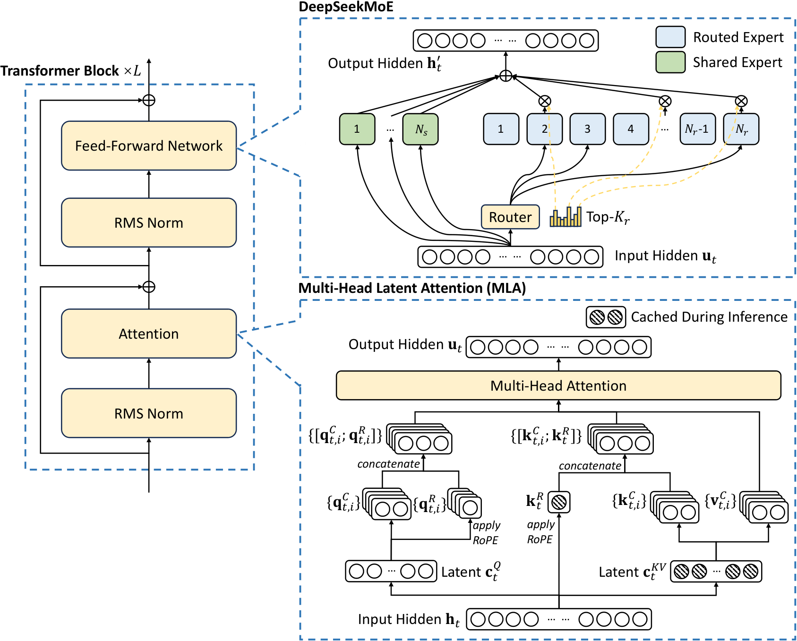
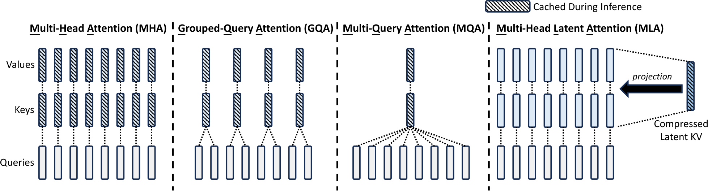
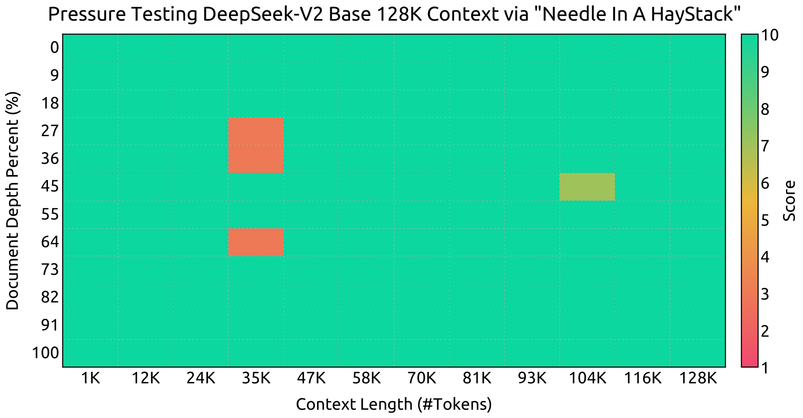

# DeepSeek-V2：用 MLA 与细粒度 MoE 降低大模型训练和推理成本

> 将每层历史 K/V 联合压成低维 latent，并把位置编码独立出来；再结合共享／路由专家、受设备约束的路由与系统优化，扩大模型容量而控制计算和缓存。
>
> DeepSeek-AI，2024 年 5 月 · [论文 v5](https://arxiv.org/abs/2405.04434v5) · [代码与模型](https://github.com/deepseek-ai/DeepSeek-V2) · [补充解读](DeepSeek-V2解读.md)

更大的模型不仅训练昂贵，在线生成还受 KV cache 占用和反复读取历史状态限制。DeepSeek-V2 分别改造 attention 与 FFN：MLA 用低秩联合压缩保留各 head 的表达能力，解耦 RoPE 使历史 KV 无需完整展开；DeepSeekMoE 以共享与细粒度路由专家增加总容量，再控制专家跨设备通信。

最终模型共 236B 参数，每 token 激活 21B，在 8.1T 中英为主的数据上训练，扩展到 128K 上下文，再通过 SFT 与两阶段 GRPO 对齐。相较 DeepSeek 67B，论文报告单位 token 训练成本下降 42.5%、KV cache 降低 93.3%，部署生成吞吐最高达到 5.76 倍。效率来自架构和部署优化共同作用；本文同时保留 attention 消融、质量结果及偏好对齐的能力取舍。

## 背景与整体架构

前作 DeepSeek LLM 采用稠密 Transformer，DeepSeekMoE 已验证细粒度专家与共享专家能提高参数效率。V2 沿用后一条路线，并把注意力的 KV cache 作为新的核心瓶颈。

常规 MHA 为每个 head 保存历史 K 与 V，缓存随层数、序列长度、batch 和 head 数线性增长。MQA／GQA 通过共享 K/V 降低缓存，但作者在同规模对照中观察到部分困难任务下降。因此，V2 目标是以更低缓存保持足够的多头表达能力。

每层仍由 attention 和 FFN 组成：MLA 负责上下文信息聚合，MoE 负责条件计算。RMSNorm、SwiGLU 等基础组件总体延续 DeepSeek 67B。第一层保留稠密 FFN，其余层使用 MoE。

## MLA：缓存低维状态，而非每个 head 的完整 K/V

### 标准 MHA 的缓存开销

设隐藏维度为 $d$，有 $n_h$ 个 head，每头维度 $d_h$。输入 $h_t$ 经过 $W^Q,W^K,W^V$ 得到各头 query、key、value，以：

$$
o_{t,i}=\sum_{j\le t}\operatorname{Softmax}_j\left(
\frac{q_{t,i}^{\top}k_{j,i}}{\sqrt{d_h}}\right)v_{j,i}
$$

聚合历史，再经输出投影合并。为避免每一步重算所有历史投影，推理需保存全部历史 K/V。若有 $L$ 层，每个 token 的缓存为 **$2n_hd_hL$ 个元素**。

### 联合低秩压缩 K 与 V

MLA 先将 $h_t$ 下投影到共享 latent：

$$
c_t^{KV}=W^{DKV}h_t,\qquad
k_t^C=W^{UK}c_t^{KV},\qquad
v_t^C=W^{UV}c_t^{KV}.
$$

$c_t^{KV}\in\mathbb R^{d_c}$，其中 $d_c\ll n_hd_h$；$W^{DKV}$ 的形状为 $d_c\times d$，上投影矩阵将 latent 恢复到多个 head 所需的内容 K/V。K 与 V 从同一 latent 派生，因此可只缓存 **$c_t^{KV}$**，无需分别存完整向量。

图中不同方法减少缓存的方式不同：GQA／MQA 减少独立 K/V 头数，MLA 压缩所有 head 共同依赖的底层状态。每个 query head 仍可通过自己的变换读取 latent 中的信息。

### 矩阵吸收：避免每一步把历史 K/V 展开

对内容分数，利用矩阵乘法的结合律：

$$
(q_{t,i}^{C})^\top W_i^{UK}c_j^{KV}
=\big((W_i^{UK})^\top q_{t,i}^{C}\big)^\top c_j^{KV}.
$$

于是可以先变换当前 query，直接和缓存 latent 点积。Value 的线性上投影也可吸收到最终输出投影中，避免对所有历史 token 重新展开 $v_j^C$。这里改变的是同一线性计算的执行组织，保留了每个 head 对共享 latent 的不同读取方式。

Query 侧也采用 $c_t^Q=W^{DQ}h_t$、$q_t^C=W^{UQ}c_t^Q$ 的低秩结构，以减少训练激活内存；query 不属于历史 KV cache，因此这部分压缩的目的不同。

### 为什么 RoPE 必须解耦

如果直接对内容 K 应用 RoPE，位置旋转矩阵会夹在 query 投影与 K 上投影之间。旋转依赖当前／历史位置，矩阵通常不能交换，因此无法按前述方式吸收，推理又需要反复恢复历史 keys。

V2 将位置项拆出：

$$
q_{t,i}^{R}=\operatorname{RoPE}_t(W_i^{QR}c_t^Q),\qquad
k_t^{R}=\operatorname{RoPE}_t(W^{KR}h_t),
$$

$$
q_{t,i}=[q_{t,i}^{C};q_{t,i}^{R}],\qquad
k_{j,i}=[k_{j,i}^{C};k_j^{R}].
$$

内容部分仍可在 latent 中计算，位置部分通过低维 RoPE key 单独计算。所有 head 共享同一个 $k_j^R$，但每个 head 有自己的位置 query。最终分数为：

$$
\frac{(q_{t,i}^{C})^\top k_{j,i}^{C}
+(q_{t,i}^{R})^\top k_j^{R}}
{\sqrt{d_h+d_h^R}}.
$$

因此每个历史 token 只缓存 **$c_j^{KV}$ 与 $k_j^R$**，总量为 $(d_c+d_h^R)L$。

### 最终维度与缓存比较

V2 为 60 层、hidden 5120、128 heads，内容 head 维度 128；$d_c=512$、query latent 1536，位置维度 $d_h^R=64$。每层缓存 **512+64=576** 个元素，而相同 head 组织的 MHA 为 $2\times128\times128=32768$。

| Attention | 每 token、全模型 KV 元素数 |
|---|---|
| MHA | $2n_hd_hL$ |
| GQA（$n_g$ 组） | $2n_gd_hL$ |
| MQA | $2d_hL$ |
| MLA | $(d_c+d_h^R)L$ |

原文将此 MLA 缓存量类比为约 2.25 组 GQA。相较实际前代 67B 的缓存减少比例，还涉及不同层数、GQA 配置等，故不能把上面同结构 MHA 的比例直接当作跨代部署数据。

## DeepSeekMoE：容量、路由与通信一起设计

### 共享与路由专家

除首层外，每层有 **2 个共享专家、160 个路由专家**，每 token 选 6 个路由专家；每个专家中间维度 1536。输出由残差、共享 FFN 输出，以及稀疏加权的路由专家输出组成：

$$
h'_t=u_t+\sum_{i=1}^{N_s}\operatorname{FFN}^{(s)}_i(u_t)
+\sum_{i=1}^{N_r}g_{i,t}\operatorname{FFN}^{(r)}_i(u_t).
$$

路由分数来自输入与专家向量的 softmax 亲和度，仅 top-$K_r$ 的 $g_{i,t}$ 非零。共享专家处理通用知识，细粒度专家使条件组合更灵活。全模型总参数 236B、每 token 激活 21B。

### Device-limited routing

若 6 个专家分散在多个设备，每个 token 就产生多路分发。V2 先选择包含高亲和专家的最多 **$M$ 个设备**，再在这些设备上做 top-$K$。实验发现 $M\ge3$ 时，质量大致接近无设备限制路由；最终采用 **8 路专家并行、每 token 最多去 3 个设备**。

这种限制先控制“一个 token 要发到多少地方”，后续均衡项则处理“哪些地方接收过多”。

### 三种均衡损失

专家级损失抑制少数专家长期占用全部训练；设备级损失平衡设备上的专家计算；通信级损失平衡每个设备接收的 token。

以专家级为例：

$$
\mathcal L_{\mathrm{ExpBal}}=\alpha_1\sum_i f_iP_i,
\quad f_i=\frac{N_r}{K_rT}\sum_t\mathbf1[t\text{ selects }i],
\quad P_i=\frac1T\sum_t s_{i,t}.
$$

设备级将专家集合按设备聚合，通信级则使用“token 是否发往该设备”的次数，避免某设备虽然专家计算近似均衡、却接收了过多不同 token。最终系数分别为 **0.003／0.05／0.02**。

### 设备级 token dropping

辅助损失不能保证每个 batch 严格均衡。训练进一步以平均设备计算为预算（capacity factor=1.0），在超载设备上优先丢弃亲和分数最低的路由 token；约 **10% 训练序列不允许丢弃**，让模型接触完整路由。评测时不丢 token。

## 预训练、长上下文与系统实现

### 8.1T 数据与训练设置

数据沿用去重、过滤、重混合框架，改进清洗以找回误删的有用文本，增加中文与高质量来源。分词为 100K BBPE；共 **8.1T token，中文 token 比英文约多 12%**。

| 配置 | DeepSeek-V2 |
|---|---|
| 层数／隐藏维度 | 60／5120 |
| 总参数／激活参数 | 236B／21B |
| 预训练上下文 | 4K |
| 峰值学习率 | $2.4\times10^{-4}$ |
| Warm-up | 2K 步 |
| Batch 调度 | 前 225B token 中由 2304 条增至 9216 条，随后固定 |
| 学习率下降点 | 约 60%／90% token，各乘 0.316 |
| AdamW | $\beta_1=0.9,\beta_2=0.95$，weight decay 0.1 |
| 专家并行与路由 | 8 设备，每 token 最多 3 设备 |

低秩瓶颈后增加 RMSNorm，并对 latent 与路由专家中间表示施加缩放，以控制输出尺度。训练使用 16 路 zero-bubble pipeline、8 路专家并行、ZeRO-1；通过部分重计算控制激活内存，从而不用张量并行，减少通信。共享专家计算与 expert all-to-all 重叠，MLA 内核基于改造的 FlashAttention-2。

### YaRN 扩展到 128K

YaRN 只作用于携带位置的解耦共享 key。配置为 $s=40,\alpha=1,\beta=32$、目标最大长度 160K；调整 attention 熵相关缩放为 $\sqrt t=0.0707\ln s+1$。再以 **32K 长度、576 条 batch 训练 1,000 步**。

横轴表示上下文长度，纵轴表示待找信息在文本中的位置。模型虽然扩展训练长度为 32K，在该合成检索任务中仍能处理至 128K 的不同位置；它提供的是长程定位能力证据。

## Base 结果与效率

### 同一评测框架的质量比较

作者用统一内部框架比较 DeepSeek 67B、Qwen1.5 72B、Mixtral 8×22B、LLaMA3 70B 和 V2。选择题通常以 perplexity 作答，生成任务按答案抽取／执行评分，Pile 用 BPB。下表选取主表中覆盖不同能力的代表任务：

| 任务 | DeepSeek 67B | Qwen1.5 72B | Mixtral 8×22B | LLaMA3 70B | V2 |
|---|---:|---:|---:|---:|---:|
| 激活参数 | 67B | 72B | 39B | 70B | **21B** |
| MMLU，5-shot | 71.3 | 77.2 | 77.6 | 78.9 | 78.5 |
| BBH，3-shot | 68.7 | 59.9 | 78.9 | 81.0 | 78.9 |
| Pile，BPB ↓ | 0.642 | 0.637 | 0.623 | 0.602 | 0.606 |
| HumanEval | 45.1 | 43.9 | 53.1 | 48.2 | 48.8 |
| MBPP，3-shot | 57.4 | 53.6 | 64.2 | 68.6 | 66.6 |
| GSM8K，8-shot | 63.4 | 77.9 | 80.3 | 83.0 | 79.2 |
| MATH，4-shot | 18.7 | 41.4 | 42.5 | 42.2 | **43.6** |
| CMath，3-shot | 63.0 | 77.8 | 72.3 | 73.9 | **78.7** |
| C-Eval，5-shot | 66.1 | 83.7 | 59.6 | 67.5 | 81.7 |
| CMMLU，5-shot | 70.8 | 84.3 | 60.0 | 69.3 | 84.0 |

V2 在较少激活参数下进入当时开源模型第一梯队。其中文能力明显强于非中文专门训练的 Mixtral／LLaMA3，英语基础任务中仍有落后项。原表还保留 HellaSwag、阅读理解、问答、CRUXEval、中文文化等项目；文中的 HumanEval 是此报告统一重评结果，不应与早期报告的另一个评测值混用。

### 成本与吞吐分别怎样测

在 H800 集群训练每 1T token，DeepSeek 67B 需要 **300.6K GPU·h**，V2 为 **172.8K GPU·h**，下降 **42.5%**。

服务部署将权重转为 FP8，并把 KV cache 量化到平均 6 bit。以实际 67B 服务的输入／输出长度分布测试，8×H800 单节点的 V2 生成吞吐超过 **50K token/s**，为前代最大吞吐的 **5.76 倍**，输入处理吞吐超过 100K token/s。这里的部署吞吐包含量化、大 batch 与算子优化；MLA 缓存节省是支持更大 batch 的重要前提。

## SFT 与两阶段 GRPO

SFT 共 **1.5M 样本**，其中帮助性 1.2M、安全性 0.3M，训练 2 epoch，学习率 $5\times10^{-6}$。相比前代，作者进一步改善数据质量、幻觉表现和写作能力。

后续使用 GRPO 省去价值模型，以同题候选的标准化奖励构造优势。由于代码、数学在更长 RL 训练中仍能提升，作者将流程分为：

1. **推理对齐**：代码偏好来自编译器反馈，数学偏好来自标准答案，用训练出的推理奖励模型优化。
2. **人类偏好对齐**：合并帮助性、安全性奖励模型与规则奖励。奖励模型由 V2 Chat SFT 初始化，以 point-wise 或 pair-wise 目标训练。

训练与采样使用不同并行布局，配合 vLLM、大 batch 及 CPU offload 调度，在显存、生成速度与训练效率之间协调。

### SFT、RL 的客观结果

**原文表 3 的部分对照。**

| 指标 | Qwen1.5 72B Chat | LLaMA3 70B Inst. | Mixtral 8×22B Inst. | V2 SFT | V2 RL |
|---|---:|---:|---:|---:|---:|
| MMLU | 76.2 | 80.3 | 77.8 | 78.4 | 77.8 |
| BBH | 65.9 | 80.1 | 78.4 | 81.3 | 79.7 |
| IFEval | 57.3 | 79.7 | 72.1 | 64.1 | 63.8 |
| HumanEval | 68.9 | 76.2 | 75.0 | 76.8 | **81.1** |
| MBPP | 52.2 | 69.8 | 64.4 | 70.4 | **72.0** |
| LiveCodeBench | 18.8 | 30.5 | 25.0 | 28.7 | **32.5** |
| GSM8K | 81.9 | 93.2 | 87.9 | 90.8 | 92.2 |
| MATH | 40.6 | 48.5 | 49.8 | 52.7 | **53.9** |
| C-Eval | 82.2 | 67.9 | 60.0 | 80.9 | 78.0 |
| CMMLU | 82.9 | 70.7 | 61.0 | 82.4 | 81.6 |

LiveCodeBench 使用 2023-09-01 至 2024-04-01 的题目；IFEval 为 prompt-level loose accuracy。RL 在数学与代码上继续提升，但 BBH、部分知识与指令分数回落。报告将它称为人类偏好对齐的 alignment tax，并讨论如何通过数据与训练策略减轻。

### 开放式结果

| Model | MT-Bench | AlpacaEval 2.0 |
| --- | --- | --- |
| DeepSeek 67B Chat | 8.35 | 16.6 |
| Mistral 8x22B Instruct v0.1 | 8.66 | 30.9 |
| Qwen1.5 72B Chat | 8.61 | 36.6 |
| LLaMA3 70B Instruct | 8.95 | 34.4 |
| DeepSeek-V2 Chat (SFT) | 8.62 | 30.0 |
| DeepSeek-V2 Chat (RL) | 8.97 | 38.9 |

MT-Bench 从 SFT 的 **8.62 到 8.97**，AlpacaEval 2.0 从 **30.0 到 38.9**。中文 AlignBench 的整体分数从 **7.74 到 7.91**，推理为 7.45、语言为 8.36。作者观察到在线偏好优化优于其离线实验；这与本项目的数据与训练设置相联系，论文未给出覆盖所有条件的在线／离线结论。

## Attention 消融与 Lite 模型

### MHA、GQA、MQA 的控制对照

7B 稠密模型在相同 1.33T token 下训练，仅调整 attention，并用深度保持参数接近：

| Attention | BBH | MMLU | C-Eval | CMMLU |
|---|---:|---:|---:|---:|
| MQA | 33.2 | 37.9 | 30.0 | 34.6 |
| GQA，8 groups | 35.6 | 41.2 | 37.7 | 38.4 |
| MHA | **37.0** | **45.2** | **42.9** | **43.5** |

这组表 8 实验说明作者设计 MLA 时，希望避免简单减少 K/V 头造成的质量取舍。

### MLA 与 MHA 的直接对照

**原文表 9，分别在小 MoE（1.33T token）和大 MoE（420B token）比较。**

| 指标 | 小 MoE MHA | 小 MoE MLA | 大 MoE MHA | 大 MoE MLA |
|---|---:|---:|---:|---:|
| 总参数 | 15.8B | 15.7B | 250.8B | 247.4B |
| 激活参数 | 2.5B | 2.4B | 25.0B | 21.5B |
| KV 元素／token | 110.6K | **15.6K** | 860.2K | **34.6K** |
| BBH | 37.9 | 39.0 | 46.6 | 50.7 |
| MMLU | 48.7 | 50.0 | 57.5 | 59.0 |
| C-Eval | 51.6 | 50.9 | 57.9 | 59.2 |
| CMMLU | 52.3 | 53.4 | 60.7 | 62.5 |

MLA 在大多数项目提高质量，同时将缓存降到 MHA 的约 **14%／4%**。这是与 MLA 设计直接对应的消融，比跨代端到端吞吐更能隔离 attention 机制的影响。

### DeepSeek-V2-Lite

附录发布 27 层、2048 hidden 的 Lite：15.7B 总参数、2.4B 激活，MLA 有 16 heads、KV latent 512，query 不压缩；每层 2 共享、64 路由，选 6。它在 **5.7T token** 上训练，支持 32K，上下文扩展后再 SFT。

Lite Base 的 MMLU **58.3**、GSM8K **41.1**、MATH **17.1**，高于早期 16B MoE 的 45.0／18.8／4.3；Lite Chat 为 55.7／72.0／27.9。此处同时改变了架构与训练量，因此与前代的差值不全是 MLA 的单独贡献。

## 结论与局限

V2 的关键是把 **KV 表示、专家计算、路由拓扑和部署方式**联动优化。MLA 用联合压缩与位置解耦消除大量缓存，MoE 让总容量与激活计算分开，训练系统与在线对齐使这些结构落实到可用模型。

报告仍保留英语基础能力、对齐后部分客观分数下降和真实长上下文任务等改进空间。附录进一步讨论价值敏感测试中的标注分歧，列出完整 MLA 公式、Lite 规格、代码与中文数学补充测试，以及各任务提示格式。模型的低激活参数优势也伴随全部 236B 权重的部署需求，实际效率应按论文给出的硬件、量化和负载条件理解。
