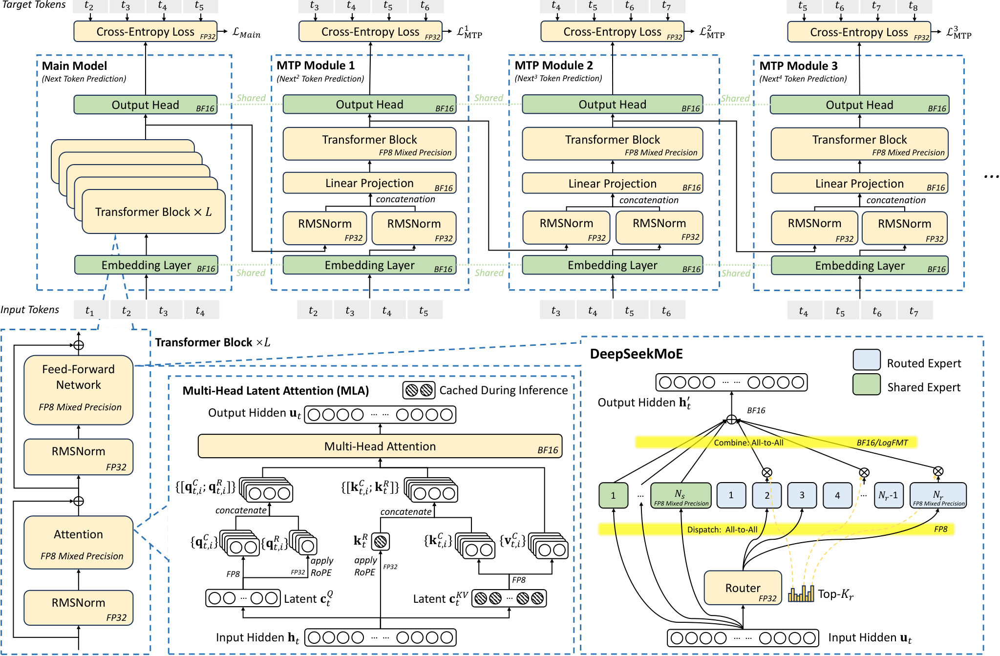

# DeepSeek-V3-Hardware：补充解读

> 如何区分一个好格式与一个好系统？以下为直觉解释与应用延伸，论文内容见 [精炼主笔记](DeepSeek-V3-Hardware详解.md)。

## 算法优化常常是在移动瓶颈

MoE 省了矩阵计算，却增加专家通信；MLA 省了 KV 存储，却要求适合 latent 表示的内核；FP8 省带宽，却增加缩放与累加精度要求。如果不测整个执行路径，局部收益可能被新的瓶颈吞掉。

图中不同精度并存说明低精度训练不是把所有张量统一 cast 成 FP8。敏感累加、归一化和优化器状态需要不同处理。

## 对 Python 使用者最实用的启发

查看服务的 TTFT、每 token 时延、吞吐和显存时，要记录输入长度、输出长度和并发。长 prompt 的瓶颈可能是 prefill，长输出是 decode，长程 agent 又可能卡在缓存 I/O。只看模型参数或 GPU 利用率无法定位问题。

## 论文建议与现成能力分开读

LogFMT、统一互联和更强累加支持属于探索或硬件建议。不要因为论文讨论过，就假设开源权重和通用推理框架已经默认具备。

## 用一个具体场景串起来

LogFMT在数值实验中可提高同bit精度，但如果每次发送前都要昂贵log/exp，通信少了、kernel却更慢，最终仍不值得部署。原型成立与生产采用是两层证据。

类似地，节点受限路由减少跨网目的地，利用更快节点内转发；代价是限制专家组合。模型设计是在真实互联比率下做取舍，换硬件后最好重新测量，而不是把路由限制视作永恒最佳。
