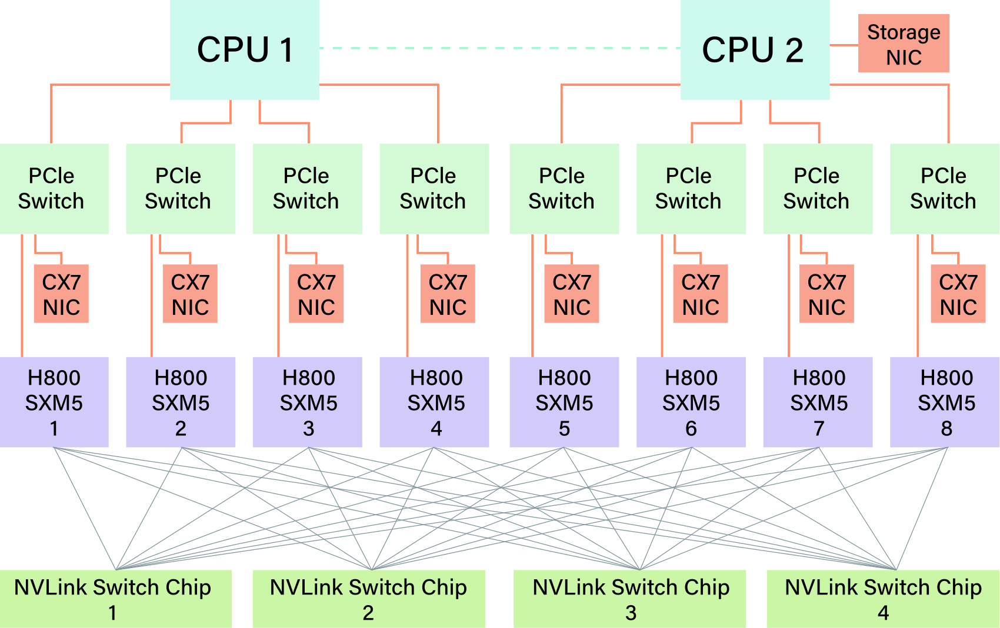

# DeepSeek-V3 硬件洞察：模型、精度、互联与网络协同设计

> 💡 本文从V3实际训练和服务中的瓶颈出发，解释MLA、MoE、FP8、节点受限路由与通信重叠为何这样设计，并提出下一代硬件应改善的精度、带宽、延迟和可靠性能力。
>
> [论文 v2](https://arxiv.org/abs/2505.09343v2) · [补充解读](DeepSeek-V3-Hardware解读.md)

V3技术报告描述了模型和训练配方，这篇论文进一步站在硬件角度解释设计背后的约束：显存限制KV容量，网络限制MoE分发，低精度受到累加和编码支持限制，流水线和多微批又需要计算与通信并发。全文既有已部署方案，也有测量、原型及面向未来的硬件建议。阅读重点是把这些层次分开，尤其不要把尚未部署的LogFMT、内存语义改进或新网络能力写成V3已经使用的功能。

## 内存与计算：MLA和MoE分别解决什么

| Model | KV Cache Per Token | Multiplier |
| --- | --- | --- |
| DeepSeek-V3 (MLA) | 70.272 KB | 1x |
| Qwen-2.5 72B (GQA) | 327.680 KB | 4.66x |
| LLaMA-3.1 405B (GQA) | 516.096 KB | 7.28x |

MLA把多头KV压成latent，减少每token缓存，长上下文或大batch时收益明显；表中的每token字节量受层数、精度和结构影响，不是只由参数规模决定。MoE则将总容量与激活计算分开，V3总671B、激活37B，不能把激活量当作完整权重大小。

| Model | Size | Training Cost |
| --- | --- | --- |
| DeepSeek-V2 MoE | 236B | 155 GFLOPS/Token |
| DeepSeek-V3 MoE | 671B | 250 GFLOPS/Token |
| Qwen-72B Dense | 72B | 394 GFLOPS/Token |
| LLaMa-405B Dense | 405B | 2448 GFLOPS/Token |

成本表比较相应模型每token训练运算量，支持稀疏计算的效率；不同模型能力、token量和系统利用率仍不同。FP8再降低权重/激活搬运，但优化器与关键数值环节不是全部改成8bit。

## 吞吐、单请求延迟与MTP

服务吞吐依靠双micro-batch把MLA/MoE计算与dispatch/combine交错，掩蔽通信；单请求TPOT则可能由小包All-to-All的延迟和HBM读取限制。更大batch有利于效率，却未必改善交互延迟。

MTP以较低成本提出额外token并并行验证，作为self-draft加速，收益取决于接受率和验证开销。论文把训练能力增益与服务加速都纳入考虑，不等于无条件每步固定输出多个已接受token。

## 通信下界怎样换算成TPOT

报告假设每设备处理32个token、hidden约7K、分发到八个路由加一个共享专家，dispatch每元素1Byte、combine2Bytes。在50GB/s网络下，相应两次All-to-All的数据传输时间估为：

$$
T_{comm}=\frac{(1+2)\times32\times9\times7K}{50\ \mathrm{GB/s}}\approx120.96\ \mu s.
$$

双microbatch理想重叠分析按每层两份计算，61层得到约14.76ms/token、约67token/s；假设换成900GB/s级互联可得到约0.82ms、1200token/s的理论数。**两者都不是实测服务速度**：分析刻意最小化计算开销，忽略固有延迟、带宽未满、小batch低利用率，真实长上下文还可能被MLA计算支配。该推导用于展示互联可能性，而非给某款硬件作吞吐承诺。

## FP8的硬件限制与LogFMT原型

Hopper的FP8乘加内部累加精度有限，长点积会损失小项；V3通过分块和周期性提升累加精度等方式补偿。未来建议包括更高或可配置累加精度，以及更适合细粒度缩放的原生支持。

EP dispatch使用细粒度FP8，较BF16减半通信量；combine更敏感，仍需较高精度。论文还研究LogFMT，按块动态范围编码，并强调在线性空间舍入以减小偏差。

**LogFMT最终没有部署到该V3路径**：在现有GPU上log/exp编解码和寄存器压力过大，融合到通信可能增加约50%–100%开销。它说明数据格式有效不等于系统有效，因而建议硬件原生压缩/解压支持。

LogFMT的具体编码按1×128 tile计算绝对值的对数范围a到b，n位中一位符号，零独占编码，其余步长为：

$$
\operatorname{Step}=\frac{b-a}{2^{n-1}-2},\qquad \widehat x=\operatorname{sign}(x)\exp(a+\operatorname{Step}(K-1)).
$$

按块共享范围能比固定浮点动态分配精度；实现在线性空间选择舍入，并限制对数范围，避免极小值占用全部区间。约7B dense模型的残差支路量化实验中8bit优于相应FP8格式，10bit接近BF16。它是模拟combine敏感性的数值实验，且没有消除前述编解码部署成本。

## 节点内与节点间带宽差异

H800节点内NVLink较H100受限，每GPU又配400G IB，训练因而避免大规模TP，更多依靠PP/EP与DualPipe；推理仍可选择TP来改善TTFT/TPOT，不能写成整个V3永远不用TP。

节点内有效转发约160GB/s、节点间有效约40GB/s，约4:1。若八个目标专家分布八个节点，每个token要多次跨IB；将同节点目标先合并、跨IB只传一份，再NVLink转发可降低流量。

V3把256个路由专家分为八组，限制每token最多访问四节点。这是模型路由和部署共同设计，代价是约束自由专家组合，收益是跨网流量受控。

## 并发通信、带宽竞争与统一互联

dispatch/combine不仅占链路，还可能占GPU SM，若通信kernel与计算争抢资源，就无法仅凭纸面带宽推断重叠效果。论文讨论更强通信引擎、低开销同步及scale-up/scale-out融合，希望减少软件手动在层级互联之间搬运的负担。

内存语义的load/store接口也有顺序问题：数据写完后更新flag必须有可靠的可见性保证，包喷洒与乱序到达会增加难度。region-based acquire/release等是面向未来的硬件建议，并不是把fence删除即可安全加速。

## 多平面网络与实际对照

| Metric | FT2 | MPFT | FT3 | SF | DF |
| --- | --- | --- | --- | --- | --- |
| Endpoints | 2,048 | 16,384 | 65,536 | 32,928 | 261,632 |
| Switches | 96 | 768 | 5,120 | 1,568 | 16,352 |
| Links | 2,048 | 16,384 | 131,072 | 32,928 | 384,272 |
| Cost [M$] | 9 | 72 | 491 | 146 | 1,522 |
| Cost/Endpoint [k$] | 4.39 | 4.39 | 7.5 | 4.4 | 5.8 |

多平面两层Fat-Tree通过多个较小网络平面扩展端点，降低交换复杂度。它与传统三层、其他拓扑的成本和带宽条件不同，不能只用交换机数量判断服务质量。

| Metric | MPFT | MRFT |
| --- | --- | --- |
| tokens/day (B) | 272.80 | 272.52 |
| time/step (s) | 19.926 | 19.946 |
| 1F (s) | 1.13 | 1.13 |
| bubble (s) | 2.06 | 2.03 |
| 1B (s) | 1.99 | 1.99 |
| 1W (s) | 0.48 | 0.48 |
| 1F1B (s) | 13.95 | 14.00 |
| opt (s) | 0.29 | 0.31 |
| TFLOPS (non-causal) | 432 | 432 |
| TFLOPS (causal) | 385 | 385 |
| MFU (non-causal) | 43.73% | 43.68% |
| MFU (causal) | 38.94% | 38.90% |

MPFT与单平面multi-rail在真实训练中的tokens/day和step时间接近，说明降低拓扑成本可以保持相近工作负载性能，**不是多平面必然产生大倍数加速**。NCCL PXN的NVLink转发有助于解释两者接近。

| Link Layer | Same Leaf | Cross Leaf |
| --- | --- | --- |
| RoCE | 3.6us | 5.6us |
| InfiniBand | 2.8us | 3.7us |
| NVLink | 3.33us | - |

IB在相应测量中延迟更低；RoCE有成本和端口规模优势。论文建议低延迟交换、改进路由和队列隔离；ECMP碰撞、incast与不同集体操作并发会损害吞吐，adaptive routing的效果也依赖网络和流量条件。

IBGDA让GPU直接填WR并写NIC doorbell，去掉CPU代理往返；适合小包和GPU驱动通信，但依赖对应硬件与软件机制。

## CPU、可靠性与未来硬件

CPU仍承担数据处理、I/O与控制；160条PCIe5通道若充分使用，数据搬运对主存提出约TB/s级需求，说明“GPU够快”不能解决节点内存系统瓶颈。

硬件故障包括互联闪断、ECC与静默错误。论文建议更完善检测、诊断和校验，减少昂贵重启和错误训练；这不是实验室算子benchmark能体现的成本。

未来方向还包括网络内聚合/压缩、堆叠DRAM与光互联。它们分别针对延迟、带宽、能耗和内存墙，部分尚属设计建议。全文的结论是模型架构必须适应现实硬件，同时把实测限制反馈给硬件设计，而不是仅以峰值算力挑选训练平台。
