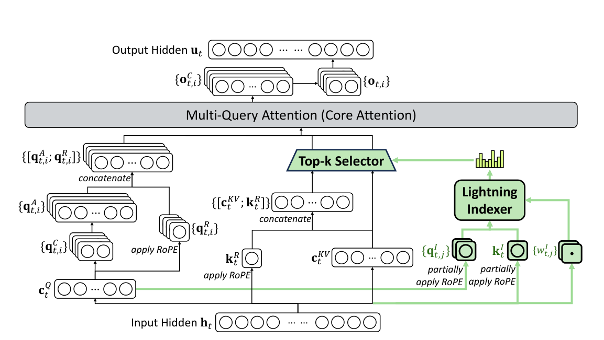
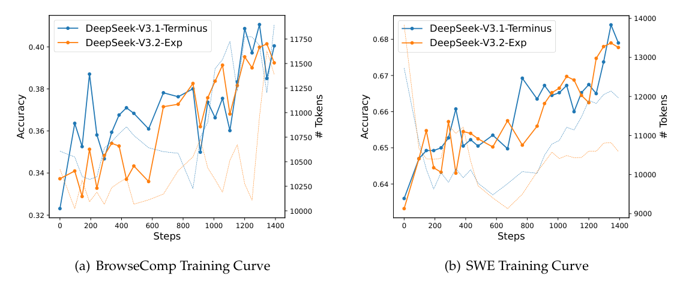
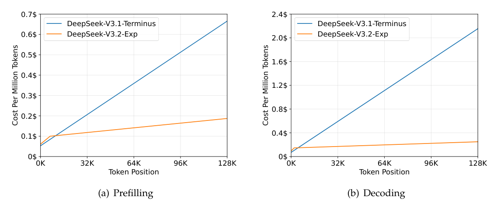

# DeepSeek-V3.2-Exp：将可训练的细粒度稀疏注意力接入 MLA

> 💡 V3.2-Exp 用轻量索引器选出重要历史token，只在选中的MLA缓存上计算主注意力，再通过分阶段继续训练恢复原模型能力。
>
> [官方报告与权重](https://huggingface.co/deepseek-ai/DeepSeek-V3.2-Exp) · [官方仓库](https://github.com/deepseek-ai/DeepSeek-V3.2-Exp) · [补充解读](DeepSeek-V3.2-Exp解读.md)。依据2025-09-29官方六页报告；它不是随后V3.2正式报告的另一名称。

V3.1-Terminus已经支持128K，但MLA虽然压缩KV存储，主注意力计算仍随长度增长。Exp只修改注意力结构，引入DSA，尽量沿用数据与后训练来评估稀疏化本身的影响。核心是把昂贵的多头主注意力与便宜的相关性索引分开，而不是直接随机丢缓存。报告重点解释索引器、密集预热、稀疏继续训练、能力对照和H800成本测量；并明确仍需真实流量验证。因此它首先是一项架构与效率实验，不应混入正式V3.2后续的Agent合成和RL扩展成果。

## Lightning indexer与选token

对当前位置$t$和历史位置$s$计算：

$$
I_{t,s}=\sum_{j=1}^{H_I}w^I_{t,j}\operatorname{ReLU}(q^I_{t,j}\cdot k^I_s).
$$

少量head、低维投影和FP8使索引较便宜。按分数选top-$k$，只从这些位置读取MLA latent KV做主attention；配置$k=2048$。

MLA以MQA计算模式共享KV给同一query位置的多个head，便于kernel复用。索引器不输出最终任务答案，它决定主attention访问哪些历史内容。与NSA三分支结构不同，DSA主线是轻量indexer加细粒度token选择。

## 两阶段继续预训练

第一阶段保留dense attention，冻结主模型，只训indexer。将主attention跨heads求和并L1归一化得到$p_{t,:}$，以KL蒸馏：

$$
\mathcal L_I=\sum_tD_{KL}(p_{t,:}\|\operatorname{softmax}I_{t,:}).
$$

学习率$10^{-3}$，1000步，每步16条128K序列，共约2.1B token。先让indexer学会识别重要位置，避免从随机选取直接破坏原模型。

第二阶段开启top-2048稀疏，更新整个主模型；indexer继续只对选中集合$\mathcal S_t$上的attention分布做KL对齐。索引输入detach，主模型只受语言建模loss，indexer只受自身KL，不把两类梯度不加区分地混合。

学习率$7.3\times10^{-6}$，15000步，每步480条128K序列，共约943.7B token。训练分布沿用Terminus的长上下文扩展数据。这个量级说明从dense迁移到sparse需要实质适应，不是加载时切换一个开关。

## 保持对齐流程的能力比较

后训练保持与Terminus相同的pipeline、算法与数据。先分别训练数学、竞赛代码、逻辑、代码Agent、搜索Agent等specialists，生成thinking和non-thinking数据，蒸馏回统一模型，再混合RL。

推理和Agent用结果规则、长度惩罚和语言一致性，通用任务用带rubrics的生成式RM。合并成一次混合RL以减少多阶段遗忘，重点在长度—准确率和语言—准确率之间折中。

| Category | Benchmark (Metric) | DeepSeek-V3.1-Terminus | DeepSeek-V3.2-Exp |
|---|---|---|---|
| General | MMLU-Pro (EM) | 85.0 | 85.0 |
| General | GPQA-Diamond (Pass@1) | 80.7 | 79.9 |
| General | Humanity’s Last Exam (Pass@1) | 21.7 | 19.8 |
| Search Agent | BrowseComp (Acc.) | 38.5 | 40.1 |
| Search Agent | BrowseComp_zh (Acc.) | 45.0 | 47.9 |
| Search Agent | SimpleQA (Acc.) | 96.8 | 97.1 |
| Code | LiveCodeBench (2408-2505) (Pass@1) | 74.9 | 74.1 |
| Code | Codeforces-Div1 (Rating) | 2046 | 2121 |
| Code | Aider-Polyglot (Acc.) | 76.1 | 74.5 |
| Code Agent | SWE Verified (Agent mode) | 68.4 | 67.8 |
| Code Agent | SWE-bench Multilingual (Agent mode) | 57.8 | 57.9 |
| Code Agent | Terminal-bench (Terminus 1 framework) | 36.7 | 37.7 |
| Math | AIME 2025 (Pass@1) | 88.4 | 89.3 |
| Math | HMMT 2025 (Pass@1) | 86.1 | 83.6 |

Exp的AIME2025为89.3，Terminus88.4；GPQA79.9对80.7，HLE19.8对21.7，HMMT83.6对86.1。总体接近但并非逐项无损。作者观察Exp在部分任务思考更短，比较相近长度的中间checkpoint差距缩小。

表中SimpleQA位于Search Agent分类，是带搜索的任务，不能与R1不带搜索的SimpleQA分数直接混用；SWE和Terminal-bench也受agent框架与设置影响。

BrowseComp和SWE验证集的训练轨迹接近，支持DSA可稳定参与后训练；曲线对照不等于对所有长尾任务有稳定性保证。

## 复杂度与真实成本

主attention从$O(L^2)$变为$O(Lk)$，但**indexer仍是$O(L^2)$**，只是常数和精度成本小。因此不能把整体算法称为严格线性注意力。

成本按实际H800服务benchmark、每GPU每小时2美元租价估算，不是所有云平台的统一价格。长序列优势明显，短prefill则采用masked-MHA方式模拟DSA以降低稀疏选择开销，说明最优kernel会随长度变化。

## 限制与后续关系

固定top-k可能漏掉分散的相关证据，索引仍扫描长历史，稀疏选择本身和GPU访存都有成本。六页报告提供的消融有限，未单独隔离所有indexer配置或覆盖真实业务长尾。

Exp证明可以以较大继续训练预算把DSA接到MLA，并维持总体能力和后训练稳定。正式V3.2沿用架构，但增加的Agent任务、RL稳定化和Speciale应在对应正式报告中阅读。
