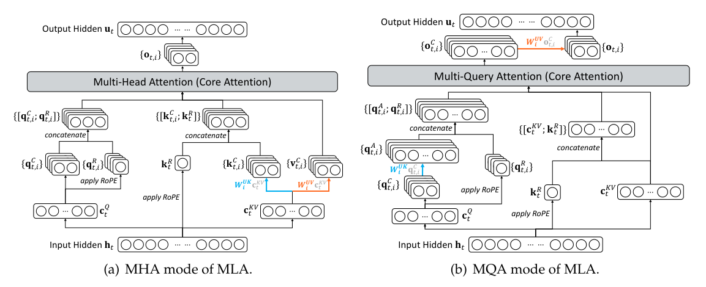

# DeepSeek-V3.2-Exp: Boosting Long-Context Efficiency with DeepSeek Sparse Attention / 全文中英对照

> 来源：[官方报告](https://github.com/deepseek-ai/DeepSeek-V3.2-Exp/blob/main/DeepSeek_V3_2.pdf)。英文段落后紧接中文，覆盖所取 PDF 版本的主文、附录、图表、脚注与参考文献；公式、数字表和书目信息共用。中文以机器初译为底稿，进行了术语整理与结构核对，尚未逐句人工审定；遇到歧义请以紧邻英文和原论文为准。 本文采用作者官方仓库公开报告，其许可证及版权声明随目录保留；中文为该版本的翻译改写。

## Authors and affiliations / 作者与机构

DeepSeek-AI · research@deepseek.com

## Abstract / 摘要

**EN.** We introduce DeepSeek-V3.2-Exp, an experimental sparse-attention model, which equips DeepSeek-V3.1-Terminus with DeepSeek Sparse Attention (DSA) through continued training. With DSA, a fine-grained sparse attention mechanism powered by a lightning indexer, DeepSeek-V3.2-Exp achieves significant efficiency improvements in both training and inference, especially in long-context scenarios. The model checkpoints are available at https://huggingface.co/deepseek-ai/DeepSeek-V3.2-Exp.

**中.** 我们引入了 DeepSeek-V3.2-Exp，一种实验性稀疏注意力模型，它通过持续训练为 DeepSeek-V3.1-Terminus 配备了 DeepSeek 稀疏注意力（DSA）。借助 DSA（一种由闪电索引器支持的细粒度稀疏注意力机制），DeepSeek-V3.2-Exp 在训练和推理方面实现了显着的效率提升，尤其是在长上下文场景中。模型检查点可在 https://huggingface.co/deepseek-ai/DeepSeek-V3.2-Exp. 获取

## Architecture / 建筑

**EN.** Compared with DeepSeek-V3.1-Terminus, the last version of DeepSeek-V3.1, the only architectural modification of DeepSeek-V3.2-Exp is the introduction of DeepSeek Sparse Attention (DSA) through continued training.

**中.** 与 DeepSeek-V3.1 的最后一个版本 DeepSeek-V3.1-Terminus 相比，DeepSeek-V3.2-Exp 唯一的架构修改是通过持续训练引入 DeepSeek 稀疏注意力（DSA）。

**EN.** Prototype of DSA. The prototype of DSA primarily consists of two components: a lightning indexer and a fine-grained token selection mechanism.

**中.** DSA 的原型。 DSA 的原型主要由两个组件组成：闪电索引器和细粒度代币选择机制。

**EN.** The lightning indexer computes the index score $I_{t,s}$ between the query token $h_t\in\mathbb R^d$ and a preceding token $h_s\in\mathbb R^d$, determining which tokens to be selected by the query token:

**中.** 闪电索引器计算查询代币 $h_t\in\mathbb R^d$ 和前一个代币 $h_s\in\mathbb R^d$ 之间的索引分数 $I_{t,s}$，从而确定查询代币选择哪些代币：

$$
I_{t,s}=\sum_{j=1}^{H_I}w^I_{t,j}\cdot\operatorname{ReLU}(q^I_{t,j}\cdot k^I_s).\tag{1}
$$

**EN.** where $H_I$ denotes the number of indexer heads; $q^I_{t,j}\in\mathbb R^{d_I}$ and $w^I_{t,j}\in\mathbb R$ are derived from the query token $h_t$; and $k^I_s\in\mathbb R^{d_I}$ is derived from the preceding token $h_s$. We choose ReLU as the activation function for throughput consideration. Given that the lightning indexer has a small number of heads and can be implemented in FP8, its computational efficiency is remarkable.

**中.** 其中$H_I$表示分度器头的数量； $q^I_{t,j}\in\mathbb R^{d_I}$和$w^I_{t,j}\in\mathbb R$源自查询令牌$h_t$； $k^I_s\in\mathbb R^{d_I}$ 源自前面的代币 $h_s$。出于吞吐量考虑，我们选择ReLU作为激活函数。鉴于闪电索引器的头数较少，并且可以在 FP8 中实现，其计算效率非常显着。

**EN.** Given the index scores $\{I_{t,s}\}$ for each query token $h_t$, our fine-grained token selection mechanism retrieves only the key-value entries $\{c_s\}$ corresponding to the top-k index scores. Then, the attention output $u_t$ is computed by applying the attention mechanism between the query token $h_t$ and the sparsely selected key-value entries $\{c_s\}$:

**中.** 给定每个查询标记 $h_t$ 的索引分数 $\{I_{t,s}\}$，我们的细粒度标记选择机制仅检索与前 k 个索引分数对应的键值条目 $\{c_s\}$。然后，通过在查询标记 $h_t$ 和稀疏选择的键值条目 $\{c_s\}$ 之间应用注意机制来计算注意输出 $u_t$：

$$
u_t=\operatorname{Attn}(h_t,\{c_s\mid I_{t,s}\in\operatorname{Top-k}(I_{t,:})\}).\tag{2}
$$

**EN.** Figure 1 | Attention architecture of DeepSeek-V3.2-Exp, where DSA is instantiated under MLA. The green part illustrates how DSA selects the top-k key-value entries according to the indexer.

**中.** 图1| DeepSeek-V3.2-Exp的注意力架构，其中DSA在MLA下实例化。绿色部分说明了 DSA 如何根据索引器选择前 k 个键值条目。

**EN.** Instantiate DSA Under MLA. For the consideration of continued training from DeepSeek-V3.1- Terminus, we instantiate DSA based on MLA (DeepSeek-AI, 2024) for DeepSeek-V3.2-Exp. At the kernel level, each key-value entry must be shared across multiple queries for computational efficiency (Yuan et al., 2025). Therefore, we implement DSA based on the MQA (Shazeer, 2019) mode of MLA[^exp-fn1], where each latent vector (the key-value entry of MLA) will be shared across all query heads of the query token. The DSA architecture based on MLA is illustrated in Figure 1. We also provide an open-source implementation of DeepSeek-V3.2-Exp[^exp-fn2] to specify the details unambiguously.

**中.** 在 MLA 下实例化 DSA。出于从 DeepSeek-V3.1-Terminus 继续训练的考虑，我们为 DeepSeek-V3.2-Exp 实例化了基于 MLA (DeepSeek-AI, 2024) 的 DSA。在内核级别，每个键值条目必须在多个查询之间共享，以提高计算效率（Yuan et al., 2025）。因此，我们基于 MLA[^exp-fn1] 的 MQA（Shazeer，2019）模式实现 DSA，其中每个潜在向量（MLA 的键值条目）将在查询令牌的所有查询头之间共享。基于 MLA 的 DSA 架构如图 1 所示。我们还提供了 DeepSeek-V3.2-Exp[^exp-fn2] 的开源实现，以明确指定细节。

## Training / 培训

**EN.** Starting from a base checkpoint of DeepSeek-V3.1-Terminus, whose context length has been extended to 128K, we perform continued pre-training followed by post-training to create DeepSeek- V3.2-Exp.

**中.** 从上下文长度已扩展到128K的DeepSeek-V3.1-Terminus的基础检查点开始，我们执行持续的预训练，然后进行后训练以创建DeepSeek-V3.2-Exp。

## Continued Pre-Training / 继续预训练

**EN.** The continued pre-training of DeepSeek-V3.2-Exp consists of two training stages. For both stages, the distribution of training data is totally aligned with the 128K long context extension data used for DeepSeek-V3.1-Terminus.

**中.** DeepSeek-V3.2-Exp的持续预训练包括两个训练阶段。对于这两个阶段，训练数据的分布与 DeepSeek-V3.1-Terminus 使用的 128K 长上下文扩展数据完全一致。

**EN.** Dense Warm-up Stage. We first use a short warm-up stage to initialize the lightning indexer. In this stage, we keep dense attention and freeze all model parameters except for the lightning indexer. To align the indexer outputs with the main attention distribution, for the 𝑡-th query token, we first aggregate the main attention scores by summing across all attention heads. This sum is then L1-normalized along the sequence dimension to produce a target distribution $p_{t,:}\in\mathbb R^t$. Based on $p_{t,:}$, we set a KL-divergence loss as the training objective of the indexer:

**中.** 密集热身阶段。我们首先使用一个简短的预热阶段来初始化闪电索引器。在这个阶段，我们保持高度关注并冻结除闪电索引器之外的所有模型参数。为了将索引器输出与主要注意力分布对齐，对于第 𝑡 个查询标记，我们首先通过对所有注意力头求和来聚合主要注意力分数。然后，该总和沿序列维度进行 L1 归一化，以生成目标分布 $p_{t,:}\in\mathbb R^t$。基于$p_{t,:}$，我们设置KL散度损失作为索引器的训练目标：

$$
\mathcal L_I=\sum_t D_{\mathrm{KL}}(p_{t,:}\Vert\operatorname{Softmax}(I_{t,:})).\tag{3}
$$

**EN.** For warm-up, we use a learning rate of $10^{-3}$. We train the indexer for only 1000 steps, with each step consisting of 16 sequences of 128K tokens, resulting in a total of 2.1B tokens.

**中.** 为了热身，我们使用 $10^{-3}$ 的学习率。我们仅训练索引器 1000 个步骤，每个步骤由 16 个 128K 个令牌序列组成，总共产生 2.1B 个令牌。

**EN.** Sparse Training Stage. Following indexer warm-up, we introduce the fine-grained token selection mechanism and optimize all model parameters to adapt the model to the sparse pattern of DSA. In this stage, we also keep aligning the indexer outputs to the main attention distribution, but considering only the selected token set $\mathcal S_t=\{s\mid I_{t,s}\in\operatorname{Top-k}(I_{t,:})\}$:

**中.** 稀疏训练阶段。在索引器预热之后，我们引入了细粒度标记选择机制并优化所有模型参数以使模型适应 DSA 的稀疏模式。在此阶段，我们还保持将索引器输出与主要注意力分布对齐，但仅考虑选定的令牌集 $\mathcal S_t=\{s\mid I_{t,s}\in\operatorname{Top-k}(I_{t,:})\}$：

$$
\mathcal L_I=\sum_t D_{\mathrm{KL}}(p_{t,\mathcal S_t}\Vert\operatorname{Softmax}(I_{t,\mathcal S_t})).\tag{4}
$$

**EN.** It is worth noting that we detach the indexer input from the computational graph for separate optimization. The training signal of the indexer is from only $\mathcal L_I$, while the optimization of the main model is according to only the language modeling loss. In this sparse training stage, we use a learning rate of $7.3\times10^{-6}$, and select 2048 key-value tokens for each query token. We train both the main model and the indexer for 15000 steps, with each step consisting of 480 sequences of 128K tokens, resulting in a total of 943.7B tokens.

**中.** 值得注意的是，我们将索引器输入与计算图分离以进行单独优化。索引器的训练信号仅来自$\mathcal L_I$，而主模型的优化仅根据语言建模损失。在这个稀疏训练阶段，我们使用 $7.3\times10^{-6}$ 的学习率，并为每个查询标记选择 2048 个键值标记。我们对主模型和索引器进行了 15000 个步骤的训练，每个步骤由 480 个 128K 个 token 的序列组成，总共得到 943.7B 个 token。

## Post-Training / 培训后

**EN.** After continued pre-training, we perform post-training to create the final DeepSeek-V3.2-Exp. The post-training of DeepSeek-V3.2-Exp also employs sparse attention in the same way as the sparse continued pre-training stage. In pursuit of a rigorous assessment of the impact of introducing DSA, for DeepSeek-V3.2-Exp, we maintain the same post-training pipeline, algorithm, and data as used for DeepSeek-V3.1-Terminus, which are detailed as follows.

**中.** 经过持续的预训练后，我们进行后训练以创建最终的 DeepSeek-V3.2-Exp。 DeepSeek-V3.2-Exp 的后训练也采用了稀疏注意力，与稀疏持续预训练阶段相同。为了对引入 DSA 的影响进行严格评估，对于 DeepSeek-V3.2-Exp，我们维护与 DeepSeek-V3.1-Terminus 相同的训练后流程、算法和数据，详细信息如下。

**EN.** Specialist Distillation. For each task, we initially develop a specialized model dedicated exclusively to that particular domain, with all specialist models being fine-tuned from the same pre-trained DeepSeek-V3.2 base checkpoint. In addition to writing tasks and general questionanswering, our framework encompasses five specialized domains: mathematics, competitive programming, general logical reasoning, agentic coding, and agentic search. Each specialist is trained with large-scale Reinforcement Learning (RL) computing. Furthermore, we employ different models to generate training data for long chain-of-thought reasoning (thinking mode) and direct response generation (non-thinking mode). Once the specialist models are prepared, they are used to produce the domain-specific data for the final checkpoint. Experimental results demonstrate that models trained on the distilled data achieve performance levels only marginally below those of domain-specific specialists, with the performance gap being effectively eliminated through subsequent RL training.

**中.** 专业蒸馏。对于每项任务，我们最初开发一个专用于该特定领域的专用模型，所有专业模型都从相同的预训练 DeepSeek-V3.2 基础检查点进行微调。除了编写任务和一般问答之外，我们的框架还涵盖五个专业领域：数学、竞争性编程、一般逻辑推理、代理编码和代理搜索。每位专家都接受过大规模强化学习 (RL) 计算的培训。此外，我们采用不同的模型来生成长链思维推理（思维模式）和直接响应生成（非思维模式）的训练数据。一旦准备好专业模型，它们就会被用来为最终检查点生成特定于领域的数据。实验结果表明，在蒸馏数据上训练的模型所达到的性能水平仅略低于特定领域专家的性能水平，并且通过后续的 RL 训练有效地消除了性能差距。

**EN.** Mixed RL Training. For DeepSeek-V3.2-Exp, we still adopt Group Relative Policy Optimization (GRPO) (DeepSeek-AI, 2025; Shao et al., 2024) as the RL training algorithm. Unlike in previous DeepSeek models, which are trained with multi-stage reinforcement learning, we merge reasoning, agent, and human alignment training into one RL stage. This approach effectively balances performance across diverse domains while circumventing the catastrophic forgetting issues commonly associated with multi-stage training paradigms. For reasoning and agent tasks, we employ rule-based outcome reward, length penalty, and language consistency reward. For general tasks, we employ a generative reward model where each prompt has its own rubrics for evaluation. Our reward design carefully balances two key trade-offs: (1) length versus accuracy and (2) language consistency versus accuracy.

**中.** 混合强化学习训练。对于 DeepSeek-V3.2-Exp，我们仍然采用组相对策略优化（GRPO）（DeepSeek-AI，2025；Shao et al.，2024）作为 RL 训练算法。与之前经过多阶段强化学习训练的 DeepSeek 模型不同，我们将推理、代理和人类对齐训练合并到一个 RL 阶段。这种方法有效地平衡了不同领域的性能，同时避免了通常与多阶段训练范例相关的灾难性遗忘问题。对于推理和代理任务，我们采用基于规则的结果奖励、长度惩罚和语言一致性奖励。对于一般任务，我们采用生成奖励模型，其中每个提示都有自己的评估规则。我们的奖励设计仔细地平衡了两个关键的权衡：(1) 长度与准确性；(2) 语言一致性与准确性。

## Evaluations / 评价

**EN.** Model Capabilities. We evaluate DeepSeek-V3.2-Exp on a suite of benchmarks, which focus on diverse capabilities, and compare it with DeepSeek-V3.1-Terminus in Table 1. While DeepSeek- V3.2-Exp significantly improves computational efficiency on long sequences, we do not observe substantial performance degradation compared with DeepSeek-V3.1-Terminus, on both shortand long-context tasks. In addition, we also compare the reinforcement learning training curves of DeepSeek-V3.2-Exp and DeepSeek-V3.1-Terminus, as shown in Figure 2. The performance of both models on BrowseComp and SWE Verified improves steadily throughout the training process, with closely aligned curves, which reflects the training stability of DSA.

**中.** 模型能力。我们在一系列侧重于不同功能的基准测试中对 DeepSeek-V3.2-Exp 进行了评估，并将其与表 1 中的 DeepSeek-V3.1-Terminus 进行了比较。虽然 DeepSeek-V3.2-Exp 显着提高了长序列的计算效率，但与 DeepSeek-V3.1-Terminus 相比，在短上下文和长上下文任务上，我们没有观察到明显的性能下降。此外，我们还比较了DeepSeek-V3.2-Exp和DeepSeek-V3.1-Terminus的强化学习训练曲线，如图2所示。在整个训练过程中，两个模型在BrowseComp和SWE Verified上的性能稳步提升，曲线紧密对齐，体现了DSA的训练稳定性。

| Category 类别 | Benchmark (Metric) 基准（公制） | DeepSeek-V3.1-Terminus | DeepSeek-V3.2-Exp |
|---|---|---|---|
| General 一般 | MMLU-Pro (EM) | 85.0 | 85.0 |
| General 一般 | GPQA-Diamond (Pass@1) GPQA-钻石级（通过@1） | 80.7 | 79.9 |
| General 一般 | Humanity’s Last Exam (Pass@1) 人类的最后考试（通过@1） | 21.7 | 19.8 |
| Search Agent 搜寻代理 | BrowseComp (Acc.) 浏览比较（加速） | 38.5 | 40.1 |
| Search Agent 搜寻代理 | BrowseComp_zh (Acc.) BrowseComp_zh（加速） | 45.0 | 47.9 |
| Search Agent 搜寻代理 | SimpleQA (Acc.) 简单QA（附件） | 96.8 | 97.1 |
| Code 代码 | LiveCodeBench (2408-2505) (Pass@1) LiveCodeBench (2408-2505) (通过@1) | 74.9 | 74.1 |
| Code 代码 | Codeforces-Div1 (Rating) Codeforces-Div1（评级） | 2046 | 2121 |
| Code 代码 | Aider-Polyglot (Acc.) Aider-多语言（加速） | 76.1 | 74.5 |
| Code Agent 代码代理 | SWE Verified (Agent mode) SWE 验证（代理模式） | 68.4 | 67.8 |
| Code Agent 代码代理 | SWE-bench Multilingual (Agent mode) SWE-bench 多语言（代理模式） | 57.8 | 57.9 |
| Code Agent 代码代理 | Terminal-bench (Terminus 1 framework) 终端工作台（Terminus 1 框架） | 36.7 | 37.7 |
| Math 数学 | AIME 2025 (Pass@1) AIME 2025（通过@1） | 88.4 | 89.3 |
| Math 数学 | HMMT 2025 (Pass@1) HMMT 2025（通过@1） | 86.1 | 83.6 |

**EN.** Table 1 | Evaluations of DeepSeek-V3.1-Terminus and DeepSeek-V3.2-Exp. Overall, DeepSeek- V3.2-Exp does not show substantial performance degradation compared with DeepSeek-V3.1- Terminus. The performance of DeepSeek-V3.2-Exp on GPQA, HLE, and HMMT 2025 is lower than that of DeepSeek-V3.1-Terminus because DeepSeek-V3.2-Exp generates fewer reasoning tokens. However, this performance gap closes when using intermediate checkpoints that produce a comparable number of tokens.

**中.** 表 1 | DeepSeek-V3.1-Terminus 和 DeepSeek-V3.2-Exp 的评估。总体而言，与 DeepSeek-V3.1-Terminus 相比，DeepSeek-V3.2-Exp 并未表现出明显的性能下降。 DeepSeek-V3.2-Exp 在 GPQA、HLE 和 HMMT 2025 上的性能低于 DeepSeek-V3.1-Terminus，因为 DeepSeek-V3.2-Exp 生成的推理令牌较少。然而，当使用产生相当数量令牌的中间检查点时，这种性能差距就会缩小。

**EN.** Figure 2 | RL training curve of DeepSeek-V3.1-Terminus and DeepSeek-V3.2-Exp on BrowseC- omp and SWE Verified. The solid and dashed lines denote the accuracy and average output tokens, respectively.

**中.** 图2| DeepSeek-V3.1-Terminus 和 DeepSeek-V3.2-Exp 在 BrowseComp 和 SWE 上的 RL 训练曲线经过验证。实线和虚线分别表示准确度和平均输出标记。

**EN.** Inference Costs. DSA reduces the core attention complexity of the main model from $O(L^2)$ to $O(Lk)$, where $k(\ll L)$ is the number of selected tokens. Although the lightning indexer still has a complexity of $O(L^2)$, it requires much less computation compared with MLA in DeepSeek-V3.1-Terminus. Combined with our optimized implementation, DSA achieves a significant end-to-end speedup in long-context scenarios. Figure 3 presents how token costs of DeepSeek-V3.1-Terminus and DeepSeek-V3.2-Exp vary with the token position in the sequence. These costs are estimated from benchmarking the actual service deployed on H800 GPUs, at a rental price of 2 USD per GPU hour. Note that for short-sequence prefilling, we specially implement a masked MHA mode to simulate DSA, which can achieve higher efficiency under short-context conditions.

**中.** 推理成本。 DSA将主模型的核心注意力复杂度从$O(L^2)$降低到$O(Lk)$，其中$k(\ll L)$是选择的token数量。尽管闪电索引器的复杂度仍然是$O(L^2)$，但与DeepSeek-V3.1-Terminus中的MLA相比，它需要的计算量要少得多。结合我们的优化实现，DSA 在长上下文场景中实现了显着的端到端加速。图 3 显示了 DeepSeek-V3.1-Terminus 和 DeepSeek-V3.2-Exp 的令牌成本如何随序列中令牌位置的变化而变化。这些成本是通过对 H800 GPU 上部署的实际服务进行基准测试估算得出的，租赁价格为每 GPU 小时 2 美元。请注意，对于短序列预填充，我们专门实现了一种 masked MHA 模式来模拟 DSA，这可以在短上下文条件下实现更高的效率。

**EN.** Figure 3 | Inference costs of DeepSeek-V3.1-Terminus and DeepSeek-V3.2-Exp on H800 clusters.

**中.** 图3 | DeepSeek-V3.1-Terminus 和 DeepSeek-V3.2-Exp 在 H800 集群上的推理成本。

**EN.** Future Validation in Real World. Although our internal evaluations show promising results of DeepSeek-V3.2-Exp, we are actively pursuing further large-scale testing in real-world scenarios to uncover potential limitations of the sparse attention architecture.

**中.** 现实世界中的未来验证。尽管我们的内部评估显示了 DeepSeek-V3.2-Exp 的良好结果，但我们正在积极寻求在现实场景中进行进一步的大规模测试，以揭示稀疏注意力架构的潜在局限性。

## References / 参考文献

- DeepSeek-AI. Deepseek-v2: A strong, economical, and efficient mixture-of-experts language model. CoRR, abs/2405.04434, 2024. doi: 10.48550/ARXIV.2405.04434. URL https://doi.org/10.48550/arXiv.2405.04434.

- DeepSeek-AI. Deepseek-r1 incentivizes reasoning in llms through reinforcement learning. Nature, 645(8081):633–638, 2025.

- Z. Shao, P. Wang, Q. Zhu, R. Xu, J. Song, M. Zhang, Y. K. Li, Y. Wu, and D. Guo. Deepseekmath: Pushing the limits of mathematical reasoning in open language models. CoRR, abs/2402.03300, 2024. doi: 10.48550/ARXIV.2402.03300. URL https://doi.org/10.48550/arXiv.2402.03300.

- N. Shazeer. Fast transformer decoding: One write-head is all you need. CoRR, abs/1911.02150, 2019. URL http://arxiv.org/abs/1911.02150.

- J. Yuan, H. Gao, D. Dai, J. Luo, L. Zhao, Z. Zhang, Z. Xie, Y. Wei, L. Wang, Z. Xiao, Y. Wang, C. Ruan, M. Zhang, W. Liang, and W. Zeng. Native sparse attention: Hardware-aligned and natively trainable sparse attention. In W. Che, J. Nabende, E. Shutova, and M. T. Pilehvar, editors, Proceedings of the 63rd Annual Meeting of the Association for Computational Linguistics (Volume 1: Long Papers), ACL 2025, pages 23078–23097. Association for Computational Linguistics, 2025. URL https://aclanthology.org/2025.acl-long.1126/.

## Appendix: MHA and MQA Modes of MLA / 附录：MLA的MHA和MQA模式

**EN.** Figure 4 | Illustration of the MHA and MQA modes of MLA. For DeepSeek-V3.1-Terminus, the MHA mode is used for training and prefilling, while the MQA mode is used for decoding.

**中.** 图4 | MLA 的 MHA 和 MQA 模式图示。对于DeepSeek-V3.1-Terminus，MHA模式用于训练和预填充，而MQA模式用于解码。

**EN.** Figure 4 illustrates two aspects of MLA – the MHA and MQA modes – as well as the transformation between them.

**中.** 图 4 说明了 MLA 的两个方面——MHA 和 MQA 模式——以及它们之间的转换。

[^exp-fn1]: **EN.** We illustrate the difference between the MQA and MHA modes of MLA in Appendix A. **中.** 我们在附录 A 中说明了 MLA 的 MQA 和 MHA 模式之间的差异。

[^exp-fn2]: **EN.** https://huggingface.co/deepseek-ai/DeepSeek-V3.2-Exp/tree/main/inference **中.** https://huggingface.co/deepseek-ai/DeepSeek-V3.2-Exp/tree/main/inference
