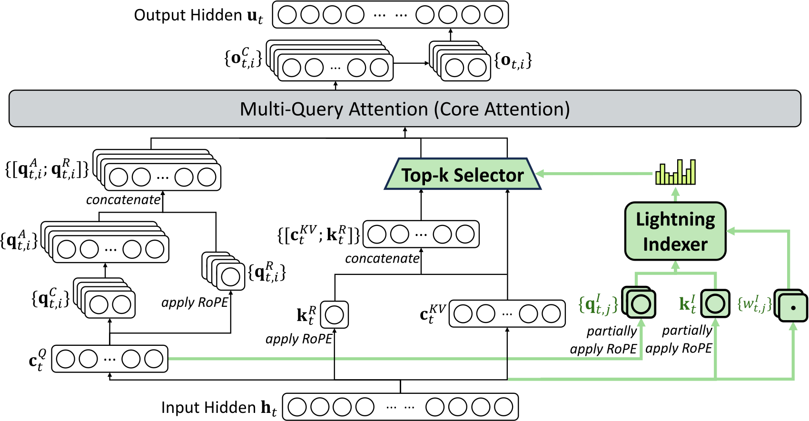

# DeepSeek-V3.2：补充解读

> 为什么 rollout 系统细节会改变 RL 算法？以下为直觉解释与应用延伸，论文内容见 [精炼主笔记](DeepSeek-V3.2详解.md)。

## DSA 的索引器并不是免费检索

主注意力只看少数 KV，但选择这些位置仍需要扫描分数。低维、少头、FP8 让这一步便宜得多，不等于所有计算都变成严格线性。长上下文优化应同时测 prefill、decode、索引和 KV 读取。

图中选择发生在 MLA latent KV 上，因此它与 NSA 的三分支结构不同，也不是外部文档检索。直接给另一个模型替换同样 Top-k 算子，不能假设能力不下降。

## 为什么 RL 的系统细节进入算法论文

重要性比要求分子分母描述同一动作空间。若 rollout 的采样掩码、专家路径或数值实现不同，纸面上同名的概率未必对应同一个实际分布。Keep Routing 和 Keep Sampling Mask 的价值就在于减少这种偏差。

## Agent 合成最难的是验证器

自动生成几千套工具并不难，困难在于任务真的有意义、能完成、结果可验证且不会被捷径骗过。通用环境消融说明多样性有价值，但不能把合成任务成功率直接当作真实业务完成率。

## 用一个具体场景串起来

同一串token在rollout走专家A，训练时因实现或参数变化走专家B，优化的就不是生成数据时那组计算路径。即便概率比率公式写对，也可能遭遇额外不一致。

top-p同样定义了实际采样动作集合。Keep Routing与Keep Sampling Mask分别对齐路径和集合，说明“训练更稳定”可能来自执行语义修复，而不仅是换优化器或调学习率。
