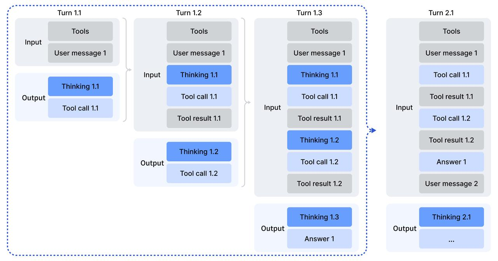
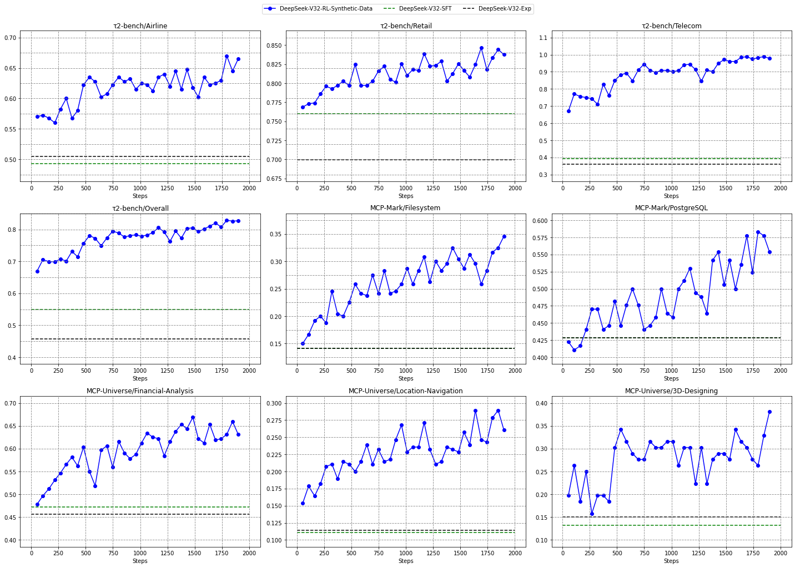

# DeepSeek-V3.2：稀疏注意力、大规模RL与工具内思考

> 💡 V3.2沿用DSA降低长上下文开销，再通过专家蒸馏、稳定化GRPO和可验证Agent任务，把长链思考扩展到真实工具交互。
>
> [论文](https://arxiv.org/abs/2512.02556) · [官方仓库](https://github.com/deepseek-ai/DeepSeek-V3.2) · [补充解读](DeepSeek-V3.2解读.md)

V3.2不仅要降低长上下文计算，还要让模型在工具调用、多领域推理和通用对齐之间共同提升。架构与Exp相同，新增重点在后训练：扩展领域specialists，合成可验证的工具任务，修正大规模RL中的采样、路由和off-policy不一致，并管理工具调用间的思考历史。报告还发布更偏重长思考的Speciale，比较更高准确率与更长输出的代价。方法的论证因此需要同时看架构、训练稳定、Agent数据与评测框架，不能只总结为“更大RL带来更高分”。

## DSA与继续训练

轻量indexer用$I_{t,s}=\sum_jw_{t,j}\operatorname{ReLU}(q_{t,j}\cdot k_s)$评分历史token，选top-2048的MLA KV参与主attention。先冻结主体、dense预热indexer约2.1B token，再用约943.7B token进行主体与稀疏模式适应，indexer独立做KL蒸馏，主模型做语言loss。

主体注意力为$O(Lk)$，indexer仍$O(L^2)$但较便宜；效率与Exp主线相同，不是正式版新增加一套注意力。成本图基于H800真实服务测试估算，长短序列有不同kernel选择。

## 专家蒸馏与混合RL

从同一base训练数学、编程、逻辑、通用Agent、代码Agent和搜索Agent等specialists，分别产thinking与non-thinking数据，再蒸馏成统一检查点。接着把推理、Agent与人类偏好放入混合RL，减少顺序训练的遗忘。

规则奖励用于可验证任务，配长度和语言一致性；通用任务由每prompt专用rubrics及生成式RM评价。Speciale只强化推理、减弱长度惩罚，并吸收Math-V2证明数据与奖励，其预算取舍与正式通用模型不同。

## Scaling GRPO的四项稳定化

本文组内优势采用$\hat A_i=R_i-\operatorname{mean}(R)$，不应自动补上其他GRPO版本的标准差归一化。token重要性比率为$\rho=\pi_\theta/\pi_{old}$。

**KL估计修正**：数据来自old而非current，K3项要乘重要性比率：

$$
\widehat D_{KL}=\frac{\pi_\theta}{\pi_{old}}\left(\frac{\pi_{ref}}{\pi_\theta}-\log\frac{\pi_{ref}}{\pi_\theta}-1\right).
$$

它针对采样分布与当前分布不一致时的估计/梯度偏差；不同领域所需KL强度不同，数学可能更弱甚至不用。

**Off-policy sequence masking**：当负优势轨迹与current的平均log比率超过阈值时，屏蔽其策略更新。只屏蔽负优势，不是把全部旧数据丢掉，也不取代重要性采样。

**Keep Routing**：记录rollout时的MoE专家路径，训练重放相同路由，避免更新后路由跳变造成激活参数子空间不一致。该机制从V3-0324已在使用。

**Keep Sampling Mask**：rollout做top-p/top-k截断，训练也应用相同mask，保证两侧动作集合一致。只保留温度而不保留截断集合不足以解决问题。

这些处理针对策略陈旧、训练/推理实现差异及稀疏路由，不能笼统合成一个“无偏GRPO”保证所有训练动态。

## 工具调用间如何保留思考

新用户消息到来才丢弃历史reasoning；仅追加tool调用结果时保留当前思考。删除思考时，调用和结果仍保留。这减少每次工具返回后从零重推的开销。

若框架把工具结果伪装成user消息，会触发清理，无法获得同样收益。上下文角色和序列化是协议的一部分，不是只改一个“thinking=true”。冷启动将现有推理与工具数据通过提示组合，收集偶尔成功的交错轨迹，再用RL强化。

## 四类Agent任务构造

|  | number of tasks | environment | prompt |
| --- | --- | --- | --- |
| code agent | 24667 | real | extracted |
| search agent | 50275 | real | synthesized |
| general agent | 4417 | synthesized | synthesized |
| code interpreter | 5908 | real | extracted |

真实环境不表示来自真实用户请求：代码问题来自issue/PR，搜索提示主要合成。代码环境要求gold patch带来非零F2P且零P2F，用统一JUnit解析跨语言测试。搜索从长尾实体构题，多候选与检索验证保留难题；代码解释器使用Jupyter执行数学、逻辑和数据科学任务。

通用Agent由合成器创建数据库、工具、任务、参考解与Python verifier，再逐步提高难度。参考解只能调工具或做逻辑，不能越过接口直读数据库。筛到pass@100非零后，保留1827环境、4417任务，强调难但可验证与可学习。

## 主结果、Speciale与预算

|  | Benchmark (Metric) | Claude-4.5- | GPT-5 | Gemini-3.0 | Kimi-K2 | MiniMax | DeepSeek-V3.2 |
| --- | --- | --- | --- | --- | --- | --- | --- |
|  | Benchmark (Metric) | Sonnet | High | Pro | Thinking | M2 | Thinking |
| English | MMLU-Pro (EM) | 88.2 | 87.5 | 90.1 | 84.6 | 82.0 | 85.0 |
| English | GPQA Diamond (Pass@1) | 83.4 | 85.7 | 91.9 | 84.5 | 77.7 | 82.4 |
| English | HLE (Pass@1) | 13.7 | 26.3 | 37.7 | 23.9 | 12.5 | 25.1 |
| Code | LiveCodeBench (Pass@1-COT) | 64.0 | 84.5 | 90.7 | 82.6 | 83.0 | 83.3 |
| Code | Codeforces (Rating) | 1480 | 2537 | 2708 | - | - | 2386 |
| Math | AIME 2025 (Pass@1) | 87.0 | 94.6 | 95.0 | 94.5 | 78.3 | 93.1 |
| Math | HMMT Feb 2025 (Pass@1) | 79.2 | 88.3 | 97.5 | 89.4 | - | 92.5 |
| Math | HMMT Nov 2025 (Pass@1) | 81.7 | 89.2 | 93.3 | 89.2 | - | 90.2 |
| Math | IMOAnswerBench (Pass@1) | - | 76.0 | 83.3 | 78.6 | - | 78.3 |
| Code Agent | Terminal Bench 2.0 (Acc) | 42.8 | 35.2 | 54.2 | 35.7 | 30.0 | 46.4 |
| Code Agent | SWE Verified (Resolved) | 77.2 | 74.9 | 76.2 | 71.3 | 69.4 | 73.1 |
| Code Agent | SWE Multilingual (Resolved) | 68.0 | 55.3 | - | 61.1 | 56.5 | 70.2 |
| Search Agent | BrowseComp (Pass@1) | 24.1 | 54.9 | - | -/60.2* | 44.0 | 51.4/67.6 * |
| Search Agent | BrowseCompZh (Pass@1) | 42.4 | 63.0 | - | 62.3 | 48.5 | 65.0 |
| Search Agent | HLE (Pass@1) | 32.0 | 35.2 | 45.8 | 44.9 | 31.8 | 40.8 |
| ToolUse | $\tau^{2}$ -Bench (Pass@1) | 84.7 | 80.2 | 85.4 | 74.3 | 76.9 | 80.3 |
| ToolUse | MCP-Universe (Success Rate) | 46.5 | 47.9 | 50.7 | 35.6 | 29.4 | 45.9 |
| ToolUse | MCP-Mark (Pass@1) | 33.3 | 50.9 | 43.1 | 20.4 | 24.4 | 38.0 |
| ToolUse | Tool-Decathlon (Pass@1) | 38.6 | 29.0 | 36.4 | 17.6 | 16.0 | 35.2 |

表中推理、Agent和工具指标采用不同框架。BrowseComp约20%以上轨迹超过128K，论文使用context management得到主结果；不管理时为51.4。若省略这点，会把框架预算变化误写成纯模型提升。

| Benchmark | GPT-5 | Gemini-3.0 | Kimi-K2 | DeepSeek-V3.2 | DeepSeek-V3.2 |
| --- | --- | --- | --- | --- | --- |
| Benchmark | High | Pro | Thinking | Thinking | Speciale |
| AIME 2025 (Pass@1) | 94.6 (13k) | 95.0 (15k) | 94.5 (24k) | 93.1 (16k) | 96.0 (23k) |
| HMMT Feb 2025 (Pass@1) | 88.3 (16k) | 97.5 (16k) | 89.4 (31k) | 92.5 (19k) | 99.2 (27k) |
| HMMT Nov 2025 (Pass@1) | 89.2 (20k) | 93.3 (15k) | 89.2 (29k) | 90.2 (18k) | 94.4 (25k) |
| IMOAnswerBench (Pass@1) | 76.0 (31k) | 83.3 (18k) | 78.6 (37k) | 78.3 (27k) | 84.5 (45k) |
| LiveCodeBench (Pass@1-COT) | 84.5 (13k) | 90.7 (13k) | 82.6 (29k) | 83.3 (16k) | 88.7 (27k) |
| CodeForces (Rating) | 2537 (29k) | 2708 (22k) | - | 2386 (42k) | 2701 (77k) |
| GPQA Diamond (Pass@1) | 85.7 (8k) | 91.9 (8k) | 84.5 (12k) | 82.4 (7k) | 85.7 (16k) |
| HLE (Pass@1) | 26.3 (15k) | 37.7 (15k) | 23.9 (24k) | 25.1 (21k) | 30.6 (35k) |

Speciale在部分高难推理有更强成绩，同时token效率明显低于同期Gemini3。竞赛金牌水平还依赖相应评分与测试时流程，不是模型直接参加官方赛事的称号。

## Agent合成与上下文管理消融

| Pass@K | DeepSeek-v3.2-Exp | Sonnet-4.5 | Gemini-3.0 Pro | GPT-5-Thinking |
| --- | --- | --- | --- | --- |
| 1 | 12% | 34% | 51% | 62% |
| 2 | 18% | 47% | 65% | 75% |
| 4 | 26% | 62% | 74% | 82% |

50条合成任务中，Exp pass@1仅12%，前沿闭源最高62%，说明任务具有挑战性。进一步在non-thinking下仅用合成任务RL，可提高Tau2/MCP等未见环境表现，减少“收益只是更长CoT或其他数据”这一混杂。

超过窗口80%时，比较总结、丢75%工具史、丢全部工具史和独立并行采样。BrowseComp的Summary可延长到平均364步、分数约60.2；Discard-all约67.6且更省步。简单清理有效不表示历史永远无用，而是所测任务允许重新检索和探索。

## 局限

模型仍会过度自检、冗长交互并耗尽128K，特别是GitHub/浏览器类任务。更强RL和更大测试预算带来成本，知识、工具鲁棒性与token效率仍有限。论文展示的是架构降本、稳定训练、任务合成和交互协议的组合；准确比较必须同时记录模式、框架、工具角色与上下文管理。
