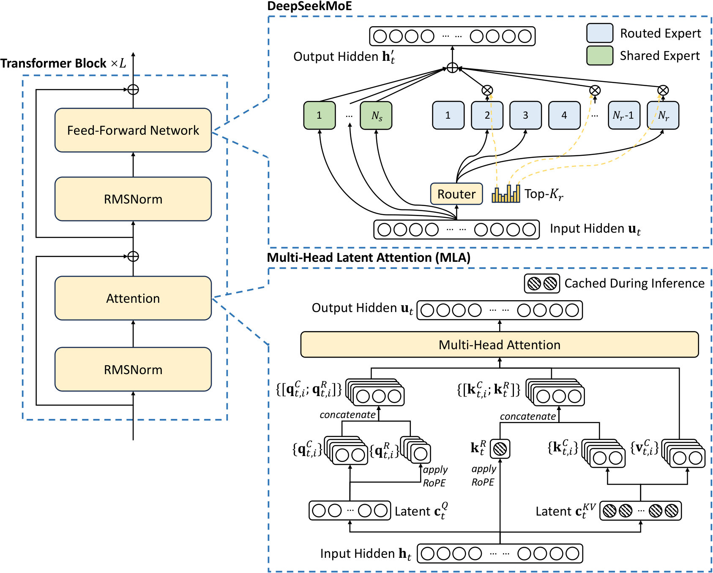
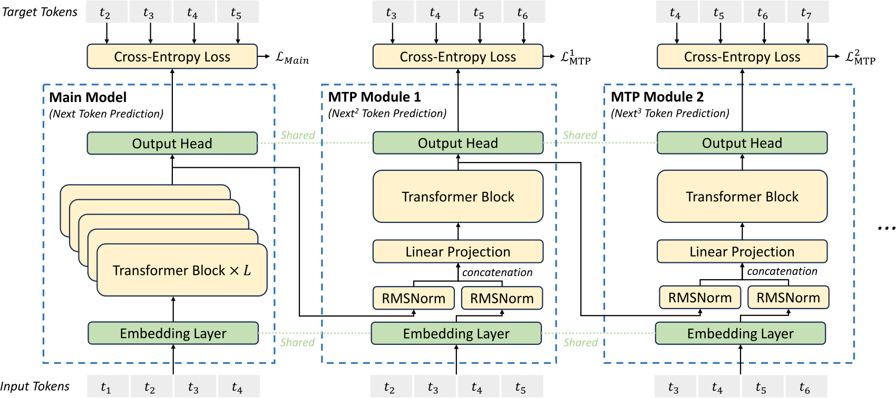
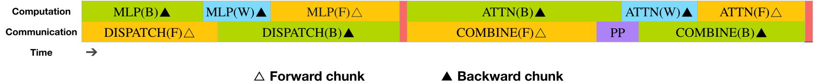
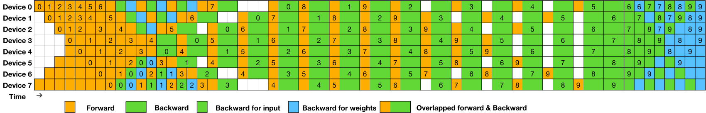
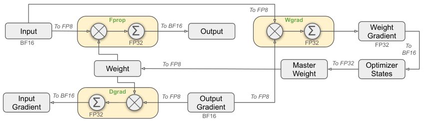
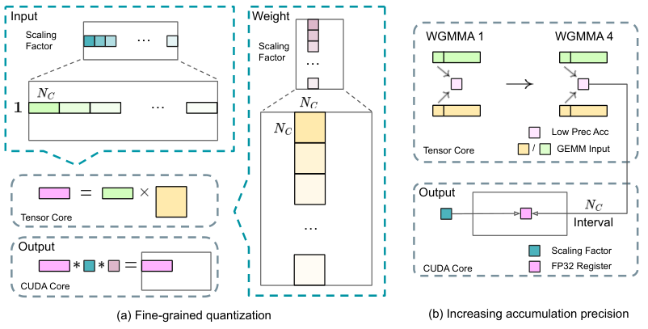

# DeepSeek-V3：把稀疏架构、FP8 训练与推理蒸馏组合起来

> 在 MLA／DeepSeekMoE 基础上，以路由偏置代替主要均衡损失、加入顺序多 token 预测，并通过 FP8、DualPipe 和通信优化完成大规模训练。
>
> DeepSeek-AI，2024 年 12 月 · [技术报告 v2](https://arxiv.org/abs/2412.19437v2) · [官方仓库](https://github.com/deepseek-ai/DeepSeek-V3) · [补充解读](DeepSeek-V3解读.md)

DeepSeek-V3 同时处理两个目标：在较少激活计算下提高模型能力，以及使大规模细粒度 MoE 真正在有限集群上高效运行。它沿用 MLA 压缩 KV、用共享与路由专家扩容，再通过动态路由偏置平衡负载，减少强辅助损失对专业化的约束；顺序 MTP 则让同一位置学习更多未来预测。

671B 总参数、37B 激活参数的模型在 14.8T token 上训练。系统采用 2,048 张 H800、FP8 混合精度、DualPipe 与跨节点通信优化；后训练进一步利用内部推理模型生成的数据和 GRPO。报告给出约 2.788M H800 GPU·h 的最终训练成本，并在数学、代码、多语及开放式任务上取得当时有竞争力的结果。其贡献是一套相互配合的架构、数值与系统配方。

## 摘要与整体设计

V2 已把 KV cache 与激活计算显著压低，但继续扩大专家模型还会遇到路由均衡、通信重叠和低精度稳定性问题。V3 的主要增量分别位于四层：

- **架构**：MLA + DeepSeekMoE；以 sigmoid 亲和度、归一化选中权重与动态偏置组织路由。
- **训练目标**：主 next-token 之外增加因果链保持完整的 Multi-Token Prediction。
- **系统与数值**：DualPipe 隐藏跨节点 MoE 通信，细粒度 FP8 量化及高精度累加保持训练准确性。
- **后训练**：从推理专家生成更有效的 SFT 数据，再用规则和模型奖励进行多领域 GRPO。

模型为 61 层、hidden 7168，前 3 层是稠密 FFN，其余使用 MoE。每层 **1 共享 + 256 路由专家**，每 token 激活 **1+8**；每专家中间维度 2048。MLA 为 128 heads、每头内容维度 128，KV latent 512、query latent 1536、解耦 RoPE 维度 64。

## MLA 与 DeepSeekMoE 的基础计算

MLA 从输入 $h_t$ 得到共享压缩状态 $c_t^{KV}=W^{DKV}h_t$，再派生内容 K/V；另外生成位置 key $k_t^R=\operatorname{RoPE}(W^{KR}h_t)$。各 query head 同时具有内容与位置分量，对二者的点积之和做 softmax。

推理只缓存 **$c_t^{KV}$ 与 $k_t^R$**。内容 K/V 的上投影通过结合律吸收到 query／输出投影中，因此不必为每个生成位置重新展开所有历史 K/V。Query 压缩用于减少训练激活，占用与 KV 缓存的作用不同。该机制延续 V2，V3 重点在扩展其规模与系统实现。

MoE 输出由所有 token 都经过的共享 FFN，以及被选路由 FFN 的加权和组成。与 V2 的 softmax 亲和度不同，V3 使用：

$$
s_{i,t}=\operatorname{Sigmoid}(u_t^\top e_i),\qquad
 g_{i,t}=\frac{s_{i,t}\mathbf1[i\in\mathcal S_t]}
 {\sum_{j\in\mathcal S_t}s_{j,t}}.
$$

$s_{i,t}$ 衡量 token 对专家的亲和程度，$\mathcal S_t$ 是最终选中集合。门权重仅在被选专家之间归一化。

## 路由偏置：把负载控制从语言损失中移开

### 偏置改变选择，不改变加权值

传统均衡损失能防止专家塌缩和设备拥堵，但太强会迫使不相关 token 使用某专家，影响表示质量。V3 为每个路由专家设置偏置 $b_i$：

$$
\mathcal S_t=\operatorname{TopK}_i(s_{i,t}+b_i,K_r).
$$

**选谁**由 $s+b$ 决定，**选中后贡献多大**仍用原始 $s$ 计算前式的 $g$。每个训练 step 统计整个 batch 的专家负载：超载则 $b_i\leftarrow b_i-\gamma$，欠载则 $b_i\leftarrow b_i+\gamma$。它是一套按负载调整的外部控制，不通过均衡辅助梯度改变语言建模目标。

### Batch 级专业化与很弱的序列约束

模型主要在整个 batch 上平衡，允许单条数学、代码或普通文本偏向不同专家。为防止单条序列极端失衡，仍保留系数仅 **$10^{-4}$** 的 sequence-wise 辅助损失。因此“auxiliary-loss-free”指主要均衡机制，而非所有辅助项绝对为零。

路由同时限制每个 token 最多访问 **4 个节点**：先按节点内若干最高亲和专家分数之和选择节点，再在允许范围内选专家。有效均衡使 V3 在训练和推理中均**不丢弃 token**，与 V2 的训练 dropping 配方不同。

## 顺序 MTP：保留因果链的多 token 预测

主模型在位置 $i$ 预测 $t_{i+1}$。第 $k$ 个额外模块接收前一深度的表示 $h_i^{k-1}$，与已知的下一个输入 token $t_{i+k}$ 的 embedding 合并，再预测 $t_{i+k+1}$：

$$
\widetilde h_i^k=M_k[\operatorname{RMSNorm}(h_i^{k-1});
\operatorname{RMSNorm}(\operatorname{Emb}(t_{i+k}))],
$$

$$
h_{1:T-k}^k=\operatorname{TRM}_k(\widetilde h_{1:T-k}^k),\qquad
P_{i+k+1}^k=\operatorname{OutHead}(h_i^k).
$$

$M_k$ 将两个 $d$ 维向量合并回 $d$ 维，TRM 为额外 Transformer block；embedding 与输出头均和主模型共享。每一步只使用目标之前的内容，所以仍保持自回归因果链。它区别于在同一表示上用多个独立 head 平行猜未来。

每个深度计算交叉熵，辅助损失为：

$$
\mathcal L_{\mathrm{MTP}}=\frac\lambda D\sum_{k=1}^D
\mathcal L_{\mathrm{MTP}}^k.
$$

V3 使用 **$D=1$**，即主 next-token 加一个额外未来 token。前 10T token 的 $\lambda=0.3$，后 4.8T 为 0.1。MTP 主要用于提高主模型训练质量，推理可直接丢弃，也可作为 speculative decoding 的草稿模块。

## DualPipe 与跨节点通信

### 为什么只有少量激活参数仍可能训得慢

细粒度专家产生大量 dispatch／combine，跨节点通信与计算时间比一度约为 **1:1**。训练框架为 16 路流水线、跨 8 节点的 64 路专家并行与 ZeRO-1 数据并行，若直接串行执行，稀疏计算的节省会被等待抵消。

### 前后向分块重排

每个 chunk 分成 attention、dispatch、MLP、combine；反向又拆为 input gradient 与 weight gradient，并另有流水线通信。DualPipe 将一对前向和反向的这些操作重新安排，利用互不依赖的部分覆盖 all-to-all 和流水线传输。

micro-batch 从流水线两端进入。与 1F1B 相比，DualPipe 减少 bubble，代价是保留两份模型参数布局，峰值激活槽位从 $PP$ 增为 $PP+1$；由于专家参数本身高度分片，这个额外参数布局在该训练设计中可控。它只要求 stage 和 micro-batch 数能被 2 整除，不要求 micro-batch 是 stage 数的倍数。

### IB 与 NVLink 协同分发

集群内 NVLink 约 160 GB/s，跨节点 IB 约 50 GB/s。一个 token 先经 IB 到目标节点上同索引 GPU，再立即通过 NVLink 转到真正承载专家的 GPU，使两段传输重叠。最多 4 节点的路由限制减少跨节点流量。

通信内核使用 warp specialization，把 IB 发送、跨域转发、接收及归并分给不同 warp，并调节传输块大小以降低 L2 干扰。约 **20 个 SM**即可覆盖所需通信；这仍消耗计算资源，因此论文也提出将相关搬运与 reduce 任务交给硬件协处理器的建议。

### 其他显存优化

RMSNorm 与 MLA 上投影在反向重计算，不持久保存输出；EMA 权重放在 CPU 异步更新。DualPipe 让最浅和最深层位于同一 PP rank，使 MTP 与主模型的 embedding、输出头实现物理共享。这些措施使训练避免高通信成本的 tensor parallelism。

## FP8：量化粒度和累加精度缺一不可

### 哪些算 FP8，哪些保留高精度

Linear 的 Fprop、Dgrad、Wgrad GEMM 均使用 FP8 输入，输出为 BF16 或 FP32。Embedding、输出头、MoE gate、归一化、attention 等敏感或低成本算子保留 BF16／FP32。主权重及梯度累积保留 FP32，Adam 一、二阶矩改用 BF16。

因此 FP8 是经过选择的混合精度框架，并非把模型每个张量一律存成 8 bit。

### 细粒度在线缩放

异常值会使整张量量化的范围被少数大数撑开，损失其他数的精度。V3 对 activation 使用 **1×128 tile**，对权重使用 **128×128 block**，每组在线计算最大绝对值和 scale。较小分组缩小需要共同覆盖的动态范围，使前后向统一使用精度较高的 **E4M3**，而不必靠 E5M2 扩大指数范围。

### H800 Tensor Core 累加的问题

作者发现 Hopper 的 FP8 GEMM 累加有效精度约 14 bit，在较大内积维度下误差积累明显；随机矩阵 $K=4096$ 的测试最大相对误差接近 2%。解决方案是在 Tensor Core 中每累积 **$N_C=128$** 个元素后，将部分和提升到 CUDA Core 的 FP32 寄存器，再做完整精度累加，同时应用每组反量化 scale。

两组 WGMMA 执行与 promotion 交叠，控制这一步的开销。模型级验证中，FP8 与 BF16 的相对 loss 误差持续低于 **0.25%**。

### 低精度缓存与通信

反向所需 activation 主要缓存为 FP8；attention 输出后 Linear 的输入因还用于 attention 反向，采用专门的 **E5M6** 保存。MoE SwiGLU 保存输入、反向重算输出。Dispatch 的 activation 和部分反向梯度也用 FP8 传输，combine 则保留 BF16。部分 scale 限定为 2 的整数幂，以减少转置重新分组时的额外量化误差。

附录进一步解释，activation 若与权重一样粗到 block-wise，异常值会影响更多 token，可能造成训练不稳定。这是量化粒度不能只按存储便利选择的实验依据。

## 数据、训练调度与成本

### 14.8T 预训练数据

数据提高数学、代码比例，扩大中英之外的多语覆盖，并改进冗余控制与 document packing。预训练 packing **不使用跨样本 attention mask**。FIM 在打包前以 document 为单位应用，PSM 比例 **10%**。

BBPE 词表扩为 **128K**，改进多语压缩。预切分还允许标点与换行组成 token；为减轻少样本 prompt 无结尾换行时的边界偏差，训练中随机拆开部分组合 token。

### 预训练与上下文扩展

预训练上下文 4K，AdamW（0.9／0.95，weight decay 0.1），梯度裁剪 1.0。前 2K 步将学习率升至 $2.2\times10^{-4}$，保持到 **10T token**；再用 **4.3T** cosine 降至 $2.2\times10^{-5}$；最后 500B 中，前 333B 保持该值，后 167B 改为 $7.3\times10^{-6}$。

Batch 在最初 469B token 中由 3072 增到 **15360 条序列**。路由偏置更新速度前 14.3T 为 0.001，最后 500B 置零。预训练后使用 YaRN，两阶段分别以 **32K／batch 1920**、**128K／batch 480**各训练 1000 步，学习率均为 $7.3\times10^{-6}$。

### 最终训练成本

| 阶段 | H800 GPU·h | 按每 GPU 小时 2 美元折算 |
|---|---:|---:|
| 预训练 | 2.664M | 5.328M 美元 |
| 上下文扩展 | 119K | 238K 美元 |
| 后训练 | 5K | 10K 美元 |
| 合计 | **2.788M** | **5.576M 美元** |

这是原文表 1 对最终训练流程的统计，不包含之前的架构、算法、数据研究和消融实验成本。预训练每 1T token 约需 180K H800 GPU·h，反映的是报告给定集群和训练实现的效率。

## Base 模型质量与架构消融

### 与强稠密／MoE 基座比较

**原文表 3 的代表性任务；统一内部框架重新评测。**

| 指标 | V2 Base | Qwen2.5 72B | LLaMA3.1 405B | V3 Base |
|---|---:|---:|---:|---:|
| 激活参数 | 21B | 72B | 405B | **37B** |
| MMLU | 78.4 | 85.0 | 84.4 | **87.1** |
| MMLU-Pro | 51.4 | 58.3 | 52.8 | **64.4** |
| BBH | 78.8 | 79.8 | 82.9 | **87.5** |
| HumanEval | 43.3 | 53.0 | 54.9 | **65.2** |
| MBPP | 65.0 | 72.6 | 68.4 | **75.4** |
| GSM8K | 81.6 | 88.3 | 83.5 | **89.3** |
| MATH | 43.4 | 54.4 | 49.0 | **61.6** |
| C-Eval | 81.4 | 89.2 | 72.5 | **90.1** |
| CMMLU | 84.0 | **89.5** | 73.7 | 88.8 |
| MMMLU，非英文 | 64.0 | 74.8 | 73.8 | **79.4** |

V3 在数学、代码、多语与多项知识任务上明显提升，CMMLU 等项目仍有更强对手。论文还报告阅读理解、事实问答和 Pile；V2 的部分数值随评测框架更新而变化，表中使用此报告的同口径结果。

### MTP 消融：推理时丢弃模块仍有效

小模型为 15.7B、训练 1.33T token；大模型为 228.7B、训练 540B。训练数据及主架构一致，评测时都不使用 MTP 模块：

| 任务 | 小模型基线 | 小模型 +MTP | 大模型基线 | 大模型 +MTP |
|---|---:|---:|---:|---:|
| BBH | 39.0 | 41.4 | 70.0 | 70.7 |
| MMLU | 50.0 | 53.3 | 67.5 | 66.6 |
| HumanEval | 20.7 | **26.8** | 44.5 | **53.7** |
| GSM8K | 25.4 | **31.4** | 72.3 | 74.0 |
| MATH | 10.7 | 12.6 | 38.6 | 39.8 |

多数项目提高，特别是代码；大模型 MMLU 也有回落。由于推理计算相同，这组表 4 对照支持 MTP 的训练收益。

### 路由均衡消融

相同规模、数据及 sigmoid gate 下，将纯辅助损失替换为偏置控制。大模型训练 578B，Pile BPB **0.656→0.652**、HumanEval **40.2→46.3**、GSM8K **70.7→74.5**、MATH **37.2→39.6**；MMLU **68.3→67.2**。小模型也在多数项目受益。

更细的实验指出，收益不只来自“没有辅助梯度”，还来自**均衡范围**：batch-wise 辅助损失与偏置方法可达到相近结果。1B 模型 loss 为 sequence-wise 2.258、偏置法 2.253、batch-wise loss 2.253；3B 则为 2.085／2.080／2.080。允许单序列形成领域偏好，是作者对专业化增强的关键解释。

## 后训练：从推理专家生成紧凑可用的数据

### SFT 数据怎样构造

SFT 共 **1.5M 样本**。数学、竞赛代码、逻辑等使用当时内部 **DeepSeek-R1** 的输出，但这些输出可能太长、格式不稳或过度思考。作者先训练领域专家，混合原始短回答与带反思／验证提示的 R1 回答，再用 RL 和高温采样融合两种模式；最后拒绝采样出高质量、较简洁的数据供 V3 学习。

写作、角色扮演、普通问答等主要由 V2.5 生成并经人工核验。SFT 训练 2 epoch，cosine 学习率由 $5\times10^{-6}$ 降到 $10^{-6}$。与预训练不同，SFT packing 使用 **sample mask**，不同样本互不可见。

### GRPO 与奖励来源

数学标准答案和代码测试尽可能使用规则奖励。自由形式但有参考答案的问题由奖励模型判断匹配，无唯一答案的写作等则按回答质量评分。模型奖励由 V3 SFT 初始化，偏好样本还包含作出评价的推理，以提高评判可靠性。

GRPO 仍从同题组分数估计优势，覆盖代码、数学、写作、角色扮演和问答。它在这里是多个领域共同的策略优化器，奖励来源随任务变化。

## Chat 评测：能力、生成预算与具体框架

最大输出统一为 **8192 token**。AIME／CNMO 使用 temperature 0.7、16 次运行平均；MATH-500 为贪心。LiveCodeBench 使用 **2024 年 8–11 月**题目，分别报告 CoT 和非 CoT；SWE-bench Verified 用 **Agentless**，Aider 用 diff 格式。各项分数需与这些设置一起读。

| 指标 | Qwen2.5 72B Inst. | LLaMA3.1 405B Inst. | Claude3.5 Sonnet-1022 | GPT-4o-0513 | V3 |
|---|---:|---:|---:|---:|---:|
| MMLU | 85.3 | 88.6 | 88.3 | 87.2 | 88.5 |
| MMLU-Pro | 71.6 | 73.3 | **78.0** | 72.6 | 75.9 |
| GPQA-Diamond | 49.0 | 51.1 | **65.0** | 49.9 | 59.1 |
| IFEval，Prompt Strict | 84.1 | 86.0 | 86.5 | 84.3 | 86.1 |
| SimpleQA | 9.1 | 17.1 | 28.4 | **38.2** | 24.9 |
| LongBench v2 | 39.4 | 36.1 | 41.0 | 48.1 | **48.7** |
| HumanEval-Mul | 77.3 | 77.2 | 81.7 | 80.5 | **82.6** |
| LiveCodeBench，CoT | 31.1 | 28.4 | 36.3 | 33.4 | **40.5** |
| SWE Verified | 23.8 | 24.5 | **50.8** | 38.8 | 42.0 |
| Aider-Polyglot | 7.6 | 5.8 | 45.3 | 16.0 | **49.6** |
| AIME 2024 | 23.3 | 23.3 | 16.0 | 9.3 | **39.2** |
| MATH-500 | 80.0 | 73.8 | 78.3 | 74.6 | **90.2** |
| CNMO 2024 | 15.9 | 6.8 | 13.1 | 10.8 | **43.2** |
| C-SimpleQA | 48.4 | 50.4 | 51.3 | 59.3 | **64.8** |

V3 在本表数学、算法代码、多语和中文事实任务上强，工程修复仍低于 Claude，英文事实问答也低于 GPT-4o。开放式主表中 Arena-Hard 为 **85.5**，AlpacaEval 2.0 为 **70.0**，对照 V2.5 为 76.2／50.5。

## 推理蒸馏、自奖励与部署

### 蒸馏提升准确率，也改变生成长度

**原文表 9，在 V2.5 上隔离蒸馏数据的贡献。**

| 数据配置 | LiveCodeBench CoT Pass@1 | 平均长度 | MATH-500 Pass@1 | 平均长度 |
|---|---:|---:|---:|---:|
| 短 CoT 基线 | 31.1 | 718 | 74.6 | 769 |
| 加入 R1 专家蒸馏 | **37.4** | 783 | **83.2** | 1510 |

代码提高 6.3 点，MATH-500 提高 8.6 点，后者长度接近翻倍。最终数据选择同时考虑正确性和响应成本。

### V3 作为生成式奖励模型

RewardBench 上，V3 平均 **87.0**；maj@6 后 **89.6**，其中 Chat-Hard 79.8→82.6、Reasoning 84.3→89.2。作者据此将模型投票与 constitutional 信息用于一般任务自反馈，规则无法覆盖的场景也可得到质量信号。这部分效果取决于模型评判能力与评价原则。

### MTP 推测解码与服务布局

额外 token 的接受率约 **85%–90%**，在对应推测解码实现下，报告约 **1.8 倍 TPS**。服务将 prefill 与 decode 分开配置：prefill 示例为 32 GPU、TP4／DP8 与 EP32；decode 为 320 GPU、TP4／DP80 与 EP320，并复制热点专家平衡负载。

这组大型部署单元服务于高吞吐与延迟目标，不是加载量化权重所需的最小显卡数。它展示了计算密集的 prefill 与访存、通信敏感的 decode 为何需要不同的专家布局。

## 结论与局限

V3 将**低缓存 attention、稀疏容量、batch 级均衡、多步监督、数值精度和通信调度**共同推进。报告不只给最终排行榜，也给 MTP、路由范围、低精度误差与推理数据长度等消融，使各项设计的作用可以分别回查。

高效服务仍依赖较大的部署规模和定制内核；全部专家的存储成本并未随激活参数等比例消失。未来方向包括更长上下文、更多样的数据与训练信号、更深推理和更全面的评测。附录保留低精度对照、block-wise 激活量化分析及专家领域专门化可视化。
