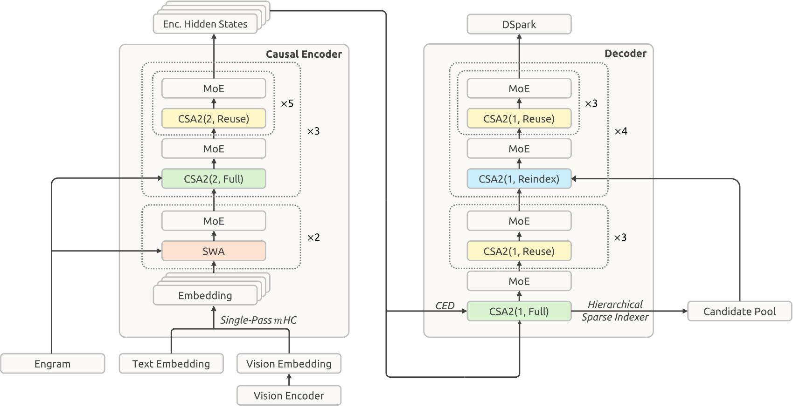
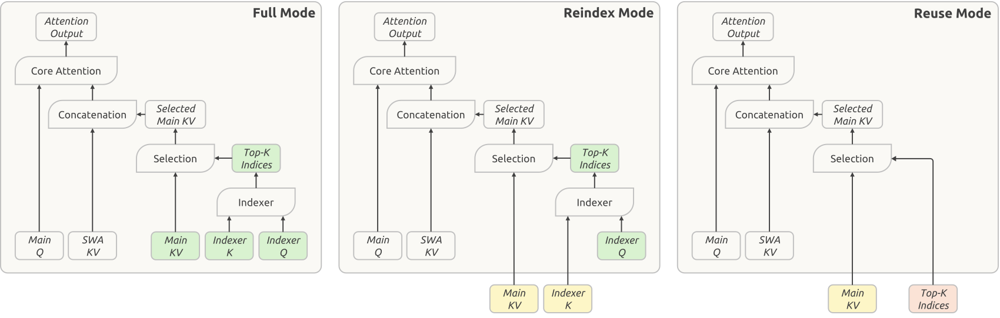

# DeepSeek-V4.1-Flash：因果编码解码、跨层缓存复用与原生多模态

> 💡 V4.1-Flash把prompt的全局KV构建集中到前半网络，跨层复用缓存与索引，再结合条件记忆、视觉输入、低精度及Agent数据训练，降低长交互的预填充和存储成本。
>
> [论文](https://arxiv.org/abs/2609.19969) · [官方模型](https://huggingface.co/deepseek-ai/DeepSeek-V4.1-Flash) · [补充解读](DeepSeek-V4.1-Flash解读.md)。按2026年9月报告版本记录。

V4已经压缩序列维KV，但Agent仍频繁遇到新输入、缓存miss和多轮状态，prefill与跨层缓存成为下一步成本。V4.1-Flash用Causal Encoder-Decoder减少prompt通过后半网络的工作，再用CSA2在层维共享KV与稀疏选择；同时从预训练起接入图像和Engram。报告的另一条主线是可验证Agent任务和异步后训练基础设施，而非声称全新RL算法。效果需连同缓存近似、effort、harness和测试预算阅读，尤其bounded replay恢复的是近似状态，不是精确重放。

## 整体配置与视觉路径

40层、hidden5120，前20层causal encoder、后20层decoder。主干552B，另196B Engram；prefill每token激活约8B，decode约16B。激活差来自执行路径，不是动态把完整权重缩到8B。

DeepSeek-ViT为32层、hidden1024、16heads、patch14，从头训练，采用2D-RoPE、RMSNorm、SwiGLU和可用Muon更新的线性patch投影。$3\times3$ pixel-unshuffle将视觉token减少九倍，再以两层MLP进入语言主干，分辨率最高约1344方图。

图像/文本分别维护专家均衡bias，更新各自负载，原亲和分仍用于输出权重，避免整体均衡掩盖单模态过载。全部层有MoE：384路由、一个共享、top6，SwiGLU阈值10。

## CED：全局KV不用每层重新计算

decoder全局KV与压缩权重从encoder最后状态投影：

$$
C_l=H_{L/2}W_l^{KV},\qquad Z_l=H_{L/2}W_l^Z,\quad l>L/2.
$$

多数prompt token只需跑encoder即可提供decoder的全局历史。但SWA仍依赖每层自身hidden，因此decoder要补局部窗口。对$N\gg W$，计算近似$O(NL/2+WL/2)$，而非普通$O(NL)$。

这不是传统非因果seq2seq encoder，encoder仍causal；decode新token仍通过完整网络。接近减半的结论主要针对长prompt prefill，短轮中窗口重算占比会变大。

## CSA2：在层维共享KV、key与选择

Full自己构建main KV和indexer K，并产生选择；Reindex共享此前KV/K，但用新query重新选；Reuse连选择也共享，只计算本层query、SWA与attention输出。缓存共享和选择共享因此可分别控制。

压缩器删除V4的重叠来源和绝对块内位置，indexer K直接从main KV投影。encoder压缩率2，18个CSA2层分三组，每组六层首Full后五Reuse；decoder压缩率1，首组Full+三Reuse，后四组各Reindex+三Reuse。

queryheads64、head512、top-k512、indexer32heads×128，局部窗128。共享main KV省存储，复用indices省计算，两者不是同一类收益。

## 层级索引：只让首层扫描完整历史

decoder首Full同时做块候选筛选，按每块最大分选2048个8位置块，形成至多16384候选；后续Reindex只在池内重评分，再选自己的top512。池大于最终选择，所以允许各层不同取舍。

首层仍扫描全历史，后层成本对固定池不再随上下文增长。不能因此把全部indexer称为常数复杂度。候选限制在后训练和服务一致应用，避免训练时能访问的条目到推理突然被删除。

## Single-Pass mHC、Engram与DSpark

原mHC需要先预测当前input mixing系数，再读残差混合；Single-Pass改用上一个block产生的系数：

$$
X_{l+1}=B_lX_l+C_lF_l(A_{l-1}X_l).
$$

这解除同一次全局归约依赖，Mega-mHC融合残差更新、输入混合、系数预测及pre-norm/FP8，激活搬运从$(4n+4)d$降至$(2n+2)d$。它是指定连接kernel的读写量减半，不是全模型带宽减半。

Engram在零索引1/14层各放一半196B记忆，2/3/4-gram、每阶八hash heads、每阶总维2048、约16M行素数表；省去原短卷积。表和投影FP8，地址确定后经后台RDMA从主机内存预取。

不在主干预训练联合训练MTP，之后冻结主干单训三层DSpark、block5；后训练随主干一起适配，但draft loss不反传主干。它服务RL rollout与在线加速，正确性依赖投机验证和调度条件。

## FP4主KV与优化器

indexer QK用MXFP4提高硬件兼容性；主KV以近四位E2M1加每16通道E4M3 scale存储，attention前解量化。主KV低位主要省存储，不要求该格式原生矩阵乘支持。去掉第二级global scale因实际KV范围足够，不能推广为所有模型均不需要scale。

线性矩阵Muon、Q/K按head做Muon，非矩阵与norm用AdamW。大embedding、Engram和head改用Nesterov momentum后Sinkhorn balancing：

$$
\Delta=\sqrt nD_r\widehat GD_c,\quad\tfrac1n\sum_j\Delta_{ij}^2\approx1,\quad\tfrac1m\sum_i\Delta_{ij}^2\approx1.
$$

它平衡更新的行列RMS，减少Adam第二矩状态；并不是将embedding权重投影成mHC的双随机混合矩阵。近零行屏蔽，11次迭代，Engram学习率五倍，无weight decay。

## 预训练与视觉训练

45T多模态token，batch100.6M；64K稀疏从头训练，34T扩1M。学习率2000步预热至$2.6\times10^{-4}$，28T–40T余弦降至十分之一，再保持到45T。图像和文字bias速度0.001，保留$10^{-4}$序列均衡项。

ViT先用约47B图文对做SigLIP式对比，最高224；再接4B MoE以236B token自回归训练细粒度视觉，分辨率544–1344，之后丢弃该4B语言模型、保留ViT。主干前期冻结视觉，学习率衰减阶段再以小学习率解冻。

## SWA持久缓存与bounded replay

全局KV长尾复用，持久cache至少72小时；SWA只在活跃session几分钟内有价值，因此从SSD持久缓存移到各主机约10% DRAM组成的短TTL池。

miss时只重跑最后$W=128$ token，而不是理论精确恢复所需$LW$。重放prefix仅恢复SWA，已有global不重算覆盖；新suffix再生成两类cache。decoder同样只补最后W token以完成首个decode所需局部状态。

**这是一种近似**：重放边界截掉更早的跨层SWA依赖，后续状态会随cache-hit位置改变，不是数学上batch/prefix完全不变。报告观察质量影响很小，不能改写成无损恢复。

## Agent任务、异步RL与OPD

后训练遵循SFT→RL→OPD，主要投入任务/环境构造。任务以problem、environment、verification组成，通过难度和正确性反馈反复改进；一般Agent复现真实工作流接口和失败案例，代码环境从合作会话和公开仓库构造，独立尝试与检查修复环境问题。

异步rollout按sample完成量派新prompt，避免全组等长尾；trainer收足样本后抢占rollout，共设备时分。跨checkpoint样本拼接每段实际专家路由，控制陈旧度并mask过旧token；限制数据集并发和过滤早到短样本，缓解长度偏差。最后40多个异构teacher做全词表OPD，缓存hidden而非完整logits。

## 可控effort与实验条件

训练以$b\in[1,100]$条件化，同题同effort子组内中心化奖励，不跨effort直接比较。长度惩罚：

$$
r^{len}=-\min(C_{max},k(b)\ell/L_{norm}),\quad k(b)=k_0e^{-(b-b_{min})/\tau}.
$$

高effort较少惩罚长思考，API low/high/max对应50/75/100。它学习连续成本—质量选择，不代表b=100一定用满某个token上限。

|  | Benchmark (Metric) | # Shots | DeepSeek-V4-Flash | DeepSeek-V4-Pro | DeepSeek-V4.1-Flash |
| --- | --- | --- | --- | --- | --- |
|  | Benchmark (Metric) | # Shots | Base | Base | Base |
|  | Architecture | - | MoE | MoE | MoE |
|  | # Activated Params | - | 13B | 49B | 8B/16B |
|  | # Backbone Params | - | 284B | 1.6T | 552B |
| World Knowl. | AGIEval (EM) | 3-5-shot | 83.9 | 84.4 | 83.4 |
| World Knowl. | MMLU-Pro (EM) | 5-shot | 68.3 | 73.5 | 74.1 |
| World Knowl. | C-Eval (EM) | 5-shot | 92.1 | 93.1 | 92.1 |
| World Knowl. | MultiLoKo (LLM-Judge) | 5-shot | 42.6 | 50.9 | 45.5 |
| World Knowl. | Simple-QA verified (EM) | 25-shot | 30.1 | 55.2 | 42.3 |
| World Knowl. | SuperGPQA (EM) | 5-shot | 46.5 | 53.9 | 53.1 |
| Lang. & Reas. | BBH (EM) | 3-shot | 86.9 | 87.5 | 86.1 |
| Lang. & Reas. | BBEH (EM) | 1-shot | 25.4 | 29.8 | 27.2 |
| Lang. & Reas. | DROP (F1) | 1-shot | 88.6 | 88.7 | 87.9 |
| Lang. & Reas. | HellaSwag (EM) | 0-shot | 85.7 | 88.0 | 87.2 |
| Code & Math | BigCodeBench (Pass@1) | 3-shot | 56.8 | 59.2 | 60.6 |
| Code & Math | HumanEval (Pass@1) | 0-shot | 69.5 | 76.8 | 79.4 |
| Code & Math | GSM8K (EM) | 8-shot | 90.8 | 92.6 | 93.0 |
| Code & Math | MATH (EM) | 4-shot | 57.4 | 64.5 | 61.1 |
| Code & Math | MGSM (EM) | 8-shot | 85.7 | 84.4 | 80.2 |
| Long Context | LongBench-V2 (EM) | 1-shot | 44.7 | 51.5 | 45.2 |
| Multimodal | MMMU-Pro (EM) | 4-shot | - | - | 56.5 |
| Multimodal | CVBench (EM) | 4-shot | - | - | 77.9 |
| Multimodal | DocVQA (LLM-Judge) | 4-shot | - | - | 95.6 |
| Multimodal | RefCOCO-avg (Acc@0.5) | 0-shot | - | - | 86.0 |

base表检查知识、多语言与长文，post-training不能替代预训练知识。以下最终表有不同harness：代码默认DeepSeek Harness Minimal、1M，DeepSWE用mini-SWE，视觉用Claude Code与512K，不能一概当同一agent框架。

|  | Benchmark (Metric) | Opus-5 | GPT-5.6 Sol | K3 | GLM-5.3 | DS-V4-Pro | DS-V4-Flash | DS-V4.1-Flash |
| --- | --- | --- | --- | --- | --- | --- | --- | --- |
|  | Benchmark (Metric) | Max | Max | Max | Max | Max | Max | Max |
| Reasoning | GPQA Diamond (Pass@1) | 93.4 | 94.1 | 92.9 | 88.1 | 92.4 | 89.9 | 90.9 |
| Reasoning | HLE (Pass@1) | 56.3 | 44.5 | 43.5 | 42.0 † | 42.7 † | 37.8 † | 36.8 (39.1 † ) |
| Reasoning | Codeforces (Rating) | - | - | - | - | 3348 | 3289 | 3471 |
| Reasoning | MathArena Apex (Pass@1) | - | - | 65.6 | - | 65.3 | 58.6 | 65.6 |
| Agentic | Terminal-Bench 2.1 (Pass@1) | 89.1 | 88.8 | 88.3 | 88.2 | 87.9 | 82.7 | 90.6 |
| Agentic | Terminal-Bench 3.0 (Pass@1) | 43.3 | 34.4 | 17.7 | 28.3 | 11.8 | 7.6 | 30.0 |
| Agentic | Terminal-Bench 4.0 (Pass@1) | 51.8 | 39.9 | 12.6 | 37.9 | 12.4 | 7.0 | 31.2 |
| Agentic | DeepSWE v1.1 (Resolved) | 74.0 | 73.0 | 67.5 | 66.9 | 62.7 | 54.4 | 74.2 |
| Agentic | ProgramBench (Almost@1) | 37.0 | 23.0 | 17.5 | 19.0 | 15.5 | - | 20.3 |
| Agentic | NL2Repo-Bench (Score) | 75.3 | 56.8 | 58.0 | 58.0 | 61.5 | 54.2 | 65.4 |
| Agentic | CyberGym (Pass@1) | - | 84.5 | 80.0 | 84.5 | 83.3 | 76.7 | 88.1 |
| Agentic | SEC-Bench Pro (Pass@1) | - | 74.3 | - | - | 56.4 | 30.9 | 62.8 |
| Agentic | ExploitGym (Pass@1) | 22.1 | 33.7 | - | 15.0 | 5.4 | 1.8 | 15.3 |
| Agentic | HLE w/ tools (Pass@1) | 63.6 | - | 59.8 | 62.5 | 60.0 | 51.5 | 63.9 |
| Agentic | Automation-Bench (Pass@1) | 50.3 | 45.8 | 46.7 | 48.8 | 43.2 | 37.7 | 54.8 |
| Agentic | Agents’ Last Exam (Pass@1) | 28.6 | 26.7 | 27.6 | 28.5 | 25.7 | 25.2 | 31.8 |
| Agentic | Chartography w/ tools (Pass@1) | 84.0 | 79.9 | 68.1 | - | - | - | 78.9 |
| Agentic | BabyVision w/ tools (Pass@1) | 94.1 | 88.9 | 85.7 | - | - | - | 89.6 |
| Agentic | ZeroBench-main w/ tools (Pass@5) | 52.0 | 53.0 | 41.0 | - | - | - | 49.0 |

代表结果Codeforces3471、GPQA90.9、DeepSWE74.2、Terminal2.1为90.6。更换框架后同checkpoint也变：

| Benchmark (Metric) | Claude Code | Codex | OpenCode | Pi | mini-SWE | DeepSeek Harness | DeepSeek Harness | DeepSeek Harness |
| --- | --- | --- | --- | --- | --- | --- | --- | --- |
| Benchmark (Metric) | Claude Code | Codex | OpenCode | Pi | mini-SWE | Minimal | Standard | PTC |
| DeepSWE v1.1 (Resolved) | 69.8 | 65.6 | 65.5 | 66.2 | 74.2 | 72.6 | 70.5 | 67.6 |
| Terminal-Bench v2.1 (Pass@1) | 88.0 | 84.1 | 85.0 | 86.1 | 90.3 | 90.6 | 85.8 | 85.8 |

DeepSWE不同框架65.5–74.2，说明harness是实质变量。effort25→100八项推理均分67.1→76.3，约多2.5倍输出；60–80已恢复不少质量，最后档收益递减。

## 多Agent实验与局限

团队模式用任务效果、协作奖励和按事件依赖DAG关键路径估计的延迟惩罚训练。ProgramBench筛参考方案≥95%通过的172题，最多三rollouts，Almost@1为单次得分≥0.95比例；FrontierSWE无GPU子集用Mean@5，二者不能混用。

ProgramBench八小时团队30.04%、单体20.39%；FrontierSWE二十小时32.90%对28.20%。论文注明比较最强观察配置、结果初步，不是固定总计算量的无条件团队优势。

缓存恢复有近似，复杂agent仍受环境和验证漏洞影响；视觉任务距闭源前沿仍有差距。报告贡献在于把prefill、缓存、条件记忆与数据训练一起优化，许多模块并无完全隔离消融，所以最终系统分数不能反推每个模块的独立增益。
