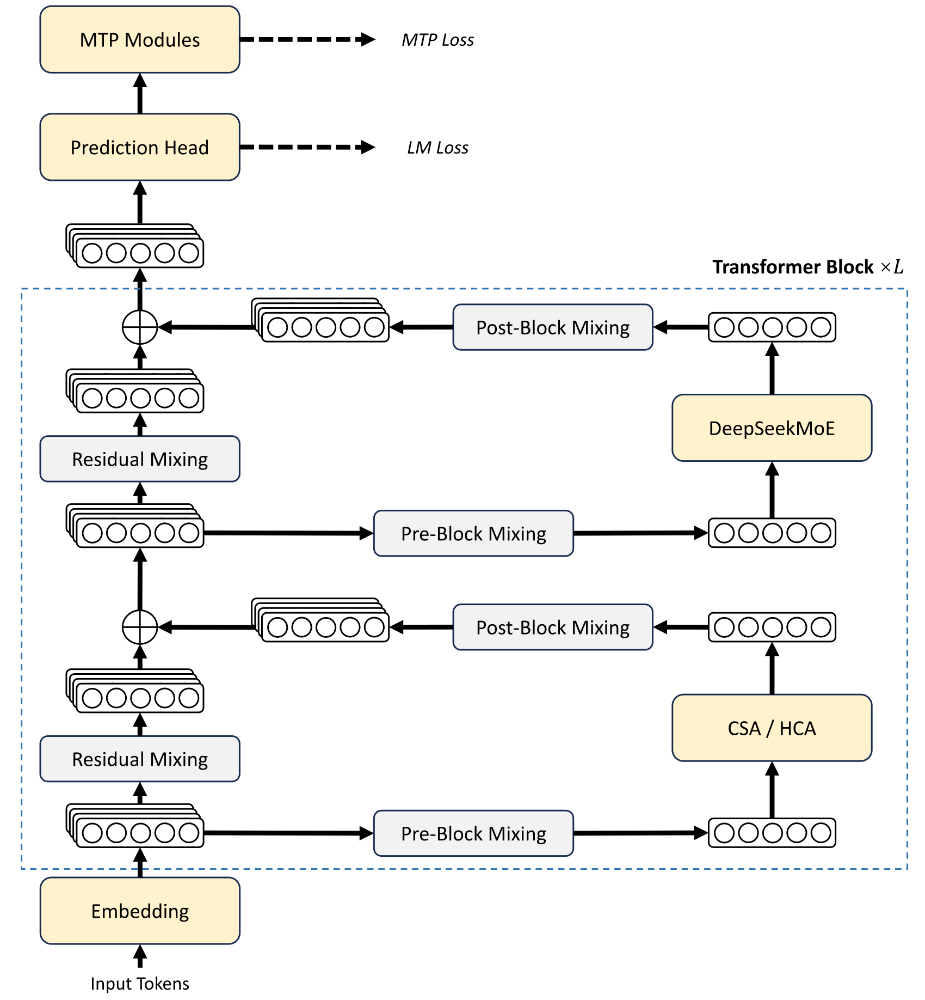

# DeepSeek-V4：补充解读

> CSA与HCA为什么要交错而不是二选一？以下为直觉解释与应用延伸，论文内容见 [精炼主笔记](DeepSeek-V4详解.md)。

## CSA 与 HCA 的分工

CSA 像带检索的较细记忆，HCA 像持续保留的粗摘要；滑窗则保存最近细节。压缩不可避免地丢信息，混合结构是在信息保留和成本之间分配预算，而不是实现无损无限上下文。

图中不同层承担不同信息访问模式。只有将 KV 存储、位置编码和算子一起处理，才能得到报告中的成本收益。

## OPD 为什么仍属于后训练核心

先训练不同专家，再让学生在自己会遇到的状态上学习教师分布，可以缓和多任务奖励冲突。它并不意味着 RL 被彻底取消：领域专家的能力仍通过 RL 获得，只是最终合并方式改变。

## 百万上下文的实际价值

长任务除了模型“能接收”，还需要重复工具调用时可复用前缀、可管理思考内容、可承受 KV 生命周期。一个超长窗口若每轮都重新 prefill，用户仍可能无法接受成本和时延。

## 阅读硬件数字时对齐条件

10% KV 和 27% FLOPs 都有明确基线、长度及精度。较少激活参数不代表总权重小；kernel 快 1.7 倍也不代表包含通信、排队、工具调用的任务快 1.7 倍。

## 用一个具体场景串起来

轻压缩保留较多细节，但若全读仍贵；所以CSA再挑少量相关条目。重压缩把全局历史变得便宜，但细节损失更大；HCA让每层还能获得粗全局信息。两者是在精细检索与整体汇聚间分工。

百万窗口只是容量。若一个任务需要跨多段精确组合，压缩和选择都可能损失线索；应看MRCR、CorpusQA与真实任务，而不是只验证模型能接收百万token不报错。
