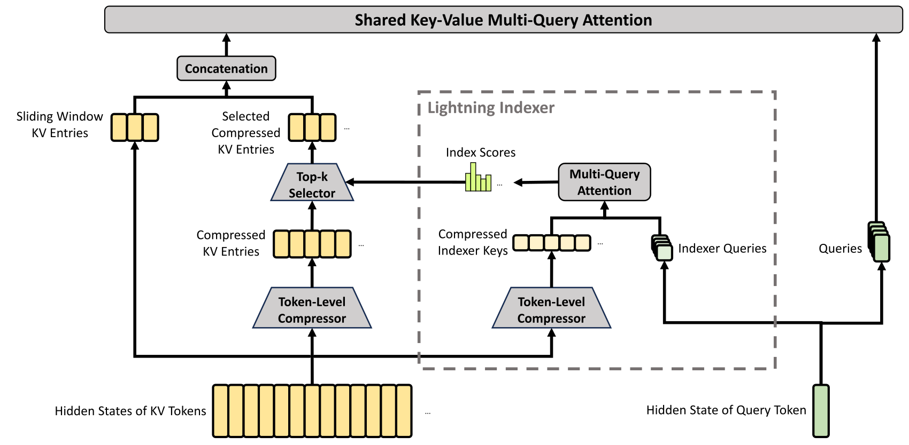
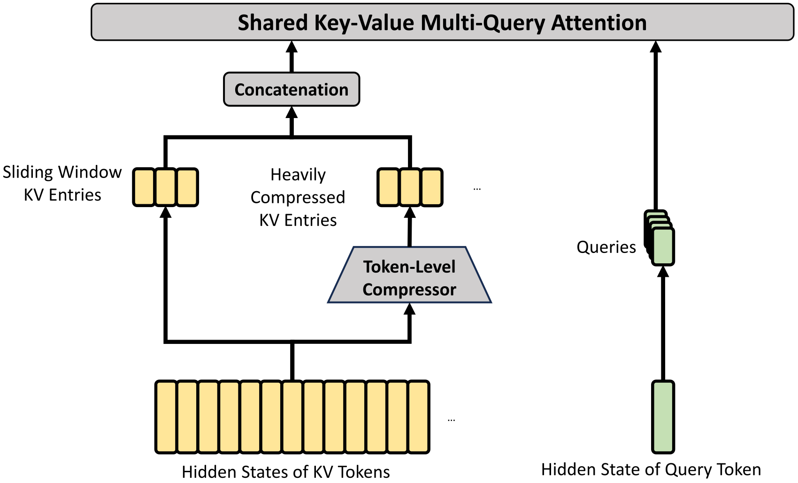
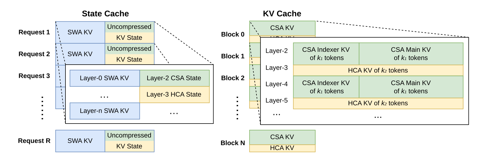

# DeepSeek-V4：压缩混合注意力与百万上下文训练系统

> 💡 V4把轻压缩后的稀疏检索与重压缩后的全局注意力交错使用，结合多流残差、Muon、低精度和完整训练服务系统，以较低KV与计算成本支持百万token。
>
> [论文](https://arxiv.org/abs/2606.19348) · [官方推理代码](https://huggingface.co/deepseek-ai/DeepSeek-V4-Pro/tree/main/inference) · [补充解读](DeepSeek-V4解读.md)。本文依据该预览技术报告，配置与结果按报告版本记录。

DSA降低了长序列主注意力的访问量，但索引与缓存仍会随上下文增长。V4进一步在序列维压缩KV，让不同层分别承担细粒度稀疏读取与粗粒度全局汇聚，构成CSA/HCA混合结构。与此同时，百万上下文会放大训练显存、优化器、磁盘缓存、RL rollout和沙箱执行的全部成本，报告因此花大量篇幅解释基础设施。模型包括Flash和Pro，后训练以领域专家和多教师on-policy distillation汇合能力。理解这篇报告需要把“压缩了什么”“省掉什么计算”与评测模式联系起来，而不能只摘取一个百万上下文规格。

## 规模与继承结构

| 配置 | Flash | Pro |
| --- | ---: | ---: |
| 总参数/每token激活 | 284B / 13B | 1.6T / 49B |
| Transformer层/hidden | 43 / 4096 | 61 / 7168 |
| 路由专家/每token选取 | 256 / 6 | 384 / 6 |
| 共享专家 | 1 | 1 |
| CSA压缩率/选取数 | 4 / 512 | 4 / 1024 |
| HCA压缩率 | 128 | 128 |
| 局部窗口 | 128 | 128 |
| mHC流数/SK次数 | 4 / 20 | 4 / 20 |
| 预训练token | 32T | 33T |

保留细粒度MoE与MTP；前三个MoE层使用hash路由，其余采用学习路由。mHC约束多流残差混合为近似双随机，使容量扩展不完全依赖主模块增宽。它控制残差旁路传播，不是对整个非线性模型的全局稳定保证。

## CSA：轻压缩后再稀疏选择

每个位置生成两组KV候选$C^a,C^b$及通道级压缩logits。一个压缩项从本块$m$个a候选和前块$m$个b候选中加权聚合，权重跨$2m$位置归一化；相邻压缩项的来源重叠，但输出长度仍为$N/m$，不是$N/(2m)$。

可概括为：

$$
C_i^{comp}=\sum_{j\in\text{本块}}S_j^a\odot C_j^a+\sum_{j\in\text{前块}}S_j^b\odot C_j^b.
$$

$S$来自压缩logits与可学习块内位置偏置，不是固定平均池化。indexer key做相同压缩，query经低秩down/up投影，计算多头ReLU相关分，再选top-k压缩项做主attention。

主KV由所有query heads共享，且同一个压缩向量兼作key/value。indexer与主attention共享压缩query latent，但各有上投影。多个attention head输出先分组降维，再汇合成hidden，控制宽输出投影成本。

## HCA：重压缩后的全局汇聚

HCA用$m'=128$的非重叠块，同样学习按位置和通道的聚合权重，随后对**全部压缩项**做attention，不进行top-k。CSA强调相对细粒度选择，HCA用更少条目保留全局通路，两者在层间交错。

为保持因果性，query只读此前完成的压缩块，当前块的局部信息由独立滑窗补齐。Flash前两层纯SWA，Pro前两层HCA，之后交错；不能把所有层都画成完全相同的CSA。

## 位置、sink和复杂度

query和KV先做RMSNorm，抑制attention logits异常。仅最后64维使用RoPE；因KV也当value，输出还需反向位置旋转，避免带出不适当的绝对位置。attention sink在softmax分母增加可学习项，使一个head可选择总输出接近零，而非必须把权重全部分给历史。

KV的RoPE维保留BF16，其余FP8；indexer QK使用FP4。百万上下文下约为参考BF16 GQA8缓存的2%，是指定基线和长度下的比值，不是所有模型均固定节约98%。HCA及indexer仍保留随长度增长的部分，不能称整个系统严格常数或线性成本。

## Muon、数值稳定与训练配方

矩阵参数主要用Muon，embedding、head、RMSNorm等用AdamW；Muon momentum0.95，更新RMS重标到0.18以复用学习率尺度。通过混合Newton-Schulz等实现控制正交化代价，attention归一化也用于防止异常logits。

Flash最大token batch75.5M、峰值学习率$2.7\times10^{-4}$；Pro94.4M、$2\times10^{-4}$，末期均降到十分之一。长度由4K→16K→64K→1M，先dense warmup，再预热indexer并切稀疏；Flash首1T为dense，Pro更长。MTP权重0.3，学习率衰减后0.1，均衡偏置速度0.001并保留$10^{-4}$序列辅助项。

训练异常与MoE outliers相关。SwiGLU线性分支夹到[-10,10]、gate上界10；Anticipatory Routing使用历史检查点预先算当前数据的路由，解耦主干与路由同步变化。该模式单独运行开销约20%，只在检测尖峰后短回滚启用，再回普通训练，整体代价较低。作者承认其机制尚未充分理论化。

## 从kernel到长序列训练的基础设施

细粒度EP重叠将通信拆进计算，mega-kernel减少调用与同步；TileLang支持复杂融合与host codegen，并用SMT辅助整数分析处理索引和边界。

batch-invariant kernel减少同请求随批结构变化的数值差异，deterministic kernel强调重复运行可复现；二者不是同一性质。Muon分布式实现、mHC重计算、长序列context parallel与灵活activation checkpoint共同控制显存。

服务需管理压缩KV、indexer K、局部SWA及未压缩尾块，不能仅把一个均匀张量分页。磁盘prefix cache的块边界、尾部状态与重建关系决定实际命中收益；压缩attention的算法也必须与缓存布局共同设计。

## 专家训练、工具思考与OPD

specialists覆盖多个领域及non-think/high/max模式，使用生成式RM、可验证任务和Agent环境。工具调用场景跨用户轮保留思考，普通对话仍清掉旧思考，与V3.2规则有差异。Quick Instruction用专用token复用已有KV完成搜索判断等辅助任务，避免另一个小模型重复prefill。

多教师OPD在学生自己的轨迹上对齐领域教师，目标是加权reverse KL：

$$
\mathcal L_{OPD}=\sum_iw_i\,\mathbb E_{y\sim\pi_\theta}[D_{KL}(\pi_\theta(\cdot\mid x,y_{<t})\|\pi_{E_i}(\cdot\mid x,y_{<t}))].
$$

使用十多个teacher的全词表分布，减少只用采样token估计的方差。教师权重按需从分布式存储加载，缓存末层hidden，训练时本地恢复logits，避免存全量大词表张量。

## QAT、rollout与DSec

后训练对MoE权重和CSA indexer QK做MXFP4 QAT；不是所有参数都FP4。训练用FP32master→FP4→FP8模拟并STE，rollout/服务直接用FP4，减小训练服务差异。索引分数FP32→BF16使top-k selector约快两倍、KV选择召回99.7%，这只是对应算子的结果。

rollout用逐token WAL持久化生成进度与KV，抢占后继续，故障可用已生成token重建cache。百万token数据拆元信息与重字段，先算全局packing，再按minibatch取重字段。

DSec统一function/container/microVM/fullVM，3FS按需加载只读层，写入COW；轨迹日志复用已完成命令结果，减少恢复时非幂等操作被再次执行。此类日志不等于任意外部副作用可回滚。

## 基础模型与后训练结果

|  | Benchmark (Metric) | # Shots | DeepSeek-V3.2 | DeepSeek-V4-Flash | DeepSeek-V4-Pro |
| --- | --- | --- | --- | --- | --- |
|  | Benchmark (Metric) | # Shots | Base | Base | Base |
|  | Architecture | - | MoE | MoE | MoE |
|  | # Activated Params | - | 37B | 13B | 49B |
|  | # Total Params | - | 671B | 284B | 1.6T |
| World Knowl. | AGIEval (EM) | 0-shot | 80.1 | 82.6 | 83.1 |
| World Knowl. | MMLU (EM) | 5-shot | 87.8 | 88.7 | 90.1 |
| World Knowl. | MMLU-Redux (EM) | 5-shot | 87.5 | 89.4 | 90.8 |
| World Knowl. | MMLU-Pro (EM) | 5-shot | 65.5 | 68.3 | 73.5 |
| World Knowl. | MMMLU (EM) | 5-shot | 87.9 | 88.8 | 90.3 |
| World Knowl. | C-Eval (EM) | 5-shot | 90.4 | 92.1 | 93.1 |
| World Knowl. | CMMLU (EM) | 5-shot | 88.9 | 90.4 | 90.8 |
| World Knowl. | MultiLoKo (EM) | 5-shot | 38.7 | 42.2 | 51.1 |
| World Knowl. | Simple-QA verified (EM) | 25-shot | 28.3 | 30.1 | 55.2 |
| World Knowl. | SuperGPQA (EM) | 5-shot | 45.0 | 46.5 | 53.9 |
| World Knowl. | FACTS Parametric (EM) | 25-shot | 27.1 | 33.9 | 62.6 |
| World Knowl. | TriviaQA (EM) | 5-shot | 83.3 | 82.8 | 85.6 |
| Lang. & Reas. | BBH (EM) | 3-shot | 87.6 | 86.9 | 87.5 |
| Lang. & Reas. | DROP (F1) | 1-shot | 88.2 | 88.6 | 88.7 |
| Lang. & Reas. | HellaSwag (EM) | 0-shot | 86.4 | 85.7 | 88.0 |
| Lang. & Reas. | WinoGrande (EM) | 0-shot | 78.9 | 79.5 | 81.5 |
| Lang. & Reas. | CLUEWSC (EM) | 5-shot | 83.5 | 82.2 | 85.2 |
| Code & Math | BigCodeBench (Pass@1) | 3-shot | 63.9 | 56.8 | 59.2 |
| Code & Math | HumanEval (Pass@1) | 0-shot | 62.8 | 69.5 | 76.8 |
| Code & Math | GSM8K (EM) | 8-shot | 91.1 | 90.8 | 92.6 |
| Code & Math | MATH (EM) | 4-shot | 60.5 | 57.4 | 64.5 |
| Code & Math | MGSM (EM) | 8-shot | 81.3 | 85.7 | 84.4 |
| Code & Math | CMath (EM) | 3-shot | 92.6 | 93.6 | 90.9 |
| Long Context | LongBench-V2 (EM) | 1-shot | 40.2 | 44.7 | 51.5 |

统一内部base评测中Flash在更低参数/激活下优于V3.2多个任务，Pro进一步提升。它是架构、数据与训练组合，不是单独CSA消融。

|  | Benchmark (Metric) | DeepSeek-V4-Flash | DeepSeek-V4-Flash | DeepSeek-V4-Flash | DeepSeek-V4-Pro | DeepSeek-V4-Pro | DeepSeek-V4-Pro |
| --- | --- | --- | --- | --- | --- | --- | --- |
|  | Benchmark (Metric) | Non-Think | High | Max | Non-Think | High | Max |
| Knowledge & Reasoning | MMLU-Pro (EM) | 83.0 | 86.4 | 86.2 | 82.9 | 87.1 | 87.5 |
| Knowledge & Reasoning | SimpleQA-Verified (Pass@1) | 23.1 | 28.9 | 34.1 | 45.0 | 46.2 | 57.9 |
| Knowledge & Reasoning | Chinese-SimpleQA (Pass@1) | 71.5 | 73.2 | 78.9 | 75.8 | 77.7 | 84.4 |
| Knowledge & Reasoning | GPQA Diamond (Pass@1) | 71.2 | 87.4 | 88.1 | 72.9 | 89.1 | 90.1 |
| Knowledge & Reasoning | HLE (Pass@1) | 8.1 | 29.4 | 34.8 | 7.7 | 34.5 | 37.7 |
| Knowledge & Reasoning | LiveCodeBench (Pass@1-COT) | 55.2 | 88.4 | 91.6 | 56.8 | 89.8 | 93.5 |
| Knowledge & Reasoning | Codeforces (Rating) | - | 2816 | 3052 | - | 2919 | 3206 |
| Knowledge & Reasoning | HMMT 2026 Feb (Pass@1) | 40.8 | 91.9 | 94.8 | 31.7 | 94.0 | 95.2 |
| Knowledge & Reasoning | IMOAnswerBench (Pass@1) | 41.9 | 85.1 | 88.4 | 35.3 | 88.0 | 89.8 |
| Knowledge & Reasoning | Apex (Pass@1) | 1.0 | 19.1 | 33.0 | 0.4 | 27.4 | 38.3 |
| Knowledge & Reasoning | Apex Shortlist (Pass@1) | 9.3 | 72.1 | 85.7 | 9.2 | 85.5 | 90.2 |
| Long | MRCR 1M (MMR) | 37.5 | 76.9 | 78.7 | 44.7 | 83.3 | 83.5 |
| Long | CorpusQA 1M (ACC) | 15.5 | 59.3 | 60.5 | 35.6 | 56.5 | 62.0 |
| Agentic | Terminal Bench 2.0 (Acc) | 49.1 | 56.6 | 56.9 | 59.1 | 63.3 | 67.9 |
| Agentic | SWE Verified (Resolved) | 73.7 | 78.6 | 79.0 | 73.6 | 79.4 | 80.6 |
| Agentic | SWE Pro (Resolved) | 49.1 | 52.3 | 52.6 | 52.1 | 54.4 | 55.4 |
| Agentic | SWE Multilingual (Resolved) | 69.7 | 70.2 | 73.3 | 69.8 | 74.1 | 76.2 |
| Agentic | BrowseComp (Pass@1) | - | 53.5 | 73.2 | - | 80.4 | 83.4 |
| Agentic | HLE w/ tools (Pass@1) | - | 40.3 | 45.1 | - | 44.7 | 48.2 |
| Agentic | MCPAtlas Public (Pass@1) | 64.0 | 67.4 | 69.0 | 69.4 | 74.2 | 73.6 |
| Agentic | GDPval-AA (Elo) | - | - | 1395 | - | - | 1554 |
| Agentic | Toolathlon (Pass@1) | 40.7 | 43.5 | 47.8 | 46.3 | 49.0 | 51.8 |

non-think/high/max在知识推理评测中分别使用8K/128K/384K预算，temperature1。更高effort总体更强但更贵。正式数学Agent还用Lean4.28.0-rc1、最多500工具调用和strict Comparator，不能与Prover系列旧版本及不同采样预算直接并榜。

代码Agent内部harness用bash+edit，最多500步、512K；BrowseComp沿用discard-all管理。Codeforces是14场Div1、114题，多候选模拟十次提交并计惩罚的rating估计，不是一次生成的真实参赛名次。

百万上下文用MRCR与CorpusQA，报告显示128K后仍逐步退化；支持1M输入不等于1M所有位置保持同样推理准确率。写作、搜索、白领任务和内部代码Agent案例补充真实用途，证据与标准benchmark分开看。

## 局限

极致效率带来较复杂的结构和缓存协议；路由与clamping稳定机制仍缺少完整解释，知识与复杂Agent仍落后部分闭源模型。报告自身也将简化架构、提高token效率、长程多轮和多模态列为后续方向。主要贡献是从attention到后训练与服务共同支撑百万上下文，而非一个孤立模块解决全部长文问题。
