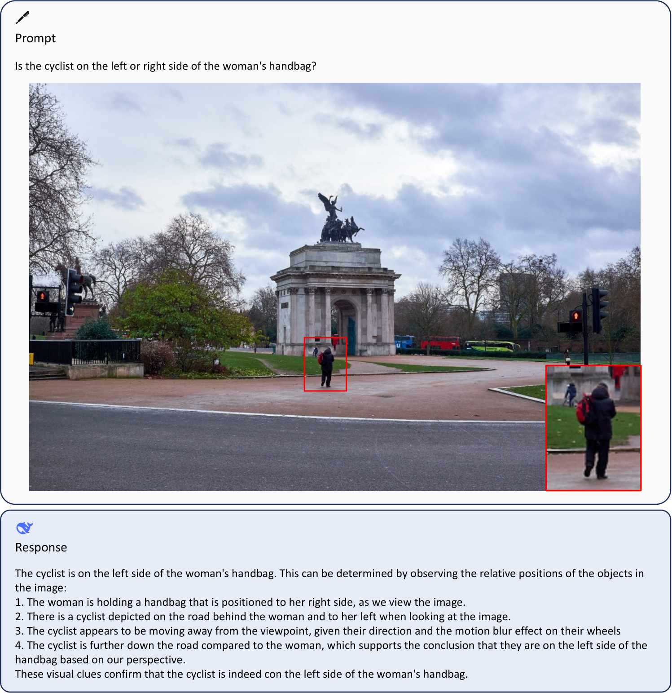
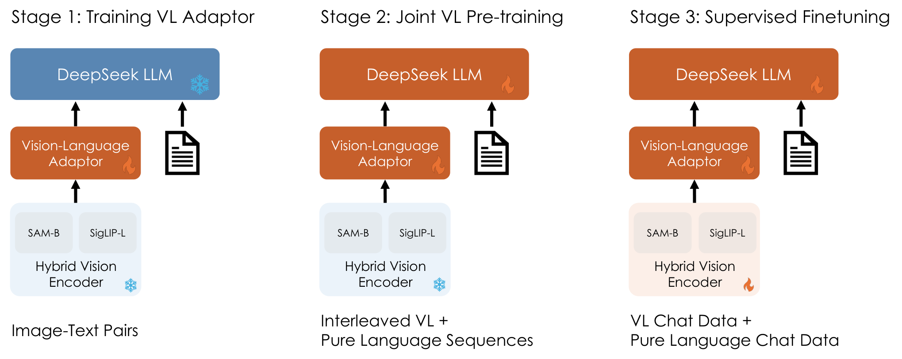
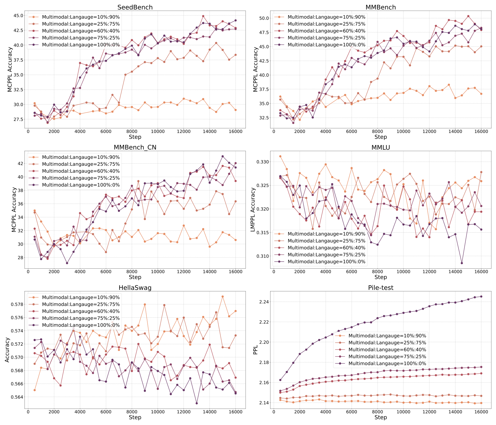

# DeepSeek-VL：混合视觉编码器与语言—多模态联合预训练

> 💡 DeepSeek-VL 用 SigLIP 提供视觉语义、SAM 补充高分辨率细节，并通过联合预训练和模态比例渐进调整，在增加视觉能力时尽量保留语言能力。
>
> [论文 v2](https://arxiv.org/abs/2403.05525v2) · [代码与模型](https://github.com/deepseek-ai/DeepSeek-VL) · [补充解读](DeepSeek-VL解读.md)

视觉语言模型不能只做到“能看图说话”：密集文字、图表、网页、界面和空间细节，都要求视觉编码器提供足够的信息；同时，把语言模型继续训练成多模态模型还可能损害原有语言能力。DeepSeek-VL 因而同时研究视觉表示与训练流程。它在有限的视觉 token 预算中融合两类编码器，再将适配器预热、语言—多模态联合预训练和指令微调分开。报告发布 1.3B 与 7B 级模型，通过公开基准、语言测试、人工评估及多组消融，说明真正关键的不只是增加一个 projector，还包括让语言模型本身参与学习、控制模态竞争，以及稳定地监控训练。

## 数据：从图文配对到真实任务指令

预训练数据包括交错图文网页、图像描述、OCR 文档以及图表等。交错图文让模型接触图片与上下文的关系，OCR 渲染对提供密集文字的监督，图表和文档则补充仅靠自然照片难以覆盖的结构信息。

| Category | Dataset | Ratio |
| --- | --- | --- |
| Interleaved image-text | MMC4 ( Zhu et al., 2024 ) | 13.1% |
|  | Wikipedia EN& CN ( Foundation, ) |  |
|  | Wikihow ( Yang et al., 2021 ) |  |
|  | in-house PDF and Epub textbooks |  |
| Image caption | Capsfusion ( Yu et al., 2023a ) | 11.1% |
|  | TaiSu ( Liu et al., 2022b ) |  |
|  | Detailed Caption ( echo840, 2024 ) |  |
| Table and chart | Chart2text ( Kantharaj et al., 2022 ) | 2.1% |
|  | Geo170K ( Gao et al., 2023 ) |  |
|  | Ureader ( Ye et al., 2023 ) |  |
|  | Unichart ( Masry et al., 2023 ) |  |
|  | M-paper ( Hu et al., 2023 ) |  |
|  | ScienceQA ( Lu et al., 2022b ) |  |
|  | ScreenQA ( Hsiao et al., 2022 ) |  |
|  | SciGraphQA-295K ( Li and Tajbakhsh, 2023 ) |  |
|  | Paper2figure100k ( Rodriguez et al., 2023 ) |  |
|  | Widget Captioning ( Li et al., 2020 ) |  |
|  | Screen2words ( Wang et al., 2021 ) |  |
|  | Refexp ( Mao et al., 2016 ) |  |
| Web Code | Websight ( HuggingFaceM4, 2024 ) | 0.4% |
|  | python plots scraped from GitHub notebook |  |
| Scene text OCR | ArT ( Chng et al., 2019 ) | 1.2% |
|  | MLT-17 ( Nayef et al., 2017 ) |  |
|  | LSVT ( Sun et al., 2019 ) |  |
|  | UberText ( Zhang et al., 2017 ) |  |
|  | Coco-text ( Veit et al., 2016 ) |  |
|  | RCTW-17 ( Shi et al., 2017 ) |  |
|  | ReCTS ( Zhang et al., 2019 ) |  |
|  | TextOCR ( Singh et al., 2021 ) |  |
|  | OpenVINO ( Krylov et al., 2021 ) |  |
|  | HierText ( Long et al., 2022 ) |  |
| Document OCR | arXiv rendered markdown ( Blecher et al., 2023 ) | 2.1% |
| Text-only corpus | DeepSeek-LLM 2T text copus ( DeepSeek-AI, 2024 ) | 70.0% |

表是多模态预训练数据内部的分布，不能与后文“纯文本占整体联合预训练约 70%”混为一谈。指令阶段另按真实应用建立任务分类，涵盖识别、理解与推理等，既使用公开数据，也补充内部构造的指令。

| Class | Dataset | Ratio |
| --- | --- | --- |
| In-house Data | SFT data based on taxonomy (Figure 3 ) | 10.5% |
| General Multi-modality | ShareGPT4V ( Chen et al., 2023 ) | 35.5% |
|  | LAION-GPTV ( LAION, 2023 ) |  |
|  | LVIS-Instruct4V ( Wang et al., 2023a ) |  |
|  | textOCR-GPT4V ( Carter, 2024 ) |  |
|  | LLaVA1.6-GPT4V ( Liu et al., 2024a ) |  |
|  | IconQA ( Lu et al., 2021 ) |  |
| Table and chart | Ureader ( Ye et al., 2023 ) | 4.1% |
|  | Geo170K ( Gao et al., 2023 ) |  |
|  | ScienceQA ( Lu et al., 2022b ) |  |
| Web Code | Screen-to-code ( Abi, 2024 ) | 2.0% |
|  | ScreenQA ( Hsiao et al., 2022 ) |  |
| Text-only SFT | DeepSeek-LLM ( DeepSeek-AI, 2024 ) | 47.9% |

这里的内部任务分类数据占 10.5%；模型并不是只靠这部分数据获得全部视觉能力。图像描述、一般视觉问答和文档任务分别承担不同监督作用。论文正文与个别示意图的数据比例标注存在不一致时，联合训练的文本比例以方法正文给出的 language:multimodal≈7:3 为准。

## 架构：语义与细节在通道维融合

SigLIP-L 接收 $384\times384$ 图像，提供语义较强但分辨率有限的特征；SAM-B 的图像编码器接收 $1024\times1024$ 图像，补充高分辨率的局部结构。后者在这里不是输出分割掩码，而是作为视觉特征提取器。

SAM 分支先输出 $64\times64\times256$，插值到 $96\times96\times256$，再经过两个 stride=2 的卷积，形成 $24\times24\times1024$，即 $576\times1024$。SigLIP 分支也提供 $576\times1024$。两分支分别做特征适配，再沿通道拼接成 $576\times2048$，经共享变换映射到语言模型输入空间。

因此融合后仍是 **576 个视觉 token**，不是把两组 token 简单拼成 1,152 个。可以把该过程概括为 $V=W_{\rm shared}[f_{\rm SigLIP}(I);f_{\rm SAM}(I)]$，分号表示通道拼接；实际实现还包含分支 MLP、激活及形状变换。

7B 模型采用混合编码器，1.3B 模型采用 SigLIP。语言部分沿用 DeepSeek LLM 的 RMSNorm、SwiGLU 和 RoPE，1.3B 与 7B 起始语言检查点分别约训练过 500B 与 2T 文本 token。

## 三阶段训练及其必要性

### 适配器预热

冻结视觉编码器和 LLM，只训练连接二者的适配器。数据为约 125 万图像描述对和 250 万 OCR 渲染对，先建立图像特征与语言输入空间之间的联系。

但小型 MLP 的容量有限，不能期望只扩大这一阶段的数据，就让冻结的 LLM 学会所有视觉概念。报告直接比较了预热步数：

| Stage 1, Training Step | MMB | MMC | SEED | POPE | MMMU | Average |
| --- | --- | --- | --- | --- | --- | --- |
| 2K | 59.0 | 54.0 | 61.8 | 82.3 | 30.3 | 57.5 |
| 8K | 58.0 | 45.0 | 58.5 | 84.9 | 29.2 | 55.1 |
| 20K | 56.0 | 52.3 | 59.0 | 81.7 | 28.6 | 55.5 |
| 80K | 58.1 | 55.0 | 58.6 | 78.6 | 27.9 | 55.6 |

由 2k 增至 80k 步，平均分没有提高，个别任务还下降。这项消融针对“冻结主体、仅训练适配器”的路线，不是说多模态数据扩展普遍无效。

### 语言—多模态联合预训练

冻结视觉编码器，更新适配器与语言模型。直接全部喂多模态数据会让语言指标明显恶化，作者认为原因包括视觉语料相对简单、分布差异与模态竞争。因此最终保留约 70% 纯文本、30% 多模态数据。

图中的不同配比表明，加入文本能显著缓解语言退化，而且不必付出同等程度的视觉损失。这里不是先把语言训练完成后永久冻结 LLM，而是在联合训练中保留语言任务的梯度。

训练还采用两项措施。**模态预热**从全语言数据开始，逐渐过渡到目标比例，避免训练初期的突变。**模态分组**让不同 step 分别处理纯文本或多模态 batch，减少文本样本等待视觉计算；论文报告训练效率提高约 20%，并非模型推理普遍快 20%。

1.3B 模型直接生成选项时指标波动很大，因此训练监控采用多选题 PPL：分别计算候选答案的条件似然，选择困惑度最低者；同时混入少量 SFT 数据，改善答案格式遵循。报告强调要区分“不会题”和“知道但没有按评测格式输出”。

### 监督微调

用视觉指令与纯文本对话混合训练，只监督 assistant 回答及相关特殊 token，屏蔽用户和 system 输入。更新 LLM、适配器与 SigLIP；受显存限制，SAM 保持冻结。这样最终模型才从多模态条件语言建模器转成可对话助手。

| Stage 1 | Stage 2 | Stage 3 | MMB | MMC | SEED | POPE | MMMU | Average |
| --- | --- | --- | --- | --- | --- | --- | --- | --- |
| ✓ |  | ✓ | 59.4 | 54.2 | 61.4 | 82.5 | 29.2 | 57.4 |
|  | ✓ | ✓ | 63.4 | 60.5 | 65.9 | 87.1 | 31.8 | 61.7 |
| ✓ | ✓ | ✓ | 64.3 | 61.3 | 66.7 | 87.6 | 32.2 | 62.4 |

完整三阶段平均分 62.4；跳过联合预训练为 57.4，跳过适配器预热为 61.7。主要收益来自主体参与的联合预训练，而适配器预热仍有小幅增益。

## 超参数与训练系统

|  | DeepSeek-VL 1B | DeepSeek-VL 1B | DeepSeek-VL 1B | DeepSeek-VL-7B | DeepSeek-VL-7B | DeepSeek-VL-7B |
| --- | --- | --- | --- | --- | --- | --- |
| Vision Encoder | SigLIP | SigLIP | SigLIP | SigLIP+SAM | SigLIP+SAM | SigLIP+SAM |
| Hyperparameters | Stage 1 | Stage 2 | Stage 3 | Stage 1 | Stage 2 | Stage 3 |
| Learning rate | $1.0\times 10^{-3}$ | $3\times 10^{-5}$ | $2.0\times 10^{-5}$ | $1.0\times 10^{-3}$ | $4.2\times 10^{-5}$ | $2.0\times 10^{-5}$ |
| LR scheduler | Cosine | Step | Cosine | Cosine | Step | Cosine |
| Weight decay | 0.0 | 0.0 | 0.0 | 0.0 | 0.0 | 0.0 |
| Gradient clip | 1.0 | 1.0 | 1.0 | 1.0 | 1.0 | 1.0 |
| Optimizer | AdamW( $\beta_{1}=0.9,\beta_{2}=0.95$ ) | AdamW( $\beta_{1}=0.9,\beta_{2}=0.95$ ) | AdamW( $\beta_{1}=0.9,\beta_{2}=0.95$ ) | AdamW( $\beta_{1}=0.9,\beta_{2}=0.95$ ) | AdamW( $\beta_{1}=0.9,\beta_{2}=0.95$ ) | AdamW( $\beta_{1}=0.9,\beta_{2}=0.95$ ) |
| Warm-up steps | 128 | 2000 | 256 | 128 | 2000 | 256 |
| Training steps | 15000 | 96000 | 10000 | 15000 | 42000 | 10000 |
| Batch size | 256 | 1024 | 256 | 256 | 2304 | 256 |
| Sequence length | 512 | 4096 | 4096 | 512 | 4096 | 4096 |
| Sequence packing | $\times$ | ✓ | $\times$ | $\times$ | ✓ | $\times$ |
| Pipeline parallelism | $\times$ | $\times$ | $\times$ | $\times$ | ✓ | ✓ |

7B 联合预训练为 42k steps、batch 2304、长度 4096，1.3B 为 96k steps、batch 1024；两个规模的训练步数不同，不能只凭模型大小比较总计算量。SFT 学习率为 $2\times10^{-5}$，适配器预热为 $10^{-3}$。

系统使用 HAI-LLM，视觉编码器和文本 embedding 作为流水线的首模块，重新分配后续层以平衡各 stage。视觉模块较小但结构不适合直接套标准张量并行，因此在 tensor-parallel ranks 上重算其前向。7B 使用 64 个节点、每节点八张 A100，训练约五天；1.3B 使用 16 个相同节点约七天。

## 公开视觉、语言与人工评测

| 模型 | MMMU | MMBench | MMBench-CN | SEED | OCRBench | POPE | MathVista | MMVet |
| --- | ---: | ---: | ---: | ---: | ---: | ---: | ---: | ---: |
| LLaVA-Next 7B | 35.8 | 67.4 | 60.0 | 70.2 | — | 86.5 | 34.6 | 43.9 |
| DeepSeek-VL 1.3B | 32.2 | 64.6 | 61.3 | 66.7 | 409 | 87.6 | 31.1 | 34.8 |
| DeepSeek-VL 7B | 36.6 | 73.2 | 72.8 | 70.4 | 456 | 88.1 | 36.1 | 41.5 |
| GPT-4V | 56.8 | 75.0 | 74.7 | 71.6 | 659 | — | 47.8 | 49.9 |

MMBench 使用 dev 集，视觉公开测试采用 greedy generation，再解析答案。OCRBench 是原始分数，不能与百分数直接平均；论文计算综合均分时做了归一化。7B 在中英文 MMBench 上表现较强，但 MMMU、数学视觉推理与部分开放式视觉问答仍明显落后于闭源大模型，不是所有任务都优于同级开源模型。

| 语言指标 | DeepSeek-LLM 7B Chat | DeepSeek-VL 7B Chat |
| --- | ---: | ---: |
| HellaSwag | 68.5 | 68.4 |
| MMLU | 49.4 | 52.4 |
| GSM8K | 63.0 | 55.0 |
| MBPP | 35.2 | 35.2 |
| AGIEval | 19.3 | 27.8 |

语言测试中，多选题使用候选 PPL，而数学与代码使用任务对应的生成评测。保留语言能力的结论是整体层面的，GSM8K 仍有下降，不能写成“所有文本能力无损”。

人工测试另外覆盖现实场景，比较不同模型的回答偏好。它补充公开基准不能覆盖的交互体验，但其题目分布与主观评价方式不同，不能把偏好胜率直接换成标准基准准确率。附录展示 OCR、表格、定位和代码等案例，用于说明任务覆盖，不作为独立统计证据。

## 编码器与适配器消融

| Architecture | MMB | MMC | SEED | POPE | ScienceQA | MMMU | OCRB | Average |
| --- | --- | --- | --- | --- | --- | --- | --- | --- |
| Sequence Concatenation: | Sequence Concatenation: | Sequence Concatenation: | Sequence Concatenation: | Sequence Concatenation: | Sequence Concatenation: | Sequence Concatenation: | Sequence Concatenation: |  |
| Token Pooling - W | 61.2 | 59.6 | 61.6 | 86.5 | 57.7 | 31.6 | 304 | 55.5 |
| Token Pooling - H | 59.9 | 58.3 | 61.6 | 83.8 | 55.0 | 32.0 | 291 | 54.2 |
| Embedding Concatenation: | Embedding Concatenation: | Embedding Concatenation: | Embedding Concatenation: | Embedding Concatenation: | Embedding Concatenation: | Embedding Concatenation: | Embedding Concatenation: |  |
| Hybrid MLP | 61.7 | 60.1 | 62.9 | 87.8 | 56.6 | 31.3 | 309 | 55.9 |
| Shared MLP | 62.0 | 58.9 | 62.5 | 86.6 | 54.7 | 30.2 | 318 | 55.2 |
| Separate MLP | 57.5 | 58.7 | 63.1 | 86.5 | 56.6 | 29.0 | 299 | 54.5 |

在固定视觉 token 预算下，通道拼接配合混合 MLP 的平均结果最好：先各分支适配，再共享融合，比全部共享或全部分离更稳。序列拼接若保持 token 数不变，需要池化，反而损失部分信息。因此结果并不等于“通道拼接永远好于序列拼接”，关键是比较时受同样 token 预算约束。

视觉编码器消融还显示，引入视觉自监督编码器能改善训练损失；但报告为节省成本缩短了相关训练，不能把该训练损失曲线直接当作每个最终任务的独立增益。整体结论是：高分辨率细节、语义特征和主体联合训练相互配合；小适配器上的扩展不足以替代完整的多模态学习。
