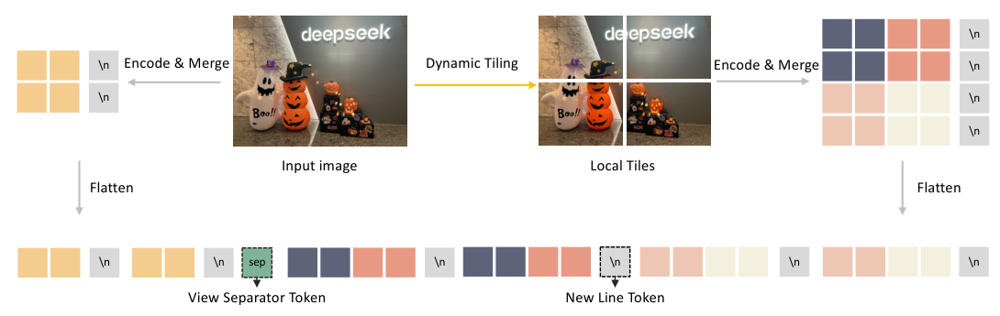

# DeepSeek-VL2：补充解读

> 动态切图买来了什么，又付出了什么？以下为直觉解释与应用延伸，论文内容见 [精炼主笔记](DeepSeek-VL2详解.md)。

## 激活参数少，显存为何仍然很大

MoE 只减少每个 token 执行的专家计算，未被激活的专家通常仍要驻留设备或被调入。比较 2.8B 激活 MoE 与 2.8B dense 模型时，计算预算可以接近，存储与通信预算却可能差很多。MLA 节省的是 KV cache，又是另一项成本。

## 切图是自适应地买更多 token

长页面并没有被免费变清晰：更多 tile 意味着更多视觉 token、prefill 和后续注意力成本。全局缩略图提供布局，局部图块提供细节，行分隔符帮助保留二维关系。

图中的拼接顺序对多列文档尤其重要。检索系统若只取局部 tile，可能丢失标题或跨列关联；生成系统若全量输入，又可能超出预算。两者应根据实际阅读任务取舍。

## 如何看 grounding 的价值

把“这只动物”定位到一个框，可让回答更可核查，也能给 agent 提供操作坐标；但一个正确框不能证明关于对象的所有文字判断都正确。实践评估可以把定位准确率、文本回答准确率与二者一致性分开记录。

## 用一个具体场景串起来

一张横向很长的表格缩成单个方图会让小字难辨；切成多块保留局部清晰度，全局缩略图补回布局。代价是视觉token变多，LLM上下文与attention开销增加。

因此选分辨率不只是图像预处理参数，也是计算分配。grounding再把“回答文字”变成可定位区域，适合文档引用和界面理解，但需要坐标协议、负样本和布局评测共同支持。
