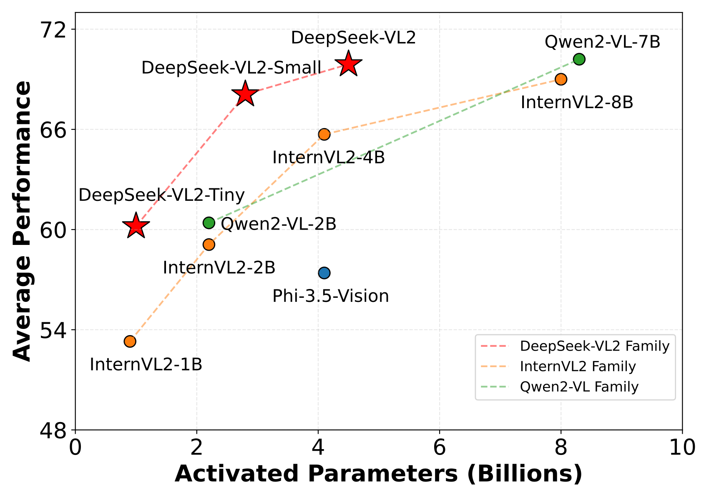
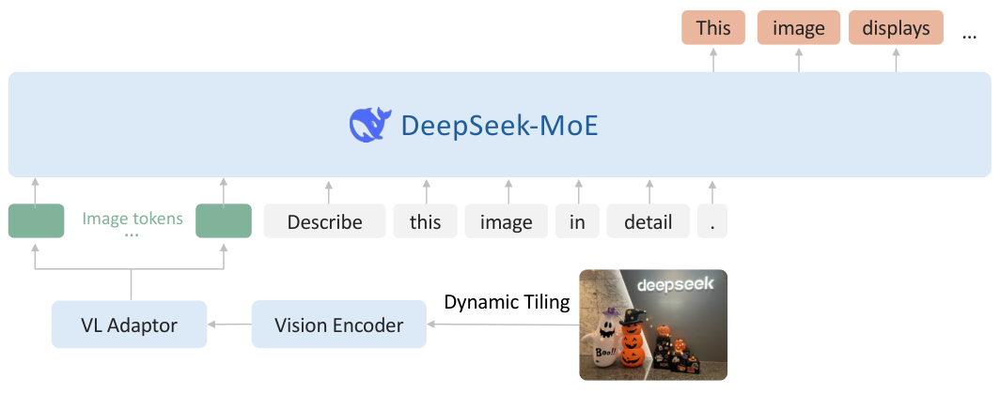
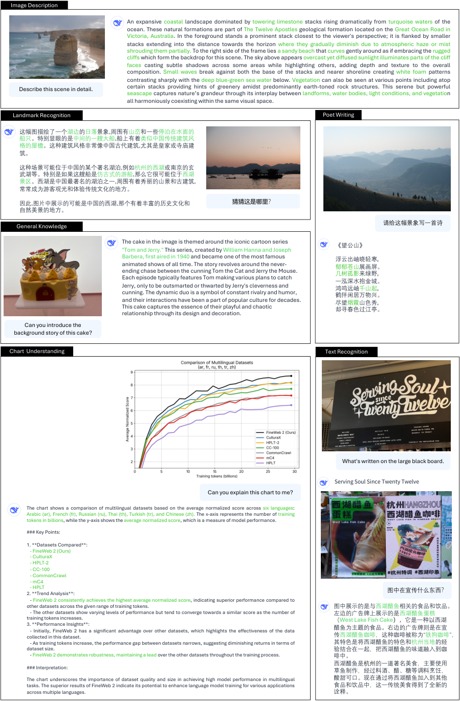
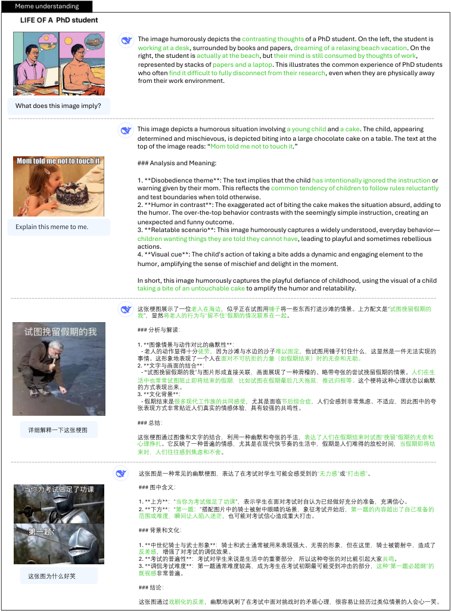
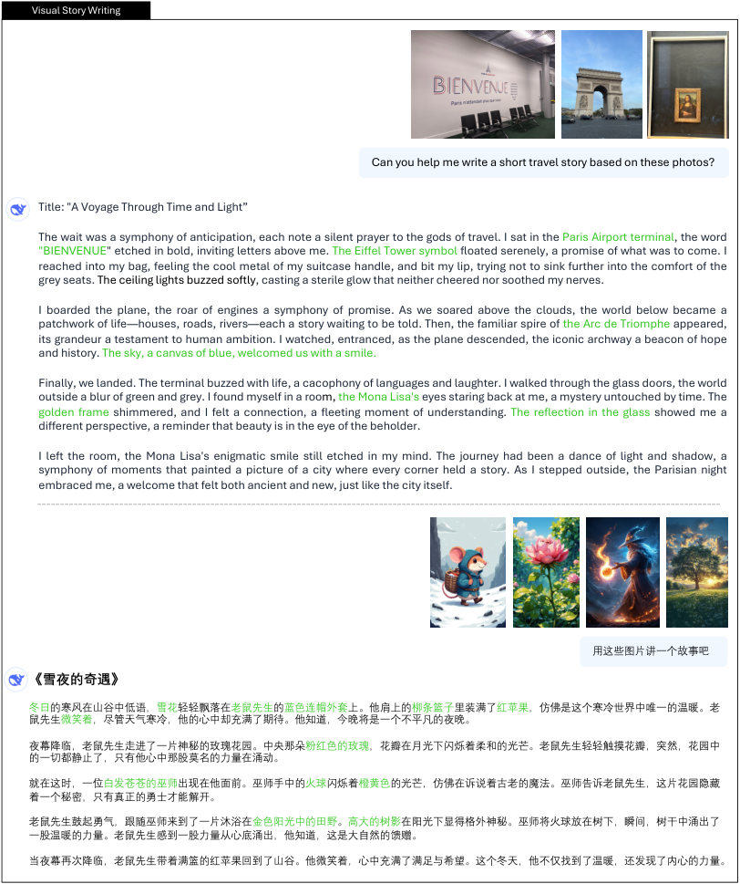
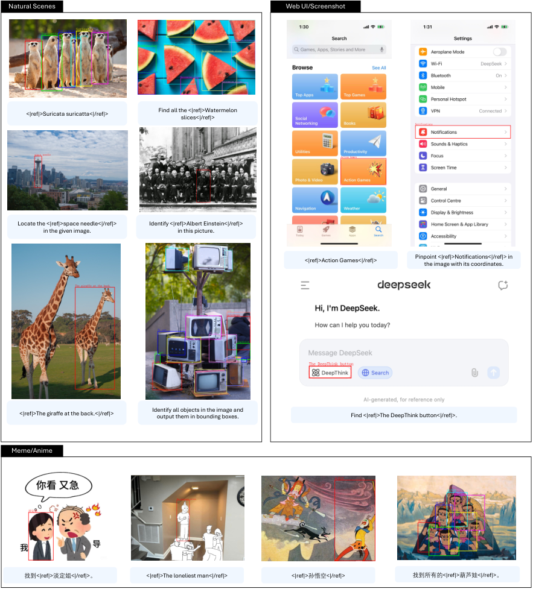
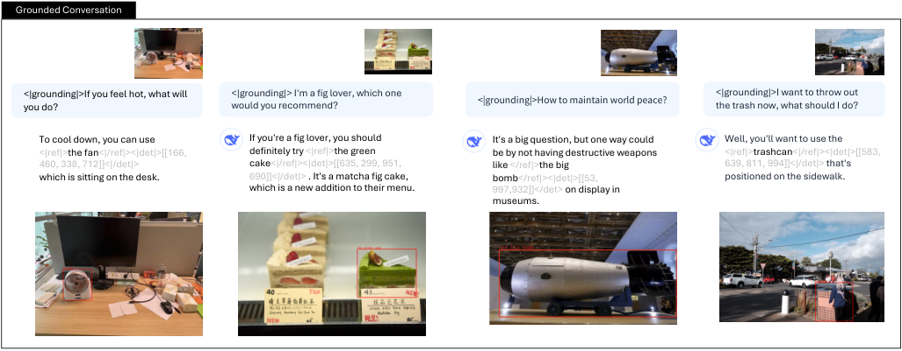
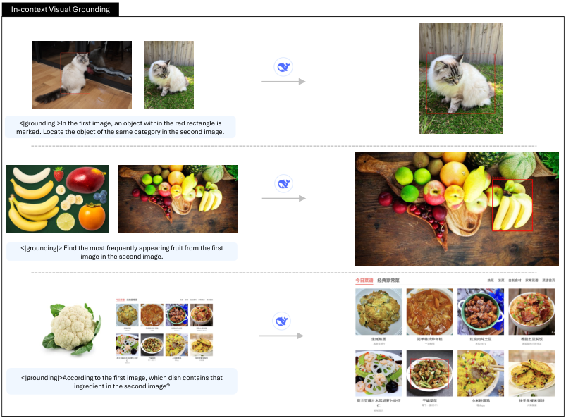

# DeepSeek-VL2: Mixture-of-Experts Vision-Language Models for Advanced Multimodal Understanding / 全文中英对照

> 来源：[arXiv:2412.10302v1](https://arxiv.org/abs/2412.10302v1)。英文段落后紧接中文，覆盖所取 HTML 版本的主文、附录、图表、脚注与参考文献；公式、数字表和书目信息共用。中文以机器初译为底稿，进行了术语整理与结构核对，尚未逐句人工审定；遇到歧义请以紧邻英文和原论文为准。 原作版权归所列作者，许可见 [原作许可](http://creativecommons.org/licenses/by/4.0/)；中文译文与版式改写在该许可条件下提供（涉及 SA 时沿用相同许可，涉及 NC 时仅限非商业使用）。

## Authors and affiliations / 作者与机构

Zhiyu Wu ∗ , Xiaokang Chen ∗ , Zizheng Pan ∗ , Xingchao Liu ∗ , Wen Liu ∗,† , Damai Dai, Huazuo Gao, Yiyang Ma, Chengyue Wu, Bingxuan Wang, Zhenda Xie, Yu Wu, Kai Hu, Jiawei Wang, Yaofeng Sun, Yukun Li, Yishi Piao, Kang Guan, Aixin Liu, Xin Xie, Yuxiang You, Kai Dong, Xingkai Yu, Haowei Zhang, Liang Zhao, Yisong Wang, Chong Ruan ‡ DeepSeek-AI Corresponding author: ∗ : Core contributors. † : Project lead. ‡ : Corresponding author.

**EN.** \reportnumber

**中.** \报告编号

**EN.** 001

**中.** 001

## Abstract / 摘要

**EN.** We present DeepSeek-VL2, an advanced series of large Mixture-of-Experts (MoE) Vision-Language Models that significantly improves upon its predecessor, DeepSeek-VL, through two key major upgrades. For the vision component, we incorporate a dynamic tiling vision encoding strategy designed for processing high-resolution images with different aspect ratios. For the language component, we leverage DeepSeekMoE models with the Multi-head Latent Attention mechanism, which compresses Key-Value cache into latent vectors, to enable efficient inference and high throughput. Trained on an improved vision-language dataset, DeepSeek-VL2 demonstrates superior capabilities across various tasks, including but not limited to visual question answering, optical character recognition, document/table/chart understanding, and visual grounding. Our model series is composed of three variants: DeepSeek-VL2-Tiny, DeepSeek-VL2-Small and DeepSeek-VL2, with 1.0B, 2.8B and 4.5B activated parameters respectively. DeepSeek-VL2 achieves competitive or state-of-the-art performance with similar or fewer activated parameters compared to existing open-source dense and MoE-based models. Codes and pre-trained models are publicly accessible at [https://github.com/deepseek-ai/DeepSeek-VL2](https://github.com/deepseek-ai/DeepSeek-VL2) .

**中.** 我们推出 DeepSeek-VL2，这是一系列先进的大型专家混合 (MoE) 视觉语言模型，通过两项关键的重大升级，显着改进了其前身 DeepSeek-VL。对于视觉组件，我们采用了动态平铺视觉编码策略，旨在处理具有不同纵横比的高分辨率图像。对于语言组件，我们利用带有多头潜在注意力机制的 DeepSeekMoE 模型，该机制将键值缓存压缩为潜在向量，以实现高效推理和高吞吐量。 DeepSeek-VL2 在改进的视觉语言数据集上进行训练，在各种任务中展示了卓越的能力，包括但不限于视觉问答、光学字符识别、文档/表格/图表理解和视觉基础。我们的模型系列由三个变体组成：DeepSeek-VL2-Tiny、DeepSeek-VL2-Small 和 DeepSeek-VL2，分别具有 1.0B、2.8B 和 4.5B 激活参数。与现有的开源稠密模型和基于 MoE 的模型相比，DeepSeek-VL2 通过相似或更少的激活参数实现了具有竞争力或最先进的性能。代码和预训练模型可在 [https://github.com/deepseek-ai/DeepSeek-VL2](https://github.com/deepseek-ai/DeepSeek-VL2) 上公开访问。

**EN.** Figure 1: Average performance vs. activated parameters among different open-source models . We average the accuracy of MMBench v1.1, MMStar, MMMU (Val), MathVista (TestMini), AI2D (Test), and OCRBench. The scores of OCRBench are divided by $10$ to scale them to $[0,100]$ .

**中.** 图 1：不同开源模型之间的平均性能与激活参数。我们对 MMBench v1.1、MMStar、MMMU (Val)、MathVista (TestMini)、AI2D (Test) 和 OCRBench 的准确度进行平均。 OCRBench 的分数除以 $10$ 以缩放到 $[0,100]$ 。

## Introduction / 简介

**EN.** Large Vision-Language Models (VLMs) have emerged as a transformative force in artificial intelligence [ 54 , 59 , 94 , 63 , 83 , 15 , 88 ] , extending the remarkable capabilities of Large Language Models (LLMs) to seamlessly process both visual and textual information. This advancement has dramatically expanded the potential for AI systems to tackle complex real-world applications that require multimodal understanding.

**中.** 大型视觉语言模型 (VLM) 已成为人工智能领域的一股变革力量 [54、59、94、63、83、15、88]，扩展了大型语言模型 (LLM) 的卓越能力，可以无缝处理视觉和文本信息。这一进步极大地扩展了人工智能系统处理需要多模式理解的复杂现实应用的潜力。

**EN.** In this technical report, we present DeepSeek-VL2, a new series of open-source Vision-Language Models that leverages the Mixture-of-Experts (MoE) architecture to achieve substantial improvements in both performance and efficiency compared to its predecessor, DeepSeek-VL [ 59 ] . Our advancements center around three key aspects: (1) a dynamic, high-resolution vision encoding strategy that enhances visual understanding, (2) an optimized language model architecture that significantly improves both training and inference efficiency, and (3) a refined vision-language data construction pipeline that not only boosts overall performance but also extends model capabilities to new areas such as precise visual grounding.

**中.** 在本技术报告中，我们介绍了 DeepSeek-VL2，这是一系列新的开源视觉语言模型，它利用专家混合 (MoE) 架构，与其前身 DeepSeek-VL [59] 相比，在性能和效率方面实现了显着改进。我们的进步集中在三个关键方面：(1) 增强视觉理解的动态高分辨率视觉编码策略；(2) 优化的语言模型架构，显着提高训练和推理效率；(3) 精细的视觉语言数据构建管道，不仅提高整体性能，还将模型功能扩展到精确视觉基础等新领域。

**EN.** For the vision component, we introduce a dynamic tiling vision encoding strategy that efficiently processes high-resolution images of varying aspect ratios. This approach improves over DeepSeek-VL’s hybrid vision encoder, which extracted features from images at two fixed resolutions ( $384\times 384$ and $1024\times 1024$ ). Our approach avoids the limitations of the old fixed-size encoder and excels in tasks requiring ultra-high resolution, including visual grounding, document/table/chart analysis, and detailed feature extraction, while maintaining a manageable number of visual tokens. Drawing inspiration from established slicing-tile methods, our system dynamically segments high-resolution inputs into local tiles, processes each tile through a shared vision transformer, and seamlessly integrates the extracted features within the language model. This design preserves the advantages of vision transformers with local attention, enabling rich feature extraction without the quadratic computational scaling typically associated with increasing image resolutions.

**中.** 对于视觉组件，我们引入了动态平铺视觉编码策略，可以有效地处理不同纵横比的高分辨率图像。这种方法改进了 DeepSeek-VL 的混合视觉编码器，后者以两种固定分辨率（ $384\times 384$ 和 $1024\times 1024$ ）从图像中提取特征。我们的方法避免了旧的固定大小编码器的限制，并且在需要超高分辨率的任务中表现出色，包括视觉基础、文档/表格/图表分析和详细特征提取，同时保持可管理数量的视觉标记。从已建立的切片切片方法中汲取灵感，我们的系统将高分辨率输入动态分割为本地切片，通过共享视觉转换器处理每个切片，并将提取的特征无缝集成到语言模型中。这种设计保留了具有局部注意力的视觉变换器的优点，能够提取丰富的特征，而无需通常与提高图像分辨率相关的二次计算缩放。

**EN.** For the language component, we leverage DeepSeek language models [ 20 , 53 ] , featuring the Multi-head Latent Attention (MLA) mechanism. MLA significantly reduces computational cost by compressing the Key-Value (KV) cache into a latent vector, resulting in faster inference and increased throughput capacity. We further enhance efficiency through the DeepSeekMoE framework [ 20 , 86 ] , which employs sparse computation techniques. Our model series adopt three MoE variants, 3B, 16B, and 27B. These LLMs have 0.57B, 2.4B, and 4.1B activated parameters respectively.

**中.** 对于语言组件，我们利用 DeepSeek 语言模型 [20, 53]，具有多头潜在注意（MLA）机制。 MLA 通过将键值 (KV) 缓存压缩为潜在向量来显着降低计算成本，从而加快推理速度并提高吞吐量。我们通过采用稀疏计算技术的 DeepSeekMoE 框架 [20, 86] 进一步提高了效率。我们的车型系列采用三种 MoE 变体：3B、16B 和 27B。这些 LLM 分别具有 0.57B、2.4B 和 4.1B 激活参数。

**EN.** We also greatly enhance our vision-language training data in terms of quality, quantity, and diversity. This comprehensive dataset enables better generalization and performance across a broad spectrum of tasks, including Visual Question Answering (VQA), Optical Character Recognition (OCR), document/table/chart understanding, visual reasoning, and general chatbot applications. The improved training data has also enabled new abilities such as visual grounding and Graphical User Interface (GUI) perception.

**中.** 我们还大大增强了视觉语言训练数据的质量、数量和多样性。这个全面的数据集可以在广泛的任务中实现更好的泛化和性能，包括视觉问答 (VQA)、光学字符识别 (OCR)、文档/表格/图表理解、视觉推理和一般聊天机器人应用。改进的训练数据还实现了视觉基础和图形用户界面（GUI）感知等新能力。

**EN.** In summary, DeepSeek-VL2 marks a substantial leap forward in large-scale Mixture-of-Experts Vision-Language modeling. Through a new visual processing strategy and an optimized language model, we develop a series of models that balances performance with efficiency. By open-sourcing the pre-trained models, we aim to accelerate progress in the field and promote collaborative research advancement.

**中.** 总之，DeepSeek-VL2 标志着大规模专家混合视觉语言建模的重大飞跃。通过新的视觉处理策略和优化的语言模型，我们开发了一系列平衡性能与效率的模型。通过开源预训练模型，我们的目标是加速该领域的进展并促进协作研究的进步。

**EN.** Figure 2: Overview of DeepSeek-VL2 . The overall structure is a llava-style architecture, which includes a vision encoder, a VL adaptor, and a MoE-based LLM.

**中.** 图 2：DeepSeek-VL2 概述。整体结构是llava风格的架构，包括视觉编码器、VL适配器和基于MoE的LLM。

## Model Architecture / 模型架构

**EN.** DeepSeek-VL2 consists of three core modules: (1) a vision encoder, (2) a vision-language adaptor, and (3) a Mixture-of-Experts language model. Building upon the decoder-only LLaVA-style [ 54 ] architecture of its predecessor, DeepSeek-VL2 introduces two major advancements: a dynamic tiling strategy and a DeepSeekMOE [ 20 , 86 ] language model featuring Multi-head Latent Attention [ 53 ] . These innovations enable more efficient processing of both high-resolution visual inputs and text data.

**中.** DeepSeek-VL2 由三个核心模块组成：(1) 视觉编码器、(2) 视觉语言适配器和 (3) 专家混合语言模型。 DeepSeek-VL2 以其前身的仅解码器 LLaVA 风格 [54] 架构为基础，引入了两项重大改进：动态平铺策略和具有多头潜在注意力 [53] 的 DeepSeekMOE [20, 86] 语言模型。这些创新可以更有效地处理高分辨率视觉输入和文本数据。

**EN.** Dynamic Tiling Strategy. The original DeepSeek-VL employed a hybrid vision encoder combining SigLIP [ 106 ] for coarse-grained feature extraction at $384\times 384$ resolution and SAM-B [ 35 ] for fine-grained feature extraction at $1024\times 1024$ resolution. While this fusion approach generated rich visual representations suitable for various vision-language tasks, it was limited by the fixed $1024\times 1024$ resolution constraint. This limitation is particularly challenging for processing images with larger resolutions and extreme aspect ratios, such as those found in InfographicVQA [ 67 ] , dense OCR, and detailed visual grounding tasks.

**中.** 动态平铺策略。原始的 DeepSeek-VL 采用混合视觉编码器，结合 SigLIP [106]（用于 $384\times 384$ 分辨率的粗粒度特征提取）和 SAM-B [35]（用于 $1024\times 1024$ 分辨率的细粒度特征提取）。虽然这种融合方法生成了适合各种视觉语言任务的丰富视觉表示，但它受到固定 $1024\times 1024$ 分辨率约束的限制。这种限制对于处理具有较大分辨率和极端纵横比的图像尤其具有挑战性，例如 InfographicVQA [67]、密集 OCR 和详细视觉基础任务中的图像。

**EN.** Inspired by recent advances in VLMs [ 55 , 21 , 16 ] , we implement a dynamic tiling strategy by splitting a high-resolution image into tiles. This approach enables the efficient processing of different high-resolution images with varying aspect ratios using a single SigLIP-SO400M-384 vision encoder [ 106 ] . The pre-trained SigLIP operates at a base resolution of $384\times 384$ . To accommodate different aspect ratios, we define a set of candidate resolutions: $C_{R}=\{(m\cdot 384,n\cdot 384)\penalty\ \mid\penalty\ m\in\mathbb{N},n\in\mathbb{N},1\leq m,n,mn\leq 9\}$ , where $m:n$ represents the aspect ratio. For an input image of size $(H,W)$ , we calculate the padding area required for resizing [^footnote1] it to each candidate resolution in $C_{R}$ . We select the resolution $(m_{i}\cdot 384,n_{i}\cdot 384)$ that minimizes the padding area. The resized image is then divided into $m_{i}\times n_{i}$ local tiles of $384\times 384$ pixels, plus one global thumbnail tile. The SigLIP-SO400M-384 vision encoder processes all $(1+m_{i}\times n_{i})$ tiles, yielding $27\times 27=729$ visual embeddings of $1152$ dimensions per tile. For computational efficiency and context length management, we disable the dynamic tiling strategy when processing multiple $(>2)$ images.

**中.** 受 VLM [55,21,16] 最新进展的启发，我们通过将高分辨率图像分割为图块来实现动态图块策略。这种方法可以使用单个 SigLIP-SO400M-384 视觉编码器有效处理具有不同长宽比的不同高分辨率图像[106]。预训练的 SigLIP 的基本分辨率为$384\times 384$。为了适应不同的宽高比，我们定义了一组候选分辨率：$C_{R}=\{(m\cdot 384,n\cdot 384)\penalty\ \mid\penalty\ m\in\mathbb{N},n\in\mathbb{N},1\leq m,n,mn\leq 9\}$， 在哪里$m:n$代表纵横比。对于尺寸为的输入图像$(H,W)$，我们计算调整大小所需的填充面积[^footnote1]给每个候选人决议$C_{R}$。我们选择分辨率$(m_{i}\cdot 384,n_{i}\cdot 384)$最大限度地减少填充区域。调整大小的图像然后分为$m_{i}\times n_{i}$当地的瓷砖$384\times 384$像素，加上一个全局缩略图图块。 SigLIP-SO400M-384 视觉编码器处理所有$(1+m_{i}\times n_{i})$瓷砖，屈服$27\times 27=729$的视觉嵌入$1152$每块瓷砖的尺寸。为了计算效率和上下文长度管理，我们在处理多个时禁用动态平铺策略$(>2)$图像。

**EN.** Figure 3: Illustration of dynamic tiling strategy in DeepSeek-VL2 . By dividing images into multiple tiles, DeepSeek-VL2 achieves stronger fine-grained understanding capabilities compared to DeepSeek-VL.

**中.** 图 3：DeepSeek-VL2 中动态分块策略的图示。通过将图像划分为多个图块，与 DeepSeek-VL 相比，DeepSeek-VL2 实现了更强的细粒度理解能力。

**EN.** Vision-Language Adaptor. Following visual tile processing, we implement a $2\times 2$ pixel shuffle operation to compress each tile’s visual tokens from $27\times 27$ to $14\times 14=196$ tokens. We then introduce three special tokens when processing the $(1+m_{i}\times n_{i})$ tiles. For the global thumbnail tile ( $14\times 14$ ), we add 14 <tile_newline> tokens to the end of each row, resulting in a total number of $14\times 15=210$ tokens. For the $m_{i}\times n_{i}$ local tiles, which are arranged in a 2D grid of shape $(m_{i}\cdot 14,n_{i}\cdot 14)$ , we append $m_{i}\cdot 14$ <tile_newline> tokens at the end of the final column to indicate the end of a row of all the local tiles. Additionally, a <view_separator> token is inserted between the global thumbnail tile and the local tiles. The complete visual sequence contains $210+1+m_{i}\cdot 14\times(n_{i}\cdot 14+1)$ visual tokens, which are subsequently projected into the language model’s embedding space using a two-layer multilayer perceptron (MLP). A visual illustration of our dynamic tiling strategy is shown in Figure 3 .

**中.** 视觉语言适配器。在视觉图块处理之后，我们实现了 $2\times 2$ 像素洗牌操作，以将每个图块的视觉标记从 $27\times 27$ 压缩到 $14\times 14=196$ 标记。然后，我们在处理 $(1+m_{i}\times n_{i})$ 图块时引入三个特殊标记。对于全局缩略图图块 ( $14\times 14$ )，我们在每行末尾添加 14 个 <tile_newline> 标记，从而得到 $14\times 15=210$ 标记的总数。对于以 $(m_{i}\cdot 14,n_{i}\cdot 14)$ 形状的 2D 网格排列的 $m_{i}\times n_{i}$ 局部图块，我们在最后一列的末尾附加 $m_{i}\cdot 14$ <tile_newline> 标记，以指示所有局部图块的一行的末尾。另外，在全局缩略图块和局部块之间插入<view_separator>标记。完整的视觉序列包含 $210+1+m_{i}\cdot 14\times(n_{i}\cdot 14+1)$ 视觉标记，随后使用两层多层感知器 (MLP) 将其投影到语言模型的嵌入空间中。图 3 直观地展示了我们的动态平铺策略。

**EN.** DeepSeekMoE LLM. Our language model is based on DeepSeekMoE [ 20 , 86 ] , which incorporates the Multi-head Latent Attention mechanism [ 53 ] . MLA enhances inference efficiency by compressing the Key-Value cache into a latent vector, enabling increased throughput capacity. The model also incorporates a MoE architecture [ 20 ] allowing for efficient inference through sparse computation. During MoE training, we introduce a global bias term [ 86 ] for each expert to cost-effectively improve load balancing between experts. DeepSeek-VL2 comes in three variants with the following model sizes: 1.0B, 2.8B and 4.5B. Complete architectural specifications can be found in Table 1 .

**中.** DeepSeekMoE LLM。我们的语言模型基于 DeepSeekMoE [20, 86]，它结合了多头潜在注意力机制 [53]。 MLA 通过将键值缓存压缩为潜在向量来提高推理效率，从而提高吞吐量。该模型还采用了 MoE 架构 [20]，允许通过稀疏计算进行高效推理。在 MoE 培训期间，我们为每位专家引入了全局偏差项 [86]，以经济高效地改善专家之间的负载平衡。 DeepSeek-VL2 提供三种型号，型号尺寸如下：1.0B、2.8B 和 4.5B。完整的架构规范可以在表 1 中找到。

|  | DeepSeek-VL2-Tiny | DeepSeek-VL2-Small DeepSeek-VL2-小 | DeepSeek-VL2 |
| --- | --- | --- | --- |
| Vocabulary size 词汇量 | 129,280 | 102,400 | 129,280 |
| Embedding size 嵌入尺寸 | 1,280 | 2,048 | 2,560 |
| #Attention heads #注意头 | 10 | 16 | 32 |
| #Layers #层数 | 12 | 27 | 30 |
| Attention 注意 | Multi-Head Attention 多头注意力 | MLA (rank=512) MLA（排名=512） | MLA (rank=512) MLA（排名=512） |
| #Routed experts #路由专家 | 64 | 64 | 72 |
| #Shared experts #共享专家 | 2 | 2 | 2 |
| Top-K for expert selection Top-K 专家评选 | 6 | 6 | 6 |
| Routing function 路由功能 | Softmax 软最大 | Softmax 软最大 | Sigmoid 乙状结肠 |
| Expert correction bias 专家纠正偏差 | $\times$ | $\times$ | ✓ |

**EN.** Table 1: Architectural configuration for DeepSeek-VL2 . We list the hyperparameters of the architecture along with the details related to the mixture-of-expert training.

**中.** 表 1：DeepSeek-VL2 的架构配置。我们列出了该架构的超参数以及与专家混合训练相关的详细信息。

## Data Construction / 数据建设

**EN.** We build a comprehensive Vision-Language dataset from diverse sources for DeepSeek-VL2. The training process is structured into three distinct stages: (1) VL alignment, (2) VL pretraining, and (3) supervised fine-tuning (SFT). In the following parts, we provide descriptions of the data used in each stage.

**中.** 我们从不同来源为 DeepSeek-VL2 构建了全面的视觉语言数据集。训练过程分为三个不同的阶段：(1) VL 对齐、(2) VL 预训练和 (3) 监督微调 (SFT)。在以下部分中，我们提供每个阶段使用的数据的描述。

### Vision-Language Alignment Data / 视觉语言对齐数据

**EN.** The alignment stage focuses on training the MLP connector to bridge the pretrained visual encoder and the LLM. For this initial warmup phase, we utilize ShareGPT4V [ 12 ] , a dataset containing approximately 1.2M caption and conversation samples.

**中.** 对齐阶段的重点是训练 MLP 连接器以桥接预训练的视觉编码器和 LLM。对于这个初始预热阶段，我们使用 ShareGPT4V [12]，这是一个包含大约 120 万个标题和对话样本的数据集。

### Vision-Language Pretraining Data / 视觉语言预训练数据

**EN.** Following DeepSeek-VL [ 59 ] , our pretraining data combines vision-language (VL) and text-only data to maintain a balance between VL capabilities and text-only performance. For DeepSeek-VL2, we maintain a ratio of around 70% VL data to 30% text-only data, with the latter sourced directly from our base LLM pretraining corpus. In the following, we categorize the VL data into several groups and describe their details.

**中.** 遵循 DeepSeek-VL [59]，我们的预训练数据结合了视觉语言（VL）和纯文本数据，以保持 VL 功能和纯文本性能之间的平衡。对于 DeepSeek-VL2，我们保持约 70% VL 数据与 30% 纯文本数据的比例，后者直接来自我们的基础 LLM 预训练语料库。下面，我们将 VL 数据分为几组并描述它们的详细信息。

#### Interleaved image-text data. / 交错的图像文本数据。

**EN.** Our data collection begins with several open-sourced datasets, including WIT [ 79 ] , WikiHow [ 38 ] , and 30% random samples from OBELICS [ 41 ] . This specific mixing ratio was determined through preliminary experiments with DeepSeek-VL2-Tiny. To enhance multilingual capabilities, we supplemented the predominantly English datasets with Chinese content extracted from Wanjuan [ 29 ] . Additionally, we developed an in-house collection to expand coverage of general real-world knowledge.

**中.** 我们的数据收集始于几个开源数据集，包括 WIT [79]、WikiHow [38] 和来自 OBELICS [41] 的 30% 随机样本。这个具体的混合比例是通过DeepSeek-VL2-Tiny的初步实验确定的。为了增强多语言能力，我们用从万卷中提取的中文内容补充了以英语为主的数据集[29]。此外，我们还开发了一个内部集合，以扩大一般现实世界知识的覆盖范围。

#### Image captioning data. / 图像字幕数据。

**EN.** Image captions represent fundamental data in VLM training, providing direct alignment between visual and textual information. We initially leveraged diverse open-source datasets [ 50 , 78 , 73 , 51 , 48 , 82 , 40 , 36 , 39 , 8 , 80 , 37 , 25 , 28 ] . However, our preliminary analysis revealed severe quality variations across these datasets, ranging from dense, accurate captions generated by advanced VLMs to problematic cases with brief descriptions, mismatched text pairs, or obvious hallucinations. To address these quality inconsistencies, we developed a comprehensive image captioning pipeline that considers: (1) OCR hints, (2) meta information (e.g., location, camera settings), and (3) relevant original captions as prompts. Using an in-house captioner, we recaption the images following prompting strategies similar to PixelProse [ 78 ] , employing varied instructions to guide the VLM’s caption generation.

**中.** 图像说明代表 VLM 训练中的基本数据，提供视觉和文本信息之间的直接对齐。我们最初利用了不同的开源数据集 [50, 78, 73, 51, 48, 82, 40, 36, 39, 8, 80, 37, 25, 28]。然而，我们的初步分析显示，这些数据集存在严重的质量差异，从高级 VLM 生成的密集、准确的标题到带有简短描述、不匹配的文本对或明显幻觉的问题案例。为了解决这些质量不一致的问题，我们开发了一个全面的图像字幕管道，该管道考虑：(1) OCR 提示，(2) 元信息（例如位置、相机设置），以及 (3) 相关的原始字幕作为提示。使用内部字幕生成器，我们按照类似于 PixelProse [78] 的提示策略重新捕获图像，并使用各种指令来指导 VLM 的字幕生成。

**EN.** Despite the overall improvement in caption quality, we observed repetition issues in the large-scale annotation pipelines. To mitigate this, we implemented a quality control pipeline using DeepSeek Chat [ 53 ] to score all captions simply based on their writing quality. In practice, this approach is both efficient and effective in filtering out low-quality captions.

**中.** 尽管字幕质量总体有所提高，但我们在大规模注释管道中观察到重复问题。为了缓解这个问题，我们使用 DeepSeek Chat [53] 实施了一个质量控制管道，仅根据所有字幕的写作质量对其进行评分。在实践中，这种方法在过滤掉低质量字幕方面既高效又有效。

#### Optical character recognition data. / 光学字符识别数据。

**EN.** To develop OCR capabilities, we used open-source datasets including LaTeX OCR [ 7 ] and 12M RenderedText [ 93 ] . We combined these datasets with an extensive in-house OCR dataset covering diverse document types. Currently, our in-house dataset mainly focuses on English and Chinese character recognition. We plan to expand to other languages in our future work.

**中.** 为了开发 OCR 功能，我们使用了开源数据集，包括 LaTeX OCR [7] 和 12M RenderedText [93]。我们将这些数据集与涵盖不同文档类型的广泛内部 OCR 数据集相结合。目前，我们内部的数据集主要集中于英文和汉字识别。我们计划在未来的工作中扩展到其他语言。

#### Visual question-answering (QA) data. / 视觉问答 (QA) 数据。

**EN.** In our early exploration, we found general QA data clearly benefits model pretraining. Consequently, we developed a comprehensive visual QA dataset consisting of the following categories:

**中.** 在我们的早期探索中，我们发现一般的 QA 数据明显有利于模型预训练。因此，我们开发了一个全面的视觉 QA 数据集，包含以下类别：

**EN.** General VQA. We inherit the general VQA data from DeepSeek-VL. For more details, please refer to [ 59 ] .

**中.** 一般VQA。我们继承了 DeepSeek-VL 的通用 VQA 数据。欲了解更多详情，请参阅[59]。

**EN.** Table, chart and document understanding. We adopt PubTabNet [ 112 ] , FinTabNet [ 111 ] and Docmatix [ 42 ] to enhance document comprehension capabilities.

**中.** 表格、图表和文档的理解。我们采用 PubTabNet [112]、FinTabNet [111] 和 Docmatix [42] 来增强文档理解能力。

**EN.** Web-to-code and plot-to-Python generation. We leverage Websight [ 44 ] for webpage-to-code abilities and Python plots obtained from public Jupyter notebooks, following DeepSeek-VL. We enhance this dataset by replicating a portion of Websight using DeepSeek V2.5. We also exploit Python plot codes generated by DeepSeek V2.5 to mitigate the noises in the plot-to-code data.

**中.** Web 到代码和绘图到 Python 生成。我们利用 Websight [44] 实现网页到代码的能力，并按照 DeepSeek-VL 从公共 Jupyter 笔记本获得 Python 绘图。我们通过使用 DeepSeek V2.5 复制 Websight 的一部分来增强此数据集。我们还利用 DeepSeek V2.5 生成的 Python 绘图代码来减轻绘图到代码数据中的噪声。

**EN.** QA with visual prompt. We follow [ 9 ] to construct visual prompt understanding data by overlaying various visual indicators (arrows, boxes, circles, and scribbles) onto images from [ 9 , 89 , 90 ] . We then created QA pairs focusing on objects highlighted by these visual prompts.

**中.** 带有视觉提示的 QA。我们按照[9]通过将各种视觉指示符（箭头、方框、圆圈和涂鸦）叠加到[9、89、90]的图像上来构建视觉提示理解数据。然后，我们创建了 QA 对，重点关注这些视觉提示突出显示的对象。

#### Visual grounding data. / 视觉接地数据。

**EN.** We construct our visual grounding dataset from [ 71 , 75 ] . For each image’s object detection annotations, we structure the data as follows:

**中.** 我们从 [71, 75] 构建视觉基础数据集。对于每个图像的对象检测注释，我们按如下方式构建数据：

**EN.** Prompt: Locate <|ref|><query><|/ref|> in the given image.

**中.** 提示：在给定图像中找到<|ref|><query><|/ref|>。

**EN.** Response: <|ref|><query><|/ref|><|det|>[[x1, y1, x2, y2],…]<|/det|>

**中.** 响应：<|ref|><查询><|/ref|><|det|>[[x1, y1, x2, y2],…]<|/det|>

**EN.** during training, the question prompts are randomly sampled from a candidate pool during training. <|ref|> , <|/ref|> , <|det|> , <|/det|> are special tokens. <query> is a placeholder for either the category name (e.g., “car”) or description of the object (e.g., “the leftmost person”). [[x1, y1, x2, y2], …] is a list of bounding boxes, where each bounding box corresponds to an object’s position. The coordinates x1, y1 and x2, y2 specify the top-left and bottom-right corners respectively, normalized to values between 0 and 999 according to the resolution of the image. We also construct negative samples where queried objects are intentionally absent from the images to enhance the robustness of the model.

**中.** 在训练期间，问题提示是从训练期间的候选池中随机抽取的。 <|ref|> 、 <|/ref|> 、 <|det|> 、 <|/det|> 是特殊标记。 <query> 是类别名称（例如“汽车”）或对象描述（例如“最左边的人”）的占位符。 [[x1, y1, x2, y2], …] 是边界框列表，其中每个边界框对应于一个对象的位置。坐标 x1、y1 和 x2、y2 分别指定左上角和右下角，根据图像的分辨率标准化为 0 到 999 之间的值。我们还构建了负样本，其中查询的对象故意不存在于图像中，以增强模型的鲁棒性。

#### Grounded conversation data. / 接地对话数据。

**EN.** We derived our grounded conversation dataset from [ 71 ] , structured in the following format:

**中.** 我们从[71]中导出了我们的基础对话数据集，其结构如下：

**EN.** Prompt: <|grounding|>Can you describe the content of the image?

**中.** 提示：<|接地|>你能描述一下图片的内容吗？

**EN.** Response: Two <|ref|>dogs<|/ref|><|det|>[[x1, y1, x2, y2],…]<|/det|> are running on the grass.

**中.** 响应：两只<|ref|>狗<|/ref|><|det|>[[x1, y1, x2, y2],…]<|/det|>正在草地上奔跑。

**EN.** As in other visual grounding data, <|grounding|> , <|ref|> , <|/ref|> , <|det|> , <|/det|> are special tokens and x1, y1, x2, y2 is subject to the same normalization scheme.

**中.** 与其他视觉基础数据一样， <|grounding|> 、 <|ref|> 、 <|/ref|> 、 <|det|> 、 <|/det|> 是特殊标记，并且 x1、y1、x2、y2 遵循相同的归一化方案。

### Supervised Fine-tuning Data / 监督微调数据

**EN.** Our SFT data combines a diverse collection of open-sourced datasets with high-quality in-house QA pairs. Below, we detail our efforts to enhance the quality of our SFT dataset.

**中.** 我们的 SFT 数据结合了各种开源数据集和高质量的内部 QA 对。下面，我们详细介绍了我们为提高 SFT 数据集质量所做的努力。

#### General visual question-answering. / 一般视觉问答。

**EN.** While public visual QA datasets are diverse [ 74 , 10 , 43 , 9 , 27 , 31 , 47 ] , they often suffer from three main limitations: (1) short responses, (2) poor OCR quality, and (3) hallucinated content. To address these issues, we regenerate responses by jointly considering the original questions, images, and OCR information. Our experiments demonstrate that this approach produces more comprehensive and accurate results. During development, we observed that an early version of DeepSeek-VL2, particularly the Tiny variant, occasionally inserted English words inappropriately in Chinese responses. This issue was not present in our larger models, suggesting it stemmed from limited model capacity and an imbalance between English and Chinese data in the visual-language pretraining stage. To address this limitation in our smaller model, we developed an in-house Chinese QA dataset with diverse image descriptions and single/multi-round conversations. This dataset helps to mitigate the language mixing issue. Furthermore, we created an extra in-house dataset to complement real-world and cultural visual knowledge, including anime, memes, cuisine and art.

**中.** 虽然公共视觉 QA 数据集多种多样 [74、10、43、9、27、31、47]，但它们通常受到三个主要限制：(1) 简短的响应，(2) 较差的 OCR 质量，以及 (3) 幻觉内容。为了解决这些问题，我们通过共同考虑原始问题、图像和 OCR 信息来重新生成答案。我们的实验表明，这种方法可以产生更全面、更准确的结果。在开发过程中，我们观察到 DeepSeek-VL2 的早期版本，尤其是 Tiny 变体，偶尔会在中文响应中不恰当地插入英文单词。这个问题在我们的较大模型中不存在，这表明它源于模型容量有限以及视觉语言预训练阶段英文和中文数据之间的不平衡。为了解决较小模型中的这一限制，我们开发了一个内部中文 QA 数据集，其中包含不同的图像描述和单轮/多轮对话。该数据集有助于缓解语言混合问题。此外，我们还创建了一个额外的内部数据集来补充现实世界和文化视觉知识，包括动漫、模因、美食和艺术。

#### OCR and document understanding. / OCR 和文档理解。

**EN.** Thanks to our advanced image captioning pipeline, DeepSeek-VL2 already demonstrates superior OCR capabilities compared to other state-of-the-art VLMs. Therefore, rather than further enhancing OCR performance during the SFT stage, we focused on cleaning existing open-source datasets [ 43 , 24 , 92 , 104 , 66 , 77 , 31 , 67 ] by removing samples with poor OCR quality. For document understanding, we curated a diverse subset of document pages from our in-house data. We then generate multi-round conversational QA pairs specific to document comprehension. Early results indicate that this approach improves document-based interactions.

**中.** 得益于我们先进的图像字幕管道，与其他最先进的 VLM 相比，DeepSeek-VL2 已经展示了卓越的 OCR 功能。因此，我们并没有在 SFT 阶段进一步增强 OCR 性能，而是专注于通过删除 OCR 质量较差的样本来清理现有的开源数据集 [43,24,92,104,66,77,31,67]。为了理解文档，我们从内部数据中整理了不同的文档页面子集。然后，我们生成特定于文档理解的多轮对话 QA 对。早期结果表明，这种方法改进了基于文档的交互。

#### Table and chart understanding. / 表格和图表的理解。

**EN.** We enhanced table-based QA data by regenerating responses for all public datasets [ 14 , 49 ] based on their original questions except Cauldron [ 43 ] , which already exhibits high quality. Similar to our OCR capabilities developed during VL pretraining, our model demonstrated strong performance in chart understanding without requiring additional efforts.

**中.** 我们通过根据原始问题重新生成所有公共数据集 [14, 49] 的响应来增强基于表的 QA 数据，Cauldron [43] 除外，它已经表现出了高质量。与我们在 VL 预训练期间开发的 OCR 功能类似，我们的模型在图表理解方面表现出了强大的性能，而无需额外的努力。

#### Reasoning, logic, and mathematics. / 推理、逻辑和数学。

**EN.** We enhance public reasoning-focused datasets [ 76 , 43 , 61 , 17 , 102 , 109 ] with more detailed reasoning processes and standardize response formats which puts the final answer at the end of the response. We observe that detailed responses are less effective when training smaller VLMs. In our exploration, DeepSeek-VL2-Tiny shows better performance with more concise responses.

**中.** 我们通过更详细的推理过程增强了以公共推理为中心的数据集[76、43、61、17、102、109]，并标准化了响应格式，将最终答案放在响应的末尾。我们观察到，在训练较小的 VLM 时，详细的响应效果较差。在我们的探索中，DeepSeek-VL2-Tiny 显示出更好的性能和更简洁的响应。

#### Textbook and academic questions. / 教科书和学术问题。

**EN.** We build an internal dataset focused on textbooks from our document collection. This dataset primarily emphasizes college-level contents across multiple academic disciplines.

**中.** 我们构建了一个内部数据集，重点关注我们文档集中的教科书。该数据集主要强调跨多个学科的大学水平内容。

#### Web-to-code and plot-to-Python generation. / Web 到代码和绘图到 Python 生成。

**EN.** We expand our in-house dataset for web code and Python plot code beyond what was used during pretraining. For open-source datasets, we improve their quality by regenerating their answers.

**中.** 我们将内部数据集扩展到 Web 代码和 Python 绘图代码，超出了预训练期间使用的数据集。对于开源数据集，我们通过重新生成答案来提高其质量。

#### Visual grounding. / 视觉接地。

**EN.** We develop our visual grounding dataset using data from [ 85 , 64 , 101 , 2 , 110 , 23 ] . To boost model capabilities, we translate query phrases into Chinese and create additional negative samples. We also add in-context visual grounding data, where the task involves locating objects of the same category across multiple images, given a reference object highlighted by a rectangle or ellipse in a reference image. The data format follows this structure:

**中.** 我们使用 [85, 64, 101, 2, 110, 23] 中的数据开发视觉基础数据集。为了提高模型能力，我们将查询短语翻译成中文并创建额外的负样本。我们还添加上下文视觉基础数据，其中任务涉及在多个图像中定位同一类别的对象，给定参考图像中用矩形或椭圆突出显示的参考对象。数据格式遵循以下结构：

**EN.** Prompt: <|grounding|>The first image shows <object>.Please identify the object of the same category in the second image.

**中.** 提示：<|接地|>第一幅图像显示<物体>，请识别第二幅图像中相同类别的物体。

**EN.** Response: <|ref|><description><|/ref|><|det|>[[x1, y1, x2, y2]]<|/det|>

**中.** 响应：<|ref|><描述><|/ref|><|det|>[[x1, y1, x2, y2]]</|/det|>

**EN.** In this format, <|grounding|> , <|ref|> , <|/ref|> , <|det|> , <|/det|> are special tokens. The <object> placeholder represents phrases like “an object within the red bounding box” while <description> is the model’s description of the detected object (e.g., “cat”).

**中.** 在这种格式中， <|grounding|> 、 <|ref|> 、 <|/ref|> 、 <|det|> 、 <|/det|> 是特殊标记。 <object> 占位符表示诸如“红色边界框中的对象”之类的短语，而 <description> 是模型对检测到的对象（例如“猫”）的描述。

#### Grounded conversation. / 接地气的谈话。

**EN.** We construct our grounded conversation data using [ 62 , 72 ] to further enhance the model’s capabilities established during the pretraining phase.

**中.** 我们使用 [62, 72] 构建基础对话数据，以进一步增强在预训练阶段建立的模型的功能。

#### Text-Only datasets. / 纯文本数据集。

**EN.** To maintain the language ability of the model, we also use text-only instruction-tuning datasets [ 98 , 4 , 18 , 68 , 91 , 70 , 84 , 6 , 19 ] during the SFT stage.

**中.** 为了保持模型的语言能力，我们还在 SFT 阶段使用纯文本指令调整数据集 [98、4、18、68、91、70、84、6、19]。

## Training Methodology / 培训方法

### Training Pipelines / 培训渠道

**EN.** DeepSeek-VL2 is trained through a three-stage pipeline: (1) an initial stage where we train the vision encoder and vision-language adaptor MLP while keeping the language model fixed, using image-text paired data detailed in Section 3.1 , (2) a pretraining stage where we conduct vision-language pre-training using the data described in Section 3.2 , and (3) a fine-tuning stage where we perform supervised fine-tuning with the data outlined in Section 3.3 . In both the pretraining and fine-tuning stages, all model parameters, including the vision encoder, vision-language adaptor, and language model, are unlocked and trained simultaneously. Throughout all stages, we emphasize visual understanding capabilities and compute the next token prediction loss exclusively on the text tokens.

**中.** DeepSeek-VL2 通过三阶段流程进行训练：(1) 初始阶段，我们使用第 3.1 节中详细介绍的图像文本配对数据来训练视觉编码器和视觉语言适配器 MLP，同时保持语言模型固定；(2) 预训练阶段，我们使用第 3.2 节中描述的数据进行视觉语言预训练；(3) 微调阶段，我们使用第 3.3 节中概述的数据进行监督微调。在预训练和微调阶段，所有模型参数，包括视觉编码器、视觉语言适配器和语言模型，都是同时解锁和训练的。在所有阶段中，我们强调视觉理解能力，并仅在文本标记上计算下一个标记预测损失。

**EN.** Vision-Language Alignment. Building upon pre-trained language models (DeepSeekMoE 3B/16B/27B), our primary objective is to establish robust connections between visual features and language features. This alignment enables the pre-trained language model to effectively handle visual inputs. Unlike previous approaches [ 54 , 59 ] , which maintain fixed pretrained vision encoders and language models, we adapt the fixed-resolution vision encoder to accommodate dynamic high-resolution images. In this stage, we optimize both the vision encoder and vision-language adaptor while keeping the language model frozen.

**中.** 视觉-语言一致。基于预先训练的语言模型（DeepSeekMoE 3B/16B/27B），我们的主要目标是在视觉特征和语言特征之间建立强大的联系。这种对齐使预训练的语言模型能够有效地处理视觉输入。与之前的方法[54, 59]不同，这些方法维持固定的预训练视觉编码器和语言模型，我们采用固定分辨率视觉编码器来适应动态高分辨率图像。在此阶段，我们优化视觉编码器和视觉语言适配器，同时保持语言模型冻结。

|  | DeepSeek-VL2-Tiny | DeepSeek-VL2-Tiny | DeepSeek-VL2-Tiny | DeepSeek-VL2-Small DeepSeek-VL2-小 | DeepSeek-VL2-Small DeepSeek-VL2-小 | DeepSeek-VL2-Small DeepSeek-VL2-小 | DeepSeek-VL2 | DeepSeek-VL2 | DeepSeek-VL2 |
| --- | --- | --- | --- | --- | --- | --- | --- | --- | --- |
| Total parameters (LLM) 总参数（LLM） | 3B | 3B | 3B | 16B | 16B | 16B | 27B | 27B | 27B |
| Activated parameters (LLM) 激活参数（LLM） | 0.57B | 0.57B | 0.57B | 2.4B | 2.4B | 2.4B | 4.1B | 4.1B | 4.1B |
| Vision Encoder 视觉编码器 | SigLIP-SO400M | SigLIP-SO400M | SigLIP-SO400M | SigLIP-SO400M | SigLIP-SO400M | SigLIP-SO400M | SigLIP-SO400M | SigLIP-SO400M | SigLIP-SO400M |
| Hyperparameters 超参数 | Stage 1 第一阶段 | Stage 2 第二阶段 | Stage 3 第三阶段 | Stage 1 第一阶段 | Stage 2 第二阶段 | Stage 3 第三阶段 | Stage 1 第一阶段 | Stage 2 第二阶段 | Stage 3 第三阶段 |
| Learning rate 学习率 | $5.4\times 10^{-4}$ | $5.4\times 10^{-4}$ | $3.0\times 10^{-5}$ | $4.2\times 10^{-4}$ | $4.2\times 10^{-4}$ | $1.4\times 10^{-5}$ | $4.5\times 10^{-4}$ | $4.5\times 10^{-4}$ | $2\times 10^{-5}$ |
| Visual Encoder LR multiplier 视觉编码器LR乘数 | 0.1 | 0.1 | 0.1 | 0.1 | 0.1 | 0.1 | 0.1 | 0.1 | 0.1 |
| Fix langauge model 修复语言模型 | ✓ | $\times$ | $\times$ | ✓ | $\times$ | $\times$ | ✓ | $\times$ | $\times$ |
| LR scheduler LR调度器 | Cosine 余弦 | Step 步骤 | Constant 常数 | Cosine 余弦 | Step 步骤 | Constant 常数 | Cosine 余弦 | Step 步骤 | Constant 常数 |
| Weight decay 重量衰减 | 0.1 | 0.1 | 0.1 | 0.1 | 0.1 | 0.1 | 0.1 | 0.1 | 0.1 |
| Gradient clip 渐变剪辑 | 1.0 | 1.0 | 1.0 | 1.0 | 1.0 | 1.0 | 1.0 | 1.0 | 1.0 |
| Optimizer 优化器 | AdamW( $\beta_{1}=0.9,\beta_{2}=0.95$ ) 亚当W( $\beta_{1}=0.9,\beta_{2}=0.95$ ) | AdamW( $\beta_{1}=0.9,\beta_{2}=0.95$ ) 亚当W( $\beta_{1}=0.9,\beta_{2}=0.95$ ) | AdamW( $\beta_{1}=0.9,\beta_{2}=0.95$ ) 亚当W( $\beta_{1}=0.9,\beta_{2}=0.95$ ) | AdamW( $\beta_{1}=0.9,\beta_{2}=0.95$ ) 亚当W( $\beta_{1}=0.9,\beta_{2}=0.95$ ) | AdamW( $\beta_{1}=0.9,\beta_{2}=0.95$ ) 亚当W( $\beta_{1}=0.9,\beta_{2}=0.95$ ) | AdamW( $\beta_{1}=0.9,\beta_{2}=0.95$ ) 亚当W( $\beta_{1}=0.9,\beta_{2}=0.95$ ) | AdamW( $\beta_{1}=0.9,\beta_{2}=0.95$ ) 亚当W( $\beta_{1}=0.9,\beta_{2}=0.95$ ) | AdamW( $\beta_{1}=0.9,\beta_{2}=0.95$ ) 亚当W( $\beta_{1}=0.9,\beta_{2}=0.95$ ) | AdamW( $\beta_{1}=0.9,\beta_{2}=0.95$ ) 亚当W( $\beta_{1}=0.9,\beta_{2}=0.95$ ) |
| BF16 optimizer BF16优化器 | $\times$ | $\times$ | $\times$ | $\times$ | $\times$ | $\times$ | ✓ | ✓ | ✓ |
| Aux loss weight 辅助减肥 | 0.001 | 0.001 | 0.001 | 0.001 | 0.001 | 0.001 | 0.0001 | 0.0001 | 0.0001 |
| Expert bias correction step 专家偏差纠正步骤 | - | - | - | - | - | - | 0 | 0.001 | 0 |
| Training tokens 训练代币 | $2.0$ B | $798.5$ B | $19.5$ B | $2.0$ B | $808.9$ B | $20.0$ B | $2.0$ B | $796.5$ B | $19.5$ B |
| Batch size 批量大小 | 256 | 2304 | 64 | 256 | 2304 | 64 | 256 | 3360 | 64 |
| Sequence length 序列长度 | 4096 | 4096 | 4096 | 4096 | 4096 | 4096 | 4096 | 4096 | 4096 |
| Sequence packing 顺序包装 | $\times$ | ✓ | ✓ | $\times$ | ✓ | ✓ | $\times$ | ✓ | ✓ |
| Pipeline parallelism 管道并行性 | $\times$ | ✓ | ✓ | ✓ | ✓ | ✓ | ✓ | ✓ | ✓ |

**EN.** Table 2: Hyperparameters for training DeepSeek-VL2 . The Step LR Scheduler divides the learning rate by $\sqrt{10}$ at 50% and 75% of the total training steps.

**中.** 表 2：训练 DeepSeek-VL2 的超参数。 Step LR Scheduler 在总训练步数的 50% 和 75% 处将学习率除以 $\sqrt{10}$。

**EN.** Vision-Language Pre-training. After establishing the vision-language alignment in the embedding space, we dedicate the majority of our computational resources to vision-language pre-training. This stage focuses on developing comprehensive joint vision-language knowledge across diverse tasks. We unfreeze all parameters, including the vision encoder, vision-language adaptor MLP, and DeepSeekMoE LLM, to enable full model optimization. Using approximately 800B image-text tokens (Section 3.2 ), this stage significantly enhances the model’s multimodal understanding capabilities while maintaining most of its language capabilities.

**中.** 视觉语言预训练。在嵌入空间中建立视觉语言对齐后，我们将大部分计算资源用于视觉语言预训练。此阶段的重点是开发跨不同任务的全面联合视觉语言知识。我们解冻所有参数，包括视觉编码器、视觉语言适配器 MLP 和 DeepSeekMoE LLM，以实现全面的模型优化。使用大约 800B 个图像文本标记（第 3.2 节），该阶段显着增强了模型的多模态理解能力，同时保持了大部分语言能力。

**EN.** Supervised Fine-Tuning. In the final stage, we enhance the pre-trained model’s instruction-following and conversational capabilities through supervised fine-tuning. Using our in-house vision-language SFT data, we optimize all parameters while supervising only the answers and special tokens, masking both system and user prompts. To strengthen dialogue comprehension, we combine multimodal data with the pure text dialogue data from DeepSeek-V2 [ 53 ] . This approach ensures robust performance across diverse vision-language tasks, including dense image captioning, general VQA, OCR, table/chart/document/figure understanding, visual-to-code, visual reasoning, visual grounding, and language understanding, etc..

**中.** 监督微调。在最后阶段，我们通过监督微调增强预训练模型的指令跟随和对话能力。使用我们内部的视觉语言 SFT 数据，我们优化所有参数，同时仅监督答案和特殊标记，屏蔽系统和用户提示。为了加强对话理解，我们将多模态数据与来自 DeepSeek-V2 [53] 的纯文本对话数据相结合。这种方法确保了在不同视觉语言任务中的稳健性能，包括密集图像字幕、通用 VQA、OCR、表格/图表/文档/图形理解、视觉到代码、视觉推理、视觉基础和语言理解等。

| Model 型号 | #Params (LLM) #参数（LLM） | #Params (VE) #参数（VE） | #Params (Activated) #Params（已激活） | DocVQA 文档VQA | ChartQA 图表质量保证 | InfoVQA 信息质量保证 | TextVQA 文本VQA | OCRBench |
| --- | --- | --- | --- | --- | --- | --- | --- | --- |
| Model 型号 | #Params (LLM) #参数（LLM） | #Params (VE) #参数（VE） | #Params (Activated) #Params（已激活） | (test) （测试） | (test) （测试） | (test) （测试） | (val) （值） |  |
| Closed Model 封闭模型 | Closed Model 封闭模型 | Closed Model 封闭模型 | Closed Model 封闭模型 | Closed Model 封闭模型 | Closed Model 封闭模型 | Closed Model 封闭模型 | Closed Model 封闭模型 | Closed Model 封闭模型 |
| GPT-4V [ 69 ] | - | - | - | 87.2 | 78.1 | 75.1 | 78.0 | 645 |
| GPT-4o [ 32 ] | - | - | - | 92.8 | 85.7 | 79.2 | 77.4 | 736 |
| Claude 3.5 Sonnet [ 5 ] 克劳德 3.5 十四行诗 [ 5 ] | - | - | - | 95.2 | 90.8 | 74.1 | 74.1 | 788 |
| Gemini-1.5-Pro [ 81 ] | - | - | - | 93.1 | 87.2 | 80.1 | 78.7 | 754 |
| Open-source Model (0.5B - 3B) 开源模型（0.5B - 3B） | Open-source Model (0.5B - 3B) 开源模型（0.5B - 3B） | Open-source Model (0.5B - 3B) 开源模型（0.5B - 3B） | Open-source Model (0.5B - 3B) 开源模型（0.5B - 3B） | Open-source Model (0.5B - 3B) 开源模型（0.5B - 3B） | Open-source Model (0.5B - 3B) 开源模型（0.5B - 3B） | Open-source Model (0.5B - 3B) 开源模型（0.5B - 3B） | Open-source Model (0.5B - 3B) 开源模型（0.5B - 3B） | Open-source Model (0.5B - 3B) 开源模型（0.5B - 3B） |
| LLaVA-OV 0.5B [ 45 ] | 0.5B | 0.4B | 0.9B | 70.0 | 61.4 | 41.8 | - | - |
| InternVL2-1B [ 16 ] 实习生VL2-1B [ 16 ] | - | - | 0.9B | 81.7 | 72.9 | 50.9 | 70.5 | 754 |
| MM 1.5-1B [ 107 ] | - | - | 1B | 81.0 | 67.2 | 50.5 | 72.5 | 605 |
| DeepSeek-VL2-Tiny | 0.6B † | 0.4B | 1.0B † | 88.9 | 81.0 | 66.1 | 80.7 | 809 |
| MolmoE-1B [ 22 ] | 1.2B † | 0.3B | 1.5B † | 77.7 | 78.0 | 53.9 | 78.8 |  |
| MiniCPM-V 2.0 [ 99 ] | 2.4B | 0.4B | 2.8B | 71.9 | - | - | 74.1 | 605 |
| InternVL2-2B [ 16 ] 实习生VL2-2B [ 16 ] | 1.9B | 0.3B | 2.2B | 86.9 | 76.2 | 58.9 | 73.4 | 784 |
| Qwen2-VL-2B [ 88 ] | 1.5B | 0.7B | 2.2B | 90.1 | 73.5 | 65.5 | 79.7 | 794 |
| MM 1.5-3B [ 107 ] | - | - | 3B | 87.7 | 74.2 | 58.5 | 76.5 | 657 |
| DeepSeek-VL2-Small DeepSeek-VL2-小 | 2.4B † | 0.4B | 2.8B † | 92.3 | 84.5 | 75.8 | 83.4 | 834 |
| Open-source Model (4B - 13B) 开源模型 (4B - 13B) | Open-source Model (4B - 13B) 开源模型 (4B - 13B) | Open-source Model (4B - 13B) 开源模型 (4B - 13B) | Open-source Model (4B - 13B) 开源模型 (4B - 13B) | Open-source Model (4B - 13B) 开源模型 (4B - 13B) | Open-source Model (4B - 13B) 开源模型 (4B - 13B) | Open-source Model (4B - 13B) 开源模型 (4B - 13B) | Open-source Model (4B - 13B) 开源模型 (4B - 13B) | Open-source Model (4B - 13B) 开源模型 (4B - 13B) |
| Phi-3.5-Vision [ 1 ] Phi-3.5-视觉 [ 1 ] | 3.8B | 0.3B | 4.1B | 69.3 | 81.8 | 36.6 | 72.0 | 599 |
| InternVL2-4B [ 16 ] 实习生VL2-4B [ 16 ] | 3.8B | 0.3B | 4.1B | 89.2 | 81.5 | 67.0 | 74.4 | 788 |
| Aria-MoE [ 46 ] Aria-教育部 [ 46 ] | 3.9B † | 0.4B | 4.3B † | 92.6 | 86.4 | - | 81.1 | - |
| MM 1.5-7B [ 107 ] | - | - | 7B | 88.1 | 78.6 | 59.5 | 76.5 | 635 |
| LLaVA-OV 7B [ 45 ] | 7.6B | 0.4B | 8.0B | 87.5 | 80.0 | 68.8 | - | - |
| Molmo-7B-O [ 22 ] | 7.3B | 0.3B | 7.6B | - | 80.4 | 70.0 | 80.4 | - |
| MiniCPM-V2.6 [ 99 ] | 7.6B | 0.4B | 8.0B | 90.8 | 82.4 | - | 80.1 | 852 (CoT) 852（科特） |
| InternVL2-8B [ 16 ] 实习生VL2-8B [ 16 ] | 7.7B | 0.3B | 8.0B | 91.6 | 83.3 | 74.8 | 77.4 | 794 |
| Qwen2-VL-7B [ 88 ] | 7.6B | 0.7B | 8.3B | 94.5 | 83.0 | 76.5 | 84.3 | 845 |
| Pixtral-12B [ 3 ] | 12.0B | 0.4B | 12.4B | 90.7 | 81.8 (CoT) 81.8（常规） | 50.8 | 75.7 |  |
| DeepSeek-VL 7B [ 59 ] | 6.9B | 0.4B | 7.3B | - | - | - | - | 456 |
| DeepSeek-VL2 | 4.1B † | 0.4B | 4.5B † | 93.3 | 86.0 | 78.1 | 84.2 | 811 |

**EN.** Table 3: Comparison with state-of-the-art models on OCR-related multimodal benchmarks . † : activated parameters of MoE model.

**中.** 表 3：与 OCR 相关多模式基准上最先进模型的比较。 †：MoE 模型的激活参数。

### Hyperparameters and Infrastructures / 超参数和基础设施

**EN.** Detailed hyperparameters for DeepSeek-VL2 training are listed in Table 2 . We conducted our training and evaluation using HAI-LLM [ 30 ] , an efficient and lightweight platform designed for large models. A significant challenge in our pipeline parallel strategy arose from the vision encoder’s unique computational characteristics compared to LLM blocks. As the first component in the model pipeline, the vision encoder requires careful load balancing across GPUs to prevent pipeline bubbles and optimize GPU utilization. To address this, we implemented fine-grained layer division of the vision encoder within our pipeline parallel strategy. Moreover, we perform image tile load balancing across different data parallel ranks during the forward and backward processes to alleviate the imbalance in the number of image tiles caused by the dynamic resolution strategy. Our training process also incorporates tensor parallelism and expert parallelism approaches to achieve the highest efficiency. Since some data batches have only text data while others include image data, we introduce two different pipeline strategies for different kinds of data and switch between these two strategies on demand. The training of DeepSeek-VL2 was completed in 7/10/14 days using a cluster of 16/33/42 nodes, with each node equipped with 8 NVIDIA A100 GPUs.

**中.** 表 2 列出了 DeepSeek-VL2 训练的详细超参数。我们使用 HAI-LLM [30] 进行训练和评估，这是一个专为大型模型设计的高效且轻量级的平台。与 LLM 模块相比，视觉编码器独特的计算特性是我们流水线并行策略中的一个重大挑战。作为模型管道中的第一个组件，视觉编码器需要在 GPU 之间进行仔细的负载平衡，以防止管道泡沫并优化 GPU 利用率。为了解决这个问题，我们在管道并行策略中实现了视觉编码器的细粒度层划分。此外，我们在前向和后向过程中跨不同数据并行等级执行图像瓦片负载平衡，以减轻动态分辨率策略引起的图像瓦片数量不平衡。我们的训练过程还结合了张量并行和专家并行方法来实现最高效率。由于某些数据批次仅包含文本数据，而其他数据批次包含图像数据，因此我们针对不同类型的数据引入两种不同的管道策略，并根据需要在这两种策略之间切换。 DeepSeek-VL2的训练在7/10/14天内完成，使用16/33/42个节点的集群，每个节点配备8个NVIDIA A100 GPU。

## Evaluation / 评价

### Multimodal Performance / 多模式性能

#### Benchmarks / 基准测试

**EN.** We perform a holistic evaluation of DeepSeek-VL2 across a collection of commonly used benchmarks, including DocVQA [ 66 ] , ChartQA [ 65 ] , InfoVQA [^footnote2] [ 67 ] , TextVQA [ 77 ] , RealWorldQA [ 95 ] , OCRBench [ 57 ] , AI2D [ 34 ] , MMMU [ 105 ] , MMStar [ 13 ] , MathVista [ 60 ] , MME [ 26 ] , MMBench, MMBench-V1.1 [ 58 ] and MMT-Bench [ 100 ] . These benchmarks span diverse tasks from document understanding and chart interpretation to real-world problem solving, enabling comprehensive evaluation of our model’s capabilities. To evaluate the grounding capability of our models, we test DeepSeek-VL2 on the RefCOCO, RefCOCO+ and RefCOCOg benchmarks [ 33 , 64 ] .

**中.** 我们在一系列常用基准测试中对 DeepSeek-VL2 进行了全面评估，包括 DocVQA [66]、ChartQA [65]、InfoVQA [^footnote2] [67]、TextVQA [77]、RealWorldQA [95]、OCRBench [57]、AI2D [34]、MMMU [ 105]、MMStar [13]、MathVista [60]、MME [26]、MMBench、MMBench-V1.1 [58] 和 MMT-Bench [100]。这些基准涵盖从文档理解和图表解释到解决现实世界问题的各种任务，从而能够全面评估我们模型的能力。为了评估我们模型的接地能力，我们在 RefCOCO、RefCOCO+ 和 RefCOCOg 基准测试上测试 DeepSeek-VL2 [33, 64]。

| Model 型号 | #Params #参数 | MMStar MM星 | AI2D 人工智能二维 | MMMU | MME 微机电系统 | MMBench | MMBench | MMBench-V1.1 | MMT-Bench MMT-长凳 | RealWorldQA 真实世界质量保证 | MathVista 数学维斯塔 |
| --- | --- | --- | --- | --- | --- | --- | --- | --- | --- | --- | --- |
| Model 型号 | (Activated) （已激活） |  | (test) （测试） | (val) （值） |  | (sum) （总和） | (en test) （测试中） | (cn test) （中国测试） |  |  | (testmini) （测试迷你） |
| Closed Model 封闭模型 | Closed Model 封闭模型 | Closed Model 封闭模型 | Closed Model 封闭模型 | Closed Model 封闭模型 | Closed Model 封闭模型 | Closed Model 封闭模型 | Closed Model 封闭模型 | Closed Model 封闭模型 | Closed Model 封闭模型 | Closed Model 封闭模型 | Closed Model 封闭模型 |
| GPT-4V [ 69 ] | - | 56.0 | 89.4 | 63.1 | 1,927 | 81 | 80.2 | 80 | 64.3 | 61.4 | 58.1 |
| GPT-4o [ 32 ] | - | 63.9 | 94.2 | 69.1 | 2,329 | 83.4 | 82.1 | 82.2 | 65.5 | 75.4 | 63.8 |
| Claude 3.5 Sonnet [ 5 ] 克劳德 3.5 十四行诗 [ 5 ] | - | 62.2 | 94.7 | 68.3 | 1,920 | 79.7 | 80.7 | 78.5 | - | 60.1 | 67.7 |
| Gemini-1.5-Pro [ 81 ] | - | - | 94.4 | 62.2 | - | - | - | - | 64.5 | 70.4 | 63.9 |
| Open-source Model (0.5B - 3B) 开源模型（0.5B - 3B） | Open-source Model (0.5B - 3B) 开源模型（0.5B - 3B） | Open-source Model (0.5B - 3B) 开源模型（0.5B - 3B） | Open-source Model (0.5B - 3B) 开源模型（0.5B - 3B） | Open-source Model (0.5B - 3B) 开源模型（0.5B - 3B） | Open-source Model (0.5B - 3B) 开源模型（0.5B - 3B） | Open-source Model (0.5B - 3B) 开源模型（0.5B - 3B） | Open-source Model (0.5B - 3B) 开源模型（0.5B - 3B） | Open-source Model (0.5B - 3B) 开源模型（0.5B - 3B） | Open-source Model (0.5B - 3B) 开源模型（0.5B - 3B） | Open-source Model (0.5B - 3B) 开源模型（0.5B - 3B） | Open-source Model (0.5B - 3B) 开源模型（0.5B - 3B） |
| LLaVA-OV 0.5B [ 45 ] | 0.9B | 37.7 | 57.1 | 31.4 | 1,478 | 61.6 | 55.5 | 59.6 | - | 55.6 | 34.8 |
| InternVL2-1B [ 16 ] 实习生VL2-1B [ 16 ] | 0.9B | 45.7 | 64.1 | 35.4 | 1,794 | 65.4 | 60.7 | 61.6 | 49.5 | 50.3 | 37.7 |
| MM 1.5-1B [ 107 ] | 1B | - | 59.3 | 35.8 | 1,611 | - | - | - | - | 53.3 | 37.2 |
| DeepSeek-VL2-Tiny | 1.0B † | 45.9 | 71.6 | 40.7 | 1,915 | 73.3 | 69.2 | 68.3 | 53.2 | 64.2 | 53.6 |
| MolmoE-1B [ 22 ] | 1.5B † | - | 86.4* | 34.9 | - | - | - | - | - | 60.4 | 34 |
| MiniCPM-V 2.0 [ 99 ] | 2.8B | - | - | 38.2 | 1,809 | 69.6 | 68.1 | - | - | - | 38.7 |
| InternVL2-2B [ 16 ] 实习生VL2-2B [ 16 ] | 2.2B | 49.8 | 74.1 | 36.3 | 1,877 | 73.2 | 70.9 | 69.6 | 50.4 | 57.3 | 46.3 |
| Qwen2-VL-2B [ 88 ] | 2.2B | 48 | 74.4 | 41.1 | 1,872 | 74.9 | 73.5 | 72.2 | 54.5 | 62.9 | 47.8 |
| MM 1.5-3B [ 107 ] | 3B | - | 65.7 | 37.1 | 1,798 | - | - | - | - | 56.9 | 44.4 |
| DeepSeek-VL2-Small DeepSeek-VL2-小 | 2.8B † | 57.0 | 80.0 | 48.0 | 2,123 | 82.3 | 80.3 | 79.3 | 62.9 | 65.4 | 60.7 |
| Open-source Model (4B - 13B) 开源模型 (4B - 13B) | Open-source Model (4B - 13B) 开源模型 (4B - 13B) | Open-source Model (4B - 13B) 开源模型 (4B - 13B) | Open-source Model (4B - 13B) 开源模型 (4B - 13B) | Open-source Model (4B - 13B) 开源模型 (4B - 13B) | Open-source Model (4B - 13B) 开源模型 (4B - 13B) | Open-source Model (4B - 13B) 开源模型 (4B - 13B) | Open-source Model (4B - 13B) 开源模型 (4B - 13B) | Open-source Model (4B - 13B) 开源模型 (4B - 13B) | Open-source Model (4B - 13B) 开源模型 (4B - 13B) | Open-source Model (4B - 13B) 开源模型 (4B - 13B) | Open-source Model (4B - 13B) 开源模型 (4B - 13B) |
| Phi-3.5-Vision [ 1 ] Phi-3.5-视觉 [ 1 ] | 4.1B | 47.5 | 78.1 | 43 | - | 76 | 66.1 | 72.1 | 53.6 | 53.6 | 43.9 |
| InternVL2-4B [ 16 ] 实习生VL2-4B [ 16 ] | 4.1B | 54.3 | 78.9 | 47.9 | 2,060 | 78.6 | 73.9 | 75.8 | 55.7 | 60.7 | 58.6 |
| Aria-MoE [ 46 ] Aria-教育部 [ 46 ] | 4.3B † | - | - | 54.9 | - | - | - | - | - | - | 66.1 |
| MM 1.5-7B [ 107 ] | 7B | - | 72.2 | 41.8 | 1,861 | - | - | - | - | 62.5 | 47.6 |
| LLaVA-OV 7B [ 45 ] | 8.0B | - | 81.4 | 48.8 | 1,998 | 80.8 | - | - | - | 66.3 | 63.2 |
| Molmo-7B-O [ 22 ] | 7.6B † | - | 90.7* | 39.3 | - | - | - | - | - | 67.5 | 44.5 |
| MiniCPM-V2.6 [ 99 ] | 8.0B | 57.5 | 82.1 | 49.8 (CoT) 49.8（常规） | 2,348 (CoT) 2,348（CoT） | 81.5 | 79.3 | 78.0 | 60.8 | 65.0 | 60.6 |
| InternVL2-8B [ 16 ] 实习生VL2-8B [ 16 ] | 8.0B | 61.5 | 83.8 | 51.8 | 2,210 | 81.7 | 81.2 | 79.4 | 60.0 | 64.4 | 58.3 |
| Qwen2-VL-7B [ 88 ] | 8.3B | 60.7 | 83 | 54.1 | 2,327 | 83 | 80.5 | 80.7 | 63.7 | 70.1 | 58.2 |
| Pixtral-12B [ 3 ] | 12.4B | - | - | 52.5 (CoT) 52.5（CoT） | - | - | - | - | - | 65.4 | 58 (CoT) 58（科特） |
| DeepSeek-VL 7B [ 59 ] | 7.3B | - | - | 36.6 | - | 73.2 | - | - | - | - | - |
| DeepSeek-VL2 | 4.5B † | 61.3 | 81.4 | 51.1 | 2,253 | 83.1 | 79.6 | 79.2 | 63.6 | 68.4 | 62.8 |

**EN.** Table 4: Comparison with state-of-the-art models on general QA and math-related multimodal benchmarks . † : activated parameters of MoE model. *: evaluated in a different setting.

**中.** 表 4：在一般 QA 和数学相关的多模态基准上与最先进的模型进行比较。 †：MoE 模型的激活参数。 *：在不同的设置下评估。

| Model 型号 | RefCOCO 参考COCO | RefCOCO 参考COCO | RefCOCO 参考COCO | RefCOCO+ 参考COCO+ | RefCOCO+ 参考COCO+ | RefCOCO+ 参考COCO+ | RefCOCOg 参考COCOg | RefCOCOg 参考COCOg |
| --- | --- | --- | --- | --- | --- | --- | --- | --- |
| Model 型号 | val 瓦尔 | testA 测试A | testB 测试B | val 瓦尔 | testA 测试A | testB 测试B | val 瓦尔 | test 测试 |
| Vision Model 视觉模型 | Vision Model 视觉模型 | Vision Model 视觉模型 | Vision Model 视觉模型 | Vision Model 视觉模型 | Vision Model 视觉模型 | Vision Model 视觉模型 | Vision Model 视觉模型 | Vision Model 视觉模型 |
| Grounding DINO-Tiny [ 56 ] 接地 DINO-Tiny [ 56 ] | 89.2 | 91.9 | 86.0 | 81.1 | 87.4 | 74.7 | 85.2 | 84.9 |
| Grounding DINO-Largey [ 56 ] 接地 DINO-Largey [ 56 ] | 90.6 | 93.2 | 88.2 | 82.8 | 89.0 | 75.9 | 86.1 | 87.0 |
| UNINEXT-H [ 52 ] | 92.6 | 94.3 | 91.5 | 85.2 | 89.6 | 79.8 | 88.7 | 89.4 |
| VLM + Task-Specific Fine-Tuning VLM + 针对特定任务的微调 | VLM + Task-Specific Fine-Tuning VLM + 针对特定任务的微调 | VLM + Task-Specific Fine-Tuning VLM + 针对特定任务的微调 | VLM + Task-Specific Fine-Tuning VLM + 针对特定任务的微调 | VLM + Task-Specific Fine-Tuning VLM + 针对特定任务的微调 | VLM + Task-Specific Fine-Tuning VLM + 针对特定任务的微调 | VLM + Task-Specific Fine-Tuning VLM + 针对特定任务的微调 | VLM + Task-Specific Fine-Tuning VLM + 针对特定任务的微调 | VLM + Task-Specific Fine-Tuning VLM + 针对特定任务的微调 |
| ONE-PEACE [ 87 ] 和平 [ 87 ] | 92.6 | 94.2 | 89.3 | 88.8 | 92.2 | 83.2 | 89.2 | 89.3 |
| mPLUG-2 [ 97 ] | 90.1 | 92.8 | 86.1 | - | - | 86.1 | 84.7 | 85.1 |
| Florence-2-B [ 96 ] 佛罗伦萨-2-B [ 96 ] | 92.6 | 94.8 | 91.5 | 86.8 | 91.7 | 82.2 | 89.8 | 82.2 |
| Florence-2-L [ 96 ] 佛罗伦萨-2-L [ 96 ] | 93.4 | 95.3 | 92.0 | 88.3 | 92.9 | 83.6 | 91.2 | 91.7 |
| Open-source VLM (0.5B - 3B) 开源 VLM (0.5B - 3B) | Open-source VLM (0.5B - 3B) 开源 VLM (0.5B - 3B) | Open-source VLM (0.5B - 3B) 开源 VLM (0.5B - 3B) | Open-source VLM (0.5B - 3B) 开源 VLM (0.5B - 3B) | Open-source VLM (0.5B - 3B) 开源 VLM (0.5B - 3B) | Open-source VLM (0.5B - 3B) 开源 VLM (0.5B - 3B) | Open-source VLM (0.5B - 3B) 开源 VLM (0.5B - 3B) | Open-source VLM (0.5B - 3B) 开源 VLM (0.5B - 3B) | Open-source VLM (0.5B - 3B) 开源 VLM (0.5B - 3B) |
| InternVL2-1B [ 16 ] 实习生VL2-1B [ 16 ] | 83.6 | 88.7 | 79.8 | 76.0 | 83.6 | 67.7 | 80.2 | 79.9 |
| DeepSeek-VL2-Tiny | 84.7 | 87.8 | 78.4 | 75.9 | 83.9 | 67.4 | 73.8 | 83.9 |
| InternVL2 - 2B [ 16 ] 实习生VL2-2B [ 16 ] | 82.3 | 88.2 | 75.9 | 73.5 | 82.8 | 63.3 | 77.6 | 78.3 |
| DeepSeek-VL2-Small DeepSeek-VL2-小 | 93.9 | 95.3 | 91.3 | 89.4 | 92.9 | 84.8 | 92.6 | 92.6 |
| Open-source VLM (4B - 9B) 开源 VLM (4B - 9B) | Open-source VLM (4B - 9B) 开源 VLM (4B - 9B) | Open-source VLM (4B - 9B) 开源 VLM (4B - 9B) | Open-source VLM (4B - 9B) 开源 VLM (4B - 9B) | Open-source VLM (4B - 9B) 开源 VLM (4B - 9B) | Open-source VLM (4B - 9B) 开源 VLM (4B - 9B) | Open-source VLM (4B - 9B) 开源 VLM (4B - 9B) | Open-source VLM (4B - 9B) 开源 VLM (4B - 9B) | Open-source VLM (4B - 9B) 开源 VLM (4B - 9B) |
| Shikra-7B [ 11 ] | 87.0 | 90.6 | 80.2 | 81.6 | 87.4 | 72.1 | 82.3 | 82.2 |
| TextHawk2-7B [ 103 ] 文本鹰2-7B [ 103 ] | 91.9 | 93.0 | 87.6 | 86.2 | 90.0 | 80.4 | 88.2 | 88.1 |
| Ferret-v2-7B [ 108 ] 雪貂-v2-7B [ 108 ] | 92.8 | 94.7 | 88.7 | 87.4 | 92.8 | 79.3 | 89.4 | 89.3 |
| InternVL2-8B [ 16 ] 实习生VL2-8B [ 16 ] | 87.1 | 91.1 | 80.7 | 79.8 | 87.9 | 71.4 | 82.7 | 82.7 |
| MM1.5-7B [ 107 ] | - | 92.5 | 86.7 | - | 88.7 | 77.8 | - | 87.1 |
| Qwen2-VL-7B [ 88 ] | 91.7 | 93.6 | 87.3 | 85.8 | 90.5 | 79.5 | 87.3 | 87.8 |
| DeepSeek-VL2 | 95.1 | 96.7 | 92.7 | 91.2 | 94.9 | 87.4 | 92.8 | 92.9 |

**EN.** Table 5: Comparison with state-of-the-art models on visual grounding benchmarks . Our models of different sizes have all achieved the best results among MLLMs with similar sizes.

**中.** 表 5：在视觉基础基准上与最先进模型的比较。我们不同尺寸的模型都在相似尺寸的MLLM中取得了最好的结果。

#### Comparison with the state-of-the-arts / 与最先进的技术比较

**EN.** On the multimodal understanding benchmarks, we compare DeepSeek-VL2 with state-of-the-art models, including LLaVA-OV [ 45 ] , InternVL2 [ 15 ] , DeepSeek-VL [ 59 ] , Qwen2-VL [ 88 ] , Phi-3.5-Vision [ 1 ] , Molmo [ 22 ] , Pixtral [ 3 ] , MM1.5 [ 107 ] and Aria-MoE [ 46 ] . The results are reported in Table 3 and 4 . Benefited from our MoE architecture, DeepSeek-VL2 achieves similar or better performance with fewer activated parameters. On the grounding benchmarks, we compare DeepSeek-VL2 with Groudning DINO [ 56 ] , UNINEXT [ 52 ] , ONE-PEACE [ 87 ] , mPLUG-2 [ 97 ] , Florence-2 [ 96 ] , InternVL2 [ 16 ] , Shikra [ 11 ] , TextHawk2 [ 103 ] , Ferret-v2 [ 108 ] , MM1.5 [ 107 ] and Qwen2 [ 88 ] . Our models outperforms the other VLMs at similar scales.

**中.** 在多模态理解基准上，我们将 DeepSeek-VL2 与最先进的模型进行比较，包括 LLaVA-OV [ 45 ] 、 InternVL2 [ 15 ] 、 DeepSeek-VL [ 59 ] 、 Qwen2-VL [ 88 ] 、 Phi-3.5-Vision [ 1 ] 、 Molmo [ 22 ] 、 Pixtral [ 3 ] 、 MM1.5 [107] 和 Aria-MoE [46]。结果报告于表3和表4中。受益于我们的 MoE 架构，DeepSeek-VL2 以更少的激活参数实现了相似或更好的性能。在接地基准上，我们将 DeepSeek-VL2 与 Groudning DINO [ 56 ] 、 UNINEXT [ 52 ] 、 ONE-PEACE [ 87 ] 、 mPLUG-2 [ 97 ] 、 Florence-2 [ 96 ] 、 InternVL2 [ 16 ] 、 Shikra [ 11 ] 、 TextHawk2 [ 103 ] 进行比较， Ferret-v2 [108]、MM1.5 [107] 和 Qwen2 [88]。我们的模型在类似规模上优于其他 VLM。

**EN.** Figure 4: General question answering capability of DeepSeek-VL2 . Our model has multi-faceted capabilities, including recognition of landmarks, image-based poetry composition, answering questions about general knowledge, understanding charts, recognizing text, and more.

**中.** 图 4：DeepSeek-VL2 的一般问答能力。我们的模型具有多方面的功能，包括识别地标、基于图像的诗歌创作、回答有关常识的问题、理解图表、识别文本等等。

**EN.** Figure 5: Meme understanding capability of DeepSeek-VL2 . Our model can understand the humor in memes and provide explanations.

**中.** 图 5：DeepSeek-VL2 的模因理解能力。我们的模型可以理解模因中的幽默并提供解释。

**EN.** Figure 6: Multi-image conversation capability of DeepSeek-VL2 . Our model can understand the relationships between multiple images and do some reasoning based on them.

**中.** 图6：DeepSeek-VL2的多图像对话能力。我们的模型可以理解多个图像之间的关系，并根据它们进行一些推理。

**EN.** Figure 7: Visual storytelling capability of DeepSeek-VL2 . Our model can accept multiple images as input and narrate a story in either Chinese or English based on the images.

**中.** 图 7：DeepSeek-VL2 的视觉叙事能力。我们的模型可以接受多个图像作为输入，并根据图像用中文或英文讲述一个故事。

### Qualitative Study / 定性研究

**EN.** In this section, we demonstrate different capabilities of DeepSeek-VL2, ranging from general question answering to visual storytelling and visual grounding.

**中.** 在本节中，我们将演示 DeepSeek-VL2 的不同功能，从一般问题回答到视觉叙事和视觉基础。

#### General visual question answering. / 一般视觉问答。

**EN.** Benefited from our new VL pretraining dataset and diverse SFT data. DeepSeek-VL2 demonstrated significantly improved ability on general visual question answering, as shown in Figure 4 . Overall, this model excels at dense image description and it is able to recognize common landmarks, general visual knowledge, and rich-texts in both English and Chinese. It also performs favorably on chart understanding with accurate attributes recognition. Furthermore, we show the improved meme understanding of DeepSeek-VL2 in Figure 5 , where it can describe the correct context and explain the humor with meaningful cultural background.

**中.** 受益于我们新的 VL 预训练数据集和多样化的 SFT 数据。 DeepSeek-VL2在一般视觉问答方面表现出显着提高的能力，如图4所示。总体而言，该模型擅长密集图像描述，能够识别常见地标、一般视觉知识以及英文和中文的富文本。它还在图表理解和准确的属性识别方面表现良好。此外，我们在图 5 中展示了 DeepSeek-VL2 改进的模因理解，它可以描述正确的上下文并解释具有有意义的文化背景的幽默。

#### Multi-image conversation. / 多图像对话。

**EN.** DeepSeek-VL2 demonstrated improved ability on multi-image conversation, as shown in Figure 6 . Our model can analyze the associations and differences among multiple images, while also enabling simple reasoning by integrating the content of several images. For example, it can think about how to prepare a dish based on images of certain ingredients.

**中.** DeepSeek-VL2展示了改进的多图像对话能力，如图6所示。我们的模型可以分析多个图像之间的关联和差异，同时还可以通过整合多个图像的内容来进行简单的推理。例如，它可以根据某些食材的图像思考如何准备菜肴。

#### Visual storytelling. / 视觉叙事。

**EN.** In Figure 7 , we show DeepSeek-VL2 is able to write a creative story given a few images. The story writing is backed by its strong general visual capabilities such as landmark recognition and OCR, as highlight in green texts. In addition, since the story writing ability is originally from the text-only DeepSeek Chat model, which is already aligned with good safety, we do not observe significant harmful and NSFW output from DeepSeek-VL2 during our internal testing. However, it is worth noting that creative storytelling in real-world scenarios demands more diverse genres ( e . g ., horror, comedy, action) and varied plot types ( e . g ., happy or tragic endings), which may inherently conflict with the safety requirements in LLM/VLM research. We aim to explore solutions to broaden the scope of storytelling while considering these challenges.

**中.** 在图 7 中，我们展示了 DeepSeek-VL2 能够在给定一些图像的情况下编写一个创意故事。故事写作得到了强大的通用视觉功能的支持，例如地标识别和 OCR，如绿色文本中的突出显示。此外，由于故事编写能力最初来自纯文本的 DeepSeek Chat 模型，该模型已经具有良好的安全性，因此我们在内部测试期间没有观察到 DeepSeek-VL2 的重大有害和 NSFW 输出。然而，值得注意的是，现实世界场景中的创造性故事讲述需要更多样化的类型（例如恐怖、喜剧、动作）和多样化的情节类型（例如幸福或悲剧结局），这可能与LLM/VLM研究的安全要求存在内在冲突。我们的目标是在考虑这些挑战的同时探索扩大讲故事范围的解决方案。

**EN.** Figure 8: Visual grounding ability of DeepSeek-VL2 . Our model can locate objects based on their category names, descriptions, or some abstract concepts.

**中.** 图8：DeepSeek-VL2的视觉接地能力。我们的模型可以根据对象的类别名称、描述或一些抽象概念来定位对象。

**EN.** Figure 9: Grounded conversation with DeepSeek-VL2 . Our model can perform reasoning on images while identifying the locations of relevant objects, thereby enabling the possibility of interacting with the real world.

**中.** 图 9：与 DeepSeek-VL2 的基础对话。我们的模型可以对图像进行推理，同时识别相关对象的位置，从而实现与现实世界交互的可能性。

**EN.** Figure 10: In-context visual grounding with DeepSeek-VL2 . Given one image, either with or without visual prompts, DeepSeek-VL2 is able to find relevant objects in another image.

**中.** 图 10：使用 DeepSeek-VL2 进行上下文视觉基础。给定一张图像，无论有没有视觉提示，DeepSeek-VL2 都能够在另一张图像中找到相关对象。

#### Visual grounding. / 视觉接地。

**EN.** Visual grounding is a new ability we bring to DeepSeek-VL2. In Figure 8 , we show the general grounding ability of DeepSeek-VL2. Interestingly, although the majority of images in our training set come from natural scenes, and the referring expressions are object category names or specific descriptions of objects, we find that the model is capable of generalizing to other scenarios (such as memes and animes), and has the ability to recognize certain celebrities and abstract concepts. Furthermore, we show DeepSeek-VL2 has in-context visual grounding ability in Figure 10 . Given the first image, where an object is referred by the visual prompt, the model is able to locate the object of the same category in the second image. We also observe that the model has exhibited emergent abilities. Given an image and textual descriptions, the model can combine the information from the image and the text to identify the corresponding object in a second image. Examples are listed in the second and the third rows in Figure 10 .

**中.** 视觉接地是我们为 DeepSeek-VL2 带来的一项新功能。在图8中，我们展示了DeepSeek-VL2的一般接地能力。有趣的是，虽然我们训练集中的大多数图像来自自然场景，并且指代表达是对象类别名称或对象的具体描述，但我们发现该模型能够泛化到其他场景（例如模因和动漫），并且具有识别某些名人和抽象概念的能力。此外，我们在图 10 中显示 DeepSeek-VL2 具有上下文视觉基础能力。给定第一张图像，其中视觉提示引用了一个对象，模型能够在第二张图像中找到相同类别的对象。我们还观察到该模型表现出了突现能力。给定图像和文本描述，模型可以结合图像和文本中的信息来识别第二图像中的相应对象。图 10 中的第二行和第三行列出了示例。

#### Grounding conversation. / 接地气的谈话。

**EN.** With the special token <|grounding|> , DeepSeek-VL2 can unleash its ability of grounded conversation, where it can refer to the key objects with accurate locations in its response, as demonstrated in Figure 9 . This enables the model to interact better with the real world, thereby creating opportunities to play a greater role in fields such as embodied AI and computer/phone agents.

**中.** 通过特殊标记 <|grounding|> ，DeepSeek-VL2 可以释放其接地对话的能力，它可以在其响应中引用具有准确位置的关键对象，如图 9 所示。这使得模型能够更好地与现实世界交互，从而创造机会在实体人工智能和计算机/电话代理等领域发挥更大作用。

## Conclusion / 结论

**EN.** In this technical report, we introduce DeepSeek-VL2, an enhanced version of MoE-based Vision-Language Models, available in scales of 3B, 16B, and 27B parameters in total, with corresponding activated parameters of 1.0B, 2.8B, and 4.5B. This configuration facilitates efficient computational consumption during both training and inference stages. Notably, our 3B, 16B and 27B models can be deployed on a single GPU with 10 GB, 40GB and 80GB memory respectively. We employ a dynamic tiling vision encoding strategy to efficiently process high-resolution images with various aspect ratios. By making codes and pre-trained models publicly available, we aim to stimulate further advancements and applications at the intersection of vision and language.

**中.** 在本技术报告中，我们介绍了 DeepSeek-VL2，它是基于 MoE 的视觉语言模型的增强版，共有 3B、16B 和 27B 参数尺度，对应的激活参数为 1.0B、2.8B 和 4.5B。这种配置有利于训练和推理阶段的高效计算消耗。值得注意的是，我们的 3B、16B 和 27B 模型可以分别部署在具有 10 GB、40GB 和 80GB 内存的单个 GPU 上。我们采用动态平铺视觉编码策略来有效处理具有各种长宽比的高分辨率图像。通过公开代码和预训练模型，我们的目标是促进视觉和语言交叉领域的进一步进步和应用。

#### Limitations and Future Work / 局限性和未来的工作

**EN.** While DeepSeek-VL2 demonstrates strong capabilities across various tasks, there are several areas for future improvements. Currently, DeepSeek-VL2’s context window only allows for a few images per chat session. We plan to extend the context window in our next version to enable richer multi-image interactions. Moreover, like other current VLMs, the model occasionally faces challenges with blurry images or unseen objects, presenting opportunities for improved robustness in future versions. Finally, while DeepSeek-VL2 excels in visual perception and recognition tasks, we aim to strengthen its reasoning capabilities. These identified areas guide our ongoing research directions as we continue to advance the model’s capabilities.

**中.** 虽然 DeepSeek-VL2 在各种任务中展示了强大的功能，但仍有多个领域需要未来改进。目前，DeepSeek-VL2 的上下文窗口仅允许每个聊天会话显示一些图像。我们计划在下一版本中扩展上下文窗口，以实现更丰富的多图像交互。此外，与当前的其他 VLM 一样，该模型有时会面临模糊图像或看不见的物体的挑战，这为未来版本中提高鲁棒性提供了机会。最后，虽然 DeepSeek-VL2 在视觉感知和识别任务方面表现出色，但我们的目标是加强其推理能力。随着我们不断提高模型的功能，这些确定的领域指导着我们正在进行的研究方向。

## References / 参考文献

- [1] M. Abdin, J. Aneja, H. Awadalla, A. Awadallah, A. A. Awan, N. Bach, A. Bahree, A. Bakhtiari, J. Bao, H. Behl, et al. Phi-3 technical report: A highly capable language model locally on your phone. arXiv preprint arXiv:2404.14219 , 2024.

- [2] agentsea. Wave-ui 25k. [https://huggingface.co/datasets/agentsea/wave-ui-25k](https://huggingface.co/datasets/agentsea/wave-ui-25k) , 2024.

- [3] P. Agrawal, S. Antoniak, E. B. Hanna, B. Bout, D. Chaplot, J. Chudnovsky, D. Costa, B. De Monicault, S. Garg, T. Gervet, et al. Pixtral 12b. arXiv preprint arXiv:2410.07073 , 2024.

- [4] A. Amini, S. Gabriel, P. Lin, R. Koncel-Kedziorski, Y. Choi, and H. Hajishirzi. Mathqa: Towards interpretable math word problem solving with operation-based formalisms. arXiv preprint arXiv:1905.13319 , 2019.

- [5] Anthropic. Claude 3.5 sonnet. [https://www.anthropic.com/news/claude-3-5-sonnet](https://www.anthropic.com/news/claude-3-5-sonnet) , 2024.

- [6] Y. Bai, X. Du, Y. Liang, Y. Jin, Z. Liu, J. Zhou, T. Zheng, X. Zhang, N. Ma, Z. Wang, et al. Coig-cqia: Quality is all you need for chinese instruction fine-tuning. arXiv preprint arXiv:2403.18058 , 2024.

- [7] L. Blecher. Latex-ocr — a tool to convert images of latex equations into latex code. [https://github.com/lukas-blecher/LaTeX-OCR](https://github.com/lukas-blecher/LaTeX-OCR) , 2023. Accessed: 2023-10-17.

- [8] O. B. Bohan and H. Face. Megalith 10m dataset. [https://huggingface.co/datasets/madebyollin/megalith-10m](https://huggingface.co/datasets/madebyollin/megalith-10m) , 2024.

- [9] M. Cai, H. Liu, S. K. Mustikovela, G. P. Meyer, Y. Chai, D. Park, and Y. J. Lee. Vip-llava: Making large multimodal models understand arbitrary visual prompts. In CVPR , pages 12914–12923. IEEE, 2024.

- [10] G. H. Chen, S. Chen, R. Zhang, J. Chen, X. Wu, Z. Zhang, Z. Chen, J. Li, X. Wan, and B. Wang. Allava: Harnessing gpt4v-synthesized data for a lite vision-language model. arXiv preprint arXiv:2402.11684 , 2024a.

- [11] K. Chen, Z. Zhang, W. Zeng, R. Zhang, F. Zhu, and R. Zhao. Shikra: Unleashing multimodal llm’s referential dialogue magic. arXiv preprint arXiv:2306.15195 , 2023a.

- [12] L. Chen, J. Li, X. Dong, P. Zhang, C. He, J. Wang, F. Zhao, and D. Lin. Sharegpt4v: Improving large multi-modal models with better captions. ECCV , 2023b.

- [13] L. Chen, J. Li, X. Dong, P. Zhang, Y. Zang, Z. Chen, H. Duan, J. Wang, Y. Qiao, D. Lin, et al. Are we on the right way for evaluating large vision-language models? arXiv preprint arXiv:2403.20330 , 2024b.

- [14] W. Chen, H. Wang, J. Chen, Y. Zhang, H. Wang, S. Li, X. Zhou, and W. Y. Wang. Tabfact: A large-scale dataset for table-based fact verification. In International Conference on Learning Representations .

- [15] Z. Chen, J. Wu, W. Wang, W. Su, G. Chen, S. Xing, M. Zhong, Q. Zhang, X. Zhu, L. Lu, B. Li, P. Luo, T. Lu, Y. Qiao, and J. Dai. Internvl: Scaling up vision foundation models and aligning for generic visual-linguistic tasks. arXiv preprint arXiv:2312.14238 , 2023c.

- [16] Z. Chen, W. Wang, H. Tian, S. Ye, Z. Gao, E. Cui, W. Tong, K. Hu, J. Luo, Z. Ma, et al. Internvl2: Better than the best—expanding performance boundaries of open-source multimodal models with the progressive scaling strategy, 2024c.

- [17] A. Cherian, K.-C. Peng, S. Lohit, K. Smith, and J. B. Tenenbaum. Are deep neural networks smarter than second graders? arXiv preprint arXiv:2212.09993 , 2022.

- [18] K. Cobbe, V. Kosaraju, M. Bavarian, M. Chen, H. Jun, L. Kaiser, M. Plappert, J. Tworek, J. Hilton, R. Nakano, C. Hesse, and J. Schulman. Training verifiers to solve math word problems. arXiv preprint arXiv:2110.14168 , 2021.

- [19] M. Conover, M. Hayes, A. Mathur, J. Xie, J. Wan, S. Shah, A. Ghodsi, P. Wendell, M. Zaharia, and R. Xin. Free dolly: Introducing the world’s first truly open instruction-tuned llm, 2023. URL [https://www.databricks.com/blog/2023/04/12/dolly-first-open-commercially-viable-instruction-tuned-llm](https://www.databricks.com/blog/2023/04/12/dolly-first-open-commercially-viable-instruction-tuned-llm) .

- [20] D. Dai, C. Deng, C. Zhao, R. Xu, H. Gao, D. Chen, J. Li, W. Zeng, X. Yu, Y. Wu, et al. Deepseekmoe: Towards ultimate expert specialization in mixture-of-experts language models. arXiv preprint arXiv:2401.06066 , 2024a.

- [21] W. Dai, N. Lee, B. Wang, Z. Yang, Z. Liu, J. Barker, T. Rintamaki, M. Shoeybi, B. Catanzaro, and W. Ping. Nvlm: Open frontier-class multimodal llms. arXiv preprint , 2024b.

- [22] M. Deitke, C. Clark, S. Lee, R. Tripathi, Y. Yang, J. S. Park, M. Salehi, N. Muennighoff, K. Lo, L. Soldaini, et al. Molmo and pixmo: Open weights and open data for state-of-the-art multimodal models. arXiv preprint arXiv:2409.17146 , 2024.

- [23] X. Deng, Y. Gu, B. Zheng, S. Chen, S. Stevens, B. Wang, H. Sun, and Y. Su. Mind2web: Towards a generalist agent for the web. Advances in Neural Information Processing Systems , 36, 2024.

- [24] M. Diem, S. Fiel, F. Kleber, R. Sablatnig, J. M. Saavedra, D. Contreras, J. M. Barrios, and L. S. Oliveira. Icfhr 2014 competition on handwritten digit string recognition in challenging datasets (hdsrc 2014). In 2014 14th International Conference on Frontiers in Handwriting Recognition , pages 779–784. IEEE, 2014.

- [25] B. Egan, A. Redden, XWAVE, and SilentAntagonist. Dalle3 1 Million+ High Quality Captions, May 2024. URL [https://huggingface.co/datasets/ProGamerGov/synthetic-dataset-1m-dalle3-high-quality-captions](https://huggingface.co/datasets/ProGamerGov/synthetic-dataset-1m-dalle3-high-quality-captions) .

- [26] C. Fu, P. Chen, Y. Shen, Y. Qin, M. Zhang, X. Lin, J. Yang, X. Zheng, K. Li, X. Sun, Y. Wu, and R. Ji. Mme: A comprehensive evaluation benchmark for multimodal large language models, 2024. URL [https://arxiv.org/abs/2306.13394](https://arxiv.org/abs/2306.13394) .

- [27] Y. Goyal, T. Khot, D. Summers-Stay, D. Batra, and D. Parikh. Making the V in VQA matter: Elevating the role of image understanding in Visual Question Answering. In Conference on Computer Vision and Pattern Recognition (CVPR) , 2017.

- [28] J. Gu, X. Meng, G. Lu, L. Hou, N. Minzhe, X. Liang, L. Yao, R. Huang, W. Zhang, X. Jiang, C. Xu, and H. Xu. Wukong: A 100 million large-scale chinese cross-modal pre-training benchmark. In NeurIPS , 2022.

- [29] C. He, Z. Jin, C. Xu, J. Qiu, B. Wang, W. Li, H. Yan, J. Wang, and D. Lin. Wanjuan: A comprehensive multimodal dataset for advancing english and chinese large models. arXiv preprint arXiv:2308.10755 , 2023.

- [30] High-flyer. HAI-LLM: Efficient and lightweight training tool for large models, 2023. URL [https://www.high-flyer.cn/en/blog/hai-llm](https://www.high-flyer.cn/en/blog/hai-llm) .

- [31] D. A. Hudson and C. D. Manning. Gqa: A new dataset for real-world visual reasoning and compositional question answering. In Proceedings of the IEEE/CVF conference on computer vision and pattern recognition , pages 6700–6709, 2019.

- [32] A. Hurst, A. Lerer, A. P. Goucher, A. Perelman, A. Ramesh, A. Clark, A. Ostrow, A. Welihinda, A. Hayes, A. Radford, et al. Gpt-4v(ision) system card. 2023.

- [33] S. Kazemzadeh, V. Ordonez, M. Matten, and T. Berg. Referitgame: Referring to objects in photographs of natural scenes. In Proceedings of the 2014 conference on empirical methods in natural language processing (EMNLP) , pages 787–798, 2014.

- [34] A. Kembhavi, M. Salvato, E. Kolve, M. Seo, H. Hajishirzi, and A. Farhadi. A diagram is worth a dozen images. In Computer Vision–ECCV 2016: 14th European Conference, Amsterdam, The Netherlands, October 11–14, 2016, Proceedings, Part IV 14 , pages 235–251. Springer, 2016.

- [35] A. Kirillov, E. Mintun, N. Ravi, H. Mao, C. Rolland, L. Gustafson, T. Xiao, S. Whitehead, A. C. Berg, W.-Y. Lo, et al. Segment anything. In Proceedings of the IEEE/CVF International Conference on Computer Vision , pages 4015–4026, 2023a.

- [36] A. Kirillov, E. Mintun, N. Ravi, H. Mao, C. Rolland, L. Gustafson, T. Xiao, S. Whitehead, A. C. Berg, W.-Y. Lo, et al. Segment anything. In Proceedings of the IEEE/CVF International Conference on Computer Vision , pages 4015–4026, 2023b.

- [37] Y. Kirstain, A. Polyak, U. Singer, S. Matiana, J. Penna, and O. Levy. Pick-a-pic: An open dataset of user preferences for text-to-image generation. In NeurIPS , 2023.

- [38] M. Koupaee and W. Y. Wang. Wikihow: A large scale text summarization dataset. arXiv preprint arXiv:1810.09305 , 2018.

- [39] A. Kuznetsova, H. Rom, N. Alldrin, J. Uijlings, I. Krasin, J. Pont-Tuset, S. Kamali, S. Popov, M. Malloci, A. Kolesnikov, T. Duerig, and V. Ferrari. The open images dataset v4: Unified image classification, object detection, and visual relationship detection at scale. IJCV , 2020.

- [40] LAION. Laion-aesthetics, 2023. URL [https://laion.ai/blog/laion-aesthetics](https://laion.ai/blog/laion-aesthetics) . Accessed: 2023-10-27.

- [41] H. Laurençon, L. Saulnier, L. Tronchon, S. Bekman, A. Singh, A. Lozhkov, T. Wang, S. Karamcheti, A. M. Rush, D. Kiela, M. Cord, and V. Sanh. OBELICS: an open web-scale filtered dataset of interleaved image-text documents. In NeurIPS , 2023.

- [42] H. Laurençon, A. Marafioti, V. Sanh, and L. Tronchon. Building and better understanding vision-language models: insights and future directions., 2024a.

- [43] H. Laurençon, L. Tronchon, M. Cord, and V. Sanh. What matters when building vision-language models?, 2024b.

- [44] H. Laurençon, L. Tronchon, and V. Sanh. Unlocking the conversion of web screenshots into html code with the websight dataset, 2024c.

- [45] B. Li, Y. Zhang, D. Guo, R. Zhang, F. Li, H. Zhang, K. Zhang, P. Zhang, Y. Li, Z. Liu, et al. Llava-onevision: Easy visual task transfer. arXiv preprint arXiv:2408.03326 , 2024a.

- [46] D. Li, Y. Liu, H. Wu, Y. Wang, Z. Shen, B. Qu, X. Niu, G. Wang, B. Chen, and J. Li. Aria: An open multimodal native mixture-of-experts model. arXiv preprint arXiv:2410.05993 , 2024b.

- [47] F. Li, R. Zhang, H. Zhang, Y. Zhang, B. Li, W. Li, Z. Ma, and C. Li. Llava-next-interleave: Tackling multi-image, video, and 3d in large multimodal models. arXiv preprint arXiv:2407.07895 , 2024c.

- [48] L. Li, Y. Wang, R. Xu, P. Wang, X. Feng, L. Kong, and Q. Liu. Multimodal ArXiv: A dataset for improving scientific comprehension of large vision-language models. In ACL , 2024d.

- [49] L. Li, Y. Wang, R. Xu, P. Wang, X. Feng, L. Kong, and Q. Liu. Multimodal arxiv: A dataset for improving scientific comprehension of large vision-language models. arXiv preprint arXiv:2403.00231 , 2024e.

- [50] X. Li, F. Zhang, H. Diao, Y. Wang, X. Wang, and L.-Y. Duan. Densefusion-1m: Merging vision experts for comprehensive multimodal perception. arXiv preprint arXiv:2407.08303 , 2024f.

- [51] Z. Li, X. Yang, K. Choi, W. Zhu, R. Hsieh, H. Kim, J. H. Lim, S. Ji, B. Lee, X. Yan, et al. Mmsci: A dataset for graduate-level multi-discipline multimodal scientific understanding. arXiv preprint arXiv:2407.04903 , 2024g.

- [52] F. Lin, J. Yuan, S. Wu, F. Wang, and Z. Wang. Uninext: Exploring a unified architecture for vision recognition. In Proceedings of the 31st ACM International Conference on Multimedia , pages 3200–3208, 2023.

- [53] A. Liu, B. Feng, B. Wang, B. Wang, B. Liu, C. Zhao, C. Dengr, C. Ruan, D. Dai, D. Guo, et al. Deepseek-v2: A strong, economical, and efficient mixture-of-experts language model. arXiv preprint arXiv:2405.04434 , 2024a.

- [54] H. Liu, C. Li, Q. Wu, and Y. J. Lee. Visual instruction tuning. Advances in neural information processing systems , 36, 2023a.

- [55] H. Liu, C. Li, Y. Li, B. Li, Y. Zhang, S. Shen, and Y. J. Lee. Llava-next: Improved reasoning, ocr, and world knowledge, January 2024b. URL [https://llava-vl.github.io/blog/2024-01-30-llava-next/](https://llava-vl.github.io/blog/2024-01-30-llava-next/) .

- [56] S. Liu, Z. Zeng, T. Ren, F. Li, H. Zhang, J. Yang, Q. Jiang, C. Li, J. Yang, H. Su, et al. Grounding dino: Marrying dino with grounded pre-training for open-set object detection. In European Conference on Computer Vision , pages 38–55. Springer, 2025a.

- [57] Y. Liu, Z. Li, B. Yang, C. Li, X. Yin, C.-l. Liu, L. Jin, and X. Bai. On the hidden mystery of ocr in large multimodal models. arXiv preprint arXiv:2305.07895 , 2023b.

- [58] Y. Liu, H. Duan, Y. Zhang, B. Li, S. Zhang, W. Zhao, Y. Yuan, J. Wang, C. He, Z. Liu, et al. Mmbench: Is your multi-modal model an all-around player? In European Conference on Computer Vision , pages 216–233. Springer, 2025b.

- [59] H. Lu, W. Liu, B. Zhang, B. Wang, K. Dong, B. Liu, J. Sun, T. Ren, Z. Li, H. Yang, et al. Deepseek-vl: towards real-world vision-language understanding. arXiv preprint arXiv:2403.05525 , 2024.

- [60] P. Lu, H. Bansal, T. Xia, J. Liu, C. Li, H. Hajishirzi, H. Cheng, K.-W. Chang, M. Galley, and J. Gao. Mathvista: Evaluating mathematical reasoning of foundation models in visual contexts. In The Twelfth International Conference on Learning Representations .

- [61] P. Lu, L. Qiu, J. Chen, T. Xia, Y. Zhao, W. Zhang, Z. Yu, X. Liang, and S.-C. Zhu. Iconqa: A new benchmark for abstract diagram understanding and visual language reasoning. arXiv preprint arXiv:2110.13214 , 2021.

- [62] C. Ma, Y. Jiang, J. Wu, Z. Yuan, and X. Qi. Groma: Localized visual tokenization for grounding multimodal large language models. In European Conference on Computer Vision , pages 417–435. Springer, 2025.

- [63] Y. Ma, X. Liu, X. Chen, W. Liu, C. Wu, Z. Wu, Z. Pan, Z. Xie, H. Zhang, L. Zhao, et al. Janusflow: Harmonizing autoregression and rectified flow for unified multimodal understanding and generation. arXiv preprint arXiv:2411.07975 , 2024.

- [64] J. Mao, J. Huang, A. Toshev, O. Camburu, A. L. Yuille, and K. Murphy. Generation and comprehension of unambiguous object descriptions. In Proceedings of the IEEE conference on computer vision and pattern recognition , pages 11–20, 2016.

- [65] A. Masry, D. X. Long, J. Q. Tan, S. Joty, and E. Hoque. Chartqa: A benchmark for question answering about charts with visual and logical reasoning. arXiv preprint arXiv:2203.10244 , 2022.

- [66] M. Mathew, D. Karatzas, and C. Jawahar. Docvqa: A dataset for vqa on document images. In Proceedings of the IEEE/CVF winter conference on applications of computer vision , pages 2200–2209, 2021.

- [67] M. Mathew, V. Bagal, R. Tito, D. Karatzas, E. Valveny, and C. Jawahar. Infographicvqa. In Proceedings of the IEEE/CVF Winter Conference on Applications of Computer Vision , pages 1697–1706, 2022.

- [68] A. Mitra, H. Khanpour, C. Rosset, and A. Awadallah. Orca-math: Unlocking the potential of slms in grade school math, 2024.

- [69] OpenAI. Gpt-4v(ision) system card. [https://openai.com/research/gpt-4v-system-card](https://openai.com/research/gpt-4v-system-card) , 2023.

- [70] B. Peng, C. Li, P. He, M. Galley, and J. Gao. Instruction tuning with gpt-4. arXiv preprint arXiv:2304.03277 , 2023a.

- [71] Z. Peng, W. Wang, L. Dong, Y. Hao, S. Huang, S. Ma, and F. Wei. Kosmos-2: Grounding multimodal large language models to the world. arXiv preprint arXiv:2306.14824 , 2023b.

- [72] B. A. Plummer, L. Wang, C. M. Cervantes, J. C. Caicedo, J. Hockenmaier, and S. Lazebnik. Flickr30k entities: Collecting region-to-phrase correspondences for richer image-to-sentence models. In Proceedings of the IEEE international conference on computer vision , pages 2641–2649, 2015.

- [73] B. Saleh and A. Elgammal. Large-scale classification of fine-art paintings: Learning the right metric on the right feature. arXiv preprint arXiv:1505.00855 , 2015.

- [74] S. Shah, A. Mishra, N. Yadati, and P. P. Talukdar. Kvqa: Knowledge-aware visual question answering. In Proceedings of the AAAI conference on artificial intelligence , volume 33, pages 8876–8884, 2019.

- [75] S. Shao, Z. Li, T. Zhang, C. Peng, G. Yu, X. Zhang, J. Li, and J. Sun. Objects365: A large-scale, high-quality dataset for object detection. In Proceedings of the IEEE/CVF international conference on computer vision , pages 8430–8439, 2019.

- [76] W. Shi, Z. Hu, Y. Bin, J. Liu, Y. Yang, S.-K. Ng, L. Bing, and R. K.-W. Lee. Math-llava: Bootstrapping mathematical reasoning for multimodal large language models. arXiv preprint arXiv:2406.17294 , 2024.

- [77] A. Singh, V. Natarajan, M. Shah, Y. Jiang, X. Chen, D. Batra, D. Parikh, and M. Rohrbach. Towards vqa models that can read. In Proceedings of the IEEE/CVF conference on computer vision and pattern recognition , pages 8317–8326, 2019.

- [78] V. Singla, K. Yue, S. Paul, R. Shirkavand, M. Jayawardhana, A. Ganjdanesh, H. Huang, A. Bhatele, G. Somepalli, and T. Goldstein. From pixels to prose: A large dataset of dense image captions. CoRR , abs/2406.10328, 2024.

- [79] K. Srinivasan, K. Raman, J. Chen, M. Bendersky, and M. Najork. Wit: Wikipedia-based image text dataset for multimodal multilingual machine learning. In SIGIR , page 2443–2449, 2021.

- [80] K. Sun, J. Pan, Y. Ge, H. Li, H. Duan, X. Wu, R. Zhang, A. Zhou, Z. Qin, Y. Wang, J. Dai, Y. Qiao, L. Wang, and H. Li. Journeydb: A benchmark for generative image understanding. In NeurIPS , 2023.

- [81] G. Team, P. Georgiev, V. I. Lei, R. Burnell, L. Bai, A. Gulati, G. Tanzer, D. Vincent, Z. Pan, S. Wang, et al. Gemini 1.5: Unlocking multimodal understanding across millions of tokens of context. arXiv preprint arXiv:2403.05530 , 2024.

- [82] B. Thomee, D. A. Shamma, G. Friedland, B. Elizalde, K. Ni, D. Poland, D. Borth, and L.-J. Li. Yfcc100m: The new data in multimedia research. Communications of the ACM , 59(2):64–73, 2016.

- [83] S. Tong, E. L. Brown II, P. Wu, S. Woo, A. J. IYER, S. C. Akula, S. Yang, J. Yang, M. Middepogu, Z. Wang, et al. Cambrian-1: A fully open, vision-centric exploration of multimodal llms. In The Thirty-eighth Annual Conference on Neural Information Processing Systems .

- [84] S. Toshniwal, W. Du, I. Moshkov, B. Kisacanin, A. Ayrapetyan, and I. Gitman. Openmathinstruct-2: Accelerating ai for math with massive open-source instruction data. arXiv preprint arXiv:2410.01560 , 2024.

- [85] J. Wang, P. Zhang, T. Chu, Y. Cao, Y. Zhou, T. Wu, B. Wang, C. He, and D. Lin. V3det: Vast vocabulary visual detection dataset. In Proceedings of the IEEE/CVF International Conference on Computer Vision , pages 19844–19854, 2023a.

- [86] L. Wang, H. Gao, C. Zhao, X. Sun, and D. Dai. Auxiliary-loss-free load balancing strategy for mixture-of-experts. CoRR , abs/2408.15664, 2024a. [10.48550/ARXIV.2408.15664](https://doi.org/10.48550/ARXIV.2408.15664) . URL [https://doi.org/10.48550/arXiv.2408.15664](https://doi.org/10.48550/arXiv.2408.15664) .

- [87] P. Wang, S. Wang, J. Lin, S. Bai, X. Zhou, J. Zhou, X. Wang, and C. Zhou. One-peace: Exploring one general representation model toward unlimited modalities. arXiv preprint arXiv:2305.11172 , 2023b.

- [88] P. Wang, S. Bai, S. Tan, S. Wang, Z. Fan, J. Bai, K. Chen, X. Liu, J. Wang, W. Ge, et al. Qwen2-vl: Enhancing vision-language model’s perception of the world at any resolution. arXiv preprint arXiv:2409.12191 , 2024b.

- [89] W. Wang, M. Shi, Q. Li, W. Wang, Z. Huang, L. Xing, Z. Chen, H. Li, X. Zhu, Z. Cao, et al. The all-seeing project: Towards panoptic visual recognition and understanding of the open world. arXiv preprint arXiv:2308.01907 , 2023c.

- [90] W. Wang, Y. Ren, H. Luo, T. Li, C. Yan, Z. Chen, W. Wang, Q. Li, L. Lu, X. Zhu, et al. The all-seeing project v2: Towards general relation comprehension of the open world. In European Conference on Computer Vision , pages 471–490. Springer, 2025.

- [91] Y. Wei, Z. Wang, J. Liu, Y. Ding, and L. Zhang. Magicoder: Empowering code generation with OSS-instruct. In Proceedings of the 41st International Conference on Machine Learning , volume 235 of Proceedings of Machine Learning Research , pages 52632–52657. PMLR, 21–27 Jul 2024. URL [https://proceedings.mlr.press/v235/wei24h.html](https://proceedings.mlr.press/v235/wei24h.html) .

- [92] C. Wendler. wendlerc/renderedtext.

- [93] C. Wendler. Renderedtext dataset. [https://huggingface.co/datasets/wendlerc/RenderedText](https://huggingface.co/datasets/wendlerc/RenderedText) , 2023. Accessed: 2023-10-17.

- [94] C. Wu, X. Chen, Z. Wu, Y. Ma, X. Liu, Z. Pan, W. Liu, Z. Xie, X. Yu, C. Ruan, et al. Janus: Decoupling visual encoding for unified multimodal understanding and generation. arXiv preprint arXiv:2410.13848 , 2024.

- [95] xAI. Grok-1.5 vision preview. 2024.

- [96] B. Xiao, H. Wu, W. Xu, X. Dai, H. Hu, Y. Lu, M. Zeng, C. Liu, and L. Yuan. Florence-2: Advancing a unified representation for a variety of vision tasks. In Proceedings of the IEEE/CVF Conference on Computer Vision and Pattern Recognition , pages 4818–4829, 2024.

- [97] H. Xu, Q. Ye, M. Yan, Y. Shi, J. Ye, Y. Xu, C. Li, B. Bi, Q. Qian, W. Wang, et al. mplug-2: A modularized multi-modal foundation model across text, image and video. In International Conference on Machine Learning , pages 38728–38748. PMLR, 2023.

- [98] Z. Xu, F. Jiang, L. Niu, Y. Deng, R. Poovendran, Y. Choi, and B. Y. Lin. Magpie: Alignment data synthesis from scratch by prompting aligned llms with nothing. arXiv preprint arXiv:2406.08464 , 2024.

- [99] Y. Yao, T. Yu, A. Zhang, C. Wang, J. Cui, H. Zhu, T. Cai, H. Li, W. Zhao, Z. He, et al. Minicpm-v: A gpt-4v level mllm on your phone. arXiv preprint arXiv:2408.01800 , 2024.

- [100] K. Ying, F. Meng, J. Wang, Z. Li, H. Lin, Y. Yang, H. Zhang, W. Zhang, Y. Lin, S. Liu, et al. Mmt-bench: A comprehensive multimodal benchmark for evaluating large vision-language models towards multitask agi. In Forty-first International Conference on Machine Learning .

- [101] L. Yu, P. Poirson, S. Yang, A. C. Berg, and T. L. Berg. Modeling context in referring expressions. In Computer Vision–ECCV 2016: 14th European Conference, Amsterdam, The Netherlands, October 11-14, 2016, Proceedings, Part II 14 , pages 69–85. Springer, 2016.

- [102] L. Yu, W. Jiang, H. Shi, J. Yu, Z. Liu, Y. Zhang, J. T. Kwok, Z. Li, A. Weller, and W. Liu. Metamath: Bootstrap your own mathematical questions for large language models. arXiv preprint arXiv:2309.12284 , 2023.

- [103] Y.-Q. Yu, M. Liao, J. Zhang, and J. Wu. Texthawk2: A large vision-language model excels in bilingual ocr and grounding with 16x fewer tokens. arXiv preprint arXiv:2410.05261 , 2024.

- [104] Y. Yuan, X. Liu, W. Dikubab, H. Liu, Z. Ji, Z. Wu, and X. Bai. Syntax-aware network for handwritten mathematical expression recognition. arXiv preprint arXiv:2203.01601 , 2022.

- [105] X. Yue, Y. Ni, K. Zhang, T. Zheng, R. Liu, G. Zhang, S. Stevens, D. Jiang, W. Ren, Y. Sun, et al. Mmmu: A massive multi-discipline multimodal understanding and reasoning benchmark for expert agi. In Proceedings of the IEEE/CVF Conference on Computer Vision and Pattern Recognition , pages 9556–9567, 2024.

- [106] X. Zhai, B. Mustafa, A. Kolesnikov, and L. Beyer. Sigmoid loss for language image pre-training. In Proceedings of the IEEE/CVF International Conference on Computer Vision , pages 11975–11986, 2023.

- [107] H. Zhang, M. Gao, Z. Gan, P. Dufter, N. Wenzel, F. Huang, D. Shah, X. Du, B. Zhang, Y. Li, et al. Mm1.5: Methods, analysis & insights from multimodal llm fine-tuning. arXiv preprint arXiv:2409.20566 , 2024a.

- [108] H. Zhang, H. You, P. Dufter, B. Zhang, C. Chen, H.-Y. Chen, T.-J. Fu, W. Y. Wang, S.-F. Chang, Z. Gan, et al. Ferret-v2: An improved baseline for referring and grounding with large language models. arXiv preprint arXiv:2404.07973 , 2024b.

- [109] R. Zhang, X. Wei, D. Jiang, Y. Zhang, Z. Guo, C. Tong, J. Liu, A. Zhou, B. Wei, S. Zhang, P. Gao, and H. Li. Mavis: Mathematical visual instruction tuning, 2024c. URL [https://arxiv.org/abs/2407.08739](https://arxiv.org/abs/2407.08739) .

- [110] B. Zheng, B. Gou, J. Kil, H. Sun, and Y. Su. Gpt-4v(ision) is a generalist web agent, if grounded. 2024. URL [https://openreview.net/forum?id=piecKJ2DlB](https://openreview.net/forum?id=piecKJ2DlB) .

- [111] X. Zheng, D. Burdick, L. Popa, P. Zhong, and N. X. R. Wang. Global table extractor (gte): A framework for joint table identification and cell structure recognition using visual context. Winter Conference for Applications in Computer Vision (WACV) , 2021.

- [112] X. Zhong, E. ShafieiBavani, and A. Jimeno-Yepes. Image-based table recognition: Data, model, and evaluation. In ECCV , volume 12366, pages 564–580, 2020.

## Footnotes / 脚注

[^footnote1]: **EN.** We first resize the original image until its long side matches the target resolution, then pad the other dimension while maintaining the original aspect ratio. **中.** 我们首先调整原始图像的大小，直到其长边与目标分辨率匹配，然后在保持原始宽高比的同时填充其他尺寸。

[^footnote2]: **EN.** Given that InfoVQA contains images with extreme aspect ratios and excessively large images, we enlarge the candidate resolutions as $C_{R}=\{(m\cdot 384,n\cdot 384)\penalty\ \mid\penalty\ m\in\mathbb{N},n\in\mathbb{N},1\leq m,n,mn\leq 18\}$ when evaluating. **中.** 鉴于InfoVQA包含极端长宽比和过大图像的图像，我们在评估时将候选分辨率放大为$C_{R}=\{(m\cdot 384,n\cdot 384)\penalty\ \mid\penalty\ m\in\mathbb{N},n\in\mathbb{N},1\leq m,n,mn\leq 18\}$。
