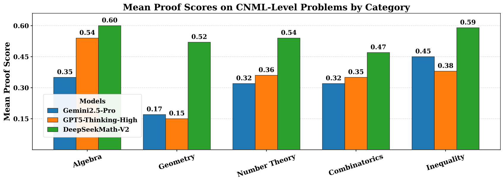
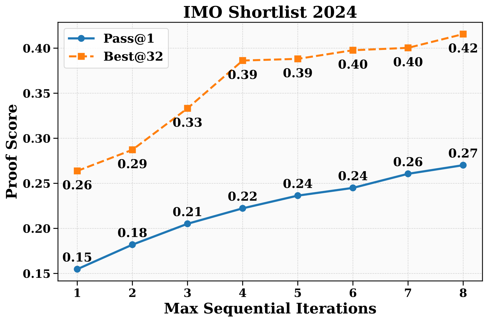
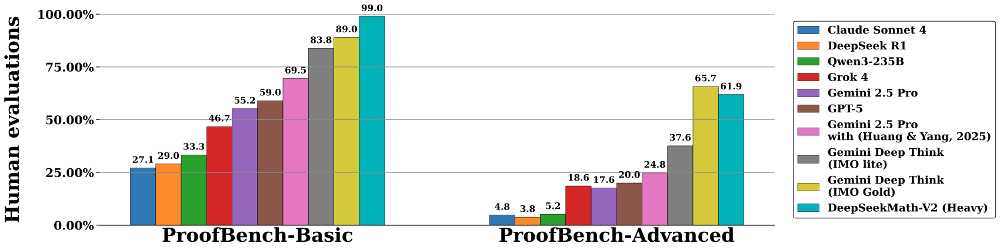

# DeepSeekMath-V2：证明生成、验证与元验证共同训练

> 💡 DeepSeekMath-V2 训练模型检查自然语言证明中的具体漏洞，再用“检查是否可信”的元验证约束奖励，使生成器学会诚实自查和反复修正证明。
>
> [论文](https://arxiv.org/abs/2511.22570) · [官方仓库](https://github.com/deepseek-ai/DeepSeek-Math-V2) · [补充解读](DeepSeekMath-V2解读.md)

数学题只核对最终答案不足以训练完整证明，Lean 形式化又增加了表达和库使用的门槛。Math-V2 选择研究自然语言证明的生成与验证，重点不是把答案奖励简单扩展成长文本分数，而是让验证器指出真实错误、让生成器能够自评。论文发现单独监督最终分数会让验证器“分打对但理由编错”，因此引入元验证；又发现生成器总倾向宣称自己正确，因此对自评准确性单独给奖励。通过生成与验证共同迭代、再扩大测试时搜索，该系统在 IMO/CMO/Putnam 上取得较强结果，但这些是带验证和搜索预算的自然语言证明成绩，不能与形式证明或一次生成混同。

## 验证器：分数之外还要有正确的问题分析

初始题库为 AoPS 中 17,503 道证明题，偏重奥赛、选拔及 2010 年后题目。用 V3.2-Exp-Thinking 变体采样并多轮完善证明，再由数学专家标注。

证明评分为三档：1 表示完整严谨；0.5 表示总体思路正确但有小错误或缺细节；0 表示致命漏洞。验证器输入问题 $X$ 与证明 $Y$，输出问题分析 $V$ 和预测分 $s'$。

分数奖励为：

$$
R_{score}=1-|s'-s|,\qquad R=R_{format}R_{score}.
$$

格式奖励检查必要的分析和分数表达。该目标能学会打分，却不能保证分析内容真实：错误 proof 被判 0 时，编造另一个不存在的漏洞也可能得满奖励。

## 元验证：检查批评本身是否成立

专家再评估验证器分析，形成 $(X,Y,V,ms)$，训练 meta-verifier 判断“指出的问题是否存在、是否足以支持所给分数”。它不是重新求解另一道题，而是对具体批评作证据检查。

增强后的验证奖励为：

$$
R_V=R_{format}\,R_{score}\,R_{meta}.
$$

在原验证集上，元验证器给分析质量的平均分从 0.85 提高到 0.96，同时 proof 分数预测准确性保持。这里质量分来自模型评估，虽有人工冷启动监督，也不应当作绝对无误的数学判定。

## 生成器：奖励正确证明，也奖励诚实自查

仅用 verifier 给 proof 分数，生成器能学习写更好证明；但当要求它自查时，仍可能对明显有错的输出宣称正确。因此输出改为 proof $Y$ 加 self-analysis $Z$，由外部 verifier 分别评证明和评自查：

$$
R=R_{format}(Y,Z)(0.76R_Y+0.24R_Z),\qquad R_Z=(1-|s'-s|)R_{meta}(Z).
$$

承认真实错误因此比谎称正确更有价值，但最高奖励仍来自正确证明加准确自评。系数偏向证明质量，避免“很会承认错误但一直不解决问题”成为最终目标。

## 生成—验证共同迭代

更强 generator 产生更难识别的错误，反过来挑战 verifier。为减少人工标注成本，对每个 proof 采 $n$ 条验证分析，发现问题的再做 $m$ 次元验证；多数元验证支持的分析才算有效。如果最低分至少得到 $k$ 个有效分析支持，就用该分；所有检查都未发现可靠问题则标 1，模糊样本丢弃或交专家。

这些 $n,m,k$ 是过程中的控制量，不应与最终高计算搜索的固定 64 次验证混淆。自动标注仍可能漏错，论文通过多重检查提高置信，而非获得形式化完备性。

训练使用 GRPO，每轮先强化验证，再从 verifier 检查点训练生成；后续轮通过 rejection fine-tuning 汇合上轮两类能力。最终一个模型可以同时承担生成与验证。

## 单次生成与顺序修正

内部 CNML 难度集 91 题，包含代数 13、几何 24、数论 19、组合 24、不等式 11。每题生成八次，正确性由最终 verifier 八次分析的多数判断。该结果用于比较模型及领域表现，依赖同一个自动判分过程。

对 IMO Shortlist 2024，每题启 32 条独立修正线程，反复把前次 proof 和自查反馈给模型，直到自评满分或达到轮数限制。图中 pass@1 是线程最终输出的平均分，Best@32 是依据自评分选出的最好一条；**这里分数可能包含 0.5，不能一律解释为严格二元正确率。**

随着轮数增加平均质量提高，自选最好结果高于均值，说明自评具有选择价值。但“自评满分”仍需与外部核查区别，不能作为最终正确性的唯一依据。

## 高计算搜索与竞赛结果

每题初始生成 64 条 proof，每条做 64 次验证；每轮保留分数最高的 64 条，与优先指出漏洞的八条分析分别配对，产生新修正版，再更新池。最多 16 轮，或出现通过全部 64 次检查的候选。最终最高分 proof 由数学专家评估。

| Contest | Problems | Points |
| --- | --- | --- |
| IMO 2025 | P1 , P2 , P3 , P4 , P5 | 83.3% |
| CMO 2024 | P1 , P2 , P4 , P5 , P6 | 73.8% |
| Putnam 2024 | A1 $\sim$ B4 , B5 , B6 | 98.3% |

IMO 2025 解五道，CMO 2024 四道完整加另一题部分分，Putnam 2024 为 118/120。金牌水平指按相关评分标准比较的表现，不是模型未经工具和额外预算直接参加官方考试取得奖牌。

比较中基础组有明显优势，高级组仍有困难。相较单次生成，这些高计算结果付出大量并行采样、验证与迭代成本；不能把 118/120 放到一个省略预算的 pass@1 排名中。

## 与形式证明的区别及局限

Prover 系列用 Lean 验证代码；Math-V2 验证自然语言论证，覆盖表达更自由，但错误检测是统计模型能力。多次验证可能产生相关错误，元验证也可能共享盲区，未发现问题不等于数学上已经证明没有问题。

论文的核心贡献是把“批评真实”“自评诚实”变成可训练目标，而不只奖励最终自信或分数。结果支持验证与生成相互增强、测试时修正提高证明质量；剩余难题包括极难证明、自动标注可靠性、评测独立性和高计算成本。
