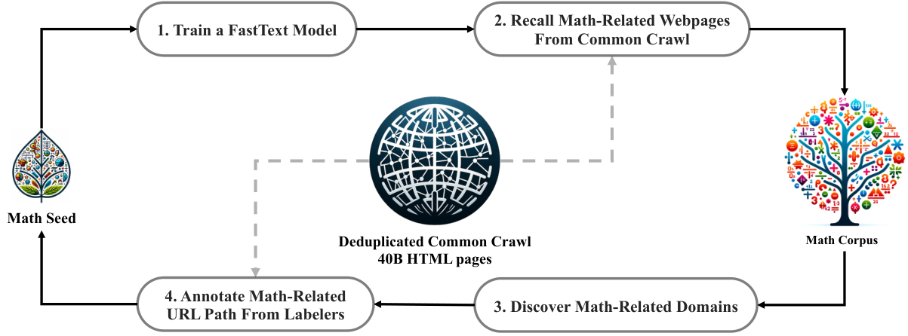
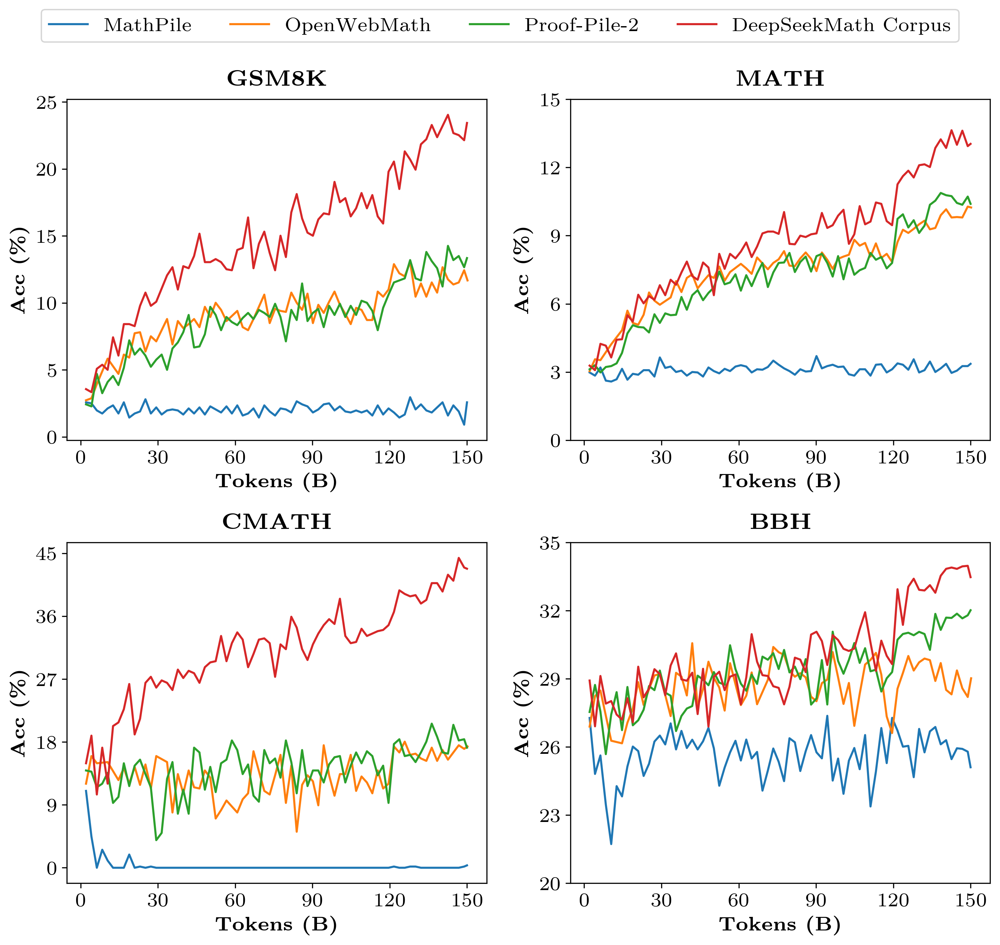
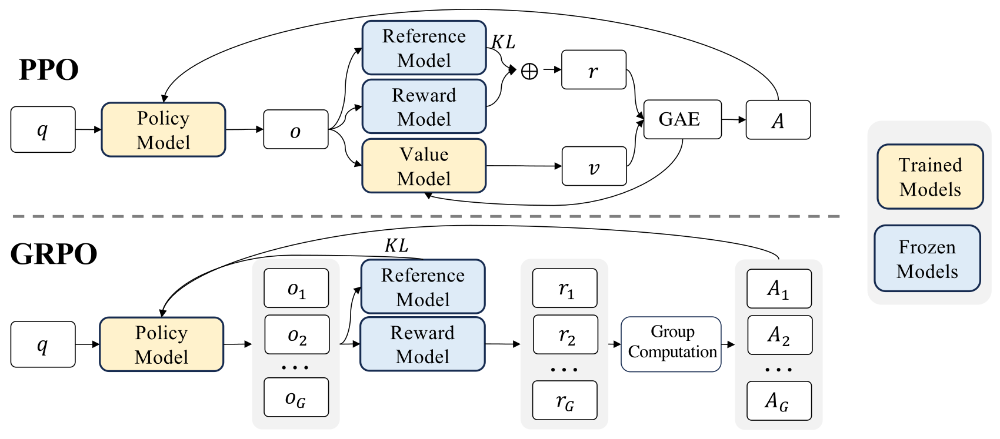
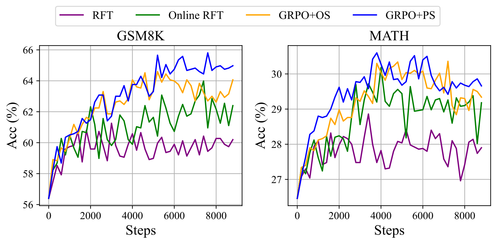
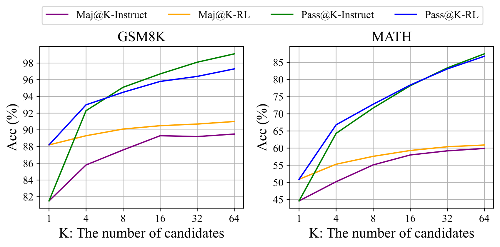

# DeepSeekMath：从数学网页挖掘到组相对强化学习

> 用迭代网页召回建立大规模中英数学语料，在代码基座上继续预训练和指令微调，再以同题多回答的相对奖励优化策略，形成 GRPO。
>
> DeepSeek-AI，2024 年 2 月 · [论文 v3](https://arxiv.org/abs/2402.03300v3) · [代码与模型](https://github.com/deepseek-ai/DeepSeek-Math) · [补充解读](DeepSeekMath解读.md)

数学能力的瓶颈既包括预训练中能否获得足够高质量的数学知识，也包括生成时能否稳定选中正确解法。DeepSeekMath 将两部分连起来：先从 Common Crawl 迭代挖掘约 120B 数学 token，在代码模型上继续训练 500B token，再用 776K 条中英数学解答做 SFT，最后通过 GRPO 进一步改善回答分布。

7B Base 在 MATH 上达到 36.2%，Instruct 达到 46.8%，RL 后达到 51.7%；允许工具时 RL 为 58.8%。论文的价值还包括完整的数据与算法分析：代码训练的迁移作用、arXiv-only 训练的有限收益，以及在线采样、过程奖励与组相对梯度分别贡献什么。作者也观察到 RL 主要改善多数投票正确率，而没有明显扩大 Pass@K 覆盖，并据此讨论后续探索空间。

## 摘要、背景与任务划分

当时的数学模型包括在专业语料上继续训练的 Minerva／Llemma，以及通过合成解答、过程监督或 RL 改善回答的 WizardMath、MetaMath、ToRA 等路线。本文同时研究预训练、SFT 和 RL，避免把最终提升只归因于单一优化公式。

论文区分三种任务：**无工具自然语言 CoT**、**用 Python 执行的程序／工具整合推理**、**生成可由证明器检查的形式证明**。数值计算题、大学级数学、中文 K-12 与形式化证明的能力并不完全一致，评测因此分别报告。

## 数学语料：从种子网页扩展到 120B token

### 迭代召回管线

图中的关键闭环是：以已知高质量数学网页训练分类器，在大规模网页中召回相似内容，再发现遗漏的数学域名并补充正例。新正例改善下一轮召回的覆盖。

具体过程如下：

1. **起始种子**采用 OpenWebMath。随机取 500K 种子页面作为正例、500K Common Crawl 页面作为负例，训练 fastText；向量维度 256、学习率 0.1、最大词 n-gram 为 3、最小词频 3、训练 3 epoch。
2. Common Crawl 经 URL 与近重复去重后保留约 **40B HTML 页面**。分类器对页面打分，先比较保留 top 40B／80B／120B／160B token 的预训练效果，首轮选择 top **40B token**。
3. 以基础 URL 将网页分成域，若某域超过 **10% 页面**被召回，视为数学相关域；人工标注其中真正的数学 URL 路径，将尚未召回的页面加入正例种子。
4. 重新训练 fastText 并召回，最终 **4 轮**得到 **35.5M 网页、约 120B token**。第四轮约 98% 已在第三轮出现，因此停止扩展。

这套流程既利用廉价分类器处理规模，也用人工识别数学路径来补充种子多样性。最终语料以英文、中文为主，覆盖多个语言，而非只抓取学术论文。

### 去污染

针对 GSM8K、MATH、CMATH、AGIEval 等测试集，删除含相同 **10-gram** 的文本；短于 10-gram、至少 3-gram 的测试片段使用精确匹配。去污染覆盖题目和答案，以减少网页中已有标准题解对评测的影响。

## 语料验证：相同训练预算比较不同数学数据

作者在相同 **DeepSeek-LLM 1.3B** 基座上，分别用数学语料训练 **150B token**。基线包括 MathPile（8.9B，超过 85% 来自 arXiv）、OpenWebMath（13.6B）与 Proof-Pile-2（51.9B，包含网页、arXiv、数学代码）。小语料在相同预算下会重复多轮。

优化器为 AdamW，$\beta_1=0.9,\beta_2=0.95$、weight decay 0.1；4K 上下文，每步 4M token，峰值学习率 $5.3\times10^{-4}$。预热 2K 步，在 80%／90% 进度将学习率降至峰值的 31.6%／10%。

**原文表 1：不同语料继续训练后的 few-shot CoT 结果。**

| Math Corpus | Size | GSM8K | MATH | OCW | SAT | MMLU STEM | CMATH | Gaokao MathCloze | Gaokao MathQA |
| --- | --- | --- | --- | --- | --- | --- | --- | --- | --- |
| No Math Training | N/A | 2.9% | 3.0% | 2.9% | 15.6% | 19.5% | 12.3% | 0.8% | 17.9% |
| MathPile | 8.9B | 2.7% | 3.3% | 2.2% | 12.5% | 15.7% | 1.2% | 0.0% | 2.8% |
| OpenWebMath | 13.6B | 11.5% | 8.9% | 3.7% | 31.3% | 29.6% | 16.8% | 0.0% | 14.2% |
| Proof-Pile-2 | 51.9B | 14.3% | 11.2% | 3.7% | 43.8% | 29.2% | 19.9% | 5.1% | 11.7% |
| DeepSeekMath Corpus | 120.2B | 23.8% | 13.6% | 4.8% | 56.3% | 33.1% | 41.5% | 5.9% | 23.6% |

DeepSeekMath Corpus 的 GSM8K 为 **23.8%**、MATH 为 **13.6%**，分别高于 Proof-Pile-2 的 14.3%／11.2%；中文 CMATH 为 **41.5% vs 19.9%**。优势不仅来自更大数据量：原文学习曲线中，在约 50B token、即 Proof-Pile-2 约一轮的数据量处，DeepSeekMath 语料训练的模型也更强。

大规模、较高质量且有中英覆盖的数据，使提升可以持续更久；小语料较早进入重复训练的收益平台。MathPile 在某些中文任务上还低于原始基座，显示数学领域标签本身不足以保证数据适配。

## DeepSeekMath-Base：在代码模型上继续预训练

基座是 **DeepSeek-Coder-Base-v1.5 7B**，继续训练 **500B token**。混合比例为：

| 数据来源 | 比例 |
|---|---:|
| DeepSeekMath Corpus | 56% |
| AlgebraicStack 数学代码 | 4% |
| arXiv | 10% |
| GitHub 代码 | 20% |
| 中英 Common Crawl 普通文本 | 10% |

这里的 120B 是数学语料本身的规模，500B 是混合继续训练的 token 预算。最终配置保持 4K 上下文，峰值学习率改为 $4.2\times10^{-4}$，batch 为 **10M token**。

### 无工具 CoT 主结果

**原文表 2。OCW 是大学级数学问题，SAT／MMLU-STEM 与高考数学选择题覆盖另一种回答形式。**

| Model | Size | GSM8K | MATH | OCW | SAT | MMLU STEM | CMATH | Gaokao MathCloze | Gaokao MathQA |
| --- | --- | --- | --- | --- | --- | --- | --- | --- | --- |
| Minerva | 7B | 16.2% | 14.1% | 7.7% | - | 35.6% | - | - | - |
| Minerva | 62B | 52.4% | 27.6% | 12.0% | - | 53.9% | - | - | - |
| Minerva | 540B | 58.8% | 33.6% | 17.6% | - | 63.9% | - | - | - |
| Mistral | 7B | 40.3% | 14.3% | 9.2% | 71.9% | 51.1% | 44.9% | 5.1% | 23.4% |
| Llemma | 7B | 37.4% | 18.1% | 6.3% | 59.4% | 43.1% | 43.4% | 11.9% | 23.6% |
| Llemma | 34B | 54.0% | 25.3% | 10.3% | 71.9% | 52.9% | 56.1% | 11.9% | 26.2% |
| DeepSeekMath-Base | 7B | 64.2% | 36.2% | 15.4% | 84.4% | 56.5% | 71.7% | 20.3% | 35.3% |

DeepSeekMath-Base 的 MATH 为 **36.2%**，高于 Llemma 34B 的 25.3%，也高于 Minerva 540B 的 33.6%；GSM8K 为 **64.2%**，CMATH 为 **71.7%**。OCW 则为 15.4%，仍低于 Minerva 540B 的 17.6%，保留了难度和领域差异。

### 工具与形式化证明

程序辅助任务用 few-shot PoT，让模型写 Python，可调用 `math`、`sympy`，以执行结果作答。形式化任务使用 miniF2F：给非形式题目、形式题目及自然语言证明，生成 **Isabelle** 证明草稿，再交由 Sledgehammer 补足。这不是后来 Prover 系列使用的 Lean 路线。

| 模型 | GSM8K + Python | MATH + Python | miniF2F-valid | miniF2F-test |
|---|---:|---:|---:|---:|
| Mistral 7B | 48.5 | 18.2 | 18.9 | 18.0 |
| CodeLlama 34B | 52.7 | 23.5 | 18.5 | 18.0 |
| Llemma 7B | 41.0 | 18.6 | 20.6 | 22.1 |
| Llemma 34B | 64.6 | 26.3 | 21.0 | 21.3 |
| DeepSeekMath-Base 7B | **66.9** | **31.4** | **25.8** | **24.6** |

原文表 3，数字为百分数。数学继续训练也使通用 MMLU 从代码基座的 49.1 到 54.9，BBH 从 55.2 到 59.5；HumanEval 43.2→40.9、MBPP 60.4→52.6，说明代码能力有所回落，保留代码混合缓解而非完全消除了这种取舍。

## SFT：把数学知识转成可用解答

作者构造 **776K 条**中英数学指令，包含 CoT、PoT 与自然语言／工具交织的 tool-integrated reasoning。

英文部分为 GSM8K／MATH 标注工具整合解答，并结合 MathInstruct 子集、Lila-OOD 训练集，覆盖代数、概率、数论、微积分、几何等；中文收集 K-12 的 **76 个子主题**，同时标注 CoT 与工具整合格式。

在 Base 上随机拼接到 4K，batch 256，固定学习率 $5\times10^{-5}$，训练 **500 步**。所得 Instruct 无工具 GSM8K／MATH 为 **82.9%／46.8%**，工具整合时为 **83.7%／57.4%**。后文 RL 从此模型继续。

## GRPO：用同题相对奖励替代价值模型

### PPO 中价值模型承担什么

PPO 用当前策略与采样旧策略的 token 概率比，乘以优势 $A_t$，再通过 clipping 限制过大的更新。传统 LLM PPO 通常还训练一个与策略规模接近的价值模型，以 GAE 估计 token 级优势；只有回答末尾得到分数时，逐 token 价值学习较难，并增加显存和训练成本。

GRPO 对同一个问题采样一组回答，利用组内分数作为相对基线，省去单独的 critic。策略、采样旧策略、参考策略和奖励模型仍有各自职责。

### 结果监督的优势

对问题 $q$，由 $\pi_{\theta_{old}}$ 采样 $G$ 条回答 $o_i$，奖励模型得到 $r_i$。组均值和标准差为 $\bar r$、$\sigma_r$，则：

$$
\hat A_{i,t}=\frac{r_i-\bar r}{\sigma_r}.
$$

结果监督下，同一回答全部 token 使用相同优势：分数高于同题平均的回答被相对强化，低于平均的回答被相对抑制。基线来自同题候选，不需要训练每个位置的价值预测。

### 裁剪策略目标与 KL

记 token 概率比为：

$$
\rho_{i,t}(\theta)=
\frac{\pi_\theta(o_{i,t}\mid q,o_{i,<t})}
{\pi_{\theta_{old}}(o_{i,t}\mid q,o_{i,<t})}.
$$

论文将 GRPO 写为对组、回答及 token 的平均：

$$
\mathcal J_{\mathrm{GRPO}}=
\mathbb E\left[\frac1G\sum_i\frac1{|o_i|}\sum_t
\left(\min\{\rho_{i,t}\hat A_{i,t},
\operatorname{clip}(\rho_{i,t},1-\varepsilon,1+\varepsilon)\hat A_{i,t}\}
-\beta D_{\mathrm{KL}}[\pi_\theta\Vert\pi_{ref}]\right)\right].
$$

$\varepsilon$ 限制一次更新的概率比变化，$\beta$ 控制偏离参考策略的惩罚。旧策略决定这批回答如何采样，参考策略为行为提供约束，二者角色不同。这里每条回答先除以自己的长度，再在组内平均。

与将 KL 混进奖励后再计算优势的写法不同，本文把 KL 直接放入优化目标。其 token 估计为：

$$
k_{i,t}=\frac{\pi_{ref}}{\pi_\theta}
-\log\frac{\pi_{ref}}{\pi_\theta}-1.
$$

概率均对应同一已生成 token 和相同前缀。该表达式非负；本文借它将相对奖励归一化与参考约束分开。

### 过程监督与迭代 RL

结果奖励只有整条回答一个分数。过程监督则在每个推理步骤末尾评分，将组内所有步骤分数归一化后，对位置 $t$ 累计其后的步骤奖励：

$$
\hat A_{i,t}=\sum_{j:\,\operatorname{index}(j)\ge t}\widetilde r_i^{\operatorname{index}(j)}.
$$

这里 $\operatorname{index}(j)$ 为第 $j$ 步的结尾位置，使不同 token 能接收更细的训练信号。

迭代训练进一步更新奖励模型：用当前策略产生新数据，继续训练奖励模型并混入 **10% 历史数据**回放；在新一轮将参考模型设为该轮起点策略。论文实验进行了两轮迭代，第一轮收益尤其明显。

## RL 训练设置与最终模型结果

RL 使用 Instruct 起点，问题来自 SFT 中与 GSM8K／MATH 相关的 **约 144K 条 CoT 问题**。初始奖励模型从 Math-Base 7B 训练，学习率 $2\times10^{-5}$；策略学习率 $10^{-6}$，KL 系数 **0.04**，每题采样 **64 条**，最长 **1024 token**，batch size 1024，每次探索后只作一次策略更新。

因此，这篇原始 GRPO 的实验包含**学习到的奖励模型**；答案正确性规则参与奖励训练数据构造。不能把它改写成后来某些纯规则 RLVR 配方。

**原文表 5 的主要对照；同一模型的无工具与工具设置分别报告。**

| 模型与模式 | GSM8K | MATH | MGSM-zh | CMATH |
|---|---:|---:|---:|---:|
| GPT-3.5，CoT | 80.8 | 34.1 | — | 73.8 |
| GPT-4，CoT | 92.0 | 52.9 | — | 86.0 |
| Gemini Ultra，CoT | 94.4 | 53.2 | — | — |
| Qwen 72B，CoT | 78.9 | 35.2 | — | — |
| InternLM2-Math 20B，CoT | 82.6 | 37.7 | — | — |
| DeepSeekMath-Instruct，CoT | 82.9 | 46.8 | 73.2 | 84.6 |
| DeepSeekMath-RL，CoT | **88.2** | **51.7** | **79.6** | **88.8** |
| GPT-4 Code Interpreter | 97.0 | 69.7 | — | — |
| ToRA 34B，工具整合 | 80.7 | 50.8 | 41.2 | 53.4 |
| DeepSeekMath-Instruct，工具整合 | 83.7 | 57.4 | 72.0 | 84.3 |
| DeepSeekMath-RL，工具整合 | **86.7** | **58.8** | **78.4** | **87.6** |

数字为百分数。无工具 MATH 提高 **4.9 点**，GSM8K 提高 **5.3 点**。RL 只使用英语 GSM8K／MATH 的 CoT 问题，但中文及工具任务也有提升，为此设置下的域外迁移提供证据。

## 预训练消融：代码、数学与 arXiv 分别带来什么

### 代码预训练对无工具与有工具推理的影响

消融以 1.3B 基座进行，数学数据使用采集第二轮的 **89B-token 版本**，不同于最终 120B 数据。比较先训练 400B 普通或代码 token、再训练 150B 数学，以及一次性混合训练：

| Training Setting | General | Code | Math | GSM8K | MATH | CMATH | GSM8K+Python | MATH+Python |
| --- | --- | --- | --- | --- | --- | --- | --- | --- |
| No Continual Training | – | – | – | 2.9% | 3.0% | 12.3% | 2.7% | 2.3% |
| Stage 1: General Training | 400B | – | – | 2.9% | 3.2% | 14.8% | 3.3% | 2.3% |
| Stage 2: Math Training | – | – | 150B | 19.1% | 14.4% | 37.2% | 14.3% | 6.7% |
| Stage 1: Code Training | – | 400B | – | 5.9% | 3.6% | 19.9% | 12.4% | 10.0% |
| Stage 2: Math Training | – | – | 150B | 21.9% | 15.3% | 39.7% | 17.4% | 9.4% |
| Math Training | – | – | 150B | 20.5% | 13.1% | 37.6% | 11.4% | 6.5% |
| Code & Math Mixed Training | – | 400B | 150B | 17.6% | 12.1% | 36.3% | 19.7% | 13.5% |

先代码后数学的无工具 GSM8K 为 **21.9%**，高于先普通文本后数学的 19.1%；带 Python 时也为 17.4 vs 14.3。代码因此不仅帮助调用工具，也改善该实验中的纯 CoT。

混合代码与数学的程序推理更强，GSM8K+Python 达到 **19.7%**，MATH+Python **13.5%**，但纯 CoT GSM8K 为 17.6%，低于分阶段训练。原表 7 还显示，先代码后纯数学会使 HumanEval 从 25.0 掉到 12.2，混合训练则保持 29.3；不同安排需要在数学专门化与代码保留之间取舍。

### arXiv-only 并未带来预期收益

作者分别让 1.3B 模型训练 150B、7B 代码模型训练 40B 的 MathPile 或 ArXiv-RedPajama。许多题目分数持平或下降：7B 的无数学训练 MATH 为 **12.5%**，MathPile 后 11.5%，ArXiv-RedPajama 后 11.1%；miniF2F-test 从 **21.7%**分别降到 16.4%／11.9%。

该结论针对这些规模与 **arXiv-only** 实验。作者没有研究所有专业任务、更大模型以及与其他数据混合后的效果，最终 500B 配方仍含 10% arXiv。正文将结果保留为关于语料适配的经验，而非“学术论文没有用”的普遍结论。

## RL 分析：数据来源、梯度权重与覆盖率

### 用同一个梯度框架比较训练方法

作者将训练梯度概括为三部分：数据从哪里来、奖励如何定义、算法怎样把奖励变成每个 token 的梯度系数。SFT 用人工筛选数据；RFT 对 SFT 模型生成的正确答案再训练；Online RFT 从更新中的策略实时采样；PPO／GRPO 则进一步按奖励构造正负、不同强度的更新。

在线 RFT 早期接近离线 RFT，后期更强，说明随策略变化更新候选数据有价值。GRPO 又优于 Online RFT：后者只等权强化正确答案，前者可按相对奖励同时强化、抑制，并区分强度。过程监督 GRPO 优于只用结果监督的版本，支持更细粒度信号的收益。

### Pass@K 与 Maj@K 回答了不同问题

Pass@K 衡量多次采样中是否至少有一次正确，Maj@K 衡量按最终答案多数投票是否正确。作者发现 RL 改善 Maj@K，但没有明显提高 Pass@K，因此将其解释为**已有候选空间内的概率分布变得更有利于正确答案**。

这促使作者把后续方向放在更广的问题分布、更强探索／搜索、能泛化且表达不确定性的奖励模型，以及对噪声奖励更鲁棒的算法。附录对 SFT、RFT、DPO、PPO、GRPO 的梯度系数逐一推导，使上述比较有统一的数学基础。

## 结论与局限

DeepSeekMath 的完整路线是：**高质量网页挖掘 → 代码基座的数学继续预训练 → 多格式中英 SFT → 组相对 RL**。公开结果既展示 7B 数学能力的提升，也提供数据选择和后训练收益来源的分析。

作者报告几何与证明题仍较弱，部分三角形、椭圆相关问题失败，可能反映数据选择偏差；few-shot 相较 zero-shot 的收益也弱于 GPT-4。对 RL 而言，当前探索主要在已有 SFT 题目上，奖励模型的泛化与噪声仍限制更广的能力提升。上述问题对应的是后续数据、探索和验证机制需要继续改进的方向。
