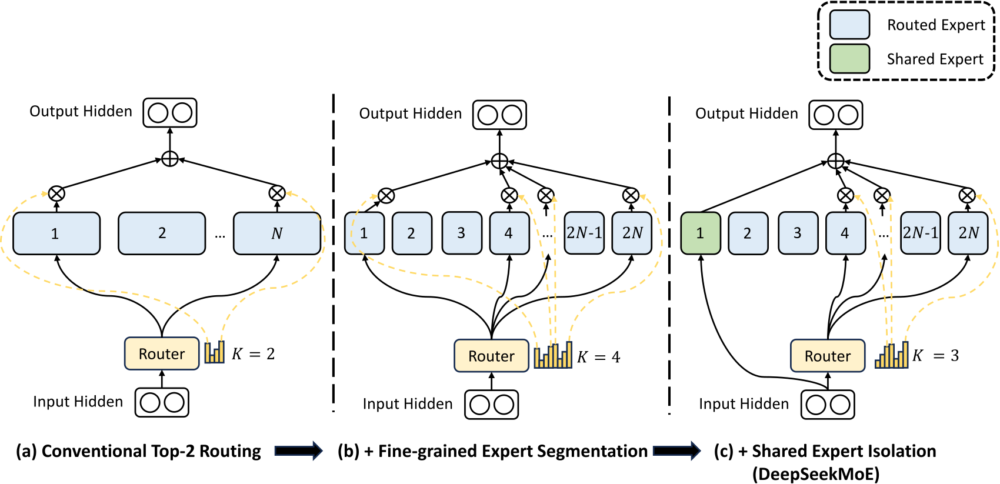
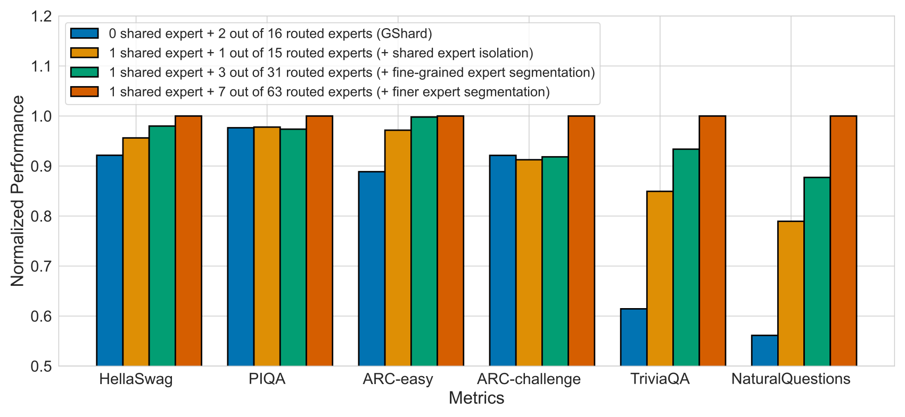
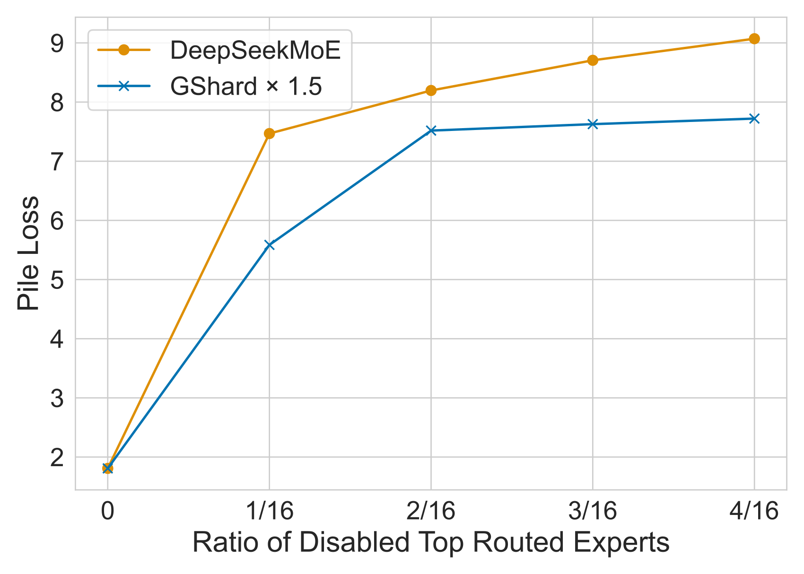
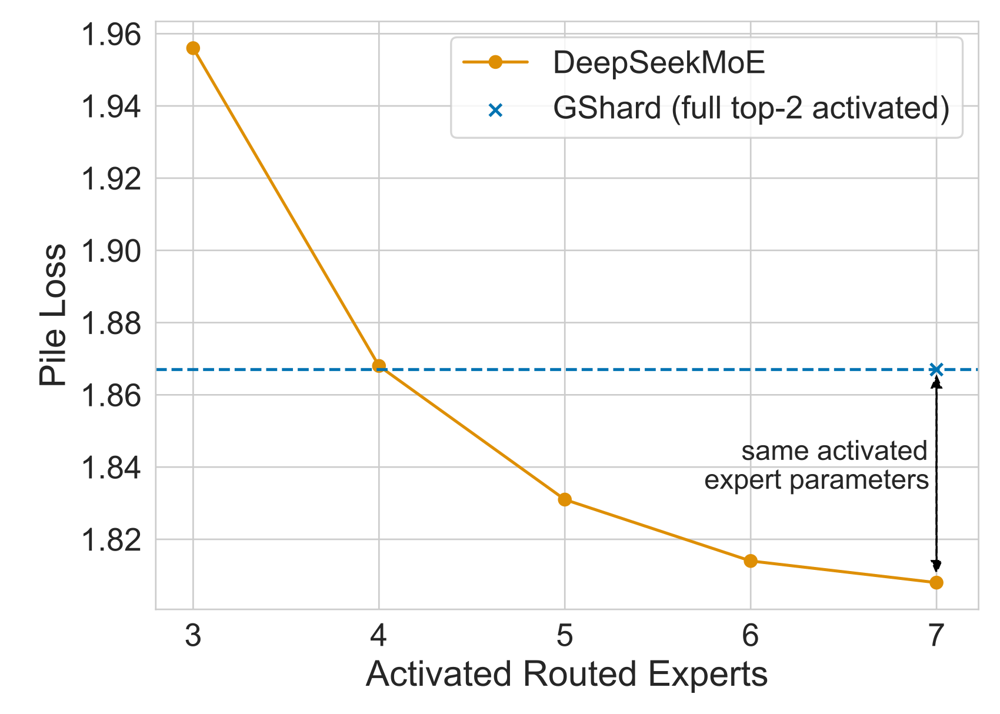

# DeepSeekMoE：以细粒度专家与共享专家提高专业化程度

> 将大 FFN 专家拆成更多小专家，用更灵活的组合承接差异化知识；再隔离始终激活的共享专家，让路由专家集中学习专门知识。
>
> DeepSeek-AI，2024 年 1 月 · [论文](https://arxiv.org/abs/2401.06066v1) · [代码与模型](https://github.com/deepseek-ai/DeepSeek-MoE) · [补充解读](DeepSeekMoE解读.md)

稀疏 MoE 可以保留大量参数、每个 token 只激活其中一小部分，但“用了专家”不等于“专家已经专门化”：一个大专家可能同时混合多类知识，不同专家又会重复存储公共知识。DeepSeekMoE 分别用**细粒度切分**与**共享专家隔离**处理这两个问题，在保持总专家参数和激活计算量的条件下，增加知识组合的灵活性并减少冗余。

作者先在 2B 小规模控制实验中比较 Hash Layer、Switch、GShard，再分析切分粒度、共享专家和屏蔽专家后的行为；随后训练 16.4B、激活 2.8B 的模型，并探索 145B 规模。16B 模型使用约 40% 的 7B 稠密模型计算量达到接近的总体表现，但多学科选择题仍是短板。本文因此既提出架构，也用多层实验说明“专家专业化”怎样转化为参数效率。

## 摘要与相关工作：MoE 的容量和计算如何分开

标准 Transformer 在 attention 后接一个 FFN。MoE 将若干层的 FFN 替换为多个结构相同的专家，由 router 根据当前 token 的隐藏状态决定选哪些专家。总参数随专家数增长，每个 token 的计算则主要取决于激活专家数。

Switch Transformer 使用 top-1，GShard 使用 top-2；Hash Layer 用固定 hash 分配。这些路线已经证明稀疏模型可以在接近激活计算量下扩大容量。DeepSeekMoE 进一步关注容量是否被有效利用：粗粒度专家中知识混杂，不同专家又重复学习共同内容，会限制稀疏参数的实际收益。

本文从算法角度组织专家分工。共享专家在既有系统中已有相关设计，作者强调的是它与细粒度切分共同服务于**更准确地调用所需知识**，并通过相同参数／计算预算的实验验证。

## 常规 MoE：路由分数与稀疏 FFN

设第 $l$ 层 attention 后的 token 表示为 $u_t^l\in\mathbb R^d$，常规 MoE 层为：

$$
h_t^l=u_t^l+\sum_{i=1}^N g_{i,t}\operatorname{FFN}_i(u_t^l),
\qquad s_{i,t}=\operatorname{Softmax}_i((u_t^l)^\top e_i^l).
$$

$N$ 是专家总数，$e_i^l$ 是可训练的路由向量，$s_{i,t}$ 是 token 对专家的亲和分数。只有分数进入 top-$K$ 的专家保留 $g_{i,t}=s_{i,t}$，其他门值为 0。最终将被选专家的 FFN 输出加权相加，再接残差。为突出专家机制，论文这些表达式省略了归一化操作。

这种结构通过 $K\ll N$ 节省计算，但 top-$K$ 只能从有限的粗粒度专家中挑选；单个专家内部不同类型的知识难以独立调用。

## 核心架构：细粒度切分与共享隔离

图中先将粗粒度 FFN 拆小，再把一部分小专家固定为共享路径。比较时，作者同时控制“拥有多少专家参数”与“每个 token 实际激活多少专家参数”，使架构收益能够与单纯增大计算区分。

### 细粒度专家切分

把每个专家的 FFN 中间维度缩小到原来的 $1/m$，专家总数从 $N$ 增为 $mN$；为保持计算量，激活数从 $K$ 增为 $mK$。于是：

$$
h_t^l=u_t^l+\sum_{i=1}^{mN}g_{i,t}\operatorname{FFN}_i(u_t^l),
\quad |\{i:g_{i,t}\ne0\}|=mK.
$$

总专家参数近似不变，激活 FFN 参数也近似不变，但 token 可以从更多小模块中组合知识。论文用 $N=16,K=2,m=4$ 举例：组合数由 $\binom{16}{2}=120$ 增至 $\binom{64}{8}=4,426,165,368$。这个例子说明选择空间如何扩大，实际收益则由训练与消融验证。

小专家的意义是让原本在一个大 FFN 中捆绑的知识有机会分散存储；当输入需要多个不同知识成分时，可以选到相应模块，而不是一起激活整块粗专家。

### 共享专家隔离

不同 token 通常仍需要共同的基础知识。如果这些内容只能通过路由专家提供，多个专家可能重复学习相同模式。作者指定 $K_s$ 个共享专家，对每个 token **始终激活**；同时把其他激活专家数减少 $K_s$，保持计算不变：

$$
h_t^l=u_t^l+
\sum_{i=1}^{K_s}\operatorname{FFN}_i(u_t^l)+
\sum_{i=K_s+1}^{mN}g_{i,t}\operatorname{FFN}_i(u_t^l).
$$

共有 $mN-K_s$ 个路由专家，每次选 $mK-K_s$ 个。共享路径承接通用知识，路由路径承接随 token 改变的专业知识；共享专家输出不乘稀疏路由门值。

## 负载均衡：分别处理专家塌缩与设备瓶颈

路由若总偏向少数专家，其他专家得不到训练，形成 routing collapse；分布式部署时，负载最重设备又会拖慢整层。本文用两种粒度的辅助损失处理它们。

令 $N'=mN-K_s$、$K'=mK-K_s$，$T$ 为序列 token 数：

$$
\mathcal L_{\mathrm{ExpBal}}=\alpha_1\sum_{i=1}^{N'}f_iP_i,\quad
f_i=\frac{N'}{K'T}\sum_t\mathbf1[t\text{ selects }i],\quad
P_i=\frac1T\sum_t s_{i,t}.
$$

$f_i$ 描述实际被选负载，$P_i$ 是平均路由概率。该项让高负载且仍被 router 强烈偏好的专家承担更大惩罚。

若把专家分到 $D$ 个设备组 $\mathcal E_d$，进一步定义：

$$
\mathcal L_{\mathrm{DevBal}}=\alpha_2\sum_{d=1}^{D}f'_dP'_d,
\quad f'_d=\frac1{|\mathcal E_d|}\sum_{i\in\mathcal E_d}f_i,
\quad P'_d=\sum_{i\in\mathcal E_d}P_i.
$$

设备粒度允许同一设备内专家负载不同，同时约束设备总计算。作者采用较小专家级系数防塌缩、较大设备级系数减少并行瓶颈，避免对每个专家施加过强的均匀化压力。实际是否使用设备损失，随部署方式变化。

## 控制实验：先验证架构，而非直接比较大模型

### 数据、模型与训练设置

小规模实验取相同中英为主的多语言语料 **100B token**，包含网页、数学、代码、书刊等。BPE 词表 8K；模型 9 层、隐藏维度 1280、10 个 attention head，每个 head 128 维。

各 MoE 总参数约 2B。GShard 与 DeepSeekMoE 均激活约 0.3B；Dense、Hash、Switch 约 0.2B。DeepSeekMoE 使用 **1 共享 + 63 路由**，激活 **1+7**，每专家为标准 FFN 的 1/4。

训练为 AdamW（0.9／0.95，weight decay 0.1），2K 步 warm-up，峰值 $1.08\times10^{-3}$，在 80%／90% 进度分别乘 0.316；2K 序列长、2K 条序列 batch，共 25K 步。全部专家在同一设备，不丢 token，不用设备级均衡，专家级系数为 0.01。

### 主对照：同参数与激活计算下比较路由结构

**原文表 1。Pile 为交叉熵 loss，越低越好；代码为 Pass@1，问答为 EM，其他为准确率。**

| Metric | # Shot | Dense | Hash Layer | Switch | GShard | DeepSeekMoE |
| --- | --- | --- | --- | --- | --- | --- |
| # Total Params | N/A | 0.2B | 2.0B | 2.0B | 2.0B | 2.0B |
| # Activated Params | N/A | 0.2B | 0.2B | 0.2B | 0.3B | 0.3B |
| FLOPs per 2K Tokens | N/A | 2.9T | 2.9T | 2.9T | 4.3T | 4.3T |
| # Training Tokens | N/A | 100B | 100B | 100B | 100B | 100B |
| Pile (Loss) | N/A | 2.060 | 1.932 | 1.881 | 1.867 | 1.808 |
| HellaSwag (Acc.) | 0-shot | 38.8 | 46.2 | 49.1 | 50.5 | 54.8 |
| PIQA (Acc.) | 0-shot | 66.8 | 68.4 | 70.5 | 70.6 | 72.3 |
| ARC-easy (Acc.) | 0-shot | 41.0 | 45.3 | 45.9 | 43.9 | 49.4 |
| ARC-challenge (Acc.) | 0-shot | 26.0 | 28.2 | 30.2 | 31.6 | 34.3 |
| RACE-middle (Acc.) | 5-shot | 38.8 | 38.8 | 43.6 | 42.1 | 44.0 |
| RACE-high (Acc.) | 5-shot | 29.0 | 30.0 | 30.9 | 30.4 | 31.7 |
| HumanEval (Pass@1) | 0-shot | 0.0 | 1.2 | 2.4 | 3.7 | 4.9 |
| MBPP (Pass@1) | 3-shot | 0.2 | 0.6 | 0.4 | 0.2 | 2.2 |
| TriviaQA (EM) | 5-shot | 4.9 | 6.5 | 8.9 | 10.2 | 16.6 |
| NaturalQuestions (EM) | 5-shot | 1.4 | 1.4 | 2.5 | 3.2 | 5.7 |

从 Dense 到 Hash／Switch，扩大总容量已有收益；从 Switch 到 top-2 GShard，更多激活计算再带来提升。关键对照是 **GShard 与 DeepSeekMoE**：二者都约 2B 总参数、0.3B 激活、每 2K token 4.3T FLOPs，但 Pile loss 从 **1.867 降至 1.808**，HellaSwag 从 50.5 到 54.8，TriviaQA 从 10.2 到 16.6。此处增益来自专家组织变化。

进一步把 GShard 专家扩大 1.5 倍，或让同样专家参数全部激活：

| Metric | # Shot | GShard $\times 1.5$ | Dense $\times 16$ | DeepSeekMoE |
| --- | --- | --- | --- | --- |
| Relative Expert Size | N/A | 1.5 | 1 | 0.25 |
| # Experts | N/A | 0 + 16 | 16 + 0 | 1 + 63 |
| # Activated Experts | N/A | 0 + 2 | 16 + 0 | 1 + 7 |
| # Total Expert Params | N/A | 2.83B | 1.89B | 1.89B |
| # Activated Expert Params | N/A | 0.35B | 1.89B | 0.24B |
| FLOPs per 2K Tokens | N/A | 5.8T | 24.6T | 4.3T |
| # Training Tokens | N/A | 100B | 100B | 100B |
| Pile (Loss) | N/A | 1.808 | 1.806 | 1.808 |
| HellaSwag (Acc.) | 0-shot | 54.4 | 55.1 | 54.8 |
| PIQA (Acc.) | 0-shot | 71.1 | 71.9 | 72.3 |
| ARC-easy (Acc.) | 0-shot | 47.3 | 51.9 | 49.4 |
| ARC-challenge (Acc.) | 0-shot | 34.1 | 33.8 | 34.3 |
| RACE-middle (Acc.) | 5-shot | 46.4 | 46.3 | 44.0 |
| RACE-high (Acc.) | 5-shot | 32.4 | 33.0 | 31.7 |
| HumanEval (Pass@1) | 0-shot | 3.0 | 4.3 | 4.9 |
| MBPP (Pass@1) | 3-shot | 2.6 | 2.2 | 2.2 |
| TriviaQA (EM) | 5-shot | 15.7 | 16.5 | 16.6 |
| NaturalQuestions (EM) | 5-shot | 4.7 | 6.3 | 5.7 |

DeepSeekMoE 在 4.3T FLOPs 下达到与 5.8T 的 GShard×1.5 接近的整体结果，也接近 24.6T 的 Dense×16 在 Pile 上的表现。Dense×16 是把 16 个标准 FFN 都作为共享专家的容量上界参照，不是简单把整个 Transformer 扩大 16 倍。

## 消融：怎样确认专家更专门化

### 切分粒度和共享专家各自贡献什么

作者控制总专家参数与激活计算，改变粒度、是否隔离共享专家。更细粒度和共享路径均改善多项 benchmark，二者结合效果最好。在最细的 64 专家设置下，1／2／4 个共享专家的 Pile loss 分别为 1.808／1.806／1.811，差距较小；作者在扩展模型时采用共享与激活路由约 1:3 的比例。专家进一步缩小时还要考虑算子效率，因此大规模配置没有一味增加粒度。

### 屏蔽专家后的损失变化

训练后屏蔽部分优先选中的路由专家，DeepSeekMoE 的损失比 GShard 更敏感，说明被选模块较难相互替代，冗余更低。单独关闭共享专家、增加一个路由专家以保持计算，loss 从 **1.808 升到 2.414**，显示共享路径学到的内容与路由路径并不等价。

只激活 4 个路由专家，DeepSeekMoE 仍可达到 GShard 近似的 Pile loss。作者还从零训练只激活 **1 共享 + 3 路由**的模型：其激活专家参数减半后仍优于 GShard。这一重新训练的对照，将“临时屏蔽专家”与“较低预算重新学习”区分开，进一步支持知识调用效率提高的解释。

## DeepSeekMoE 16B：把架构扩展到 2T token

### 配置与训练

16B 模型有 **28 层、2048 hidden、16 个 MHA head**；除第一层保留稠密 FFN 外，其余层均为 **2 个共享 + 64 个路由专家**，每 token 激活 **2+6**，专家宽度为标准 FFN 的 1/4。第一层未替换，是因为其负载均衡收敛尤其慢。

总参数 **16.4B**、激活 **2.8B**，BPE 词表 100K。训练 2T token，4K 序列，batch 4608 条（约 18M token），峰值学习率 $4.2\times10^{-4}$，共 106,449 步。每层专家都放在同一设备，用流水线分配层，故不使用设备损失；专家级系数仅 **0.001**。较大的均衡系数在此不增加效率，反而影响质量。

### 与相同语料的 DeepSeek 7B 稠密模型比较

**原文表 3。此处 Pile 使用 BPB，DROP 使用 EM，与 DeepSeek LLM 报告中部分指标定义不同。**

| Metric | # Shot | DeepSeek 7B (Dense) | DeepSeekMoE 16B |
| --- | --- | --- | --- |
| # Total Params | N/A | 6.9B | 16.4B |
| # Activated Params | N/A | 6.9B | 2.8B |
| FLOPs per 4K Tokens | N/A | 183.5T | 74.4T |
| # Training Tokens | N/A | 2T | 2T |
| Pile (BPB) | N/A | 0.75 | 0.74 |
| HellaSwag (Acc.) | 0-shot | 75.4 | 77.1 |
| PIQA (Acc.) | 0-shot | 79.2 | 80.2 |
| ARC-easy (Acc.) | 0-shot | 67.9 | 68.1 |
| ARC-challenge (Acc.) | 0-shot | 48.1 | 49.8 |
| RACE-middle (Acc.) | 5-shot | 63.2 | 61.9 |
| RACE-high (Acc.) | 5-shot | 46.5 | 46.4 |
| DROP (EM) | 1-shot | 34.9 | 32.9 |
| GSM8K (EM) | 8-shot | 17.4 | 18.8 |
| MATH (EM) | 4-shot | 3.3 | 4.3 |
| HumanEval (Pass@1) | 0-shot | 26.2 | 26.8 |
| MBPP (Pass@1) | 3-shot | 39.0 | 39.2 |
| TriviaQA (EM) | 5-shot | 59.7 | 64.8 |
| NaturalQuestions (EM) | 5-shot | 22.2 | 25.5 |
| MMLU (Acc.) | 5-shot | 48.2 | 45.0 |
| WinoGrande (Acc.) | 0-shot | 70.5 | 70.2 |
| CLUEWSC (EM) | 5-shot | 73.1 | 72.1 |
| CEval (Acc.) | 5-shot | 45.0 | 40.6 |
| CMMLU (Acc.) | 5-shot | 47.2 | 42.5 |
| CHID (Acc.) | 0-shot | 89.3 | 89.4 |

同样 2T 数据下，每 4K token 的 FLOPs 为 **74.4T vs 183.5T**，约为稠密模型的 40.5%。知识相关任务更强，例如 TriviaQA 64.8 vs 59.7、NaturalQuestions 25.5 vs 22.2；数学与代码接近。但 MMLU **45.0 vs 48.2**，C-Eval **40.6 vs 45.0**，CMMLU **42.5 vs 47.2**。

作者把选择题短板与 attention 容量联系起来：16B MoE 的 attention 参数仅约 0.5B，而 7B 稠密模型约 2.5B；FFN 容量扩大并没有同步扩大所有主干计算。与 LLaMA2 7B 的对照则同时包含中英语料差异，论文另报告了内部 benchmark 和 Open LLM Leaderboard 两种协议。

模型权重可部署在单张 40GB GPU；在相应算子优化下，论文报告接近 7B 稠密模型 **2.5 倍**的推理速度。它与 FLOPs 比例分别对应实际实现和理论计算两个层面。

## 对齐与 145B 初步扩展

### 相同 SFT 数据下是否仍保有优势

SFT 数据为 **1.4M 条中英样本**，覆盖数学、代码、写作、问答、推理和摘要。三个比较模型使用相同数据；4K packing、batch 1024、训练 8 epoch，固定学习率 $10^{-5}$，无 dropout。

| Metric | # Shot | LLaMA2 SFT 7B | DeepSeek Chat 7B | DeepSeekMoE Chat 16B |
| --- | --- | --- | --- | --- |
| # Total Params | N/A | 6.7B | 6.9B | 16.4B |
| # Activated Params | N/A | 6.7B | 6.9B | 2.8B |
| FLOPs per 4K Tokens | N/A | 187.9T | 183.5T | 74.4T |
| HellaSwag (Acc.) | 0-shot | 67.9 | 71.0 | 72.2 |
| PIQA (Acc.) | 0-shot | 76.9 | 78.4 | 79.7 |
| ARC-easy (Acc.) | 0-shot | 69.7 | 70.2 | 69.9 |
| ARC-challenge (Acc.) | 0-shot | 50.8 | 50.2 | 50.0 |
| BBH (EM) | 3-shot | 39.3 | 43.1 | 42.2 |
| RACE-middle (Acc.) | 5-shot | 63.9 | 66.1 | 64.8 |
| RACE-high (Acc.) | 5-shot | 49.6 | 50.8 | 50.6 |
| DROP (EM) | 1-shot | 40.0 | 41.7 | 33.8 |
| GSM8K (EM) | 0-shot | 63.4 | 62.6 | 62.2 |
| MATH (EM) | 4-shot | 13.5 | 14.7 | 15.2 |
| HumanEval (Pass@1) | 0-shot | 35.4 | 45.1 | 45.7 |
| MBPP (Pass@1) | 3-shot | 27.8 | 39.0 | 46.2 |
| TriviaQA (EM) | 5-shot | 60.1 | 59.5 | 63.3 |
| NaturalQuestions (EM) | 0-shot | 35.2 | 32.7 | 35.1 |
| MMLU (Acc.) | 0-shot | 50.0 | 49.7 | 47.2 |
| WinoGrande (Acc.) | 0-shot | 65.1 | 68.4 | 69.0 |
| CLUEWSC (EM) | 5-shot | 48.4 | 66.2 | 68.2 |
| CEval (Acc.) | 0-shot | 35.1 | 44.7 | 40.0 |
| CMMLU (Acc.) | 0-shot | 36.9 | 51.2 | 49.3 |

MoE Chat 的 GSM8K 为 62.2，与两种 7B 稠密 Chat 接近；HumanEval 为 **45.7**、MBPP **46.2**，在代码上有优势。MMLU 为 47.2，仍低于 DeepSeek Chat 7B 的 49.7，但差距有所缩小。对齐并未消除所有由架构容量分配造成的差异，也没有破坏主要稀疏效率收益。

### 145B 与半激活配置

初步扩展使用 62 层、4096 hidden、32 head；每层 **4 共享 + 128 路由**，每 token 激活 **4+12**，专家宽度为标准 FFN 的 1/8。总参数 **144.6B**、激活 **22.2B**。专家跨 4 设备，均衡系数为专家级 0.003、设备级 0.05。

该实验仅训练 **245B token／13K 步**，warm-up 后保持 $3\times10^{-4}$，属于扩展验证。比较模型也在相同语料与 token 数下评测：

| Metric | # Shot | DeepSeek 67B (Dense) | GShard 137B | DeepSeekMoE 145B | DeepSeekMoE 142B (Half Activated) |
| --- | --- | --- | --- | --- | --- |
| # Total Params | N/A | 67.4B | 136.5B | 144.6B | 142.3B |
| # Activated Params | N/A | 67.4B | 21.6B | 22.2B | 12.2B |
| Relative Expert Size | N/A | N/A | 1 | 0.125 | 0.125 |
| # Experts | N/A | N/A | 0 + 16 | 4 + 128 | 2 + 128 |
| # Activated Experts | N/A | N/A | 0 + 2 | 4 + 12 | 2 + 6 |
| FLOPs per 4K Tokens | N/A | 2057.5T | 572.7T | 585.6T | 374.6T |
| # Training Tokens | N/A | 245B | 245B | 245B | 245B |
| Pile (Loss.) | N/A | 1.905 | 1.961 | 1.876 | 1.888 |
| HellaSwag (Acc.) | 0-shot | 74.8 | 72.0 | 75.8 | 74.9 |
| PIQA (Acc.) | 0-shot | 79.8 | 77.6 | 80.7 | 80.2 |
| ARC-easy (Acc.) | 0-shot | 69.0 | 64.0 | 69.7 | 67.9 |
| ARC-challenge (Acc.) | 0-shot | 50.4 | 45.8 | 48.8 | 49.0 |
| RACE-middle (Acc.) | 5-shot | 63.2 | 59.2 | 62.1 | 59.5 |
| RACE-high (Acc.) | 5-shot | 46.9 | 43.5 | 45.5 | 42.6 |
| DROP (EM) | 1-shot | 27.5 | 21.6 | 27.8 | 28.9 |
| GSM8K (EM) | 8-shot | 11.8 | 6.4 | 12.2 | 13.8 |
| MATH (EM) | 4-shot | 2.1 | 1.6 | 3.1 | 2.8 |
| HumanEval (Pass@1) | 0-shot | 23.8 | 17.7 | 19.5 | 23.2 |
| MBPP (Pass@1) | 3-shot | 33.6 | 27.6 | 33.2 | 32.0 |
| TriviaQA (EM) | 5-shot | 57.2 | 52.5 | 61.1 | 59.8 |
| NaturalQuestions (EM) | 5-shot | 22.6 | 19.0 | 25.0 | 23.5 |
| MMLU (Acc.) | 5-shot | 45.1 | 26.3 | 39.4 | 37.5 |
| WinoGrande (Acc.) | 0-shot | 70.7 | 67.6 | 71.9 | 70.8 |
| CLUEWSC (EM) | 5-shot | 69.1 | 65.7 | 71.9 | 72.6 |
| CEval (Acc.) | 5-shot | 40.3 | 26.2 | 37.1 | 32.8 |
| CMMLU (Acc.) | 5-shot | 40.6 | 25.4 | 35.9 | 31.9 |
| CHID (Acc.) | 0-shot | 88.5 | 86.9 | 90.3 | 88.3 |

145B 对应每 4K token **585.6T FLOPs**，明显优于计算接近的 GShard 137B，整体接近 2057.5T 的 DeepSeek 67B 稠密基线。另一个从零训练的 142B 配置只激活 **2 共享 + 6 路由**，激活参数 12.2B、FLOPs 374.6T，也保有较强表现；多学科知识选择题仍低于稠密基线。

## 结论与附录补充

本文的实验链条从同规模架构比较、扩大对照模型，到粒度消融、屏蔽专家、减半激活与大规模训练，逐层支持同一论点：**细粒度与共享专家让同样激活预算中的参数承担更明确的知识分工**。

附录列出了各规模超参数、GShard×1.2／×1.5 与全激活稠密模型的更多比较，以及 16B 与 DeepSeek 7B 的训练中 benchmark 曲线。论文也保留了工程边界：过小专家会降低算子效率，跨设备 MoE 需要负载控制，激活计算降低并不减少必须存储的全部专家权重。145B 结果还只来自早期训练阶段，进一步规模收益需要完整训练验证。
