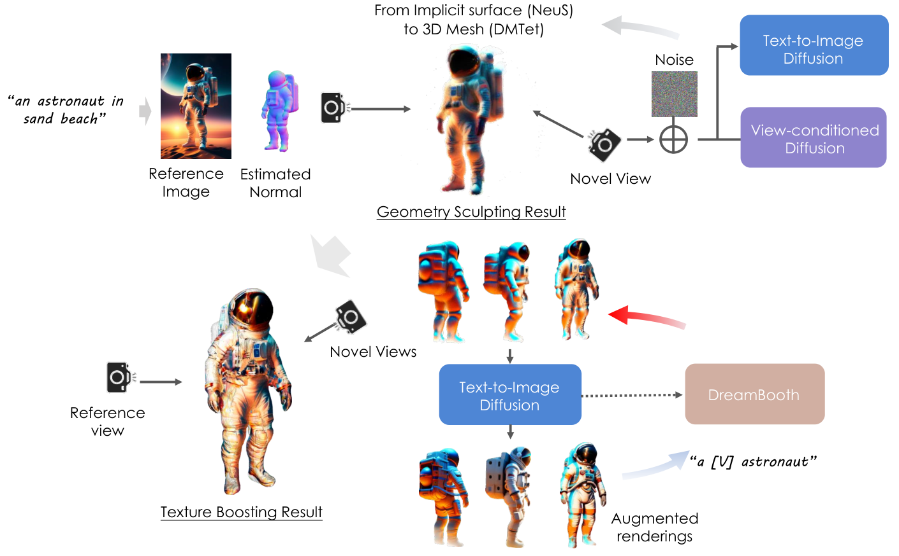
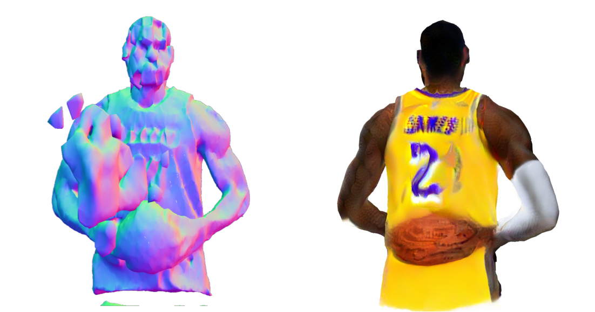

# DreamCraft3D：几何雕刻与自举纹理优化的分层三维生成

> 💡 DreamCraft3D 先从高质量二维参考图逐步建立几何，再交替训练场景专用扩散先验与优化纹理，让多视角一致性和细节共同改善。
>
> [论文 v2](https://arxiv.org/abs/2310.16818v2) · [项目与代码](https://github.com/deepseek-ai/DreamCraft3D) · [补充解读](DreamCraft3D解读.md)

二维扩散模型能够生成精美单图，但把各视角分别优化成“看起来合理”的图像，不保证它们属于同一个三维物体。DreamCraft3D 从参考图出发，将三维提升分成几何雕刻和纹理增强：前者优先建立形状与视角一致性，后者固定几何，用当前渲染反过来微调扩散先验，再由先验指导更好的渲染。其重点不是直接训练一个大型文本模型，而是为单个三维资产设计层次化优化。论文同时解释 SDS、VSD 与自举 score distillation 的区别，并通过定量、人工与组件对照检查生成质量。

## 背景：逐视角合理不等于三维一致

给定三维参数$\theta$，渲染$x=g(\theta;c)$。SDS 用预训练噪声预测器指导渲染：

$$
\nabla_\theta\mathcal L_{SDS}=\mathbb E_{t,\epsilon}[w(t)(\epsilon_\phi(x_t;y,t)-\epsilon)\,\partial x/\partial\theta].
$$

较强CFG会带来过饱和和平滑。VSD把减去的随机噪声替换成当前渲染分布的LoRA噪声估计，缓解纹理问题；但若目标扩散先验固定，它仍只约束各视角的合理性，可能产生多张脸等Janus现象。这里的Janus是三维生成现象，不是后续同名多模态模型。

## 分层流程

先由文本生成高质量参考图，保留二维模型的创作能力；之后以该图为锚，逐步优化三维。几何允许牺牲部分纹理精细度，避免一开始同时追求所有目标。

## 几何：参考监督与混合扩散先验

参考视角用前景RGB、mask、预测深度与法线约束。深度使用负Pearson相关而非直接像素距离，处理单目深度尺度不一致；法线使用方向余弦。

新视角同时使用DeepFloyd IF的二维先验和Zero-1-to-3的视角条件先验：

$$
\nabla\mathcal L_{hybrid}=\nabla\mathcal L_{SDS}+2\nabla\mathcal L_{3D-SDS}.
$$

二维先验保持生成质量，三维感知先验约束相对相机视角。只依赖后者可能因其训练资产类别和渲染质量有限而损失细节，因此需要混合。

训练视角逐步从参考附近扩大到360度，减轻单图歧义下突然生成额外结构。扩散时间从高噪声区间$[0.7,0.85]$逐步移到$[0.2,0.5]$，先全局形状再局部细节。

表示先用NeuS隐式表面，借Instant-NGP优化，再转DMTet可变形四面体网格。前者建立粗形，后者便于高分辨率细节及几何—纹理解耦；报告使用128网格和512渲染分辨率。

## 纹理：让先验跟随正在形成的三维资产

固定几何，仅优化纹理，改用高分辨率Stable Diffusion。几何阶段的多视角渲染虽模糊却较一致，因此拿它们作为DreamBooth样本，加入对象唯一标识与相机条件，学习场景专用先验。

为避免专用模型只学会模糊图，先对渲染加噪再恢复，补充高频细节；但增强越强越可能不一致。因此随纹理改善逐步减小增强噪声，使后期训练更忠于当前资产。

BSD梯度可概括为：

$$
\nabla_\theta\mathcal L_{BSD}=\mathbb E[w(t)(\epsilon_{DreamBooth}-\epsilon_{LoRA})\,\partial x/\partial\theta].
$$

与VSD相比，目标端不再是始终固定的二维先验，而是由当前多视角渲染更新的场景先验；LoRA端仍估计当前渲染分布。论文交替优化两次已取得较好效果，而不是无限迭代或完整多资产共同训练。

## 结果与对照

测试集含300张真实或Stable Diffusion/DeepFloyd生成的图像，每张附前景mask、预测深度与文本prompt；参考图像到三维的定量对比使用这300个样本。文本到三维基线包括DreamFusion、Magic3D和ProlificDreamer，图到三维包括Make-it-3D和Magic123，分别使用Threestudio或官方实现。

|  | CLIP $\uparrow$ | Contextual $\downarrow$ | PSNR $\uparrow$ | LPIPS $\downarrow$ |
| --- | --- | --- | --- | --- |
| Make-it-3D | 0.872 | 1.609 | 18.937 | 0.054 |
| Magic123 | 0.843 | 1.628 | 22.838 | 0.053 |
| DreamCraft3D | 0.896 | 1.579 | 31.801 | 0.005 |

CLIP越高代表语义相似更好，Contextual越低代表图像对应更接近；PSNR和LPIPS在参考视角衡量保真，不能把31.801 PSNR当成未知背面的几何真值评价。它们不能单独完整衡量隐藏视角的真实三维几何，因此还需结合多视角渲染和人工偏好。

去掉三维先验容易出现多脸和不规则结构；SDS纹理平滑过饱和；固定先验VSD更逼真但跨视角不一致；BSD在细节与一致性间取得较好平衡。该组主要通过视觉对照呈现，不应为其编造未报告的独立百分比提升。

正文还比较渐进视角、分层表示与纹理自举，说明几何与外观阶段承担不同目标。高质量参考图帮助语义创作，却无法唯一确定物体背面，输出是合理补全而非真实重建。

人工研究另选15组prompt/图像，32位参与者观看自由视角视频并选择偏好，共480次回答；论文报告平均约92%的偏好优势。这是小规模主观比较，参与者、题目和选择设置不同于300样本的图像指标，不能当通用成功率。

## 局限

方法需针对每个资产优化与微调先验，成本明显高于一次前向生成；依赖二维与视角条件先验，对复杂遮挡、罕见结构仍有歧义。几何固定后纹理阶段无法彻底修复前阶段的结构错误。论文的主要贡献是让三维资产和专用扩散先验相互自举，改善“每张图都好看、放在一起却不是同一物体”的问题。
