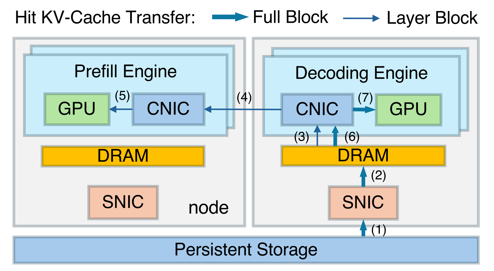

# DualPath：补充解读

> 多走一跳为什么可能更快？以下为直觉解释与应用延伸，论文内容见 [精炼主笔记](DualPath详解.md)。

## 为何绕路反而更快

最短路径如果只使用一张已经饱和的网卡，总容量就被它限制。绕到 decode 节点可借用另一张空闲存储网卡，再走更快的计算网络。关键是汇聚资源，不是凭空减少需要读取的字节。

图中 decode 不是替 prefill 计算，而是参与缓存搬运。P/D 计算分工保持清楚，数据路径变得更灵活。

## Agent 为何特别容易遇到这个问题

每轮工具返回很短，但历史越来越长，计算追加部分很便宜，读历史却越来越贵。因此减少模型 FLOPs 可能让 I/O 瓶颈更突出。排查时看存储 NIC、主机内存与 GPU 等待，比单看 CUDA kernel 更有效。

## 对小规模系统的启示

不一定需要复制整套多机方案。先统计前缀命中长度、追加长度和缓存搬运时间；若权重推理仍是主瓶颈，就优先处理模型与 batch，而不是为未出现的存储问题引入复杂调度。

## 用一个具体场景串起来

如果PE存储口满载，而DE存储口闲置且计算网络尚有余量，多走DE→PE一跳可以换取更多并行读取。瓶颈不在路径最短，而在最忙资源的排队。

但若额外KV流量挤占MoE同步，整体会变慢，因此CNIC统一QoS和按负载选择路径是必要条件。小规模单机或缓存主要命中HBM时，系统前提不同，不能期待相同收益。
