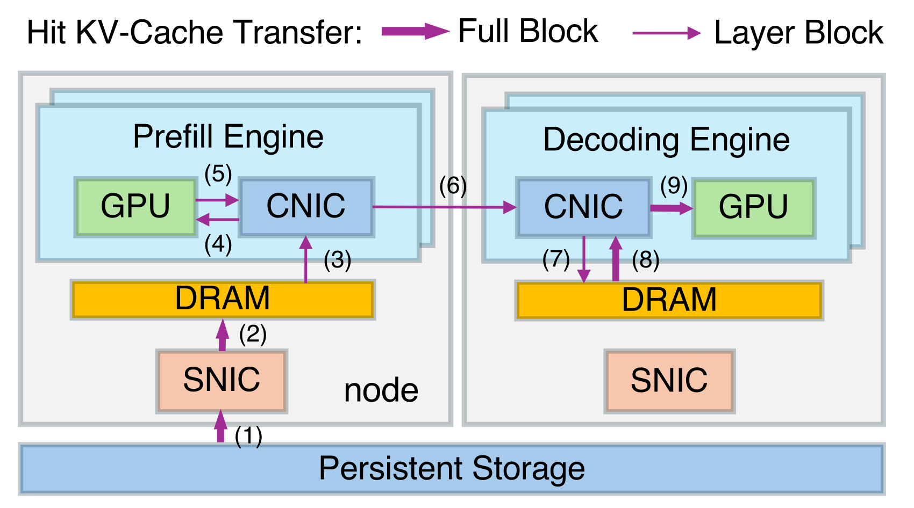
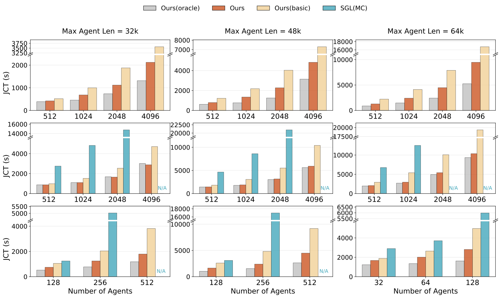
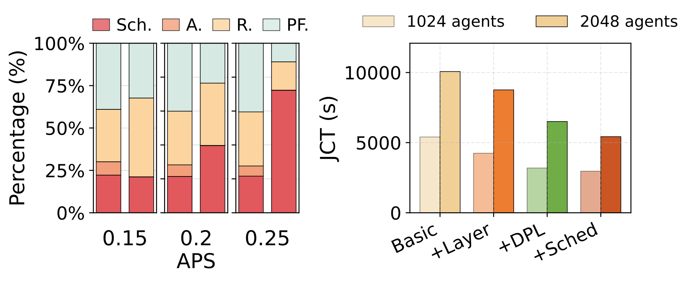

# DualPath：池化 Prefill 与 Decode 两侧的 KV 存储带宽

> 💡 DualPath 让缓存既可从存储读到Prefill，也可先读到Decode再经计算网络转发，配合流量隔离与调度，利用原本闲置的Decode存储网卡。
>
> [论文 v2](https://arxiv.org/abs/2602.21548v2) · [补充解读](DualPath解读.md)

Agent多轮交互通常每轮只新增少量内容，却反复访问很长的历史上下文。把KV持久化可以省重算，但在Prefill/Decode分离部署中，如果所有历史都由Prefill侧从存储加载，少量Prefill节点的存储网卡会先饱和，Decode侧I/O却闲置。DualPath把缓存读取变成跨引擎可调度资源，在已有layerwise prefill上增加第二条读取路径，再解决小块传输、模型通信干扰及负载均衡。报告的收益针对这种I/O密集的多轮负载，不是任意聊天推理都能得到相同倍数。

## I/O瓶颈的测量与适用条件

代表性代码Agent轨迹平均157轮、历史32.7k token、每轮追加429，缓存命中约98.7%。命中高虽然减少重算，却提高每单位计算要读取的KV：V3.2约22GB/PFLOP；对更大KV的GQA模型，I/O压力更强。稀疏attention减少计算后，存储反而可能成为更明显的新瓶颈。

令P/D为Prefill/Decode节点数，g为每节点GPU数，每GPU计算NIC带宽B、每节点存储带宽sB、主存带宽M。在负载均衡、PCIe拓扑合适、计算网络无拥塞、存储读满等假设下，双路径不在CNIC/DRAM形成新瓶颈的区间为：

$$
\frac{s}{g-s}\le\frac PD\le\min\left\{\frac{g-2s}{s},\frac{g-s}{2s},\frac{M/(Bs)-3}{2}\right\}.
$$

g=8、s=1、M约500GB/s、sB约50GB/s时得到1/7≤P/D≤7/2。它解释常见配置为何能利用两侧存储带宽，同时说明并非任何P/D比例都能免费搬运；尾部负载不平衡和模型通信也可能使实测偏离理想分析。

## 两条路径与逐层流动

PE路径：存储→PE主机buffer→每层PE HBM；该层补算未缓存的新token后，把完整KV转到DE buffer。DE路径：存储→DE buffer→逐层送PE，只把新计算的缺失KV回传DE。两者最终在DE组成完整prompt KV，再送入DE HBM开始解码。

只在需要执行该attention层时把KV送进PE HBM，避免Prefill保存所有层缓存。存储采用含全部层的Full Block，PE逐层加载与传输采用Layer Block；decode累计满块就持久化。

代价是额外DRAM buffer和转发，不是减少缓存的数学内容。第二条路径利用DE存储NIC，同时消耗计算网络空闲带宽，因此需要先分析并保护关键通信。

## CNIC中心的流量隔离

通常CUDA copy engine和GPUDirect Storage不受同一计算网络QoS控制，会与EP All-to-All等在PCIe上竞争。DualPath把包括本地H2D/D2H在内的数据流也交给GPU配对CNIC，通过RDMA数据路径统一调度。

IB虚拟通道把模型通信设为高优先级、KV传输设低优先级；约99%带宽权重留给高优先级，低优先级仍能使用空闲容量且避免饥饿。它不是给KV永久只留1%的可用吞吐，而是优先级仲裁。

小块搬运中，论文测CUDA提交约5–7微秒，RDMA WR约1微秒并可doorbell batching。这个结果依赖测试驱动与硬件，不能作为所有机器的固定常数。

## 两层请求调度

跨引擎调度同时跟踪未完成token、请求数和存储读队列。PE优先给存储队列短且未过载的引擎；DE先跨组平衡token，再在显存允许下兼顾token和请求数。选好PE/DE后，选择读取队列较短的一侧。

引擎内对Prefill按预测attention时间做FIFO packing，达到compute quota时用二分缩小本次chunk，而不是只按相同token数切批。长缓存命中和新token组合会改变计算量；在EP同步前尽量使各rank的attention时间接近，减少等待。

论文当前每个请求选一条读取路径，同时从两侧拆分读取留作未来工作。

## 实验设置与结果

测试服务器每台八张Hopper GPU、八个400Gbps计算NIC加一个独立存储NIC，存储为3FS；模型包括V3.2 660B、内部27B缩小版和Qwen2.5-32B。三组真实Agent轨迹各500条，测试不同上下文与新增/生成长度。

| MaxLen | Turns | Append | Gen | Total | Context |
| --- | --- | --- | --- | --- | --- |
| 32K | 60 | 608 | 148 | 28639 | 17183 |
| 48K | 106 | 474 | 172 | 42607 | 25120 |
| 64K | 157 | 429 | 176 | 55958 | 32721 |

离线模拟RL rollout，指标为整批完成的JCT。大模型对Basic最高约1.87倍，27B不同P/D比例平均1.64倍、最高2.46倍；Oracle消除相应I/O成本作为参考，不是现实可部署竞争系统。

新增token或生成变长时计算占比增加，存储优势相对收窄。因而论文改变append/gen长度检查瓶颈，而不是只选一个有利工作点。

在线请求为Poisson到达，SLO为TTFT≤4秒、TPOT≤50ms。满足该约束的Agent到达容量对Basic为27B约1.67倍、660B约2.25倍；超过SLO的TPOT/TTST点被省略，不能把图中缺点视为没有测量成本。

## 消融与扩展

逐项加入组件，JCT相对Basic平均下降：layerwise prefill约17.21%，再加双路径约38.19%，最终调度约45.62%。这些是累计结果，不应把三个百分比再相加。

调度使存储NIC Max/Avg由round-robin的1.53改善到1.18，attention前段约1.06；尾部负载不足，比例失去代表性，因此不展示该段。

|  | Setting | JCT | TTFT | TTST | TPOT |
| --- | --- | --- | --- | --- | --- |
| Offline | 2P4D, 2K agents | 3,167s | – | – | – |
| Offline | 48P96D, 48K agents | 3,201s | – | – | – |
| Online | 2P4D, 0.4 APS | – | 1.739s | 0.228s | 0.039s |
| Online | 44P88D, 8.8 APS | – | 1.847s | 0.194s | 0.036s |

扩至1152 GPU时，离线24倍Agent量下JCT由3167秒到3201秒；在线APS由0.4到8.8。作者明确大规模尚未展示优于同成本多个小单元的额外收益，因为并行和P/D比例没有充分调优。扩展意义主要是池化与调度灵活性。

## 局限与结论

收益依赖计算网络有可用带宽和硬件QoS，额外buffer、复制及小模型P-D传输仍有成本；工作集大小、缓存命中和P/D配置都会改变瓶颈。本文不是新缓存压缩算法，而是把现有KV的读取、转发和计算时机共同安排，解决Agent推理中单侧I/O资源利用失衡。
