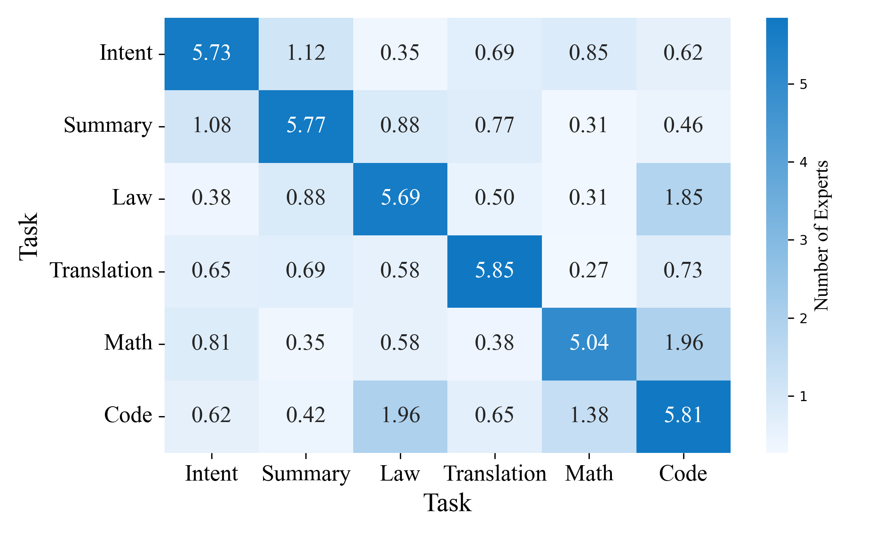
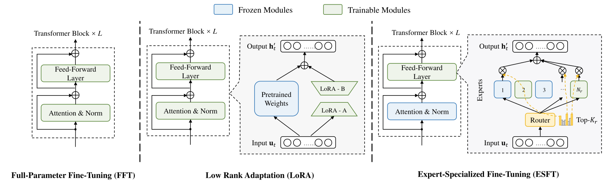

# ESFT：通过任务相关专家进行 MoE 参数高效微调

> 💡 ESFT 先用少量任务数据识别经常被调用的专家，再只更新这些非共享专家，利用 MoE 已形成的任务分工完成定制，并减少通用能力遗忘。
>
> [论文 v2](https://arxiv.org/abs/2407.01906v2) · [官方仓库](https://github.com/deepseek-ai/ESFT) · [补充解读](ESFT解读.md)

LoRA 主要利用参数更新的低秩性，而 MoE 本身已经包含条件激活与专家分工。ESFT 因而提出另一种参数高效微调思路：不额外插入低秩矩阵，而是从原有专家中找出与任务最相关的部分，只更新这部分参数。论文先用路由统计证明同一任务的专家选择相对稳定、不同任务又有差异，再给出两种相关性评分和逐层选择算法。在 DeepSeek-V2-Lite 上，它以接近全量微调的任务成绩，换取更少训练参数与更好的通用能力保留；消融进一步说明，关键不只是“少训练”，而是优先训练任务相关的非共享专家。

## 观察：专家使用具有任务结构

对同一任务独立采两组数据，其 top-6 专家重叠接近 6；跨任务重叠显著更低。另一项门控分布统计显示，少数专家贡献了大部分门控权重。这些是路由行为的实证观察，而不是假定每个专家预先对应某个语义标签。

任务涵盖数学、代码，以及意图转 JSON、客服摘要、法律判决预测和 Cherokee→English 低资源翻译。任务不同，专家集中程度及跨层分布也不同，因此 ESFT 逐层选专家，而非给全部层套同一专家编号。

## 两种相关性评分

从目标训练集采样 $N_s$ 条长度为 $L_j$ 的序列，记录第 $l$ 层专家 $i$ 对第 $k$ 个 token 的实际门控值 $g^l_{i,k}$。未选中专家的门控值为零。

**ESFT-Gate** 使用平均门控值：

$$
G_i^l=\frac1{N_s}\sum_{j=1}^{N_s}\frac1{L_j}\sum_{k=1}^{L_j}g^l_{i,k}.
$$

它同时考虑被选频率与权重大小。**ESFT-Token** 使用选择频率：

$$
R_i^l=\frac1{N_s}\sum_{j=1}^{N_s}\frac1{L_j}\sum_{k=1}^{L_j}\frac{\mathbb 1[g^l_{i,k}>0]}K.
$$

$K$ 是每个 token 选择的专家数，因而该评分在专家间归一化。Token 方案关注“多少 token 用到它”，Gate 方案更关注“路由实际赋予多少权重”。论文发现 32 条拼接后的 4096-token 样本通常已能稳定选择相关专家，附录进一步比较样本量。

## 累计阈值选择与更新范围

每层按相关性降序排列，选择最小前缀集合 $E_s^l$，使累计归一化得分达到阈值 $p$：

$$
\sum_{i\in E_s^l}\widetilde R_i^l\ge p.
$$

Gate 分数按总量归一化后用于累计选择；Token 分数本身是比例。**$p$ 是覆盖的相关性质量，不是直接指定训练 $p$ 比例的专家。**专家分布越集中，同样阈值可能选得越少。

训练时冻结未选专家、共享专家、注意力、路由与其他参数，只更新所选非共享专家。但前向仍沿用原路由，token 可以访问任意专家；它不是把其余专家从模型里剪掉。因此训练参数、存储增量与完整模型推理开销需要分别理解。

## 实验设置

所有实验基于 DeepSeek-V2-Lite，先做一个不含数学与代码数据的通用对齐，作为 vanilla 模型。任务训练数据与通用对齐数据按 1:1 混合，FFT、LoRA、ESFT 采用相同任务设置。数学用 MetaMathQA，评测 GSM8K/MATH；代码用 evol-codealpaca 的 Python 子集，评测 HumanEval/MBPP。

batch 32、长度 4096、最多 500 steps，每 100 steps 评测。经搜索选择 FFT/LoRA/ESFT 学习率分别 $3\times10^{-5}$、$10^{-4}$、$10^{-5}$；LoRA rank 8、scaling 2，覆盖除 embedding 和输出头外的参数。Gate 的 $p=0.1$，Token 的 $p=0.2$。训练资源为两台各八张 A100 PCIe 的节点。

意图任务使用 exact match；摘要、法律和翻译以参考答案配合 GPT-4 评 0–10 分。后几项并不是百分比准确率，平均前遵循论文的汇总口径。

## 任务成绩与通用能力保留

|  | Math Ability | Math Ability | Code Ability | Code Ability | Specialized Tasks | Specialized Tasks | Specialized Tasks | Specialized Tasks |  |
| --- | --- | --- | --- | --- | --- | --- | --- | --- | --- |
|  | MATH | GSM8K | Humaneval | MBPP | Intent | Summary | Law | Translation | Average |
| Vanilla Model | 19.6 | 55.9 | 42.1 | 44.6 | 16.8 | 58.6 | 17.1 | 14.5 | 33.6 |
| FFT | 23.4 | 66.4 | 42.1 | 42.2 | 78.8 | 69.4 | 47.0 | 38.4 | 51.0 |
| LoRA | 20.6 | 58.9 | 39.6 | 44.8 | 67.8 | 64.7 | 39.7 | 23.1 | 44.9 |
| ESFT-Token (Ours) | 22.6 | 66.0 | 41.5 | 42.6 | 75.6 | 65.4 | 45.7 | 36.2 | 49.4 |
| ESFT-Gate (Ours) | 23.2 | 64.9 | 43.3 | 41.8 | 78.6 | 65.8 | 49.1 | 35.2 | 50.2 |

ESFT-Gate 的任务汇总 50.2，接近 FFT 的 51.0，高于 LoRA 的 44.9；Token 为 49.4。具体任务各有胜负，而不是所有任务均超过全量微调。

|  | CLUEWSC | TriviaQA | IFEval | MMLU | CEval | HellaSwag | ARC | Average |
| --- | --- | --- | --- | --- | --- | --- | --- | --- |
| Vanilla Model | 81.5 | 67.7 | 42.5 | 57.5 | 59.9 | 74.0 | 53.7 | 62.4 |
| FFT | 80.9 $\pm$ 1.1 | 65.9 $\pm$ 0.7 | 34.2 $\pm$ 4.1 | 55.5 $\pm$ 1.0 | 58.8 $\pm$ 0.9 | 67.9 $\pm$ 3.8 | 48.4 $\pm$ 2.4 | 58.8 $\pm$ 1.3 |
| LoRA | 74.3 $\pm$ 7.7 | 63.4 $\pm$ 5.4 | 38.7 $\pm$ 2.5 | 55.5 $\pm$ 1.2 | 57.0 $\pm$ 1.5 | 72.8 $\pm$ 1.9 | 51.8 $\pm$ 2.3 | 59.1 $\pm$ 2.5 |
| ESFT-Token | 80.9 $\pm$ 0.9 | 66.7 $\pm$ 1.8 | 40.7 $\pm$ 1.3 | 57.1 $\pm$ 0.5 | 59.6 $\pm$ 0.8 | 72.3 $\pm$ 3.6 | 52.9 $\pm$ 1.5 | 61.5 $\pm$ 1.1 |
| ESFT-Gate | 81.4 $\pm$ 1.1 | 66.5 $\pm$ 2.3 | 40.2 $\pm$ 1.5 | 57.0 $\pm$ 0.4 | 59.5 $\pm$ 0.8 | 68.2 $\pm$ 9.9 | 51.5 $\pm$ 3.1 | 60.6 $\pm$ 2.3 |

通用指标平均 Token 61.5、Gate 60.6，高于 FFT 58.8 与 LoRA 59.1。模型更新越集中于任务专家，对共享能力的扰动通常越小，这是 ESFT 相比任务全量适配的重要优势。

| 资源指标，论文各任务平均 | FFT | LoRA | ESFT-Token | ESFT-Gate |
| --- | ---: | ---: | ---: | ---: |
| 训练时间，分钟 | 28.5 | 16.5 | 19.8 | 20.9 |
| 更新参数的存储，GB | 28.6 | 更少 | 2.57 | 3.20 |

ESFT 比 FFT 更快、增量更小，但速度与存储并非都胜过 LoRA。时间仅对应论文训练配置；它没有声称把完整模型权重缩小到 2.57GB。

## 消融：相关专家、共享参数与细粒度结构

| Non-shared Experts | Shared Experts | Non-expert Parameters | Trainable Parameters | Specialized Ability | General Ability | Average |
| --- | --- | --- | --- | --- | --- | --- |
| ALL | $\checkmark$ | $\checkmark$ | 15.7B | 51.0 | 58.8 | 54.9 |
| Relevant | $\checkmark$ | $\times$ | 1.85B | 49.8 | 60.7 | 55.3 |
| Relevant | $\times$ | $\times$ | 1.4B | 49.4 | 61.5 | 55.4 |
| $\times$ | $\checkmark$ | $\times$ | 450M | 47.4 | 61.2 | 54.3 |
| $\times$ | $\checkmark$ | $\checkmark$ | 1.3B | 49.0 | 60.0 | 54.5 |
| Relevant | $\checkmark$ | $\checkmark$ | 2.7B | 50.8 | 60.3 | 55.6 |
| $\times$ | $\times$ | $\times$ | - | 33.8 | 62.4 | 48.1 |

表分别控制是否更新任务相关非共享专家、共享专家与非专家参数。更多参数通常提高专门任务分，但更新共享部分更容易损害通用能力。作者据此给出两类取舍：追求专门能力时可训练共享参数和相关专家；兼顾保留与成本时，只训练相关非共享专家。

随机选择同样数量专家的结果明显更差，说明收益不只是参数数量减少：

|  | Math Ability | Math Ability | Code Ability | Code Ability | Specialized Tasks | Specialized Tasks | Specialized Tasks | Specialized Tasks |  |
| --- | --- | --- | --- | --- | --- | --- | --- | --- | --- |
|  | MATH | GSM8K | Humaneval | MBPP | Intent | Summary | Law | Translation | Average |
| ESFT-Token | 22.6 | 66.0 | 41.5 | 42.6 | 75.6 | 65.4 | 45.7 | 36.2 | 49.4 |
| $\Delta$ of rand | -1.0 | -3.7 | -2.5 | 0.2 | -2.6 | -1.7 | 1.3 | -13.5 | -2.8 |
| ESFT-Gate | 23.2 | 64.9 | 43.3 | 41.8 | 78.6 | 65.8 | 49.1 | 35.2 | 50.2 |
| $\Delta$ of rand | -1.7 | -3.2 | -4.3 | 1.6 | -5.0 | 0.3 | -2.9 | -20.4 | -4.4 |

阈值消融中，提高 $p$ 在一定范围有益，但收益很快饱和；数学任务中 Token 在约 0.2、Gate 在约 0.1 已接近高效区间。阈值继续增大不保证持续提升，专门与通用指标的最佳点也不完全一致。

作者还人为把细粒度专家分组，模拟较粗粒度专家。在计算激活比例大致保持不变时，分组越粗，ESFT 越难精准选出任务相关部分，性能下降且需更新更多参数。这说明模型本身的专家细分和专业化程度，是方法能否成功的前提。

附录比较对齐数据混合，发现 ESFT 不混通用对齐数据也可能更好保留能力；这不等价于 FFT 或 LoRA 也不需要保留数据。全文的主要局限是实验以 V2-Lite 为主，不能直接把同样阈值和选择规则推广到所有 MoE 架构。论文把参数高效微调从“新增适配器”推进到“利用已有专家结构”，但仍需保留完整模型完成前向与部署。
