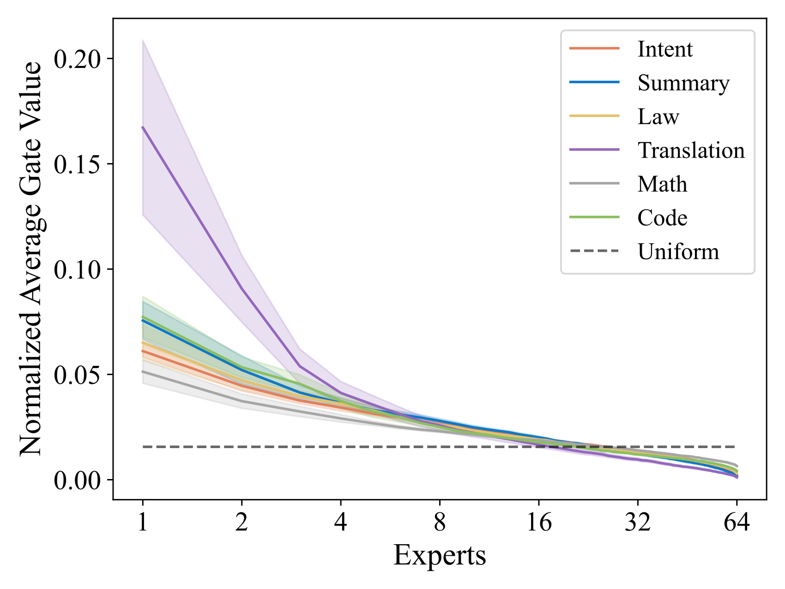
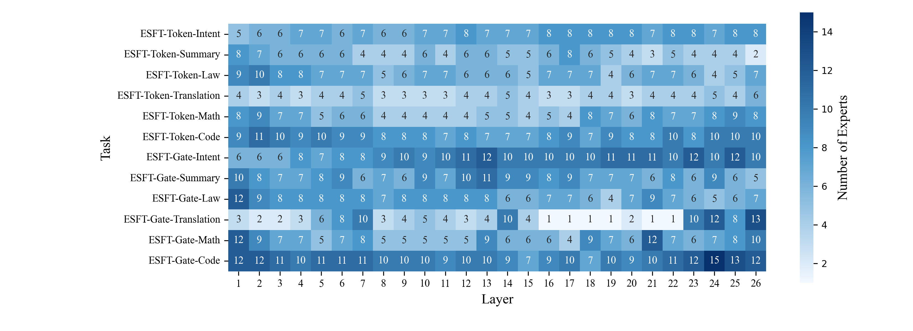
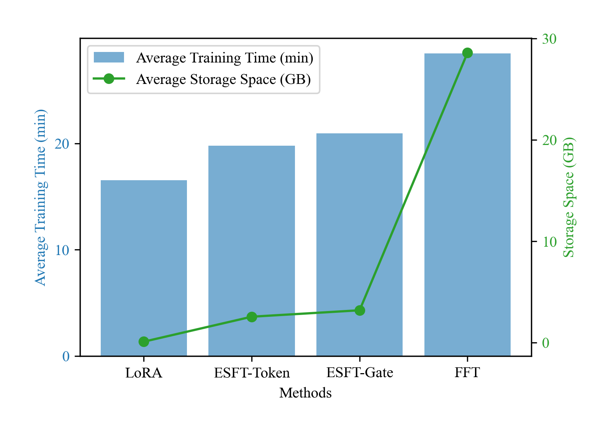
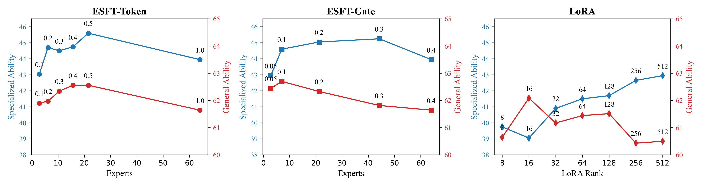
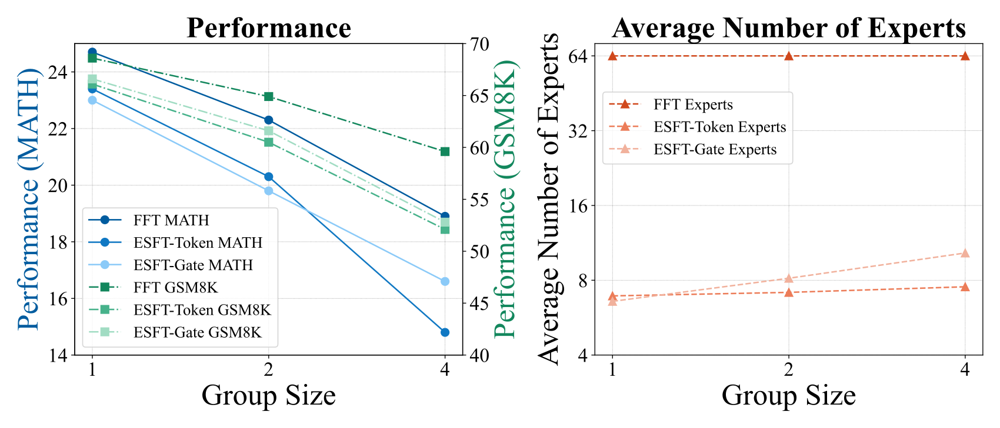
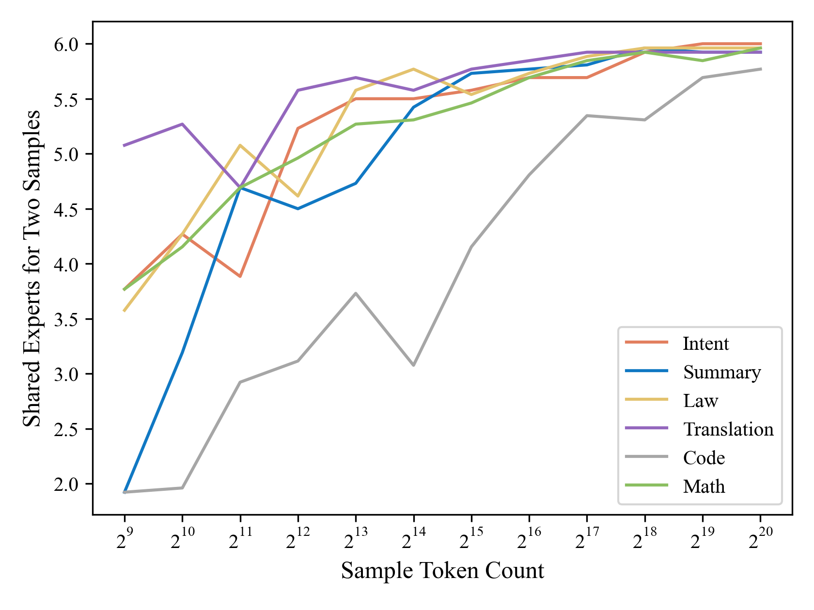

# Let the Expert Stick to His Last: Expert-Specialized Fine-Tuning for Sparse Architectural Large Language Models / 全文中英对照

> 来源：[arXiv:2407.01906v2](https://arxiv.org/abs/2407.01906v2)。英文段落后紧接中文，覆盖所取 HTML 版本的主文、附录、图表、脚注与参考文献；公式、数字表和书目信息共用。中文以机器初译为底稿，进行了术语整理与结构核对，尚未逐句人工审定；遇到歧义请以紧邻英文和原论文为准。 原作版权归所列作者，许可见 [原作许可](https://creativecommons.org/licenses/by/4.0/)；中文译文与版式改写在该许可条件下提供（涉及 SA 时沿用相同许可，涉及 NC 时仅限非商业使用）。

## Authors and affiliations / 作者与机构

Zihan Wang [^id1] Email: zw@deepseek.com Deli Chen Affiliation: DeepSeek AI Email: victorchen@deepseek.com Damai Dai Affiliation: DeepSeek AI Runxin Xu Affiliation: DeepSeek AI Zhuoshu Li Affiliation: DeepSeek AI Y. Wu Affiliation: DeepSeek AI Affiliation: Northwestern University

## Abstract / 摘要

**EN.** Parameter-efficient fine-tuning ( PEFT ) is crucial for customizing Large Language Models ( LLMs ) with constrained resources. Although there have been various PEFT methods for dense-architecture LLMs, PEFT for sparse-architecture LLMs is still underexplored. In this work, we study the PEFT method for LLMs with the Mixture-of-Experts ( MoE ) architecture and the contents of this work are mainly threefold: (1) We investigate the dispersion degree of the activated experts in customized tasks, and found that the routing distribution for a specific task tends to be highly concentrated, while the distribution of activated experts varies significantly across different tasks. (2) We propose E xpert- S pecialized F ine- T uning, or ESFT, which tunes the experts most relevant to downstream tasks while freezing the other experts and modules; experimental results demonstrate that our method not only improves the tuning efficiency, but also matches or even surpasses the performance of full-parameter fine-tuning. (3) We further analyze the impact of the MoE architecture on expert-specialized fine-tuning. We find that MoE models with finer-grained experts are more advantageous in selecting the combination of experts that are most relevant to downstream tasks, thereby enhancing both the training efficiency and effectiveness. Our code is available at [https://github.com/deepseek-ai/ESFT](https://github.com/deepseek-ai/ESFT) .

**中.** 参数高效的微调 (PEFT) 对于在资源有限的情况下定制大型语言模型 (LLM) 至关重要。尽管针对密集架构 LLM 已有多种 PEFT 方法，但针对稀疏架构 LLM 的 PEFT 仍处于探索之中。在这项工作中，我们研究了采用混合专家（MoE）架构的LLM的PEFT方法，这项工作的内容主要有三个方面：（1）我们研究了定制任务中激活专家的分散程度，发现特定任务的路由分布往往高度集中，而不同任务中激活专家的分布差异很大。 （2）我们提出专家专用微调（ESFT），它调整与下游任务最相关的专家，同时冻结其他专家和模块；实验结果表明，我们的方法不仅提高了调优效率，而且达到甚至超过了全参数微调的性能。 (3)我们进一步分析MoE架构对专家专业微调的影响。我们发现，具有更细粒度专家的 MoE 模型更有利于选择与下游任务最相关的专家组合，从而提高训练效率和效果。 Our code is available at [https://github.com/deepseek-ai/ESFT](https://github.com/deepseek-ai/ESFT) .

## Introduction / 简介

**EN.** As the parameter scale of large language models ( LLMs ) continues to increase ( Meta, 2024 ; Mistral, 2024a ; DeepSeek, 2024 ; Qwen, 2024 ) , parameter-efficient fine-tuning ( PEFT ) methods ( Han et al., 2024 ) are becoming increasingly important in adapting pre-trained LLMs to downstream customization tasks. However, existing works on PEFT like low-rank adaptation (LoRA) and P-Tuning ( Hu et al., 2021 ; Liu et al., 2021 ) have primarily focused on dense-architecture LLMs, with research on sparse-architecture LLMs still being markedly insufficient.

**中.** 随着大型语言模型（LLM）的参数规模不断增加（Meta，2024；Mistral，2024a；DeepSeek，2024；Qwen，2024），参数高效微调（PEFT）方法（Han等人，2024）在使预训练的LLM适应下游定制任务方面变得越来越重要。然而，现有的 PEFT 工作，如低秩适配（LoRA）和 P-Tuning（Hu et al., 2021；Liu et al., 2021）主要集中在密集架构的 LLM 上，对稀疏架构 LLM 的研究还明显不足。

**EN.** In this work, we focus on exploring PEFT techniques within the Mixture-of-Experts ( MoE ) LLMs ( Mistral, 2024b ; Databricks, 2024 ) , as introduced in § 3.1 . Unlike dense models where all tasks are handled by the same parameters, in the MoE architecture, different tasks are processed by distinct activated experts ( Lepikhin et al., 2021 ; Fedus et al., 2021 ) . Observations indicate that task specialization in expert systems is the key to the MoE LLM performance ( Dai et al., 2024 ) . We further illustrate such specialization in § 3.2 that experts activated by the same task’s data are concentrated, while those for different tasks vary significantly, suggesting MoE models use specialized expert combinations to handle different tasks. Motivated by this, we propose Expert-Specialized Fine-Tuning ( ESFT ), as illustrated in § 3.3 . ESFT only tunes the experts with the highest affinity to the task, while freezing the parameters of other experts and modules.

**中.** 在这项工作中，我们重点探索专家混合 (MoE) LLM（Mistral, 2024b；Databricks, 2024）中的 PEFT 技术，如第 3.1 节中所述。与所有任务都由相同参数处理的稠密模型不同，在 MoE 架构中，不同的任务由不同的激活专家处理（Lepikhin 等人，2021；Fedus 等人，2021）。观察表明，专家系统中的任务专业化是 MoE LLM 成绩的关键（Dai et al., 2024）。我们在第 3.2 节中进一步说明了这种专业化，即由同一任务数据激活的专家是集中的，而不同任务的专家则差异很大，这表明 MoE 模型使用专门的专家组合来处理不同的任务。受此启发，我们提出专家专业微调（ESFT），如第 3.3 节所示。 ESFT 仅调整与任务亲和力最高的专家，同时冻结其他专家和模块的参数。

**EN.** The primary advantages of ESFT lie in two aspects: (1) Maintaining Expert Specialization : ESFT prevents the decrement of specialization in full-parameter fine-tuning, where experts not adept at the task also update their parameters. Experimental results in § 5.1 show that ESFT can achieve aligned or even superior performance in downstream tasks compared to full-parameter fine-tuning, and better maintains performance in general tasks. (2) Saving Computation Resources : ESFT only trains the parameters of the selected experts, which effectively reduces the storage of up to 90% and training time up to 30% compared to full-parameter fine-tuning, as shown in § 5.2 .

**中.** ESFT的主要优点在于两个方面：（1）保持专家专业化：ESFT防止全参数微调中专业化的减少，不擅长该任务的专家也会更新他们的参数。 §5.1中的实验结果表明，与全参数微调相比，ESFT可以在下游任务中实现一致甚至更优越的性能，并且在一般任务中更好地保​​持性能。 （2）节省计算资源：ESFT仅对选定专家的参数进行训练，与全参数微调相比，有效减少高达90%的存储和高达30%的训练时间，如§5.2所示。

**EN.** Besides, we delve deeper into the working mechanism of the ESFT method. We analyze the expert selection process in § 6.1 and demonstrate how ESFT leverages specialized experts effectively, as selecting 5-15% experts can achieve promising performance in different tasks. We investigate the efficiency of ESFT under different computational constraints in § 6.2 , showcasing its ability to leverage training resources efficiently compared to other PEFT methods like LoRA. Our studies in § 6.3 analyze the effects of shared and non-shared parameters in the model on specialized and general performance, pointing out the priority to selectively train non-shared parameters in ESFT. Through ablation studies in § 6.4 , we highlight the importance of our expert relevance scores and the fine-grained expert segmentation architecture.

**中.** 此外，我们还深入研究了ESFT方法的工作机制。我们分析了第 6.1 节中的专家选择过程，并演示了 ESFT 如何有效地利用专业专家，因为选择 5-15% 的专家可以在不同的任务中取得有希望的表现。我们在第 6.2 节中研究了 ESFT 在不同计算约束下的效率，展示了与 LoRA 等其他 PEFT 方法相比，它有效利用训练资源的能力。我们在第 6.3 节中的研究分析了模型中共享和非共享参数对专业和通用性能的影响，指出了 ESFT 中选择性训练非共享参数的优先级。通过第 6.4 节中的消融研究，我们强调了专家相关性评分和细粒度专家分割架构的重要性。

## Related Work / 相关工作

### Parameter-efficient fine-tuning for dense architectural LLMs / 针对密集架构LLM的参数高效微调

**EN.** The goal of parameter-efficient fine-tuning ( Han et al., 2024 ) is to efficiently customize LLMs for downstream tasks, while existing studies primarily focus on dense architectural LLMs. PEFT methods for dense models can generally be categorized into three approaches: (1) Adding new parameters : methods of this kind fix the existing model parameters and fine-tune the model on a small number of newly added parameters. Adapter ( Houlsby et al., 2019 ; Pfeiffer et al., 2020 ; He et al., 2021 ; Wang et al., 2022 ) and Soft Prompt ( Li and Liang, 2021 ; Liu et al., 2021 ; Zhang et al., 2023b ; Lester et al., 2021 ) are two typical representatives of this category of methods. (2) Selecting existing parameters : methods of this type fine-tune a limited part of existing parameters, while keeping the majority of the other parameters fixed. Based on whether the trainable parameter space is continuous, these methods can generally be divided into structured training ( Guo et al., 2020 ; Gheini et al., 2021 ; He et al., 2023 ; Vucetic et al., 2022 ) and unstructured training ( Liao et al., 2023 ; Ansell et al., 2021 ; Sung et al., 2021 ; Xu et al., 2021 ) . (3) Applying low-rank adaptation : LoRA ( Hu et al., 2021 ; Fomenko et al., 2024 ) is a widely-used PEFT method, which decomposes the origin weight matrices into low-rank components. Subsequent works ( Zhang et al., 2023a ; Ding et al., 2023 ; Lin et al., 2024 ; Liu et al., 2023 ) have introduced numerous improvements to the original LoRA method. However, the study of PEFT in sparse models is still scarce. In this work, we select and tune part of the experts based on their downstream task affinity, as a unique selection dimension exclusive to the sparse MoE architecture.

**中.** 参数高效微调（Han et al., 2024）的目标是为下游任务高效定制 LLM，而现有研究主要集中在密集架构 LLM。用于稠密模型的PEFT方法通常可以分为三种方法：（1）添加新参数：此类方法固定现有模型参数，并在少量新添加的参数上对模型进行微调。适配器（Houlsby等，2019；Pfeiffer等，2020；He等，2021；Wang等，2022）和软提示（Li和Liang，2021；Liu等，2021；Zhang等，2023b；Lester等，2021）是该类别的两个典型代表的方法。 (2)选择现有参数：此类方法微调现有参数的有限部分，同时保持大多数其他参数固定。根据可训练参数空间是否连续，这些方法通常可以分为结构化训练（Guo et al., 2020；Gheini et al., 2021；He et al., 2023；Vucetic et al., 2022）和非结构化训练（Liao et al., 2023；Ansell et al., 2021；Sung et al., 2021）徐等人，2021）。 （3）应用低秩适配：LoRA（Hu et al., 2021；Fomenko et al., 2024）是一种广泛使用的PEFT方法，它将原始权重矩阵分解为低秩分量。随后的工作（Zhang et al., 2023a；Ding et al., 2023；Lin et al., 2024；Liu et al., 2023）对原始 LoRA 方法进行了许多改进。然而，稀疏模型中PEFT的研究仍然很少。在这项工作中，我们根据下游任务亲和力选择和调整部分专家，作为稀疏 MoE 架构独有的独特选择维度。

### Coarse- and Fine-grained MoE LLMs

**EN.** Compared to dense LLMs (e.g., LLaMA series, Meta, 2023b ; Meta, 2023a ), MoE LLMs (e.g., Mixtral series, Mistral, 2024a ; Mistral, 2024b ) can increase model size while saving training and inference costs. Based on the granularity of experts, existing large MoE models can generally be divided into two categories: coarse- and fine-grained expert LLMs. Most existing MoE LLMs ( Lepikhin et al., 2021 ; Fedus et al., 2021 ; Roller et al., 2021 ; Dai et al., 2022 ; Shen et al., 2024 ) have coarse-grained experts where the number of experts is very limited. For example, 2 out of 8 experts are activated for Mixtral MoE series ( Mistral, 2024a ; Mistral, 2024b ) and Grok-V1 ( XAI, 2024 ) . As a result, a single expert has to learn complicated patterns from different domain tasks simultaneously. To address this issue, DeepSeek MoE ( Dai et al., 2024 ) has introduced fine-grained expert segmentation. In the DeepSeek-V2 ( DeepSeek, 2024 ) , there are as many as 162 experts, with 8 active experts (8 out of 66 experts are activated for the DeepSeek-V2-Lite). The fine-grained division of experts ensures a high degree of specialization among the experts. Moreover, the specialized expert system enables the selection of experts that are most relevant to the task for efficient tuning.

**中.** 与密集LLM（例如LLaMA系列，Meta，2023b；Meta，2023a）相比，MoE LLM（例如Mixtral系列，Mistral，2024a；Mistral，2024b）可以增加模型大小，同时节省训练和推理成本。根据专家的粒度，现有的大型MoE模型一般可以分为两类：粗粒度和细粒度的专家LLM。大多数现有的教育部LLM（Lepikhin et al., 2021；Fedus et al., 2021；Roller et al., 2021；Dai et al., 2022；Shen et al., 2024）都有粗粒度的专家，但专家数量非常有限。例如，Mistral MoE 系列（Mistral，2024a；Mistral，2024b）和 Grok-V1（XAI，2024）激活了八分之二的专家。因此，单个专家必须同时从不同的领域任务中学习复杂的模式。为了解决这个问题，DeepSeek MoE（Dai et al., 2024）引入了细粒度的专家分割。在DeepSeek-V2（DeepSeek，2024）中，有多达162个专家，其中8个活跃专家（DeepSeek-V2-Lite的66个专家中有8个是激活的）。专家的细粒度划分，保证了专家的高度专业化。此外，专业的专家系统可以选择与任务最相关的专家来进行高效的调整。

## Methods / 方法

**EN.** Figure 1: Comparison between Expert-Specialized Fine-Tuning (ESFT) and other fine-tuning methods. FFT trains all parameters. LoRA combines pre-trained weights with low-rank matrices to reduce training costs. ESFT only trains a subset of experts in a Mixture-of-Expert (MoE) architecture, optimizing efficiency and task specialization.

**中.** 图 1：专家专业微调 (ESFT) 与其他微调方法之间的比较。 FFT trains all parameters. LoRA 将预训练权重与低秩矩阵相结合，以降低训练成本。 ESFT 仅在专家混合 (MoE) 架构中培训一部分专家，从而优化效率和任务专业化。

### Preliminaries: Mixture-of-Experts for Transformers / 预备课程：Transformer专家混合

**EN.** Mixture-of-Experts (MoE) for Transformers replace Feed-Forward Networks (FFNs) with MoE layers. Each MoE layer consists of multiple experts structurally identical to a FFN. Tokens are assigned to and processed by a subset of the most relevant experts based on their affinity scores, ensuring computational efficiency in MoE layers. The output hidden state $\mathbf{h}_{t}^{l}$ of the $t$ -th token in the $l$ -th MoE layer is computed as:

**中.** Transformer 的专家混合 (MoE) 用 MoE 层取代了前馈网络 (FFN)。每个 MoE 层由多个结构与 FFN 相同的专家组成。令牌根据亲和力分数分配给最相关的专家子集并由其处理，从而确保 MoE 层的计算效率。第 $l$ MoE 层中第 $t$ 令牌的输出隐藏状态 $\mathbf{h}_{t}^{l}$ 计算如下：

$$
\mathbf{h}_{t}^{l}=\sum_{i=1}^{N}\left(g_{i,t}\text{FFN}^{n}_{i}(\mathbf{u}_{t}^{l})\right)+\mathbf{u}_{t}^{l},\tag{1}
$$

$$
g_{i,t}=\begin{cases}s_{i,t},&s_{i,t}{\in}\text{TopK}(\{s_{j,t}|1{\leqslant}j{\leqslant}N\},K),\\
0,&\text{otherwise},\end{cases}\tag{2}
$$

$$
s_{i,t}=\text{Softmax}_{i}\left(\mathbf{u}_{t}^{l\top}\mathbf{e}_{i}^{l}\right),\tag{3}
$$

**EN.** where $N$ denotes the total number of experts, $\text{FFN}_{i}(\cdot)$ is the $i$ -th expert FFN, $g_{i,t}$ denotes the gate value for the $i$ -th expert, $s_{i,t}$ denotes the token-to-expert affinity, $\text{TopK}(\cdot,K)$ denotes the set comprising $K$ highest affinity scores among those calculated for the $t$ -th token and all $N$ experts, and $\mathbf{e}_{i}^{l}$ is the centroid of the $i$ -th expert in the $l$ -th layer.

**中.** 其中 $N$ 表示专家总数，$\text{FFN}_{i}(\cdot)$ 是第 $i$ 专家 FFN，$g_{i,t}$ 表示第 $i$ 专家的门值，$s_{i,t}$ 表示代币与专家的亲和力，$\text{TopK}(\cdot,K)$ 表示集合包含 $K$ 为第 $t$ 代币和所有 $N$ 专家计算的最高亲和力分数，并且 $\mathbf{e}_{i}^{l}$ 是第 $l$ 层中第 $i$ 专家的质心。

**EN.** Recently, DeepSeekMoE ( Dai et al., 2024 ) proposes enhancements to the MoE architecture through several techniques, including (1) Fine-grained segmentation, segmenting each expert into multiple smaller ones and keeping the same fraction of experts to process each token, allowing specialization in different knowledge types while maintaining the same computational cost. (2) Shared expert isolation, leveraging shared experts that process all tokens to capture common knowledge, reducing parameter redundancy and enhancing efficiency. The output of an MoE layer in DeepSeekMoE is:

**中.** 最近，DeepSeekMoE（Dai et al., 2024）通过多种技术提出了对 MoE 架构的增强，包括（1）细粒度分割，将每个专家分割成多个更小的专家，并保持相同比例的专家来处理每个令牌，允许在保持相同的计算成本的同时专业化不同的知识类型。 (2) 共享专家隔离，利用处理所有 token 的共享专家捕获公共知识，减少参数冗余，提高效率。 The output of an MoE layer in DeepSeekMoE is:

$$
\mathbf{h}_{t}^{l}{=}\sum_{i=1}^{K_{s}}\text{FFN}^{s}_{i}(\mathbf{u}_{t}^{l}){+}\sum_{i=1}^{N}(g_{i,t}\text{FFN}^{n}_{i}{(}\mathbf{u}_{t}^{l}{)}){+}\mathbf{u}_{t}^{l},\tag{4}
$$

$$
g_{i,t}=\begin{cases}s_{i,t},~s_{i,t}{\in}\text{TopK}(\{s_{j,t}|1{\leqslant}j{\leqslant}N\},K{-}K_{s}),\\
0,~~~\text{otherwise},\end{cases}\tag{5}
$$

**EN.** where $K_{s}$ is the number of shared experts, $\text{FFN}^{s}_{i}$ and $\text{FFN}^{n}_{i}$ denote the shared and non-shared experts, respectively. Each expert is segmented into $m$ ones, with $N$ and $K$ also multiplied by $m$ times compared to the coarse-grained architecture.

**中.** 其中$K_{s}$是共享专家的数量，$\text{FFN}^{s}_{i}$和$\text{FFN}^{n}_{i}$分别表示共享和非共享专家。每个专家被细分为$m$，其中$N$和$K$与粗粒度架构相比也乘以$m$倍。

### Probing Task-Specific Expert Specialization in MoE Models / 探索 MoE 模型中特定任务的专家专业化

**EN.** Despite the significant success of MoE LLMs, a clear understanding of the underlying mechanism remains elusive. We conduct probing experiments to understand how non-shared experts are utilized across various tasks. These tasks, as detailed in § 4.1 , include general domains like math and code, as well as specialized domains like intent recognition, summarization, legal judgment prediction, and translation. These experiments reveal the expert specialization in MoE models in two aspects:

**中.** 尽管教育部LLM取得了巨大成功，但人们仍然难以清楚地了解其根本机制。我们进行探索实验，以了解如何在各种任务中利用非共享专家。这些任务（如第 4.1 节中详述）包括数学和代码等通用领域，以及意图识别、摘要、法律判断预测和翻译等专业领域。这些实验从两个方面揭示了 MoE 模型的专家专业化：

#### Expert Routing is Concentrated in the Same Task

**EN.** We investigate the distribution of normalized gate values, i.e., the sum of all expert-token gate values for each expert, divided by the total across all experts. Figure 2 displays this distribution, where the experts are sorted by their normalized values from high to low. The figure shows that a small subset of experts handles the majority of gate values, indicating the model’s and concentrated expert allocation for a specific task.

**中.** We investigate the distribution of normalized gate values, i.e., the sum of all expert-token gate values for each expert, divided by the total across all experts. Figure 2 displays this distribution, where the experts are sorted by their normalized values from high to low. The figure shows that a small subset of experts handles the majority of gate values, indicating the model’s and concentrated expert allocation for a specific task.

#### Active Experts Vary Significantly across Tasks / 活跃专家在不同任务上存在显着差异

**EN.** We investigate the joint distribution of experts across tasks. Figure 3 shows a heatmap of the shared Top-6 experts for two independent data samples per task averaged across layers. This indicates the degree of overlap of experts used within the same task or between different tasks. Off-diagonal values are near 0, and diagonal values are near 6, indicating that the same task uses similar experts, while different tasks use different sets.

**中.** We investigate the joint distribution of experts across tasks. Figure 3 shows a heatmap of the shared Top-6 experts for two independent data samples per task averaged across layers. This indicates the degree of overlap of experts used within the same task or between different tasks. Off-diagonal values are near 0, and diagonal values are near 6, indicating that the same task uses similar experts, while different tasks use different sets.

**EN.** Figure 2: Top Expert distribution for specific tasks. Shaded areas represent variance across layers. The figure shows that few experts handle most gate values, highlighting expert specialization for different tasks.

**中.** Figure 2: Top Expert distribution for specific tasks.阴影区域表示各层之间的差异。 The figure shows that few experts handle most gate values, highlighting expert specialization for different tasks.

**EN.** Figure 3: The average number of shared Top-6 routed experts across tasks. The values are averaged by layer, indicating that the sets of experts used for the same task are consistent while different tasks are distinct.

**中.** Figure 3: The average number of shared Top-6 routed experts across tasks. The values are averaged by layer, indicating that the sets of experts used for the same task are consistent while different tasks are distinct.

### Expert-Specialized Fine-tuning (ESFT) / 专家专业微调 (ESFT)

**EN.** The highly specialized expert system suggests that different experts can be optimized for specific tasks. Inspired by this, we propose Expert-Specialized Fine-Tuning (ESFT) for MoE LLM customization, which selectively fine-tunes the most relevant experts for downstream tasks to enhance computational efficiency and maintain expert specialization. Figure 1 illustrates the differences between our method and existing methods. Below, we introduce our method step by step.

**中.** The highly specialized expert system suggests that different experts can be optimized for specific tasks. Inspired by this, we propose Expert-Specialized Fine-Tuning (ESFT) for MoE LLM customization, which selectively fine-tunes the most relevant experts for downstream tasks to enhance computational efficiency and maintain expert specialization. Figure 1 illustrates the differences between our method and existing methods.下面，我们一步步介绍我们的方法。

#### Data Sampling

**EN.** We randomly sample a subset $D_{s}=\{(x_{i},y_{i})\}_{i=1}^{N_{s}}$ from the training data $D=\{(x_{i},y_{i})\}_{i=1}^{N}$ for expert selection, where $x_{i}$ and $y_{i}$ denote the input and label, respectively. Empirically, we find that a subset of $32$ concatenated samples, each with a fixed length of $L=4096$ , is robust enough to select the most relevant experts for a task. We detail this claim in Appendix C .

**中.** We randomly sample a subset $D_{s}=\{(x_{i},y_{i})\}_{i=1}^{N_{s}}$ from the training data $D=\{(x_{i},y_{i})\}_{i=1}^{N}$ for expert selection, where $x_{i}$ and $y_{i}$ denote the input and label, respectively. Empirically, we find that a subset of $32$ concatenated samples, each with a fixed length of $L=4096$ , is robust enough to select the most relevant experts for a task. We detail this claim in Appendix C .

#### Expert Relevance Score

**EN.** We propose two methods to calculate the relevance of an expert to a task based on its affinity to the sample tokens, defined as average gate score and token selection ratio, respectively. Both methods assess each expert’s relevance to downstream tasks and can be chosen based on task-specific experimental performance.

**中.** We propose two methods to calculate the relevance of an expert to a task based on its affinity to the sample tokens, defined as average gate score and token selection ratio, respectively.这两种方法都会评估每个专家与下游任务的相关性，并且可以根据特定任务的实验表现进行选择。

**EN.** Average Gate Score (ESFT-Gate) This score calculates the average affinity of expert $e_{i}$ to all tokens in the sampled data. It is defined as:

**中.** 平均门分数 (ESFT-Gate) 该分数计算专家 $e_{i}$ 对采样数据中所有令牌的平均亲和力。它定义为：

$$
g_{i}^{l}=\frac{1}{N_{s}}\sum_{j=1}^{N_{s}}\frac{1}{L_{j}}\sum_{k=1}^{L_{j}}g_{i,k}^{l},\tag{6}
$$

**EN.** where $L_{j}$ is the length of the input sequence $x_{j}$ in the sampled data $D_{s}$ .

**中.** 其中 $L_{j}$ 是采样数据 $D_{s}$ 中输入序列 $x_{j}$ 的长度。

**EN.** Token Selection Ratio (ESFT-Token) This score calculates the ratio of tokens for which expert $e_{i}$ is selected. It is defined as:

**中.** 令牌选择比率 (ESFT-Token) 该分数计算选择专家 $e_{i}$ 的令牌比率。它定义为：

$$
r_{i}^{l}=\frac{1}{N_{s}}\sum_{j=1}^{N_{s}}\frac{1}{L_{j}}\sum_{k=1}^{L_{j}}\frac{\mathbbm{1}\left(g_{i,k}^{l}>0\right)}{K},\tag{7}
$$

**EN.** where $\mathbbm{1}\left(g_{i,k}^{l}>0\right)$ is an indicator that equals 1 if the gate score $g_{i,k}^{l}$ is positive, and 0 otherwise. $K$ is the number of experts selected per token.

**中.** 其中 $\mathbbm{1}\left(g_{i,k}^{l}>0\right)$ 是一个指标，如果门分数 $g_{i,k}^{l}$ 为正，则等于 1，否则等于 0。 $K$ 是每个代币选择的专家数量。

#### Expert Selection and Fine-tuning

**EN.** For each MoE layer $l$ , we select a subset of experts to be fine-tuned based on their relevance scores. We define a threshold $p\in(0,1]$ as a hyperparameter controlling the proportion of total relevance scores to be included in the selected subset. For each layer $l$ , we select a set of top-scored experts $E_{s}^{l}$ whose cumulative relevance score exceeds the threshold $p$ , satisfying:

**中.** 对于每个 MoE 层 $l$ ，我们选择一个专家子集，根据他们的相关性分数进行微调。 We define a threshold $p\in(0,1]$ as a hyperparameter controlling the proportion of total relevance scores to be included in the selected subset. For each layer $l$ , we select a set of top-scored experts $E_{s}^{l}$ whose cumulative relevance score exceeds the threshold $p$ , satisfying:

$$
\sum_{i\in E_{s}^{l}}R_{i}^{l}\geqslant p,\tag{8}
$$

**EN.** where $R_{i}^{l}$ is the relevance score (either $r_{i}^{l}$ or $g_{i}^{l}$ ) of expert $i$ in layer $l$ . During training and inference, tokens can be assigned to any expert. However, only the selected experts $E_{s}^{l}$ in each layer can be updated; other experts and modules remain frozen.

**中.** 其中 $R_{i}^{l}$ 是 $l$ 层中专家 $i$ 的相关性得分（$r_{i}^{l}$ 或 $g_{i}^{l}$ ）。在训练和推理过程中，可以将令牌分配给任何专家。但只能更新每层选定的专家$E_{s}^{l}$； other experts and modules remain frozen.

## Experiment Setup / 实验设置

### Main Evaluation / 主要评价

**EN.** We evaluate our ESFT method on two common LLM customization scenarios: (1) improving the model’s specific ability in a domain where the model may already have decent performance; (2) adapting the model to a possibly narrow but unfamiliar specialized task .

**中.** 我们在两种常见的 LLM 定制场景上评估我们的 ESFT 方法：（1）在模型可能已经具有良好性能的领域中提高模型的特定能力； (2) 使模型适应可能狭窄但不熟悉的专门任务。

#### Tasks for Model Enhancement

**EN.** We choose two domain-specific tasks, i.e., Math and Code, to evaluate how our method can enhance the model’s existing abilities. The two domains are widely concerned in current LLM research and suitable for evaluation, as many pre-trained models can perform decently, while there is significant potential for improvement through further training. We assess our method’s effectiveness through performance gains.

**中.** 我们选择两个特定领域的任务，即数学和代码，来评估我们的方法如何增强模型的现有能力。这两个领域在当前的LLM研究中受到广泛关注，并且适合评估，因为许多预训练模型都可以表现良好，同时通过进一步训练还有很大的改进潜力。我们通过性能提升来评估我们方法的有效性。

**EN.** For the Math domain, we use MetaMathQA Yu et al. (2023) for training and use GSM8K Cobbe et al. (2021) and MATH Hendrycks et al. (2021a) for evaluation. For the Code domain, We train the model on the Python subset of the enormous evol-codealpaca dataset Luo et al. (2023) to simulate a more concentrated LLM customization scenario, and assess its performance on HumanEval Chen et al. (2021) and MBPP Austin et al. (2021) .

**中.** For the Math domain, we use MetaMathQA Yu et al. (2023) for training and use GSM8K Cobbe et al. (2021) and MATH Hendrycks et al. （2021a）进行评估。对于代码域，我们在巨大的 evol-codealpaca 数据集 Luo 等人的 Python 子集上训练模型。 (2023) 模拟更集中的 LLM 定制场景，并评估其在 HumanEval Chen 等人上的表现。 (2021) and MBPP Austin et al. （2021）。

|  | Math Ability 数学能力 | Math Ability 数学能力 | Code Ability 代码能力 | Code Ability 代码能力 | Specialized Tasks 专门任务 | Specialized Tasks 专门任务 | Specialized Tasks 专门任务 | Specialized Tasks 专门任务 |  |
| --- | --- | --- | --- | --- | --- | --- | --- | --- | --- |
|  | MATH 数学 | GSM8K | Humaneval 人性评估 | MBPP | Intent 意图 | Summary 总结 | Law 法律 | Translation 翻译 | Average 平均 |
| Vanilla Model 香草模型 | 19.6 | 55.9 | 42.1 | 44.6 | 16.8 | 58.6 | 17.1 | 14.5 | 33.6 |
| FFT 快速傅里叶变换 | 23.4 | 66.4 | 42.1 | 42.2 | 78.8 | 69.4 | 47.0 | 38.4 | 51.0 |
| LoRA 洛拉 | 20.6 | 58.9 | 39.6 | 44.8 | 67.8 | 64.7 | 39.7 | 23.1 | 44.9 |
| ESFT-Token (Ours) ESFT-代币（我们的） | 22.6 | 66.0 | 41.5 | 42.6 | 75.6 | 65.4 | 45.7 | 36.2 | 49.4 |
| ESFT-Gate (Ours) ESFT-Gate（我们的） | 23.2 | 64.9 | 43.3 | 41.8 | 78.6 | 65.8 | 49.1 | 35.2 | 50.2 |

**EN.** Table 1: Main performance comparison across methods and tasks. Best or near-best results are shown in bold and second-best results are underlined . Our method ESFT provides a strong balance of performance across diverse tasks, rivaling FFT and surpassing LoRA, particularly in specialized task domains.

**中.** 表 1：不同方法和任务的主要性能比较。最佳或接近最佳的结果以粗体显示，次佳的结果用下划线显示。我们的方法 ESFT 在不同任务之间提供了强大的性能平衡，可与 FFT 相媲美并超越 LoRA，特别是在专门的任务领域。

#### Tasks for Model Adaptation / 模型适应的任务

**EN.** We select four specialized tasks to evaluate how our method can facilitate language models to adapt to an unfamiliar downstream task, covering a diverse range of abilities that most models can excel at after training but not without training: (1) Text-to-JSON Intent Recognition in the BDCI-21 Smart HCI NLU Challenge [^footnote1] , which requires converting text instructions into JSON format for home appliances. (2) Text Summarization in the BDCI-21 Summarization Challenge [^footnote2] , which summarizes customer service call transcripts. (3) Legal judgment Prediction in the the BDCI-21 Law Event Prediction Challenge [^footnote3] , where the “case description” and “judgment” are repurposed as a legal judgment prediction task. (4) Low-resource Translation in the ChrEn dataset ( Zhang et al., 2020 ), translating the minority Cherokee to English. Examples of the tasks are shown in Appendix A .

**中.** 我们选择了四个专门任务来评估我们的方法如何促进语言模型适应不熟悉的下游任务，涵盖大多数模型在训练后但在没有训练的情况下都可以擅长的各种能力：（1）BDCI-21智能HCI NLU挑战[^footnote1]中的文本到JSON意图识别，这需要将文本指令转换为家用电器的JSON格式。 (2) BDCI-21 摘要挑战赛 [^footnote2] 中的文本摘要，总结了客户服务通话记录。 （3）BDCI-21法律事件预测挑战赛[^footnote3]中的法律判决预测，其中“案件描述”和“判决”被重新用作法律判决预测任务。 （4）ChrEn 数据集中的低资源翻译（Zhang et al., 2020），将少数民族切罗基语翻译成英语。任务示例如附录 A 所示。

**EN.** To measure model performance, for the text-to-JSON task, we calculate the exact match between model output and reference answer; for other tasks, we employ GPT-4 to score model output between 0 and 10 given reference answer [^footnote4] . All evaluations use few-shot examples.

**中.** 为了衡量模型性能，对于文本到 JSON 任务，我们计算模型输出和参考答案之间的精确匹配；对于其他任务，我们使用 GPT-4 在给定参考答案 [^footnote4] 的情况下对模型输出进行 0 到 10 的评分。所有评估都使用少数样本。

### General Ability Evaluation / 综合能力评价

**EN.** We select a broad range of benchmarks to evaluate the extent to which the models’ general abilities are preserved after training on new tasks. These benchmarks include MMLU Hendrycks et al. (2021b) , TriviaQA Joshi et al. (2017) , HellaSwag Zellers et al. (2019) , ARC-Challenge Clark et al. (2018) , IFEval Zhou et al. (2023) , CEval Huang et al. (2023) , and CLUEWSC Xu et al. (2020) , covering comprehensive model ability evaluations across various domains including natural language understanding, question answering, instruction following, and common sense reasoning.

**中.** 我们选择了广泛的基准来评估模型在新任务训练后保留一般能力的程度。这些基准包括 MMLU Hendrycks 等人。 (2021b)，TriviaQA Joshi 等人。 (2017)，HellaSwag Zellers 等人。 （2019），ARC-挑战克拉克等人。 (2018)，IFEval Zhou 等人。 (2023)，CEval Huang 等人。 (2023) 和 CLUEWSC Xu 等人。 (2020)，涵盖自然语言理解、问题回答、指令遵循和常识推理等各个领域的综合模型能力评估。

|  | CLUEWSC | TriviaQA 问答问答 | IFEval IFE值 | MMLU | CEval 有效值 | HellaSwag 海拉斯瓦格 | ARC | Average 平均 |
| --- | --- | --- | --- | --- | --- | --- | --- | --- |
| Vanilla Model 香草模型 | 81.5 | 67.7 | 42.5 | 57.5 | 59.9 | 74.0 | 53.7 | 62.4 |
| FFT 快速傅里叶变换 | 80.9 $\pm$ 1.1 | 65.9 $\pm$ 0.7 | 34.2 $\pm$ 4.1 | 55.5 $\pm$ 1.0 | 58.8 $\pm$ 0.9 | 67.9 $\pm$ 3.8 | 48.4 $\pm$ 2.4 | 58.8 $\pm$ 1.3 |
| LoRA 洛拉 | 74.3 $\pm$ 7.7 | 63.4 $\pm$ 5.4 | 38.7 $\pm$ 2.5 | 55.5 $\pm$ 1.2 | 57.0 $\pm$ 1.5 | 72.8 $\pm$ 1.9 | 51.8 $\pm$ 2.3 | 59.1 $\pm$ 2.5 |
| ESFT-Token ESFT-代币 | 80.9 $\pm$ 0.9 | 66.7 $\pm$ 1.8 | 40.7 $\pm$ 1.3 | 57.1 $\pm$ 0.5 | 59.6 $\pm$ 0.8 | 72.3 $\pm$ 3.6 | 52.9 $\pm$ 1.5 | 61.5 $\pm$ 1.1 |
| ESFT-Gate ESFT门 | 81.4 $\pm$ 1.1 | 66.5 $\pm$ 2.3 | 40.2 $\pm$ 1.5 | 57.0 $\pm$ 0.4 | 59.5 $\pm$ 0.8 | 68.2 $\pm$ 9.9 | 51.5 $\pm$ 3.1 | 60.6 $\pm$ 2.3 |

**EN.** Table 2: General ability performance comparison across methods and tasks. The performance for a task is averaged across all training experiments, followed by the standard deviation across tasks. Best or near-best results are shown in bold . Our method ESFT consistently achieves good performance among all tasks.

**中.** 表 2：不同方法和任务的一般能力表现比较。任务的性能是所有训练实验的平均值，然后是任务之间的标准差。最佳或接近最佳的结果以粗体显示。我们的方法 ESFT 在所有任务中始终取得良好的性能。

### Backbone Model and Training Settings / 主干模型和训练设置

**EN.** We use the backbone architecture of DeepSeek-V2-Lite DeepSeek (2024) for all experiments. The model includes a fine-grained set of 66 experts for each transformer layer. This makes it uniquely suitable at the time of this study for our method, which benefits from expert specialization. We train the model on a carefully curated alignment dataset that excludes math and code data and take the resulting checkpoint as our vanilla model for subsequent experiments. This alignment phase can activate model ability across various domains while keeping Math/Code ability as elementary to better verify the performance gains of our method in these two fields.

**中.** 我们使用 DeepSeek-V2-Lite DeepSeek (2024) 的主干架构进行所有实验。该模型为每个Transformer层包含一组细粒度的 66 位专家。这使得它在本研究时特别适合我们的方法，该方法受益于专家的专业化。我们在精心策划的对齐数据集上训练模型，该数据集不包括数学和代码数据，并将生成的检查点作为后续实验的普通模型。这个对齐阶段可以激活跨各个领域的模型能力，同时将数学/代码能力作为基本能力，以更好地验证我们的方法在这两个领域的性能增益。

**EN.** We adopt two baselines: Full-Parameter Fine-Tuning (FFT) and Low-Rank Adaptation (LoRA, Hu et al., 2021 ). For LoRA, we add low-rank matrices to all parameters for training except token embeddings and the language modeling head. We maintain a 1:1 ratio for task-specific data and alignment data for all methods, which we find is highly effective in preserving general abilities obtained from the alignment phase for FFT and LoRA. However, for our ESFT method, not adopting this data mixing strategy may even better maintain general ability. We detail this in Appendix F . All experiments are done on the HFAI cluster [^footnote5] with 2 nodes of 8x Nvidia A100 PCIe GPUs.

**中.** 我们采用两个基线：全参数微调（FFT）和低秩适配（LoRA，Hu et al.，2021）。对于 LoRA，我们将低秩矩阵添加到除令牌嵌入和语言建模头之外的所有训练参数中。我们对所有方法的任务特定数据和对齐数据保持 1:1 的比例，我们发现这对于保留从 FFT 和 LoRA 对齐阶段获得的一般能力非常有效。然而，对于我们的 ESFT 方法来说，不采用这种数据混合策略可能会更好地保持通用能力。我们在附录 F 中详细介绍了这一点。所有实验均在 HFAI 集群 [^footnote5] 上完成，该集群具有 2 个 8x Nvidia A100 PCIe GPU 节点。

**EN.** For hyperparameter settings, all methods use a batch size of 32 and a sequence length of 4096 for training. For every task, we set the maximum steps of training to 500, and evaluate the model every 100 steps. The learning rates are set to 3e-5, 1e-4, and 1e-5 for FFT, LoRA, and ESFT, respectively, based on a hyperparameter search in {1e-5, 3e-5, 1e-4, 3e-4}. The LoRA rank is set to 8 and scaling is set to 2, following Hu et al. (2021) . The threshold $p$ is set to 0.1 for ESFT-Gate and 0.2 for ESFT-Token, respectively. § 6.2 shows how we determine the threshold for ESFT.

**中.** 对于超参数设置，所有方法都使用批量大小 32 和序列长度 4096 进行训练。对于每个任务，我们将训练的最大步数设置为 500，并每 100 步评估模型。基于 {1e-5, 3e-5, 1e-4, 3e-4} 中的超参数搜索，FFT、LoRA 和 ESFT 的学习率分别设置为 3e-5、1e-4 和 1e-5。 LoRA 等级设置为 8，缩放比例设置为 2，遵循 Hu 等人的观点。 （2021）。 ESFT-Gate 的阈值 $p$ 分别设置为 0.1，ESFT-Token 的阈值 $p$ 分别设置为 0.2。 § 6.2 展示了我们如何确定 ESFT 的阈值。

## Results / 结果

### Benchmark Performance Results / 基准性能结果

**EN.** The results in Table 1 and Table 2 demonstrate several conclusions. All methods can improve model performance in customization tasks compared to the vanilla model, while they may cause a performance decrease in general tasks. Generally, the performance increase is higher in model adaptation tasks than in model enhancement tasks.

**中.** 表 1 和表 2 中的结果证明了几个结论。与普通模型相比，所有方法都可以提高定制任务中的模型性能，但可能会导致一般任务中的性能下降。一般来说，模型适应任务的性能提升高于模型增强任务。

**EN.** For customization ability evaluation, ESFT surpasses LoRA significantly and is competitive with FFT. As shown in Table 1 , ESFT-Token and ESFT-Gate achieve near-best results in model enhancement tasks like Math, and ESFT-Gate achieves the best performance in the Humaneval task. ESFT also excels in model adaptation tasks, with ESFT-Gate achieving near-best performance in 3 tasks out of 4. Notably, ESFT-Gate’s average of 50.2 is competitive compared to FFT’s 51.0, slightly better than ESFT-Token’s 49.4, and significantly surpasses LoRA’s 44.9. This demonstrates that finding task-relevant experts can efficiently adapt the model for efficient customization.

**中.** 在定制能力评估方面，ESFT显着超越LoRA，与FFT具有竞争力。如表1所示，ESFT-Token和ESFT-Gate在Math等模型增强任务中取得了接近最佳的结果，而ESFT-Gate在Humaneval任务中取得了最好的表现。 ESFT 在模型自适应任务中也表现出色，ESFT-Gate 在 4 项任务中的 3 项中取得了接近最佳的性能。值得注意的是，ESFT-Gate 的平均值 50.2 与 FFT 的 51.0 相比具有竞争力，略好于 ESFT-Token 的 49.4，并显着超过 LoRA 的 44.9。这表明寻找与任务相关的专家可以有效地调整模型以实现高效的定制。

**EN.** For general ability evaluation, ESFT consistently outperforms FFT and LoRA by showing less performance degradation. As illustrated in Table 2 , ESFT-token performs better than ESFT-gate, with average scores of 61.5 and 60.6, respectively. The results demonstrate a wide range of retention in tasks such as TriviaQA and IFEval, surpassing FFT’s 58.8 and LoRA’s 59.1. Both methods retain performance better than LoRA and FFT, highlighting their effectiveness in maintaining general task performance [^footnote6] . Analyses in § 6.3 indicate that such degradation on general tasks for FFT and LoRA may result from training shared parameters.

**中.** 对于一般能力评估，ESFT 的性能下降较少，始终优于 FFT 和 LoRA。如表2所示，ESFT-token的表现优于ESFT-gate，平均得分分别为61.5和60.6。结果表明，在 TriviaQA 和 IFEval 等任务中具有广泛的保留能力，超过了 FFT 的 58.8 和 LoRA 的 59.1。这两种方法都比 LoRA 和 FFT 更好地保留了性能，突出了它们在保持一般任务性能方面的有效性 [^footnote6] 。第 6.3 节中的分析表明，FFT 和 LoRA 一般任务的这种退化可能是由于训练共享参数造成的。

### Computational Efficiency Results / 计算效率结果

**EN.** The results in Figure 6 demonstrates that ESFT exhibits several advantages in terms of training time and storage space requirements:

**中.** 图 6 中的结果表明，ESFT 在训练时间和存储空间要求方面表现出多种优势：

**EN.** Figure 4: Number of experts trained in ESFT across layers and tasks. Earlier computed layers are numbered smaller. Most tasks and layers train 5-15% of experts, demonstrating ESFT’s effectiveness in selecting task-related experts.

**中.** 图 4：跨层和跨任务接受 ESFT 培训的专家数量。较早计算的层编号较小。大多数任务和层训练了 5-15% 的专家，这证明了 ESFT 在选择与任务相关的专家方面的有效性。

**EN.** Figure 5: Computational efficiency results. Blue bars show the training time and green lines show storage space. ESFT performs efficiently in terms of training time and storage space.

**中.** 图 5：计算效率结果。蓝色条显示训练时间，绿色线显示存储空间。 ESFT 在训练时间和存储空间方面表现高效。

#### Training Time / 训练时间

**EN.** The average training time for ESFT-Token and ESFT-Gate is 19.8 minutes and 20.9 minutes, respectively. The FFT method takes significantly longer at 28.5 minutes. Although LoRA achieves a shorter training time of 16.5 minutes, our methods are relatively close.

**中.** ESFT-Token 和 ESFT-Gate 的平均训练时间分别为 19.8 分钟和 20.9 分钟。 FFT 方法花费的时间明显更长，为 28.5 分钟。虽然 LoRA 的训练时间较短，为 16.5 分钟，但我们的方法相对接近。

#### Storage Space / 存储空间

**EN.** The average storage space of parameters trained is 2.57 GB for ESFT-Token and 3.20 GB for ESFT-Gate, while FFT demands a substantial 28.6 GB. Although LoRA requires less storage, ESFT performs significantly better than LoRA in downstream task performance.

**中.** 训练参数的平均存储空间：ESFT-Token 为 2.57 GB，ESFT-Gate 为 3.20 GB，而 FFT 则需要 28.6 GB。尽管LoRA需要的存储较少，但ESFT在下游任务性能上明显优于LoRA。

**EN.** In summary, ESFT demonstrates excellent performance in training time and storage space, significantly outperforming FFT. Furthermore, as shown in Table 3 , ESFT requires much fewer trainable parameters compared to FFT, resulting in lower GPU memory usage. These advantages show that ESFT is efficient and effective for language model customization and adaptation.

**中.** 综上所述，ESFT 在训练时间和存储空间上表现出了优异的性能，显着优于 FFT。此外，如表 3 所示，与 FFT 相比，ESFT 需要的可训练参数少得多，从而降低了 GPU 内存使用量。这些优点表明ESFT对于语言模型定制和适配来说是高效且有效的。

## Analysis / 分析

| Non-shared Experts 非共享专家 | Shared Experts 共享专家 | Non-expert Parameters 非专家参数 | Trainable Parameters 可训练参数 | Specialized Ability 专业能力 | General Ability 综合能力 | Average 平均 |
| --- | --- | --- | --- | --- | --- | --- |
| ALL 全部 | $\checkmark$ | $\checkmark$ | 15.7B | 51.0 | 58.8 | 54.9 |
| Relevant 相关 | $\checkmark$ | $\times$ | 1.85B | 49.8 | 60.7 | 55.3 |
| Relevant 相关 | $\times$ | $\times$ | 1.4B | 49.4 | 61.5 | 55.4 |
| $\times$ | $\checkmark$ | $\times$ | 450M | 47.4 | 61.2 | 54.3 |
| $\times$ | $\checkmark$ | $\checkmark$ | 1.3B | 49.0 | 60.0 | 54.5 |
| Relevant 相关 | $\checkmark$ | $\checkmark$ | 2.7B | 50.8 | 60.3 | 55.6 |
| $\times$ | $\times$ | $\times$ | - | 33.8 | 62.4 | 48.1 |

**EN.** Table 3: Comparisons of different model configs based on whether training shared or non-shared parameters. Results include trainable parameters and performance of specialized and general abilities. The best or near-best results excluding the non-training setting are shown in bold .

**中.** 表 3：根据训练共享参数还是非共享参数对不同模型配置进行比较。结果包括可训练参数以及专业和一般能力的表现。排除非训练设置的最佳或接近最佳结果以粗体显示。

**EN.** Figure 6: Comparison of three methods under different training efficiency settings on the Math task. The x-axis shows the average trainable experts per layer for ESFT and rank for LoRA, indicating the ratio of trained parameters. The y-axis represents specialized and general ability. Markers on the lines indicate $p$ or rank values. ESFT consistently outperforms LoRA in both specialized and general ability.

**中.** 图 6：数学任务不同训练效率设置下三种方法的比较。 x 轴显示 ESFT 每层的平均可训练专家和 LoRA 的排名，表示训练参数的比率。 y 轴代表专业能力和一般能力。线上的标记表示 $p$ 或等级值。 ESFT 在专业能力和通用能力方面始终优于 LoRA。

**EN.** In this section, we investigate the expert selection process of ESFT in § 6.1 , and demonstrate the performance of ESFT and LoRA under different computational constraints in § 6.2 . We analyze the effects of training shared and non-shared parameters in § 6.3 , and conduct ablation studies in § 6.4 to verify the importance of our expert relevance scores and model structure of fine-grained experts.

**中.** 在本节中，我们研究第 6.1 节中 ESFT 的专家选择过程，并在第 6.2 节中演示 ESFT 和 LoRA 在不同计算约束下的性能。我们在第 6.3 节中分析了训练共享和非共享参数的效果，并在第 6.4 节中进行了消融研究，以验证我们的专家相关性得分和细粒度专家模型结构的重要性。

### ESFT Leverages Specialized Experts Effectively / ESFT 有效利用专业专家

**EN.** We analyze the number of experts ESFT trains across tasks and layers to understand its expert selection process. Results are shown in Figure 4 .

**中.** 我们分析了 ESFT 跨任务和层级培训的专家数量，以了解其专家选择过程。结果如图4所示。

**EN.** From the results, we have several observations: (1) The average number of experts used per task across layers ranges from 2 to 15 out of 66, indicating ESFT can have 75%-95% fewer trainable parameters than FFT. (2) ESFT-Token generally employs fewer experts while better maintaining general performance, comparable to ESFT-Gate in tasks like Math, Intent, and Law. (3) The number of experts varies by task, with more specialized tasks like Math and Translation using fewer experts; our method’s performances for these tasks exceed LoRA to the greatest extent, indicating that our method is especially suitable for more specialized tasks. (4) For most tasks, few experts are chosen in the middle layers, indicating that expert distribution is more concentrated in these layers.

**中.** 从结果中，我们有几个观察结果：（1）跨层每个任务使用的专家平均数量为 66 个中的 2 到 15 个，这表明 ESFT 的可训练参数比 FFT 少 75%-95%。 (2) ESFT-Token 通常雇用较少的专家，同时更好地保持一般性能，与数学、意图和法律等任务中的 ESFT-Gate 相当。 (3) 专家的数量因任务而异，数学和翻译等更专业的任务使用的专家较少；我们的方法在这些任务上的性能最大程度地超过了 LoRA，这表明我们的方法特别适合更专业的任务。 （4）对于大多数任务，中间层选择的专家很少，表明专家分布更加集中在这些层。

### ESFT Leverages Training Resources Efficiently / ESFT 有效利用培训资源

|  | Math Ability 数学能力 | Math Ability 数学能力 | Code Ability 代码能力 | Code Ability 代码能力 | Specialized Tasks 专门任务 | Specialized Tasks 专门任务 | Specialized Tasks 专门任务 | Specialized Tasks 专门任务 |  |
| --- | --- | --- | --- | --- | --- | --- | --- | --- | --- |
|  | MATH 数学 | GSM8K | Humaneval 人性评估 | MBPP | Intent 意图 | Summary 总结 | Law 法律 | Translation 翻译 | Average 平均 |
| ESFT-Token ESFT-代币 | 22.6 | 66.0 | 41.5 | 42.6 | 75.6 | 65.4 | 45.7 | 36.2 | 49.4 |
| $\Delta$ of rand 兰特 $\Delta$ | -1.0 | -3.7 | -2.5 | 0.2 | -2.6 | -1.7 | 1.3 | -13.5 | -2.8 |
| ESFT-Gate ESFT门 | 23.2 | 64.9 | 43.3 | 41.8 | 78.6 | 65.8 | 49.1 | 35.2 | 50.2 |
| $\Delta$ of rand 兰特 $\Delta$ | -1.7 | -3.2 | -4.3 | 1.6 | -5.0 | 0.3 | -2.9 | -20.4 | -4.4 |

**EN.** Table 4: Performance comparison between original experts and random experts. Replacing high-affinity experts with random ones significantly harms model performance across different tasks.

**中.** 表4：原始专家和随机专家的表现比较。用随机专家替换高亲和力专家会显着损害模​​型在不同任务中的性能。

**EN.** Both ESFT and LoRA have a training efficiency hyperparameter ( $p$ for ESFT and rank for LoRA). Increasing its value would raise computational resource usage and potentially improve performance. To understand how ESFT and LoRA perform under different efficiency settings, we evaluate benchmark performance on the Math task. We set rank $\leqslant$ 512 for LoRA as a higher value will result in more trainable parameters than FFT. Figure 6 illustrates both specialized and general ability under different training efficiency settings.

**中.** ESFT 和 LoRA 都有一个训练效率超参数（ESFT 为 $p$，LoRA 为Rank）。增加其价值将增加计算资源的使用并可能提高性能。为了了解 ESFT 和 LoRA 在不同效率设置下的表现，我们评估了数学任务的基准性能。我们为 LoRA 设置等级 $\leqslant$ 512，因为较高的值将导致比 FFT 更多的可训练参数。图 6 说明了不同训练效率设置下的专业能力和一般能力。

**EN.** From the results, we can conclude: (1) All three methods show a trade-off between training efficiency and performance. Increasing trained parameters ( $p$ for ESFT and rank for LoRA) before a certain point can improve performance. (2) Both ESFT-Token and ESFT-Gate outperform LoRA at any point, demonstrating higher specialized ability and more stable general ability. (3) ESFT-Token peaks in both specialized and general ability at $p$ =0.5, while ESFT-Gate peaks at $p$ =0.3 for specialized and $p$ =0.1 for general ability. (4) ESFT-Token and ESFT-Gate performance saturates at $p$ =0.2 and $p$ =0.1, respectively, indicating that most expert choices may be less relevant to task performance. We delve deeper into this in Appendix E .

**中.** 从结果中，我们可以得出结论：（1）所有三种方法都显示了训练效率和性能之间的权衡。在某个点之前增加训练参数（ESFT 为 $p$，LoRA 为Rank）可以提高性能。 （2）ESFT-Token和ESFT-Gate在任何一点上都优于LoRA，表现出更高的专业能力和更稳定的通用能力。 (3) ESFT-Token 专业能力和通用能力的峰值均为 $p$ =0.5，而 ESFT-Gate 专业能力的峰值为 $p$ =0.3，通用能力的峰值为 $p$ =0.1。 (4) ESFT-Token 和 ESFT-Gate 性能分别在 $p$ = 0.2 和 $p$ = 0.1 时饱和，表明大多数专家选择可能与任务性能不太相关。我们在附录 E 中对此进行了更深入的研究。

### Selectively Training Non-Shared Parameters is the Key to ESFT / 选择性训练非共享参数是 ESFT 的关键

**EN.** In our proposed ESFT method, we only fine-tune a subset of non-shared experts. This section provides detailed discussions of several variants of our method that may also train shared parameters. The variables are based on:

**中.** 在我们提出的 ESFT 方法中，我们仅微调非共享专家的子集。本节详细讨论了我们方法的几种变体，这些变体也可以训练共享参数。变量基于：

**EN.** Whether all non-shared experts or a task-relevant subset of them (we use the Token Selection Ratio and set $p$ =0.2) are trained.

**中.** 是否训练所有非共享专家或其中与任务相关的子集（我们使用令牌选择比率并设置 $p$ =0.2）。

**EN.** Whether shared experts are trained.

**中.** 共享专家是否经过培训。

**EN.** Whether other parameters, including gates, attention layers, and embeddings, are trained.

**中.** 是否训练其他参数，包括门、注意力层和嵌入。

**EN.** The results are shown in Table 3 . We report average trainable parameters across all tasks, performance of specialized and general abilities, and their average. Detailed numbers for all benchmarks are shown in Appendix D . From the results, we can draw several conclusions:

**中.** 结果如表3所示。我们报告所有任务的平均可训练参数、专业能力和一般能力的表现及其平均值。所有基准测试的详细数字如附录 D 所示。从结果中，我们可以得出几个结论：

**EN.** Specialized performance increases as trainable parameters increase. The rank of trainable parameters from 450M to 15.7B highly aligns with the rank of specialized ability from 47.4 to 51.0. This suggests that increasing trainable parameters is effective in enhancing specialized performance.

**中.** 随着可训练参数的增加，专业性能也会提高。可训练参数的等级从450M到15.7B与专业能力的等级从47.4到51.0高度一致。这表明增加可训练参数可以有效提高专业性能。

**EN.** General performance decreases as trainable shared parameters increase. Whether relevant non-shared experts are trained or not, general performance decreases from 61.5 to 60.3, or from 62.4 to 60.0, respectively, as we train shared experts and/or non-expert parameters. As the complete set of non-shared experts is trained, general performance decreases further from 60.3 to 58.8. This suggests that training shared parameters is more likely to cause overfitting on downstream tasks and forgetting on general tasks compared to training non-shared parameters.

**中.** 随着可训练共享参数的增加，总体性能会下降。无论是否训练相关的非共享专家，当我们训练共享专家和/或非专家参数时，总体性能分别从 61.5 下降到 60.3，或从 62.4 下降到 60.0。随着整套非共享专家的训练，总体表现进一步从 60.3 下降到 58.8。这表明，与训练非共享参数相比，训练共享参数更有可能导致下游任务的过度拟合和一般任务的遗忘。

**EN.** It is highly prioritized to train task-relevant non-shared experts. Training relevant experts achieves at least 55.3, while other settings achieve at most 54.9, even with higher demands of up to 15.7B parameters. Therefore, fine-tuning these experts is highly prioritized for model customization.

**中.** 高度优先培养与任务相关的非共享专家。培训相关专家至少达到 55.3，而其他设置最多达到 54.9，即使有高达 15.7B 参数的更高要求。因此，对这些专家进行微调是模型定制的重中之重。

**EN.** We propose two major training strategies based on these conclusions:

**中.** 基于这些结论，我们提出了两种主要的培训策略：

**EN.** 1.

**中.** 1.

**EN.** Prioritize specialized ability: Train all shared parameters and task-relevant non-shared experts to maximize the enhancement of specialized performance.

**中.** 优先专业能力：培训所有共享参数和任务相关的非共享专家，最大限度地增强专业能力。

**EN.** 2.

**中.** 2.

**EN.** Balance specialized and general ability, and computational efficiency: Train only task-relevant non-shared experts to minimize parameter costs while maximizing the maintenance of general ability.

**中.** 平衡专业能力和通用能力以及计算效率：仅训练与任务相关的非共享专家，以最小化参数成本，同时最大限度地维持通用能力。

**EN.** Figure 7: Experiment results for grouped experts. As the experts become more coarse-grained, ESFT degrades more severely than FFT.

**中.** 图 7：分组专家的实验结果。随着专家变得更加粗粒度，ESFT 的性能下降比 FFT 更严重。

### Analysis of Key Modules in ESFT / ESFT关键模块分析

**EN.** In this section, we analyze and demonstrate that the effectiveness of our method lies in two modules: (1) our proposed expert relevance score functions and (2) the fine-grained expert segmentation of the MoE model architecture.

**中.** 在本节中，我们分析并证明我们方法的有效性在于两个模块：（1）我们提出的专家相关性评分函数和（2）MoE模型架构的细粒度专家分割。

#### Expert Relevance Score Function / 专家相关性评分函数

**EN.** In this work, we propose Average Gate Score and Token Selection Ratio as expert relevance score functions to filter relevant experts for different tasks. To demonstrate their effectiveness, we replace the experts obtained from these functions with random experts while keeping the number of activated experts per layer the same. Results in Table 4 show that replacing relevant experts with random ones significantly decreases task performance, demonstrating the effectiveness of our proposed relevance scores.

**中.** 在这项工作中，我们提出平均门得分和令牌选择比作为专家相关性得分函数，以过滤不同任务的相关专家。为了证明其有效性，我们用随机专家替换了从这些函数中获得的专家，同时保持每层激活专家的数量相同。表 4 中的结果表明，用随机专家替换相关专家会显着降低任务绩效，证明了我们提出的相关性评分的有效性。

#### Fine-Grained Expert Segmentation of the MoE Model / MoE 模型的细粒度专家细分

**EN.** We use the fine-grained segmented DeepSeek-V2 model as our backbone. To demonstrate t the effectiveness of this fine-grained segmentation, we use greedy search (as detailed in Appendix B ) to group experts, simulating coarse-grained segmentation. Experts in the same group share the average affinity score. We maintain the computational cost by selecting a constant 1/8 of experts for each token. Experiment results of the Math domain in Figure 7 show that as the group size increases, our method’s performance decreases more severely than FFT, while the training cost (i.e., trainable experts) rises. These findings indicate that our method, and even effective LLM customization, highly rely on a fine-grained segmented LLM architecture with more specialized experts.

**中.** 我们使用细粒度分段 DeepSeek-V2 模型作为我们的骨干。为了证明这种细粒度分割的有效性，我们使用贪婪搜索（详见附录 B）对专家进行分组，模拟粗粒度分割。同一组中的专家共享平均亲和力分数。我们通过为每个代币选择恒定的 1/8 专家来维持计算成本。图 7 中数学域的实验结果表明，随着组规模的增加，我们的方法的性能下降比 FFT 更严重，而训练成本（即可训练的专家）却上升。这些发现表明，我们的方法，甚至有效的LLM定制，高度依赖于具有更专业专家的细粒度分段LLM架构。

## Conclusion / 结论

**EN.** In this work, we study parameter-efficient fine-tuning methods for sparse large language models with the Mixture of Experts (MoE) architecture. We first observe that tasks from different domains are handled by distinct combinations of experts. We then propose selecting the most relevant experts for downstream tasks using two metrics: average gate score and token selection ratio. Experimental results show that our method significantly reduces training costs while matching or surpassing full parameter fine-tuning results. Further analysis confirms that our method enhances the specialization of the expert system within the MoE architecture.

**中.** 在这项工作中，我们研究了具有专家混合（MoE）架构的稀疏大型语言模型的参数高效微调方法。我们首先观察到来自不同领域的任务是由不同的专家组合处理的。然后，我们建议使用两个指标为下游任务选择最相关的专家：平均门得分和令牌选择率。实验结果表明，我们的方法显着降低了训练成本，同时匹配或超越了全参数微调结果。进一步的分析证实，我们的方法增强了 MoE 架构内专家系统的专业化。

## Limitations / 局限性

**EN.** Firstly, due to the limitation of the availability of other fine-grained MoE models, our method was only tested on the DeepSeek-V2-Lite MoE model. The conclusions drawn from this model require further validation when applied to other contexts. Besides, due to the lack of parameter-wise and structurally aligned MoE models with different expert granularities, we used a simulation approach by binding several groups of experts to compare coarse-grained and fine-grained MoE methods.

**中.** 首先，由于其他细粒度 MoE 模型可用性的限制，我们的方法仅在 DeepSeek-V2-Lite MoE 模型上进行了测试。从该模型得出的结论在应用于其他情况时需要进一步验证。此外，由于缺乏不同专家粒度的参数化和结构一致的MoE模型，我们采用了绑定多组专家的模拟方法来比较粗粒度和细粒度的MoE方法。

## References / 参考文献

- Ansell et al. (2021) Alan Ansell, Edoardo Maria Ponti, Anna Korhonen, and Ivan Vulić. 2021. Composable sparse fine-tuning for cross-lingual transfer. arXiv preprint arXiv:2110.07560 .

- Austin et al. (2021) Jacob Austin, Augustus Odena, Maxwell Nye, Maarten Bosma, Henryk Michalewski, David Dohan, Ellen Jiang, Trevor Cai, Anselm Levskaya, Charles Sutton, et al. 2021. Program synthesis with large language models. arXiv preprint arXiv:2108.07732 .

- Chen et al. (2021) Mark Chen, Jerry Tworek, Heewoo Jun, Qiming Yuan, Maarten Dehghani, Pieter Abbeel, Deepak Pathak, Brandon Sanders, Vishal Katarkar, Zareen Xu, et al. 2021. Evaluating large language models trained on code. In NeurIPS .

- Clark et al. (2018) Peter Clark, Isaac Cowhey, Oren Etzioni, Tushar Khot, Ashish Sabharwal, Carissa Schoenick, and Oyvind Tafjord. 2018. [Think you have solved question answering? try arc, the AI2 reasoning challenge](http://arxiv.org/abs/1803.05457) . CoRR , abs/1803.05457.

- Cobbe et al. (2021) Karl Cobbe, Vineet Kosaraju, Mohammad Bavarian, Jacob Hilton, Reiichiro Nakano, Christopher Hesse, and John Schulman. 2021. Gsm8k: A dataset for grade school math problem solving. In NeurIPS .

- Dai et al. (2024) Damai Dai, Chengqi Deng, Chenggang Zhao, R. X. Xu, Huazuo Gao, Deli Chen, Jiashi Li, Wangding Zeng, Xingkai Yu, Y. Wu, Zhenda Xie, Y. K. Li, Panpan Huang, Fuli Luo, Chong Ruan, Zhifang Sui, and Wenfeng Liang. 2024. Deepseekmoe: Towards ultimate expert specialization in mixture-of-experts language models. CoRR , abs/2401.06066.

- Dai et al. (2022) Damai Dai, Li Dong, Shuming Ma, Bo Zheng, Zhifang Sui, Baobao Chang, and Furu Wei. 2022. [Stablemoe: Stable routing strategy for mixture of experts](https://doi.org/10.18653/V1/2022.ACL-LONG.489) . In Proceedings of the 60th Annual Meeting of the Association for Computational Linguistics (Volume 1: Long Papers), ACL 2022, Dublin, Ireland, May 22-27, 2022 , pages 7085–7095. Association for Computational Linguistics.

- Databricks (2024) Databricks. 2024. [Dbrx: Resources and code examples](https://github.com/databricks/dbrx) .

- DeepSeek (2024) DeepSeek. 2024. Deepseek-v2: A strong, economical, and efficient mixture-of-experts language model. CoRR , abs/2405.04434.

- Ding et al. (2023) Ning Ding, Xingtai Lv, Qiaosen Wang, Yulin Chen, Bowen Zhou, Zhiyuan Liu, and Maosong Sun. 2023. Sparse low-rank adaptation of pre-trained language models. arXiv preprint arXiv:2311.11696 .

- Fedus et al. (2021) William Fedus, Barret Zoph, and Noam Shazeer. 2021. [Switch transformers: Scaling to trillion parameter models with simple and efficient sparsity](https://arxiv.org/abs/2101.03961) . CoRR , abs/2101.03961.

- Fomenko et al. (2024) Vlad Fomenko, Han Yu, Jongho Lee, Stanley Hsieh, and Weizhu Chen. 2024. A note on lora. arXiv preprint arXiv:2404.05086 .

- Gheini et al. (2021) Mozhdeh Gheini, Xiang Ren, and Jonathan May. 2021. Cross-attention is all you need: Adapting pretrained transformers for machine translation. arXiv preprint arXiv:2104.08771 .

- Guo et al. (2020) Demi Guo, Alexander M Rush, and Yoon Kim. 2020. Parameter-efficient transfer learning with diff pruning. arXiv preprint arXiv:2012.07463 .

- Han et al. (2024) Zeyu Han, Chao Gao, Jinyang Liu, Jeff Zhang, and Sai Qian Zhang. 2024. Parameter-efficient fine-tuning for large models: A comprehensive survey. CoRR , abs/2403.14608.

- He et al. (2023) Haoyu He, Jianfei Cai, Jing Zhang, Dacheng Tao, and Bohan Zhuang. 2023. Sensitivity-aware visual parameter-efficient fine-tuning. In Proceedings of the IEEE/CVF International Conference on Computer Vision , pages 11825–11835.

- He et al. (2021) Junxian He, Chunting Zhou, Xuezhe Ma, Taylor Berg-Kirkpatrick, and Graham Neubig. 2021. Towards a unified view of parameter-efficient transfer learning. arXiv preprint arXiv:2110.04366 .

- Hendrycks et al. (2021a) Dan Hendrycks, Collin Burns, Steven Basart, Andy Zou, Mantas Mazeika, Dawn Song, and Jacob Steinhardt. 2021a. Measuring mathematical problem solving with the math dataset. arXiv preprint arXiv:2103.03874 .

- Hendrycks et al. (2021b) Dan Hendrycks, Collin Burns, Steven Basart, et al. 2021b. Measuring massive multitask language understanding. In International Conference on Learning Representations (ICLR) .

- Houlsby et al. (2019) Neil Houlsby, Andrei Giurgiu, Stanislaw Jastrzebski, Bruna Morrone, Quentin De Laroussilhe, Andrea Gesmundo, Mona Attariyan, and Sylvain Gelly. 2019. Parameter-efficient transfer learning for nlp. In International Conference on Machine Learning , pages 2790–2799. PMLR.

- Hu et al. (2021) Edward J Hu, Yelong Shen, Phillip Wallis, Zeyuan Allen-Zhu, Yuanzhi Li, Shean Wang, Lu Wang, and Weizhu Chen. 2021. Lora: Low-rank adaptation of large language models. arXiv preprint arXiv:2106.09685 .

- Huang et al. (2023) Yuzhen Huang, Yuzhuo Bai, Zhihao Zhu, Junlei Zhang, Jinghan Zhang, Tangjun Su, Junteng Liu, Chuancheng Lv, Yikai Zhang, Jiayi Lei, et al. 2023. C-Eval: A multi-level multi-discipline chinese evaluation suite for foundation models. arXiv preprint arXiv:2305.08322 .

- Joshi et al. (2017) Mandar Joshi, Eunsol Choi, Daniel Weld, and Luke Zettlemoyer. 2017. [triviaqa: A Large Scale Distantly Supervised Challenge Dataset for Reading Comprehension](https://arxiv.org/abs/1705.03551) . arXiv e-prints , arXiv:1705.03551.

- Lepikhin et al. (2021) Dmitry Lepikhin, HyoukJoong Lee, Yuanzhong Xu, Dehao Chen, Orhan Firat, Yanping Huang, Maxim Krikun, Noam Shazeer, and Zhifeng Chen. 2021. [Gshard: Scaling giant models with conditional computation and automatic sharding](https://openreview.net/forum?id=qrwe7XHTmYb) . In 9th International Conference on Learning Representations, ICLR 2021 . OpenReview.net.

- Lester et al. (2021) Brian Lester, Rami Al-Rfou, and Noah Constant. 2021. The power of scale for parameter-efficient prompt tuning. arXiv preprint arXiv:2104.08691 .

- Li and Liang (2021) Xiang Lisa Li and Percy Liang. 2021. Prefix-tuning: Optimizing continuous prompts for generation. arXiv preprint arXiv:2101.00190 .

- Liao et al. (2023) Baohao Liao, Yan Meng, and Christof Monz. 2023. Parameter-efficient fine-tuning without introducing new latency. arXiv preprint arXiv:2305.16742 .

- Lin et al. (2024) Yang Lin, Xinyu Ma, Xu Chu, Yujie Jin, Zhibang Yang, Yasha Wang, and Hong Mei. 2024. Lora dropout as a sparsity regularizer for overfitting control. arXiv preprint arXiv:2404.09610 .

- Liu et al. (2023) Qidong Liu, Xian Wu, Xiangyu Zhao, Yuanshao Zhu, Derong Xu, Feng Tian, and Yefeng Zheng. 2023. Moelora: An moe-based parameter efficient fine-tuning method for multi-task medical applications. arXiv preprint arXiv:2310.18339 .

- Liu et al. (2021) Xiao Liu, Kaixuan Ji, Yicheng Fu, Weng Lam Tam, Zhengxiao Du, Zhilin Yang, and Jie Tang. 2021. P-tuning v2: Prompt tuning can be comparable to fine-tuning universally across scales and tasks. arXiv preprint arXiv:2110.07602 .

- Luo et al. (2023) Ziyang Luo, Can Xu, Pu Zhao, Qingfeng Sun, Xiubo Geng, Wenxiang Hu, Chongyang Tao, Jing Ma, Qingwei Lin, and Daxin Jiang. 2023. Wizardcoder: Empowering code large language models with evol-instruct.

- Meta (2023a) Meta. 2023a. Llama 2: Open foundation and fine-tuned chat models. CoRR , abs/2307.09288.

- Meta (2023b) Meta. 2023b. Llama: Open and efficient foundation language models. arXiv preprint arXiv:2302.13971 .

- Meta (2024) Meta. 2024. [Llama 3 model card](https://github.com/meta-llama/llama3/blob/main/MODEL_CARD.md) .

- Mistral (2024a) Mistral. 2024a. [Cheaper, better, faster, stronger: Continuing to push the frontier of ai and making it accessible to all](https://mistral.ai/news/mixtral-8x22b) .

- Mistral (2024b) Mistral. 2024b. Mixtral of experts. CoRR , abs/2401.04088.

- Pfeiffer et al. (2020) Jonas Pfeiffer, Aishwarya Kamath, Andreas Rücklé, Kyunghyun Cho, and Iryna Gurevych. 2020. Adapterfusion: Non-destructive task composition for transfer learning. arXiv preprint arXiv:2005.00247 .

- Qwen (2024) Qwen. 2024. [Introducing qwen1.5](https://qwenlm.github.io/blog/qwen1.5) .

- Roller et al. (2021) Stephen Roller, Sainbayar Sukhbaatar, Arthur Szlam, and Jason Weston. 2021. [Hash layers for large sparse models](https://arxiv.org/abs/2106.04426) . CoRR , abs/2106.04426.

- Shen et al. (2024) Yikang Shen, Zhen Guo, Tianle Cai, and Zengyi Qin. 2024. [Jetmoe: Reaching llama2 performance with 0.1m dollars](https://doi.org/10.48550/ARXIV.2404.07413) . CoRR , abs/2404.07413.

- Sung et al. (2021) Yi-Lin Sung, Varun Nair, and Colin A Raffel. 2021. Training neural networks with fixed sparse masks. Advances in Neural Information Processing Systems , 34:24193–24205.

- Vucetic et al. (2022) Danilo Vucetic, Mohammadreza Tayaranian, Maryam Ziaeefard, James J Clark, Brett H Meyer, and Warren J Gross. 2022. Efficient fine-tuning of bert models on the edge. In 2022 IEEE International Symposium on Circuits and Systems (ISCAS) , pages 1838–1842. IEEE.

- Wang et al. (2022) Yaqing Wang, Subhabrata Mukherjee, Xiaodong Liu, Jing Gao, Ahmed Hassan Awadallah, and Jianfeng Gao. 2022. Adamix: Mixture-of-adapter for parameter-efficient tuning of large language models. arXiv preprint arXiv:2205.12410 , 1(2):4.

- XAI (2024) XAI. 2024. [Grok open release](https://github.com/xai-org/grok-1) .

- Xu et al. (2020) Liang Xu, Hai Hu, Xuanwei Zhang, et al. 2020. Clue: A chinese language understanding evaluation benchmark. arXiv preprint arXiv:2004.05986 .

- Xu et al. (2021) Runxin Xu, Fuli Luo, Zhiyuan Zhang, Chuanqi Tan, Baobao Chang, Songfang Huang, and Fei Huang. 2021. Raise a child in large language model: Towards effective and generalizable fine-tuning. arXiv preprint arXiv:2109.05687 .

- Yu et al. (2023) Longhui Yu, Weisen Jiang, Han Shi, Jincheng Yu, Zhengying Liu, Yu Zhang, James T Kwok, Zhenguo Li, Adrian Weller, and Weiyang Liu. 2023. Metamath: Bootstrap your own mathematical questions for large language models. arXiv preprint arXiv:2309.12284 .

- Zellers et al. (2019) Rowan Zellers, Ari Holtzman, Yonatan Bisk, Ali Farhadi, and Yejin Choi. 2019. [HellaSwag: Can a machine really finish your sentence?](https://doi.org/10.18653/v1/p19-1472) In Proceedings of the 57th Conference of the Association for Computational Linguistics, ACL 2019, Florence, Italy, July 28- August 2, 2019, Volume 1: Long Papers , pages 4791–4800. Association for Computational Linguistics.

- Zhang et al. (2023a) Qingru Zhang, Minshuo Chen, Alexander Bukharin, Pengcheng He, Yu Cheng, Weizhu Chen, and Tuo Zhao. 2023a. Adaptive budget allocation for parameter-efficient fine-tuning. arXiv preprint arXiv:2303.10512 .

- Zhang et al. (2020) Shiyue Zhang, Benjamin Frey, and Mohit Bansal. 2020. Chren: Cherokee-english machine translation for endangered language revitalization. In EMNLP2020 .

- Zhang et al. (2023b) Zhen-Ru Zhang, Chuanqi Tan, Haiyang Xu, Chengyu Wang, Jun Huang, and Songfang Huang. 2023b. Towards adaptive prefix tuning for parameter-efficient language model fine-tuning. arXiv preprint arXiv:2305.15212 .

- Zhou et al. (2023) Jeffrey Zhou, Tianjian Lu, Swaroop Mishra, Siddhartha Brahma, Sujoy Basu, Yi Luan, Denny Zhou, and Le Hou. 2023. [Instruction-following evaluation for large language models](https://arxiv.org/abs/2311.07911) . Preprint , arXiv:2311.07911.

**EN.** Table 5: Examples for different specialized tasks.

**中.** 表 5：不同专业任务的示例。

| Non-shared 非共享 | Shared 共享 | Non-expert 非专家 | CLUEWSC | TriviaQA 问答问答 | IFEval IFE值 | MMLU | CEval 有效值 | HellaSwag 海拉斯瓦格 | ARC | Average 平均 |
| --- | --- | --- | --- | --- | --- | --- | --- | --- | --- | --- |
| ALL 全部 | $\checkmark$ | $\checkmark$ | 80.9 $\pm$ 2.2 | 65.9 $\pm$ 1.5 | 34.2 $\pm$ 8.1 | 55.5 $\pm$ 1.9 | 58.8 $\pm$ 1.7 | 67.9 $\pm$ 7.4 | 48.4 $\pm$ 4.7 | 58.8 $\pm$ 2.5 |
| Relevant 相关 | $\checkmark$ | $\times$ | 80.9 $\pm$ 2.1 | 66.1 $\pm$ 4.4 | 42.4 $\pm$ 3.0 | 56.8 $\pm$ 1.0 | 58.9 $\pm$ 1.6 | 67.8 $\pm$ 20.4 | 52.1 $\pm$ 5.7 | 60.7 $\pm$ 4.4 |
| Relevant 相关 | $\times$ | $\times$ | 80.9 $\pm$ 1.8 | 66.7 $\pm$ 3.5 | 40.7 $\pm$ 2.6 | 57.1 $\pm$ 1.0 | 59.6 $\pm$ 1.5 | 72.3 $\pm$ 7.0 | 52.9 $\pm$ 3.0 | 61.5 $\pm$ 2.3 |
| $\times$ | $\checkmark$ | $\times$ | 81.1 $\pm$ 3.4 | 66.7 $\pm$ 4.2 | 41.2 $\pm$ 1.6 | 56.9 $\pm$ 1.2 | 58.9 $\pm$ 1.6 | 71.3 $\pm$ 14.1 | 52.6 $\pm$ 5.6 | 61.2 $\pm$ 3.3 |
| $\times$ | $\checkmark$ | $\checkmark$ | 79.5 $\pm$ 4.4 | 65.8 $\pm$ 5.0 | 41.4 $\pm$ 3.2 | 56.2 $\pm$ 1.6 | 58.6 $\pm$ 1.7 | 67.5 $\pm$ 20.7 | 51.2 $\pm$ 4.1 | 60.0 $\pm$ 4.4 |
| Relevant 相关 | $\checkmark$ | $\checkmark$ | 80.4 $\pm$ 4.1 | 66.3 $\pm$ 4.1 | 41.1 $\pm$ 5.0 | 56.7 $\pm$ 1.2 | 59.0 $\pm$ 1.9 | 67.5 $\pm$ 20.3 | 51.5 $\pm$ 4.6 | 60.3 $\pm$ 4.6 |
| $\times$ | $\times$ | $\times$ | 81.5 | 67.7 | 42.5 | 57.5 | 59.9 | 74.0 | 53.7 | 62.4 |

**EN.** Table 6: Performance of general tasks across methods based on whether training shared or non-shared parameters. The performance for a task is averaged across all training experiments, followed by the standard deviation across tasks. Best or near-best results are shown in bold .

**中.** 表 6：基于训练共享参数还是非共享参数，跨方法的一般任务性能。任务的性能是所有训练实验的平均值，然后是任务之间的标准差。最佳或接近最佳的结果以粗体显示。

| Non-shared 非共享 | Shared 共享 | Non-expert 非专家 | Math Ability 数学能力 | Math Ability 数学能力 | Code Ability 代码能力 | Code Ability 代码能力 | Specialized Tasks 专门任务 | Specialized Tasks 专门任务 | Specialized Tasks 专门任务 | Specialized Tasks 专门任务 |  |
| --- | --- | --- | --- | --- | --- | --- | --- | --- | --- | --- | --- |
|  |  |  | MATH 数学 | GSM8K | Humaneval 人性评估 | MBPP | Intent 意图 | Summary 总结 | Law 法律 | Translation 翻译 | Average 平均 |
| ALL 全部 | $\checkmark$ | $\checkmark$ | 23.4 | 66.4 | 42.1 | 42.2 | 78.8 | 69.4 | 47.0 | 38.4 | 51.0 |
| Relevant 相关 | $\checkmark$ | $\times$ | 23.8 | 65.7 | 40.2 | 43.8 | 80.4 | 67.3 | 42.4 | 35.1 | 49.8 |
| Relevant 相关 | $\times$ | $\times$ | 22.6 | 66.0 | 41.5 | 42.6 | 75.6 | 65.4 | 45.7 | 36.2 | 49.4 |
| $\times$ | $\checkmark$ | $\times$ | 22.7 | 64.5 | 37.2 | 44.0 | 73.6 | 68.3 | 42.7 | 26.0 | 47.4 |
| $\times$ | $\checkmark$ | $\checkmark$ | 23.4 | 66.6 | 41.5 | 44.4 | 81.0 | 66.7 | 39.0 | 29.5 | 49.0 |
| Relevant 相关 | $\checkmark$ | $\checkmark$ | 24.8 | 66.0 | 42.1 | 43.2 | 82.2 | 69.5 | 46.4 | 32.2 | 50.8 |
| $\times$ | $\times$ | $\times$ | 19.6 | 55.9 | 42.1 | 44.6 | 16.8 | 58.6 | 17.1 | 14.5 | 33.6 |

**EN.** Table 7: Performance of specialized tasks across methods based on whether training shared or non-shared parameters. Best or near-best results are shown in bold .

**中.** 表 7：基于训练共享参数还是非共享参数，跨方法的专门任务的性能。最佳或接近最佳的结果以粗体显示。

|  | Math Ability 数学能力 | Math Ability 数学能力 | Code Ability 代码能力 | Code Ability 代码能力 |  |
| --- | --- | --- | --- | --- | --- |
|  | MATH 数学 | GSM8K | HumanEval 人类评估 | MBPP | Average 平均 |
| Vanilla Model 香草模型 | 19.6 | 55.9 | 42.1 | 44.6 | 40.5 |
| FFT 快速傅里叶变换 | 15.1 $\pm$ 0.3 | 40.3 $\pm$ 5.3 | 30.2 $\pm$ 4.4 | 40.6 $\pm$ 3.9 | 31.5 $\pm$ 2.5 |
| LoRA 洛拉 | 11.8 $\pm$ 0.6 | 36.1 $\pm$ 4.4 | 27.9 $\pm$ 2.3 | 36.6 $\pm$ 2.6 | 28.1 $\pm$ 2.0 |
| ESFT-Token ESFT-代币 | 19.4 $\pm$ 0.8 | 55.2 $\pm$ 0.7 | 39.5 $\pm$ 1.0 | 44.8 $\pm$ 0.8 | 39.7 $\pm$ 0.4 |
| ESFT-Gate ESFT门 | 19.5 $\pm$ 0.3 | 55.1 $\pm$ 1.3 | 39.3 $\pm$ 1.3 | 45.3 $\pm$ 0.6 | 39.8 $\pm$ 0.6 |

**EN.** Table 8: Math and Code performance comparison across methods trained on specialized tasks. Best or near-best results are shown in bold . ESFT retains performance significantly better compared to FFT and LoRA.

**中.** 表 8：针对专门任务训练的方法之间的数学和代码性能比较。最佳或接近最佳的结果以粗体显示。与 FFT 和 LoRA 相比，ESFT 的性能明显更好。

|  | Math Ability 数学能力 | Math Ability 数学能力 | Code Ability 代码能力 | Code Ability 代码能力 | Specialized Tasks 专门任务 | Specialized Tasks 专门任务 | Specialized Tasks 专门任务 | Specialized Tasks 专门任务 |  |
| --- | --- | --- | --- | --- | --- | --- | --- | --- | --- |
|  | MATH 数学 | GSM8K | HumanEval 人类评估 | MBPP | Intent 意图 | Service 服务 | Law 法律 | Translation 翻译 | Average 平均 |
| FFT 快速傅里叶变换 | 26.1 | 70.4 | 51.2 | 42.6 | 78.8 | 72.8 | 45.6 | 34.4 | 52.7 |
| + mix data + 混合数据 | -2.7 | -4.0 | -9.1 | -0.4 | 0.0 | -3.4 | 1.4 | 4.0 | -1.7 |
| LoRA 洛拉 | 21.8 | 57.8 | 42.1 | 42.6 | 78.2 | 66.4 | 46.0 | 21.8 | 47.1 |
| + mix data + 混合数据 | -1.2 | 1.1 | -2.5 | 2.2 | -10.4 | -1.7 | -6.3 | 1.3 | -2.2 |
| ESFT-Token ESFT-代币 | 25.2 | 64.8 | 42.1 | 43.8 | 78.0 | 67.4 | 47.2 | 31.9 | 50.0 |
| + mix data + 混合数据 | -2.6 | 1.2 | -0.6 | -1.2 | -2.4 | -2.0 | -1.5 | 4.3 | -0.6 |
| ESFT-Gate ESFT门 | 24.1 | 64.9 | 42.1 | 44.6 | 77.2 | 68.4 | 43.6 | 32.8 | 49.7 |
| + mix data + 混合数据 | -0.9 | 0.0 | 0.0 | -2.8 | 1.4 | -2.6 | 0.9 | 2.4 | 0.5 |

**EN.** Table 9: Downstream task performance comparison across methods and tasks with and without mixing data from the alignment phase. Results show that mixing alignment data leads to a minor performance decrease for most methods.

**中.** 表 9：使用和不使用来自对齐阶段的混合数据的方法和任务之间的下游任务性能比较。结果表明，混合比对数据会导致大多数方法的性能略有下降。

|  | CLUEWSC | TriviaQA 问答问答 | IFEval IFE值 | MMLU | CEval 有效值 | HellaSwag 海拉斯瓦格 | ARC | Average 平均 |
| --- | --- | --- | --- | --- | --- | --- | --- | --- |
| Vanilla Model 香草模型 | 81.5 | 67.7 | 42.5 | 57.5 | 59.9 | 74.0 | 53.7 | 62.4 |
| FFT 快速傅里叶变换 | 76.8 $\pm$ 1.7 | 62.4 $\pm$ 10 | 28.4 $\pm$ 5.1 | 55.5 $\pm$ 1.1 | 58.4 $\pm$ 0.4 | 74.6 $\pm$ 3.2 | 53.6 $\pm$ 3.1 | 58.5 $\pm$ 2.5 |
| + mix data + 混合数据 | 4.1 | 3.5 | 5.8 | 0.0 | 0.4 | -6.7 | -5.2 | 0.3 |
| LoRA 洛拉 | 60.2 $\pm$ 27 | 61.2 $\pm$ 4.0 | 33.4 $\pm$ 6.1 | 52.3 $\pm$ 3.3 | 55.3 $\pm$ 2.3 | 71.5 $\pm$ 2.5 | 50.7 $\pm$ 2.2 | 55.0 $\pm$ 4.6 |
| + mix data + 混合数据 | 14.1 | 2.2 | 5.3 | 3.2 | 1.7 | 1.3 | 1.1 | 4.1 |
| ESFT-Token ESFT-代币 | 80.0 $\pm$ 2.5 | 67.5 $\pm$ 0.3 | 41.9 $\pm$ 0.8 | 57.3 $\pm$ 0.2 | 60.2 $\pm$ 0.5 | 74.5 $\pm$ 0.7 | 54.9 $\pm$ 0.7 | 62.3 $\pm$ 0.5 |
| + mix data + 混合数据 | 0.9 | -0.8 | -1.2 | -0.2 | -0.6 | -2.2 | -2.0 | -0.8 |
| ESFT-Gate ESFT门 | 80.2 $\pm$ 1.6 | 67.6 $\pm$ 0.3 | 40.8 $\pm$ 2.4 | 57.3 $\pm$ 0.3 | 59.9 $\pm$ 0.4 | 74.3 $\pm$ 0.9 | 55.1 $\pm$ 0.9 | 62.2 $\pm$ 0.5 |
| + mix data + 混合数据 | 1.2 | -1.1 | -0.6 | -0.3 | -0.4 | -6.1 | -3.6 | -1.6 |

**EN.** Table 10: General task performance comparison across methods and tasks with and without alignment data mixing. Results show that mixing alignment data improves FFT and LoRA in general tasks, but not our ESFT method. It showcases that ESFT can adapt to downstream tasks directly with minimal performance loss in general tasks.

**中.** 表 10：有和没有比对数据混合的方法和任务之间的一般任务性能比较。结果表明，混合对齐数据可以改善一般任务中的 FFT 和 LoRA，但不能改善我们的 ESFT 方法。它展示了 ESFT 可以直接适应下游任务，并且在一般任务中性能损失最小。

| Task 任务 | Evaluation Instruction 评估指导 |
| --- | --- |
| Summary 总结 | 请你进行以下电话总结内容的评分。请依据以下标准综合考量，以确定预测答案与标准答案之间的一致性程度。满分为10分，根据预测答案的准确性、完整性和相关性来逐项扣分。请先给每一项打分并给出总分，再给出打分理由。总分为10分减去每一项扣除分数之和，最低可扣到0分。请以“内容准确性扣x分，详细程度/完整性扣x分，…，总分是：x分"为开头。 1. 内容准确性 ： - 预测答案是否准确反映了客户问题或投诉的核心要点。 - 是否有任何关键信息被错误陈述或误解。 2. 详细程度/完整性 ： - 预测答案中包含的细节是否充分，能否覆盖标准答案中所有重要点。 - 对于任何遗漏的关键信息，应相应减分。 3. 内容冗余度 ： - 预测答案是否简洁明了，和标准答案风格一致，不存在冗余信息。 - 如果预测答案过长或与标准答案风格不一致，需相应减分。 4. 行动指令正确性 ： - 预测答案对后续处理的建议或请求是否与标准答案相符。 - 如果处理建议发生改变或丢失，需相应减分。 预测答案：{prediction} 参考答案：{ground_truth} 请您进行以下电话汇总内容的评分。请按照以下标准考量，预测答案与标准答案之间的一致性程度。分为满10分，根据预测答案的准确性、缺陷和相关性来逐项扣分。请先给每一个再打分并给出总分，给出打分理由。总分10分击败每一个优先分数之和，最低可扣到0分。请以“准确内容扣x分，详细程度/缺陷扣x分，…，总分是：x分”为开头。 1. 内容准确性 ： - 预测答案是否准确反映了客户问题或投诉的核心要点。 - 是否有任何关键信息被错误陈述或误解。 2. 详细程度/完整性 ： - 预测答案中包含的细节是否充分，能否覆盖标准答案中所有重要点。 - 对于任何遗漏的关键信息，应相应减分。 3. 内容冗余度 ： - 预测答案是否简洁明了，和标准答案风格一致，不存在冗余信息。 - 4. 行动指令正确性： - 预测答案对后续处理的建议或请求是否与标准答案一致。 - 处理建议如果发生改变或丢失，需相应减分。 预测预测答案：{prediction} 参考答案：{ground_truth} |
| Law 法律 | 请你进行以下法案判决预测内容的评分。请依据以下标准综合考量，以确定预测答案与标准答案之间的一致性程度。满分为10分，根据预测答案的准确性、完整性和相关性来逐项扣分。请先给每一项打分并给出总分，再给出打分理由。总分为10分减去每一项扣除分数之和，最低可扣到0分。请以“相关性扣x分，完整性扣x分，…，总分是：x分"为开头。 1. 相关性 ：预测答案与标准答案的相关程度是最重要的评分标准。如果预测的判决情况与标准答案完全一致，即所有事实和结果都被精确复制或以不同但等效的方式表述，则应给予高分。若只有部分一致或存在偏差，则根据一致的程度适当扣分。如果没有预测判决内容，扣10分。 2. 完整性 ：评估预测答案是否涵盖了所有标准答案中提到的关键点，包括但不限于当事人、具体金额、责任判定、费用承担等。如果遗漏重要信息，则应相应扣分。 3. 准确性 ：检查预测答案中提及的细节、数字、日期和法律依据是否与标准答案保持一致。任何错误信息均需扣分，并且严重错误应该导致更多的扣分。 4. 客观性与专业性 ：预测答案应客观反映法案内容并使用恰当的法律术语。主观臆断或非专业表达需酌情扣分。 预测答案：{prediction} 参考答案：{ground_truth} 请您进行以下分数评分预测内容综合考量，修补预测答案与答案之间的一致性程度。满分为10分，根据预测答案的准确性、错误性和相关性来逐项分分。请先给每一项再打分并给出总分，给出打分理由。总分为10分，每一项标准分数之和，最低可扣到0分。请以“相关性扣x分，缺陷扣x分，……，总分是：x分”为开头。 1. 相关性：预测答案与标准答案的相关程度是最重要的评分标准。如果预测的结果情况与标准答案完全一致，即所有事实和结果都被准确复制或以不同同等的方式进行评分，则应给予高分。若只有部分一致或偏差存在，则根据一致的程度适当扣分。如果没有预测合格内容，扣10分。 2. 缺陷：评估答案预测是否涵盖了所有标准答案中提到的关键点，包括但不限于部分、具体金额、责任判定、费用承担等。如果遗漏重要信息，则应相应分扣。 3. 准确性：检查预测答案中提及的细节、数字、日期和法律是否与标准答案保持一致。任何错误信息均需扣分，而错误应导致更多的扣分。 4. 侦查性与专业性：答案预测应监测反应法案内容并使用近似的法律术语。高度猜断或非专业表达需酌情扣分。 答案预测：{prediction} 参考答案：{ground_truth} |
| Translation 翻译 | You are an expert master in machine translation. Please score the predicted answer against the standard answer out of 10 points based on the following criteria: Content accuracy: Does the predicted answer accurately reflect the key points of the reference answer? Level of detail/completeness: Does the predicted answer cover all important points from the standard answer? Content redundancy: Is the predicted answer concise and consistent with the style of the standard answer? Respond following the format: "Content accuracy x points, level of detail/completeness x points, …, total score: x points". The total score is the average of all the scores. Do not give reasons for your scores. Predicted answer: {prediction} Reference answer: {ground_truth} 您是机器翻译方面的专家大师。请根据以下标准对预测答案与标准答案进行评分，满分 10 分： 内容准确性：预测答案是否准确反映了参考答案的要点？详细程度/完整性：预测答案是否涵盖了标准答案中的所有重要点？内容冗余：预测答案是否简洁、与标准答案的风格一致？按照以下格式回答：“内容准确性 x 分，详细程度/完整性 x 分，……，总分：x 分”。总分是所有分数的平均分。不要给出分数的理由。预测答案：{prediction} 参考答案：{ground_truth} |

**EN.** Table 11: Task instructions for model performance evaluation. The placeholder {prediction} and {ground_truth} represent model prediction and reference answer, respectively.

**中.** 表 11：模型性能评估的任务说明。占位符{prediction}和{ground_truth}分别表示模型预测和参考答案。

## Appendix / 附录

## Examples for Specialized Tasks / 专门任务的示例

**EN.** Table 5 presents task examples as prompts and corresponding reference responses for each specialized task, including intent recognition, text summarization, legal judgment prediction, and low-resource translation.

**中.** Table 5 presents task examples as prompts and corresponding reference responses for each specialized task, including intent recognition, text summarization, legal judgment prediction, and low-resource translation.

## Strategy for Grouping Experts / 专家分组策略

**EN.** To group experts together and simulate coarse-grained mixture-of-experts transformer models, we calculate expert similarity and group the experts by maximizing in-group similarities using a greedy search algorithm.

**中.** 为了将专家分组并模拟粗粒度专家混合Transformer模型，我们计算专家相似度并通过使用贪婪搜索算法最大化组内相似度来对专家进行分组。

**EN.** We sample data from the alignment dataset, containing 32 samples each with a sequence length of 4096, to calculate the similarity between experts. We initialize a co-occurrence matrix for all expert pairs as a zero matrix. For each pair of experts that occur simultaneously in a token’s Top-6 expert choices, we increment their score by 1 in the matrix. After iterating through the dataset, we calculate the similarity between each pair of experts $i$ and expert $j$ using the cosine similarity between the vectors of row $i$ and row $j$ in the matrix.

**中.** 我们从比对数据集中采样数据，其中包含 32 个样本，每个样本的序列长度为 4096，以计算专家之间的相似度。 We initialize a co-occurrence matrix for all expert pairs as a zero matrix. For each pair of experts that occur simultaneously in a token’s Top-6 expert choices, we increment their score by 1 in the matrix.迭代数据集后，我们使用矩阵中 $i$ 行和 $j$ 行向量之间的余弦相似度来计算每对专家 $i$ 和专家 $j$ 之间的相似度。

**EN.** To obtain an expert grouping strategy through greedy search, we calculate the average intra-group similarity (the average pairwise similarity of all experts within the group) for all possible K-expert groups (where K is the group size, either 2 or 4) from the 64 non-shared experts out of the 66 experts in each layer. We then select the K-expert group with the highest score. For the remaining unselected experts, we repeat this process until all experts are selected and grouped.

**中.** 为了通过贪婪搜索获得专家分组策略，我们从每层 66 个专家中的 64 个非共享专家中计算所有可能的 K 专家组（其中 K 是组大小，2 或 4）的平均组内相似度（组内所有专家的平均成对相似度）。 We then select the K-expert group with the highest score. For the remaining unselected experts, we repeat this process until all experts are selected and grouped.

## Analysis of Expert Affinity Sample Size / 专家亲和力样本量分析

**EN.** Figure 8: Results of the shared Top-6 routed experts in two independent samples of a task. The x-axis represents the sample size, and the y-axis shows the shared Top-6 routed experts averaged by model layers.

**中.** Figure 8: Results of the shared Top-6 routed experts in two independent samples of a task. The x-axis represents the sample size, and the y-axis shows the shared Top-6 routed experts averaged by model layers.

**EN.** To evaluate the amount of data needed to identify the most relevant experts for a task, we independently sample two sets of data from the training set for each of the six tasks and calculate the shared Top-6 experts between the two sets. The results are shown in Figure 8 . As the sample size reaches $2^{17}$ (i.e., 32 samples with a sequence length of 4096), all tasks exhibit a high number of shared experts between the two samples. This indicates that the sample size is sufficiently large to select the top-relevant experts for the tasks.

**中.** 为了评估识别任务最相关的专家所需的数据量，我们从六个任务中每一个任务的训练集中独立采样两组数据，并计算两组之间共享的 Top-6 专家。结果如图8所示。当样本量达到 $2^{17}$（即 32 个样本，序列长度为 4096）时，所有任务在两个样本之间都表现出大量共享专家。 This indicates that the sample size is sufficiently large to select the top-relevant experts for the tasks.

## Detailed Results for Ablations on Training Shared Parameters / 训练共享参数消融的详细结果

**EN.** We present two tables that summarize the performance of various methods with different configurations for training shared or non-shared parameters. Table 6 shows results on general tasks, and Table 7 focuses on specialized tasks. The results indicate that training only task-relevant non-shared experts consistently maintains the best general task performance. Additionally, training task-relevant non-shared experts and all shared parameters yields the best specialized task performance, short of full-parameter fine-tuning.

**中.** We present two tables that summarize the performance of various methods with different configurations for training shared or non-shared parameters.表 6 显示了一般任务的结果，表 7 重点关注专门任务。结果表明，仅训练与任务相关的非共享专家始终保持最佳的一般任务性能。 Additionally, training task-relevant non-shared experts and all shared parameters yields the best specialized task performance, short of full-parameter fine-tuning.

## Qualitative Examples of the Expert Choices / 专家选择的定性示例

**EN.** We present qualitative examples of the amount that routed experts are trainable among all tokens for each task in Figure . Each subfigure demonstrates examples drawn from a task. Deeper tokens indicate more trainable experts across all 26 layers (top-6 experts per layer). The parameter $p$ is set to 0.2 for the token selection ratio. Results show that our method, even handling only about 20% of expert choices, covers a wide range of key task-relevant words.

**中.** 我们提供了图 1 中每个任务的所有代币中可训练的路由专家数量的定性示例。每个子图都演示了从任务中提取的示例。更深的令牌表示所有 26 层中可训练的专家更多（每层前 6 个专家）。参数$p$设置为0.2作为令牌选择比率。结果表明，我们的方法即使只处理大约 20% 的专家选择，也涵盖了广泛的与关键任务相关的单词。

**EN.** For example, in the Intent recognition task, the deepest tokens are “意图” (Intent); in the legal judgment task, the deepest tokens include “婚后” (Post-marriage), “要求”(request), “原告” (plaintiff) and “被告” (defendant); in the Math task, the deepest tokens are mainly numerical tokens such as “3”, “5”, “6” and “7”; in the Code task, the deepest tokens are key words like “const”, or important commentary words like “Fetch the list of IDs”.

**中.** 例如，在Intent识别任务中，最深的token是“明白”（Intent）； in the legal judgment task, the deepest tokens include “婚后” (Post-marriage), “要求”(request), “原告” (plaintiff) and “被告” (defendant);在数学任务中，最深的标记主要是“3”、“5”、“6”和“7”等数字标记；在代码任务中，最深的标记是“const”等关键词，或“获取 ID 列表”等重要注释词。

## The Impact of Mixing Alignment Data for Training / 混合对齐数据对训练的影响

**EN.** We adopt a 1:1 ratio for downstream task data and alignment data for all methods during training to better maintain general task performance. This manual ratio is kept constant to avoid the significant additional costs associated with fine-tuning the ratio for each task.

**中.** 我们在训练过程中对所有方法的下游任务数据和对齐数据采用 1:1 的比例，以更好地保持一般任务性能。该手动比率保持恒定，以避免因微调每个任务的比率而产生大量额外成本。

**EN.** In this section, we present performance comparisons across various methods and tasks to reveal the impact of mixing alignment data during training. Table 9 presents the performance on downstream specialized tasks, and Table 10 shows the performance on general tasks.

**中.** In this section, we present performance comparisons across various methods and tasks to reveal the impact of mixing alignment data during training.表 9 显示了下游专用任务的性能，表 10 显示了一般任务的性能。

**EN.** The results indicate that FFT and LoRA benefit from the inclusion of alignment data, leading to improved performance in general tasks while only slightly decreasing performance in downstream tasks. Conversely, our ESFT method does not exhibit the same advantage. Specifically, mixing alignment data does not result in performance increases in either general or downstream tasks. The findings suggest that ESFT is inherently capable of adapting to downstream tasks without significant performance degradation in general tasks, even without added alignment data. This highlights the robustness and adaptability of ESFT in diverse task settings.

**中.** The results indicate that FFT and LoRA benefit from the inclusion of alignment data, leading to improved performance in general tasks while only slightly decreasing performance in downstream tasks.相反，我们的 ESFT 方法没有表现出相同的优势。具体来说，混合对齐数据不会导致一般或下游任务的性能提高。研究结果表明，即使没有添加对齐数据，ESFT 本质上也能够适应下游任务，而不会在一般任务中显着降低性能。这凸显了 ESFT 在不同任务设置中的稳健性和适应性。

## Evaluation Instructions for Specialized Tasks / 专门任务的评估说明

**EN.** Table 11 presents the detailed criteria to evaluate specialized tasks including text summarization, legal judgment prediction, and low-resource translation. Each task includes specific instructions on assessing predicted answers against reference answers, focusing on aspects such as content accuracy, completeness, relevance, and consistency.

**中.** 表 11 列出了评估专业任务的详细标准，包括文本摘要、法律判决预测和低资源翻译。 Each task includes specific instructions on assessing predicted answers against reference answers, focusing on aspects such as content accuracy, completeness, relevance, and consistency.

## Evaluating Math and Code as General Tasks / 将数学和代码作为一般任务进行评估

**EN.** We investigate the Math and Code performance of models trained on adaptation tasks (i.e., Intent, Summary, Law, Translation), as these domains reflect the model’s general ability if not specifically trained on them. We report numbers with the setting of training on only downstream task data. Results in Table 8 show that FFT and LoRA would lead to significant performance drops in the Math and Code domain, having average performance drops of 9.0 and 12.4, respectively. Notably, our ESFT method retains performance significantly better compared to FFT and LoRA, with an average performance drop of less than 1.

**中.** 我们研究了在适应任务（即意图、摘要、法律、翻译）上训练的模型的数学和代码性能，因为这些领域反映了模型的一般能力（如果没有专门训练的话）。我们报告仅对下游任务数据进行训练的数字。表 8 中的结果表明，FFT 和 LoRA 将导致数学和代码领域的性能显着下降，平均性能分别下降 9.0 和 12.4。值得注意的是，与 FFT 和 LoRA 相比，我们的 ESFT 方法保留了明显更好的性能，平均性能下降小于 1。

## Footnotes / 脚注

[^id1]: **EN.** Work done during internship at DeepSeek. **中.** 在 DeepSeek 实习期间完成的工作。

[^footnote1]: **EN.** [https://www.datafountain.cn/competitions/511](https://www.datafountain.cn/competitions/511) **中.** [https://www.datafountain.cn/competitions/511](https://www.datafountain.cn/competitions/511)

[^footnote2]: **EN.** [https://www.datafountain.cn/competitions/536](https://www.datafountain.cn/competitions/536) **中.** [https://www.datafountain.cn/competitions/536](https://www.datafountain.cn/competitions/536)

[^footnote3]: **EN.** [https://www.datafountain.cn/competitions/540](https://www.datafountain.cn/competitions/540) **中.** [https://www.datafountain.cn/competitions/540](https://www.datafountain.cn/competitions/540)

[^footnote4]: **EN.** The exact version we use is gpt-4-1106-preview . The evaluation instructions are in Appendix G . **中.** 我们使用的确切版本是 gpt-4-1106-preview 。评估说明见附录 G。

[^footnote5]: **EN.** [https://doc.hfai.high-flyer.cn/index.html](https://doc.hfai.high-flyer.cn/index.html) **中.** [https://doc.hfai.high-flyer.cn/index.html](https://doc.hfai.high-flyer.cn/index.html)

[^footnote6]: **EN.** We further investigate Math and Code performance of the models trained on specialized tasks in Appendix H . FFT and LoRA exhibit even more severe degradation, while ESFT shows a minimal performance drop. **中.** 我们进一步研究了附录 H 中专门任务训练的模型的数学和代码性能。 FFT 和 LoRA 表现出更严重的退化，而 ESFT 表现出最小的性能下降。
