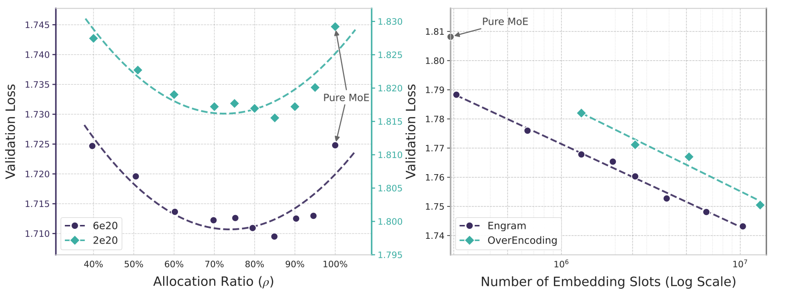

# Engram：补充解读

> Engram为什么不同于外部检索，也不同于大词表？以下为直觉解释与应用延伸，论文内容见 [精炼主笔记](Engram详解.md)。

## Engram 和 RAG 的根本区别

RAG 检索外部文本，再把文本作为上下文；Engram 根据局部 token 确定地址，取出联合训练的向量参数。它没有逐条可读文档，也不天然提供来源引用。把它叫记忆，不意味着可以任意编辑一个事实而保证没有副作用。

## 为什么记忆也能帮助推理

推理依赖基础模式识别。如果模型的早层不必反复重建常见搭配，后续计算可以用于更复杂组合。这类似把常用操作预先缓存，但缓存的是训练出的表示，而不是完整答案。

图中 U 形曲线提醒我们，记忆与计算互补。无限扩大表无法代替关系推导，也不会消除未知输入和哈希碰撞问题。

## 确定性地址为什么对系统重要

MoE 路由要等当前层隐藏状态，Engram 地址可从输入 token 提前算出，因此能与前面层的计算重叠传输。这个时序差别比“O(1)”口号更关键。短模型、极小 batch 或主机带宽拥堵时，隐藏传输的空间会缩小。

## 用一个具体场景串起来

查“New York”对应N-gram槽位，是读取训练过的参数向量，不是从文档库拿一段可引用原文；它也不改变原tokenizer如何表达字符串。全局语境再决定该向量是否适用。

固定计算下把部分专家参数换成记忆有收益，说明静态模式值得专门容量；给记忆过多又会损失动态推理。它强调分工，而不是宣称所有知识都能用查表替代。
