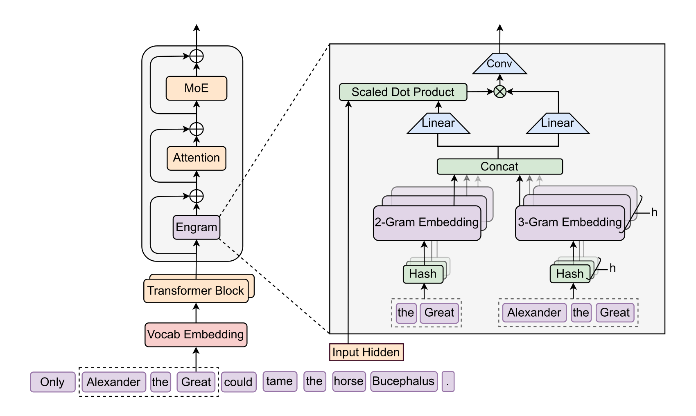
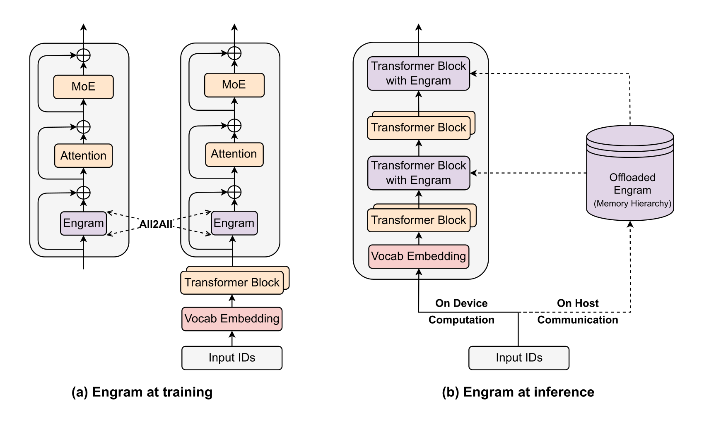
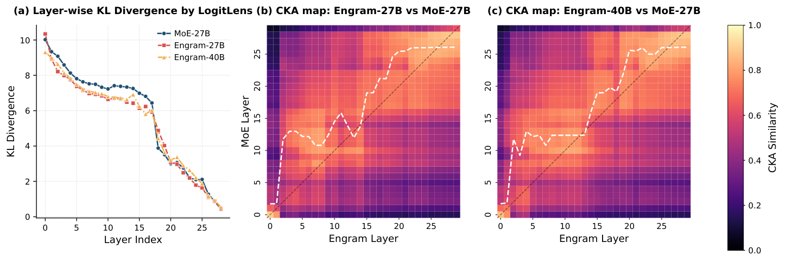
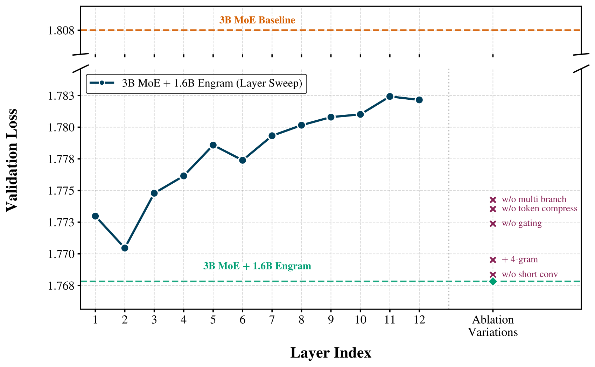
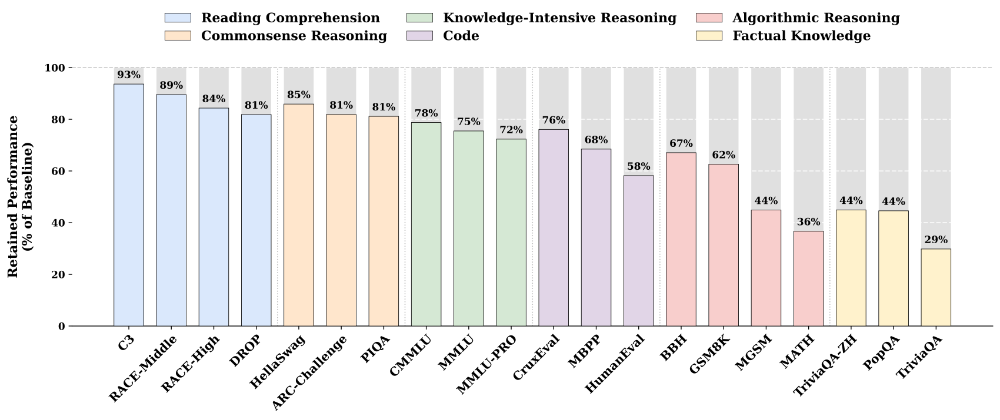
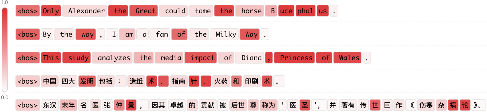
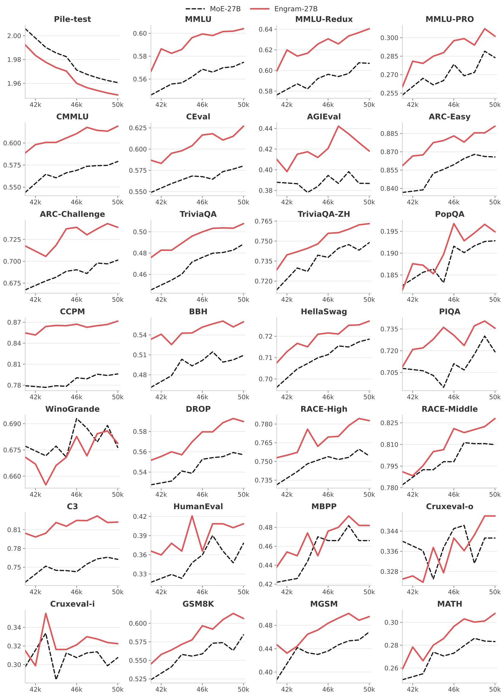

# Conditional Memory via Scalable Lookup: A New Axis of Sparsity for Large Language Models / 全文中英对照

> 来源：[arXiv:2601.07372v2](https://arxiv.org/abs/2601.07372v2)。英文段落后紧接中文，覆盖所取 HTML 版本的主文、附录、图表、脚注与参考文献；公式、数字表和书目信息共用。中文以机器初译为底稿，进行了术语整理与结构核对，尚未逐句人工审定；遇到歧义请以紧邻英文和原论文为准。 原作版权归所列作者，许可见 [原作许可](http://creativecommons.org/licenses/by/4.0/)；中文译文与版式改写在该许可条件下提供（涉及 SA 时沿用相同许可，涉及 NC 时仅限非商业使用）。

## Authors and affiliations / 作者与机构

Xin Cheng 1,2∗ , Rui Tian 2∗ , Wangding Zeng 2 , Damai Dai 2 , Qinyu Chen 2 , Bingxuan Wang 2 , Zhenda Xie 2 , Kezhao Huang 2 , Xingkai Yu 2 Chengqi Deng 2 , Shangyan Zhou 2 , Chenggang Zhao 2 , Zhewen Hao 2 Yukun Li 2 , Han Zhang 2 , Zhengyan Zhang 2 , Yixuan Wei 2 , M.Y Xu 2 Huishuai Zhang 1 , Dongyan Zhao 1 , Wenfeng Liang 2 1 Peking University 2 DeepSeek-AI {zhanghuishuai, zhaody}@pku.edu.cn {chengxin, tianr22, zengwangding, damai.dai}@deepseek.com

**EN.** \reportnumber

**中.** \报告编号

**EN.** 001

**中.** 001

## Abstract / 摘要

**EN.** While Mixture-of-Experts (MoE) scales capacity via conditional computation, Transformers lack a native primitive for knowledge lookup, forcing them to inefficiently simulate retrieval through computation. To address this, we introduce conditional memory as a complementary sparsity axis, instantiated via Engram , a module that modernizes classic $N$ -gram embedding for $\mathcal{O}(1)$ lookup. By formulating the Sparsity Allocation problem, we uncover a U-shaped scaling law that optimizes the trade-off between neural computation (MoE) and static memory (Engram). Guided by this law, we scale Engram to 27B parameters, achieving superior performance over a strictly iso-parameter and iso-FLOPs MoE baseline. Most notably, while the memory module is expected to aid knowledge retrieval (e.g., MMLU $+3.4$ ; CMMLU $+4.0$ ), we observe even larger gains in general reasoning (e.g., BBH $+5.0$ ; ARC-Challenge $+3.7$ ) and code/math domains (HumanEval $+3.0$ ; MATH $+2.4$ ). Mechanistic analyses reveal that Engram relieves the backbone’s early layers from static reconstruction, effectively deepening the network for complex reasoning. Furthermore, by delegating local dependencies to lookups, it frees up attention capacity for global context, substantially boosting long-context retrieval (e.g., Multi-Query NIAH: $84.2\to 97.0$ ). Finally, Engram establishes infrastructure-aware efficiency: its deterministic addressing enables runtime prefetching from host memory, incurring negligible overhead. We envision conditional memory as an indispensable modeling primitive for next-generation sparse models. Code available at: [https://github.com/deepseek-ai/Engram](https://github.com/deepseek-ai/Engram) .

**中.** 虽然专家混合 (MoE) 通过条件计算扩展容量，但 Transformer 缺乏用于知识查找的本机原语，迫使它们通过计算低效地模拟检索。为了解决这个问题，我们引入条件内存作为补充稀疏轴，通过 Engram 实例化，该模块使经典的 $N$ -gram 嵌入现代化，以进行 $\mathcal{O}(1)$ 查找。通过制定稀疏分配问题，我们发现了一个 U 形缩放定律，该定律优化了神经计算 (MoE) 和静态内存 (Engram) 之间的权衡。在这一定律的指导下，我们将 Engram 扩展到 27B 参数，在严格的 iso 参数和 iso-FLOPs MoE 基线上实现了卓越的性能。最值得注意的是，虽然内存模块预计有助于知识检索（例如 MMLU $+3.4$ ；CMMLU $+4.0$ ），但我们观察到在一般推理（例如 BBH $+5.0$ ；ARC-Challenge $+3.7$ ）和代码/数学领域（HumanEval $+3.0$ ; 数学 $+2.4$ )。机制分析表明，Engram 使主干网的早期层免于静态重建，有效加深了网络的复杂推理能力。此外，通过将本地依赖项委托给查找，它释放了全局上下文的注意力能力，从而大大提高了长上下文检索（例如，多查询 NIAH：$84.2\to 97.0$ ）。最后，Engram 建立了基础设施感知效率：其确定性寻址支持运行时从主机内存预取，产生的开销可以忽略不计。我们将条件记忆视为下一代稀疏模型不可或缺的建模原语。代码可在：[https://github.com/deepseek-ai/Engram](https://github.com/deepseek-ai/Engram) 获取。

## Introduction / 简介

**EN.** Sparsity is a recurring design principle for intelligent systems, spanning from biological neural circuits ( Olshausen and Field, 1997 ; Lennie, 2003 ) to modern Large Language Models (LLMs). Currently, this principle is primarily realized through Mixture-of-Experts (MoE) ( Shazeer et al., 2017 ; Dai et al., 2024 ) , which scales capacity via conditional computation. Owing to its ability to drastically increase model size without proportional increases in compute, MoE has become the de facto standard for frontier models ( Guo et al., 2025 ; Comanici et al., 2025 ; Kimi, 2025 ) .

**中.** 稀疏性是智能系统反复出现的设计原则，涵盖从生物神经回路（Olshausen 和 Field，1997；Lennie，2003）到现代大型语言模型（LLM）。目前，这一原理主要通过专家混合（MoE）来实现（Shazeer et al., 2017；Dai et al., 2024），它通过条件计算来扩展容量。由于其能够在计算量不成比例增加的情况下大幅增加模型大小，MoE 已成为前沿模型事实上的标准（Guo et al., 2025；Comanici et al., 2025；Kimi, 2025）。

**EN.** Despite the success of this conditional computation paradigm, the intrinsic heterogeneity of linguistic signals suggests significant room for structural optimization . Specifically, language modeling entails two qualitatively different sub-tasks: compositional reasoning and knowledge retrieval. While the former demands deep, dynamic computation, a substantial portion of text—such as named entities and formulaic patterns—is local, static, and highly stereotyped ( Erman, 2000 ; Constant et al., 2017 ) . The effectiveness of classical $N$ -gram models ( Liu et al., 2024b ; Nguyen, 2024 ; Brants et al., 2007 ) in capturing such local dependencies implies that these regularities are naturally represented as computationally inexpensive lookups. Since standard Transformers ( Vaswani et al., 2017 ) lack a native knowledge lookup primitive, current LLMs are forced to simulate retrieval through computation . For instance, resolving a common multi-token entity requires consuming multiple early layers of attention and feed-forward networks ( Ghandeharioun et al., 2024 ; Jin et al., 2025 ) (see Table 3 ). This process essentially amounts to an expensive runtime reconstruction of a static lookup table, wasting valuable sequential depth on trivial operations that could otherwise be allocated to higher-level reasoning.

**中.** 尽管这种条件计算范式取得了成功，但语言信号的内在异质性表明结构优化的巨大空间。具体来说，语言建模需要两个性质不同的子任务：组合推理和知识检索。虽然前者需要深入的动态计算，但文本的很大一部分（例如命名实体和公式模式）是本地的、静态的和高度刻板的（Erman，2000；Constant 等，2017）。经典的 $N$ -gram 模型（Liu et al., 2024b；Nguyen, 2024；Brants et al., 2007）在捕获此类局部依赖性方面的有效性意味着这些规律性自然地表示为计算成本低廉的查找。由于标准 Transformer（Vaswani 等人，2017）缺乏原生知识查找原语，当前的LLM被迫通过计算来模拟检索。例如，解析一个常见的多令牌实体需要消耗多个早期的注意力层和前馈网络（Ghandeharioun 等人，2024；Jin 等人，2025）（参见表 3）。这个过程本质上相当于静态查找表的昂贵的运行时重建，将宝贵的顺序深度浪费在琐碎的操作上，否则这些操作可以分配给更高级别的推理。

**EN.** To align model architecture with this linguistic duality, we advocate for a complementary axis of sparsity: conditional memory. Whereas conditional computation sparsely activates parameters to process dynamic logic ( Shazeer et al., 2017 ; Bengio et al., 2013 ) , conditional memory relies on sparse lookup operations to retrieve static embeddings for fixed knowledge. As a preliminary exploration of this paradigm, we revisit $N$ -gram embeddings ( Bojanowski et al., 2017 ) as a canonical instantiation: local context serves as a key to index a massive embedding table via constant-time $\mathcal{O}(1)$ lookups ( Tito Svenstrup et al., 2017 ; Huang et al., 2025a ; Pagnoni et al., 2025 ; Yu et al., 2025 ) . Our investigation reveals that, perhaps surprisingly, this static retrieval mechanism can serve as an ideal complement to modern MoE architecture—but only if it is properly designed. In this paper, we propose Engram , a conditional memory module grounded in the classic $N$ -gram structure but equipped with modern adaptations such as tokenizer compression, multi-head hashing, contextualized gating, and multi-branch integration (detailed in Section 2 ).

**中.** 为了使模型架构与这种语言二元性保持一致，我们提倡一个互补的稀疏轴：条件记忆。条件计算稀疏地激活参数来处理动态逻辑（Shazeer 等人，2017 年；Bengio 等人，2013 年），而条件内存则依赖稀疏查找操作来检索固定知识的静态嵌入。作为对此范式的初步探索，我们重新审视 $N$ -gram 嵌入（Bojanowski 等人，2017）作为规范实例化：本地上下文作为通过恒定时间 $\mathcal{O}(1)$ 查找索引大规模嵌入表的关键（Tito Svenstrup 等人，2017；Huang 等人，2025a； Pagnoni 等人，2025；Yu 等人，2025）。我们的调查表明，也许令人惊讶的是，这种静态检索机制可以作为现代 MoE 架构的理想补充，但前提是设计得当。在本文中，我们提出了 Engram，这是一种基于经典 $N$ -gram 结构的条件内存模块，但配备了现代适应性，例如分词器压缩、多头哈希、上下文门控和多分支集成（详细信息请参阅第 2 节）。

**EN.** To quantify the synergy between these two primitives, we formulate the Sparsity Allocation problem: given a fixed total parameter budget, how should capacity be distributed between MoE experts and Engram memory? Our experiments uncover a distinct U-shaped scaling law, revealing that even simple lookup mechanisms, when treated as a first-class modeling primitive, act as essential complements to neural computation. Guided by this allocation law, we scale Engram to a 27B-parameter model. Compared to a strictly iso-parameter and iso-FLOPs MoE-27B baseline, Engram-27B achieves superior efficiency across diverse domains. Crucially, the gains are not limited to knowledge-intensive tasks (e.g., MMLU: $+3.4$ ; CMMLU: $+4.0$ ; MMLU-Pro: $+1.8$ ), where memory capacity is intuitively beneficial; we observe even more significant improvements in general reasoning (e.g., BBH: $+5.0$ ; ARC-Challenge: $+3.7$ ; DROP: $+3.3$ ) and code/math domains (e.g., HumanEval: $+3.0$ ; MATH: $+2.4$ ; GSM8K: $+2.2$ ).

**中.** 为了量化这两个原语之间的协同作用，我们制定了稀疏分配问题：给定固定的总参数预算，容量应该如何在 MoE 专家和 Engram 内存之间分配？我们的实验揭示了一个独特的 U 形缩放定律，表明即使是简单的查找机制，当被视为一流的建模原语时，也可以作为神经计算的重要补充。在此分配法则的指导下，我们将 Engram 扩展到 27B 参数模型。与严格的 iso-parameter 和 iso-FLOPs MoE-27B 基线相比，Engram-27B 在不同领域实现了卓越的效率。至关重要的是，收益不仅限于知识密集型任务（例如 MMLU：$+3.4$ ；CMMLU：$+4.0$ ；MMLU-Pro：$+1.8$ ），在这些任务中，内存容量直观上是有益的；我们观察到一般推理（例如 BBH：$+5.0$ ；ARC-Challenge：$+3.7$ ；DROP：$+3.3$ ）和代码/数学领域（例如 HumanEval：$+3.0$ ；数学：$+2.4$ ；GSM8K： $+2.2$）。

**EN.** Mechanistic analysis via LogitLens ( nostalgebraist, 2020 ) and CKA ( Hendrycks et al., 2021a ) reveals the source of these gains: Engram relieves the backbone from reconstructing static knowledge in early layers, thereby increasing effective depth available for complex reasoning. Furthermore, by delegating local dependencies to lookups, Engram frees up attention capacity to focus on global context, enabling exceptional performance in long-context scenarios—substantially outperforming baselines on LongPPL ( Fang et al., ) and RULER ( Hsieh et al., ) (e.g., Multi-Query NIAH: $97.0$ vs. $84.2$ ; Variable Tracking: $89.0$ vs. $77.0$ ).

**中.** 通过 LogitLens（nostalgebraist，2020）和 CKA（Hendrycks 等人，2021a）进行的机制分析揭示了这些增益的来源：Engram 减轻了骨干网在早期层中重建静态知识的负担，从而增加了可用于复杂推理的有效深度。此外，通过将本地依赖项委托给查找，Engram 释放了注意力能力来关注全局上下文，从而在长上下文场景中实现卓越的性能 - 大大优于 LongPPL（Fang 等人）和 RULER（Hsieh 等人）的基线（例如，多查询 NIAH：$97.0$ 与 $84.2$；变量跟踪： $89.0$ 与 $77.0$ ）。

**EN.** Finally, we establish infrastructure-aware efficiency as a first-class principle. Unlike MoE’s dynamic routing, Engram employs deterministic IDs to enable runtime prefetching, overlapping communication with computation. Empirical results show that offloading a 100B-parameter table to host memory incurs negligible overhead ( $<3\%$ ). This demonstrates that Engram effectively bypasses GPU memory constraints, facilitating aggressive parameter expansion.

**中.** 最后，我们将基础设施意识效率确立为一流原则。与 MoE 的动态路由不同，Engram 采用确定性 ID 来实现运行时预取、重叠通信与计算。经验结果表明，将 100B 参数表卸载到主机内存所产生的开销可以忽略不计 ( $<3\%$ )。这表明 Engram 有效地绕过了 GPU 内存限制，促进了积极的参数扩展。

**EN.** Figure 1 : The Engram Architecture. The module augments the backbone by retrieving static $N$ -gram memory and fusing it with dynamic hidden states via context-aware gating. This module is applied only to specific layers to decouple memory from compute, leaving the standard input embedding and un-embedding module intact.

**中.** 图 1：印迹架构。该模块通过检索静态 $N$ -gram 内存并通过上下文感知门控将其与动态隐藏状态融合来增强主干。该模块仅应用于特定层，以将内存与计算解耦，使标准输入嵌入和非嵌入模块保持完整。

## Architecture / 建筑

### Overview / 概述

**EN.** As shown in Figure 1 , Engram is a conditional memory module designed to augment the Transformer backbone by structurally separating static pattern storage from dynamic computation. Formally, given an input sequence $X=(x_{1},\dots,x_{T})$ and hidden states $\mathbf{H}^{(\ell)}\in\mathbb{R}^{T\times d}$ at layer $\ell$ , the module processes each position $t$ in two functional phases: retrieval and fusion . First, as detailed in Section 2.2 , we extract and compress suffix $N$ -grams to deterministically retrieve static embedding vectors via hashing. Subsequently, in Section 2.3 , these retrieved embeddings are dynamically modulated by the current hidden state and refined via a lightweight convolution. Finally, we discuss the integration with multi-branch architectures in Section 2.4 and the system-level design in Section 2.5 .

**中.** 如图 1 所示，Engram 是一个条件内存模块，旨在通过在结构上将静态模式存储与动态计算分开来增强 Transformer 主干。形式上，给定输入序列 $X=(x_{1},\dots,x_{T})$ 和层 $\ell$ 的隐藏状态 $\mathbf{H}^{(\ell)}\in\mathbb{R}^{T\times d}$ ，该模块在两个功能阶段处理每个位置 $t$ ：检索和融合。首先，如第 2.2 节所述，我们提取并压缩后缀 $N$ -gram，以通过哈希确定性地检索静态嵌入向量。随后，在第 2.3 节中，这些检索到的嵌入由当前隐藏状态动态调制，并通过轻量级卷积进行细化。最后，我们在 2.4 节中讨论与多分支架构的集成，在 2.5 节中讨论系统级设计。

### Sparse Retrieval via Hashed $N$ -grams / 通过哈希 $N$ -grams 进行稀疏检索

**EN.** The first phase maps local contexts to static memory entries, involving tokenizer compression and retrieving embeddings via deterministic hashing.

**中.** 第一阶段将本地上下文映射到静态内存条目，涉及分词器压缩和通过确定性哈希检索嵌入。

#### Tokenizer Compression / 分词器压缩

**EN.** While $N$ -gram models typically operate directly on tokenizer outputs, standard subword tokenizers prioritize lossless reconstruction , often assigning disjoint IDs to semantically equivalent terms (e.g., Apple vs. ␣apple ) ( Kudo and Richardson, 2018 ; Li et al., 2023b ) . To maximize semantic density, we implement a vocabulary projection layer. Specifically, we pre-compute a surjective function $\mathcal{P}:V\to V^{\prime}$ that collapses raw token IDs into canonical identifiers based on normalized textual equivalence (using NFKC ( Whistler, 2025 ) , lowercasing, etc.). In practice, this process achieves a 23% reduction in the effective vocabulary size for a 128k tokenizer (see Appendix C ). Formally, for a token at position $t$ , we map its raw ID $x_{t}$ to a canonical ID $x^{\prime}_{t}=\mathcal{P}(x_{t})$ to form the suffix $N$ -gram $g_{t,n}=(x^{\prime}_{t-n+1},\dots,x^{\prime}_{t})$ .

**中.** 虽然 $N$ -gram 模型通常直接在分词器输出上运行，但标准子词分词器优先考虑无损重建，通常将不相交的 ID 分配给语义上等效的术语（例如，Apple 与 ␣apple）（Kudo 和 Richardson，2018；Li 等人，2023b）。为了最大化语义密度，我们实现了词汇投影层。具体来说，我们预先计算一个满射函数 $\mathcal{P}:V\to V^{\prime}$，该函数根据标准化文本等效性（使用 NFKC (Whistler, 2025)、小写等）将原始令牌 ID 折叠为规范标识符。实际上，这个过程可以将 128k 分词器的有效词汇量减少 23%（参见附录 C）。形式上，对于位置 $t$ 的令牌，我们将其原始 ID $x_{t}$ 映射到规范 ID $x^{\prime}_{t}=\mathcal{P}(x_{t})$ 以形成后缀 $N$ -gram $g_{t,n}=(x^{\prime}_{t-n+1},\dots,x^{\prime}_{t})$ 。

#### Multi-Head Hashing. / 多头哈希。

**EN.** Directly parameterizing the combinatorial space of all possible $N$ -grams is intractable. Following Tito Svenstrup et al. (2017) , we adopt a hashing-based approach. To mitigate collisions, we employ $K$ distinct hash heads for each $N$ -gram order $n$ . Each head $k$ maps the compressed context to an index within an embedding table $\mathbf{E}_{n,k}$ (of prime size $M_{n,k}$ ) via a deterministic function $\varphi_{n,k}$ :

**中.** 直接参数化所有可能的 $N$ -gram 的组合空间是很棘手的。继 Tito Svenstrup 等人之后。 (2017)，我们采用基于哈希的方法。为了减轻冲突，我们为每个 $N$ 语法顺序 $n$ 使用 $K$ 不同的哈希头。每个头 $k$ 通过确定性函数 $\varphi_{n,k}$ 将压缩上下文映射到嵌入表 $\mathbf{E}_{n,k}$ （素数大小 $M_{n,k}$ ）内的索引：

$$
z_{t,n,k}\triangleq\varphi_{n,k}(g_{t,n}),\quad\mathbf{e}_{t,n,k}=\mathbf{E}_{n,k}[z_{t,n,k}].\tag{1}
$$

**EN.** In practice, $\varphi_{n,k}$ is implemented as a lightweight multiplicative-XOR hash. We construct the final memory vector $\mathbf{e}_{t}\in\mathbb{R}^{d_{\text{mem}}}$ by concatenating all retrieved embeddings:

**中.** 在实践中，$\varphi_{n,k}$ 被实现为轻量级乘法异或哈希。我们通过连接所有检索到的嵌入来构造最终的记忆向量 $\mathbf{e}_{t}\in\mathbb{R}^{d_{\text{mem}}}$：

$$
\mathbf{e}_{t}\triangleq\mathop{\|}_{n=2}^{N}\mathop{\|}_{k=1}^{K}\mathbf{e}_{t,n,k}.\tag{2}
$$

### Context-aware Gating / 上下文感知门控

**EN.** The retrieved embeddings $\mathbf{e}_{t}$ serve as context-independent priors. Being static, however, they inherently lack contextual adaptability and may suffer from noise due to hash collisions or polysemy ( Haber and Poesio, 2024 ) . To enhance expressivity and resolve this ambiguity, we employ a context-aware gating mechanism inspired by Attention ( Vaswani et al., 2017 ; Bahdanau et al., 2015 ) . Specifically, we utilize the current hidden state $\mathbf{h}_{t}$ —which has aggregated global context via preceding attention layers—as a dynamic Query, while the retrieved memory $\mathbf{e}_{t}$ serves as the source for both Key and Value projections:

**中.** 检索到的嵌入 $\mathbf{e}_{t}$ 作为上下文无关的先验。然而，由于它们是静态的，它们本质上缺乏上下文适应性，并且可能会因哈希冲突或多义而受到噪音的影响（Haber 和 Poesio，2024）。为了增强表达性并解决这种歧义，我们采用了受注意力机制启发的上下文感知门控机制（Vaswani 等人，2017；Bahdanau 等人，2015）。具体来说，我们利用当前隐藏状态 $\mathbf{h}_{t}$（它通过前面的注意力层聚合了全局上下文）作为动态查询，而检索到的内存 $\mathbf{e}_{t}$ 充当键和值投影的源：

$$
\mathbf{k}_{t}=\mathbf{W}_{K}\mathbf{e}_{t},\quad\mathbf{v}_{t}=\mathbf{W}_{V}\mathbf{e}_{t}\tag{3}
$$

**EN.** where $\mathbf{W}_{K},\mathbf{W}_{V}$ are learnable projection matrices. To ensure gradient stability ( Dehghani et al., 2023 ) , we apply RMSNorm ( Zhang and Sennrich, 2019 ) to the Query and Key before computing the scalar gate $\alpha_{t}\in(0,1)$ :

**中.** 其中 $\mathbf{W}_{K},\mathbf{W}_{V}$ 是可学习的投影矩阵。为了确保梯度稳定性（Dehghani 等人，2023），我们在计算标量门 $\alpha_{t}\in(0,1)$ 之前将 RMSNorm（Zhang 和 Sennrich，2019）应用于 Query 和 Key：

$$
\alpha_{t}=\sigma\left(\frac{\text{RMSNorm}(\mathbf{h}_{t})^{\top}\text{RMSNorm}(\mathbf{k}_{t})}{\sqrt{d}}\right).\tag{4}
$$

**EN.** The gated output is defined as $\tilde{\mathbf{v}}_{t}=\alpha_{t}\cdot\mathbf{v}_{t}$ . This design enforces semantic alignment: if the retrieved memory $\mathbf{e}_{t}$ contradicts the current context $\mathbf{h}_{t}$ , the gate $\alpha_{t}$ tends toward zero, effectively suppressing the noise.

**中.** 门控输出定义为 $\tilde{\mathbf{v}}_{t}=\alpha_{t}\cdot\mathbf{v}_{t}$ 。这种设计强制语义对齐：如果检索到的内存 $\mathbf{e}_{t}$ 与当前上下文 $\mathbf{h}_{t}$ 相矛盾，则门 $\alpha_{t}$ 趋于零，从而有效抑制噪声。

**EN.** Finally, to expand the receptive field and enhance the model’s non-linearity, we introduce a short, depthwise causal convolution ( Gu et al., 2022 ; Peng et al., 2023 ) . Let $\tilde{\mathbf{V}}\in\mathbb{R}^{T\times d}$ denote the sequence of gated values. Using a kernel size $w$ (set to 4), dilation $\delta$ (set to the max $N$ -gram order) and SiLU activation ( Elfwing et al., 2018 ) , the final output $\mathbf{Y}$ is computed as:

**中.** 最后，为了扩大感受野并增强模型的非线性，我们引入了一个短的、深度方向的因果卷积（Gu et al., 2022；Peng et al., 2023）。让 $\tilde{\mathbf{V}}\in\mathbb{R}^{T\times d}$ 表示门控值的序列。使用内核大小 $w$（设置为 4）、膨胀 $\delta$（设置为最大 $N$ 克阶）和 SiLU 激活（Elfwing 等人，2018），最终输出 $\mathbf{Y}$ 计算如下：

$$
\mathbf{Y}=\text{SiLU}\left(\text{Conv1D}(\text{RMSNorm}(\tilde{\mathbf{V}}))\right)+\tilde{\mathbf{V}},\tag{5}
$$

**EN.** The Engram module is integrated into the backbone via a residual connection: $\mathbf{H}^{(\ell)}\leftarrow\mathbf{H}^{(\ell)}+\mathbf{Y}$ , followed by the standard Attention and MoE. Crucially, Engram is not applied to every layer; its specific placement is optimized to balance modeling effectiveness against the system-level latency constraints detailed in Section 2.5 .

**中.** Engram 模块通过剩余连接集成到主干中： $\mathbf{H}^{(\ell)}\leftarrow\mathbf{H}^{(\ell)}+\mathbf{Y}$ ，后面是标准的 Attention 和 MoE。至关重要的是，印迹并不适用于每一层；它的具体位置经过优化，可以平衡建模有效性与第 2.5 节中详述的系统级延迟约束。

**EN.** Figure 2 : System implementation of Engram. (a) Training Phase: The massive embedding tables are sharded across available GPUs. An All-to-All communication primitive is employed to retrieve active embedding rows across devices. (b) Inference Phase: Engram tables are offloaded to host memory. By exploiting the deterministic retrieval logic, the host asynchronously prefetches and transfers embeddings, overlapping communication with the on-device computation of preceding Transformer blocks.

**中.** 图 2：Engram 的系统实现。 (a) 训练阶段：大量嵌入表在可用 GPU 上进行分片。采用 All-to-All 通信原语来检索跨设备的活动嵌入行。 (b) 推理阶段：印迹表被卸载到主机内存。通过利用确定性检索逻辑，主机异步预取和传输嵌入，与前面 Transformer 块的设备上计算重叠通信。

### Integration with Multi-branch Architecture / 与多分支架构集成

**EN.** In this work, rather than standard single-stream connections ( He et al., 2016 ) , we adopt the advanced multi-branch architecture as our default backbone, chosen for its superior modeling capabilities ( Larsson et al., 2017 ; Zhu et al., 2025 ; Xie et al., 2025 ; Szegedy et al., 2015 ) . A defining characteristic of this architecture is the expansion of the residual stream into $M$ parallel branches, where information flow is modulated by learnable connection weights.

**中.** 在这项工作中，我们没有采用标准的单流连接（He et al., 2016），而是采用先进的多分支架构作为我们的默认骨干网，选择它是因为其卓越的建模能力（Larsson et al., 2017; Zhu et al., 2025; Xie et al., 2025; Szegedy et al., 2015）。该架构的一个定义特征是将残余流扩展到 $M$ 并行分支，其中信息流由可学习的连接权重进行调制。

**EN.** Although the Engram module is inherently topology-agnostic, adapting it to this multi-branch framework necessitates structural optimization to balance efficiency and expressivity. Specifically, we implement a parameter-sharing strategy: a single sparse embedding table and a Value projection matrix $\mathbf{W}_{V}$ are shared across all $M$ branches, whereas $M$ distinct Key projection matrices $\{\mathbf{W}_{K}^{(m)}\}_{m=1}^{M}$ are employed to enable branch-specific gating behaviors. For the $m$ -th branch with hidden state $\mathbf{h}_{t}^{(m)}$ , the branch-specific gating signal is computed as:

**中.** 尽管印迹模块本质上与拓扑无关，但要使其适应这种多分支框架，就需要进行结构优化以平衡效率和表现力。具体来说，我们实现了参数共享策略：单个稀疏嵌入表和值投影矩阵 $\mathbf{W}_{V}$ 在所有 $M$ 分支之间共享，而 $M$ 不同的键投影矩阵 $\{\mathbf{W}_{K}^{(m)}\}_{m=1}^{M}$ 用于启用特定于分支的门控行为。对于具有隐藏状态 $\mathbf{h}_{t}^{(m)}$ 的第 $m$ 分支，特定于分支的门控信号计算如下：

$$
\alpha_{t}^{(m)}=\sigma\left(\frac{\text{RMSNorm}(\mathbf{h}_{t}^{(m)})^{\top}\text{RMSNorm}(\mathbf{W}_{K}^{(m)}\mathbf{e}_{t})}{\sqrt{d}}\right).\tag{6}
$$

**EN.** The retrieved memory is then modulated by these independent gates applied to the shared value vector: $\mathbf{u}_{t}^{(m)}=\alpha_{t}^{(m)}\cdot(\mathbf{W}_{V}\mathbf{e}_{t})$ . This design allows the linear projections (one $\mathbf{W}_{V}$ and $M$ distinct $\mathbf{W}_{K}^{(m)}$ ) to be fused into a single dense FP8 matrix multiplication, maximizing the compute utilization of modern GPUs. Unless otherwise stated, all experiments utilize this integration with Manifold-Constrained Hyper-Connections ( $M=4$ ) ( Xie et al., 2025 ) .

**中.** 然后，检索到的内存由应用于共享值向量的这些独立门进行调制：$\mathbf{u}_{t}^{(m)}=\alpha_{t}^{(m)}\cdot(\mathbf{W}_{V}\mathbf{e}_{t})$。这种设计允许将线性投影（一个 $\mathbf{W}_{V}$ 和 $M$ 不同的 $\mathbf{W}_{K}^{(m)}$ ）融合到单个密集 FP8 矩阵乘法中，从而最大限度地提高现代 GPU 的计算利用率。除非另有说明，所有实验均利用与流形约束超连接 ($M=4$) 的集成（Xie 等人，2025）。

### System Efficiency: Decoupling Compute and Memory / 系统效率：计算和内存解耦

**EN.** Scaling model parameters is often constrained by the limited capacity of GPU high-bandwidth memory (HBM). However, unlike MoE which relies on runtime hidden states for dynamic routing, Engram employs a deterministic retrieval mechanism based solely on input token IDs, naturally decoupling parameter storage from computation. This predictability facilitates specialized optimization strategies for both training and inference, as illustrated in Figure 2 .

**中.** 缩放模型参数通常受到 GPU 高带宽内存 (HBM) 有限容量的限制。然而，与依赖运行时隐藏状态进行动态路由的 MoE 不同，Engram 采用仅基于输入令牌 ID 的确定性检索机制，自然地将参数存储与计算解耦。这种可预测性有利于训练和推理的专门优化策略，如图 2 所示。

**EN.** During training, to accommodate large-scale embedding tables, we employ standard model parallelism by sharding the tables across available GPUs. An All-to-All communication primitive is used to gather active rows in the forward pass and dispatch gradients in the backward pass, enabling the total memory capacity to scale linearly with the number of accelerators.

**中.** 在训练过程中，为了适应大规模嵌入表，我们通过在可用 GPU 上对表进行分片来采用标准模型并行性。 All-to-All 通信原语用于在前向传递中收集活动行并在后向传递中分派梯度，从而使总内存容量能够随加速器数量线性扩展。

**EN.** During inference, this deterministic nature enables a prefetch-and-overlap strategy. Since memory indices are known prior to the forward pass, the system can asynchronously retrieve embeddings from abundant host memory via PCIe. To effectively mask communication latency, the Engram module is placed at specific layers within the backbone, leveraging the computation of preceding layers as a buffer to prevent GPU stalls. This necessitates a hardware-algorithm co-design strategy: while placing Engram deeper extends the compute window available for hiding latency, our ablation in Section 6.2 shows that modeling performance favors early intervention to offload local pattern reconstruction. Therefore, the optimal placement must simultaneously satisfy both modeling and system latency constraints.

**中.** 在推理过程中，这种确定性性质支持预取和重叠策略。由于内存索引在前向传递之前已知，因此系统可以通过 PCIe 从丰富的主机内存中异步检索嵌入。为了有效屏蔽通信延迟，Engram 模块被放置在主干内的特定层，利用前面层的计算作为缓冲区来防止 GPU 停顿。这就需要一种硬件算法协同设计策略：虽然将 Engram 放置得更深，扩展了可用于隐藏延迟的计算窗口，但我们在第 6.2 节中的消融表明，建模性能有利于早期干预，以减轻局部模式重建的负担。因此，最佳布局必须同时满足建模和系统延迟约束。

**EN.** Furthermore, natural language $N$ -grams inherently follow a Zipfian distribution ( Piantadosi, 2014 ; Chao and Zipf, 1950 ) , where a small fraction of patterns accounts for the vast majority of memory accesses. This statistical property motivates a Multi-Level Cache Hierarchy: frequently accessed embeddings can be cached in faster storage tiers (e.g., GPU HBM or Host DRAM), while the long tail of rare patterns resides in slower, high-capacity media (e.g., NVMe SSD). This stratification allows Engram to scale to massive memory capacities with minimal impact on effective latency.

**中.** 此外，自然语言 $N$ -gram 本质上遵循 Zipfian 分布（Piantadosi，2014；Chao 和 Zipf，1950），其中一小部分模式占绝大多数内存访问。这种统计特性激发了多级缓存层次结构：频繁访问的嵌入可以缓存在更快的存储层（例如 GPU HBM 或主机 DRAM）中，而罕见模式的长尾则驻留在速度较慢的大容量介质（例如 NVMe SSD）中。这种分层使得 Engram 能够扩展到海量内存容量，同时对有效延迟的影响最小。

**EN.** Figure 3 : Sparsity allocation and Engram scaling. Left: Validation loss across allocation ratios $\rho$ . Two compute budgets are shown ( $2\text{e}20$ and $6\text{e}20$ FLOPs). Both regimes exhibit a U-shape, with hybrid allocation surpassing Pure MoE. Right: Scaling behavior in the infinite-memory regime. Validation loss exhibits a log-linear trend with respect to the number of embeddings.

**中.** 图 3：稀疏分配和印迹缩放。左：分配比率 $\rho$ 的验证损失。显示了两个计算预算（$2\text{e}20$ 和 $6\text{e}20$ FLOP）。两种制度都呈现出 U 形，混合分配超过了纯 MoE。右图：无限内存状态下的缩放行为。验证损失相对于嵌入数量呈现对数线性趋势。

## Scaling Laws and Sparsity Allocation / 缩放法则和稀疏性分配

**EN.** Engram, as an instantiation of conditional memory, is structurally complementary to the conditional computation provided by MoE experts. This section investigates the scaling properties of this duality and how to optimally allocate sparse capacity. Specifically, two key questions drive our research:

**中.** Engram作为条件记忆的实例，与教育部专家提供的条件计算在结构上是互补的。本节研究这种二元性的扩展特性以及如何优化分配稀疏容量​​。具体来说，两个关键问题推动了我们的研究：

**EN.** 1.

**中.** 1.

**EN.** Allocation under Finite Constraints. When total parameters and training compute are fixed (Iso-parameter and Iso-FLOPs), how should we split the sparse capacity between MoE experts and Engram embeddings?

**中.** 有限约束下的分配。当总参数和训练计算固定（Iso 参数和 Iso-FLOPs）时，我们应该如何在 MoE 专家和 Engram 嵌入之间分配稀疏容量​​？

**EN.** 2.

**中.** 2.

**EN.** Infinite Memory Regime. Considering the non-scaling $\mathcal{O}(1)$ overhead of Engram, if the memory budget is relaxed or scaled aggressively, what scaling behavior does Engram exhibit by itself?

**中.** 无限内存制度。考虑到 Engram 的非缩放 $\mathcal{O}(1)$ 开销，如果内存预算放松或大幅缩放，Engram 本身会表现出什么缩放行为？

### Optimal Allocation Ratio Between MoE and Engram / MoE与Engram之间的最佳分配比例

#### Compute-matched formulation. / 计算匹配的配方。

**EN.** We analyze the trade-off using three parameter metrics:

**中.** 我们使用三个参数指标来分析权衡：

**EN.** $P_{\mathrm{tot}}$ : total trainable parameters, excluding vocabulary embedding and LM head.

**中.** $P_{\mathrm{tot}}$：总可训练参数，不包括词汇嵌入和LM头。

**EN.** $P_{\mathrm{act}}$ : activated parameters per token. This quantity determines the training cost (FLOPs).

**中.** $P_{\mathrm{act}}$ ：每个令牌激活的参数。该数量决定了训练成本 (FLOP)。

**EN.** $P_{\mathrm{sparse}}\triangleq P_{\mathrm{tot}}-P_{\mathrm{act}}$ : the inactive parameters, which represents the “free” parameter budget available for scaling model size without incurring computational cost (e.g., unselected experts or unretrieved embeddings).

**中.** $P_{\mathrm{sparse}}\triangleq P_{\mathrm{tot}}-P_{\mathrm{act}}$：非活动参数，代表可用于缩放模型大小的“免费”参数预算，而不会产生计算成本（例如，未选择的专家或未检索的嵌入）。

**EN.** We keep $P_{\mathrm{tot}}$ and $P_{\mathrm{act}}$ fixed within each FLOPs budget, so that models have the same number of parameters and the same per-token FLOPs. For MoE, $P_{\mathrm{act}}$ is determined by the top- $k$ selected experts, while the parameters of non-selected experts contribute to $P_{\mathrm{sparse}}$ . For Engram, only a constant number of slots are retrieved per token, so scaling the number of embedding slots increases $P_{\mathrm{tot}}$ without increasing per-token FLOPs.

**中.** 我们将 $P_{\mathrm{tot}}$ 和 $P_{\mathrm{act}}$ 固定在每个 FLOP 预算内，以便模型具有相同数量的参数和相同的每个代币 FLOP。对于MoE来说，$P_{\mathrm{act}}$由顶级$k$入选专家确定，而非入选专家的参数贡献于$P_{\mathrm{sparse}}$。对于 Engram，每个令牌仅检索恒定数量的槽，因此扩展嵌入槽的数量会增加 $P_{\mathrm{tot}}$，而不会增加每个令牌的 FLOP。

#### Allocation ratio. / 分配比例。

**EN.** We define the allocation ratio $\rho\in[0,1]$ as the fraction of the inactive-parameter budget assigned to MoE expert capacity:

**中.** 我们将分配比率 $\rho\in[0,1]$ 定义为分配给 MoE 专家容量的非活动参数预算的一部分：

$$
P_{\mathrm{MoE}}^{(\mathrm{sparse})}=\rho\,P_{\mathrm{sparse}},\qquad P_{\mathrm{Engram}}=(1-\rho)\,P_{\mathrm{sparse}}.\tag{7}
$$

**EN.** Intuitively:

**中.** 直观地说：

**EN.** $\rho=1$ corresponds to a pure MoE model (all inactive parameters are routed experts).

**中.** $\rho=1$对应于纯MoE模型（所有非活动参数都是路由专家）。

**EN.** $\rho<1$ reduces the number of routed experts and reallocates the freed parameters to Engram embedding slots.

**中.** $\rho<1$ 减少了路由专家的数量，并将释放的参数重新分配给 Engram 嵌入槽。

#### Experimental protocol. / 实验方案。

**EN.** We evaluate this trade-off at two compute regimes and maintain a constant sparsity ratio $P_{\mathrm{tot}}/P_{\mathrm{act}}\approx 10$ across both settings:

**中.** 我们在两种计算机制下评估这种权衡，并在两种设置中保持恒定的稀疏比 $P_{\mathrm{tot}}/P_{\mathrm{act}}\approx 10$：

**EN.** $C=2\times 10^{20}$ FLOPs: $P_{\mathrm{tot}}\approx 5.7$ B and $P_{\mathrm{act}}=568$ M. The baseline ( $\rho=1$ ) has a total of 106 experts.

**中.** $C=2\times 10^{20}$ FLOPs：$P_{\mathrm{tot}}\approx 5.7$ B 和 $P_{\mathrm{act}}=568$ M。基线（$\rho=1$）共有 106 个专家。

**EN.** $C=6\times 10^{20}$ FLOPs: $P_{\mathrm{tot}}\approx 9.9$ B and $P_{\mathrm{act}}=993$ M. The baseline ( $\rho=1$ ) has a total of 99 experts.

**中.** $C=6\times 10^{20}$ FLOPs：$P_{\mathrm{tot}}\approx 9.9$ B 和 $P_{\mathrm{act}}=993$ M。基线（$\rho=1$）共有 99 位专家。

**EN.** For different $\rho$ , we construct the corresponding model only by adjusting the number of routed experts and the number of Engram embedding slots. All runs use the identical training pipeline and optimization hyperparameters.

**中.** 对于不同的 $\rho$ ，我们仅通过调整路由专家的数量和 Engram 嵌入槽的数量来构建相应的模型。所有运行都使用相同的训练管道和优化超参数。

#### Results and Analysis. / 结果与分析。

**EN.** Figure 3 (left) reveals a consistent U-shaped relationship between validation loss and the allocation ratio $\rho$ . Remarkably, the Engram model achieves comparable performance to the pure MoE baseline ( $\rho=100\%$ ) even when the MoE allocation is reduced to just $\rho\approx 40\%$ (i.e., a total of 46 experts for the 5.7B model and 43 experts for the 9.9B model). Furthermore, the pure MoE baseline proves suboptimal: reallocating roughly $20\%\text{--}25\%$ of the sparse parameter budget to Engram yields the best performance. Quantitatively, in the 10B regime ( $C=6\times 10^{20}$ ), validation loss improves from $1.7248$ (at $\rho=100\%$ ) to $1.7109$ near the optimum of $\rho\approx 80\%$ ( $\Delta=0.0139$ ). Crucially, the location of this optimum is stable across regimes ( $\rho\approx 75\%\text{--}80\%$ ), suggesting a robust allocation preference across the examined scales (under fixed sparsity). This observed U-shape confirms the structural complementarity between the two modules:

**中.** 图 3（左）揭示了验证损失和分配比率 $\rho$ 之间一致的 U 形关系。值得注意的是，即使 MoE 分配减少到 $\rho\approx 40\%$（即 5.7B 模型总共 46 名专家，9.9B 模型总共 43 名专家），Engram 模型也能实现与纯 MoE 基线 ($\rho=100\%$) 相当的性能。此外，纯 MoE 基线被证明不是最理想的：将稀疏参数预算的大约 $20\%\text{--}25\%$ 重新分配给 Engram 可以产生最佳性能。从数量上来说，在 10B 体系 ( $C=6\times 10^{20}$ ) 中，验证损失从 $1.7248$ (在 $\rho=100\%$ ) 改善到接近 $\rho\approx 80\%$ ( $\Delta=0.0139$ ) 最优值的 $1.7109$ 。至关重要的是，该最优值的位置在不同机制（ $\rho\approx 75\%\text{--}80\%$ ）中是稳定的，这表明在所检查的尺度上（在固定稀疏度下）存在强大的分配偏好。观察到的 U 形证实了两个模块之间的结构互补性：

**EN.** MoE-dominated ( $\rho\to 100\%$ ): The model lacks dedicated memory for static patterns, forcing it to inefficiently reconstruct them through depth and computation.

**中.** MoE 主导（$\rho\to 100\%$）：该模型缺乏静态模式的专用内存，迫使其通过深度和计算低效地重建它们。

**EN.** Engram-dominated ( $\rho\to 0\%$ ): The model loses conditional computation capacity, hurting tasks that require dynamic, context-dependent reasoning; memory cannot replace computation in this regime.

**中.** 印迹主导（$\rho\to 0\%$）：模型失去条件计算能力，损害了需要动态、上下文相关推理的任务；在这种情况下，内存无法取代计算。

### Engram under Infinite Memory Regime / 无限记忆机制下的印迹

**EN.** In Section 3.1 , we optimized the allocation under a fixed parameter budget. We now explore the complementary setting: aggressive memory scaling. This investigation is motivated by Engram’s unique ability to decouple storage from compute detailed in Section 2.5 .

**中.** 在3.1节中，我们在固定参数预算下优化了分配。我们现在探索互补的设置：积极的内存扩展。这项研究的动机是 Engram 将存储与计算分离的独特能力，详见第 2.5 节。

#### Experimental protocol. / 实验方案。

**EN.** We utilize a fixed MoE backbone with $P_{\mathrm{tot}}\approx 3$ B and $P_{\mathrm{act}}=568$ M, trained for 100B tokens to ensure convergence. On top of this backbone, we attach an Engram table and sweep the number of slots $M$ from $2.58\times 10^{5}$ to $1.0\times 10^{7}$ (adding up to $\approx 13$ billion parameters). For baselines, we compare against OverEncoding ( Huang et al., 2025a ) , which integrates $N$ -gram embeddings via averaging with the vocabulary embedding. We note that while other work such as SCONE ( Yu et al., 2025 ) also investigates large-scale embeddings, it is primarily inference-focused and includes extra module ( f-gram model ) and additional training FLOPs, rendering it incompatible with the strict iso-compute constraints of this study.

**中.** 我们利用带有 $P_{\mathrm{tot}}\approx 3$ B 和 $P_{\mathrm{act}}=568$ M 的固定 MoE 主干，针对 100B 令牌进行训练以确保收敛。在此骨干网之上，我们附加了一个印迹表，并将插槽数量 $M$ 从 $2.58\times 10^{5}$ 扫描到 $1.0\times 10^{7}$（总计达到 $\approx 13$ 十亿个参数）。对于基线，我们与 OverEncoding（Huang et al., 2025a）进行比较，后者通过对词汇嵌入进行平均来集成 $N$ -gram 嵌入。我们注意到，虽然 SCONE（Yu 等人，2025）等其他工作也研究了大规模嵌入，但它主要侧重于推理，并包括额外的模块（f-gram 模型）和额外的训练 FLOP，使其与本研究严格的 iso-compute 约束不兼容。

#### Results. / 结果。

**EN.** Figure 3 (right) demonstrates that scaling the number of memory slots yields a clear and consistent improvement in validation loss. Across the explored range, the curve follows a strict power law (linear in log-space), indicating that Engram provides a predictable scaling knob: larger memory continues to pay off without requiring additional computation. Crucially, regarding scaling efficiency: while the direct averaging approach of OverEncoding benefits from larger memory tables, Engram unlocks much larger scaling potential from the same memory budget. Together with the allocation law in Section 3.1 , these results validate that conditional memory serves as a distinct, scalable axis of sparse capacity that complements the conditional computation of MoE.

**中.** 图 3（右）表明，扩展内存插槽数量可以明显且一致地改善验证损失。在探索的范围内，曲线遵循严格的幂律（在对数空间中呈线性），这表明 Engram 提供了可预测的缩放旋钮：更大的内存会继续带来回报，而不需要额外的计算。至关重要的是，关于扩展效率：虽然 OverEncoding 的直接平均方法受益于更大的内存表，但 Engram 从相同的内存预算中释放了更大的扩展潜力。与第 3.1 节中的分配法则一起，这些结果验证了条件内存作为一个独特的、可扩展的稀疏容量轴，补充了 MoE 的条件计算。

## Large Scale Pre-training / 大规模预训练

|  | Benchmark (Metric) 基准（公制） | # Shots # 镜头 | Dense-4B 密集4B | MoE-27B 教育部27B | Engram-27B 印迹27B | Engram-40B 印迹-40B |
| --- | --- | --- | --- | --- | --- | --- |
|  | # Total Params # 总参数 |  | 4.1B | 26.7B | 26.7B | 39.5B |
|  | # Activated (w/o token embed) # 已激活（无令牌嵌入） |  | 3.8B | 3.8B | 3.8B | 3.8B |
|  | # Trained Tokens # 训练过的令牌 |  | 262B | 262B | 262B | 262B |
|  | # Experts (shared + routed, top- $k$ ) # 专家（共享+路由，顶部-$k$） |  | - | $2+72$ (top-6) $2+72$（前六名） | $2+55$ (top-6) $2+55$（前六名） | $2+55$ (top-6) $2+55$（前六名） |
|  | # Engram Params # 印迹参数 |  | - | - | 5.7B | 18.5B |
| Language Modeling 语言建模 | Pile (loss) 桩（损失） | - | 2.091 | 1.960 | 1.950 | 1.942 |
| Language Modeling 语言建模 | Validation Set (loss) 验证集（损失） | - | 1.768 | 1.634 | 1.622 | 1.610 |
| Knowledge & Reasoning 知识与推理 | MMLU (Acc.) MMLU（加速） | 5-shot 5发 | 48.6 | 57.4 | 60.4 | 60.6 |
| Knowledge & Reasoning 知识与推理 | MMLU-Redux (Acc.) MMLU-Redux（附件） | 5-shot 5发 | 50.7 | 60.6 | 64.0 | 64.5 |
| Knowledge & Reasoning 知识与推理 | MMLU-Pro (Acc.) MMLU-Pro（加速） | 5-shot 5发 | 21.1 | 28.3 | 30.1 | 31.3 |
| Knowledge & Reasoning 知识与推理 | CMMLU (Acc.) CMMLU（加速） | 5-shot 5发 | 47.9 | 57.9 | 61.9 | 63.4 |
| Knowledge & Reasoning 知识与推理 | C-Eval (Acc.) C-评估（加速） | 5-shot 5发 | 46.9 | 58.0 | 62.7 | 63.3 |
| Knowledge & Reasoning 知识与推理 | AGIEval (Acc.) AGIEval（加速） | 0-shot 0次射击 | 29.1 | 38.6 | 41.8 | 45.9 |
| Knowledge & Reasoning 知识与推理 | ARC-Easy (Acc.) ARC-Easy（附件） | 25-shot 25发 | 76.8 | 86.5 | 89.0 | 90.1 |
| Knowledge & Reasoning 知识与推理 | ARC-Challenge (Acc.) ARC-挑战（附件） | 25-shot 25发 | 59.3 | 70.1 | 73.8 | 76.4 |
| Knowledge & Reasoning 知识与推理 | TriviaQA (EM) 问答问答 (EM) | 5-shot 5发 | 33.0 | 48.8 | 50.7 | 51.8 |
| Knowledge & Reasoning 知识与推理 | TriviaQA-ZH (EM) 问答问答-ZH (EM) | 5-shot 5发 | 62.8 | 74.8 | 76.3 | 77.9 |
| Knowledge & Reasoning 知识与推理 | PopQA (EM) | 15-shot 15发 | 15.1 | 19.2 | 19.4 | 21.2 |
| Knowledge & Reasoning 知识与推理 | CCPM (Acc.) CCPM（加速） | 0-shot 0次射击 | 72.2 | 79.6 | 87.1 | 87.7 |
| Knowledge & Reasoning 知识与推理 | BBH (EM) | 3-shot 3发 | 42.8 | 50.9 | 55.9 | 57.5 |
| Knowledge & Reasoning 知识与推理 | HellaSwag (Acc.) HellaSwag（加速） | 0-shot 0次射击 | 64.3 | 71.8 | 72.7 | 73.1 |
| Knowledge & Reasoning 知识与推理 | PIQA (Acc.) PIQA（加速器） | 0-shot 0次射击 | 63.8 | 71.9 | 73.5 | 76.5 |
|  | WinoGrande (Acc.) 维诺格兰德 (Ac.) | 5-shot 5发 | 64.0 | 67.6 | 67.8 | 68.1 |
| Reading Comprehension 阅读理解 | DROP (F1) 掉落（F1） | 1-shot 1 次射击 | 41.6 | 55.7 | 59.0 | 60.7 |
| Reading Comprehension 阅读理解 | RACE-Middle (Acc.) 比赛-中（加速） | 5-shot 5发 | 72.4 | 80.9 | 82.8 | 83.3 |
| Reading Comprehension 阅读理解 | RACE-High (Acc.) RACE-高（加速） | 5-shot 5发 | 66.0 | 75.4 | 78.2 | 79.2 |
| Reading Comprehension 阅读理解 | C3 (Acc.) C3（加速） | 0-shot 0次射击 | 57.7 | 60.1 | 63.6 | 61.8 |
| Code & Math 代码与数学 | HumanEval (Pass@1) 人类评估（通过@1） | 0-shot 0次射击 | 26.8 | 37.8 | 40.8 | 38.4 |
| Code & Math 代码与数学 | MBPP (Pass@1) MBPP（通过@1） | 3-shot 3发 | 35.4 | 46.6 | 48.2 | 46.2 |
| Code & Math 代码与数学 | CruxEval-i (EM) | 0-shot 0次射击 | 27.6 | 30.7 | 32.2 | 36.2 |
| Code & Math 代码与数学 | CruxEval-o (EM) | 0-shot 0次射击 | 28.7 | 34.1 | 35.0 | 35.3 |
| Code & Math 代码与数学 | GSM8K (EM) GSM8K（EM） | 8-shot 8发 | 35.5 | 58.4 | 60.6 | 62.6 |
| Code & Math 代码与数学 | MGSM (EM) MGSM（新兴市场） | 8-shot 8发 | 27.0 | 46.8 | 49.4 | 52.4 |
| Code & Math 代码与数学 | MATH (EM) 数学（EM） | 4-shot 4发 | 15.2 | 28.3 | 30.7 | 30.6 |

**EN.** Table 1 : Pre-training performance comparison between dense, MoE, and Engram models . All models are trained for 262B tokens and are matched in activated parameters (3.8B). Engram-27B is iso-parameters with MoE-27B by reallocating parameters from routed experts (72 $\to$ 55) to a 5.7B-parameter Engram memory. Engram-40B further increases Engram memory (18.5B parameters) while keeping the activated-parameter budget fixed. Full training-time benchmark trajectories are reported in Appendix B .

**中.** 表 1：稠密模型、MoE 模型和 Engram 模型之间的预训练性能比较。所有模型均针对 262B 令牌进行训练，并在激活参数 (3.8B) 中进行匹配。 Engram-27B 通过将参数从路由专家 (72 $\to$ 55) 重新分配到 5.7B 参数 Engram 内存，与 MoE-27B 实现等参数。 Engram-40B 进一步增加了 Engram 记忆（18.5B 参数），同时保持激活参数预算固定。附录 B 报告了完整的训练时间基准轨迹。

**EN.** With the proposed Engram architecture and the empirically derived allocation law, we scale Engram to the multi-billion parameter to validate its efficacy in real-world language model pre-training. Specifically, we train four models: (1) Dense-4B (4.1B total parameters), (2) MoE-27B (26.7B total parameters), (3) Engram-27B (26.7B total parameters), and (4) Engram-40B (39.5B total parameters). All models are trained using an identical data curriculum (same token budget and order) and are strictly matched in the number of activated parameters.

**中.** 利用所提出的 Engram 架构和经验得出的分配法则，我们将 Engram 扩展到数十亿个参数，以验证其在现实世界语言模型预训练中的有效性。具体来说，我们训练四个模型：（1）Dense-4B（总参数 4.1B）、（2）MoE-27B（总参数 26.7B）、（3）Engram-27B（总参数 26.7B）和（4）Engram-40B（总参数 39.5B）。所有模型都使用相同的数据课程（相同的代币预算和顺序）进行训练，并且激活参数的数量严格匹配。

### Experimental Setup / 实验装置

#### Training Data and Model Configurations / 训练数据和模型配置

**EN.** All models are pre-trained on a corpus of 262 billion tokens and we utilize the tokenizer from DeepSeek-v3 ( Liu et al., 2024a ) with a vocabulary size of 128k. For modeling, to ensure a controlled comparison, we adhere to a consistent default setting across all models unless explicitly stated otherwise. We utilize a 30-block Transformer with a hidden size of 2560. Each block integrates a Multi-head Latent Attention (MLA) ( DeepSeek-AI, 2024 ) with 32 heads, connected to FFNs via mHC ( Xie et al., 2025 ) with an expansion rate of 4. All models are optimized using Muon ( Jordan et al., 2024 ; Liu et al., 2025b ) ; detailed hyperparameters are listed in the Appendix A . We instantiate four distinct models:

**中.** 所有模型均在包含 2620 亿个标记的语料库上进行预训练，我们使用 DeepSeek-v3 的标记生成器（Liu et al., 2024a），词汇量为 128k。对于建模，为了确保受控比较，除非另有明确说明，否则我们在所有模型中坚持一致的默认设置。我们使用隐藏大小为 2560 的 30 块 Transformer。每个块集成了一个具有 32 个头的多头潜在注意力（MLA）（DeepSeek-AI，2024），通过 mHC 连接到 FFN（Xie 等人，2025），扩展率为 4。所有模型均使用 Muon 进行优化（Jordan 等人，2024；Liu 等人， 2025b）；详细的超参数列于附录 A 中。我们实例化四个不同的模型：

**EN.** Dense-4B serves as the baseline model. It utilizes the backbone architecture described above, incorporating a standard dense FFN into every block.

**中.** Dense-4B 作为基线模型。它利用上述骨干架构，将标准密集 FFN 合并到每个块中。

**EN.** MoE-27B replaces the standard dense FFN with a DeepSeekMoE module ( Dai et al., 2024 ) . Configured with 72 routed experts and 2 shared experts (activating the top- $k=6$ routed experts per token), this model scales to 26.7B total parameters while maintaining the same activated parameters as Dense-4B.

**中.** MoE-27B 用 DeepSeekMoE 模块取代了标准密集 FFN（Dai 等人，2024）。该模型配置了 72 个路由专家和 2 个共享专家（每个代币激活顶级 $k=6$ 路由专家），可扩展至 26.7B 总参数，同时保持与 Dense-4B 相同的激活参数。

**EN.** Engram-27B is strictly derived from the MoE-27B architecture to ensure fair comparison. We reduce the number of routed experts from 72 to 55 and reallocate the freed parameters to a 5.7B-parameter embedding module ( $\rho=74.3\%$ ), keeping the total model size constant at 26.7B. Regarding the Engram configuration, we instantiate the module at layers 2 and 15 and set the maximum $N$ -gram size to 3, the number of heads to 8, and the dimension to 1280. For optimization, the embedding parameters are updated using Adam ( Kingma, 2014 ) with a learning rate scaled by $5\times$ and no weight decay, while the convolution parameters are initialized to zero to strictly preserve the identity mapping at the start of training.

**中.** Engram-27B 严格源自 MoE-27B 架构，以确保公平比较。我们将路由专家的数量从 72 个减少到 55 个，并将释放的参数重新分配给 5.7B 参数嵌入模块（ $\rho=74.3\%$ ），使总模型大小保持在 26.7B 不变。关于 Engram 配置，我们在第 2 层和第 15 层实例化模块，并将最大 $N$ -gram 大小设置为 3，头数设置为 8，维度设置为 1280。为了优化，使用 Adam（Kingma，2014）更新嵌入参数，学习率按 $5\times$ 缩放，并且没有权重衰减，而卷积参数初始化为零以严格限制在训练开始时保留恒等映射。

**EN.** Engram-40B retains the same backbone and computation budget as Engram-27B but scales the sparse embedding module to 18.5B parameters (totaling 39.5B parameters). This model is designed to investigate the scaling properties of Engram.

**中.** Engram-40B 保留了与 Engram-27B 相同的主干和计算预算，但将稀疏嵌入模块扩展到 18.5B 个参数（总共 39.5B 个参数）。该模型旨在研究印迹的缩放特性。

#### Evaluation Protocol / 评估协议

**EN.** We evaluate models on a diverse suite of benchmarks spanning language modeling, knowledge, reasoning, reading comprehension, and code/math. For each benchmark, we follow standard prompting protocols and evaluation metrics.

**中.** 我们根据一系列涵盖语言建模、知识、推理、阅读理解和代码/数学的基准来评估模型。对于每个基准，我们都遵循标准提示协议和评估指标。

**EN.** Language Modeling: We report loss on the test set of The Pile ( Gao et al., 2020 ) and an validation set drawn from the same distribution as the training data.

**中.** 语言建模：我们报告了 The Pile 测试集（Gao et al., 2020）的损失以及从与训练数据相同的分布中提取的验证集。

**EN.** Knowledge & Reasoning: MMLU ( Hendrycks et al., 2021a ) , MMLU-Redux ( Gema et al., 2025 ) , MMLU-Pro ( Wang et al., 2024b ) , CMMLU ( Li et al., 2024 ) , C-Eval ( Huang et al., 2023 ) , AGIEval ( Zhong et al., 2024 ) , ARC-Easy/Challenge ( Clark et al., 2018 ) , TriviaQA ( Joshi et al., 2017 ) , TriviaQA-ZH (internal), PopQA ( Mallen et al., 2023 ) , CCPM ( Li et al., 2021 ) , BBH ( Suzgun et al., 2023 ) , HellaSwag ( Zellers et al., 2019 ) , PIQA ( Bisk et al., 2020 ) , and WinoGrande ( Sakaguchi et al., 2021 ) .

**中.** 知识与推理：MMLU (Hendrycks et al., 2021a)、MMLU-Redux (Gema et al., 2025)、MMLU-Pro (Wang et al., 2024b)、CMMLU (Li et al., 2024)、C-Eval (Huang et al., 2023)、AGIEval (Zhong et al., 2024) 2024）、ARC-Easy/Challenge（Clark 等人，2018）、TriviaQA（Joshi 等人，2017）、TriviaQA-ZH（内部）、PopQA（Mallen 等人，2023）、CCPM（Li 等人，2021）、BBH（Suzgun 等人，2023） 、HellaSwag（Zellers 等人，2019）、PIQA（Bisk 等人，2020）和 WinoGrande（Sakaguchi 等人，2021）。

**EN.** Reading Comprehension: DROP ( Dua et al., 2019 ) , RACE (Middle/High) ( Lai et al., 2017 ) , and C3 ( Sun et al., 2020 ) .

**中.** 阅读理解：DROP（Dua 等人，2019）、RACE（中/高）（Lai 等人，2017）和 C3（Sun 等人，2020）。

**EN.** Code & Math: HumanEval ( Chen et al., 2021 ) , MBPP ( Austin et al., 2021 ) , CruxEval ( Gu et al., 2024 ) , GSM8K ( Cobbe et al., 2021 ) , MGSM ( Shi et al., 2023 ) , and MATH ( Hendrycks et al., 2021b ) .

**中.** 代码和数学：HumanEval (Chen et al., 2021)、MBPP (Austin et al., 2021)、CruxEval (Gu et al., 2024)、GSM8K (Cobbe et al., 2021)、MGSM (Shi et al., 2023) 和 MATH (Hendrycks et al., 2021b) 。

### Experimental Results / 实验结果

**EN.** Table 1 summarizes the main results. First, consistent with prior literature ( Shazeer et al., 2017 ; He, 2024 ; Borgeaud et al., 2022 ) , sparse architectures demonstrate superior scaling laws compared to dense models. Under the same training compute budget, all three sparse variants (MoE-27B, Engram-27B/40B) significantly outperform the iso-FLOPs Dense-4B baseline across all benchmarks.

**中.** 表 1 总结了主要结果。首先，与之前的文献一致（Shazeer et al., 2017；He, 2024；Borgeaud et al., 2022），与稠密模型相比，稀疏架构表现出更优越的缩放法则。在相同的训练计算预算下，所有三种稀疏变体（MoE-27B、Engram-27B/40B）在所有基准测试中均显着优于 iso-FLOPs Dense-4B 基线。

**EN.** More importantly, Engram-27B consistently improves over the iso-parameter and iso-FLOPs MoE-27B baseline. Interestingly, these gains are not limited to knowledge-intensive tasks (e.g., MMLU: +3.0, MMLU-Pro: +1.8, CMMLU: +4.0), where memory capacity is intuitively beneficial. We observe even more significant improvements in general-reasoning domains (e.g., BBH: +5.0, ARC-Challenge: +3.7, DROP: +3.3), as well as code and mathematical reasoning (e.g., HumanEval: +3.0, MBPP: +1.6, GSM8K: +2.2, MATH: +2.4). To reduce the impact of benchmark noise and to visualize training dynamics, we provide full benchmark trajectories during pre-training in Appendix B . These results support our hypothesis that introducing a dedicated knowledge lookup primitive improves representation efficiency beyond what can be achieved by allocating the entire sparse budget to conditional computation.

**中.** 更重要的是，Engram-27B 持续改进了 iso 参数和 iso-FLOPs MoE-27B 基线。有趣的是，这些收益并不限于知识密集型任务（例如，MMLU：+3.0、MMLU-Pro：+1.8、CMMLU：+4.0），在这些任务中，内存容量直观上是有益的。我们观察到一般推理领域（例如 BBH：+5.0、ARC-Challenge：+3.7、DROP：+3.3）以及代码和数学推理（例如 HumanEval：+3.0、MBPP：+1.6、GSM8K：+2.2、MATH：+2.4）方面有更显着的改进。为了减少基准噪声的影响并可视化训练动态，我们在附录 B 中的预训练期间提供了完整的基准轨迹。这些结果支持我们的假设，即引入专用知识查找原语可以提高表示效率，超出将整个稀疏预算分配给条件计算所能达到的效果。

**EN.** Finally, scaling to Engram-40B further reduces pre-training loss and improves performance across most benchmarks. Although it does not yet strictly dominate Engram-27B on every task, this is likely an artifact of under-training. We observe that the training loss gap between Engram-40B and the baselines continues to widen towards the end of training, suggesting that the expanded memory capacity has not yet fully saturated within the current token budget.

**中.** 最后，扩展到 Engram-40B 进一步减少了预训练损失并提高了大多数基准测试的性能。尽管它尚未在每项任务上严格控制 Engram-27B，但这很可能是训练不足的结果。我们观察到，Engram-40B 与基线之间的训练损失差距在训练结束时继续扩大，这表明扩展的内存容量在当前令牌预算内尚未完全饱和。

| Model 型号 | LongPPL (32k) 长PPL (32k) | LongPPL (32k) 长PPL (32k) | LongPPL (32k) 长PPL (32k) | LongPPL (32k) 长PPL (32k) | RULER (32k) 尺子 (32k) | RULER (32k) 尺子 (32k) | RULER (32k) 尺子 (32k) | RULER (32k) 尺子 (32k) | RULER (32k) 尺子 (32k) | RULER (32k) 尺子 (32k) | RULER (32k) 尺子 (32k) | RULER (32k) 尺子 (32k) |
| --- | --- | --- | --- | --- | --- | --- | --- | --- | --- | --- | --- | --- |
| Model 型号 | Perplexity ( $\downarrow$ ) 困惑 ( $\downarrow$ ) | Perplexity ( $\downarrow$ ) 困惑 ( $\downarrow$ ) | Perplexity ( $\downarrow$ ) 困惑 ( $\downarrow$ ) | Perplexity ( $\downarrow$ ) 困惑 ( $\downarrow$ ) | NIAH Accuracy ( $\uparrow$ ) NIAH 精度 ( $\uparrow$ ) | NIAH Accuracy ( $\uparrow$ ) NIAH 精度 ( $\uparrow$ ) | NIAH Accuracy ( $\uparrow$ ) NIAH 精度 ( $\uparrow$ ) | NIAH Accuracy ( $\uparrow$ ) NIAH 精度 ( $\uparrow$ ) | Other Tasks ( $\uparrow$ ) 其他任务 ( $\uparrow$ ) | Other Tasks ( $\uparrow$ ) 其他任务 ( $\uparrow$ ) | Other Tasks ( $\uparrow$ ) 其他任务 ( $\uparrow$ ) | Other Tasks ( $\uparrow$ ) 其他任务 ( $\uparrow$ ) |
| Model 型号 | Book 预订 | Paper 纸 | Code 代码 | L-CoT | S | MK | MV | MQ | VT 室速 | CWE | FWE | QA 质量保证 |
| MoE-27B (50k, 1.63) | 4.38 | 2.91 | 2.49 | 14.16 | 100.0 | 88.0 | 92.7 | 84.2 | 77.0 | 4.5 | 73.0 | 34.5 |
| Engram-27B (41k, 1.66) 印迹-27B (41k, 1.66) | 4.37 | 2.92 | 2.50 | 14.26 | 99.6 | 88.3 | 93.0 | 89.5 | 83.2 | 3.8 | 99.6 | 44.0 |
| Engram-27B (46k, 1.63) 印迹-27B (46k, 1.63) | 4.19 | 2.84 | 2.45 | 13.59 | 97.6 | 89.0 | 95.5 | 97.0 | 87.2 | 4.3 | 98.6 | 37.5 |
| Engram-27B (50k, 1.62) 印迹-27B (50k, 1.62) | 4.14 | 2.82 | 2.44 | 13.41 | 99.3 | 89.3 | 96.5 | 97.0 | 89.0 | 5.9 | 99.3 | 40.5 |

**EN.** Table 2 : Long-context performance comparison. Parenthetical values (e.g. (50k, 1.62) ) denote the pre-training steps and the corresponding loss prior to the long-context extension. Two key findings: (1) With only 82% of the pre-training FLOPs (41k vs. 50k), Engram-27B matches the baseline’s LongPPL ( Fang et al., ) performance while achieving significantly higher accuracy on RULER ( Hsieh et al., ) ; (2) Under both iso-pretraining-loss (46k) and iso-pretraining-FLOPs (50k) settings, Engram-27B substantially outperforms the baseline across all metrics. Bold indicates the best and underline the second.

**中.** 表 2：长上下文性能比较。括号中的值（例如 (50k, 1.62) ）表示长上下文扩展之前的预训练步骤和相应的损失。两个关键发现：(1) Engram-27B 仅 82% 的预训练 FLOP（41k 与 50k）匹配基线的 LongPPL（Fang 等人）性能，同时在 RULER（Hsieh 等人）上实现显着更高的准确度； (2) 在 iso-pretraining-loss (46k) 和 iso-pretraining-FLOPs (50k) 设置下，Engram-27B 在所有指标上均明显优于基线。粗体表示最好的，下划线表示第二个。

## Long Context Training / 长情境训练

**EN.** By offloading local dependency modeling to static lookups, the Engram architecture preserves valuable attention capacity for managing global context. In this section, we empirically verify this structural advantage by conducting long-context extension training ( Gao et al., 2025 ; Peng et al., 2024 ) . Through a rigorous evaluation protocol that isolates architectural contributions from base model capabilities, we demonstrate that Engram yields significant gains in long-range retrieval and reasoning tasks.

**中.** 通过将本地依赖建模转移到静态查找，Engram 架构保留了管理全局上下文的宝贵注意力能力。在本节中，我们通过进行长上下文扩展训练来实证验证这种结构优势（Gao等，2025；Peng等，2024）。通过严格的评估协议将架构贡献与基本模型功能隔离开来，我们证明 Engram 在远程检索和推理任务中取得了显着的成果。

### Experimental Setup / 实验装置

#### Training Details. / 培训细节。

**EN.** To enable long-context capabilities, we adopt the context expansion strategy introduced in DeepSeek-V3 ( Liu et al., 2024a ) . Following the pre-training stage, we apply YaRN ( Peng et al., 2024 ) for context window extension in a 32768-token context training stage for 5,000 steps (30B tokens of high-quality, long-context data). The hyper-parameters are scale $s=10,\alpha=1,\beta=32$ and the scaling factor $f=0.707$ .

**中.** 为了实现长上下文功能，我们采用了 DeepSeek-V3 中引入的上下文扩展策略（Liu et al., 2024a）。在预训练阶段之后，我们在 32768 令牌上下文训练阶段应用 YaRN（Peng et al., 2024）进行上下文窗口扩展，持续 5,000 个步骤（高质量、长上下文数据的 30B 令牌）。超参数是比例 $s=10,\alpha=1,\beta=32$ 和比例因子 $f=0.707$ 。

#### Model Configurations. / 模型配置。

**EN.** We compare context extensions across four distinct model configurations. We utilize the final pre-training checkpoints (50k steps) for both MoE-27B and Engram-27B. Additionally, to rigorously benchmark architectural efficiency, we select two intermediate checkpoints for Engram-27B at 41k and 46k steps. Despite differing initialization stages, all variants undergo the exact same context extension training protocol. Crucially, Engram-27B (46k) is selected because it exhibits the same pre-training loss as the fully trained MoE-27B (50k). This creates a controlled "Iso-Loss" setting, ensuring that any performance divergence during context extension is attributable to the architecture rather than the starting quality of the model.

**中.** 我们比较四种不同模型配置的上下文扩展。我们利用 MoE-27B 和 Engram-27B 的最终预训练检查点（50k 步骤）。此外，为了严格测试架构效率，我们为 Engram-27B 选择了 41k 和 46k 步骤的两个中间检查点。尽管初始化阶段不同，但所有变体都经历完全相同的上下文扩展训练协议。至关重要的是，选择 Engram-27B (46k) 是因为它表现出与完全训练的 MoE-27B (50k) 相同的预训练损失。这创建了受控的“Iso-Loss”设置，确保上下文扩展期间的任何性能差异都归因于架构而不是模型的起始质量。

#### Evaluation Benchmarks. / 评估基准。

**EN.** We assess long-context performance using LongPPL ( Fang et al., ) and RULER ( Hsieh et al., ) . For LongPPL, we construct evaluation sets spanning four categories: long books, research papers, code repositories, and long chain-of-thought (CoT) trajectories. For RULER, we evaluate on 14 subsets aggregated into 8 categories: Single (S), Multi-keys (MK), Multi-values (MV) and Multi-queries (MQ) Needle-in-a-Haystack; Multi-hop Variable Tracking (VT), Common Words Extraction (CWE), Frequent Words Extraction (FWE), and Question Answering (QA).

**中.** 我们使用 LongPPL（Fang 等人）和 RULER（Hsieh 等人）评估长上下文性能。对于 LongPPL，我们构建了涵盖四个类别的评估集：长书、研究论文、代码存储库和长思想链 (CoT) 轨迹。对于 RULER，我们评估聚合为 8 个类别的 14 个子集：单（S）、多键（MK）、多值（MV）和多查询（MQ）大海捞针；多跳变量跟踪 (VT)、常用词提取 (CWE)、常用词提取 (FWE) 和问答 (QA)。

### Experimental Results / 实验结果

**EN.** The evaluation results are summarized in Table 2 . To accurately assess the contribution of the Engram architecture, our analysis proceeds in two steps: first, decoupling the impact of base model capability from architectural design, and second, conducting a controlled analysis.

**中.** 评价结果总结于表2中。为了准确评估 Engram 架构的贡献，我们的分析分两步进行：首先，将基础模型功能的影响与架构设计分离，其次，进行受控分析。

**EN.** 1. Long-Context Capability Beyond Attention Mechanics. While attention mechanisms and positional encoding provide the structural basis for context processing ( Su et al., 2024 ; Press et al., 2022 ; Yang et al., 2025 ; Xiao et al., 2024 ) , our results indicate that long-context performance is not solely determined by architectural priors. Observing the trajectory of Engram (41k $\rightarrow$ 50k), we find that long-context performance improves monotonically with pre-training progression, even when controlling for identical model architecture and a fixed computational budget during the context extension stage. This suggests that long-context performance is intrinsically coupled with the general modeling ability of the base model. Consequently, a rigorous architectural comparison must control for this confounding variable by aligning base model loss, rather than merely aligning training steps.

**中.** 1. 超越注意力机制的长上下文能力。虽然注意力机制和位置编码为上下文处理提供了结构基础（Su et al., 2024；Press et al., 2022；Yang et al., 2025；Xiao et al., 2024），但我们的结果表明，长上下文性能不仅仅由架构先验决定。观察 Engram (41k $\rightarrow$ 50k) 的轨迹，我们发现长上下文性能随着预训练进度单调提高，即使在上下文扩展阶段控制相同的模型架构和固定的计算预算时也是如此。这表明长上下文性能本质上与基础模型的一般建模能力相关。因此，严格的架构比较必须通过调整基本模型损失来控制这种混杂变量，而不仅仅是调整训练步骤。

**EN.** 2. Architectural Superiority under Controlled Settings. Guided by the principle above, we benchmark Engram against the MoE baseline. When controlling for base capability, the efficiency gains of the Engram module become evident:

**中.** 2. 受控设置下的架构优势。在上述原则的指导下，我们将 Engram 与 MoE 基线进行了基准测试。当控制基本能力时，Engram 模块的效率增益变得明显：

**EN.** Iso-Loss Setting (46k vs. Baseline): This setting strictly isolates architectural efficiency. When comparing Engram-27B (46k) against the fully trained MoE-27B (50k)—models aligned on pre-training loss—Engram demonstrates significant gains. Specifically, it outperforms the baseline on complex retrieval tasks (e.g., Multi-Query NIAH: $97.0$ vs. $84.2$ ; VT: $87.2$ vs. $77.0$ ).

**中.** Iso-Loss 设置（46k 与基线）：此设置严格隔离架构效率。当将 Engram-27B (46k) 与经过充分训练的 MoE-27B (50k)（根据训练前损失对齐的模型）进行比较时，Engram 表现出了显着的增益。具体来说，它在复杂检索任务上的性能优于基线（例如，多查询 NIAH：$97.0$ 与 $84.2$ ；VT：$87.2$ 与 $77.0$ ）。

**EN.** Iso-FLOPs Setting (50k vs. Baseline): Under the standard iso-compute budget, Engram-27B (50k) further widens this gap, establishing the highest performance across the board.

**中.** Iso-FLOPs 设置（50k 与基线）：在标准 iso-compute 预算下，Engram-27B (50k) 进一步拉大了这一差距，全面建立了最高性能。

**EN.** Extreme Setting ( $\approx 82\%$ Compute): Even the early-stopped Engram-27B (41k) remains highly competitive against the fully trained MoE-27B (50k). It matches the baseline on LongPPL and surpasses it on RULER, underscoring the intrinsic superiority of the Engram architecture.

**中.** 极限设置（$\approx 82\%$ 计算）：即使是早期停止的 Engram-27B (41k) 仍然对训练有素的 MoE-27B (50k) 具有很强的竞争力。它与 LongPPL 上的基线相匹配，并在 RULER 上超越它，强调了 Engram 架构的内在优越性。

**EN.** Figure 4 : Analysis of representational alignment and convergence speed. (a) Layer-wise KL Divergence via LogitLens ( nostalgebraist, 2020 ) . The consistently lower divergence in early layers indicates that Engram accelerates prediction convergence. (b-c) Similarity heatmap computed by CKA ( Kornblith et al., 2019 ) . The distinct upward shift of the high-similarity diagonal demonstrates that =Engram’s shallow layers are functionally equivalent to deeper layers of the MoE model, effectively increasing the model’s depth.

**中.** 图 4：代表性对齐和收敛速度的分析。 (a) 通过 LogitLens 进行分层 KL 散度（nostalgebraist，2020）。早期层的一致较低发散表明印迹加速了预测收敛。 (b-c) 由 CKA 计算的相似性热图（Kornblith 等人，2019）。高相似度对角线明显向上移动表明 =Engram 的浅层在功能上等同于 MoE 模型的深层，有效增加了模型的深度。

| Layer 图层 | Latent State Translation 潜在状态翻译 | Explanation 说明 |
| --- | --- | --- |
| 1-2 | : Country in the United Kingdom : 国家/地区 英国 | Wales 威尔士 |
| 3 | : Country in Europe : 欧洲国家 | Wales 威尔士 |
| 4 | : Title held by female sovereigns in their own right or by queens consort ： 头衔由女性主权者或王后持有 | Princess of Wales (unspecific) 威尔士王妃（未明确） |
| 5 | : Title given to the wife of the Prince of Wales (and later King) ：授予威尔士亲王（后来的国王）妻子的头衔 | Princess of Wales (unspecific) 威尔士王妃（未明确） |
| 6 | : Diana, Princess of Wales (1961-1997), the first wife of Prince Charles, Prince of Wales, who was famous for her beauty and humanitarian work ：威尔士王妃戴安娜（1961-1997），威尔士亲王查尔斯王子的第一任妻子，以美丽和人道主义工作而闻名 | Diana, Princess of Wales 戴安娜，威尔士王妃 |

**EN.** Table 3: Entity resolution example reproduced from Ghandeharioun et al. (2024) . This table illustrates how LLMs gradually integrate context tokens through layers of attention and FFNs to construct the internal representation of the entity: ‘‘Diana, Princess of Wales’’ . The “Latent State Translation” column displays the automatically generated text for the last token: ‘‘Wales’’ by PatchScope ( Ghandeharioun et al., 2024 ) , while the “Explanation” column presents the manual interpretation provided by the original authors.

**中.** 表 3：从 Ghandeharioun 等人复制的实体解析示例。 （2024）。该表说明了 LLM 如何通过注意力层和 FFN 逐渐整合上下文标记，以构建实体的内部表示：“戴安娜，威尔士王妃”。 “潜在状态翻译”列显示最后一个标记的自动生成文本：PatchScope 的“Wales”（Ghandeharioun 等人，2024 年），而“解释”列则显示原始作者提供的手动解释。

## Analysis / 分析

**EN.** In this section, we investigate the internal mechanisms of Engram, including its effective depth ( Section 6.1 ), core module design ( Section 6.2 ), and parametric sensitivity ( Section 6.3 ). Additionally, we evaluate the inference throughput with offloading ( Section 6.4 ) and conclude with a case study ( Section 6.5 ).

**中.** 在本节中，我们研究 Engram 的内部机制，包括其有效深度（第 6.1 节）、核心模块设计（第 6.2 节）和参数敏感性（第 6.3 节）。此外，我们还评估了卸载的推理吞吐量（第 6.4 节），并以案例研究结束（第 6.5 节）。

### Is Engram functionally equivalent to increasing the model’s depth? / Engram 在功能上等同于增加模型的深度吗？

**EN.** Current LLMs lack a dedicated knowledge lookup primitive and they rely on computation to simulate memory recall. As shown in Table 3 , to recognize the entity "Diana, Princess of Wales" , an LLM must consume multiple layers of Attention and FFNs to progressively compose features ( Li and Subramani, 2025 ; Ghandeharioun et al., 2024 ; Jin et al., 2025 ) , a process that could theoretically be identified via a knowledge lookup operation.

**中.** 目前的LLM缺乏专门的知识查找原语，它们依靠计算来模拟记忆回忆。如表3所示，为了识别实体“Diana，Princess of Wales”，LLM必须消耗多层Attention和FFN来逐步组合特征（Li and Subramani, 2025；Ghandeharioun et al., 2024；Jin et al., 2025），这个过程理论上可以通过知识查找操作来识别。

**EN.** Given this, we posit that by equipping the model with an explicit knowledge lookup capability, Engram effectively mimics an increase in model depth by relieving the model of the early stages of feature composition. To validate this hypothesis, we employ two mechanistic interpretability tools: LogitLens ( nostalgebraist, 2020 ; Belrose et al., 2023 ) and Centered Kernel Alignment analysis (CKA) ( Kornblith et al., 2019 ; Davari et al., 2023 ) .

**中.** 鉴于此，我们假设通过为模型配备显式知识查找功能，Engram 通过减轻模型特征组合的早期阶段来有效地模拟模型深度的增加。为了验证这一假设，我们采用了两种机械解释工具：LogitLens（nostalgebraist，2020；Belrose 等人，2023）和中心核对齐分析（CKA）（Kornblith 等人，2019；Davari 等人，2023）。

#### Accelerated Prediction Convergence / 加速预测收敛

**EN.** We first analyze the evolution of predictions across layers using LogitLens ( nostalgebraist, 2020 ) . By projecting each intermediate layer’s hidden state with the final LM Head, we compute the Kullback–Leibler divergence ( Kullback and Leibler, 1951 ) between the intermediate output distribution and the model’s final output distribution. This metric quantifies how close a latent representation is to being “prediction-ready” ( Csordás et al., 2025 ; Belrose et al., 2023 ) .

**中.** 我们首先使用 LogitLens 分析跨层预测的演变（nostalgebraist，2020）。通过使用最终 LM Head 投影每个中间层的隐藏状态，我们计算中间输出分布和模型最终输出分布之间的 Kullback-Leibler 散度（Kullback 和 Leibler，1951）。该指标量化了潜在表示与“预测就绪”的接近程度（Csordás 等人，2025；Belrose 等人，2023）。

**EN.** Figure 4 (a) reports the layer-wise KL divergence. Compared to the MoE baseline, both Engram variants exhibit systematically smaller KL divergence, with the most pronounced gap appearing in the early blocks. The steeper descent in the Engram curves indicates that the model finishes feature composition much faster. This observation aligns with our hypothesis: by accessing external knowledge explicitly, Engram reduces the computational steps required, thereby reaching high-confidence, valid predictions earlier in the network hierarchy.

**中.** 图 4 (a) 报告了分层 KL 散度。与 MoE 基线相比，两种 Engram 变体都表现出系统较小的 KL 散度，最明显的差距出现在早期区块中。印迹曲线的下降越陡表明模型完成特征组合的速度要快得多。这一观察结果与我们的假设相一致：通过明确地访问外部知识，Engram 减少了所需的计算步骤，从而在网络层次结构的早期实现高置信度、有效的预测。

#### Representational Alignment and Effective Depth / 代表性对齐和有效深度

**EN.** To further investigate whether Engram layers semantically correspond to deeper layers of the baseline, we employ Centered Kernel Alignment (CKA), a widely established metric for comparing representational structures ( Kornblith et al., 2019 ; Kriegeskorte et al., 2008 ) . Given two sets of representations $X$ and $Y$ (e.g., activations from different models or layers), CKA is defined as:

**中.** 为了进一步研究印迹层在语义上是否对应于基线的更深层，我们采用了中心核对齐（CKA），这是一种广泛建立的用于比较表征结构的指标（Kornblith 等人，2019；Kriegeskorte 等人，2008）。给定两组表示 $X$ 和 $Y$（例如，来自不同模型或层的激活），CKA 定义为：

$$
\text{CKA}(K,L)=\frac{\text{HSIC}(K,L)}{\sqrt{\text{HSIC}(K,K)\text{HSIC}(L,L)}}\tag{8}
$$

**EN.** where $K=XX^{\top}$ and $L=YY^{\top}$ denote the Gram matrices (using a linear kernel) and HSIC is Hilbert-Schmidt Independence Criterion ( Gretton et al., 2005 ) . We employ a minibatch implementation with an unbiased estimator of HSIC ( Davari et al., 2023 ) and evaluate on the Few-NERD dataset ( Ding et al., 2021 ) , extracting hidden states corresponding to the final token of named entities.

**中.** 其中 $K=XX^{\top}$ 和 $L=YY^{\top}$ 表示 Gram 矩阵（使用线性核），HSIC 是希尔伯特-施密特独立准则（Gretton 等人，2005）。我们采用带有 HSIC 无偏估计器的小批量实现（Davari et al., 2023），并在 Few-NERD 数据集（Ding et al., 2021）上进行评估，提取与命名实体的最终标记相对应的隐藏状态。

**EN.** To rigorously quantify the layer-wise correspondence, we first compute the pairwise CKA similarity matrix $S\in[0,1]^{L\times L}$ , where $L$ is the number of layers. We then introduce a soft alignment index $a_{j}$ , defined as the weighted centroid of the top- $k$ most similar MoE layers for each Engram layer $j$ :

**中.** 为了严格量化逐层对应关系，我们首先计算成对的 CKA 相似度矩阵 $S\in[0,1]^{L\times L}$ ，其中 $L$ 是层数。然后，我们引入软对齐索引 $a_{j}$ ，定义为每个 Engram 层 $j$ 的顶部 $k$ 最相似的 MoE 层的加权质心：

$$
a_{j}=\frac{\sum_{i\in\mathcal{I}_{j}}S_{i,j}\cdot i}{\sum_{i\in\mathcal{I}_{j}}S_{i,j}},\quad\text{where }\mathcal{I}_{j}=\mathop{\text{argtop}k}_{i}(S_{i,j}).\tag{9}
$$

**EN.** Here, $S_{i,j}$ denotes the similarity score between MoE layer $i$ and Engram layer $j$ . The index $a_{j}$ serves as a robust proxy for the “effective MoE depth” corresponding to Engram layer $j$ , utilizing top- $k$ filtering (with $k=5$ ) to mitigate low-similarity noise.

**中.** 这里， $S_{i,j}$ 表示 MoE 层 $i$ 和 Engram 层 $j$ 之间的相似性得分。索引 $a_{j}$ 充当对应于 Engram 层 $j$ 的“有效 MoE 深度”的稳健代理，利用顶部 $k$ 过滤（使用 $k=5$ ）来减轻低相似性噪声。

**EN.** Figure 4 (b)–(c) visualize the similarity heatmaps overlayed with the soft alignment curve (dashed white line). We observe a distinct upward shift from the diagonal, meaning that $a_{j}>j$ for a wide range of layers. For instance, the representations formed at layer 5 of Engram-27B align most closely with those at approximately layer 12 of the MoE baseline.

**中.** 图 4 (b)–(c) 可视化覆盖了软对齐曲线（白色虚线）的相似性热图。我们观察到从对角线明显向上移动，这意味着 $a_{j}>j$ 适用于各种层。例如，Engram-27B 第 5 层形成的表示与 MoE 基线大约第 12 层形成的表示最接近。

**EN.** The consistent off-diagonal shift, which aligns with the LogitLens results ( Section 6.1.1 ), confirms that Engram achieves deeper representations at earlier layers. This validates our central hypothesis: by bypassing early-stage feature composition via explicit lookups, Engram is functionally equivalent to increasing the model’s effective depth.

**中.** 一致的非对角线位移与 LogitLens 结果（第 6.1.1 节）一致，证实 Engram 在较早的层实现了更深的表示。这验证了我们的中心假设：通过显式查找绕过早期特征组合，Engram 在功能上相当于增加模型的有效深度。

**EN.** Figure 5 : Architecture ablation results. We compare the 3B MoE baseline against Engram variations in two settings: (1) Layer Sensitivity (dark blue curve): Sweeping the insertion depth of a single Engram module confirms that early injection (Layer 2) is optimal, whereas efficacy degrades in deeper layers. (2) Component Ablation (Right Markers): Removing sub-modules from the reference configuration demonstrates the importance of multi-branch integration, tokenizer compression, and context-aware gating.

**中.** 图 5：架构消融结果。我们将 3B MoE 基线与两种设置中的 Engram 变化进行比较：(1) 层敏感性（深蓝色曲线）：扫描单个 Engram 模块的插入深度确认早期注入（第 2 层）是最佳的，而在更深的层中功效会降低。 (2) 组件消融（右侧标记）：从参考配置中删除子模块证明了多分支集成、分词器压缩和上下文感知门控的重要性。

### Structural Ablation and Layer Sensitivity / 结构烧蚀和层敏感性

**EN.** In this section, we ablate Engram under a controlled setting to investigate the effectiveness of each key module design. Unless otherwise specified, the backbone is a 12-layer 3B MoE model (0.56B activated parameters) trained for 100B tokens. Figure 5 reports validation loss. The dashed orange line denotes the 3B MoE baseline (Val Loss $=1.808$ ).

**中.** 在本节中，我们在受控设置下消融印迹，以研究每个关键模块设计的有效性。除非另有说明，骨干网是针对 100B 代币训练的 12 层 3B MoE 模型（0.56B 激活参数）。图 5 报告了验证丢失。橙色虚线表示 3B MoE 基线（Val Loss $=1.808$）。

#### Reference configuration. / 参考配置。

**EN.** We augment the backbone with a fixed 1.6B-parameter Engram memory. Our reference model uses $\{2,3\}$ -grams and inserts Engram at Layers 2 and 6, achieving Val Loss $=1.768$ , a substantial improvement over the MoE baseline ( $\Delta=0.04$ ). All structural ablations below are defined relative to this reference.

**中.** 我们用固定的 1.6B 参数印迹记忆来增强主干网络。我们的参考模型使用 $\{2,3\}$ -grams 并在第 2 层和第 6 层插入 Engram，实现 Val Loss $=1.768$ ，这是对 MoE 基线 ($\Delta=0.04$ ) 的重大改进。下面的所有结构消融都是相对于该参考文献定义的。

#### Where should memory be injected? / 内存应该注入到哪里呢？

**EN.** To study depth sensitivity, we keep the Engram budget fixed (1.6B) but consolidate it into a single Engram module, and sweep its insertion layer from 1 to 12 (dark blue “Layer Sweep” curve in Figure 5 ). This experiment exposes an inherent trade-off in Engram placement.

**中.** 为了研究深度敏感性，我们保持印迹预算固定（1.6B），但将其合并到单个印迹模块中，并将其插入层从 1 扫描到 12（图 5 中的深蓝色“层扫描”曲线）。这个实验揭示了印迹位置的固有权衡。

**EN.** A placement trade-off. Injecting Engram early allows it to offload local pattern reconstruction before the backbone expends computational depth, aligning with the backbone’s natural hierarchical processing ( Tenney et al., 2019 ; Ghandeharioun et al., 2024 ; Li and Subramani, 2025 ; Jin et al., 2025 ) . However, this incurs a cost in gating precision: early hidden states have not yet aggregated sufficient global context via attention, and the parallel branches lack the representational divergence required for fine-grained modulation ( Xie et al., 2025 ; Zhu et al., 2025 ) . Consequently, optimal placement requires balancing (i) offloading static local patterns early and (ii) utilizing stronger contextual queries for gating later.

**中.** 放置权衡。尽早注入 Engram 使其能够在主干网消耗计算深度之前卸载局部模式重建，与主干网的自然分层处理保持一致（Tenney 等人，2019；Ghandeharioun 等人，2024；Li 和 Subramani，2025；Jin 等人，2025）。然而，这会带来门控精度的成本：早期隐藏状态尚未通过注意力聚合足够的全局上下文，并且并行分支缺乏细粒度调制所需的表示发散（Xie et al., 2025；Zhu et al., 2025）。因此，最佳布局需要平衡（i）尽早卸载静态本地模式和（ii）稍后利用更强的上下文查询进行选通。

**EN.** The sweep shows that Layer 2 achieves the best single-layer performance (Val Loss $=1.770$ ), outperforming Layer 1 and degrading as the insertion point moves deeper. This indicates that one round of attention is already sufficient to provide a meaningfully contextualized $\mathbf{h}_{t}$ for gating, while still being early enough to replace the backbone’s bottom-layer local aggregation.

**中.** 扫描显示，第 2 层实现了最佳单层性能（Val Loss $=1.770$ ），优于第 1 层，但随着插入点移得更深而性能下降。这表明一轮注意力已经足以为门控提供有意义的上下文 $\mathbf{h}_{t}$，同时仍然足够早地取代骨干网的底层本地聚合。

**EN.** While Layer 2 is optimal under a single injection constraint, we find that dividing the same 1.6B memory into two smaller modules (achieved by reducing the embedding dimension $d_{\text{mem}}$ ) and placing them at Layers 2 and 6 performs even better (Val Loss $=1.768$ ). This layered design reconciles the trade-off by combining early intervention with rich, late-stage contextual gating. More importantly, layered insertion also provides a practical system advantage, enabling better utilization of the memory hierarchy as discussed in Section 2.5 .

**中.** 虽然第 2 层在单注入约束下是最佳的，但我们发现将相同的 1.6B 内存划分为两个较小的模块（通过减少嵌入维度 $d_{\text{mem}}$ 来实现）并将它们放置在第 2 层和第 6 层表现更好（Val Loss $=1.768$ ）。这种分层设计通过将早期干预与丰富的后期上下文门控相结合来协调权衡。更重要的是，分层插入还提供了实用的系统优势，可以更好地利用内存层次结构，如第 2.5 节所述。

#### Which components matter? / 哪些组件很重要？

**EN.** Starting from the reference configuration, we ablate individual design choices while keeping the Engram parameter budget fixed. Results are denoted by markers in Figure 5 . We find that three components yield the most significant gains: (i) branch-specific fusion within the multi-branch backbone, (ii) context-aware gating, and (iii) tokenizer compression. Removing any of these causes the largest regressions in validation loss. Specifically, for the “w/o multi branch” ablation, we retain the mHC backbone structure but replace the branch-specific gating with a single Engram fusion applied to the hidden states after the pre-mapping $\mathcal{H}^{pre}$ ( Xie et al., 2025 ) .

**中.** 从参考配置开始，我们消除了单独的设计选择，同时保持印迹参数预算固定。结果由图5中的标记表示。我们发现三个组件产生最显着的收益：（i）多分支骨干内的特定于分支的融合，（ii）上下文感知门控，以及（iii）分词器压缩。删除其中任何一个都会导致验证损失的最大回归。具体来说，对于“无多分支”消融，我们保留了 mHC 主干结构，但用在预映射 $\mathcal{H}^{pre}$ 后应用于隐藏状态的单个印迹融合来替换特定于分支的门控（Xie 等人，2025）。

**EN.** Other changes have smaller effects: removing the lightweight depthwise convolution only marginally degrades performance. Allocating capacity to 4-grams is slightly suboptimal under a fixed 1.6B budget—likely because it dilutes capacity from the more frequent 2/3-gram patterns—though we do not rule out that higher-order $N$ -grams become beneficial at larger memory scales.

**中.** 其他变化的影响较小：删除轻量级深度卷积只会略微降低性能。在固定的 1.6B 预算下，将容量分配给 4-gram 稍微不太理想——可能是因为它稀释了更频繁的 2/3-gram 模式的容量——尽管我们不排除更高阶的 $N$ -gram 在更大的内存规模下变得有益。

### Sensitivity Analysis / 敏感性分析

**EN.** Figure 6 : Retained performance under Engram ablation. Factual knowledge relies heavily on the Engram module, whereas reading comprehension is largely preserved by the backbone.

**中.** 图 6：印迹消融下保留的性能。事实知识在很大程度上依赖于印迹模块，而阅读理解则很大程度上由主干模块保留。

**EN.** To characterize the functional contribution of the Engram module, we evaluate the model by completely suppressing the sparse embedding output during inference while keeping the backbone unchanged. Crucially, this post-hoc ablation induces a training–inference inconsistency , potentially introducing noise in complex, mixed-capability tasks. Consequently, we prioritize the analysis of Factual Knowledge and Reading Comprehension —the two extremes of the sensitivity spectrum—which exhibit the highest signal-to-noise ratio under this stress test.

**中.** 为了表征 Engram 模块的功能贡献，我们通过在推理过程中完全抑制稀疏嵌入输出同时保持主干不变来评估模型。至关重要的是，这种事后消融会导致训练与推理的不一致，可能会在复杂的混合功能任务中引入噪音。因此，我们优先分析事实知识和阅读理解（敏感性谱的两个极端），它们在此压力测试下表现出最高的信噪比。

**EN.** As shown in Figure 6 , the results reveal a sharp functional dichotomy. Factual knowledge benchmarks suffer a catastrophic collapse, retaining only 29–44% of the original performance (e.g., TriviaQA at 29%), confirming that the Engram module acts as the primary repository for parametric knowledge. Conversely, reading comprehension tasks are remarkably resilient, retaining 81–93% (e.g., C3 at 93%), suggesting that context-grounded tasks rely primarily on the backbone’s attention mechanism rather than Engram.

**中.** 如图 6 所示，结果揭示了明显的功能二分法。事实知识基准遭受了灾难性的崩溃，仅保留了原始性能的 29-44%（例如，TriviaQA 为 29%），这证实了 Engram 模块是参数化知识的主要存储库。相反，阅读理解任务具有显着的弹性，保留率为 81-93%（例如，C3 为 93%），这表明基于上下文的任务主要依赖于主干的注意力机制，而不是 Engram。

### System Efficiency / 系统效率

**EN.** A pivotal system advantage of Engram over routing-based MoE is that its sparse activations are addressed by explicit, static hash IDs. This yields a strictly deterministic memory access pattern: indices for the next Engram lookup are fixed once the token sequence is known and can be computed before the corresponding layer executes.

**中.** 与基于路由的 MoE 相比，Engram 的一个关键系统优势是它的稀疏激活是通过显式的静态哈希 ID 来解决的。这产生了严格确定性的内存访问模式：一旦标记序列已知并且可以在相应层执行之前计算，则下一个印记查找的索引就被固定。

#### Experimental Setup. / 实验设置。

**EN.** We implemented an inference harness based on nano-vLLM [^footnote1] —a streamlined prototype of the industry-standard vLLM engine ( Kwon et al., 2023 ) . To obtain a clean latency baseline without the confounding communication patterns of Expert Parallel in MoE, we benchmark on two dense backbones (Dense-4B and Dense-8B). We insert a massive 100B-parameter Engram layer into the second Transformer block, with the entire embedding table resident in host DRAM. During inference, the system prefetches embeddings for the Engram layer asynchronously, overlapping the PCIe transfer with the computation of the first block.

**中.** 我们实现了基于 nano-vLLM [^footnote1] 的推理工具，这是行业标准 vLLM 引擎的简化原型（Kwon 等人，2023）。为了获得干净的延迟基线，而不会混淆 MoE 中 Expert Parallel 的通信模式，我们对两个密集主干网（Dense-4B 和 Dense-8B）进行了基准测试。我们将一个巨大的 100B 参数 Engram 层插入到第二个 Transformer 块中，整个嵌入表驻留在主机 DRAM 中。在推理过程中，系统异步预取 Engram 层的嵌入，将 PCIe 传输与第一个块的计算重叠。

| Experimental Setup 实验装置 | Experimental Setup 实验装置 | Experimental Setup 实验装置 |
| --- | --- | --- |
| Hardware 硬件 | Hardware 硬件 | NVIDIA H800 英伟达 H800 |
| Workload 工作量 | Workload 工作量 | 512 Sequences 512 序列 |
| Sequence Length 序列长度 | Sequence Length 序列长度 | Uniform $(100,1024)$ 制服 $(100,1024)$ |
| Throughput Results 吞吐量结果 | Throughput Results 吞吐量结果 | Throughput Results 吞吐量结果 |
| Base Model 基础型号 | Configuration 配置 | Throughput (tok/s) 吞吐量（托克/秒） |
| 4B-Dense 4B-密集 | Baseline 基线 | 9,031.62 |
| 4B-Dense 4B-密集 | + 100B Engram (CPU Offload) + 100B Engram（CPU 卸载） | 8,858.28 |
| 8B-Dense 8B-密集 | Baseline 基线 | 6,315.52 |
| 8B-Dense 8B-密集 | + 100B Engram (CPU Offload) + 100B Engram（CPU 卸载） | 6,140.02 |

**EN.** Table 4 : End-to-end Inference Throughput . We measure infernece throughput with a 100B-parameter Engram layer entirely offloaded to host memory.

**中.** 表 4：端到端推理吞吐量。我们使用完全卸载到主机内存的 100B 参数 Engram 层来测量推理吞吐量。

#### Results. / 结果。

**EN.** As detailed in Table 4 , offloading a 100B-parameter embedding table incurs a negligible throughput penalty, peaking at only $2.8\%$ on the 8B backbone. This confirms that the compute intensity of early dense blocks provides a sufficient temporal window to mask the retrieval latency. Crucially, the effective communication volume per step scales with the number of activated slots rather than the total embedding table size.

**中.** 如表 4 所示，卸载 100B 参数嵌入表所带来的吞吐量损失可以忽略不计，在 8B 主干上仅达到 $2.8\%$ 的峰值。这证实了早期密集块的计算强度提供了足够的时间窗口来掩盖检索延迟。至关重要的是，每步的有效通信量随激活槽的数量而不是嵌入表的总大小而变化。

**EN.** Crucially, this experiment serves as a conservative baseline. While the hierarchical design in Section 2.5 exploits Zipfian locality to cache frequent items in HBM, our experimental setup forces all retrievals to traverse the PCIe bus from host memory. The fact that this baseline retrieval strategy yields minimal overhead strongly suggests that a fully optimized, locality-aware implementation would incur negligible throughput penalty.

**中.** 至关重要的是，这个实验是一个保守的基线。虽然第 2.5 节中的分层设计利用 Zipfian 局部性来缓存 HBM 中的频繁项，但我们的实验设置强制所有检索从主机内存遍历 PCIe 总线。事实上，这种基线检索策略产生的开销最小，这一事实强烈表明，完全优化的、局部感知的实现所带来的吞吐量损失可以忽略不计。

### Case Study: Gating Visualization / 案例研究：门控可视化

**EN.** In Section 2.3 , we introduced the context-aware gating mechanism, designed to dynamically modulate the integration of retrieved static memory into the backbone. To empirically validate whether Engram behaves as intended, we visualize the gating scalar $\alpha_{t}$ of Engram-27B [^footnote2] across various samples in Figure 7 .

**中.** 在 2.3 节中，我们介绍了上下文感知门控机制，旨在动态调整检索到的静态内存与主干的集成。为了凭经验验证 Engram 的行为是否符合预期，我们在图 7 中的各种样本中可视化 Engram-27B [^footnote2] 的门控标量 $\alpha_{t}$。

**EN.** The results demonstrate a distinct pattern of selectivity. The gating mechanism consistently activates (shown in red) upon completing local, static patterns. In English, we observe strong activations on multi-token named entities (e.g., “Alexander the Great”, “the Milky Way”) and formulaic phrases (e.g., “By the way”, “Princess of Wales”). This behavior generalizes effectively across languages. In the Chinese examples, Engram identifies and retrieves distinct idiomatic expressions and historical entities, such as “Four Great Inventions” ( 四大发明 ) and “Zhang Zhongjing” ( 张仲景 ). These qualitative results confirm that Engram successfully identifies and handles stereotyped linguistic dependencies, effectively relieving the Transformer backbone from memorizing these static associations.

**中.** 结果表明了独特的选择性模式。门控机制在完成本地静态模式后持续激活（以红色显示）。在英语中，我们观察到多标记命名实体（例如“亚历山大大帝”、“银河系”）和公式短语（例如“顺便说一句”、“威尔士公主”）的强烈激活。这种行为可以有效地推广到各种语言。在中文例子中，英格拉姆识别并检索了独特的惯用表达和历史实体，例如“四大发明”和“张仲景”。这些定性结果证实，Engram 成功识别并处理了刻板的语言依赖性，有效地减轻了 Transformer 主干记忆这些静态关联的负担。

**EN.** Figure 7 : Visualization of the gating mechanism of Engram. The heatmap intensity corresponds to the magnitude of the gating scalar $\alpha_{t}\in[0,1]$ , where darker red indicates stronger activation. Because Engram operates on suffix $N$ -grams (here $N=3$ ), a high activation on a specific token $x_{t}$ implies that the preceding tokens culminating in that token (e.g., the phrase ending at $t$ ) are recognized as a static pattern effectively retrieved from memory.

**中.** 图 7：印迹门控机制的可视化。热图强度对应于门控标量 $\alpha_{t}\in[0,1]$ 的大小，其中深红色表示更强的激活。由于 Engram 对后缀 $N$ -gram（此处为 $N=3$ ）进行操作，因此特定标记 $x_{t}$ 上的高激活意味着以该标记结尾的前面的标记（例如，以 $t$ 结尾的短语）被识别为从内存中有效检索的静态模式。

## Related Work / 相关工作

#### $N$ -gram Modeling and Embedding Scaling. / $N$ -gram 建模和嵌入缩放。

**EN.** Originating from Shannon’s framework ( Shannon, 1948 ) , $N$ -gram models rely on local history to predict tokens, traditionally employing smoothing techniques ( Kneser and Ney, 1995 ; Katz, 1987 ) to mitigate data sparsity. Despite the paradigm shift toward neural architectures ( Bengio et al., 2003 ) for capturing long-range dependencies, the computational efficiency of $N$ -gram lookups has been preserved in modern representation learning, as exemplified by seminal works like FastText ( Bojanowski et al., 2017 ) .

**中.** 源自 Shannon 的框架（Shannon，1948），$N$ -gram 模型依靠局部历史来预测标记，传统上采用平滑技术（Kneser 和 Ney，1995；Katz，1987）来减轻数据稀疏性。尽管范式转向神经架构（Bengio 等人，2003）来捕获远程依赖关系，但 $N$ 语法查找的计算效率在现代表示学习中得到了保留，如 FastText（Bojanowski 等人，2017）等开创性工作所证明的那样。

**EN.** Recently, this paradigm has resurged as embedding scaling . While architectures such as Per-Layer Embeddings ( Team, 2025 ) , STEM ( Sadhukhan et al., 2026 ) , L3 ( Tseng and Sa, 2026 ) and DeepEmbed ( RWKV Team, 2025 ) expand capacity via massive tables, a distinct line of pioneering research—most relevant to our approach—integrates compositional $N$ -gram structures directly into the representation space. N-Grammer ( Roy et al., 2022 ) directly augments the transformer architecture with $N$ -gram that are constructed from a discrete latent text representation, while Feng et al. (2023) demonstrates the effectiveness of $N$ -gram for speech recognition. SuperBPE ( Liu et al., 2025a ) and SCONE ( Yu et al., 2025 ) explicitly target high-frequency patterns: the former by merging multi-word expressions into “superword” tokens, and the latter via an auxiliary encoding model. In parallel, OverEncoding ( Huang et al., 2025a ) and Byte Latent Transformer (BLT) ( Pagnoni et al., 2025 ) adopt hash $N$ -gram embeddings to capture local dependencies at the token and byte levels, respectively. These studies collectively demonstrate the efficacy of scaling parameters through $N$ -gram representations with minimal computational overhead. While these approaches offer significant gains in their respective settings, our work diverges fundamentally in two key dimensions.

**中.** 最近，这种范式以嵌入缩放的形式重新兴起。虽然 Per-Layer Embeddings (Team, 2025)、STEM (Sadhukhan et al., 2026)、L3 (Tseng and Sa, 2026) 和 DeepEmbed (RWKV Team, 2025) 等架构通过海量表扩展容量，但与我们的方法最相关的一系列开创性研究独特地集成了组合 $N$ -gram 结构直接进入表示空间。 N-Grammer（Roy 等人，2022）直接使用从离散潜在文本表示构建的 $N$ -gram 增强了转换器架构，而 Feng 等人。 (2023) 展示了 $N$ -gram 在语音识别方面的有效性。 SuperBPE（Liu et al., 2025a）和 SCONE（Yu et al., 2025）明确针对高频模式：前者通过将多词表达合并为“超级词”标记，后者通过辅助编码模型。同时，OverEncoding（Huang et al., 2025a）和Byte Latent Transformer (BLT)（Pagnoni et al., 2025）采用哈希 $N$ -gram 嵌入来分别捕获令牌和字节级别的本地依赖关系。这些研究共同证明了通过 $N$ -gram 表示以最小的计算开销缩放参数的功效。虽然这些方法在各自的环境中提供了显着的收益，但我们的工作在两个关键方面存在根本分歧。

**EN.** First, regarding modeling and evaluation protocols. Prior approaches often treat $N$ -gram embeddings as external augmentations without validating their efficiency under strictly fair comparison protocols. For instance, SCONE ( Yu et al., 2025 ) is inference-focused and relies on auxiliary modules that incur additional training FLOPs. Similarly, OverEncoding ( Huang et al., 2025a ) fails to yield meaningful improvements on sparse MoE backbones even under a non-isoparametric setting. In contrast, we treat conditional memory as a first-class modeling primitive instantiated via the carefully designed Engram module. By rigorously evaluating this design within our Sparsity Allocation framework, we demonstrate its clear advantage over strictly iso-parameter and iso-FLOPs MoE baselines.

**中.** 首先，关于建模和评估协议。先前的方法通常将 $N$ -gram 嵌入视为外部增强，而没有在严格公平的比较协议下验证其效率。例如，SCONE（Yu et al., 2025）以推理为重点，依赖于导致额外训练失败的辅助模块。同样，即使在非等参数设置下，OverEncoding（Huang et al., 2025a）也无法对稀疏 MoE 主干网产生有意义的改进。相比之下，我们将条件记忆视为通过精心设计的 Engram 模块实例化的一流建模原语。通过在稀疏分配框架内严格评估此设计，我们展示了其相对于严格的 iso-parameter 和 iso-FLOPs MoE 基线的明显优势。

**EN.** Second, from a system perspective, we advocate for algorithm-system co-design. Existing approaches place embeddings strictly at the input layer (Layer 0), which inherently serializes memory access and computation ( Yu et al., 2025 ; Huang et al., 2025a ) . Engram, conversely, strategically injects memory into deeper layers to enable communication-computation overlap. Furthermore, by exploiting the inherent Zipfian distribution of $N$ -grams, we could maximize the utility of the hardware memory hierarchy. This holistic design allows Engram to scale to massive parameters with negligible inference overhead.

**中.** 其次，从系统角度，我们提倡算法与系统协同设计。现有方法将嵌入严格放置在输入层（第 0 层），这本质上序列化了内存访问和计算（Yu 等人，2025；Huang 等人，2025a）。相反，印迹战略性地将内存注入更深的层，以实现通信计算重叠。此外，通过利用 $N$ -gram 固有的 Zipfian 分布，我们可以最大限度地利用硬件内存层次结构。这种整体设计使 Engram 能够以可忽略的推理开销扩展到大量参数。

#### High-Cardinality Categorical Embeddings. / 高基数分类嵌入。

**EN.** A closely related representation problem arises in large-scale recommender systems, where models learn embeddings for hundreds of categorical features whose vocabularies may contain millions to billions of IDs ( Coleman et al., 2023 ) . Prior work improves the parameter–accuracy and memory-access trade-offs through multi-hash and compositional representations ( Tito Svenstrup et al., 2017 ; Shi et al., 2020 ) , frequency-aware hashing and collision management ( Zhang et al., 2020 ; Tsang and Ahle, 2022 ; Zhang et al., 2024 ) , frequency- or importance-adaptive capacity allocation ( Ginart et al., 2021 ; Joglekar et al., 2020 ; Liu et al., 2021 ) , and structured compression based on quantization, tensor decomposition, or shared memory layouts ( Kang et al., 2020 ; Yin et al., 2021 ; Desai et al., 2022 ) . Other approaches share representations across multiple categorical fields ( Coleman et al., 2023 ) , generate embeddings without explicit tables ( Kang et al., 2021 ) , or replace arbitrary item IDs with learned semantic identifiers ( Rajput et al., 2023 ; Singh et al., 2024 ) . Engram shares with this literature the challenge of representing an extremely large discrete key space under a highly skewed access distribution, but differs in constructing keys from ordered textual $N$ -grams and injecting the retrieved representations into intermediate Transformer layers through context-aware gating.

**中.** 大规模推荐系统中出现了一个密切相关的表示问题，其中模型学习数百个分类特征的嵌入，这些特征的词汇表可能包含数百万到数十亿个 ID（Coleman 等人，2023）。先前的工作通过多哈希和组合表示（Tito Svenstrup et al., 2017；Shi et al., 2020）、频率感知哈希和冲突管理（Zhang et al., 2020；Tsang and Ahle, 2022；Zhang et al., 2024）、频率或重要性自适应来改进参数准确性和内存访问权衡。容量分配（Ginart 等人，2021；Joglekar 等人，2020；Liu 等人，2021），以及基于量化、张量分解或共享内存布局的结构化压缩（Kang 等人，2020；Yin 等人，2021；Desai 等人，2022）。其他方法共享多个分类字段的表示（Coleman 等人，2023），在没有显式表的情况下生成嵌入（Kang 等人，2021），或者用学习的语义标识符替换任意项目 ID（Rajput 等人，2023；Singh 等人，2024）。 Engram 与该文献一样面临着在高度倾斜的访问分布下表示极大离散密钥空间的挑战，但不同之处在于从有序文本 $N$ 语法构建密钥并通过上下文感知门控将检索到的表示注入到中间 Transformer 层中。

#### Mixture-of-Experts. / 混合专家。

**EN.** MoE architectures decouple model capacity from computational cost by conditionally activating a sparse subset of experts per token, a paradigm introduced by Shazeer et al. (2017) . Subsequent innovations such as GShard ( Lepikhin et al., 2020 ) , BASE ( Lewis et al., 2021 ) , Switch Transformer ( Fedus et al., 2022 ) and GLaM ( Du et al., 2022 ) enabled super-linear parameter scaling while maintaining constant inference costs. More recently, DeepSeek-MoE ( Dai et al., 2024 ) demonstrated superior efficiency, significantly outperforming dense models with equivalent active parameters via fine-grained expert segmentation and shared expert isolation. Adopting this architecture, state-of-the-art models such as DeepSeek-V3 ( Liu et al., 2024a ) and Kimi-k2 ( Kimi, 2025 ) have further pushed total parameters to hundreds of billions scale.

**中.** MoE 架构通过有条件地激活每个代币的稀疏专家子集，将模型容量与计算成本解耦，这是 Shazeer 等人引入的范例。 （2017）。随后的创新，如 GShard（Lepikhin 等人，2020）、BASE（Lewis 等人，2021）、Switch Transformer（Fedus 等人，2022）和 GLaM（Du 等人，2022）等，在保持恒定推理成本的同时实现了超线性参数缩放。最近，DeepSeek-MoE（Dai et al., 2024）展示了卓越的效率，通过细粒度专家分割和共享专家隔离，显着优于具有同等活动参数的稠密模型。采用这种架构，DeepSeek-V3（Liu et al., 2024a）和Kimi-k2（Kimi, 2025）等最先进的模型将总参数进一步推至千亿级规模。

#### Memory Network. / 记忆网。

**EN.** Research on memory-augmented networks aims to expand model capacity without a proportional increase in computational cost, broadly categorized into parametric and non-parametric approaches. Parametric memory methods, such as PKM ( Lample et al., 2019 ) , PEER ( He, 2024 ) , Selfmem ( Cheng et al., 2023b ) , Memory+ ( Berges et al., 2025 ) and UltraMem ( Huang et al., 2025c ; Huang et al., 2025b ) , integrate large-scale, sparse key-value stores directly into the model layers, thereby significantly increasing capacity with negligible impact on FLOPs. Conversely, non-parametric memory approaches like REALM ( Guu et al., 2020 ) , RETRO ( Borgeaud et al., 2022 ; Wang et al., 2023 ) , CoG ( Lan et al., 2023 ; Cao et al., ) and PlugLM ( Cheng et al., 2023a ) decouple knowledge storage from model processing, treating the external memory as an editable and scalable key-value store that allows the model to adapt to evolving information without expensive retraining.

**中.** 记忆增强网络的研究旨在扩展模型容量而不成比例增加计算成本，大致分为参数方法和非参数方法。参数化存储方法，如 PKM ( Lample et al., 2019 ) 、 PEER ( He, 2024 ) 、 Selfmem ( Cheng et al., 2023b ) 、 Memory+ ( Berges et al., 2025 ) 和 UltraMem ( Huang et al., 2025c ; Huang et al., 2025b ) ，集成了大规模、稀疏的键值直接存储到模型层中，从而显着增加容量，同时对 FLOP 的影响可以忽略不计。相反，非参数记忆方法如 REALM (Guu et al., 2020)、RETRO (Borgeaud et al., 2022; Wang et al., 2023)、CoG (Lan et al., 2023; Cao et al.,) 和 PlugLM (Cheng et al., 2023a) 将知识存储与模型处理分离，将外部存储器视为可编辑的可扩展的键值存储，使模型能够适应不断变化的信息，而无需昂贵的重新训练。

#### Mechanisms of Knowledge Storage. / 知识存储机制。

**EN.** Parallel to capacity scaling, substantial research has scrutinized the internal mechanisms governing how Transformers encode and retrieve factual knowledge. The Feed-Forward Networks (FFNs) are widely hypothesized to function as Key-Value memories ( Geva et al., 2021 ) . Under this framework, the first layer acts as a pattern detector ("keys") while the second layer projects specific information into the residual stream ("values"). This modularity is evidenced by the identification of specific “knowledge neurons” responsible for storing distinct facts ( Dai et al., 2022 ) . Further validation is provided by causal tracing methodologies, which map the information flow of factual recall to specific FFN layers ( Meng et al., 2022 ) . These insights have enabled precise model editing algorithms such as ROME ( Meng et al., 2022 ) and MEMIT ( Meng et al., 2023 ) , which allow for the direct update of factual associations without retraining. Moreover, investigations into internal representations, such as those in Othello-GPT ( Li et al., 2023a ) , suggest that these storage mechanisms may facilitate the emergence of structured “world models” rather than mere statistical memorization.

**中.** 与容量扩展并行，大量研究已经仔细研究了 Transformers 如何编码和检索事实知识的内部机制。前馈网络（FFN）被广泛假设为键值存储器（Geva 等人，2021）。在此框架下，第一层充当模式检测器（“键”），而第二层将特定信息投射到残余流（“值”）中。这种模块化通过负责存储不同事实的特定“知识神经元”的识别得到证明（Dai et al., 2022）。因果追踪方法提供了进一步的验证，该方法将事实回忆的信息流映射到特定的 FFN 层（Meng 等人，2022）。这些见解使得精确的模型编辑算法成为可能，例如 ROME (Meng et al., 2022) 和 MEMIT (Meng et al., 2023)，这些算法允许直接更新事实关联而无需重新训练。此外，对内部表征的研究，例如 Othello-GPT 中的表征（Li et al., 2023a）表明，这些存储机制可能促进结构化“世界模型”的出现，而不仅仅是统计记忆。

## Conclusion / 结论

**EN.** In this work, we introduce conditional memory as a complementary sparsity axis to the prevailing conditional computation paradigm (MoE), aiming to resolve the inefficiency of simulating knowledge retrieval through dynamic computation. We instantiate this concept via Engram, a module that modernizes classic $N$ -gram embeddings to enable scalable, constant-time $O(1)$ lookups for static patterns.

**中.** 在这项工作中，我们引入条件记忆作为流行的条件计算范式（MoE）的补充稀疏轴，旨在解决通过动态计算模拟知识检索的低效率问题。我们通过 Engram 实例化了这个概念，该模块对经典的 $N$ -gram 嵌入进行了现代化改造，以实现静态模式的可扩展、恒定时间 $O(1)$ 查找。

**EN.** By formulating the Sparsity Allocation problem, we uncover a U-shaped scaling law, demonstrating that a hybrid allocation of sparse capacity between MoE experts and Engram memory strictly outperforms pure MoE baselines. Guided by this law, we scale Engram to 27B parameters, achieving superior performance across diverse domains. Notably, while the memory module intuitively aids knowledge retrieval, we observe even larger gains in general reasoning, code, and mathematics.

**中.** 通过制定稀疏分配问题，我们发现了一个 U 形缩放定律，证明了 MoE 专家和 Engram 内存之间稀疏容量的混合分配严格优于纯 MoE 基线。在这一定律的指导下，我们将印迹扩展至 27B 参数，在不同领域实现了卓越的性能。值得注意的是，虽然记忆模块直观地帮助知识检索，但我们观察到在一般推理、代码和数学方面取得了更大的进步。

**EN.** Our mechanistic analysis reveals that Engram effectively “deepen” the network by relieving early layers from static reconstruction tasks, thereby freeing up attention capacity to focus on global context and complex reasoning. This architectural shift translates into substantial improvements in long-context capabilities, as evidenced by performance gains in LongPPL and RULER. Finally, Engram advocates for infrastructure-aware efficiency as a first-class design principle. Its deterministic addressing allows for the decoupling of storage and compute, enabling the offloading of massive parameter tables to host memory with negligible inference overhead. We envision conditional memory functions as an indispensable modeling primitive for next-generation sparse models.

**中.** 我们的机制分析表明，Engram 通过从静态重建任务中解放早期层来有效地“深化”网络，从而释放注意力以专注于全局背景和复杂推理。这种架构转变转化为长上下文功能的实质性改进，LongPPL 和 RULER 的性能提升证明了这一点。最后，Engram 提倡将基础设施感知效率作为一流的设计原则。其确定性寻址允许存储和计算解耦，从而能够将大量参数表卸载到托管内存，而推理开销可以忽略不计。我们设想条件记忆函数作为下一代稀疏模型不可或缺的建模原语。

## References / 参考文献

- Austin et al. (2021) J. Austin, A. Odena, M. Nye, M. Bosma, H. Michalewski, D. Dohan, E. Jiang, C. Cai, M. Terry, Q. Le, et al. Program synthesis with large language models . arXiv preprint arXiv:2108.07732 . Cited by: 4th item .

- Bahdanau et al. (2015) D. Bahdanau, K. Cho, and Y. Bengio Neural machine translation by jointly learning to align and translate . In 3rd International Conference on Learning Representations, ICLR 2015, San Diego, CA, USA, May 7-9, 2015, Conference Track Proceedings , Y. Bengio and Y. LeCun (Eds.) , External Links: [Link](http://arxiv.org/abs/1409.0473) Cited by: §2.3 .

- Belrose et al. (2023) N. Belrose, Z. Furman, L. Smith, D. Halawi, I. Ostrovsky, L. McKinney, S. Biderman, and J. Steinhardt Eliciting latent predictions from transformers with the tuned lens . arXiv preprint arXiv:2303.08112 . Cited by: §6.1.1 , §6.1 .

- Bengio et al. (2003) Y. Bengio, R. Ducharme, P. Vincent, and C. Janvin A neural probabilistic language model . J. Mach. Learn. Res. 3 , pp. 1137–1155 . External Links: [Link](https://jmlr.org/papers/v3/bengio03a.html) Cited by: §7 .

- Bengio et al. (2013) Y. Bengio, N. Léonard, and A. Courville Estimating or propagating gradients through stochastic neurons for conditional computation . External Links: 1308.3432 , [Link](https://arxiv.org/abs/1308.3432) Cited by: §1 .

- Berges et al. (2025) V. Berges, B. Oguz, D. Haziza, W. Yih, L. Zettlemoyer, and G. Ghosh Memory layers at scale . In Forty-second International Conference on Machine Learning, ICML 2025, Vancouver, BC, Canada, July 13-19, 2025 , External Links: [Link](https://openreview.net/forum?id=ATqGm1WyDj) Cited by: §7 .

- Bi et al. (2024) X. Bi, D. Chen, G. Chen, S. Chen, D. Dai, C. Deng, H. Ding, K. Dong, Q. Du, Z. Fu, et al. Deepseek llm: scaling open-source language models with longtermism . arXiv preprint arXiv:2401.02954 . Cited by: Table 5 .

- Bisk et al. (2020) Y. Bisk, R. Zellers, J. Gao, Y. Choi, et al. Piqa: reasoning about physical commonsense in natural language . In Proceedings of the AAAI conference on artificial intelligence , Vol. 34 , pp. 7432–7439 . Cited by: 2nd item .

- Bojanowski et al. (2017) P. Bojanowski, E. Grave, A. Joulin, and T. Mikolov Enriching word vectors with subword information . Transactions of the association for computational linguistics 5 , pp. 135–146 . Cited by: §1 , §7 .

- Borgeaud et al. (2022) S. Borgeaud, A. Mensch, J. Hoffmann, T. Cai, E. Rutherford, K. Millican, G. B. Van Den Driessche, J. Lespiau, B. Damoc, A. Clark, et al. Improving language models by retrieving from trillions of tokens . In International conference on machine learning , pp. 2206–2240 . Cited by: §4.2 , §7 .

- Brants et al. (2007) T. Brants, A. C. Popat, P. Xu, F. J. Och, and J. Dean Large language models in machine translation . In Proceedings of the 2007 Joint Conference on Empirical Methods in Natural Language Processing and Computational Natural Language Learning (EMNLP-CoNLL) , J. Eisner (Ed.) , Prague, Czech Republic , pp. 858–867 . External Links: [Link](https://aclanthology.org/D07-1090/) Cited by: §1 .

- [12] B. Cao, D. Cai, L. Cui, X. Cheng, W. Bi, Y. Zou, and S. Shi Retrieval is accurate generation . In The Twelfth International Conference on Learning Representations , Cited by: §7 .

- Chao and Zipf (1950) Y. R. Chao and G. K. Zipf Human behavior and the principle of least effort: an introduction to human ecology . Language 26 , pp. 394 . External Links: [Link](https://api.semanticscholar.org/CorpusID:10182796) Cited by: §2.5 .

- Chen et al. (2021) M. Chen, J. Tworek, H. Jun, Q. Yuan, H. P. de Oliveira Pinto, J. Kaplan, H. Edwards, Y. Burda, N. Joseph, G. Brockman, A. Ray, R. Puri, G. Krueger, M. Petrov, H. Khlaaf, G. Sastry, P. Mishkin, B. Chan, S. Gray, N. Ryder, M. Pavlov, A. Power, L. Kaiser, M. Bavarian, C. Winter, P. Tillet, F. P. Such, D. Cummings, M. Plappert, F. Chantzis, E. Barnes, A. Herbert-Voss, W. H. Guss, A. Nichol, A. Paino, N. Tezak, J. Tang, I. Babuschkin, S. Balaji, S. Jain, W. Saunders, C. Hesse, A. N. Carr, J. Leike, J. Achiam, V. Misra, E. Morikawa, A. Radford, M. Knight, M. Brundage, M. Murati, K. Mayer, P. Welinder, B. McGrew, D. Amodei, S. McCandlish, I. Sutskever, and W. Zaremba Evaluating large language models trained on code . External Links: 2107.03374 , [Link](https://arxiv.org/abs/2107.03374) Cited by: 4th item .

- Cheng et al. (2023a) X. Cheng, Y. Lin, X. Chen, D. Zhao, and R. Yan Decouple knowledge from paramters for plug-and-play language modeling . In Findings of the Association for Computational Linguistics: ACL 2023 , A. Rogers, J. Boyd-Graber, and N. Okazaki (Eds.) , Toronto, Canada , pp. 14288–14308 . External Links: [Link](https://aclanthology.org/2023.findings-acl.901/) , [Document](https://dx.doi.org/10.18653/v1/2023.findings-acl.901) Cited by: §7 .

- Cheng et al. (2023b) X. Cheng, D. Luo, X. Chen, L. Liu, D. Zhao, and R. Yan Lift yourself up: retrieval-augmented text generation with self-memory . Advances in Neural Information Processing Systems 36 , pp. 43780–43799 . Cited by: §7 .

- Clark et al. (2018) P. Clark, I. Cowhey, O. Etzioni, T. Khot, A. Sabharwal, C. Schoenick, and O. Tafjord Think you have solved question answering? try arc, the ai2 reasoning challenge . arXiv preprint arXiv:1803.05457 . Cited by: 2nd item .

- Cobbe et al. (2021) K. Cobbe, V. Kosaraju, M. Bavarian, M. Chen, H. Jun, L. Kaiser, M. Plappert, J. Tworek, J. Hilton, R. Nakano, et al. Training verifiers to solve math word problems . arXiv preprint arXiv:2110.14168 . Cited by: 4th item .

- Coleman et al. (2023) B. Coleman, W. Kang, M. Fahrbach, R. Wang, L. Hong, E. Chi, and D. Cheng Unified embedding: battle-tested feature representations for web-scale ml systems . Advances in Neural Information Processing Systems 36 , pp. 56234–56255 . Cited by: §7 .

- Comanici et al. (2025) G. Comanici, E. Bieber, M. Schaekermann, I. Pasupat, N. Sachdeva, I. Dhillon, M. Blistein, O. Ram, D. Zhang, E. Rosen, et al. Gemini 2.5: pushing the frontier with advanced reasoning, multimodality, long context, and next generation agentic capabilities . arXiv preprint arXiv:2507.06261 . Cited by: §1 .

- Constant et al. (2017) M. Constant, G. Eryiğit, J. Monti, L. Van Der Plas, C. Ramisch, M. Rosner, and A. Todirascu Survey: multiword expression processing: a survey . Computational Linguistics 43 ( 4 ), pp. 837–892 . Cited by: §1 .

- Csordás et al. (2025) R. Csordás, C. D. Manning, and C. Potts Do language models use their depth efficiently? . arXiv preprint arXiv:2505.13898 . Cited by: §6.1.1 .

- Dai et al. (2024) D. Dai, C. Deng, C. Zhao, R. Xu, H. Gao, D. Chen, J. Li, W. Zeng, X. Yu, Y. Wu, et al. Deepseekmoe: towards ultimate expert specialization in mixture-of-experts language models . arXiv preprint arXiv:2401.06066 . Cited by: §1 , 2nd item , §7 .

- Dai et al. (2022) D. Dai, L. Dong, Y. Hao, Z. Sui, B. Chang, and F. Wei Knowledge neurons in pretrained transformers . In Proceedings of the 60th Annual Meeting of the Association for Computational Linguistics (Volume 1: Long Papers) , pp. 8493–8502 . Cited by: §7 .

- Davari et al. (2023) M. Davari, S. Horoi, A. Natik, G. Lajoie, G. Wolf, and E. Belilovsky Reliability of CKA as a similarity measure in deep learning . In The Eleventh International Conference on Learning Representations, ICLR 2023, Kigali, Rwanda, May 1-5, 2023 , External Links: [Link](https://openreview.net/forum?id=8HRvyxc606) Cited by: §6.1.2 , §6.1 .

- DeepSeek-AI (2024) DeepSeek-AI DeepSeek-v2: a strong, economical, and efficient mixture-of-experts language model . External Links: 2405.04434 , [Link](https://arxiv.org/abs/2405.04434) Cited by: Table 5 , §4.1 .

- Dehghani et al. (2023) M. Dehghani, J. Djolonga, B. Mustafa, P. Padlewski, J. Heek, J. Gilmer, A. P. Steiner, M. Caron, R. Geirhos, I. Alabdulmohsin, R. Jenatton, L. Beyer, M. Tschannen, A. Arnab, X. Wang, C. Riquelme Ruiz, M. Minderer, J. Puigcerver, U. Evci, M. Kumar, S. V. Steenkiste, G. F. Elsayed, A. Mahendran, F. Yu, A. Oliver, F. Huot, J. Bastings, M. Collier, A. A. Gritsenko, V. Birodkar, C. N. Vasconcelos, Y. Tay, T. Mensink, A. Kolesnikov, F. Pavetic, D. Tran, T. Kipf, M. Lucic, X. Zhai, D. Keysers, J. J. Harmsen, and N. Houlsby Scaling vision transformers to 22 billion parameters . In Proceedings of the 40th International Conference on Machine Learning , A. Krause, E. Brunskill, K. Cho, B. Engelhardt, S. Sabato, and J. Scarlett (Eds.) , Proceedings of Machine Learning Research , Vol. 202 , pp. 7480–7512 . External Links: [Link](https://proceedings.mlr.press/v202/dehghani23a.html) Cited by: §2.3 .

- Desai et al. (2022) A. Desai, L. Chou, and A. Shrivastava Random offset block embedding array (robe) for criteotb benchmark mlperf dlrm model : 1000 $\times$ compression and 3.1 $\times$ faster inference . External Links: 2108.02191 , [Link](https://arxiv.org/abs/2108.02191) Cited by: §7 .

- Ding et al. (2021) N. Ding, G. Xu, Y. Chen, X. Wang, X. Han, P. Xie, H. Zheng, and Z. Liu Few-nerd: a few-shot named entity recognition dataset . In Proceedings of the 59th Annual Meeting of the Association for Computational Linguistics and the 11th International Joint Conference on Natural Language Processing (Volume 1: Long Papers) , pp. 3198–3213 . Cited by: §6.1.2 .

- Du et al. (2022) N. Du, Y. Huang, A. M. Dai, S. Tong, D. Lepikhin, Y. Xu, M. Krikun, Y. Zhou, A. W. Yu, O. Firat, et al. Glam: efficient scaling of language models with mixture-of-experts . In International conference on machine learning , pp. 5547–5569 . Cited by: §7 .

- Dua et al. (2019) D. Dua, Y. Wang, P. Dasigi, G. Stanovsky, S. Singh, and M. Gardner DROP: A reading comprehension benchmark requiring discrete reasoning over paragraphs . In Proceedings of the 2019 Conference of the North American Chapter of the Association for Computational Linguistics: Human Language Technologies, NAACL-HLT 2019, Minneapolis, MN, USA, June 2-7, 2019, Volume 1 (Long and Short Papers) , J. Burstein, C. Doran, and T. Solorio (Eds.) , pp. 2368–2378 . External Links: [Link](https://doi.org/10.18653/v1/n19-1246) , [Document](https://dx.doi.org/10.18653/V1/N19-1246) Cited by: 3rd item .

- Elfwing et al. (2018) S. Elfwing, E. Uchibe, and K. Doya Sigmoid-weighted linear units for neural network function approximation in reinforcement learning . Neural networks 107 , pp. 3–11 . Cited by: §2.3 .

- Erman (2000) B. Erman The idiom principle and the open choice principle . Text-Interdisciplinary Journal for the Study of Discourse . Cited by: §1 .

- [34] L. Fang, Y. Wang, Z. Liu, C. Zhang, S. Jegelka, J. Gao, B. Ding, and Y. Wang What is wrong with perplexity for long-context language modeling? . In The Thirteenth International Conference on Learning Representations , Cited by: §1 , Table 2 , Table 2 , §5.1 .

- Fedus et al. (2022) W. Fedus, B. Zoph, and N. Shazeer Switch transformers: scaling to trillion parameter models with simple and efficient sparsity . Journal of Machine Learning Research 23 ( 120 ), pp. 1–39 . Cited by: §7 .

- Feng et al. (2023) Y. Feng, M. Tu, R. Xia, C. Huang, and Y. Wang Memory augmented lookup dictionary based language modeling for automatic speech recognition . In Proc. Interspeech 2023 , pp. 481–485 . Cited by: §7 .

- Gao et al. (2020) L. Gao, S. Biderman, S. Black, L. Golding, T. Hoppe, C. Foster, J. Phang, H. He, A. Thite, N. Nabeshima, et al. The pile: an 800gb dataset of diverse text for language modeling . arXiv preprint arXiv:2101.00027 . Cited by: 1st item .

- Gao et al. (2025) T. Gao, A. Wettig, H. Yen, and D. Chen How to train long-context language models (effectively) . In Proceedings of the 63rd Annual Meeting of the Association for Computational Linguistics (Volume 1: Long Papers) , pp. 7376–7399 . Cited by: §5 .

- Gema et al. (2025) A. P. Gema, J. O. J. Leang, G. Hong, A. Devoto, A. C. M. Mancino, R. Saxena, X. He, Y. Zhao, X. Du, M. R. G. Madani, et al. Are we done with mmlu? . In Proceedings of the 2025 Conference of the Nations of the Americas Chapter of the Association for Computational Linguistics: Human Language Technologies (Volume 1: Long Papers) , pp. 5069–5096 . Cited by: 2nd item .

- Geva et al. (2021) M. Geva, R. Schuster, J. Berant, and O. Levy Transformer feed-forward layers are key-value memories . In Proceedings of the 2021 Conference on Empirical Methods in Natural Language Processing , pp. 5484–5495 . Cited by: §7 .

- Ghandeharioun et al. (2024) A. Ghandeharioun, A. Caciularu, A. Pearce, L. Dixon, and M. Geva Patchscopes: a unifying framework for inspecting hidden representations of language models . In International Conference on Machine Learning , pp. 15466–15490 . Cited by: §1 , Table 3 , §6.1 , §6.2 .

- Ginart et al. (2021) A. A. Ginart, M. Naumov, D. Mudigere, J. Yang, and J. Zou Mixed dimension embeddings with application to memory-efficient recommendation systems . In 2021 IEEE International symposium on information theory (ISIT) , pp. 2786–2791 . Cited by: §7 .

- Gretton et al. (2005) A. Gretton, O. Bousquet, A. Smola, and B. Schölkopf Measuring statistical dependence with hilbert-schmidt norms . In International conference on algorithmic learning theory , pp. 63–77 . Cited by: §6.1.2 .

- Gu et al. (2022) A. Gu, K. Goel, and C. Ré Efficiently modeling long sequences with structured state spaces . In The Tenth International Conference on Learning Representations, ICLR 2022, Virtual Event, April 25-29, 2022 , External Links: [Link](https://openreview.net/forum?id=uYLFoz1vlAC) Cited by: §2.3 .

- Gu et al. (2024) A. Gu, B. Rozière, H. J. Leather, A. Solar-Lezama, G. Synnaeve, and S. Wang CRUXEval: A benchmark for code reasoning, understanding and execution . In Forty-first International Conference on Machine Learning, ICML 2024, Vienna, Austria, July 21-27, 2024 , External Links: [Link](https://openreview.net/forum?id=Ffpg52swvg) Cited by: 4th item .

- Guo et al. (2025) D. Guo, D. Yang, H. Zhang, J. Song, R. Zhang, R. Xu, Q. Zhu, S. Ma, P. Wang, X. Bi, et al. Deepseek-r1: incentivizing reasoning capability in llms via reinforcement learning . arXiv preprint arXiv:2501.12948 . Cited by: §1 .

- Guu et al. (2020) K. Guu, K. Lee, Z. Tung, P. Pasupat, and M. Chang Retrieval augmented language model pre-training . In International conference on machine learning , pp. 3929–3938 . Cited by: §7 .

- Haber and Poesio (2024) J. Haber and M. Poesio Polysemy—Evidence from linguistics, behavioral science, and contextualized language models . Computational Linguistics 50 ( 1 ), pp. 351–417 . External Links: [Link](https://aclanthology.org/2024.cl-1.10/) , [Document](https://dx.doi.org/10.1162/coli%5Fa%5F00500) Cited by: §2.3 .

- He et al. (2016) K. He, X. Zhang, S. Ren, and J. Sun Deep residual learning for image recognition . In Proceedings of the IEEE conference on computer vision and pattern recognition , pp. 770–778 . Cited by: §2.4 .

- He (2024) X. O. He Mixture of a million experts . arXiv preprint arXiv:2407.04153 . Cited by: §4.2 , §7 .

- Hendrycks et al. (2021a) D. Hendrycks, C. Burns, S. Basart, A. Zou, M. Mazeika, D. Song, and J. Steinhardt Measuring massive multitask language understanding . In 9th International Conference on Learning Representations, ICLR 2021, Virtual Event, Austria, May 3-7, 2021 , External Links: [Link](https://openreview.net/forum?id=d7KBjmI3GmQ) Cited by: §1 , 2nd item .

- Hendrycks et al. (2021b) D. Hendrycks, C. Burns, S. Kadavath, A. Arora, S. Basart, E. Tang, D. Song, and J. Steinhardt Measuring mathematical problem solving with the MATH dataset . In Proceedings of the Neural Information Processing Systems Track on Datasets and Benchmarks 1, NeurIPS Datasets and Benchmarks 2021, December 2021, virtual , J. Vanschoren and S. Yeung (Eds.) , External Links: [Link](https://datasets-benchmarks-proceedings.neurips.cc/paper/2021/hash/be83ab3ecd0db773eb2dc1b0a17836a1-Abstract-round2.html) Cited by: 4th item .

- [53] C. Hsieh, S. Sun, S. Kriman, S. Acharya, D. Rekesh, F. Jia, and B. Ginsburg RULER: what’s the real context size of your long-context language models? . In First Conference on Language Modeling , Cited by: §1 , Table 2 , Table 2 , §5.1 .

- Huang et al. (2025a) H. Huang, D. Zhu, B. Wu, Y. Zeng, Y. Wang, Q. Min, and X. Zhou Over-tokenized transformer: vocabulary is generally worth scaling . In Forty-second International Conference on Machine Learning, ICML 2025, Vancouver, BC, Canada, July 13-19, 2025 , External Links: [Link](https://openreview.net/forum?id=gbeZKej40m) Cited by: §1 , §3.2 , 1st item , 2nd item , §7 .

- Huang et al. (2023) Y. Huang, Y. Bai, Z. Zhu, J. Zhang, J. Zhang, T. Su, J. Liu, C. Lv, Y. Zhang, Y. Fu, et al. C-eval: a multi-level multi-discipline chinese evaluation suite for foundation models . Advances in Neural Information Processing Systems 36 , pp. 62991–63010 . Cited by: 2nd item .

- Huang et al. (2025b) Z. Huang, Y. Bao, Q. Min, S. Chen, R. Guo, H. Huang, D. Zhu, Y. Zeng, B. Wu, X. Zhou, et al. UltraMemV2: memory networks scaling to 120b parameters with superior long-context learning . arXiv preprint arXiv:2508.18756 . Cited by: §7 .

- Huang et al. (2025c) Z. Huang, Q. Min, H. Huang, Y. Zeng, D. Zhu, R. Guo, and X. Zhou Ultra-sparse memory network . In The Thirteenth International Conference on Learning Representations, ICLR 2025, Singapore, April 24-28, 2025 , External Links: [Link](https://openreview.net/forum?id=zjeHLSiNv1) Cited by: §7 .

- Jin et al. (2025) M. Jin, Q. Yu, J. Huang, Q. Zeng, Z. Wang, W. Hua, H. Zhao, K. Mei, Y. Meng, K. Ding, F. Yang, M. Du, and Y. Zhang Exploring concept depth: how large language models acquire knowledge and concept at different layers? . In Proceedings of the 31st International Conference on Computational Linguistics, COLING 2025, Abu Dhabi, UAE, January 19-24, 2025 , O. Rambow, L. Wanner, M. Apidianaki, H. Al-Khalifa, B. D. Eugenio, and S. Schockaert (Eds.) , pp. 558–573 . External Links: [Link](https://aclanthology.org/2025.coling-main.37/) Cited by: §1 , §6.1 , §6.2 .

- Joglekar et al. (2020) M. R. Joglekar, C. Li, M. Chen, T. Xu, X. Wang, J. K. Adams, P. Khaitan, J. Liu, and Q. V. Le Neural input search for large scale recommendation models . In Proceedings of the 26th ACM SIGKDD International Conference on Knowledge Discovery & Data Mining , pp. 2387–2397 . Cited by: §7 .

- Jordan et al. (2024) K. Jordan, Y. Jin, V. Boza, J. You, F. Cesista, L. Newhouse, and J. Bernstein Muon: an optimizer for hidden layers in neural networks . External Links: [Link](https://kellerjordan.github.io/posts/muon/) Cited by: Table 5 , §4.1 .

- Joshi et al. (2017) M. Joshi, E. Choi, D. S. Weld, and L. Zettlemoyer TriviaQA: A large scale distantly supervised challenge dataset for reading comprehension . In Proceedings of the 55th Annual Meeting of the Association for Computational Linguistics, ACL 2017, Vancouver, Canada, July 30 - August 4, Volume 1: Long Papers , R. Barzilay and M. Kan (Eds.) , pp. 1601–1611 . External Links: [Link](https://doi.org/10.18653/v1/P17-1147) , [Document](https://dx.doi.org/10.18653/V1/P17-1147) Cited by: 2nd item .

- Kang et al. (2020) W. Kang, D. Z. Cheng, T. Chen, X. Yi, D. Lin, L. Hong, and E. H. Chi Learning multi-granular quantized embeddings for large-vocab categorical features in recommender systems . In Companion Proceedings of the Web Conference 2020 , pp. 562–566 . Cited by: §7 .

- Kang et al. (2021) W. Kang, D. Z. Cheng, T. Yao, X. Yi, T. Chen, L. Hong, and E. H. Chi Learning to embed categorical features without embedding tables for recommendation . In Proceedings of the 27th ACM SIGKDD Conference on Knowledge Discovery & Data Mining , pp. 840–850 . Cited by: §7 .

- Katz (1987) S. M. Katz Estimation of probabilities from sparse data for the language model component of a speech recognizer . IEEE Trans. Acoust. Speech Signal Process. 35 ( 3 ), pp. 400–401 . External Links: [Link](https://doi.org/10.1109/TASSP.1987.1165125) , [Document](https://dx.doi.org/10.1109/TASSP.1987.1165125) Cited by: §7 .

- Kimi (2025) Kimi Kimi K2: open agentic intelligence . CoRR abs/2507.20534 . External Links: [Link](https://doi.org/10.48550/arXiv.2507.20534) , [Document](https://dx.doi.org/10.48550/ARXIV.2507.20534) , 2507.20534 Cited by: §1 , §7 .

- Kingma (2014) D. P. Kingma Adam: a method for stochastic optimization . arXiv preprint arXiv:1412.6980 . Cited by: Table 5 , Table 5 , 3rd item .

- Kneser and Ney (1995) R. Kneser and H. Ney Improved backing-off for m-gram language modeling . In 1995 international conference on acoustics, speech, and signal processing , Vol. 1 , pp. 181–184 . Cited by: §7 .

- Kornblith et al. (2019) S. Kornblith, M. Norouzi, H. Lee, and G. Hinton Similarity of neural network representations revisited . In International conference on machine learning , pp. 3519–3529 . Cited by: Figure 4 , Figure 4 , §6.1.2 , §6.1 .

- Kriegeskorte et al. (2008) N. Kriegeskorte, M. Mur, and P. A. Bandettini Representational similarity analysis-connecting the branches of systems neuroscience . Frontiers in systems neuroscience 2 , pp. 249 . Cited by: §6.1.2 .

- Kudo and Richardson (2018) T. Kudo and J. Richardson SentencePiece: A simple and language independent subword tokenizer and detokenizer for neural text processing . In Proceedings of the 2018 Conference on Empirical Methods in Natural Language Processing, EMNLP 2018: System Demonstrations, Brussels, Belgium, October 31 - November 4, 2018 , E. Blanco and W. Lu (Eds.) , pp. 66–71 . External Links: [Link](https://doi.org/10.18653/v1/d18-2012) , [Document](https://dx.doi.org/10.18653/V1/D18-2012) Cited by: §2.2 .

- Kullback and Leibler (1951) S. Kullback and R. A. Leibler On information and sufficiency . The annals of mathematical statistics 22 ( 1 ), pp. 79–86 . Cited by: §6.1.1 .

- Kwon et al. (2023) W. Kwon, Z. Li, S. Zhuang, Y. Sheng, L. Zheng, C. H. Yu, J. Gonzalez, H. Zhang, and I. Stoica Efficient memory management for large language model serving with pagedattention . In Proceedings of the 29th symposium on operating systems principles , pp. 611–626 . Cited by: §6.4 .

- Lai et al. (2017) G. Lai, Q. Xie, H. Liu, Y. Yang, and E. H. Hovy RACE: large-scale reading comprehension dataset from examinations . In Proceedings of the 2017 Conference on Empirical Methods in Natural Language Processing, EMNLP 2017, Copenhagen, Denmark, September 9-11, 2017 , M. Palmer, R. Hwa, and S. Riedel (Eds.) , pp. 785–794 . External Links: [Link](https://doi.org/10.18653/v1/d17-1082) , [Document](https://dx.doi.org/10.18653/V1/D17-1082) Cited by: 3rd item .

- Lample et al. (2019) G. Lample, A. Sablayrolles, M. Ranzato, L. Denoyer, and H. Jégou Large memory layers with product keys . Advances in Neural Information Processing Systems 32 . Cited by: §7 .

- Lan et al. (2023) T. Lan, D. Cai, Y. Wang, H. Huang, and X. Mao Copy is all you need . arXiv preprint arXiv:2307.06962 . Cited by: §7 .

- Larsson et al. (2017) G. Larsson, M. Maire, and G. Shakhnarovich FractalNet: ultra-deep neural networks without residuals . In 5th International Conference on Learning Representations, ICLR 2017, Toulon, France, April 24-26, 2017, Conference Track Proceedings , External Links: [Link](https://openreview.net/forum?id=S1VaB4cex) Cited by: §2.4 .

- Lennie (2003) P. Lennie The cost of cortical computation . Current biology 13 ( 6 ), pp. 493–497 . Cited by: §1 .

- Lepikhin et al. (2020) D. Lepikhin, H. Lee, Y. Xu, D. Chen, O. Firat, Y. Huang, M. Krikun, N. Shazeer, and Z. Chen Gshard: scaling giant models with conditional computation and automatic sharding . arXiv preprint arXiv:2006.16668 . Cited by: §7 .

- Lewis et al. (2021) M. Lewis, S. Bhosale, T. Dettmers, N. Goyal, and L. Zettlemoyer BASE layers: simplifying training of large, sparse models . In Proceedings of the 38th International Conference on Machine Learning , M. Meila and T. Zhang (Eds.) , Proceedings of Machine Learning Research , Vol. 139 , pp. 6265–6274 . External Links: [Link](https://proceedings.mlr.press/v139/lewis21a.html) Cited by: §7 .

- Li et al. (2024) H. Li, Y. Zhang, F. Koto, Y. Yang, H. Zhao, Y. Gong, N. Duan, and T. Baldwin Cmmlu: measuring massive multitask language understanding in chinese . In Findings of the Association for Computational Linguistics: ACL 2024 , pp. 11260–11285 . Cited by: 2nd item .

- Li et al. (2023a) K. Li, A. K. Hopkins, D. Bau, F. B. Viégas, H. Pfister, and M. Wattenberg Emergent world representations: exploring a sequence model trained on a synthetic task . In The Eleventh International Conference on Learning Representations, ICLR 2023, Kigali, Rwanda, May 1-5, 2023 , External Links: [Link](https://openreview.net/forum?id=DeG07%5C_TcZvT) Cited by: §7 .

- Li and Subramani (2025) M. Li and N. Subramani Echoes of bert: do modern language models rediscover the classical nlp pipeline? . External Links: 2506.02132 , [Link](https://arxiv.org/abs/2506.02132) Cited by: §6.1 , §6.2 .

- Li et al. (2023b) R. Li, L. B. Allal, Y. Zi, N. Muennighoff, D. Kocetkov, C. Mou, M. Marone, C. Akiki, J. Li, J. Chim, Q. Liu, E. Zheltonozhskii, T. Y. Zhuo, T. Wang, O. Dehaene, M. Davaadorj, J. Lamy-Poirier, J. Monteiro, O. Shliazhko, N. Gontier, N. Meade, A. Zebaze, M. Yee, L. K. Umapathi, J. Zhu, B. Lipkin, M. Oblokulov, Z. Wang, R. M. V, J. T. Stillerman, S. S. Patel, D. Abulkhanov, M. Zocca, M. Dey, Z. Zhang, N. Fahmy, U. Bhattacharyya, W. Yu, S. Singh, S. Luccioni, P. Villegas, M. Kunakov, F. Zhdanov, M. Romero, T. Lee, N. Timor, J. Ding, C. Schlesinger, H. Schoelkopf, J. Ebert, T. Dao, M. Mishra, A. Gu, J. Robinson, C. J. Anderson, B. Dolan-Gavitt, D. Contractor, S. Reddy, D. Fried, D. Bahdanau, Y. Jernite, C. M. Ferrandis, S. Hughes, T. Wolf, A. Guha, L. von Werra, and H. de Vries StarCoder: may the source be with you! . Trans. Mach. Learn. Res. 2023 . External Links: [Link](https://openreview.net/forum?id=KoFOg41haE) Cited by: §2.2 .

- Li et al. (2021) W. Li, F. Qi, M. Sun, X. Yi, and J. Zhang Ccpm: a chinese classical poetry matching dataset . arXiv preprint arXiv:2106.01979 . Cited by: 2nd item .

- Liu et al. (2024a) A. Liu, B. Feng, B. Xue, B. Wang, B. Wu, C. Lu, C. Zhao, C. Deng, C. Zhang, C. Ruan, et al. Deepseek-v3 technical report . arXiv preprint arXiv:2412.19437 . Cited by: §4.1 , §5.1 , §7 .

- Liu et al. (2025a) A. Liu, J. Hayase, V. Hofmann, S. Oh, N. A. Smith, and Y. Choi SuperBPE: space travel for language models . In Second Conference on Language Modeling , External Links: [Link](https://openreview.net/forum?id=lcDRvffeNP) Cited by: §7 .

- Liu et al. (2024b) J. Liu, S. Min, L. Zettlemoyer, Y. Choi, and H. Hajishirzi Infini-gram: scaling unbounded n-gram language models to a trillion tokens . In First Conference on Language Modeling , External Links: [Link](https://openreview.net/forum?id=u2vAyMeLMm) Cited by: §1 .

- Liu et al. (2025b) J. Liu, J. Su, X. Yao, Z. Jiang, G. Lai, Y. Du, Y. Qin, W. Xu, E. Lu, J. Yan, et al. Muon is scalable for llm training . arXiv preprint arXiv:2502.16982 . Cited by: §4.1 .

- Liu et al. (2021) S. Liu, C. Gao, Y. Chen, D. Jin, and Y. Li Learnable embedding sizes for recommender systems . arXiv preprint arXiv:2101.07577 . Cited by: §7 .

- Mallen et al. (2023) A. Mallen, A. Asai, V. Zhong, R. Das, D. Khashabi, and H. Hajishirzi When not to trust language models: investigating effectiveness of parametric and non-parametric memories . In Proceedings of the 61st Annual Meeting of the Association for Computational Linguistics (Volume 1: Long Papers) , pp. 9802–9822 . Cited by: 2nd item .

- Meng et al. (2022) K. Meng, D. Bau, A. Andonian, and Y. Belinkov Locating and editing factual associations in gpt . Advances in neural information processing systems 35 , pp. 17359–17372 . Cited by: §7 .

- Meng et al. (2023) K. Meng, A. S. Sharma, A. J. Andonian, Y. Belinkov, and D. Bau Mass-editing memory in a transformer . In The Eleventh International Conference on Learning Representations, ICLR 2023, Kigali, Rwanda, May 1-5, 2023 , External Links: [Link](https://openreview.net/forum?id=MkbcAHIYgyS) Cited by: §7 .

- Nguyen (2024) T. Nguyen Understanding transformers via n-gram statistics . Advances in neural information processing systems 37 , pp. 98049–98082 . Cited by: §1 .

- nostalgebraist (2020) nostalgebraist Interpreting gpt: the logit lens . LessWrong . External Links: [Link](https://www.lesswrong.com/posts/AcKRB8wDpdaN6v6ru/interpreting-gpt-the-logit-lens) Cited by: §1 , Figure 4 , Figure 4 , §6.1.1 , §6.1 .

- Olshausen and Field (1997) B. A. Olshausen and D. J. Field Sparse coding with an overcomplete basis set: a strategy employed by v1? . Vision research 37 ( 23 ), pp. 3311–3325 . Cited by: §1 .

- Pagnoni et al. (2025) A. Pagnoni, R. Pasunuru, P. Rodriguez, J. Nguyen, B. Muller, M. Li, C. Zhou, L. Yu, J. E. Weston, L. Zettlemoyer, et al. Byte latent transformer: patches scale better than tokens . In Proceedings of the 63rd Annual Meeting of the Association for Computational Linguistics (Volume 1: Long Papers) , pp. 9238–9258 . Cited by: §1 , §7 .

- Peng et al. (2023) B. Peng, E. Alcaide, Q. Anthony, A. Albalak, S. Arcadinho, S. Biderman, H. Cao, X. Cheng, M. Chung, L. Derczynski, X. Du, M. Grella, K. K. GV, X. He, H. Hou, P. Kazienko, J. Kocon, J. Kong, B. Koptyra, H. Lau, J. Lin, K. S. I. Mantri, F. Mom, A. Saito, G. Song, X. Tang, J. S. Wind, S. Wozniak, Z. Zhang, Q. Zhou, J. Zhu, and R. Zhu RWKV: reinventing rnns for the transformer era . In Findings of the Association for Computational Linguistics: EMNLP 2023, Singapore, December 6-10, 2023 , H. Bouamor, J. Pino, and K. Bali (Eds.) , pp. 14048–14077 . External Links: [Link](https://doi.org/10.18653/v1/2023.findings-emnlp.936) , [Document](https://dx.doi.org/10.18653/V1/2023.FINDINGS-EMNLP.936) Cited by: §2.3 .

- Peng et al. (2024) B. Peng, J. Quesnelle, H. Fan, and E. Shippole YaRN: efficient context window extension of large language models . In The Twelfth International Conference on Learning Representations, ICLR 2024, Vienna, Austria, May 7-11, 2024 , External Links: [Link](https://openreview.net/forum?id=wHBfxhZu1u) Cited by: §5.1 , §5 .

- Piantadosi (2014) S. T. Piantadosi Zipf’s word frequency law in natural language: a critical review and future directions . Psychonomic bulletin & review 21 ( 5 ), pp. 1112–1130 . Cited by: §2.5 .

- Press et al. (2022) O. Press, N. A. Smith, and M. Lewis Train short, test long: attention with linear biases enables input length extrapolation . In The Tenth International Conference on Learning Representations, ICLR 2022, Virtual Event, April 25-29, 2022 , External Links: [Link](https://openreview.net/forum?id=R8sQPpGCv0) Cited by: §5.2 .

- Rajput et al. (2023) S. Rajput, N. Mehta, A. Singh, R. Hulikal Keshavan, T. Vu, L. Heldt, L. Hong, Y. Tay, V. Tran, J. Samost, et al. Recommender systems with generative retrieval . Advances in Neural Information Processing Systems 36 , pp. 10299–10315 . Cited by: §7 .

- Roy et al. (2022) A. Roy, R. Anil, G. Lai, B. Lee, J. Zhao, S. Zhang, S. Wang, Y. Zhang, S. Wu, R. Swavely, et al. N-grammer: augmenting transformers with latent n-grams . arXiv preprint arXiv:2207.06366 . Cited by: §7 .

- RWKV Team (2025) RWKV Team RWKV architecture history . Note: [https://wiki.rwkv.com/basic/architecture.html](https://wiki.rwkv.com/basic/architecture.html) Section “RWKV-V8’s DeepEmbed”, accessed 2025-12-09 Cited by: §7 .

- Sadhukhan et al. (2026) R. Sadhukhan, S. Cao, H. Dong, C. Zhao, A. Purpura-Pontoniere, Y. Tian, Z. Liu, and B. Chen STEM: scaling transformers with embedding modules . arXiv preprint arXiv:2601.10639 . Cited by: §7 .

- Sakaguchi et al. (2021) K. Sakaguchi, R. L. Bras, C. Bhagavatula, and Y. Choi Winogrande: an adversarial winograd schema challenge at scale . Communications of the ACM 64 ( 9 ), pp. 99–106 . Cited by: 2nd item .

- Shannon (1948) C. E. Shannon A mathematical theory of communication . The Bell system technical journal 27 ( 3 ), pp. 379–423 . Cited by: §7 .

- Shazeer et al. (2017) N. Shazeer, A. Mirhoseini, K. Maziarz, A. Davis, Q. Le, G. Hinton, and J. Dean Outrageously large neural networks: the sparsely-gated mixture-of-experts layer . arXiv preprint arXiv:1701.06538 . Cited by: §1 , §1 , §4.2 , §7 .

- Shi et al. (2023) F. Shi, M. Suzgun, M. Freitag, X. Wang, S. Srivats, S. Vosoughi, H. W. Chung, Y. Tay, S. Ruder, D. Zhou, D. Das, and J. Wei Language models are multilingual chain-of-thought reasoners . In The Eleventh International Conference on Learning Representations, ICLR 2023, Kigali, Rwanda, May 1-5, 2023 , External Links: [Link](https://openreview.net/forum?id=fR3wGCk-IXp) Cited by: 4th item .

- Shi et al. (2020) H. M. Shi, D. Mudigere, M. Naumov, and J. Yang Compositional embeddings using complementary partitions for memory-efficient recommendation systems . In Proceedings of the 26th ACM SIGKDD International Conference on Knowledge Discovery & Data Mining , pp. 165–175 . Cited by: §7 .

- Singh et al. (2024) A. Singh, T. Vu, N. Mehta, R. Keshavan, M. Sathiamoorthy, Y. Zheng, L. Hong, L. Heldt, L. Wei, D. Tandon, et al. Better generalization with semantic ids: a case study in ranking for recommendations . In Proceedings of the 18th ACM Conference on Recommender Systems , pp. 1039–1044 . Cited by: §7 .

- Su et al. (2024) J. Su, M. H. M. Ahmed, Y. Lu, S. Pan, W. Bo, and Y. Liu RoFormer: enhanced transformer with rotary position embedding . Neurocomputing 568 , pp. 127063 . External Links: [Link](https://doi.org/10.1016/j.neucom.2023.127063) , [Document](https://dx.doi.org/10.1016/J.NEUCOM.2023.127063) Cited by: §5.2 .

- Sun et al. (2020) K. Sun, D. Yu, D. Yu, and C. Cardie Investigating prior knowledge for challenging chinese machine reading comprehension . Transactions of the Association for Computational Linguistics 8 , pp. 141–155 . Cited by: 3rd item .

- Suzgun et al. (2023) M. Suzgun, N. Scales, N. Schärli, S. Gehrmann, Y. Tay, H. W. Chung, A. Chowdhery, Q. Le, E. Chi, D. Zhou, et al. Challenging big-bench tasks and whether chain-of-thought can solve them . In Findings of the Association for Computational Linguistics: ACL 2023 , pp. 13003–13051 . Cited by: 2nd item .

- Szegedy et al. (2015) C. Szegedy, W. Liu, Y. Jia, P. Sermanet, S. Reed, D. Anguelov, D. Erhan, V. Vanhoucke, and A. Rabinovich Going deeper with convolutions . In Proceedings of the IEEE conference on computer vision and pattern recognition , pp. 1–9 . Cited by: §2.4 .

- Team (2025) G. Team Gemma 3n . External Links: [Link](https://ai.google.dev/gemma/docs/gemma-3n) Cited by: §7 .

- Tenney et al. (2019) I. Tenney, D. Das, and E. Pavlick BERT rediscovers the classical nlp pipeline . In Proceedings of the 57th Annual Meeting of the Association for Computational Linguistics , Cited by: §6.2 .

- Tito Svenstrup et al. (2017) D. Tito Svenstrup, J. Hansen, and O. Winther Hash embeddings for efficient word representations . Advances in neural information processing systems 30 . Cited by: §1 , §2.2 , §7 .

- Tsang and Ahle (2022) H. L. Tsang and T. D. Ahle Clustering the sketch: a novel approach to embedding table compression . arXiv preprint arXiv:2210.05974 . Cited by: §7 .

- Tseng and Sa (2026) A. Tseng and C. D. Sa L ${}^{3}$ : large lookup layers . External Links: 2601.21461 , [Link](https://arxiv.org/abs/2601.21461) Cited by: §7 .

- Vaswani et al. (2017) A. Vaswani, N. Shazeer, N. Parmar, J. Uszkoreit, L. Jones, A. N. Gomez, Ł. Kaiser, and I. Polosukhin Attention is all you need . Advances in neural information processing systems 30 . Cited by: §1 , §2.3 .

- Wang et al. (2023) B. Wang, W. Ping, P. Xu, L. McAfee, Z. Liu, M. Shoeybi, Y. Dong, O. Kuchaiev, B. Li, C. Xiao, et al. Shall we pretrain autoregressive language models with retrieval? a comprehensive study . In Proceedings of the 2023 conference on empirical methods in natural language processing , pp. 7763–7786 . Cited by: §7 .

- Wang et al. (2024a) L. Wang, H. Gao, C. Zhao, X. Sun, and D. Dai Auxiliary-loss-free load balancing strategy for mixture-of-experts . External Links: 2408.15664 , [Link](https://arxiv.org/abs/2408.15664) Cited by: Table 5 .

- Wang et al. (2024b) Y. Wang, X. Ma, G. Zhang, Y. Ni, A. Chandra, S. Guo, W. Ren, A. Arulraj, X. He, Z. Jiang, et al. Mmlu-pro: a more robust and challenging multi-task language understanding benchmark . Advances in Neural Information Processing Systems 37 , pp. 95266–95290 . Cited by: 2nd item .

- Whistler (2025) K. Whistler Unicode standard annex #15: unicode normalization forms . Unicode Standard Annex Technical Report 15 , The Unicode Consortium . Note: Version Unicode 17.0.0, Revision 57. Accessed 2026-01-04 External Links: [Link](https://www.unicode.org/reports/tr15/tr15-57.html) Cited by: §2.2 .

- Xiao et al. (2024) G. Xiao, Y. Tian, B. Chen, S. Han, and M. Lewis Efficient streaming language models with attention sinks . In The Twelfth International Conference on Learning Representations, ICLR 2024, Vienna, Austria, May 7-11, 2024 , External Links: [Link](https://openreview.net/forum?id=NG7sS51zVF) Cited by: §5.2 .

- Xie et al. (2025) Z. Xie, Y. Wei, H. Cao, C. Zhao, C. Deng, J. Li, D. Dai, H. Gao, J. Chang, L. Zhao, S. Zhou, Z. Xu, Z. Zhang, W. Zeng, S. Hu, Y. Wang, J. Yuan, L. Wang, and W. Liang MHC: manifold-constrained hyper-connections . External Links: 2512.24880 , [Link](https://arxiv.org/abs/2512.24880) Cited by: §2.4 , §2.4 , §4.1 , §6.2 , §6.2 .

- Yang et al. (2025) S. Yang, Y. Shen, K. Wen, S. Tan, M. Mishra, L. Ren, R. Panda, and Y. Kim PaTH attention: position encoding via accumulating householder transformations . arXiv preprint arXiv:2505.16381 . Cited by: §5.2 .

- Yin et al. (2021) C. Yin, B. Acun, C. Wu, and X. Liu Tt-rec: tensor train compression for deep learning recommendation models . Proceedings of Machine Learning and Systems 3 , pp. 448–462 . Cited by: §7 .

- Yu et al. (2025) D. Yu, E. Cohen, B. Ghazi, Y. Huang, P. Kamath, R. Kumar, D. Liu, and C. Zhang Scaling embedding layers in language models . arXiv preprint arXiv:2502.01637 . Cited by: §1 , §3.2 , 1st item , 2nd item , §7 .

- Zellers et al. (2019) R. Zellers, A. Holtzman, Y. Bisk, A. Farhadi, and Y. Choi HellaSwag: can a machine really finish your sentence? . In Proceedings of the 57th Conference of the Association for Computational Linguistics, ACL 2019, Florence, Italy, July 28- August 2, 2019, Volume 1: Long Papers , A. Korhonen, D. R. Traum, and L. Màrquez (Eds.) , pp. 4791–4800 . External Links: [Link](https://doi.org/10.18653/v1/p19-1472) , [Document](https://dx.doi.org/10.18653/V1/P19-1472) Cited by: 2nd item .

- Zhang and Sennrich (2019) B. Zhang and R. Sennrich Root mean square layer normalization . Advances in neural information processing systems 32 . Cited by: §2.3 .

- Zhang et al. (2020) C. Zhang, Y. Liu, Y. Xie, S. I. Ktena, A. Tejani, A. Gupta, P. K. Myana, D. Dilipkumar, S. Paul, I. Ihara, et al. Model size reduction using frequency based double hashing for recommender systems . In Proceedings of the 14th ACM Conference on Recommender Systems , pp. 521–526 . Cited by: §7 .

- Zhang et al. (2024) H. Zhang, Z. Liu, B. Chen, Y. Zhao, T. Zhao, T. Yang, and B. Cui Cafe: towards compact, adaptive, and fast embedding for large-scale recommendation models . Proceedings of the ACM on Management of Data 2 ( 1 ), pp. 1–28 . Cited by: §7 .

- Zhong et al. (2024) W. Zhong, R. Cui, Y. Guo, Y. Liang, S. Lu, Y. Wang, A. Saied, W. Chen, and N. Duan Agieval: a human-centric benchmark for evaluating foundation models . In Findings of the Association for Computational Linguistics: NAACL 2024 , pp. 2299–2314 . Cited by: 2nd item .

- Zhu et al. (2025) D. Zhu, H. Huang, Z. Huang, Y. Zeng, Y. Mao, B. Wu, Q. Min, and X. Zhou Hyper-connections . In The Thirteenth International Conference on Learning Representations, ICLR 2025, Singapore, April 24-28, 2025 , External Links: [Link](https://openreview.net/forum?id=9FqARW7dwB) Cited by: §2.4 , §6.2 .

## Appendices / 附录

## Detailed Model Architecture and Hyper Parameters / 详细的模型架构和超参数

|  | Dense-4B 密集4B | MoE-27B 教育部27B | Engram-27B 印迹27B | Engram-40B 印迹-40B |
| --- | --- | --- | --- | --- |
| Total Params 总参数 | 4.1B | 26.7B | 26.7B | 39.5B |
| Active Params 活动参数 | 3.8B | 3.8B | 3.8B | 3.8B |
| Total Tokens 代币总数 | 262B | 262B | 262B | 262B |
| Layers 层数 | 30 | 30 | 30 | 30 |
| Dimension 尺寸 | 2560 | 2560 | 2560 | 2560 |
| Leading Dense Layers 领先的密集层 | - | 1 | 1 | 1 |
| Routed Experts 路由专家 | - | 72 | 55 | 55 |
| Active Experts 活跃专家 | - | 6 | 6 | 6 |
| Shared Experts 共享专家 | - | 2 | 2 | 2 |
| Load Balancing Method 负载均衡方式 | - | Loss Free ( Wang et al., 2024a ) 无损失（Wang et al., 2024a） | Loss Free ( Wang et al., 2024a ) 无损失（Wang et al., 2024a） | Loss Free ( Wang et al., 2024a ) 无损失（Wang et al., 2024a） |
| Attention module 注意力模块 | MLA ( DeepSeek-AI, 2024 ) MLA（DeepSeek-AI，2024） | MLA ( DeepSeek-AI, 2024 ) MLA（DeepSeek-AI，2024） | MLA ( DeepSeek-AI, 2024 ) MLA（DeepSeek-AI，2024） | MLA ( DeepSeek-AI, 2024 ) MLA（DeepSeek-AI，2024） |
| RoPE $\theta$ 绳索 $\theta$ | 10000 | 10000 | 10000 | 10000 |
| mHC Expansion Rate mHC 扩增率 | 4 | 4 | 4 | 4 |
| Sequence Length 序列长度 | 4096 | 4096 | 4096 | 4096 |
| Vocab Size 词汇量 | 129280 | 129280 | 129280 | 129280 |
| Batch Size 批量大小 | 1280 | 1280 | 1280 | 1280 |
| Training Steps 训练步骤 | 50000 | 50000 | 50000 | 50000 |
| Backbone Optimizer 骨干优化器 | Muon ( Jordan et al., 2024 ) μ介子（Jordan et al., 2024） | Muon ( Jordan et al., 2024 ) μ介子（Jordan et al., 2024） | Muon ( Jordan et al., 2024 ) μ介子（Jordan et al., 2024） | Muon ( Jordan et al., 2024 ) μ介子（Jordan et al., 2024） |
| Embedding Optimizer 嵌入优化器 | Adam ( Kingma, 2014 ) 亚当（金马，2014） | Adam ( Kingma, 2014 ) 亚当（金马，2014） | Adam ( Kingma, 2014 ) 亚当（金马，2014） | Adam ( Kingma, 2014 ) 亚当（金马，2014） |
| Base Learning Rate 基础学习率 | 4e-4 | 4e-4 | 4e-4 | 4e-4 |
| Lr Scheduler LR 调度程序 | Step Decay ( Bi et al., 2024 ) 阶跃衰减（Bi et al., 2024） | Step Decay ( Bi et al., 2024 ) 阶跃衰减（Bi et al., 2024） | Step Decay ( Bi et al., 2024 ) 阶跃衰减（Bi et al., 2024） | Step Decay ( Bi et al., 2024 ) 阶跃衰减（Bi et al., 2024） |
| Weight Decay 体重衰减 | 0.1 | 0.1 | 0.1 | 0.1 |
| Engram Dim $d_{\text{mem}}$ 印迹暗淡 $d_{\text{mem}}$ | - | - | 1280 | 1280 |
| Engram Vocab Size 印迹词汇大小 | - | - | 2262400 | 7239680 |
| Engram Num Head 印迹数头 | - | - | 8 | 8 |
| Engram Layer 印迹层 | - | - | [2,15] | [2,15] |
| Engram $N$ -gram 印迹 $N$ -克 | - | - | [2,3] | [2,3] |
| Engram combine mHC 印迹联合mHC | - | - | True 真实 | True 真实 |
| Engram tokenizer compression 印迹分词器压缩 | - | - | True 真实 | True 真实 |
| Engram Conv Zero Init 印记转换零初始化 | - | - | True 真实 | True 真实 |
| Engram Lr Multipler 印迹 Lr 倍增器 | - | - | x5 | x5 |
| Engram Weight Decay 印迹重量衰减 | - | - | 0.0 | 0.0 |
| Engram Optimizer (Embed. only) Engram 优化器（仅限嵌入） | - | - | Adam ( Kingma, 2014 ) 亚当（金马，2014） | Adam ( Kingma, 2014 ) 亚当（金马，2014） |

**EN.** Table 5 : Detailed model architecture information and training hyper parameters.

**中.** 表 5：详细的模型架构信息和训练超参数。

## Full Benchmark Curves / 完整基准曲线

**EN.** Figure 8 : Last 10k pre-training benchmark curve.

**中.** 图 8：最后 10k 预训练基准曲线。

## Case Study of Tokenizer Compression / 分词器压缩案例研究

| Rank 排名 | Merge Count 合并计数 | Normalized Token 标准化令牌 | Original Tokens 原始代币 |
| --- | --- | --- | --- |
| 1 | 163 | ’␣’ | ’\t’ , ’\n’ , ’\r’ , ’␣’ , ’␣␣’ , ’\n\n’ , ’␣␣␣’ , ’␣\n’ , … |
| 2 | 54 | ’a’ | ’A’ , ’a’ , ’␣a’ , ’␣A’ , ’á’ , ’ä’ , ’~a’ , ’ą’ , ’␣à’ , ’␣å’ , ’^a’ , … |
| 3 | 40 | ’o’ | ’O’ , ’o’ , ’␣o’ , ’␣O’ , ’ó’ , ’ö’ , ’^o’ , ’~o’ , ’ő’ , ’ò’ , … |
| 4 | 35 | ’e’ | ’E’ , ’e’ , ’␣e’ , ’␣E’ , ’é’ , ’è’ , ’␣é’ , ’ę’ , ’ě’ , ’^e’ , … |
| 5 | 30 | ’i’ | ’I’ , ’i’ , ’␣I’ , ’␣i’ , ’í’ , ’ì’ , ’^i’ , ’ī’ , ’ï’ , … |

**EN.** Table 6: The table illustrates Top-5 merged tokens by Tokenizer Compression and the overall compression ratio is 23.43% for our 128k tokenizer.

**中.** 表 6：该表显示了 Tokenizer 压缩的前 5 个合并令牌，我们的 128k 令牌生成器的总体压缩率为 23.43%。

## Footnotes / 脚注

[^footnotex1]: **EN.** Equal contribution. **中.** 同等贡献。

[^footnote1]: **EN.** [https://github.com/GeeeekExplorer/nano-vllm](https://github.com/GeeeekExplorer/nano-vllm) **中.** [https://github.com/GeeeekExplorer/nano-vllm](https://github.com/GeeeekExplorer/nano-vllm)

[^footnote2]: **EN.** As detailed in our architecture setup, this model utilizes a mHC ( $M=4$ ) with Engram modules inserted at layers 2 and 15. Consequently, for any given token, the model computes a total of 8 distinct gating scalars. We observe that not every branch encodes interpretable activation patterns. For the clarity of this visualization, we select and display the gating values most strongly correlated with semantic pattern matching. **中.** 正如我们的架构设置中所详述的，该模型使用 mHC ( $M=4$ )，并在第 2 层和第 15 层插入 Engram 模块。因此，对于任何给定的令牌，该模型总共计算 8 个不同的门控标量。我们观察到并非每个分支都编码可解释的激活模式。为了使可视化更加清晰，我们选择并显示与语义模式匹配最相关的门控值。
